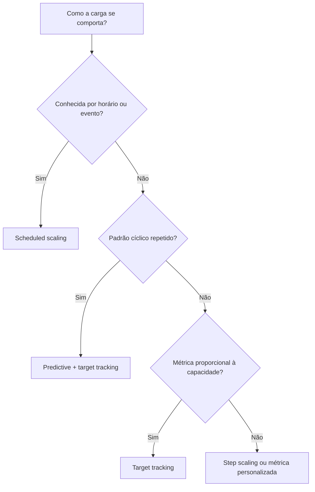

---
aliases:
  - Aula 12.7
modulo: 12
aula: 7
parte: "III Computação e armazenamento"
dominios:
  - 2
  - 3
  - 4
lida: false
tags:
  - aula
  - saa-c03
  - modulo-12
---

# Aula 12.7: Políticas de escala

[[12 - Balanceamento de Carga e Auto Scaling|Voltar ao módulo]]

> [!question] Pergunta que esta aula responde
> Quando e quanto o [[Auto Scaling Group|Auto Scaling]] muda a capacidade desejada, e como escolher entre [[Target Tracking|target tracking]], step, simple, agendada e preditiva a partir do comportamento da carga?

## Quem decide mudar o desired

O [[Auto Scaling Group|ASG]] (aula 12.6) mantém o `desired`. Quem **altera** o desired são as **políticas de escala**. Em geral elas funcionam assim: uma [[Metrica|métrica]] do [[CloudWatch]] mede a carga, uma regra compara a métrica com um alvo ou limite e a política soma ou subtrai capacidade, sempre respeitando `min` e `max`.

Existem dois grupos:

| Grupo | Reage a quê | Políticas |
|---|---|---|
| **Dinâmicas** | À carga **medida agora** | [[Target Tracking\|Target tracking]], [[Step Scaling\|step scaling]], [[Simple Scaling\|simple scaling]] |
| **Baseadas em tempo ou previsão** | Ao **calendário** ou ao **histórico** | Scheduled, predictive |

> [!info] Ligando os pontos
> No [[21 - Observabilidade Automacao e Operacoes|Módulo 21]] veremos o [[CloudWatch]] por inteiro; aqui basta saber que **[[Metrica|métrica]] + alarme** é o motor das políticas dinâmicas. E a escolha da métrica depende de uma pergunta de arquitetura: **que sinal muda quando falta capacidade?** (CPU, requisições por alvo, fila acumulada).

## Target tracking: o termostato

Você escolhe uma **[[Metrica|métrica]]** e um **valor-alvo**, e o [[Auto Scaling Group|Auto Scaling]] faz o resto: cria e gerencia os alarmes do [[CloudWatch]] e ajusta a capacidade proporcionalmente para manter a métrica perto do alvo. É a política recomendada para a maioria dos casos, porque é a mais simples.

Exemplo: "manter a CPU média do [[Auto Scaling Group|ASG]] em 50%". Se a CPU sobe a 80%, o ASG aumenta a capacidade em proporção (algo como 80/50 da capacidade atual) até a [[Metrica|métrica]] voltar perto de 50%. Se cai, reduz.

### Métricas predefinidas

| Métrica | Mede | Quando usar |
|---|---|---|
| `ASGAverageCPUUtilization` | CPU média das instâncias | Carga limitada por CPU |
| `ASGAverageNetworkIn` / `ASGAverageNetworkOut` | Bytes médios por instância | Carga limitada por rede |
| `ALBRequestCountPerTarget` | Requisições por alvo do [[Application Load Balancer\|ALB]] | Aplicação web; mede a demanda de fato |

Para `ALBRequestCountPerTarget`, a política precisa identificar o [[Application Load Balancer|ALB]] e o [[Target Group|target group]] por um *resource label*. Também é possível usar uma **[[Metrica|métrica]] personalizada** (custom), desde que ela atenda à regra abaixo.

> [!tip] Quer escalar mais rápido? Habilite o monitoramento detalhado
> Os alarmes que movem as políticas são alimentados por métricas do [[EC2]]. Por padrão o EC2 publica a cada **5 minutos** (monitoramento básico); com o **[[Detailed Monitoring|detailed monitoring]]** as métricas chegam a cada **1 minuto**, com cobrança adicional. A documentação do [[EC2 Auto Scaling]] recomenda o detalhado sempre que houver [[Scaling Policy|política de escala]], porque a resposta a mudanças de carga fica mais rápida. Ele se habilita no launch template ou no [[Launch Configuration|launch configuration]] (verificado em novembro de 2026).

> [!tip] Regra da métrica boa
> A [[Metrica|métrica]] de [[Target Tracking|target tracking]] deve **diminuir quando a capacidade aumenta** e aumentar quando ela diminui, de forma **proporcional**. CPU média e requisições por alvo cumprem. O **tamanho bruto da [[SQS|fila SQS]]** não: ele não muda proporcionalmente ao número de instâncias. Daí o padrão do "[[Backlog por Instancia|backlog por instância]]" mais abaixo.

### Comportamento que cai em prova

- **Escala para fora rápido, escala para dentro devagar.** O alarme de entrada reage a poucos pontos de dados; o de saída exige muitos pontos consecutivos abaixo do alvo, para evitar oscilação ("flapping"). O alvo de CPU de 50% não dispara scale in em um pico momentâneo de baixa.
- **Os alarmes são gerenciados pelo serviço.** Não edite nem apague: o [[Auto Scaling Group|Auto Scaling]] os recria e eles somem quando a política é removida.
- **Várias políticas ao mesmo tempo.** Se mais de uma pede capacidade, vence a que fornece **mais capacidade** (prioriza [[Disponibilidade|disponibilidade]]). Para reduzir, todas precisam concordar.
- **Opção "desabilitar scale in"**: deixa só a escala para fora (o scale in fica com outra política).
- **[[Instance Warmup|Warmup da instância]]** (*instance warmup*): período em que uma instância nova ainda **não entra nas métricas agregadas**, para a política não superestimar capacidade e parar de escalar cedo demais.

## Step scaling: degraus por faixa do alarme

No **[[Step Scaling|step scaling]]** você cria **alarmes do [[CloudWatch]]** e define **degraus**: quanto maior a violação, maior o ajuste.

| Faixa do alarme (CPU) | Ação |
|---|---|
| 60% a 70% | +1 instância |
| 70% a 85% | +3 instâncias |
| Acima de 85% | +6 instâncias |

Vantagem sobre o [[Simple Scaling|simple scaling]]: **continua reagindo enquanto o ajuste anterior ainda está em andamento** (usa warmup em vez de esperar). Útil quando se quer respostas **proporcionais e personalizadas** à gravidade do problema, ou métricas que o [[Target Tracking|target tracking]] não aceita. Exige que você crie o alarme **e** a política.

## Simple scaling: um alarme, uma ação, um cooldown

O **[[Simple Scaling|simple scaling]]** é o modelo antigo: um alarme dispara **uma** ação (por exemplo, "+2 instâncias") e o [[Auto Scaling Group|ASG]] espera um **[[Cooldown|cooldown]]** (padrão **300 s**) antes de aceitar outra. Durante a espera ele ignora novos alarmes, mesmo que a carga continue subindo. É o mais lento e raramente a melhor escolha moderna; aparece em questões como alternativa a descartar quando há opção de [[Target Tracking|target tracking]] ou step.

### Cooldown versus warmup

Dois temporizadores diferentes, e a confusão entre eles é pegadinha:

| | [[Cooldown]] | Warmup ([[Instance Warmup\|instance warmup]]) |
|---|---|---|
| Vale para | [[Simple Scaling\|Simple scaling]] | [[Target Tracking\|Target tracking]] e [[Step Scaling\|step scaling]] |
| Efeito | **Bloqueia** novas ações de escala por um tempo | A instância nova **não conta** nas métricas até aquecer; ações continuam possíveis |
| Pergunta que resolve | "Espere o efeito aparecer antes de agir de novo" | "Não conte essa instância como pronta ainda" |
| Padrão | 300 s | Usa o valor padrão do [[Auto Scaling Group\|ASG]] (se definido) |

## Scheduled scaling: o calendário

Quando a carga é **previsível por horário**, programe a capacidade: "toda segunda às 8h, `min=10`; às 20h, `min=2`", ou uma ação única para um evento (lançamento, Black Friday). A [[Scheduled Scaling|ação agendada]] altera `min`, `max` e/ou `desired` no horário (aceita expressão cron, recorrência e fuso). É a resposta para "pico conhecido de antemão", e se combina com políticas dinâmicas para o que não se previu.

## Predictive scaling: o histórico

O **[[Predictive Scaling|predictive scaling]]** usa aprendizado de máquina sobre o **histórico da [[Metrica|métrica]]** (a AWS pede pelo menos 24 horas de dados e prevê **as próximas 48 horas**, segundo a documentação, verificado em novembro de 2026) para **lançar capacidade antes do pico**. Serve a cargas **cíclicas** (diária, semanal), principalmente quando a inicialização é lenta, porque as instâncias já estão prontas quando a carga chega.

Detalhes:

- Modos: **forecast only** (só prevê, para você avaliar) e **forecast and scale** (prevê e age).
- Funciona **junto** com [[Target Tracking|target tracking]]: o preditivo põe a capacidade na frente e o target tracking absorve o inesperado.
- Não substitui a escala reativa: eventos sem padrão (um pico viral) continuam exigindo política dinâmica.

## Qual política usar

| Cenário | Política |
|---|---|
| Manter uma [[Metrica\|métrica]] em torno de um valor, sem micromanagement | [[Target Tracking\|Target tracking]] |
| Resposta proporcional à gravidade, ou [[Metrica\|métrica]] fora do suporte do [[Target Tracking\|target tracking]] | [[Step Scaling\|Step scaling]] |
| Compatibilidade com configuração legada | [[Simple Scaling\|Simple scaling]] |
| Pico previsível por horário ou evento | Scheduled |
| Padrão cíclico com inicialização lenta | Predictive (com [[Target Tracking\|target tracking]]) |



## Métricas de escala: escolher o sinal certo

| Aplicação | Métrica sugerida | Por quê |
|---|---|---|
| Web atrás de [[Application Load Balancer\|ALB]] | `ALBRequestCountPerTarget` | Mede demanda direta por alvo, não a consequência |
| Processamento limitado por CPU | `ASGAverageCPUUtilization` | A CPU satura primeiro |
| Transferência pesada | `ASGAverageNetworkOut` ou In | A rede satura |
| Workers consumindo [[SQS\|fila SQS]] | **[[Backlog por Instancia\|Backlog por instância]]** ([[Metrica\|métrica]] personalizada) | Fila bruta não é proporcional |
| Memória como gargalo | Métrica personalizada via [[CloudWatch Agent\|agente do CloudWatch]] | O [[EC2]] não publica memória por padrão |

### O padrão do SQS: backlog por instância

Workers de uma fila [[SQS]] não escalam bem pela fila bruta: com 1000 mensagens, 5 ou 50 instâncias dão resultado muito diferente. Divide-se a fila pela capacidade:

```text
backlog por instância = ApproximateNumberOfMessagesVisible / número de instâncias em serviço
```

Calcula-se o **backlog aceitável por instância** a partir da [[Latencia|latência]] tolerada e do tempo médio de processamento de uma mensagem:

```text
backlog aceitável por instância = latência aceitável / tempo médio de processamento
```

Exemplo: cada mensagem leva 0,1 s e o negócio tolera 10 s de espera: 10 / 0,1 = **100 mensagens por instância**. Publica-se a [[Metrica|métrica]] personalizada e usa-se como alvo de **[[Target Tracking|target tracking]]**. A fila cresce, o [[Backlog por Instancia|backlog por instância]] passa de 100 e o [[Auto Scaling Group|ASG]] adiciona workers até a razão voltar. Este é o padrão que a documentação da AWS descreve para escalar com base em filas, e é cobrado como "escalar workers conforme a fila", mais detalhado na [[15 - Desacoplamento Filas Eventos e Workflows|aula de filas]] do Módulo 15.

## Laboratório (opcional): ASG com target tracking

> [!warning] Conta pessoal e custo
> Execute somente em uma conta pessoal de estudo, com um [[Budgets|AWS Budgets]] configurado antes. Pré-requisitos: duas [[Sub-rede|sub-redes]] em [[Zona de Disponibilidade|AZs]] diferentes, um [[Target Group|target group]], e um launch template `lab-template` com uma [[AMI]] Amazon Linux e um [[Instance Profile|perfil de instância]] com a política `AmazonSSMManagedInstanceCore` (necessário para o [[Session Manager]] funcionar; sem ele, use outra forma de gerar carga). Instâncias `t3.micro` custam centavos por hora, mas o [[Auto Scaling Group|ASG]] pode lançar várias; defina `max-size` baixo (2 ou 3) e **apague tudo ao final**. Este curso não executa comandos na sua conta.

```bash
# 1. ASG em duas sub-redes, associado ao target group, com health check ELB
aws autoscaling create-auto-scaling-group \
  --auto-scaling-group-name lab-asg \
  --launch-template LaunchTemplateName=lab-template,Version='$Latest' \
  --min-size 1 --max-size 3 --desired-capacity 1 \
  --vpc-zone-identifier "subnet-aaaa,subnet-bbbb" \
  --target-group-arns <ARN-do-target-group> \
  --health-check-type ELB --health-check-grace-period 300

# 2. Política de target tracking: manter CPU média em 50%
aws autoscaling put-scaling-policy \
  --auto-scaling-group-name lab-asg \
  --policy-name cpu50 \
  --policy-type TargetTrackingScaling \
  --target-tracking-configuration '{
    "PredefinedMetricSpecification": {"PredefinedMetricType": "ASGAverageCPUUtilization"},
    "TargetValue": 50.0
  }'
```

Gere carga (por exemplo, com `stress` em uma instância via [[Session Manager]]) e acompanhe: `aws autoscaling describe-scaling-activities --auto-scaling-group-name lab-asg`. Observe os dois alarmes criados no [[CloudWatch]] e a mudança do `desired`.

**Limpeza (obrigatória):**

```bash
aws autoscaling delete-auto-scaling-group --auto-scaling-group-name lab-asg --force-delete
```

O `--force-delete` apaga o [[Auto Scaling Group|ASG]] **e termina as instâncias**; sem ele, o comando falha se ainda houver instâncias. As políticas e os alarmes gerenciados somem junto. Confirme no console que não restaram instâncias e apague o launch template e o [[Target Group|target group]] se não os quer mais.

## Como isso cai na prova

Esta aula sustenta a **Task 2.1** (escalabilidade), **Task 3.2** (computação elástica de alto desempenho) e **Task 4.2** (custo sob demanda), com toque em **Task 2.2** (resposta a falhas).

Palavras-chave:

- "**maintain average CPU at X%**", "**least [[Overhead Operacional|operational overhead]]**": [[Target Tracking|target tracking]].
- "**scale based on number of requests**": `ALBRequestCountPerTarget`.
- "**known traffic spike every morning / sale event**": [[Scheduled Scaling|scheduled scaling]].
- "**cyclical pattern, slow startup, scale ahead of demand**": [[Predictive Scaling|predictive scaling]].
- "**different adjustments depending on how high the metric goes**": [[Step Scaling|step scaling]].
- "**scale workers based on [[SQS]] queue**": [[Backlog por Instancia|backlog por instância]] ([[Metrica|métrica]] personalizada).
- "**wait before another scaling action**": [[Cooldown|cooldown]] ([[Simple Scaling|simple scaling]]).

Pegadinhas:

- **Escalar pela quantidade bruta de mensagens.** Não é proporcional à capacidade.
- **Scheduled para carga imprevisível.** Só serve a picos conhecidos.
- **[[Cooldown]] em [[Target Tracking|target tracking]].** O conceito equivalente é o *[[Instance Warmup|instance warmup]]*.
- **Apagar os alarmes do [[Target Tracking|target tracking]].** São gerenciados; não mexer.
- **Memória como [[Metrica|métrica]] nativa.** Exige [[CloudWatch Agent|agente do CloudWatch]] e métrica personalizada.

| Requisito no enunciado | Resposta provável | Por quê |
|---|---|---|
| Manter CPU média em 40% com mínimo de configuração | [[Target Tracking\|Target tracking]] em `ASGAverageCPUUtilization` | Termostato gerenciado |
| Site com picos determinados por requisições | [[Target Tracking\|Target tracking]] em `ALBRequestCountPerTarget` | Demanda direta por alvo |
| Promoção às 9h de toda sexta | [[Scheduled Scaling\|Scheduled scaling]] | Pico previsível por horário |
| Carga diária cíclica, boot de 10 minutos | [[Predictive Scaling\|Predictive scaling]] | Capacidade antes do pico |
| Workers de fila devem acompanhar o backlog | [[Target Tracking\|Target tracking]] com [[Backlog por Instancia\|backlog por instância]] | Métrica proporcional à capacidade |
| Aumento maior quando a violação é maior | [[Step Scaling\|Step scaling]] | Degraus por faixa do alarme |

## Resumo

> [!abstract] A aula em uma frase
> As políticas de escala movem o desired entre min e max: [[Target Tracking|target tracking]] mantém uma [[Metrica|métrica]] proporcional em um alvo (o padrão recomendado), [[Step Scaling|step scaling]] responde em degraus à gravidade do alarme, [[Simple Scaling|simple scaling]] espera [[Cooldown|cooldown]] entre ações, scheduled atende picos conhecidos e predictive antecipa padrões cíclicos.

**A lógica, em 5 passos**

1. Escolha o sinal que muda quando falta capacidade (CPU, requisições por alvo, [[Backlog por Instancia|backlog por instância]]).
2. Para [[Metrica|métrica]] proporcional, use [[Target Tracking|target tracking]] e deixe o serviço gerenciar alarmes e proporção.
3. Para respostas graduais ou métricas fora do suporte, use [[Step Scaling|step scaling]] com alarmes próprios.
4. Para o que é previsível, programe (scheduled) ou deixe a previsão agir (predictive).
5. Ajuste o warmup para a política não superestimar a capacidade de instâncias ainda em aquecimento.

**Números para lembrar**

| O quê | Valor | Por que importa |
|---|---|---|
| [[Cooldown\|Cooldown padrão]] (simple) | 300 s | Bloqueia novas ações |
| Histórico do predictive | Mínimo de 24 h, previsão de 48 h | Requisito de dados |
| Fórmula do backlog | [[Latencia\|latência]] aceitável ÷ tempo de processamento | Alvo do [[Target Tracking\|target tracking]] por fila |
| Várias políticas | Vence a de maior capacidade | Prioriza [[Disponibilidade\|disponibilidade]] |

**Tabela-síntese**

| Situação | Política |
|---|---|
| Manter [[Metrica\|métrica]] em um alvo | [[Target Tracking\|Target tracking]] |
| Degraus por gravidade | Step |
| Pico agendado | Scheduled |
| Padrão repetido | Predictive |
| Fila [[SQS]] | [[Target Tracking\|Target tracking]] com [[Backlog por Instancia\|backlog por instância]] |

**Na hora H**

- "Menor [[Overhead Operacional|esforço operacional]]" aponta para [[Target Tracking|target tracking]].
- "Previsível por horário" é scheduled; "aprende com o histórico" é predictive.
- Para fila, pense em [[Backlog por Instancia|backlog por instância]], nunca em fila bruta.

> [!tip] Liga com
> Vem da [[12.06 - Auto Scaling Groups e Launch Templates|aula 12.6]] (min, max, desired). Na [[12.08 - Ciclo de Vida Hooks e Warm Pools|aula 12.8]] aparecem os hooks e [[Warm Pool|warm pools]], que reduzem o tempo entre "decidir escalar" e "instância pronta".

## Erros comuns

- **Escolher CPU para uma aplicação limitada por memória.** O [[Auto Scaling Group|ASG]] nunca escala por um recurso que ele não enxerga.
- **Esperar que o scale in acompanhe o [[Escalabilidade Horizontal|scale out]] em velocidade.** Ele é deliberadamente conservador.
- **Usar scheduled sozinho para cargas imprevisíveis.** Quando o horário muda, a capacidade fica errada.
- **Esquecer o `max`.** O teto é a única proteção de custo quando uma [[Metrica|métrica]] enlouquece.
- **Misturar [[Cooldown|cooldown]] e warmup.** O primeiro bloqueia ações; o segundo adia a contagem de uma instância.
- **Escalar workers pelo tamanho da fila bruta.** Sem dividir pela capacidade, a política oscila ou subdimensiona.

## Pratique

**1.** Uma aplicação web em um [[Auto Scaling Group|ASG]] precisa manter a CPU média próxima de 50% com o menor [[Overhead Operacional|esforço operacional]] possível. Qual política usar?

- [ ] a) Simple scaling com um alarme de CPU e cooldown de 300 s, ajustado a cada semana.
- [ ] b) Step scaling com seis degraus e seis alarmes.
- [ ] c) Scheduled scaling com ações a cada hora.
- [ ] d) Target tracking com a métrica `ASGAverageCPUUtilization` e alvo de 50%.

**2.** Uma loja online sofre picos de acesso todos os dias entre 18h e 20h, e novas instâncias levam 8 minutos para ficar prontas. A empresa quer a capacidade pronta antes do pico, aprendendo com o histórico. Qual recurso?

- [ ] a) Predictive scaling.
- [ ] b) Simple scaling por CPU.
- [ ] c) Aumentar o cooldown.
- [ ] d) Reduzir o health check grace period.

**3.** Uma empresa lançará uma campanha às 9h de uma data conhecida, com tráfego 10 vezes maior. Como garantir capacidade na hora, de forma simples?

- [ ] a) Target tracking com alvo de CPU em 10%.
- [ ] b) Scheduled scaling que eleva o min e o desired antes das 9h.
- [ ] c) Pedir à equipe que aumente a capacidade manualmente às 9h da manhã da campanha.
- [ ] d) Habilitar cross-zone.

**4.** Workers consomem mensagens de uma [[SQS|fila SQS]]. Cada mensagem leva 0,2 s para ser processada e o negócio aceita no máximo 20 s de espera. Qual é o backlog aceitável por instância e como escalar?

- [ ] a) 4 mensagens por instância, com política simples por CPU.
- [ ] b) 20 mensagens por instância, escalando pela quantidade bruta da fila e pelo número total de instâncias do grupo de workers.
- [ ] c) 100 mensagens por instância, usando uma métrica personalizada de backlog por instância em target tracking.
- [ ] d) 400 mensagens por instância, com scheduled scaling.

**5.** Um arquiteto quer que o [[Auto Scaling Group|ASG]] adicione 1 instância quando a CPU está entre 60% e 70%, e 4 instâncias quando passa de 85%. Qual política?

- [ ] a) Target tracking.
- [ ] b) Step scaling.
- [ ] c) Scheduled scaling.
- [ ] d) Predictive scaling.

**6.** Uma política de [[Target Tracking|target tracking]] e outra de [[Step Scaling|step scaling]] pedem ações diferentes ao mesmo tempo: uma quer adicionar 2 instâncias e a outra 4. O que o [[Auto Scaling Group|ASG]] faz?

- [ ] a) Soma as duas e adiciona 6.
- [ ] b) Aplica a mais recente.
- [ ] c) Executa apenas a política mais antiga.
- [ ] d) Segue a que fornece maior capacidade, adicionando 4.

**7.** Uma equipe nota que o [[Auto Scaling Group|ASG]] não adiciona instâncias novas durante 5 minutos após cada ação, mesmo com a carga subindo, e usa [[Simple Scaling|simple scaling]]. Qual é a causa?

- [ ] a) O cooldown padrão de 300 segundos do simple scaling, que bloqueia novas ações.
- [ ] b) O instance warmup.
- [ ] c) O deregistration delay.
- [ ] d) O health check grace period de 300 segundos.

**8.** Uma aplicação tem gargalo de memória, e o [[Auto Scaling Group|ASG]] com [[Target Tracking|target tracking]] de CPU não escala quando a memória enche. O que fazer?

- [ ] a) Reduzir o alvo de CPU para 5%.
- [ ] b) Publicar a memória como métrica personalizada (agente do CloudWatch) e usá-la em uma política.
- [ ] c) Habilitar o predictive scaling.
- [ ] d) Trocar o tipo de instância pelo console a cada alarme, aumentando a memória manualmente por conta própria.

**9.** (Escolha DUAS.) Quais métricas são predefinidas para [[Target Tracking|target tracking]] em [[Auto Scaling Group|ASG]]?

- [ ] a) `ASGAverageCPUUtilization`
- [ ] b) `ASGAverageMemoryUtilization`
- [ ] c) `ALBRequestCountPerTarget`
- [ ] d) `ApproximateNumberOfMessagesVisible`
- [ ] e) `DiskReadOps`

**10.** Um [[Auto Scaling Group|ASG]] usa [[Target Tracking|target tracking]] com `ALBRequestCountPerTarget`. Qual é a vantagem em relação à CPU para uma aplicação web?

- [ ] a) Mede a demanda real de requisições por alvo, antes de a CPU saturar.
- [ ] b) Dispensa o ALB.
- [ ] c) Elimina a necessidade de max.
- [ ] d) Funciona somente com Network Load Balancer, e não com o ALB, por ser uma métrica de camada 4.

**11.** (Escolha DUAS.) Quais afirmações sobre [[Target Tracking|target tracking]] estão corretas?

- [ ] a) O serviço cria e gerencia os alarmes do CloudWatch.
- [ ] b) Os alarmes devem ser criados e mantidos manualmente pelo usuário.
- [ ] c) A escala para dentro é mais conservadora que a escala para fora.
- [ ] d) A métrica deve aumentar quando a capacidade aumenta.
- [ ] e) A política ignora os limites min e max.

**12.** Após configurar o [[Predictive Scaling|predictive scaling]], uma equipe quer avaliar as previsões sem alterar a capacidade. Qual modo usar?

- [ ] a) Forecast and scale.
- [ ] b) Forecast only.
- [ ] c) Scheduled only.
- [ ] d) Simple only.

**13.** Um [[Auto Scaling Group|ASG]] usa [[Target Tracking|target tracking]] de CPU, mas só percebe aumentos de carga com até 5 minutos de atraso, e a empresa quer reação mais rápida sem trocar a política. O que ajustar?

- [ ] a) Aumentar o max do ASG.
- [ ] b) Trocar para scheduled scaling.
- [ ] c) Habilitar o monitoramento detalhado (métricas de 1 minuto) no launch template, aceitando o custo adicional do CloudWatch.
- [ ] d) Reduzir o deregistration delay.

> [!success]- Gabarito
> **1. d)** [[Target Tracking|Target tracking]] é o termostato gerenciado, com o menor esforço; a) o simple é lento e manual, b) o step exige alarmes e degraus manuais, c) o horário não segue a CPU.
> **2. a)** O predictive escala antes do pico a partir do histórico, ideal com boot de 8 minutos; b) reage tarde, c) o [[Cooldown|cooldown]] atrasa ações, d) reduzir o [[Health Check Grace Period|grace period]] não antecipa capacidade.
> **3. b)** A [[Scheduled Scaling|ação agendada]] eleva a capacidade antes do evento conhecido; a) CPU a 10% desperdiça capacidade, c) manual é frágil, d) [[Cross-Zone Load Balancing|cross-zone]] não cria capacidade.
> **4. c)** 20 s ÷ 0,2 s = 100 mensagens por instância, com [[Metrica|métrica]] personalizada em [[Target Tracking|target tracking]]; a) 4 vem de uma conta errada e CPU não mede a fila, b) 20 é o próprio limite de espera (não dividido pelo tempo de processamento) e a fila bruta não é proporcional, d) 400 sairia de 20 ÷ 0,05, mas a conta correta é 20 ÷ 0,2 = 100, e scheduled não segue a fila.
> **5. b)** Degraus por faixa do alarme caracterizam [[Step Scaling|step scaling]]; a) o [[Target Tracking|target tracking]] não define degraus, c) e d) não reagem à [[Metrica|métrica]] em tempo real do mesmo modo.
> **6. d)** Com várias políticas, vence a de maior capacidade; a) o [[Auto Scaling Group|ASG]] não soma as ações, b) a recência não decide, c) não existe regra de "mais antiga".
> **7. a)** O [[Cooldown|cooldown]] do [[Simple Scaling|simple scaling]] bloqueia novas ações por 300 s; b) o warmup não bloqueia ações, c) trata de drenagem, d) trata de saúde.
> **8. b)** Memória não é [[Metrica|métrica]] nativa do [[EC2]]; publicá-la como personalizada permite escalar por ela; a) CPU não reflete memória, c) o preditivo não cria sinal novo, d) manual não é elástico.
> **9. a) e c)** CPU média e requisições por alvo do [[Application Load Balancer|ALB]] são predefinidas; b) não existe como predefinida (memória exige [[Metrica|métrica]] personalizada), d) é uma métrica do [[SQS]] e não é predefinida de [[Auto Scaling Group|ASG]] (por isso se usa o [[Backlog por Instancia|backlog por instância]]), e) é uma métrica bruta do [[EC2]], fora da lista predefinida de [[Target Tracking|target tracking]].
> **10. a)** Requisições por alvo medem a demanda diretamente; b) o [[Application Load Balancer|ALB]] é necessário, c) o max continua sendo a proteção de custo, d) vale para ALB.
> **11. a) e c)** O serviço gerencia os alarmes e a escala para dentro é conservadora; b) é o oposto, d) a [[Metrica|métrica]] deve diminuir quando a capacidade aumenta, e) os limites são sempre respeitados.
> **12. b)** Forecast only gera previsões sem agir; a) altera a capacidade, c) e d) não são modos do predictive.
> **13. c)** Por padrão o [[EC2]] publica a cada 5 minutos, e o [[Detailed Monitoring|detailed monitoring]] entrega métricas de 1 minuto, o que acelera os alarmes; a) o max não acelera a detecção, b) scheduled não reage à carga medida, d) o delay trata de drenagem.

## Para aprofundar

- [ ] [Dynamic scaling for Amazon EC2 Auto Scaling](https://docs.aws.amazon.com/autoscaling/ec2/userguide/as-scale-based-on-demand.html) (documentação AWS): [[Target Tracking|target tracking]], step e [[Simple Scaling|simple scaling]].
- [ ] [Scaling policy based on Amazon SQS](https://docs.aws.amazon.com/autoscaling/ec2/userguide/as-using-sqs-queue.html) (documentação AWS): [[Backlog por Instancia|backlog por instância]] passo a passo.
- [ ] [Predictive scaling for Amazon EC2 Auto Scaling](https://docs.aws.amazon.com/autoscaling/ec2/userguide/ec2-auto-scaling-predictive-scaling.html) (documentação AWS): requisitos de histórico e modos.

Próxima aula: [[12.08 - Ciclo de Vida Hooks e Warm Pools|Aula 12.8: Ciclo de vida, hooks e warm pools]].
