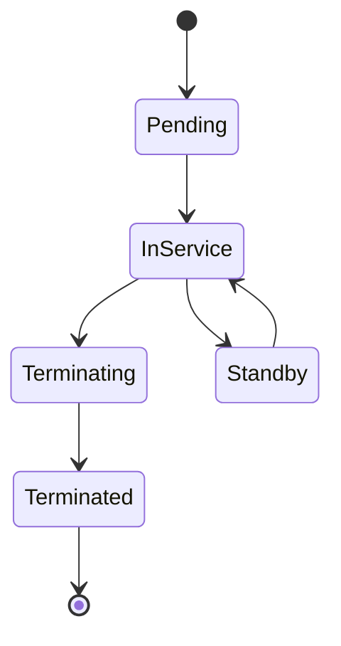

---
aliases:
  - Aula 12.8
modulo: 12
aula: 8
parte: "III Computação e armazenamento"
dominios:
  - 2
  - 3
  - 4
lida: false
tags:
  - aula
  - saa-c03
  - modulo-12
---

# Aula 12.8: Ciclo de vida, hooks e warm pools

[[12 - Balanceamento de Carga e Auto Scaling|Voltar ao módulo]]

> [!question] Pergunta que esta aula responde
> Como executar uma ação no instante em que uma instância nasce ou antes de ela morrer, e como encurtar o tempo entre "o [[Auto Scaling Group|ASG]] decidiu escalar" e "a instância está atendendo"?

## O ciclo de vida de uma instância no ASG

Uma instância do [[Auto Scaling Group|ASG]] passa por **estados**. Entender a sequência é o que torna os hooks compreensíveis:

| Estado | O que significa |
|---|---|
| `Pending` | Instância lançada, ainda não está pronta para o tráfego |
| `InService` | Em serviço; registrada nos [[Target Group\|target groups]]; conta na capacidade |
| `Terminating` | O [[Auto Scaling Group\|ASG]] decidiu terminá-la |
| `Terminated` | Encerrada |
| `Standby` | Retirada do tráfego para manutenção (aula 12.6) |

Os hooks inserem uma **pausa** nesses estados: `Pending:Wait` (entre `Pending` e `InService`) e `Terminating:Wait` (entre `Terminating` e `Terminated`). Durante a pausa, o [[Auto Scaling Group|ASG]] **segura** a instância até alguém dizer "pode continuar".

> [!info] Ligando os pontos
> O **[[Health Check Grace Period|grace period]]** da [[12.06 - Auto Scaling Groups e Launch Templates|aula 12.6]] só conta depois que a instância chega a `InService`. Um hook de lançamento é, portanto, o lugar certo para terminar a configuração **antes** de a instância receber tráfego e antes de a [[Health Check|verificação de saúde]] começar a valer.

## Lifecycle hooks

Um **[[Lifecycle Hook]]** é uma pausa configurada em um ponto do ciclo, com duas variantes:

| Hook | Transição | Casos de uso |
|---|---|---|
| **Launch** (`autoscaling:EC2_INSTANCE_LAUNCHING`) | Entrada em serviço | Instalar software, buscar configuração, registrar em um serviço de descoberta, aquecer cache |
| **Terminate** (`autoscaling:EC2_INSTANCE_TERMINATING`) | Saída de serviço | Copiar logs para o [[S3]], esvaziar fila local, concluir trabalho em andamento, desregistrar de [[DNS]] ou de um cluster |

### Como funciona

1. O [[Auto Scaling Group|ASG]] coloca a instância em `Pending:Wait` (ou `Terminating:Wait`) e **emite uma notificação**.
2. Um alvo recebe a notificação e executa a ação: uma função [[Lambda]], um script na própria instância, um fluxo de automação.
3. Ao terminar, quem executou chama **`complete-lifecycle-action`** com o resultado **CONTINUE** (seguir adiante) ou **ABANDON** (em um launch hook, abandonar termina a instância; em um terminate hook, segue para o término de qualquer modo).
4. Se o tempo acaba sem resposta, vale o **resultado padrão** do hook (CONTINUE ou ABANDON, configurável).

### Alvos de notificação

- **Amazon [[EventBridge]]** (recomendado): uma regra casa o evento de lifecycle e dispara Lambda, [[Step Functions]], [[Automation|SSM Automation]] e outros.
- **[[SNS|Amazon SNS]]** e **Amazon [[SQS]]**: mensagem para tópico ou fila.
- Também dá para a própria instância consultar os metadados e agir (o hook ainda precisa ser completado por API).

### Tempo limite e heartbeat

O hook tem um **heartbeat [[Timeout|timeout]]** (padrão **3600 s**, ou seja, 1 hora). Se a ação demora mais, quem executa envia **`record-lifecycle-action-heartbeat`** para estender a pausa. Há um teto: no máximo **48 horas** ou **100 vezes o heartbeat timeout**, o que for menor (verificado em novembro de 2026, documentação de [[Lifecycle Hook|lifecycle hooks]] do [[EC2 Auto Scaling]]).

> [!warning] Hooks atrasam o scale
> Enquanto a instância está em `Pending:Wait`, ela **não está em serviço**: não entra no [[Target Group|target group]] e **não ajuda a carga**. Um hook de lançamento lento atrasa a expansão. Se há picos súbitos, prefira [[AMI]] pronta ou [[Warm Pool|warm pool]], e use hooks só para o que é indispensável. Do outro lado, `Terminating:Wait` adia o término e, portanto, a economia.

> [!example] Terminar com segurança
> Uma frota de workers processa vídeos de 15 minutos. No scale in, um hook de término envia a notificação, o worker **termina o vídeo atual**, envia o resultado ao [[S3]] e chama `complete-lifecycle-action` com CONTINUE. Sem o hook, o [[Auto Scaling Group|ASG]] derrubaria a instância no meio do trabalho. (A alternativa mais simples, quando só se quer proteger uma instância ocupada, é a proteção contra scale in da aula 12.6.)

## Warm pools

### O problema

O boot é lento: iniciar a instância, instalar pacotes, aquecer a aplicação pode levar minutos. Se a carga sobe rápido, o [[Auto Scaling Group|ASG]] decide escalar, mas o usuário espera o boot completo. Um **[[Warm Pool]]** guarda instâncias **pré-inicializadas** ao lado do ASG, prontas para entrar em serviço bem mais rápido que uma instância fria.

### Como funciona

1. O [[Warm Pool|warm pool]] mantém instâncias **já lançadas e configuradas** ([[User Data|user data]] executado), fora do tráfego.
2. Quando o [[Auto Scaling Group|ASG]] precisa escalar para fora, **retira instâncias do [[Warm Pool|warm pool]]** em vez de lançar novas do zero; elas passam a `InService`.
3. O [[Warm Pool|warm pool]] se reabastece para manter o tamanho configurado.
4. Instâncias do [[Warm Pool|warm pool]] **não contam** na capacidade desejada do [[Auto Scaling Group|ASG]] e **não recebem tráfego**.

### Estados das instâncias no warm pool

| Estado do [[Warm Pool\|warm pool]] | Custo | Entrada em serviço |
|---|---|---|
| **Stopped** (padrão) | Só armazenamento ([[EBS]]) e IPs; **sem custo de computação** | Precisa iniciar: mais rápido que um boot completo |
| **Running** | Computação cobrada como uma instância comum | Praticamente imediata |
| **Hibernated** | Só armazenamento (estado da [[RAM]] salvo em [[EBS]]) | Retoma o estado da memória; exige instâncias e volumes compatíveis com [[Hibernacao de EC2\|hibernação]] |

Verificado em novembro de 2026. A escolha é custo versus velocidade: **Stopped** é o equilíbrio comum; **Running** compra velocidade máxima pagando a computação; **Hibernated** pula o boot do sistema operacional guardando a memória.

Também se pode configurar um **tamanho mínimo** do [[Warm Pool|warm pool]] e uma **capacidade máxima preparada** (max prepared capacity), além de uma política de **reuso** que devolve ao warm pool as instâncias retiradas em um scale in, em vez de terminá-las.

### Warm pool versus hooks versus AMI pronta

| Quero... | Ferramenta |
|---|---|
| Executar uma ação customizada no nascimento ou na saída | [[Lifecycle Hook\|Lifecycle hook]] |
| Reduzir o tempo de boot de instâncias que escalam | [[Warm Pool\|Warm pool]] |
| Reduzir o boot sem custo de instâncias paradas | [[AMI]] dourada com software pré-instalado |
| Manter a instância parada para ter sobra de capacidade rápida | [[Warm Pool\|Warm pool]] em Stopped |

Combinação importante: com [[Warm Pool|warm pool]], um **hook de lançamento** roda enquanto a instância é preparada (no warm pool), e não no momento do pico, o que tira o trabalho lento do caminho crítico.

## Como isso cai na prova

Esta aula sustenta a **Task 2.1** (escalabilidade e [[Desacoplamento|acoplamento fraco]]), **Task 3.2** (computação elástica de alto desempenho) e **Task 4.2** (custo: instâncias paradas não cobram computação).

Palavras-chave:

- "**perform a custom action when an instance launches / before it terminates**": [[Lifecycle Hook|lifecycle hook]].
- "**copy logs before the instance is terminated**": hook de término.
- "**long initialization time delays scaling**", "**pre-initialized instances**": [[Warm Pool|warm pool]].
- "**reduce cost of idle pre-warmed capacity**": [[Warm Pool|warm pool]] com instâncias Stopped.
- "**[[EventBridge]] / [[SNS]] / [[SQS]] notification for instance launch**": [[Lifecycle Hook|lifecycle hook]] notifica.

Pegadinhas:

- **Hook sem completar.** A instância fica em Wait até o [[Timeout|timeout]] e o resultado padrão.
- **ABANDON em hook de lançamento.** Termina a instância (e o [[Auto Scaling Group|ASG]] tenta repor).
- **[[Warm Pool|Warm pool]] e capacidade.** As instâncias do warm pool não contam como desired e não recebem tráfego.
- **[[Warm Pool|Warm pool]] Running.** Cobra computação; é o modo caro.
- **Hooks para acelerar o scale.** O efeito é o contrário; quem acelera é o [[Warm Pool|warm pool]] ou a [[AMI]] pronta.

| Requisito no enunciado | Resposta provável | Por quê |
|---|---|---|
| Rodar script de configuração antes de a instância entrar no balanceador | [[Lifecycle Hook\|Lifecycle hook]] de lançamento | Segura em `Pending:Wait` |
| Enviar logs ao [[S3]] antes de a instância terminar | [[Lifecycle Hook\|Lifecycle hook]] de término | Segura em `Terminating:Wait` |
| Aplicação leva 10 minutos para subir e a carga sobe rápido | [[Warm Pool\|Warm pool]] | Instâncias pré-inicializadas |
| Reduzir o custo do pool pré-aquecido | Estado Stopped (ou Hibernated) | Sem cobrança de computação |
| Disparar uma Lambda quando uma instância é lançada | Hook com notificação via [[EventBridge]] | Integração de evento |
| Ação de hook demora mais de 1 hora | Enviar heartbeat para estender o [[Timeout\|timeout]] | `record-lifecycle-action-heartbeat` |

## Resumo

> [!abstract] A aula em uma frase
> [[Lifecycle Hook|Lifecycle hooks]] pausam a instância em `Pending:Wait` ou `Terminating:Wait` para executar ações customizadas até que alguém complete a ação (ou o tempo acabe), e [[Warm Pool|warm pools]] mantêm instâncias pré-inicializadas, em Stopped, Running ou Hibernated, para reduzir o tempo entre decidir escalar e atender tráfego.

**A lógica, em 5 passos**

1. A instância percorre `Pending`, `InService`, `Terminating`, `Terminated`.
2. Um hook insere uma pausa e emite um evento ([[EventBridge]], [[SNS]] ou [[SQS]]).
3. Quem executa a ação chama `complete-lifecycle-action` com CONTINUE ou ABANDON; sem resposta, vale o padrão após o [[Timeout|timeout]].
4. O [[Warm Pool|warm pool]] mantém instâncias já preparadas fora do tráfego e fora do desired.
5. No [[Escalabilidade Horizontal|scale out]], o [[Auto Scaling Group|ASG]] usa as do [[Warm Pool|warm pool]], e o pool se reabastece.

**Números para lembrar**

| O quê | Valor | Por que importa |
|---|---|---|
| Heartbeat [[Timeout\|timeout]] padrão | 3600 s | Prazo da ação do hook |
| Teto de espera | 48 h ou 100× o heartbeat (o menor) | Limite máximo de uma pausa |
| Estados do [[Warm Pool\|warm pool]] | Stopped, Running, Hibernated | Custo versus velocidade |
| Stopped | Sem custo de computação | Opção econômica |

**Tabela-síntese**

| Necessidade | Solução |
|---|---|
| Ação no lançamento | Hook de launch |
| Ação no término | Hook de terminate |
| Boot lento no pico | [[Warm Pool\|Warm pool]] |
| Custo menor no pool | Stopped |

**Na hora H**

- Procure o verbo "antes de": antes de entrar no balanceador ou antes de terminar leva a hook.
- "Boot lento" leva a [[Warm Pool|warm pool]] ou [[AMI]] pronta, nunca a hook.
- Pool barato é Stopped; pool imediato é Running.

> [!tip] Liga com
> Vem da [[12.07 - Politicas de Escala|aula 12.7]] (quando escalar). Na [[12.09 - Instance Refresh Termination e Spot|aula 12.9]] veremos como o [[Auto Scaling Group|ASG]] decide **quem** termina e como atualizar a frota inteira.

## Erros comuns

- **Esquecer de completar o lifecycle action.** A instância fica presa até o [[Timeout|timeout]] e a escala atrasa.
- **Usar hook de lançamento lento em [[Auto Scaling Group|ASG]] de pico rápido.** A instância demora a entrar em serviço.
- **Achar que o [[Warm Pool|warm pool]] recebe tráfego.** Ele só prepara capacidade.
- **Escolher Running para economizar.** Running cobra computação.
- **Confundir hook com proteção contra scale in.** A proteção impede o término; o hook só pausa para executar uma ação.
- **Não tratar falha na ação do hook.** Sem tratamento, o resultado padrão decide o destino da instância.

## Pratique

**1.** Uma empresa precisa que cada instância copie seus logs locais para o [[S3]] antes de ser terminada por um scale in. Qual recurso resolve?

- [ ] a) Um lifecycle hook de término com ação que copia os logs e completa o hook.
- [ ] b) Aumentar o deregistration delay para 3600 segundos para segurar as conexões abertas.
- [ ] c) Uma política de scheduled scaling.
- [ ] d) Habilitar o health check do tipo ELB.

**2.** Uma aplicação leva 8 minutos para ficar pronta após o boot, e picos súbitos de tráfego causam lentidão enquanto novas instâncias iniciam. A empresa quer reduzir o tempo para atender sem manter instâncias extras em execução o tempo todo. Qual solução?

- [ ] a) Aumentar o desired permanentemente para o triplo.
- [ ] b) Um lifecycle hook de lançamento com a instalação dentro dele.
- [ ] c) Um warm pool com instâncias no estado Stopped.
- [ ] d) Reduzir o grace period para 30 segundos.

**3.** Um hook de lançamento executa um script que leva 90 minutos, mas o heartbeat [[Timeout|timeout]] padrão é de 60 minutos, e o [[Auto Scaling Group|ASG]] termina a instância. O que fazer?

- [ ] a) Aumentar o desired em uma unidade para que o ASG tenha mais tempo antes de terminar a instância nova.
- [ ] b) Estender o timeout com `record-lifecycle-action-heartbeat` ou aumentar o heartbeat timeout do hook, até a ação terminar.
- [ ] c) Remover o health check.
- [ ] d) Trocar o alvo de notificação por SNS.

**4.** Qual é o resultado de chamar `complete-lifecycle-action` com ABANDON em um hook de lançamento?

- [ ] a) A instância entra em serviço normalmente, ignorando o resultado negativo do hook.
- [ ] b) A instância é movida para Standby.
- [ ] c) A instância é terminada, e o ASG pode lançar uma substituta.
- [ ] d) A instância é movida para o warm pool.

**5.** Instâncias do [[Warm Pool|warm pool]] no estado Stopped geram qual custo?

- [ ] a) Computação integral, igual à cobrança de instâncias em execução, além do armazenamento.
- [ ] b) Apenas custos de armazenamento (EBS) e recursos associados, sem computação.
- [ ] c) Nenhum custo.
- [ ] d) Apenas o custo do balanceador.

**6.** As instâncias do [[Warm Pool|warm pool]] contam para a capacidade desejada do [[Auto Scaling Group|ASG]]?

- [ ] a) Sim, contam como instâncias em serviço.
- [ ] b) Sim, mas apenas as que estão em Running.
- [ ] c) Não, não contam como em serviço e não recebem tráfego do balanceador.
- [ ] d) Sim, e recebem metade do tráfego.

**7.** Uma equipe quer disparar automaticamente uma [[Lambda|função Lambda]] de configuração toda vez que o [[Auto Scaling Group|ASG]] lançar uma instância. Qual abordagem?

- [ ] a) Alarme do CloudWatch na CPU.
- [ ] b) Política de step scaling.
- [ ] c) Scheduled scaling a cada minuto, com uma ação que lança a Lambda de configuração do ambiente.
- [ ] d) Lifecycle hook de lançamento notificando o EventBridge, com uma regra que aciona a Lambda de configuração.

**8.** Uma equipe quer ser avisada quando uma instância entra em `Terminating:Wait` para executar uma rotina de limpeza. (Escolha DUAS.) Quais são alvos de notificação suportados pelos [[Lifecycle Hook|lifecycle hooks]]?

- [ ] a) Amazon EventBridge
- [ ] b) AWS CloudTrail
- [ ] c) Um tópico do Amazon SNS
- [ ] d) AWS Step Functions, invocado diretamente pelo ASG
- [ ] e) Uma função Lambda invocada diretamente pelo ASG, sem EventBridge

**9.** Uma equipe precisa de capacidade pré-aquecida o mais rápida possível, aceitando pagar pela computação das instâncias do pool. Qual estado do [[Warm Pool|warm pool]]?

- [ ] a) Stopped.
- [ ] b) Hibernated.
- [ ] c) Terminated.
- [ ] d) Running.

**10.** O [[Auto Scaling Group|ASG]] tem um hook de lançamento com ação de 20 minutos. Durante um pico, a aplicação sofre lentidão. Qual é a explicação mais provável?

- [ ] a) Instâncias em Pending:Wait ainda não estão em serviço e não ajudam na carga.
- [ ] b) O hook aumenta o desired automaticamente.
- [ ] c) O hook desativa o balanceador.
- [ ] d) O hook cria instâncias extras em outra região para absorver o pico de tráfego atual.

**11.** (Escolha DUAS.) Quais afirmações sobre [[Warm Pool|warm pools]] estão corretas?

- [ ] a) Mantêm instâncias pré-inicializadas para encurtar o tempo de entrada em serviço.
- [ ] b) As instâncias do warm pool recebem tráfego do balanceador.
- [ ] c) Podem manter instâncias Stopped, Running ou Hibernated.
- [ ] d) Substituem a necessidade de um ASG.
- [ ] e) Fazem o ASG ignorar as políticas de escala.

**12.** Uma empresa tem workers que processam tarefas longas e quer apenas impedir que uma instância ocupada seja escolhida em um scale in, sem pausar o ciclo. Qual recurso é mais simples?

- [ ] a) Lifecycle hook com heartbeat.
- [ ] b) Instance scale-in protection nas instâncias ocupadas.
- [ ] c) Warm pool em Running, mantendo instâncias extras prontas e fora do tráfego.
- [ ] d) Step scaling.

> [!success]- Gabarito
> **1. a)** O hook de término segura a instância até os logs serem copiados; b) a drenagem trata de conexões do balanceador, não de logs locais, c) o agendamento não ajuda, d) o [[Health Check|health check]] não copia logs.
> **2. c)** [[Warm Pool|Warm pool]] Stopped encurta o boot sem pagar computação do pool; a) mantém custo permanente, b) o hook atrasa a entrada em serviço, d) um [[Health Check Grace Period|grace period]] curto termina instâncias ainda em boot.
> **3. b)** O heartbeat estende a pausa; a), c) e d) não alteram o tempo do hook.
> **4. c)** ABANDON em lançamento termina a instância; a) é o efeito de CONTINUE, b) e d) não são resultado possível.
> **5. b)** Em Stopped paga-se armazenamento e recursos associados, sem computação; a) é o caso do Running, c) existe custo de [[EBS]], d) não há relação com o balanceador.
> **6. c)** As instâncias do [[Warm Pool|warm pool]] ficam fora do desired e do tráfego; a), b) e d) descrevem comportamentos que não existem.
> **7. d)** O hook com [[EventBridge]] aciona a Lambda; a), b) e c) não reagem ao lançamento de instância.
> **8. a) e c)** O hook notifica o [[EventBridge]] (que pode acionar Lambda, [[Step Functions]] e outros), um tópico [[SNS]] ou uma [[SQS|fila SQS]]; b) o [[CloudTrail]] só registra a chamada de API e não recebe notificações do hook, d) e e) o [[Auto Scaling Group|ASG]] não invoca Step Functions nem Lambda diretamente: o caminho é via EventBridge, SNS ou SQS.
> **9. d)** Running é o mais rápido e cobra computação; a) é mais lento, b) retoma da [[Hibernacao de EC2|hibernação]], c) não é um estado de pool.
> **10. a)** Pending:Wait mantém a instância fora de serviço; b), c) e d) não existem.
> **11. a) e c)** [[Warm Pool|Warm pool]] pré-inicializa instâncias e suporta os três estados; b) elas não recebem tráfego, d) não substituem o [[Auto Scaling Group|ASG]], e) as políticas continuam valendo.
> **12. b)** A proteção contra scale in impede o término de instâncias específicas; a) é mais complexa, c) não protege instâncias, d) é [[Scaling Policy|política de escala]].

## Para aprofundar

- [ ] [Amazon EC2 Auto Scaling lifecycle hooks](https://docs.aws.amazon.com/autoscaling/ec2/userguide/lifecycle-hooks.html) (documentação AWS): estados, notificações, [[Timeout|timeouts]] e heartbeats.
- [ ] [Warm pools for Amazon EC2 Auto Scaling](https://docs.aws.amazon.com/autoscaling/ec2/userguide/ec2-auto-scaling-warm-pools.html) (documentação AWS): estados, custos e requisitos.
- [ ] [Amazon EC2 Auto Scaling instance lifecycle](https://docs.aws.amazon.com/autoscaling/ec2/userguide/ec2-auto-scaling-lifecycle.html) (documentação AWS): todos os estados e transições.

Próxima aula: [[12.09 - Instance Refresh Termination e Spot|Aula 12.9: Instance refresh, terminação e Spot]].
