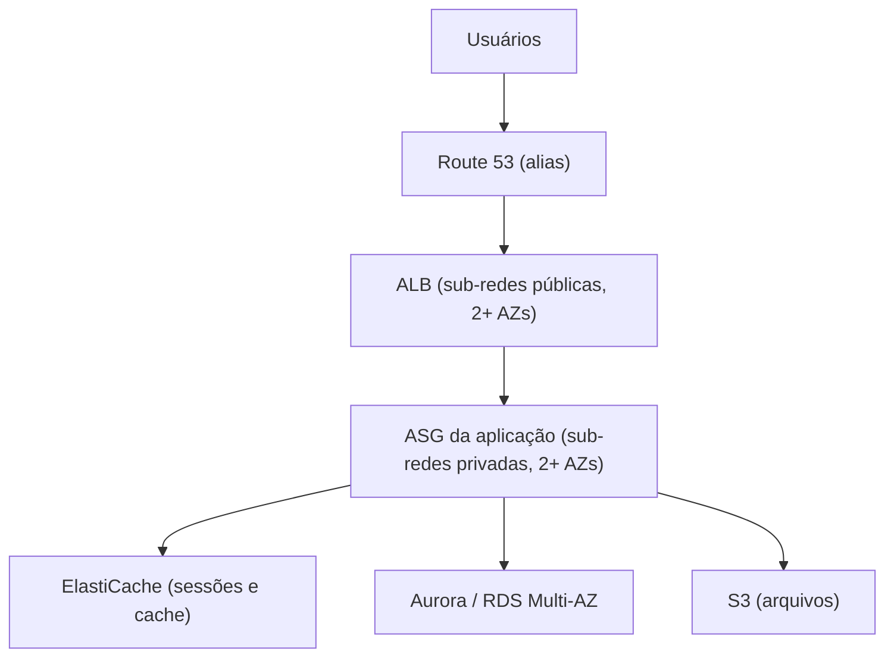
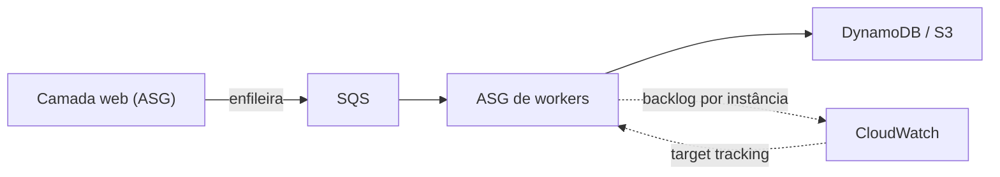

---
aliases:
  - Aula 12.10
modulo: 12
aula: 10
parte: "III Computação e armazenamento"
dominios:
  - 2
  - 3
  - 4
lida: false
tags:
  - aula
  - saa-c03
  - modulo-12
---

# Aula 12.10: Application Auto Scaling e arquiteturas completas

[[12 - Balanceamento de Carga e Auto Scaling|Voltar ao módulo]]

> [!question] Pergunta que esta aula responde
> Como escalar recursos que não são [[EC2|instâncias EC2]] (serviços [[ECS]], tabelas [[DynamoDB]], réplicas [[Aurora]]), qual a diferença entre os "Auto Scalings" da AWS e como juntar tudo em arquiteturas que escalam de ponta a ponta?

## Três nomes parecidos, três escopos

A prova gosta de confundir. Eis os três:

| Nome | O que escala | Onde se configura |
|---|---|---|
| **[[EC2 Auto Scaling]]** | **Instâncias [[EC2]]** em um [[Auto Scaling Group]] | Aulas 12.6 a 12.9 |
| **[[Application Auto Scaling]]** | **Capacidade de outros serviços** ([[ECS]], [[DynamoDB]], [[Aurora]] e mais) | API própria, usada por cada serviço |
| **AWS [[Auto Scaling Group\|Auto Scaling]]** (scaling plans) | Console unificado que **monta planos** para vários recursos de uma aplicação | Console e API de *scaling plans* |

A regra de bolso: **[[EC2|instâncias EC2]] usam [[EC2 Auto Scaling]]; todo o resto usa [[Application Auto Scaling]].** O AWS [[Auto Scaling Group|Auto Scaling]] com *scaling plans* é uma camada de conveniência que cria políticas nos dois anteriores; é raro na prova, e a documentação oficial hoje descreve como **migrar os scaling plans** para políticas do EC2 Auto Scaling e do Application Auto Scaling, ou seja, a configuração direta em cada serviço é o caminho atual (verificado em novembro de 2026).

## Application Auto Scaling

O **[[Application Auto Scaling]]** é um serviço que ajusta a **capacidade** de recursos de vários serviços da AWS por meio de **políticas de escala**. Três ideias:

1. **Scalable target**: o recurso que você registra, com sua **dimensão** escalável (por exemplo, número de tarefas de um serviço [[ECS]]), um mínimo e um máximo, como o [[Auto Scaling Group|ASG]] tem min e max.
2. **Políticas**: [[Target Tracking|target tracking]], [[Step Scaling|step scaling]] e [[Scheduled Scaling|scheduled scaling]] (o mesmo vocabulário da aula 12.7). O serviço de predição (predictive) é próprio do [[EC2 Auto Scaling]].
3. **Métricas predefinidas** por serviço, ligadas ao [[CloudWatch]].

### Quem escala por ele

| Recurso | O que ajusta | Métrica típica de [[Target Tracking\|target tracking]] |
|---|---|---|
| **[[ECS\|Amazon ECS]]** (serviço) | Número de **tarefas** (desired count) | CPU ou memória médias do serviço; requisições por alvo do [[Application Load Balancer\|ALB]] |
| **[[DynamoDB\|Amazon DynamoDB]]** (modo provisionado) | **Capacidade de leitura e escrita** de tabelas e índices globais | Utilização da capacidade provisionada |
| **[[Aurora]]** (cluster) | Número de **[[Read Replica\|réplicas de leitura]]** | CPU média das réplicas ou conexões |
| **AWS [[Lambda]]** | **Concorrência provisionada** | Utilização da [[Concorrencia Provisionada\|concorrência provisionada]] |
| **[[SageMaker AI\|Amazon SageMaker]]** | Instâncias de um endpoint | Invocações por instância |
| **[[Spot Instance|Spot]] Fleet**, **[[EMR]]**, **AppStream 2.0** e outros | Capacidade do respectivo recurso | Métricas do próprio recurso |

Verificado em novembro de 2026, lista de serviços da documentação do [[Application Auto Scaling]]; a lista cresce com o tempo, então decore o princípio (tudo que não é [[EC2]] e escala por política) e alguns membros: **[[ECS]], [[DynamoDB]], [[Aurora]], Lambda**.

> [!info] Ligando os pontos
> As tabelas [[DynamoDB]] têm também o **modo sob demanda**, que escala sozinho sem política; o modo provisionado com [[Application Auto Scaling]] é a alternativa de custo previsível (Módulo [[14 - DynamoDB Cache e Bancos de Proposito Especifico|14]]). Já o [[Aurora]] (Módulo [[13 - Bancos Relacionais RDS e Aurora|13]]) escala **[[Read Replica|réplicas de leitura]]**, não o tamanho da instância do escritor. E [[Lambda|funções Lambda]] escalam a concorrência **por conta própria**; a concorrência *provisionada* é o que se programa.

### ECS: duas camadas de escala

Em [[Container|contêineres]] há **dois níveis** que se complementam:

| Nível | Quem escala | O que escala |
|---|---|---|
| **Tarefas do serviço** | [[Application Auto Scaling]] | Quantas tarefas ([[Container\|contêineres]]) rodam |
| **Capacidade de infraestrutura** | [[Auto Scaling Group\|ASG]] (via *[[Capacity Provider\|capacity provider]]*) com [[EC2]], ou [[Fargate]] (sem servidores) | Quantas instâncias EC2 hospedam as tarefas |

Com **[[Fargate]]** só existe a primeira camada, pois não há instâncias para gerir. Detalhes no Módulo [[17 - Containers ECS EKS e Fargate|17]].

## Arquiteturas completas

### Camada web elástica (a base)

Cada elemento responde a um requisito: [[Application Load Balancer|ALB]] e [[Auto Scaling Group|ASG]] em duas [[Zona de Disponibilidade|AZs]] ([[Alta Disponibilidade|alta disponibilidade]]), sessões em cache externo ([[Stateless|stateless]], aula 12.1), banco [[Multi-AZ]] (resiliência do dado), arquivos no [[S3]] (sem disco local), [[Target Tracking|target tracking]] por requisições por alvo ([[Elasticidade|elasticidade]]). **[[Security Group|Security groups]] em cadeia**: ALB aceita do mundo, a aplicação aceita só do ALB, o banco aceita só da aplicação.

### Processamento assíncrono com fila

A fila **absorve picos** e **desacopla** a camada web dos workers. Os workers escalam pelo **[[Backlog por Instancia|backlog por instância]]** (aula 12.7). Se a fila fica vazia, o [[Auto Scaling Group|ASG]] reduz ao mínimo (que pode ser 0 em [[Processamento em Lote|lote]] que tolera espera). [[Spot Instance|Spot]] cabe bem aqui, porque a mensagem não processada volta à fila quando a instância é interrompida (visibilidade do [[SQS]], Módulo [[15 - Desacoplamento Filas Eventos e Workflows|15]]).

### Inspeção de tráfego

Quando há exigência de firewall de terceiros: tráfego da internet, via [[Gateway Load Balancer|GWLB]] endpoint, a um **GWLB** com appliances em [[Auto Scaling Group|ASG]] (aula 12.4), e só então ao [[Application Load Balancer|ALB]] da aplicação.

### Escolhendo a combinação

| Requisito | Desenho |
|---|---|
| Aplicação web, [[Alta Disponibilidade\|alta disponibilidade]] e custo proporcional ao uso | [[Application Load Balancer\|ALB]] + [[Auto Scaling Group\|ASG]] em 2+ [[Zona de Disponibilidade\|AZs]] + [[Target Tracking\|target tracking]] |
| Pico previsível diário | Scheduled ou predictive no [[Auto Scaling Group\|ASG]] |
| Tarefas assíncronas com picos | [[SQS]] + [[Auto Scaling Group\|ASG]] de workers por backlog |
| IP fixo com [[HTTP]] | [[Network Load Balancer\|NLB]] para [[Application Load Balancer\|ALB]], ou [[Global Accelerator]] |
| [[Container\|Contêineres]] sem gerir servidores | [[ECS]]/Fargate com [[Application Auto Scaling]] nas tarefas |
| Banco de leitura intensa | [[Aurora]] com réplicas escalando por [[Application Auto Scaling]] |
| Tabela com tráfego imprevisível, sem planejar capacidade | [[DynamoDB]] sob demanda |
| Tabela com tráfego previsível e custo menor | [[DynamoDB]] provisionado com [[Application Auto Scaling]] |

## Monitorar o que escala

Para operar um [[Auto Scaling Group|ASG]] com balanceador, vale acompanhar ([[CloudWatch]]):

- **Do balanceador**: `RequestCount`, `TargetResponseTime`, `HealthyHostCount` e `UnHealthyHostCount`, `HTTPCode_ELB_5XX_Count`, `HTTPCode_Target_5XX_Count`.
- **Do [[Auto Scaling Group|ASG]]**: `GroupDesiredCapacity`, `GroupInServiceInstances`, `GroupMinSize`, `GroupMaxSize`. Essas métricas do grupo precisam estar **habilitadas** (caixa de coleta de métricas do grupo na aba Monitoring do console, ou `aws autoscaling enable-metrics-collection`, com granularidade de 1 minuto): habilite explicitamente e confira o estado no seu grupo em vez de assumir o padrão (documentação de group metrics, verificado em novembro de 2026).
- **Atividades de escala**: `describe-scaling-activities` mostra o que o [[Auto Scaling Group|ASG]] fez e por quê.
- **Notificações**: eventos do [[Auto Scaling Group|ASG]] podem ir para [[SNS]] ou [[EventBridge]].

## Como isso cai na prova

Esta aula consolida as **Tasks 2.1, 2.2, 3.2 e 4.2**: arquiteturas escaláveis e resilientes, computação elástica e custo.

Palavras-chave:

- "**scale [[Servico ECS|ECS service]] tasks automatically**": [[Application Auto Scaling]] ([[Target Tracking|target tracking]]).
- "**[[DynamoDB]] provisioned capacity that adjusts to traffic**": [[Application Auto Scaling]]; "**unpredictable traffic, no capacity planning**": DynamoDB sob demanda.
- "**[[Aurora]] read replicas scale with load**": [[Application Auto Scaling]] para réplicas.
- "**decouple and absorb spikes**": [[SQS]] entre camadas.
- "**scale [[EC2]] workers on queue depth**": [[Backlog por Instancia|backlog por instância]] no [[Auto Scaling Group|ASG]].
- "**[[Alta Disponibilidade|highly available]] web tier**": [[Application Load Balancer|ALB]] + [[Auto Scaling Group|ASG]] em 2+ [[Zona de Disponibilidade|AZs]].

Pegadinhas:

- **[[EC2 Auto Scaling]] para escalar tabelas [[DynamoDB]].** É [[Application Auto Scaling]].
- **[[Aurora]] escalando o tamanho do escritor.** O [[Application Auto Scaling]] ajusta o número de réplicas.
- **[[Fargate]] precisando de [[Auto Scaling Group|ASG]].** Não existe instância para escalar.
- **Escalar a camada web sem tratar o banco.** O banco vira o gargalo (réplicas, cache, fila).
- **Lambda "escalando por política".** Escala por conta própria; só a [[Concorrencia Provisionada|concorrência provisionada]] se programa.

| Requisito no enunciado | Resposta provável | Por quê |
|---|---|---|
| Escalar tarefas de um serviço [[ECS]] pela CPU | [[Application Auto Scaling]] com [[Target Tracking\|target tracking]] | ECS não usa [[Auto Scaling Group\|ASG]] para tarefas |
| Tabela [[DynamoDB]] provisionada que acompanha a carga | [[Application Auto Scaling]] | Ajusta leitura e escrita |
| Mais [[Read Replica\|réplicas de leitura]] do [[Aurora]] em picos de leitura | [[Application Auto Scaling]] | Escala réplicas |
| Picos de gravação que a aplicação não aguenta | [[SQS]] na frente do processamento | Absorve e desacopla |
| Workers de fila escalando conforme o acúmulo | [[Auto Scaling Group\|ASG]] com [[Backlog por Instancia\|backlog por instância]] | Métrica proporcional |
| Camada web que sobrevive à falha de [[Zona de Disponibilidade\|AZ]] e escala por demanda | [[Application Load Balancer\|ALB]] + [[Auto Scaling Group\|ASG]] [[Multi-AZ\|multi-AZ]] + [[Target Tracking\|target tracking]] | Combina [[Alta Disponibilidade\|HA]] e [[Elasticidade\|elasticidade]] |

## Resumo

> [!abstract] A aula em uma frase
> [[EC2 Auto Scaling]] escala instâncias em ASGs, e o [[Application Auto Scaling]] escala a capacidade dos demais serviços ([[ECS]], [[DynamoDB]], [[Aurora]], Lambda) com o mesmo vocabulário de políticas; juntos, com balanceador, fila e dados gerenciados, formam arquiteturas que se adaptam à demanda e resistem a falhas de [[Zona de Disponibilidade|AZ]].

**A lógica, em 5 passos**

1. Instâncias [[EC2]]: [[Auto Scaling Group|ASG]] ([[EC2 Auto Scaling]]).
2. Outros serviços: registre um scalable target e aplique [[Target Tracking|target tracking]], step ou scheduled ([[Application Auto Scaling]]).
3. Em [[ECS]] com [[EC2]], escalam-se duas camadas (tarefas e instâncias); com [[Fargate]], só as tarefas.
4. Cole as camadas com [[Application Load Balancer|ALB]] (distribuição), fila ([[Desacoplamento|desacoplamento]]) e dados externos (estado).
5. Em todo desenho, 2+ [[Zona de Disponibilidade|AZs]] e teto de capacidade.

**Números para lembrar**

| O quê | Valor | Por que importa |
|---|---|---|
| Camadas de escala em [[ECS]] com [[EC2]] | 2 | Tarefas e instâncias |
| [[Zona de Disponibilidade\|AZs]] mínimas na camada web | 2 | [[Alta Disponibilidade\|Alta disponibilidade]] |
| [[Sub-rede\|Sub-redes]] do [[Application Load Balancer\|ALB]] | 2 | Requisito do balanceador |

**Tabela-síntese**

| Recurso | Quem escala |
|---|---|
| Instâncias [[EC2]] | [[EC2 Auto Scaling]] |
| Tarefas [[ECS]] | [[Application Auto Scaling]] |
| Capacidade [[DynamoDB]] provisionada | [[Application Auto Scaling]] |
| Réplicas do [[Aurora]] | [[Application Auto Scaling]] |
| Concorrência provisionada Lambda | [[Application Auto Scaling]] |

**Na hora H**

- Se o recurso não é uma instância, a resposta é [[Application Auto Scaling]].
- Gargalo no banco: réplicas, cache ou fila, não mais instâncias web.
- Sempre confirme que o desenho tem 2+ [[Zona de Disponibilidade|AZs]] e estado fora da instância.

> [!tip] Liga com
> Fecha o módulo, retomando a [[12.01 - Escalar Horizontalmente e Aplicacao Stateless|aula 12.1]]. O próximo módulo trata dos bancos relacionais, o outro lado de qualquer arquitetura que escala: [[13 - Bancos Relacionais RDS e Aurora]].

## Erros comuns

- **Procurar "[[EC2 Auto Scaling]]" para tudo que escala.** Só serve a instâncias.
- **Escalar a camada web e esquecer o banco.** O banco vira o gargalo de conexões ou [[IOPS]].
- **Desenho sem estado externo.** O scale in perde sessões e arquivos locais.
- **Ignorar o teto de capacidade.** Uma [[Metrica|métrica]] anormal pode lançar centenas de recursos.
- **Misturar o modo provisionado do [[DynamoDB]] com expectativa de escala instantânea.** O escalonamento reage a métricas e não é imediato; sob demanda é a opção para tráfego imprevisível.
- **Achar que [[Fargate]] precisa de [[Auto Scaling Group|ASG]].** Não há instâncias para o cliente gerenciar.

## Pratique

**1.** Uma aplicação roda em um serviço [[ECS]] com tarefas [[Fargate]]. A equipe quer que o número de tarefas acompanhe a CPU média do serviço, com o menor [[Overhead Operacional|esforço operacional]]. Qual solução?

- [ ] a) Um ASG de instâncias EC2 com política de target tracking na CPU média das instâncias.
- [ ] b) Application Auto Scaling com target tracking no desired count do serviço.
- [ ] c) Scheduled scaling com ajuste manual semanal.
- [ ] d) Um alarme que envia e-mail para a equipe escalar.

**2.** Uma tabela [[DynamoDB]] em modo provisionado sofre [[Throttling|throttling]] nos picos e fica ociosa à noite, e a equipe não quer gerenciar capacidade manualmente. Qual opção atende?

- [ ] a) Application Auto Scaling para ajustar a capacidade de leitura e escrita.
- [ ] b) EC2 Auto Scaling na tabela.
- [ ] c) Um Network Load Balancer na frente da tabela.
- [ ] d) Dobrar a capacidade provisionada de forma permanente, aceitando pagar pela folga à noite.

**3.** Um site de e-commerce tem tráfego muito variável e imprevisível, e a equipe não quer planejar a capacidade da tabela de carrinhos, aceitando pagar por requisição. O que usar?

- [ ] a) Scheduled scaling na tabela.
- [ ] b) DynamoDB provisionado com capacidade fixa alta.
- [ ] c) DynamoDB em modo sob demanda, que acompanha os picos sem planejar capacidade.
- [ ] d) Predictive scaling de EC2.

**4.** A camada web escala bem, mas durante picos de leitura o [[Aurora]] fica sobrecarregado. Qual medida escala a leitura automaticamente?

- [ ] a) Aumentar o desired do ASG da aplicação para absorver o pico de leitura do banco.
- [ ] b) Trocar o ALB por um NLB.
- [ ] c) Habilitar cross-zone.
- [ ] d) Application Auto Scaling para o número de réplicas de leitura do Aurora, escalando com uma métrica de utilização.

**5.** Um sistema recebe picos de pedidos que o processamento não acompanha, perdendo requisições. Quer-se absorver os picos e processar no ritmo possível, com workers elásticos. Qual arquitetura?

- [ ] a) SQS entre a camada web e um ASG de workers, escalando por backlog por instância.
- [ ] b) Aumentar o tamanho das instâncias web (escala vertical), mantendo o processamento dentro da requisição.
- [ ] c) Remover o balanceador para reduzir latência.
- [ ] d) Aumentar o cooldown do ASG web.

**6.** Qual combinação descreve uma camada web resiliente a falha de [[Zona de Disponibilidade|AZ]], elástica e [[Stateful e Stateless (Firewall)|com estado]] externo?

- [ ] a) Uma instância grande em uma única AZ, com as sessões dos usuários guardadas na memória.
- [ ] b) Um ASG em duas AZs sem balanceador.
- [ ] c) ALB e ASG em 2+ AZs, sessões em ElastiCache, arquivos no S3 e banco Multi-AZ.
- [ ] d) Duas instâncias fixas sem políticas de escala.

**7.** Uma equipe usa [[ECS]] com [[EC2|instâncias EC2]] (sem [[Fargate]]). Quais componentes precisam escalar para absorver mais carga?

- [ ] a) Apenas o número de tarefas.
- [ ] b) Apenas o banco de dados.
- [ ] c) Apenas o tamanho do balanceador, que é ajustado pelo próprio serviço de forma automática.
- [ ] d) O número de tarefas do serviço e a capacidade de instâncias que as hospeda.

**8.** (Escolha DUAS.) Quais recursos podem ser escalados pelo [[Application Auto Scaling]]?

- [ ] a) Capacidade provisionada de tabelas DynamoDB
- [ ] b) Número de tarefas de um serviço ECS
- [ ] c) Instâncias EC2 de um ASG
- [ ] d) Tamanho do volume EBS de uma instância
- [ ] e) Regras de security group

**9.** Uma empresa quer manter [[Lambda|funções Lambda]] com baixa [[Latencia|latência]] de início durante o horário comercial, programando a capacidade. O que usar?

- [ ] a) Aumentar a memória da função.
- [ ] b) Reduzir o timeout.
- [ ] c) Lambda não permite nenhuma programação de capacidade, pois escala somente por demanda.
- [ ] d) Concorrência provisionada com scheduled scaling do Application Auto Scaling.

**10.** Um arquiteto precisa explicar a diferença entre [[EC2 Auto Scaling]] e [[Application Auto Scaling]]. Qual afirmação está correta?

- [ ] a) EC2 Auto Scaling escala instâncias, o Application Auto Scaling escala ECS e DynamoDB.
- [ ] b) São o mesmo serviço com nomes diferentes.
- [ ] c) Application Auto Scaling escala apenas instâncias EC2.
- [ ] d) EC2 Auto Scaling escala tabelas DynamoDB e réplicas Aurora, enquanto o outro escala só instâncias EC2.

**11.** (Escolha DUAS.) Quais práticas deixam uma arquitetura web mais elástica e resiliente?

- [ ] a) Guardar sessões em disco local de cada instância.
- [ ] b) Colocar o ASG em sub-redes de pelo menos duas AZs.
- [ ] c) Externalizar o estado para ElastiCache, DynamoDB ou S3.
- [ ] d) Fixar o número de instâncias para evitar variação.
- [ ] e) Usar uma única AZ para reduzir custo de transferência.

**12.** Uma empresa quer um desenho em que o tráfego da internet seja inspecionado por firewalls de terceiros antes de chegar ao [[Application Load Balancer|ALB]] da aplicação. Qual componente entra no caminho?

- [ ] a) Network Load Balancer com TLS listener.
- [ ] b) Gateway Load Balancer com endpoints, e os appliances em um ASG para escalar conforme a demanda.
- [ ] c) Apenas security groups, com regras liberando as portas do firewall.
- [ ] d) Application Auto Scaling.

> [!success]- Gabarito
> **1. b)** O [[Application Auto Scaling]] ajusta o desired count de serviços [[ECS]] com [[Target Tracking|target tracking]]; a) o [[Fargate]] não usa instâncias, c) é manual, d) é manual e atrasado.
> **2. a)** O [[Application Auto Scaling]] ajusta leitura e escrita provisionadas; b) [[EC2 Auto Scaling]] não escala tabelas, c) [[Network Load Balancer|NLB]] não se aplica, d) desperdiça no período ocioso.
> **3. c)** O modo sob demanda dispensa planejamento e cobra por requisição; b) é caro e fixo, a) o horário não segue a imprevisibilidade, d) predictive é de [[EC2]].
> **4. d)** O [[Application Auto Scaling]] ajusta o número de [[Read Replica|réplicas de leitura]] do [[Aurora]]; a), b) e c) não resolvem o gargalo do banco.
> **5. a)** A fila absorve os picos e os workers escalam por backlog; b) escala vertical não desacopla, c) remover o balanceador não resolve, d) o [[Cooldown|cooldown]] não trata de picos.
> **6. c)** A combinação atende [[Alta Disponibilidade|alta disponibilidade]], [[Elasticidade|elasticidade]] e estado externo; a) é [[Ponto Unico de Falha|ponto único de falha]], b) falta distribuição de tráfego, d) não escala.
> **7. d)** Com [[EC2]] há duas camadas: tarefas e instâncias; a), b) e c) cobrem só parte.
> **8. a) e b)** [[DynamoDB]] provisionado e tarefas [[ECS]] usam [[Application Auto Scaling]]; c) é [[EC2 Auto Scaling]], d) e e) não são recursos escaláveis por ele.
> **9. d)** A [[Concorrencia Provisionada|concorrência provisionada]] pode ser programada pelo [[Application Auto Scaling]]; a) e b) não programam capacidade, c) é falso.
> **10. a)** A divisão de escopos é essa; b) são serviços distintos, c) e d) invertem os escopos.
> **11. b) e c)** Duas ou mais [[Zona de Disponibilidade|AZs]] e estado externo permitem substituir instâncias sem perder dados; a) prende estado, d) remove [[Elasticidade|elasticidade]], e) elimina a tolerância a falha de AZ.
> **12. b)** O [[Gateway Load Balancer|GWLB]] com endpoints insere os appliances no caminho, escalados em um [[Auto Scaling Group|ASG]]; a) o [[Network Load Balancer|NLB]] não inspeciona em linha, c) [[Security Group|security groups]] não inspecionam conteúdo, d) é serviço de escala.

## Para aprofundar

- [ ] [What is Application Auto Scaling?](https://docs.aws.amazon.com/autoscaling/application/userguide/what-is-application-auto-scaling.html) (documentação AWS): serviços suportados, conceitos e políticas.
- [ ] [Amazon ECS service auto scaling](https://docs.aws.amazon.com/AmazonECS/latest/developerguide/service-auto-scaling.html) (documentação AWS): escala das tarefas de um serviço.
- [ ] [Managing throughput capacity automatically with DynamoDB auto scaling](https://docs.aws.amazon.com/amazondynamodb/latest/developerguide/AutoScaling.html) (documentação AWS): integração do [[DynamoDB]] com o [[Application Auto Scaling]].

Fim das aulas do módulo. Volte à nota do módulo para o questionário final: [[12 - Balanceamento de Carga e Auto Scaling|Módulo 12]], e depois siga para o [[13 - Bancos Relacionais RDS e Aurora|Módulo 13]].
