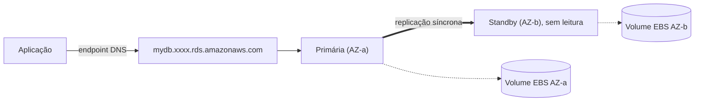

---
aliases:
  - Aula 13.3
modulo: 13
aula: 3
parte: "IV Bancos de dados"
dominios:
  - 2
  - 3
lida: false
tags:
  - aula
  - saa-c03
  - modulo-13
---

# Aula 13.3: Multi-AZ no RDS, instância e cluster

[[13 - Bancos Relacionais RDS e Aurora|Voltar ao módulo]]

> [!question] Pergunta que esta aula responde
> O que acontece com um banco [[RDS]] quando a [[Zona de Disponibilidade|zona de disponibilidade]] inteira cai, como o [[Multi-AZ]] evita perda de dados e qual a diferença entre o *[[Multi-AZ DB Instance|Multi-AZ DB instance]]* e o *[[Multi-AZ DB Cluster|Multi-AZ DB cluster]]*?

## O problema: o banco é o ponto único de falha da aplicação

Você já sabe, desde o [[01 - Nuvem e Infraestrutura Global AWS|Módulo 1]] e o [[09 - EC2 a Fundo|Módulo 9]], que uma [[Zona de Disponibilidade]] pode falhar e que a regra de ouro é espalhar a carga por pelo menos duas. Servidores de aplicação são fáceis de espalhar: eles não guardam estado, então um [[Auto Scaling Group]] sobe outro em outra zona. O banco de dados é o oposto: ele **guarda o estado**, e dois bancos independentes em duas zonas teriam dados diferentes.

Por isso o [[RDS]] resolve a [[Alta Disponibilidade|alta disponibilidade]] com replicação **gerenciada**: ele mantém uma cópia dos dados em outra zona, copia cada gravação para lá e, se a zona principal falhar, faz a troca sozinho. Essa capacidade se chama *[[Multi-AZ]]*, e existem duas formas diferentes dela. A prova adora a confusão entre as duas e entre Multi-AZ e [[Read Replica]]. Esta aula separa tudo.

> [!info] Ligando os pontos
> Na aula 13.1 vimos o eixo "[[Disponibilidade|disponibilidade]]" na tabela de escala de banco. [[Multi-AZ]] é a resposta para esse eixo: disponibilidade na mesma Região, com troca automática. Não é o mecanismo para ler mais rápido (aula 13.4) nem para sobreviver à perda de uma Região (aula 13.8).

## Multi-AZ DB instance: um standby que não atende leitura

Na implantação **[[Multi-AZ DB Instance|Multi-AZ DB instance]]**, o [[RDS]] cria a instância principal em uma zona e uma instância *standby* em outra zona da mesma Região. As características confirmadas na documentação (verificado em novembro de 2026):

- A replicação para o standby é **síncrona** ([[Replicacao Sincrona|replicação síncrona]]): a gravação só é confirmada ao cliente depois de gravada nos dois volumes. Por isso, em um [[Failover|failover]], não se perdem dados confirmados.
- O standby **não aceita leitura nem escrita**. Ele existe só para assumir o lugar da principal. Quem quer escalar leitura precisa de [[Read Replica|read replicas]] (aula 13.4).
- Você conecta pelo **endpoint [[DNS]]** da instância. Em um [[Failover]], o [[RDS]] troca o nome DNS para apontar para o standby promovido. Não existe IP fixo para o cliente guardar.
- A [[Replicacao Sincrona|replicação síncrona]] também serve para **minimizar picos de [[Latencia|latência]] durante backups do sistema** (a documentação cita isso expressamente) e melhora a [[Disponibilidade|disponibilidade]] durante manutenção planejada: o [[RDS]] aplica o patch primeiro no standby, promove-o e só então corrige a antiga primária, de modo que a interrupção é a de um [[Failover|failover]]. O detalhe de qual instância executa o backup varia por engine; para a prova, guarde apenas o benefício.
- Há **um custo**: o standby é uma instância a mais cobrada, e a [[Latencia|latência]] de gravação e de commit pode aumentar, porque cada gravação espera a confirmação da outra zona. Por isso a documentação recomenda [[Provisioned IOPS]] para cargas de produção sensíveis a latência.



### Quando o failover acontece

O [[RDS]] dispara o [[Failover|failover]] automaticamente quando detecta, entre outros, estes eventos (verificado em novembro de 2026):

| Gatilho | Observação |
|---|---|
| Indisponibilidade da zona principal | O caso de livro |
| Host da instância com problema | Falha de hardware ou do serviço subjacente |
| Perda de conectividade de rede da instância | O [[RDS]] trata como falha |
| Falha de armazenamento | Volume da principal inacessível |
| Modificação da instância (por exemplo, mudar a classe) | Uma operação planejada pode causar o [[Failover\|failover]] |
| Patch do sistema operacional e upgrade de versão minor do engine | Acontecem na **[[Maintenance Window\|janela de manutenção]]** (*maintenance window*), um intervalo semanal que você define; em [[Multi-AZ]] o [[RDS]] corrige o standby, faz [[Failover\|failover]] e corrige a antiga primária |
| **Reboot com [[Failover\|failover]]** | Você força o teste, sem esperar uma falha real |

> [!info] Eventos e janela de manutenção
> Para saber quando um [[Failover|failover]] aconteceu, você assina **notificações de eventos** do [[RDS]] (*[[Event Subscription|event subscriptions]]*) entregues por [[SNS]], e também dá para tratá-los pelo [[EventBridge]]; o exemplo e a questão estão na aula 13.5. Já para atualizar a versão do engine com pouca interrupção, a ferramenta moderna é o **[[Blue Green Deployment|Blue/Green Deployment]]** (uma cópia "green" do banco, testada e promovida por troca, aula 13.1), em vez de aceitar a interrupção da [[Maintenance Window|janela de manutenção]].

O tempo típico é de **60 a 120 segundos**, porque depende da propagação do [[DNS]] e da recuperação do banco no standby. Para a prova, a ideia é: [[Multi-AZ]] instance dá recuperação em **minutos**, não em milissegundos, e a aplicação precisa reconectar.

> [!warning] O cache de DNS pode atrasar a reconexão
> A aplicação só enxerga o novo primário quando o nome [[DNS]] resolve para ele. Clientes que fazem cache do endereço por muito tempo (a JVM é o caso clássico) continuam batendo na instância antiga. A documentação recomenda **[[TTL]] de DNS de no máximo 60 segundos** na JVM e conexão sempre pelo nome do endpoint, nunca por IP. O [[RDS Proxy]] (aula 13.6) reduz esse problema porque ignora o cache de DNS dos clientes.

### SQL Server e as tecnologias por baixo

Cada engine implementa o standby com a sua tecnologia. Para SQL Server, a documentação cita *Database Mirroring* ou *Always On [[Disponibilidade|Availability]] Groups*. Para a prova você não precisa decorar quais engines usam qual tecnologia, só saber que o resultado visível é o mesmo: um standby síncrono em outra zona, com troca de [[DNS]].

## Multi-AZ DB cluster: dois leitores que também são standby

O **[[Multi-AZ DB Cluster|Multi-AZ DB cluster]]** é a segunda forma e muda o modelo. Em vez de um standby escondido, o [[RDS]] cria um **cluster com três instâncias em três zonas**: uma **writer** e **duas readers**. As características (verificado em novembro de 2026):

- A replicação para os readers é **semissíncrona**: o writer espera a confirmação de pelo menos um reader antes de confirmar o commit ao cliente.
- Os dois readers **atendem consultas de leitura**. Então o mesmo recurso dá [[Disponibilidade|disponibilidade]] e capacidade extra de leitura.
- O [[Failover|failover]] leva tipicamente **menos de 35 segundos**, contra 60 a 120 segundos do [[Multi-AZ]] instance.
- Só existe para **[[RDS]] for MySQL e RDS for PostgreSQL**. Db2, MariaDB, Oracle e SQL Server não têm essa opção.
- Tem **três endpoints**: o *[[Cluster Endpoint|cluster endpoint]]* (sempre aponta para o writer, usado para escrita), o *[[Reader Endpoint|reader endpoint]]* (distribui entre os readers, termina em `-ro`) e os *instance endpoints* de cada instância.
- Exige **três [[Zona de Disponibilidade|zonas de disponibilidade]]** no [[DB Subnet Group]], diferente do mínimo de duas do [[Multi-AZ]] instance.

### O que o cluster não faz

A lista de limitações é pergunta clássica de prova com uma pegadinha escondida. Segundo a documentação (verificado em novembro de 2026), o [[Multi-AZ DB Cluster|Multi-AZ DB cluster]] **não suporta**:

- [[Storage Autoscaling|storage autoscaling]] (a aula 13.2 só vale para instâncias);
- parar e iniciar o cluster (*stop/start*);
- criptografar um cluster que já existe sem criptografia;
- copiar [[Snapshot|snapshots]] do cluster (qualquer cópia, não só para outra Região);
- [[Cross-Region Automated Backups|cross-Region automated backups]] (replicar os [[Automated Backup|backups automáticos]] para outra Região);
- [[Kerberos|autenticação Kerberos]];
- alterar a porta (a alternativa é restaurar o cluster a um ponto no tempo informando outra porta);
- [[Point-in-Time Recovery|point-in-time recovery]] de um cluster que já foi excluído;
- [[IPv6]] e option groups.

Em [[DB Instance Class|classes de instância]], a lista é **restrita**: só entram famílias com SSD NVMe local (por exemplo `db.m6gd` e `db.r6gd`; a lista completa na documentação), não todas as classes do [[RDS]].

Ele **suporta** o [[RDS Proxy]], com endpoint somente leitura para o cluster, e a retenção de [[Automated Backup|backups automáticos]] segue o intervalo de 1 a 35 dias.

> [!example] Replica lag e flow control
> Como a replicação é semissíncrona, um reader lento pode atrasar o writer. O MySQL tem um mecanismo de *flow control* que reduz a taxa de escrita do writer quando os readers ficam atrás, com atraso máximo padrão de 120 segundos. Em consulta lenta no reader, o *[[Replica Lag|replica lag]]* (atraso de replicação) é o sintoma. A saída é dimensionar melhor os readers, não adicionar mais.

### Comparando as duas formas

| Característica | [[Multi-AZ DB Instance\|Multi-AZ DB instance]] | [[Multi-AZ DB Cluster\|Multi-AZ DB cluster]] |
|---|---|---|
| Instâncias | 1 primária e 1 standby | 1 writer e 2 readers |
| Zonas | 2 | 3 |
| Replicação | Síncrona | Semissíncrona |
| Standby atende leitura | **Não** | **Sim** ([[Reader Endpoint\|reader endpoint]]) |
| [[Failover]] típico | 60 a 120 s | Menos de 35 s |
| Engines | Db2, MariaDB, MySQL, Oracle, PostgreSQL, SQL Server | Só MySQL e PostgreSQL |
| [[Storage Autoscaling\|Storage autoscaling]] | Suporta | Não suporta |
| Stop/start | Suporta (exceto SQL Server [[Multi-AZ]]) | Não suporta |

> [!tip] Como pensar
> Precisa de **[[Alta Disponibilidade|alta disponibilidade]] e só**: [[Multi-AZ]] instance, funciona em todos os engines. Precisa de **[[Disponibilidade|disponibilidade]] com [[Failover|failover]] mais rápido e leituras extras** em MySQL ou PostgreSQL: [[Multi-AZ DB Cluster|Multi-AZ DB cluster]]. Precisa de **muita leitura e escala flexível**: read replicas, ou o [[Aurora]] (aulas 13.7 e 13.8).

## O que Multi-AZ NÃO faz

Esta seção vale ouro na prova porque elimina alternativas que parecem atraentes.

1. **Não protege contra erro lógico.** Se alguém rodar um `DELETE` sem `WHERE` ou um `DROP TABLE`, a [[Replicacao Sincrona|replicação síncrona]] copia o estrago para o standby no mesmo instante. Para isso existem os backups e o [[Point-in-Time Recovery]] (aula 13.5).
2. **Não protege contra a perda da Região.** O standby está na mesma Região. Para [[Recuperacao de Desastres|recuperação de desastre]] entre [[Regiao AWS|Regiões]], o desenho usa réplica entre Regiões ou cópia de [[Snapshot|snapshots]] (aula 13.8).
3. **Não escala leitura no modelo instance.** O standby é invisível para consultas. Quem quer leitura extra usa [[Read Replica|read replica]].
4. **Não é automático por padrão.** Você precisa **habilitar** o [[Multi-AZ]] na criação ou depois, modificando a instância. Converter uma Single-AZ em Multi-AZ **não derruba o banco**: o [[RDS]] tira um [[Snapshot|snapshot]] da primária, cria o standby a partir dele (em outra [[Zona de Disponibilidade|AZ]]) e liga a [[Replicacao Sincrona|replicação síncrona]], com a aplicação continuando a usar a primária. O custo é de **desempenho**: enquanto o volume do standby é inicializado a partir do snapshot, cargas sensíveis a escrita podem sentir [[Latencia|latência]] maior (a documentação sugere, nesses casos, criar antes uma [[Read Replica|read replica]] como etapa intermediária). Fontes: [Multi-AZ DB instance deployments](https://docs.aws.amazon.com/AmazonRDS/latest/UserGuide/Concepts.MultiAZSingleStandby.html) e [Converting a DB instance to a Multi-AZ deployment](https://docs.aws.amazon.com/AmazonRDS/latest/UserGuide/Concepts.MultiAZ.Migrating.html) (verificado em novembro de 2026).
5. **Não é gratuito.** Você paga a instância do standby. Por isso o banco de desenvolvimento costuma ficar em Single-AZ, e o de produção em [[Multi-AZ]].

## Como isso cai na prova

> [!info] Task statements 2.1 e 2.2 (e 3.3)
> Domínio 2 (resiliência): projetar arquiteturas altamente disponíveis e tolerantes a falhas, e recuperação automática. Domínio 3 (desempenho): escolher o banco certo para o requisito.

**Palavras-chave em inglês:** *[[Alta Disponibilidade|high availability]]*, *automatic [[Failover|failover]]*, *standby*, *synchronous replication*, *[[Multi-AZ]]*, *[[Zona de Disponibilidade|Availability Zone]] failure*, *minimal downtime*, *[[RTO]]*, *readable standby*.

**Armadilhas frequentes:**

- Propor **[[Read Replica|read replica]]** quando o enunciado pede **[[Failover|failover automático]]**: read replica é para leitura e a promoção é manual (aula 13.4).
- Propor **[[Multi-AZ]]** quando o enunciado pede **ler mais** no modelo instance: o standby não responde consultas.
- Achar que [[Multi-AZ]] cobre **backup e erro humano**: não cobre.
- Esquecer que **[[Multi-AZ DB Cluster|Multi-AZ DB cluster]] só existe para MySQL e PostgreSQL**.

| Requisito no enunciado | Resposta provável | Por quê |
|---|---|---|
| Sobreviver à falha de uma [[Zona de Disponibilidade\|AZ]] sem intervenção, em qualquer engine | [[Multi-AZ DB Instance\|Multi-AZ DB instance]] | Standby síncrono com troca automática de [[DNS]] |
| [[Failover]] abaixo de 35 s e leituras extras, em MySQL ou PostgreSQL | [[Multi-AZ DB Cluster\|Multi-AZ DB cluster]] | Dois readers em 3 zonas, [[Reader Endpoint\|reader endpoint]] |
| Zero perda de dados confirmados no [[Failover\|failover]] | [[Multi-AZ]] ([[Replicacao Sincrona\|replicação síncrona]] ou semissíncrona) | O commit só é confirmado depois da cópia |
| Relatórios pesados na mesma Região, sem afetar a produção | [[Read Replica\|Read replica]] | O standby do [[Multi-AZ]] instance não atende leitura |
| Sobreviver à perda da Região inteira | Réplica entre [[Regiao AWS\|Regiões]] ou [[Aurora Global Database]] | [[Multi-AZ]] é intra-Região |
| Aplicação demora minutos para reconectar depois do [[Failover\|failover]] | [[TTL]] de [[DNS]] baixo e/ou [[RDS Proxy]] | [[Cache]] de DNS aponta para a instância antiga |

## Resumo

> [!abstract] A aula em uma frase
> [[Multi-AZ]] mantém uma cópia síncrona (instância) ou semissíncrona (cluster) do banco em outra zona e troca sozinho quando a principal falha, mas não serve para escalar leitura no modelo instance, não corrige erro lógico e não cobre a perda de uma Região.

**A lógica, em 5 passos**

1. O estado do banco não pode ser recriado em outra zona na hora, então ele precisa estar replicado antes.
2. O [[Multi-AZ DB Instance|Multi-AZ DB instance]] mantém um standby síncrono invisível; o cliente conecta por [[DNS]].
3. Na falha, o [[RDS]] promove o standby e troca o [[DNS]], em 60 a 120 segundos; o cache de DNS pode atrasar o cliente.
4. O [[Multi-AZ DB Cluster|Multi-AZ DB cluster]] usa três instâncias em três zonas, com dois readers que também servem leitura, e [[Failover|failover]] abaixo de 35 s.
5. Nenhum dos dois protege de erro lógico ou de falha de Região.

**Números para lembrar**

| O quê | Valor | Por que importa |
|---|---|---|
| [[Failover]] do [[Multi-AZ]] instance | 60 a 120 s | Depende de [[DNS]] e recuperação |
| [[Failover]] do [[Multi-AZ]] cluster | Menos de 35 s | Mais rápido que o instance |
| Zonas necessárias | 2 (instance) ou 3 (cluster) | [[Sub-rede\|Subnet]] group precisa cobri-las |
| Engines do cluster | MySQL e PostgreSQL | Os demais só têm [[Multi-AZ]] instance |
| [[TTL]] de [[DNS]] da JVM | No máximo 60 s | Evita bater na instância antiga |

**Na prática, isso significa**

- "[[Alta Disponibilidade|Alta disponibilidade]], zero intervenção" no [[RDS]]: [[Multi-AZ]].
- "Leitura extra" não é [[Multi-AZ]] instance: é [[Read Replica|read replica]].
- Teste de [[Failover|failover]] é feito com **reboot com failover**, não esperando uma falha.
- Backup, [[Point-in-Time Recovery|PITR]] e réplica entre [[Regiao AWS|Regiões]] cobrem o que o [[Multi-AZ]] não cobre.

> [!tip] Liga com
> Vem da [[13.02 - RDS Instancias Classes e Armazenamento|aula 13.2]] ([[Storage Autoscaling|storage autoscaling]] não existe no cluster). Segue para a [[13.04 - RDS Read Replicas e Escala de Leitura|aula 13.4]] (leitura) e prepara a [[13.06 - RDS Proxy e Gestao de Conexoes|aula 13.6]] (reconexão rápida).

## Erros comuns

- **"[[Multi-AZ]] é [[Read Replica|read replica]]."** [[Replicacao Sincrona|Replicação síncrona]] para [[Failover|failover]] não é a mesma coisa que [[Replicacao Assincrona|replicação assíncrona]] para leitura.
- **"O standby do [[Multi-AZ]] instance responde SELECT."** Não responde.
- **"[[Multi-AZ]] serve de backup."** Um `DROP TABLE` é copiado para o standby em tempo real.
- **"[[Multi-AZ]] cobre desastre de Região."** Ele fica dentro de uma Região.
- **"Conectei pelo IP, funcionou até cair."** Depois do [[Failover|failover]], o endereço muda; use sempre o endpoint [[DNS]].

## Pratique

**1.** Uma loja online usa [[RDS]] for MySQL em uma única zona. O banco precisa continuar disponível se a zona falhar, com troca automática e sem perda de dados confirmados. A aplicação não precisa de leitura extra. O que fazer?

- [ ] a) Criar uma read replica em outra zona e promovê-la manualmente quando houver falha
- [ ] b) Manter Single-AZ e tirar snapshots manuais a cada hora para outra Região
- [ ] c) Habilitar a implantação Multi-AZ DB instance, na criação ou depois dela
- [ ] d) Subir um banco MySQL em uma instância EC2 de outra zona e replicar por script

**2.** Os relatórios pesados de uma empresa deixam o banco de produção lento. A equipe propõe ativar o [[Multi-AZ]] para que a instância standby atenda os relatórios. O que é verdade?

- [ ] a) O standby não atende leitura; use uma read replica ou um Multi-AZ DB cluster
- [ ] b) Funciona, pois o standby aceita consultas SELECT pelo mesmo endpoint
- [ ] c) Funciona somente se o engine for SQL Server, que expõe o standby para leitura
- [ ] d) Funciona se o armazenamento usar Provisioned IOPS, que libera o acesso ao standby

**3.** Uma empresa quer o [[RDS]] for PostgreSQL com [[Failover|failover]] típico abaixo de 35 segundos e duas instâncias extras que também atendam consultas de leitura. Qual opção atende?

- [ ] a) Multi-AZ DB instance com uma read replica na mesma zona
- [ ] b) Single-AZ com três read replicas em zonas diferentes
- [ ] c) Aurora Serverless com pausa automática ativada
- [ ] d) Multi-AZ DB cluster com um writer e dois readers

**4.** Uma auditoria exige que, em caso de falha de uma zona, nenhuma transação confirmada ao cliente seja perdida. Qual mecanismo do [[RDS]] garante isso dentro da Região?

- [ ] a) Uma read replica MySQL, que replica de forma assíncrona na mesma Região
- [ ] b) O standby do Multi-AZ DB instance, com replicação síncrona
- [ ] c) A cópia de snapshots para outra Região a cada hora
- [ ] d) O backup automático, que envia os logs de transação a cada 5 minutos

**5.** Depois de um [[Failover|failover]] de um [[RDS]] [[Multi-AZ]], a aplicação Java ficou mais de cinco minutos sem conseguir conectar, embora o banco já estivesse disponível. A conexão usa o endpoint [[DNS]]. Qual a causa mais provável e a correção?

- [ ] a) O standby não foi promovido; é preciso abrir um chamado para a AWS promovê-lo
- [ ] b) O security group bloqueou a nova instância; é preciso liberar um novo IP
- [ ] c) A JVM guarda o DNS em cache; reduzir o TTL de DNS para no máximo 60 segundos
- [ ] d) A aplicação usava um IP fixo; é preciso trocar o IP no código a cada failover

**6.** Uma empresa quer uma [[Multi-AZ|implantação Multi-AZ]] DB cluster para um banco [[RDS]] for Oracle. O que é verdade?

- [ ] a) Funciona com Oracle desde que o armazenamento seja io2
- [ ] b) Funciona somente com Oracle Enterprise Edition e BYOL
- [ ] c) Funciona com qualquer engine do RDS, mudando apenas o número de readers
- [ ] d) Não existe para Oracle; vale apenas para MySQL e PostgreSQL

**7.** Uma equipe criou um [[Multi-AZ DB Cluster|Multi-AZ DB cluster]] e agora quer ativar o [[Storage Autoscaling|storage autoscaling]] para não ficar sem espaço. O que acontece?

- [ ] a) É possível ativar normalmente, como em qualquer instância RDS
- [ ] b) Não é suportado no cluster; o espaço precisa ser dimensionado à mão
- [ ] c) É possível apenas se o cluster tiver só um reader, em qualquer versão
- [ ] d) É possível somente depois de parar o cluster, o que o RDS permite sem restrições

**8.** A regulamentação exige que o banco sobreviva à perda de uma Região inteira da AWS. O banco já está em [[Multi-AZ]]. Isso basta?

- [ ] a) Não; o Multi-AZ fica na Região, então é preciso réplica entre Regiões
- [ ] b) Sim; o Multi-AZ replica automaticamente para a Região mais próxima da principal
- [ ] c) Sim; o standby é replicado para três Regiões a cada gravação confirmada
- [ ] d) Sim, desde que o banco use Provisioned IOPS em todas as zonas

**9.** Um desenvolvedor executou por engano um `DELETE` sem `WHERE` em uma tabela de produção de um [[RDS]] [[Multi-AZ]]. A equipe sugere promover o standby para recuperar os dados. Qual a análise correta?

- [ ] a) Funciona, pois o standby guarda uma cópia de segurança de 24 horas atrás da principal
- [ ] b) Funciona, desde que o failover seja feito em até 5 minutos depois do erro
- [ ] c) Não funciona; o DELETE já foi replicado, então use o point-in-time recovery
- [ ] d) Não funciona, e não há como recuperar, pois o backup automático é desativado no Multi-AZ

**10.** Um banco de desenvolvimento não tem requisito de [[Disponibilidade|disponibilidade]] e a equipe quer reduzir o custo mensal do [[RDS]]. Qual decisão ajuda mais?

- [ ] a) Trocar o gp3 por io2 para reduzir o preço por GiB
- [ ] b) Aumentar a classe da instância para reduzir o tempo de uso por dia
- [ ] c) Manter o Multi-AZ para aproveitar o desconto na instância standby
- [ ] d) Usar Single-AZ, pois o Multi-AZ cobra também a instância standby extra

**11.** Uma equipe mudou a classe de um [[RDS]] [[Multi-AZ]] e percebeu uma interrupção breve na aplicação. Por quê?

- [ ] a) O RDS recria o banco do zero a partir do último snapshot a cada modificação
- [ ] b) A modificação da instância é gatilho de failover e troca o DNS
- [ ] c) O standby aproveita a mudança para assumir também as consultas de leitura da aplicação
- [ ] d) A mudança de classe sempre apaga os backups automáticos antes de aplicar

**12.** (Escolha DUAS.) Quais afirmações sobre o [[Multi-AZ DB Cluster|Multi-AZ DB cluster]] estão corretas?

- [ ] a) Os dois readers atendem consultas de leitura.
- [ ] b) Replica automaticamente os backups automáticos para outra Região.
- [ ] c) Suporta storage autoscaling como as instâncias.
- [ ] d) Oferece um reader endpoint que distribui as leituras entre os readers.
- [ ] e) Pode ser parado e iniciado a qualquer momento para economizar.

**13.** (Escolha DUAS.) Quais situações podem disparar um [[Failover|failover automático]] em uma instância [[RDS]] [[Multi-AZ]]?

- [ ] a) Modificar a classe da instância para uma maior.
- [ ] b) Criar uma read replica a partir da instância.
- [ ] c) Tirar um snapshot manual da instância.
- [ ] d) Aplicar o patch do sistema operacional na janela de manutenção.
- [ ] e) Alterar a janela de backup automático.

> [!success]- Gabarito
> **1. c)** [[Multi-AZ DB Instance|Multi-AZ DB instance]] dá standby síncrono em outra zona com troca automática de [[DNS]]. A [[Read Replica|read replica]] (a) exige promoção manual e é assíncrona; [[Snapshot|snapshots]] (b) não dão troca automática; [[EC2]] com script (d) devolve a administração ao cliente.
> **2. a)** O standby do [[Multi-AZ DB Instance|Multi-AZ DB instance]] não atende leitura. Para relatórios, use [[Read Replica|read replica]] ou [[Multi-AZ DB Cluster|Multi-AZ DB cluster]]. As demais opções (b, c, d) afirmam acesso de leitura ao standby que não existe.
> **3. d)** O [[Multi-AZ DB Cluster|Multi-AZ DB cluster]] tem um writer e dois readers em três zonas, com [[Failover|failover]] típico abaixo de 35 s, para MySQL e PostgreSQL. As opções (a) e (b) não oferecem esse failover; o [[Aurora Serverless]] (c) é outro serviço e não é o pedido.
> **4. b)** A [[Replicacao Sincrona|replicação síncrona]] do standby só confirma o commit depois de gravar nas duas zonas. A [[Read Replica|read replica]] (a) é assíncrona; a cópia de [[Snapshot|snapshots]] (c) e o backup (d) têm janela de perda.
> **5. c)** A JVM pode guardar o [[DNS]] em cache e continuar batendo na instância antiga; a documentação recomenda [[TTL]] de no máximo 60 segundos. O standby é promovido automaticamente (a); o IP muda sem relação com [[Security Group|security group]] (b); e a conexão deve usar sempre o endpoint, nunca IP (d).
> **6. d)** O [[Multi-AZ DB Cluster|Multi-AZ DB cluster]] só existe para [[RDS]] for MySQL e RDS for PostgreSQL. O tipo de armazenamento (a), a edição (b) e a promessa de qualquer engine (c) não mudam isso.
> **7. b)** O [[Storage Autoscaling|storage autoscaling]] não é suportado no [[Multi-AZ DB Cluster|Multi-AZ DB cluster]]. Também não suporta stop/start (d).
> **8. a)** O [[Multi-AZ]] fica dentro de uma Região. Perda de Região pede réplica entre [[Regiao AWS|Regiões]], cópia de [[Snapshot|snapshots]] ou [[Aurora Global Database]]. As opções (b, c, d) inventam replicação automática entre Regiões.
> **9. c)** A [[Replicacao Sincrona|replicação síncrona]] copia o DELETE na hora. A recuperação é por [[Point-in-Time Recovery|point-in-time recovery]] em uma nova instância. O standby não guarda cópia antiga (a, b) e o [[Automated Backup|backup automático]] continua existindo no [[Multi-AZ]] (d).
> **10. d)** O [[Multi-AZ]] cobra a instância standby; em desenvolvimento sem requisito de [[Disponibilidade|disponibilidade]], Single-AZ é o que reduz custo. O [[io2]] (a) costuma ser mais caro que o [[gp3]], classe maior não reduz horas (b) e não há desconto para o standby (c).
> **11. b)** A modificação da instância é um dos gatilhos de [[Failover|failover]]: o [[RDS]] promove o standby e troca o [[DNS]]. O RDS não recria o banco do zero (a), o standby não assume leitura (c) e os backups não são apagados (d).
> **12. a), d)** Os dois readers atendem leitura, e o [[Reader Endpoint|reader endpoint]] distribui as consultas. O cluster não suporta [[Cross-Region Automated Backups|cross-Region automated backups]] (b), [[Storage Autoscaling|storage autoscaling]] (c) nem stop/start (e).
> **13. a), d)** Modificar a classe e o patch de SO na [[Maintenance Window|janela de manutenção]] são gatilhos de [[Failover|failover]] em [[Multi-AZ]]. Criar [[Read Replica|read replica]] (b), [[DB Snapshot|snapshot manual]] (c) e mudar a janela de backup (e) não derrubam a primária.

### Laboratório (opcional)

> [!warning] Cuidado com custo
> Use uma conta pessoal de estudo com *Budgets* configurado e **apague tudo no mesmo dia**. [[Multi-AZ]] cobra as duas instâncias. Este laboratório cria sua própria instância (não depende da aula 13.2). Os parâmetros abaixo seguem a CLI do [[RDS]], mas confira com `aws rds create-db-instance help` antes de rodar (não confirmado nesta pesquisa).

Custo estimado: centavos por hora para `db.t4g.micro` ou `db.t3.micro`, o dobro com [[Multi-AZ]]. Preços não confirmados; consulte a página de preços.

1. Crie uma instância [[Multi-AZ]] (substitua a senha ou use `--manage-master-user-password`, aula 13.2):

   ```bash
   aws rds create-db-instance --db-instance-identifier lab-multiaz \
     --engine postgres --db-instance-class db.t4g.micro --allocated-storage 20 \
     --master-username labadmin --manage-master-user-password \
     --multi-az --backup-retention-period 1
   ```

2. Espere ficar `available` com `aws rds wait db-instance-available --db-instance-identifier lab-multiaz`.
3. Force o [[Failover|failover]]:

   ```bash
   aws rds reboot-db-instance --db-instance-identifier lab-multiaz --force-failover
   ```

4. Veja o evento de [[Failover|failover]] em `aws rds describe-events --source-type db-instance --source-identifier lab-multiaz --duration 60` e note a zona (`SecondaryAvailabilityZone` em `describe-db-instances`) trocada.
5. **Limpeza:**

   ```bash
   aws rds delete-db-instance --db-instance-identifier lab-multiaz \
     --skip-final-snapshot --delete-automated-backups
   ```

## Para aprofundar

- [ ] [Implantações Multi-AZ do Amazon RDS](https://docs.aws.amazon.com/AmazonRDS/latest/UserGuide/Concepts.MultiAZ.html) (documentação AWS): visão geral das duas formas e como escolher.
- [ ] [Multi-AZ DB instance deployments](https://docs.aws.amazon.com/AmazonRDS/latest/UserGuide/Concepts.MultiAZSingleStandby.html) (documentação AWS): standby síncrono, gatilhos de [[Failover|failover]] e recomendação de [[TTL]] de [[DNS]].
- [ ] [Multi-AZ DB cluster deployments](https://docs.aws.amazon.com/AmazonRDS/latest/UserGuide/multi-az-db-clusters-concepts.html) (documentação AWS): endpoints, limitações e [[Replica Lag|replica lag]].

Próxima aula: [[13.04 - RDS Read Replicas e Escala de Leitura|Aula 13.4: Read replicas e escala de leitura]].
