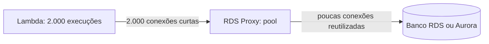

---
aliases:
  - Aula 13.6
modulo: 13
aula: 6
parte: "IV Bancos de dados"
dominios:
  - 2
  - 3
lida: false
tags:
  - aula
  - saa-c03
  - modulo-13
---

# Aula 13.6: RDS Proxy e gestão de conexões

[[13 - Bancos Relacionais RDS e Aurora|Voltar ao módulo]]

> [!question] Pergunta que esta aula responde
> Por que milhares de funções [[Lambda]] derrubam um banco relacional com "too many connections", e como o [[RDS Proxy]] resolve isso e ainda encurta o [[Failover|failover]]?

## O problema: conexão de banco é cara, e Lambda gera conexões demais

Abrir uma conexão com um banco relacional não é de graça. Para cada conexão, o servidor reserva memória, autentica o usuário (às vezes com [[TLS]] e uma consulta de senha) e mantém um processo ou *thread*. O número máximo de conexões de uma instância é limitado e depende da **memória da classe** (aula 13.2): um `db.t3.micro` aceita pouco, uma `db.r6g.4xlarge` aceita muito mais.

Aplicações tradicionais resolvem isso com um **[[Pool de Conexoes|pool de conexões]]** dentro do próprio processo: abrem, por exemplo, 20 conexões e as reutilizam. Mas considere uma aplicação [[Serverless]] com Lambda (Módulo 16). Cada execução concorrente da função é um ambiente isolado, e cada um abre **a sua própria conexão**. Se o tráfego sobe para 2.000 execuções simultâneas, o banco recebe 2.000 conexões ao mesmo tempo, e as novas falham com *too many connections*. Pior: o banco gasta CPU abrindo e fechando conexões em vez de executar consultas. O mesmo vale para fleets grandes de [[Container|contêineres]] ou instâncias que reiniciam em massa.

O [[RDS Proxy]] é um **[[Pool de Conexoes|pool de conexões]] gerenciado**, colocado entre a aplicação e o banco, para resolver exatamente isso.

## O que o RDS Proxy faz

As funções confirmadas na documentação (verificado em novembro de 2026):

1. **[[Pool de Conexoes|Pool de conexões]] e multiplexação.** O proxy mantém um conjunto de conexões abertas com o banco e **reaproveita** cada uma entre vários clientes. Quando uma transação termina, a conexão volta ao pool e outro cliente pode usá-la. Milhares de conexões de aplicação viram dezenas de conexões de banco. Esse reaproveitamento é chamado de **multiplexação**.
2. **[[Failover]] mais rápido.** O proxy reduz o tempo de failover em **até 66% em [[Multi-AZ DB Instance|Multi-AZ DB instances]]** (número da documentação de planejamento, [Planning where to use RDS Proxy](https://docs.aws.amazon.com/AmazonRDS/latest/UserGuide/rds-proxy-planning.html)), porque mantém as conexões da aplicação e se reconecta ao novo primário **sem depender dos caches de [[DNS]]** dos clientes (o problema da aula 13.3).
3. **Autenticação e segurança centralizadas.** Duas formas: a **padrão**, em que a aplicação autentica no proxy por [[IAM]] ou por usuário e senha e o proxy usa credenciais guardadas no [[Secrets Manager]] para falar com o banco; e a **IAM de ponta a ponta**, em que a autenticação do cliente e a do banco são ambas por IAM (permissão `rds-db:connect`). O proxy exige/oferece **[[TLS]]** com certificados do [[ACM]].
4. **Menos downtime em atualizações.** Em um [[Multi-AZ DB Cluster|Multi-AZ DB cluster]], o proxy pode reduzir o tempo de interrupção de uma atualização de versão menor para **1 segundo ou menos**.

> [!example] Caso concreto: Lambda e banco
> Uma API [[Serverless|serverless]] usa Lambda e [[RDS]] for PostgreSQL. No pico, a função escala para 1.500 execuções e o banco, com limite de 400 conexões, começa a recusar. Com o [[RDS Proxy]], as funções conectam ao proxy, que mantém um pool pequeno de conexões ao banco. A API passa a aguentar o pico sem aumentar a instância, e se o banco fizer [[Failover|failover]] o proxy mantém as conexões de entrada e reconecta sozinho.

## Pinning: o inimigo da multiplexação

A multiplexação só funciona se o proxy puder **trocar a conexão** entre clientes no fim de cada transação. Algumas operações **amarram** (*pin*) a conexão do banco a um único cliente até ele desconectar, e aí a conexão deixa de ser reaproveitada. Esse fenômeno é o *[[Session Pinning|session pinning]]*. A documentação cita exemplos como:

- comandos que mudam o **estado da sessão** (por exemplo, variáveis de sessão);
- **instruções muito grandes** (acima de 16 KB);
- outros recursos que guardam estado no servidor, conforme o engine.

Quanto mais [[Session Pinning|pinning]], mais o proxy se comporta como uma conexão direta, e o ganho some. A [[Metrica|métrica]] do [[CloudWatch]] do proxy mostra quando conexões estão presas. Para a prova, basta saber o conceito: pinning reduz a multiplexação.

## Onde o proxy fica e o que ele não é

Regras confirmadas (verificado em novembro de 2026):

- Roda **na mesma [[VPC]]** do banco e **não pode ser público**; o acesso externo precisa passar por algo na VPC. VPCs de **tenancy dedicada** não são suportadas.
- **Consequência para a Lambda:** como o proxy vive dentro da [[VPC]], uma [[Lambda|função Lambda]] que o use **precisa estar configurada na VPC** ([[Sub-rede|sub-redes]] e [[Security Group|security groups]] que alcancem o proxy, e um security group do proxy que aceite a função). Uma função fora da VPC tenta resolver um endereço privado e dá [[Timeout|timeout]]. O proxy também precisa de um **papel [[IAM]]** com permissão de ler os segredos no [[Secrets Manager]].
- Cada proxy tem **um alvo** (uma instância ou um cluster).
- Para **instâncias [[RDS]]**, o proxy só se conecta à **instância principal (writer)**, não a uma [[Read Replica|read replica]]. Para **[[Aurora]] e [[Multi-AZ DB Cluster|Multi-AZ DB clusters]]**, o proxy trabalha com o cluster e pode oferecer **endpoints somente leitura**.
- O endpoint padrão do proxy abrange apenas **duas zonas**, e é possível criar **até 20 endpoints adicionais**.
- Cotas: **20 proxies por conta** (por Região) e **200 segredos por proxy**.
- Há um usuário administrativo próprio, `rdsproxyadmin`, usado pelo serviço.
- Engines do [[RDS]] com suporte: **MariaDB, MySQL, PostgreSQL e SQL Server**, além do [[Aurora]]. **RDS for Oracle e RDS for Db2 não têm [[RDS Proxy]]** ([Supported Regions and DB engines for Amazon RDS Proxy](https://docs.aws.amazon.com/AmazonRDS/latest/UserGuide/Concepts.RDS_Fea_Regions_DB-eng.Feature.RDSProxy.html), verificado em novembro de 2026). O proxy também **não funciona com [[RDS Custom|RDS Custom for SQL Server]]**.

> [!warning] O proxy não é cache nem balanceador de leitura
> O [[RDS Proxy]] **não guarda resultados** de consulta (isso é cache, [[ElastiCache]], Módulo 14) e, para instâncias [[RDS]], **não distribui leitura** para réplicas. Ele reduz conexões e melhora a resiliência. Ele também **não resolve** consulta lenta: se o banco está lento por falta de índice, um [[Pool de Conexoes|pool de conexões]] não ajuda.

## Alternativa serverless: o Data API (Aurora)

Existe outro jeito de resolver "Lambda esgotando conexões" sem pool: o **[[Data API|RDS Data API]]**. Em vez de abrir uma conexão [[TCP]] persistente com o banco, a aplicação envia SQL a um **endpoint HTTPS** (via SDK), e o serviço executa a consulta usando credenciais guardadas no [[Secrets Manager]]. Você não gerencia conexões, e a [[Lambda|função Lambda]] **não precisa estar na [[VPC]]** para usá-lo (verificado em novembro de 2026 em [Using the Amazon RDS Data API](https://docs.aws.amazon.com/AmazonRDS/latest/AuroraUserGuide/data-api.html)). Cuidado com o escopo: a documentação do Data API é do **[[Aurora]]** (a [[Disponibilidade|disponibilidade]] depende de engine e versão); para um [[RDS]] de instância comum, a resposta da prova continua sendo o [[RDS Proxy]].

| | [[RDS Proxy]] | [[Data API]] ([[Aurora]]) |
|---|---|---|
| Protocolo | Conexão de banco normal (driver MySQL ou PostgreSQL) | Chamadas HTTPS pelo SDK |
| Lambda precisa estar na [[VPC]] | **Sim** | **Não** |
| Código da aplicação | Quase igual (troca o endpoint) | Muda: usa o SDK, não o driver |
| Serve para | [[RDS]] (MariaDB, MySQL, PostgreSQL, SQL Server) e [[Aurora]] | Aurora |

Na prova: "sem alterar o código e mantendo o driver" aponta o [[RDS Proxy]]; "[[Aurora]], sem gerenciar conexões e sem colocar a Lambda na [[VPC]]" aponta o [[Data API]].

## Proxy, pool na aplicação ou Aurora?

| Situação | Melhor escolha | Por quê |
|---|---|---|
| Lambda ou [[Container\|contêineres]] com muita concorrência | [[RDS Proxy]] | Funções efêmeras não têm pool próprio |
| Aplicação longa com pool bem configurado | Pool na aplicação costuma bastar | O proxy adiciona custo e um salto |
| [[Failover]] lento por cache de [[DNS]] | [[RDS Proxy]] | Ele reconecta sem passar pelo DNS dos clientes |
| Eliminar senha no código | [[RDS Proxy]] com [[IAM]] e [[Secrets Manager]] | Autenticação centralizada |
| Muitas leituras em instância [[RDS]] | Read replicas (aula 13.4) | O proxy não distribui leitura em instâncias |
| Consulta lenta | Índice, query tuning ou classe maior | Conexão não é o gargalo |

## Seguindo uma conexão pelo proxy

Para fixar o mecanismo, acompanhe uma requisição em uma API [[Serverless|serverless]] com [[RDS Proxy]] e autenticação padrão:

1. A [[Lambda|função Lambda]] abre uma conexão com o **endpoint do proxy** (e não com o endpoint do banco), usando [[TLS]].
2. O proxy autentica o cliente. Se a conexão usa [[IAM]], ele valida o token; se usa usuário e senha, valida a credencial. Em seguida, o proxy lê no [[Secrets Manager]] a credencial que **ele** usa para falar com o banco, de modo que o código da função nunca vê a senha real do banco.
3. O proxy escolhe uma conexão livre do pool para o banco e executa a transação do cliente.
4. Ao fim da transação, a conexão com o banco **volta ao pool** (a menos que tenha ocorrido [[Session Pinning|pinning]]), e outra função pode usá-la imediatamente.
5. Se o banco fizer [[Failover|failover]] no meio do tráfego, o proxy continua aceitando as conexões da aplicação, reconecta ao novo primário e retoma o envio, sem esperar a propagação do [[DNS]] no cliente.

Perceba que o passo 2 traz um benefício de segurança além da escala: as credenciais do banco ficam em um único lugar, o [[Secrets Manager]] (Módulo 8), e a permissão para que o proxy leia cada segredo é controlada por uma função [[IAM]] do próprio proxy.

## Endpoints do proxy e alta disponibilidade do próprio proxy

O proxy não é uma instância que você administra: ele é um serviço gerenciado distribuído em várias zonas dentro da [[VPC]]. O **endpoint padrão** é o nome que a aplicação usa. Você pode criar **endpoints adicionais** (até 20) para separar clientes, por exemplo, um endpoint para a aplicação transacional e outro, somente leitura, para relatórios contra um [[Aurora]] ou [[Multi-AZ DB Cluster|Multi-AZ DB cluster]]. Como o endpoint padrão cobre apenas duas zonas, quem precisa abranger outras zonas ou isolar uma [[Sub-rede|sub-rede]] cria um endpoint adicional em sub-redes específicas.

## O RDS Proxy e o custo (task statement 4.3)

> [!warning] Isto é raciocínio de arquitetura, não um benefício documentado
> A documentação de planejamento lista benefícios de **conexões, memória e [[Failover|failover]]**. Que o proxy permita reduzir a [[DB Instance Class|classe da instância]] é uma **inferência**: se o banco só estava grande para suportar conexões, um pool pode deixar uma classe menor bastar, mas o proxy tem cobrança própria (consulte a página de preços; o valor muda por Região). Faça a conta antes de prometer economia.

O que a documentação sustenta: instâncias pequenas (classes T2 e T3) sofrem com **falta de memória** e CPU gasta em abrir conexões quando recebem muitas; o proxy ajuda nesses casos. Para a prova, o raciocínio esperado é: "conexões demais, Lambda, banco sofrendo": proxy, não classe maior.

## Como isso cai na prova

> [!info] Task statements 2.1, 3.3 e 4.3
> Resiliência ([[Failover|failover]]), desempenho (conexões) e custo (menos instância para o mesmo pico).

**Palavras-chave em inglês:** *[[Pool de Conexoes|connection pooling]]*, *too many connections*, *Lambda*, *[[Failover|failover]] time*, *credentials*, *[[Secrets Manager]]*, *[[IAM]] authentication*, *reduce database load*.

**Armadilhas frequentes:**

- Escolher **[[ElastiCache]]** ou **[[Read Replica|read replica]]** para o erro "too many connections": o problema é o número de conexões, não a carga de leitura.
- Achar que o [[RDS Proxy]] fica **fora da [[VPC]]** ou é **público**: não é.
- Achar que o proxy **balanceia leituras** entre réplicas em instâncias [[RDS]]: ele se conecta ao writer.
- Aumentar a **[[DB Instance Class|classe da instância]]** só para ganhar mais conexões, quando o proxy resolveria mais barato.

| Requisito no enunciado | Resposta provável | Por quê |
|---|---|---|
| Lambda esgota as conexões do [[RDS]] | [[RDS Proxy]] | Pool e multiplexação |
| Reduzir o tempo de [[Failover\|failover]] da aplicação | [[RDS Proxy]] | Evita o cache de [[DNS]] e mantém conexões |
| Guardar credenciais do banco com segurança | [[Secrets Manager]] com o [[RDS Proxy]] | Credenciais gerenciadas e rotacionadas |
| Autenticar sem senha e com [[TLS]] | [[IAM]] authentication com o proxy | Token por IAM |
| Aplicação com carga de leitura pesada | Read replicas, não o proxy | Proxy não distribui leitura em [[RDS]] de instância |
| Lambda fora da [[VPC]] não alcança o proxy | Colocar a Lambda na VPC | O proxy é privado, dentro da VPC |
| [[Aurora]], executar SQL sem conexões e sem Lambda na [[VPC]] | [[Data API]] | HTTPS, sem pool nem VPC |

## Resumo

> [!abstract] A aula em uma frase
> O [[RDS Proxy]] é um [[Pool de Conexoes|pool de conexões]] gerenciado na [[VPC]] que multiplexa milhares de conexões de aplicação em poucas conexões de banco, protege credenciais com [[IAM]] e [[Secrets Manager]] e encurta o [[Failover|failover]] (até 66% em [[Multi-AZ DB Instance|Multi-AZ DB instances]]), mas só fala com o writer em instâncias [[RDS]] e não é cache nem balanceador de leitura.

**A lógica, em 5 passos**

1. Conexões são caras e limitadas pela memória da classe.
2. Lambda e fleets grandes abrem uma conexão por execução e estouram o limite.
3. O proxy mantém um pool e reaproveita conexões entre clientes (multiplexação).
4. [[Session Pinning|Pinning]] (estado de sessão, instruções grandes) amarra conexões e reduz o ganho.
5. No [[Failover|failover]], o proxy reconecta sem depender do [[DNS]] do cliente.

**Números para lembrar**

| O quê | Valor | Por que importa |
|---|---|---|
| Redução do tempo de [[Failover\|failover]] | Até 66% ([[Multi-AZ DB Instance\|Multi-AZ DB instances]]) | Benefício de resiliência |
| Proxies por conta | 20 | Cota padrão |
| Segredos por proxy | 200 | Cota padrão |
| Endpoints adicionais | Até 20 | Além do padrão |
| Instrução que causa [[Session Pinning\|pinning]] | Acima de 16 KB | Reduz a multiplexação |

**Na prática, isso significa**

- Lambda mais [[RDS]] relacional: planeje o [[RDS Proxy]] desde o começo.
- Credenciais do banco no [[Secrets Manager]], nunca no código.
- Alvo de leitura em instância [[RDS]]: endpoint da [[Read Replica|read replica]], direto.
- Observe métricas de conexões e de [[Session Pinning|pinning]] no [[CloudWatch]].

> [!tip] Liga com
> Vem da [[13.05 - RDS Backups PITR Snapshots Criptografia e Seguranca|aula 13.5]] ([[IAM]] e [[Secrets Manager]]) e da [[13.03 - RDS Multi-AZ Instancia e Cluster|aula 13.3]] (cache de [[DNS]]). Segue para o [[Aurora]] na [[13.07 - Aurora Arquitetura Endpoints e Replicas|aula 13.7]]. O Lambda em detalhe está no [[16 - Serverless Lambda e API Gateway|Módulo 16]].

## Erros comuns

- **"O proxy é um cache."** Ele não guarda resultados; ele reaproveita conexões.
- **"O proxy aceita [[Read Replica|read replica]] de instância [[RDS]]."** Em instâncias, só o writer.
- **"Posso expor o proxy na internet."** Ele fica na [[VPC]] e não é público.
- **"Mais conexões = classe maior."** Muitas vezes o proxy resolve por menos.
- **"O proxy corrige consulta lenta."** Conexão não é o gargalo de uma consulta ruim.

## Pratique

**1.** Uma API usa Lambda e [[RDS]] for MySQL. No pico, as funções escalam para milhares de execuções e o banco recusa novas conexões com "too many connections". Qual a solução mais indicada com o MENOR esforço de mudança?

- [ ] a) Trocar a classe do banco por uma de memória otimizada e mais cara
- [ ] b) Criar várias read replicas para distribuir as conexões de leitura
- [ ] c) Colocar o RDS Proxy entre as funções Lambda e o banco de dados
- [ ] d) Adicionar uma camada de cache com ElastiCache na frente do banco

**2.** Uma empresa quer reduzir o tempo em que a aplicação fica sem banco durante um [[Failover|failover]] do [[RDS]] [[Multi-AZ]]. Parte do atraso vem do cache de [[DNS]] dos clientes. O que ajuda?

- [ ] a) Usar o RDS Proxy, que reconecta ao novo primário sem depender do DNS
- [ ] b) Trocar o endpoint DNS por um endereço IP fixo da instância primária
- [ ] c) Criar uma read replica na mesma zona e apontar a aplicação para ela
- [ ] d) Aumentar o TTL do DNS para 10 minutos nos clientes da aplicação, para estabilizar

**3.** Uma equipe quer que a aplicação se autentique no banco sem guardar a senha no código, com as credenciais do banco armazenadas e rotacionadas de forma central. Qual combinação atende?

- [ ] a) Manter um pool de conexões embutido no código de cada função, com a senha em uma constante
- [ ] b) Usar o RDS Proxy e guardar a senha do banco em uma variável de ambiente da função
- [ ] c) Aumentar max_connections e colocar a senha em um parameter group compartilhado
- [ ] d) RDS Proxy com credenciais no Secrets Manager e autenticação por IAM no cliente

**4.** Uma empresa pergunta se pode colocar o [[RDS Proxy]] em uma [[Sub-rede Publica|sub-rede pública]] para que clientes externos conectem direto a ele. O que é correto?

- [ ] a) Sim, basta liberar a porta no security group do proxy para a internet
- [ ] b) Não; o proxy fica dentro da VPC do banco e não pode ser público
- [ ] c) Sim, colocando o proxy atrás de um Network Load Balancer público
- [ ] d) Sim, mas só se o banco for um Aurora e não uma instância RDS comum

**5.** Uma aplicação usa [[RDS Proxy]] em frente a uma instância [[RDS]] for PostgreSQL e uma [[Read Replica|read replica]]. A equipe espera que o proxy balanceie as consultas SELECT entre as duas. O que acontece?

- [ ] a) O proxy envia as leituras para a réplica e as escritas para a origem sozinho
- [ ] b) O proxy distribui toda a carga entre origem e réplica de forma igual
- [ ] c) Em instâncias RDS, o proxy fala só com a principal, sem balancear leitura
- [ ] d) O proxy escolhe a réplica mais próxima e usa a origem como contingência

**6.** Por que o uso do [[RDS Proxy]] pode não trazer ganho de multiplexação em uma aplicação que executa muitos comandos que mudam o estado da sessão?

- [ ] a) Eles causam session pinning, que prende a conexão do banco a um cliente
- [ ] b) O proxy desliga o pool sempre que detecta mais de uma sessão aberta no banco
- [ ] c) O proxy não aceita comandos de sessão e os rejeita com erro de sintaxe
- [ ] d) O proxy converte esses comandos em transações longas automaticamente

**7.** Uma empresa executa uma aplicação tradicional de longa duração, com um [[Pool de Conexoes|pool de conexões]] bem dimensionado na aplicação e poucas instâncias estáveis. O banco nunca chega perto do limite. O [[RDS Proxy]] é necessário?

- [ ] a) Sim, pois ele sempre reduz a latência de cada consulta individual
- [ ] b) Sim, pois o pool da aplicação não funciona com RDS, só com bancos em EC2
- [ ] c) Sim, pois só o proxy permite usar o Secrets Manager com o banco
- [ ] d) Provavelmente não; o pool da própria aplicação já resolve o caso

**8.** Qual benefício de resiliência o [[RDS Proxy]] documenta?

- [ ] a) Eliminar totalmente a necessidade de Multi-AZ no banco
- [ ] b) Reduzir o tempo de failover em até 66% em Multi-AZ DB instances
- [ ] c) Evitar qualquer indisponibilidade em atualizações de versão do banco
- [ ] d) Replicar o banco para outra Região de forma automática

**9.** Uma API em Lambda usa o [[RDS Proxy]] com autenticação [[IAM]] de ponta a ponta. Qual permissão IAM a função precisa para conectar?

- [ ] a) rds:CreateDBProxy, para criar o proxy a cada execução
- [ ] b) rds:DescribeDBInstances, para descobrir o endereço do banco
- [ ] c) rds-db:connect, para autenticar a conexão por IAM
- [ ] d) kms:Decrypt, para ler a senha do banco na hora da conexão

**10.** Um banco [[RDS]] for MySQL de homologação, em uma `db.t3.medium`, sofre com falta de memória e CPU alta por causa de centenas de conexões curtas vindas de [[Lambda|funções Lambda]]. Qual solução reduz o problema sem trocar de classe?

- [ ] a) Migrar o banco para uma instância burstable T maior e aceitar o consumo de créditos
- [ ] b) Desligar o Multi-AZ para liberar memória no banco principal
- [ ] c) Criar uma read replica para cada microsserviço que se conecta
- [ ] d) Usar o RDS Proxy, para que o banco receba poucas conexões reutilizadas

**11.** Qual das situações a seguir NÃO é resolvida pelo [[RDS Proxy]]?

- [ ] a) Muitas funções Lambda esgotando as conexões do banco de produção
- [ ] b) Uma consulta lenta por falta de índice em uma tabela grande
- [ ] c) Cache de DNS atrasando a reconexão depois de um failover
- [ ] d) Credenciais do banco espalhadas pelo código das aplicações

**12.** (Escolha DUAS.) Quais afirmações sobre o [[RDS Proxy]] estão corretas?

- [ ] a) Ele pode ficar fora da VPC para atender clientes externos.
- [ ] b) Ele mantém um pool de conexões e as reaproveita entre clientes.
- [ ] c) Em instâncias RDS, ele se conecta apenas à instância principal.
- [ ] d) Ele armazena em cache os resultados das consultas.
- [ ] e) Ele funciona em VPCs de tenancy dedicada.

**13.** (Escolha DUAS.) Quais cenários justificam o uso do [[RDS Proxy]]?

- [ ] a) Funções Lambda que abrem muitas conexões de curta duração com o banco.
- [ ] b) Um banco com leituras pesadas que precisam ser distribuídas entre réplicas de instância.
- [ ] c) Uma consulta analítica que demora horas por falta de índices.
- [ ] d) Reduzir o impacto de failover sobre as conexões da aplicação.
- [ ] e) Armazenar os resultados das consultas mais frequentes em memória.

**14.** Uma [[Lambda|função Lambda]] que não está associada a nenhuma [[VPC]] recebe [[Timeout|timeout]] ao conectar no endpoint de um [[RDS Proxy]] criado para um [[RDS]] for PostgreSQL. Qual correção atende o requisito?

- [ ] a) Tornar o RDS Proxy publicamente acessível e liberar o IP da função no security group
- [ ] b) Trocar o endpoint do proxy pelo endpoint do banco, que sempre é público por padrão
- [ ] c) Configurar a função na mesma VPC, com sub-redes e security group que alcancem o proxy
- [ ] d) Aumentar a memória da função, porque o timeout vem do pouco poder de CPU

**15.** Uma API ocasional em Lambda consulta um cluster [[Aurora]]. A equipe quer executar SQL sem gerenciar conexões e sem colocar a função dentro da [[VPC]]. Qual opção atende?

- [ ] a) Habilitar o RDS Data API no cluster Aurora e chamá-lo pelo SDK
- [ ] b) Criar um RDS Proxy e manter a função fora da VPC
- [ ] c) Criar uma read replica Aurora com endpoint público
- [ ] d) Colocar um ElastiCache na frente e ler só do cache

> [!success]- Gabarito
> **1. c)** O [[RDS Proxy]] mantém um pool e multiplexa as conexões, resolvendo o excesso causado pelo Lambda sem mexer no banco. Classe maior (a) é mais cara; read replicas (b) não reduzem conexões de escrita; cache (d) reduz leituras, não conexões.
> **2. a)** O proxy reconecta ao novo primário sem depender do cache de [[DNS]] dos clientes e reduz o [[Failover|failover]] em até 66% ([[Multi-AZ DB Instance|Multi-AZ DB instances]]). IP fixo (b) quebra no failover; réplica (c) não é o novo primário; aumentar o [[TTL]] (d) piora.
> **3. d)** O [[RDS Proxy]] com o [[Secrets Manager]] e a autenticação [[IAM]] centraliza as credenciais. Pool no código com constante (a), variável de ambiente (b) e [[Parameter Group|parameter group]] (c) mantêm a senha no código ou espalhada; o proxy exige segredo ou IAM para falar com o banco.
> **4. b)** O proxy roda na [[VPC]] do banco e não pode ser público. Liberar a porta (a), um [[Network Load Balancer|NLB]] público (c) e a restrição ao [[Aurora]] (d) não mudam isso.
> **5. c)** Para instâncias [[RDS]], o proxy só se conecta à principal e não balanceia leitura. As opções a), b) e d) atribuem ao proxy um balanceamento que ele não faz.
> **6. a)** Comandos que alteram o estado da sessão causam [[Session Pinning|session pinning]], que prende a conexão a um cliente e reduz a multiplexação. O proxy não desliga o pool (b), aceita comandos de sessão (c) e não os converte em transações (d).
> **7. d)** Para uma aplicação estável com pool próprio, o proxy provavelmente não é necessário e adiciona custo e um salto. Ele não reduz a [[Latencia|latência]] de cada consulta (a), o pool da aplicação funciona com [[RDS]] (b) e o [[Secrets Manager]] é usável sem o proxy (c).
> **8. b)** A documentação cita redução do tempo de [[Failover|failover]] em até 66% em [[Multi-AZ DB Instance|Multi-AZ DB instances]]. Ele não elimina o [[Multi-AZ]] (a), não evita toda indisponibilidade em upgrade (c) e não replica para outra Região (d).
> **9. c)** Na autenticação [[IAM]] de ponta a ponta, a permissão é `rds-db:connect`. As ações dos itens a), b) e d) não autenticam a conexão. Lembre também que a função precisa estar na [[VPC]] para alcançar o proxy.
> **10. d)** A documentação indica o proxy para instâncias T2 e T3 com muitas conexões, evitando falta de memória e CPU gasta em abrir conexões. Uma T maior (a) é paliativo; desligar [[Multi-AZ]] (b) não libera conexões; mais réplicas (c) não ajudam.
> **11. b)** Consulta lenta por falta de índice precisa de tuning do banco, não de [[Pool de Conexoes|pool de conexões]]. As situações a), c) e d) são resolvidas pelo proxy.
> **12. b), c)** O proxy mantém e reaproveita um pool e, em instâncias [[RDS]], só fala com a principal. Ele fica na [[VPC]] (a), não é cache de resultados (d) e não funciona em tenancy dedicada (e).
> **13. a), d)** Lambda com muitas conexões curtas e [[Failover|failover]] são os casos de uso. Distribuir leitura entre réplicas de instância (b) não é função do proxy, consulta lenta (c) pede tuning e cache de resultados (e) é [[ElastiCache]].
> **14. c)** O proxy é privado e vive na [[VPC]], então a função precisa estar na VPC (e o proxy precisa de um papel [[IAM]] para ler o segredo). O proxy não pode ser público (a), o endpoint do banco (b) perderia o pool e continua privado na prática, e memória (d) não resolve conectividade.
> **15. a)** O [[Data API]] ([[Aurora]]) executa SQL por HTTPS, sem conexões persistentes e sem Lambda na [[VPC]]. O [[RDS Proxy]] (b) exige a função na VPC; réplica pública (c) não resolve conexões e é insegura; cache (d) só atende leituras repetidas.

## Para aprofundar

- [ ] [Amazon RDS Proxy](https://docs.aws.amazon.com/AmazonRDS/latest/UserGuide/rds-proxy.html) (documentação AWS): visão geral, [[Pool de Conexoes|pool de conexões]], [[Failover|failover]], limites e cotas.
- [ ] [Conceitos e terminologia do RDS Proxy](https://docs.aws.amazon.com/AmazonRDS/latest/UserGuide/rds-proxy.howitworks.html) (documentação AWS): multiplexação, [[Session Pinning|pinning]] e autenticação.

Próxima aula: [[13.07 - Aurora Arquitetura Endpoints e Replicas|Aula 13.7: Aurora, arquitetura, endpoints e réplicas]].
