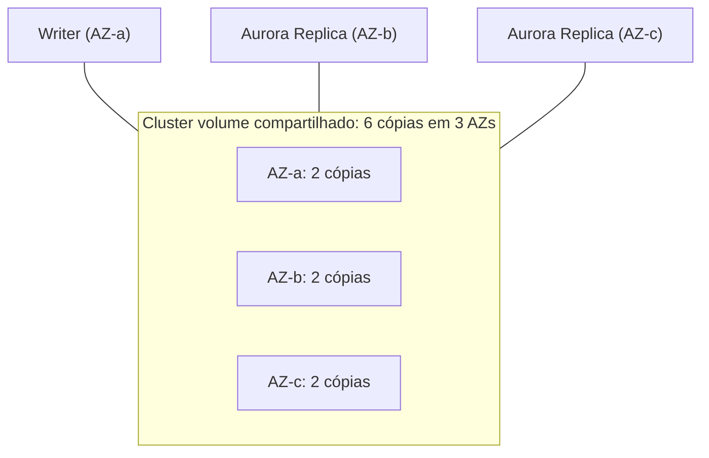

---
aliases:
  - Aula 13.7
modulo: 13
aula: 7
parte: "IV Bancos de dados"
dominios:
  - 2
  - 3
lida: false
tags:
  - aula
  - saa-c03
  - modulo-13
---

# Aula 13.7: Aurora, arquitetura, endpoints e réplicas

[[13 - Bancos Relacionais RDS e Aurora|Voltar ao módulo]]

> [!question] Pergunta que esta aula responde
> Por que o [[Aurora]] consegue ter até 15 réplicas com atraso de milissegundos e [[Failover|failover]] em menos de um minuto, enquanto o [[RDS]] tradicional copia dados entre instâncias, e quais endpoints usar em cada caso?

## O problema: no RDS tradicional, cada instância tem o seu disco

Nas aulas 13.3 e 13.4 você viu que o [[RDS]] tradicional replica **dados** entre instâncias. No [[Multi-AZ]], cada gravação é enviada ao disco do standby. Na [[Read Replica|read replica]], as mudanças são aplicadas pela réplica sobre o **seu próprio volume**. Isso tem três consequências: criar uma réplica exige **copiar o banco inteiro**, o [[Replica Lag|atraso de replicação]] cresce com a carga de escrita, e cada instância paga pelo seu próprio armazenamento.

O [[Aurora]] muda a arquitetura de base. Em vez de cada instância ter o seu disco e trocar dados com as outras, o Aurora **separa a computação do armazenamento**: as instâncias (computação) são apenas motores de banco, e todas leem e escrevem em um **único [[Cluster Volume|volume de cluster]] compartilhado e distribuído**. Essa decisão explica quase tudo que a prova pergunta sobre o Aurora.

## O volume do cluster

O **[[Cluster Volume|cluster volume]]** é um volume virtual que abrange **três [[Zona de Disponibilidade|zonas de disponibilidade]]** e guarda **seis cópias** dos dados, duas por zona (verificado em novembro de 2026). Pontos confirmados na documentação:

- A escrita tolera a **perda de duas cópias** e a leitura tolera a **perda de três**, sem perder a [[Disponibilidade|disponibilidade]] correspondente ([Aurora storage reliability](https://docs.aws.amazon.com/AmazonRDS/latest/AuroraUserGuide/Aurora.Overview.StorageReliability.html)). Em termos de **quórum**, isso é: **4 das 6 cópias** para confirmar uma escrita e **3 das 6** para uma leitura. Por isso uma [[Zona de Disponibilidade|AZ]] inteira (2 cópias) pode cair sem parar a escrita, e AZ mais uma cópia (3 cópias) ainda permite leitura.
- O armazenamento é **autorreparável** (*self-healing*): blocos com problema são detectados e reconstruídos a partir das outras cópias.
- O volume **cresce automaticamente** conforme os dados aumentam, até **256 TiB** nas versões mais novas (por exemplo, [[Aurora]] PostgreSQL 17.5, 16.9 e 15.13 ou superiores, e Aurora MySQL 3.10 ou superior), e **128 TiB** nas versões mais antigas. Você não provisiona nem escolhe o tamanho: paga pelo que usa.
- O volume sobrevive à instância: se o writer morre, os dados continuam no volume; outra instância assume.

> [!info] Ligando os pontos
> Compare com o [[Multi-AZ]] da aula 13.3: lá existem **dois** discos sincronizados por replicação. No [[Aurora]] existe **um** volume lógico distribuído, e as réplicas leem dele. Por isso criar uma [[Aurora Replica|réplica Aurora]] não copia dados e o atraso é baixo.

## Aurora Replicas: compartilham o mesmo volume

Um cluster [[Aurora]] tem **uma instância writer** e até **15 [[Aurora Replica|Aurora Replicas]]** (verificado em novembro de 2026). Em um [[Aurora Global Database]] (aula 13.8), cada cluster secundário pode ter até 16 instâncias somente leitura; confira as limitações do Global Database para a conta exata antes de dimensionar. Como as réplicas leem do **mesmo volume** do writer, não há replicação de dados entre instâncias: o atraso típico é **abaixo de 100 milissegundos**, muito menor do que o das read replicas do [[RDS]]. Essas réplicas servem a duas funções ao mesmo tempo:

1. **Escalar leitura**, como as read replicas do [[RDS]].
2. **Servir de alvo de [[Failover|failover]]**, como o standby do [[Multi-AZ]], só que **atendendo leitura enquanto esperam**.

Isso é a maior vantagem de desenho do [[Aurora]]: a mesma instância é capacidade de leitura **e** [[Disponibilidade|disponibilidade]].

### Failover

Se o writer falha, o [[Aurora]] promove uma réplica (verificado em novembro de 2026):

- Tipicamente **em menos de 60 segundos**, muitas vezes em menos de 30.
- A réplica a promover é escolhida pelos **níveis de [[Promotion Tier|prioridade de promoção]]** (*promotion tiers*), de **0 a 15**: a de menor número vence; em empate, a **maior** instância (classe) vence.
- **Sem nenhuma réplica**, o [[Aurora]] recria o writer na mesma zona, o que leva tipicamente **menos de 10 minutos**. Por isso, para [[Alta Disponibilidade|alta disponibilidade]] real, o cluster precisa de pelo menos uma réplica em **outra zona**.
- O **[[Cluster Endpoint|cluster endpoint]]** passa a apontar para o novo writer; a aplicação reconecta pelo mesmo nome.

> [!tip] Réplica em outra zona é o seguro
> Em prova, "[[Alta Disponibilidade|alta disponibilidade]] no [[Aurora]]" significa **ter pelo menos uma [[Aurora Replica]] em outra zona**. Um cluster com uma única instância depende de recuperação lenta e não tem alvo de [[Failover|failover]] imediato.

## Endpoints do Aurora

Aqui está a parte que mais cai. O [[Aurora]] oferece vários endpoints (verificado em novembro de 2026):

| Endpoint | Aponta para | Uso |
|---|---|---|
| **[[Cluster Endpoint\|Cluster endpoint]]** | Sempre o **writer** atual | Escrita e leitura que precisa ser atual; muda sozinho no [[Failover\|failover]] |
| **[[Reader Endpoint\|Reader endpoint]]** | **Distribui** entre as [[Aurora Replica\|Aurora Replicas]] | Leitura escalável; um nome único para todas as réplicas |
| **Instance endpoint** | Uma instância específica | Diagnóstico, ou tráfego dirigido a uma instância |
| **[[Custom Endpoint\|Custom endpoint]]** | Um **subconjunto** de instâncias que você escolhe (padrão: 5 por cluster) | Separar cargas (por exemplo, relatórios em instâncias maiores) |
| **Global writer endpoint** | O writer da Região primária de um [[Aurora Global Database]] (um banco que liga clusters de várias [[Regiao AWS\|Regiões]], aula 13.8) | Aplicação que deve seguir a troca de Região |

Compare com o [[RDS]] de instância da aula 13.4: lá **não há [[Reader Endpoint|reader endpoint]]**, e cada réplica tem o seu endereço. No [[Aurora]] a aplicação usa **um** nome para leitura. O balanceamento do reader endpoint é feito em nível de **conexão**, e não de consulta: o reader endpoint é um nome [[DNS]] que distribui as **conexões** entre as réplicas (round-robin), e as consultas daquela conexão ficam na réplica escolhida ([Aurora endpoint connections](https://docs.aws.amazon.com/AmazonRDS/latest/AuroraUserGuide/Aurora.Overview.Endpoints.html)). Consequência prática: uma conexão longa e pesada não é redistribuída, e o desequilíbrio é possível.

> [!example] Custom endpoint em ação
> Uma empresa tem um cluster [[Aurora]] com o writer, duas réplicas pequenas (`db.r6g.large`) e uma réplica grande (`db.r6g.4xlarge`). Ela cria um **[[Custom Endpoint|custom endpoint]]** `relatorios` que aponta só para a réplica grande, e a equipe de BI usa esse nome. As consultas pesadas ficam isoladas, e o [[Reader Endpoint|reader endpoint]] normal segue servindo o tráfego da aplicação nas réplicas pequenas.

## Aurora Auto Scaling

O [[RDS]] de instância não escala réplicas sozinho (aula 13.4); o [[Aurora]] escala. O **Aurora [[Auto Scaling Group|Auto Scaling]]** usa o **[[Application Auto Scaling]]** para **adicionar e remover [[Aurora Replica|Aurora Replicas]]** conforme uma [[Metrica|métrica]] (por exemplo, a utilização de CPU das réplicas ou o número de conexões). Regras confirmadas:

- Escala **somente réplicas**; o writer não escala por esse mecanismo.
- A réplica nova nasce com **prioridade 15** e a **mesma classe do writer**.
- **Não é suportado** em clusters secundários de um Global Database.

## Backups e recuperação no Aurora

Os backups do [[Aurora]] são **contínuos** e incrementais, gravados no próprio sistema de armazenamento (verificado em novembro de 2026):

- **Retenção de 1 a 35 dias**, e os backups **não podem ser desativados** (diferente do [[RDS]] tradicional, em que 0 desliga). O padrão é 1 dia pela CLI e 7 pelo console.
- O **[[Point-in-Time Recovery|PITR]]** permite restaurar para qualquer ponto até cerca de **5 minutos atrás**. Como no [[RDS]], a restauração cria um **novo cluster**.
- [[Snapshot|Snapshots]] manuais continuam existindo para guardar estados e copiar entre [[Regiao AWS|Regiões]]. O clone e o [[Backtrack|backtrack]] (aula 13.8) oferecem formas mais rápidas de "voltar" ou "copiar".

## Aurora versus RDS: quando escolher cada um

| Critério | [[RDS]] tradicional (MySQL, PostgreSQL, etc.) | [[Aurora]] (compatível com MySQL e PostgreSQL) |
|---|---|---|
| Armazenamento | Por instância; você escolhe tipo e tamanho | [[Cluster Volume\|Volume de cluster]] compartilhado; cresce sozinho até 256 TiB |
| Cópias dos dados | 1 por instância (mais standby) | 6 cópias em 3 zonas |
| Réplicas | Até 15 (MySQL, MariaDB, PostgreSQL), com lag maior | Até 15, lag típico abaixo de 100 ms |
| [[Failover]] | 60 a 120 s ([[Multi-AZ]] instance) | Tipicamente abaixo de 60 s |
| Escalar réplicas | Manual | [[Aurora]] [[Auto Scaling Group\|Auto Scaling]] |
| [[Reader Endpoint\|Endpoint de leitura]] | Um por réplica | Reader endpoint e [[Custom Endpoint\|custom endpoints]] |
| Engines | Db2, MariaDB, MySQL, Oracle, PostgreSQL, SQL Server | Só compatíveis com MySQL e PostgreSQL |
| Custo | Geralmente menor para cargas pequenas e estáveis | Instância mais cara; armazenamento e I/O conforme o modelo (aula 13.8) |

**Heurística de prova:** se o enunciado pede **[[Alta Disponibilidade|alta disponibilidade]], [[Failover|failover]] rápido, muitas [[Read Replica|réplicas de leitura]] com baixo lag, crescimento automático do armazenamento** ou **alto desempenho**, a resposta tende a ser [[Aurora]]. Se pede um engine fora do MySQL e do PostgreSQL (Oracle, SQL Server, MariaDB), é [[RDS]]. Se o orçamento é pequeno e a carga é simples, RDS tradicional costuma bastar.

## Como isso cai na prova

> [!info] Task statements 2.1, 3.3 e 4.3
> Resiliência, desempenho de banco e custo.

**Palavras-chave em inglês:** *[[Aurora]]*, *MySQL-compatible*, *PostgreSQL-compatible*, *up to 15 replicas*, *[[Reader Endpoint|reader endpoint]]*, *[[Cluster Endpoint|cluster endpoint]]*, *automatic [[Failover|failover]]*, *auto scaling replicas*, *shared storage*, *self-healing*.

**Armadilhas frequentes:**

- Apontar a **leitura** da aplicação para o **[[Cluster Endpoint|cluster endpoint]]**: ele aponta para o writer; leitura escalável usa o [[Reader Endpoint|reader endpoint]].
- Achar que **uma instância [[Aurora]] sozinha** já é [[Alta Disponibilidade|altamente disponível]]: sem réplica em outra zona, a recuperação é lenta.
- Esquecer que o [[Aurora]] só é compatível com **MySQL e PostgreSQL**.
- Confundir **[[Promotion Tier|promotion tier]]** (prioridade de [[Failover|failover]]) com **[[Aurora]] [[Auto Scaling Group|Auto Scaling]]** (réplica nova nasce no tier 15).
- Achar que o backup do [[Aurora]] **pode ser desligado**: não pode.

| Requisito no enunciado | Resposta provável | Por quê |
|---|---|---|
| Banco relacional com até 15 réplicas e lag mínimo | [[Aurora]] | Réplicas compartilham o volume |
| [[Failover]] em menos de um minuto, sem copiar dados | [[Aurora]] com réplica em outra zona | Promoção rápida de réplica |
| Leitura escalável com um único nome | [[Reader Endpoint\|Reader endpoint]] | Distribui entre as réplicas |
| Isolar relatórios em instâncias maiores | [[Custom Endpoint\|Custom endpoint]] | Subconjunto de instâncias |
| Réplicas escalando sozinhas com a carga | [[Aurora]] [[Auto Scaling Group\|Auto Scaling]] | [[Application Auto Scaling]] nas réplicas |
| Banco Oracle ou SQL Server | [[RDS]], não [[Aurora]] | Aurora só tem MySQL e PostgreSQL |

## Resumo

> [!abstract] A aula em uma frase
> O [[Aurora]] separa a computação do armazenamento e usa um [[Cluster Volume|volume de cluster]] compartilhado com seis cópias em três zonas, por isso suas até 15 réplicas têm lag de milissegundos, servem de alvo de [[Failover|failover]] em menos de um minuto e podem ser alcançadas por endpoints de cluster, leitura e customizados.

**A lógica, em 5 passos**

1. No [[RDS]] tradicional, cada instância tem seu disco e a replicação copia dados.
2. No [[Aurora]], as instâncias compartilham um [[Cluster Volume|volume de cluster]] de 6 cópias em 3 zonas, autorreparável e com crescimento automático.
3. Como as réplicas leem do mesmo volume, o atraso é baixo e o [[Failover|failover]] é rápido ([[Promotion Tier|promotion tiers]] de 0 a 15).
4. A aplicação usa o [[Cluster Endpoint|cluster endpoint]] para escrita e o [[Reader Endpoint|reader endpoint]] para leitura; [[Custom Endpoint|custom endpoints]] isolam cargas.
5. O [[Aurora]] [[Auto Scaling Group|Auto Scaling]] adiciona réplicas (tier 15, mesma classe do writer); os backups são contínuos e não podem ser desligados.

**Números para lembrar**

| O quê | Valor | Por que importa |
|---|---|---|
| Cópias do dado | 6, em 3 [[Zona de Disponibilidade\|AZs]] | Resiliência do volume |
| Réplicas | Até 15 | Escala de leitura |
| [[Replica Lag\|Lag de réplica]] | Tipicamente abaixo de 100 ms | Volume compartilhado |
| [[Failover]] | Tipicamente abaixo de 60 s | Com réplica em outra zona |
| Sem réplicas | Recuperação em até cerca de 10 min | Na mesma zona |
| Tamanho máximo do volume | 256 TiB (versões novas) | Crescimento automático |
| Retenção de backup | 1 a 35 dias | Não pode ser desligado |
| [[Custom Endpoint\|Custom endpoints]] | 5 por cluster (padrão) | Cota por cluster |

**Na prática, isso significa**

- Produção: no mínimo uma [[Aurora Replica]] em outra zona.
- Escrita no [[Cluster Endpoint|cluster endpoint]], leitura no [[Reader Endpoint|reader endpoint]].
- Relatórios pesados: [[Custom Endpoint|custom endpoint]] em réplicas maiores.
- Carga de leitura variável: [[Aurora]] [[Auto Scaling Group|Auto Scaling]].

> [!tip] Liga com
> Vem da [[13.06 - RDS Proxy e Gestao de Conexoes|aula 13.6]] (o proxy também suporta o [[Aurora]], com endpoints de leitura) e da [[13.04 - RDS Read Replicas e Escala de Leitura|aula 13.4]] (comparação com read replicas). Segue para a [[13.08 - Aurora Global Database Serverless v2 e Recursos|aula 13.8]].

## Erros comuns

- **"No [[Aurora]] as réplicas replicam os dados do writer."** Elas leem o mesmo volume; por isso o lag é baixo.
- **"Uma instância [[Aurora]] já é [[Alta Disponibilidade|altamente disponível]]."** Precisa de réplica em outra zona.
- **"Leio no [[Cluster Endpoint|cluster endpoint]]."** Ele sempre aponta para o writer.
- **"Desligo os backups do [[Aurora]] para economizar."** Não é possível.
- **"O [[Aurora]] serve para qualquer engine."** Só MySQL e PostgreSQL compatíveis.

## Pratique

**1.** Uma empresa precisa de um banco relacional compatível com PostgreSQL com até 15 [[Read Replica|réplicas de leitura]], [[Replica Lag|atraso de replicação]] de milissegundos, [[Failover|failover]] em menos de um minuto e armazenamento que cresça sozinho. Qual serviço atende?

- [ ] a) Amazon RDS for PostgreSQL com Multi-AZ DB instance e uma read replica
- [ ] b) Amazon RDS for PostgreSQL com Multi-AZ DB cluster e dois readers
- [ ] c) PostgreSQL instalado em EC2, com replicação nativa e volumes EBS grandes
- [ ] d) Amazon Aurora com compatibilidade PostgreSQL e várias Aurora Replicas

**2.** Uma aplicação grava no [[Cluster Endpoint|cluster endpoint]] de um cluster [[Aurora]] e também executa todos os SELECT nele. As réplicas estão ociosas e o writer está sobrecarregado. O que fazer, sem custo adicional de instâncias?

- [ ] a) Criar um segundo cluster em outra Região e mover as consultas para ele
- [ ] b) Apontar as leituras da aplicação para o reader endpoint do cluster
- [ ] c) Aumentar o armazenamento do volume de cluster, para a leitura acelerar
- [ ] d) Aumentar a classe do writer e manter todas as leituras no cluster endpoint

**3.** Um cluster [[Aurora]] de produção tem uma única instância writer e nenhuma réplica. A instância falha. O que acontece?

- [ ] a) O Aurora recria o writer na mesma zona, em alguns minutos
- [ ] b) O banco fica indisponível até alguém restaurar o último snapshot manual
- [ ] c) Os dados são perdidos, pois o volume de cluster depende da instância
- [ ] d) O Aurora promove uma réplica que o próprio cluster criou na zona vizinha antes da falha

**4.** Uma equipe de BI executa consultas pesadas e quer que elas rodem só nas maiores instâncias do cluster, sem competir com a aplicação principal. Qual recurso do [[Aurora]] ajuda?

- [ ] a) O cluster endpoint, que reserva as maiores instâncias para as consultas
- [ ] b) O reader endpoint padrão, que escolhe a instância maior de cada cluster
- [ ] c) Um custom endpoint que aponta apenas para as réplicas maiores do cluster
- [ ] d) O instance endpoint do writer, que isola o tráfego de leitura da aplicação

**5.** Uma empresa quer que o número de [[Aurora Replica|Aurora Replicas]] aumente e diminua conforme a carga de leitura. Qual recurso usar?

- [ ] a) O storage autoscaling do RDS, que também adiciona réplicas quando falta CPU
- [ ] b) O Aurora Auto Scaling, que usa o Application Auto Scaling nas réplicas
- [ ] c) Um Auto Scaling Group de instâncias EC2 que hospedam réplicas
- [ ] d) O RDS Proxy, que cria réplicas conforme as conexões aumentam

**6.** Um cluster [[Aurora]] tem duas réplicas, uma no tier 1 e outra no tier 5, ambas da mesma classe. O writer falha. Qual réplica é promovida?

- [ ] a) A do tier 5, pois tem o maior número e portanto a maior prioridade
- [ ] b) Qualquer uma, escolhida ao acaso pelo serviço de promoção
- [ ] c) Nenhuma; é preciso promovê-la manualmente depois do alerta do CloudWatch
- [ ] d) A do tier 1, pois o menor número tem a maior prioridade de promoção

**7.** Um engenheiro quer reduzir custo e propõe desligar os backups do cluster [[Aurora]] de desenvolvimento, definindo retenção zero. O que é verdade?

- [ ] a) Não é possível; os backups do Aurora não podem ser desativados nem zerados
- [ ] b) É possível, e o PITR continua funcionando com os logs do volume
- [ ] c) É possível apenas se o cluster tiver uma única instância e nenhuma réplica
- [ ] d) É possível, mas só depois de apagar todos os snapshots manuais do cluster

**8.** Uma empresa precisa de um banco relacional gerenciado compatível com Oracle e com [[Alta Disponibilidade|alta disponibilidade]] em [[Multi-AZ]]. Qual é a escolha correta?

- [ ] a) Aurora, que oferece uma edição compatível com Oracle
- [ ] b) Aurora Serverless, que roda qualquer engine sob demanda
- [ ] c) Amazon RDS for Oracle com implantação Multi-AZ para a disponibilidade
- [ ] d) Amazon RDS Proxy, que converte o Oracle para o Aurora

**9.** Por que as [[Aurora Replica|Aurora Replicas]] têm [[Replica Lag|atraso de replicação]] tipicamente abaixo de 100 ms, muito menor que o das read replicas do [[RDS]]?

- [ ] a) Porque usam um tipo de disco io2 exclusivo, mais rápido que o do RDS
- [ ] b) Porque leem o mesmo volume de cluster do writer, sem disco próprio
- [ ] c) Porque o writer só confirma cada gravação depois que todas as réplicas a aplicaram
- [ ] d) Porque as réplicas aplicam os logs do writer em paralelo, com mais vCPUs

**10.** Sobre o [[Cluster Volume|volume de cluster]] do [[Aurora]], qual afirmação está correta?

- [ ] a) Guarda uma cópia em cada instância e precisa ser dimensionado na criação
- [ ] b) Guarda três cópias em uma única zona de disponibilidade
- [ ] c) Fica atrelado a uma instância e é recriado a cada failover
- [ ] d) Guarda seis cópias em três zonas e cresce automaticamente

**11.** Uma aplicação [[Aurora]] deve continuar escrevendo corretamente depois de um [[Failover|failover]], sem mudar a configuração de conexão. Qual endpoint usar para escrita?

- [ ] a) O instance endpoint do writer original, que tem nome fixo
- [ ] b) O reader endpoint, que acompanha o novo writer depois da troca
- [ ] c) O cluster endpoint, que sempre aponta para o writer atual
- [ ] d) Um custom endpoint que inclua todas as réplicas do cluster

**12.** (Escolha DUAS.) Quais afirmações sobre o [[Aurora]] estão corretas?

- [ ] a) Um cluster pode ter até 15 Aurora Replicas.
- [ ] b) Cada Aurora Replica mantém uma cópia própria completa dos dados.
- [ ] c) O Aurora é compatível com MariaDB e Oracle.
- [ ] d) O volume de cluster guarda seis cópias dos dados em três zonas.
- [ ] e) Os backups podem ser desligados definindo retenção zero.

**13.** (Escolha DUAS.) Quais afirmações sobre os endpoints do [[Aurora]] estão corretas?

- [ ] a) O cluster endpoint sempre aponta para o writer.
- [ ] b) O reader endpoint aponta para o writer e para as réplicas ao mesmo tempo.
- [ ] c) Custom endpoints agrupam um subconjunto de instâncias escolhido por você.
- [ ] d) O reader endpoint balanceia cada consulta individualmente entre as réplicas.
- [ ] e) Um custom endpoint substitui o cluster endpoint depois de um failover.

> [!success]- Gabarito
> **1. d)** O [[Aurora]] com compatibilidade PostgreSQL oferece até 15 réplicas com lag de milissegundos, [[Failover|failover]] abaixo de 1 minuto e crescimento automático. O [[Multi-AZ]] instance (a) tem failover lento e uma réplica; o cluster (b) tem só dois readers; o [[EC2]] (c) devolve a administração ao cliente.
> **2. b)** O [[Reader Endpoint|reader endpoint]] distribui a leitura entre as réplicas e alivia o writer. As opções a), c) e d) não usam as réplicas já pagas: segundo cluster (a) custa mais, mais volume (c) não acelera leitura e classe maior (d) ignora as réplicas ociosas.
> **3. a)** Sem réplica, o [[Aurora]] recria o writer na mesma zona, o que leva em geral alguns minutos (tipicamente menos de 10). Não é preciso restaurar [[Snapshot|snapshot]] (b), o volume não depende da instância (c) e o Aurora não cria réplicas por conta própria antes da falha (d).
> **4. c)** Um [[Custom Endpoint|custom endpoint]] agrupa apenas as réplicas maiores, isolando a carga de BI. O [[Cluster Endpoint|cluster endpoint]] (a) aponta para o writer; o [[Reader Endpoint|reader endpoint]] (b) distribui entre todas as réplicas; o instance endpoint do writer (d) não isola leitura.
> **5. b)** O [[Aurora]] [[Auto Scaling Group|Auto Scaling]] usa o [[Application Auto Scaling]] para adicionar e remover réplicas. O [[Storage Autoscaling|storage autoscaling]] (a) cuida de espaço do [[RDS]]; um Auto Scaling Group (c) não gerencia réplicas Aurora; o [[RDS Proxy]] (d) não cria réplicas.
> **6. d)** A menor numeração tem a maior prioridade: o tier 1 vence o tier 5. O maior número (a) está invertido; a escolha não é aleatória (b) nem manual (c).
> **7. a)** Os backups do [[Aurora]] são contínuos e não podem ser desativados; a retenção vai de 1 a 35 dias. As opções b), c) e d) pressupõem que dá para desligar.
> **8. c)** O [[Aurora]] só tem compatibilidade com MySQL e PostgreSQL; Oracle exige [[RDS]] for Oracle com [[Multi-AZ]]. [[Aurora Serverless]] (b) não roda qualquer engine, e o [[RDS Proxy]] (d) não converte engines.
> **9. b)** As réplicas leem o mesmo [[Cluster Volume|volume de cluster]], sem aplicar logs em disco próprio, por isso o lag é baixo. Não há [[io2]] exclusivo (a), o writer não espera as réplicas (c) e não há aplicação de logs em disco próprio (d).
> **10. d)** O [[Cluster Volume|volume de cluster]] guarda seis cópias em três zonas e cresce automaticamente. Não há cópia por instância nem dimensionamento na criação (a), nem três cópias em uma zona (b), nem atrelamento a uma instância (c).
> **11. c)** O [[Cluster Endpoint|cluster endpoint]] aponta sempre para o writer atual, inclusive depois do [[Failover|failover]]. O instance endpoint do writer antigo (a) muda de papel; o [[Reader Endpoint|reader endpoint]] (b) é de leitura; um [[Custom Endpoint|custom endpoint]] de réplicas (d) não é de escrita.
> **12. a), d)** Até 15 réplicas e seis cópias em três zonas estão corretos. A réplica lê o volume compartilhado (b), o [[Aurora]] é compatível só com MySQL e PostgreSQL (c) e os backups não podem ser desligados (e).
> **13. a), c)** O [[Cluster Endpoint|cluster endpoint]] aponta para o writer e os [[Custom Endpoint|custom endpoints]] agrupam um subconjunto de instâncias. O [[Reader Endpoint|reader endpoint]] aponta para as réplicas, não para o writer (b), o reader endpoint balanceia conexões, não consultas (d), e o custom endpoint não substitui o cluster endpoint (e).

## Para aprofundar

- [ ] [Amazon Aurora DB clusters](https://docs.aws.amazon.com/AmazonRDS/latest/AuroraUserGuide/Aurora.Overview.html) (documentação AWS): visão geral, [[Cluster Volume|volume de cluster]] e réplicas.
- [ ] [Amazon Aurora endpoint connections](https://docs.aws.amazon.com/AmazonRDS/latest/AuroraUserGuide/Aurora.Overview.Endpoints.html) (documentação AWS): cluster, reader, custom e instance endpoints.
- [ ] [Amazon Aurora storage configurations](https://docs.aws.amazon.com/AmazonRDS/latest/AuroraUserGuide/Aurora.Overview.StorageReliability.html) (documentação AWS): volume em três zonas, tamanho máximo de 256 TiB e modelos de armazenamento.
- [ ] [Amazon Aurora Auto Scaling with Aurora Replicas](https://docs.aws.amazon.com/AmazonRDS/latest/AuroraUserGuide/Aurora.Integrating.AutoScaling.html) (documentação AWS): escalar réplicas com o [[Application Auto Scaling]].

Próxima aula: [[13.08 - Aurora Global Database Serverless v2 e Recursos|Aula 13.8: Aurora Global Database, Serverless v2 e recursos]].
