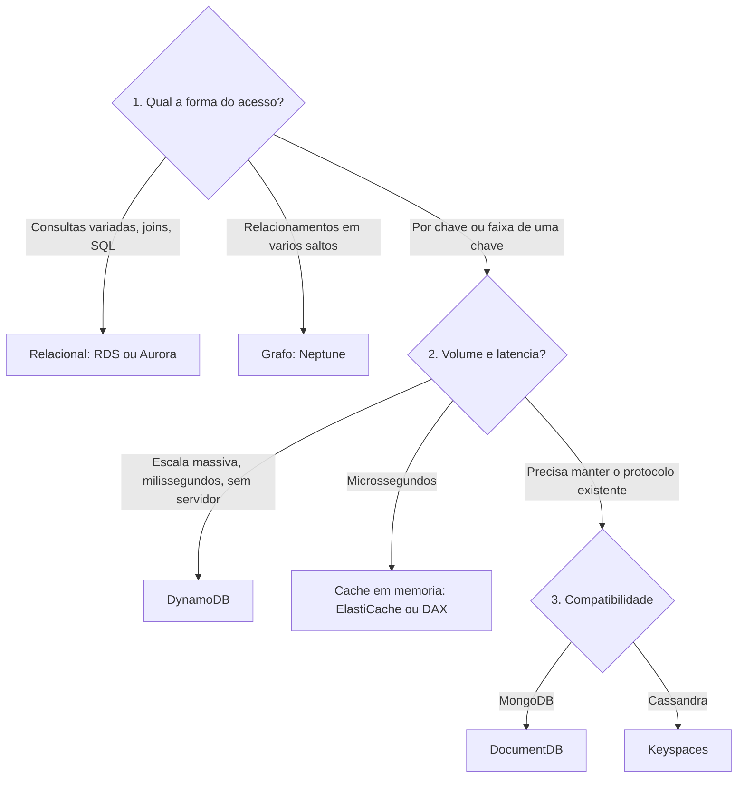

---
aliases:
  - Aula 14.1
modulo: 14
aula: 1
parte: "IV Bancos de dados"
dominios:
  - 2
  - 3
  - 4
lida: false
tags:
  - aula
  - saa-c03
  - modulo-14
---

# Aula 14.1: Por que NoSQL e a escolha pelo padrão de acesso

[[14 - DynamoDB Cache e Bancos de Proposito Especifico|Voltar ao módulo]]

> [!question] Pergunta que esta aula responde
> Se o [[RDS]] e o [[Aurora]] já resolvem bancos de dados, por que existem [[DynamoDB]], [[ElastiCache]], [[DocumentDB]], [[Neptune]] e companhia? Como decidir entre um banco relacional e um não relacional olhando para o que a aplicação faz, e não para a moda do momento?

## O problema: um banco só não é ótimo em tudo

O [[13 - Bancos Relacionais RDS e Aurora|Módulo 13]] mostrou o banco relacional gerenciado: tabelas com esquema fixo, SQL, joins e [[Transacoes ACID|transações ACID]]. É uma ferramenta excelente porque a pergunta que você fará amanhã ainda não é conhecida: com SQL você junta, filtra e agrega do jeito que precisar. Esse poder tem custo. Para manter joins e transações consistentes, o banco relacional tradicional concentra a escrita em um único nó (o writer). Você escala leitura com [[Read Replica|read replicas]], mas a escrita só cresce com um nó maior, o que é [[Escalabilidade Vertical]] e tem teto.

Agora imagine três situações reais:

- Um carrinho de compras acessado 200 mil vezes por segundo, sempre pela chave `carrinhoId`. Nenhuma consulta pergunta "todos os carrinhos com mais de 3 itens".
- Um ranking de jogo que precisa devolver "os 100 primeiros" em microssegundos, a cada tela.
- Uma rede social onde a pergunta é "amigos de amigos que curtiram a mesma banda".

O primeiro caso quer **escala horizontal quase ilimitada com acesso por chave**. O segundo quer **memória**, não disco. O terceiro quer percorrer **relacionamentos**, algo que em SQL vira uma cadeia de joins cada vez mais lenta. Um banco relacional faz os três, mal ou caro. Daí vem o princípio que a prova cobra o tempo todo: **use o serviço de propósito específico** (em inglês, *purpose-built database*).

> [!info] Ligando os pontos
> Isso é o mesmo raciocínio de escolher entre [[EBS]], [[EFS]] e [[S3]] no [[10 - Armazenamento em Bloco e Arquivos EBS EFS FSx|Módulo 10]]: cada um otimiza uma forma de acesso. Em bancos, a "forma de acesso" se chama **padrão de acesso**.

## O que é NoSQL, sem mito

**NoSQL** quer dizer "not only SQL": bancos que abrem mão de parte do modelo relacional (esquema rígido, joins, às vezes consistência imediata em todo o cluster) para ganhar outra coisa (escala horizontal, [[Latencia|latência]], flexibilidade de modelo). Não é um produto, é uma família com modelos de dados diferentes:

| Modelo | Como os dados são vistos | Serviço AWS | Pergunta típica |
|---|---|---|---|
| Chave-valor | Uma chave leva a um valor | [[DynamoDB]], [[ElastiCache]] | "Me dê o item da chave X" |
| Documento | JSON aninhado, esquema flexível | [[DynamoDB]], [[DocumentDB]] | "Me dê o pedido com seus itens" |
| Wide-column | Linhas com colunas variáveis, particionadas | [[Keyspaces]] (Cassandra) | "Leituras e escritas por partição, em escala enorme" |
| Grafo | Nós e arestas | [[Neptune]] | "Quem se conecta a quem, e por quantos saltos?" |
| Série temporal | Valores indexados por tempo | [[Timestream]] (veja a [[14.08 - Bancos de Proposito Especifico|aula 14.8]]) | "Média por minuto dos últimos 7 dias" |
| Em memória | Dados na [[RAM]] | [[ElastiCache]], [[MemoryDB]] | "Resposta em microssegundos" |
| [[Armazenamento Colunar\|Colunar]] analítico | Colunas, agregações em massa | [[Redshift]] | "Soma de vendas por região no ano" |
| Busca | Índice invertido | [[OpenSearch Service]] | "Texto contendo estas palavras" |

Os dois últimos são de análise e busca e ficam detalhados no [[22 - Dados Analytics e Ingestao|Módulo 22]]. O restante é o assunto deste módulo.

## O mecanismo por trás do ganho: partição por chave

Por que um banco chave-valor escala quase sem teto? Porque cada item vive em **uma partição determinada pela chave**. O banco calcula um [[Hash|hash]] da chave, o resultado diz em qual servidor o item está, e o pedido vai direto para lá. Nenhum outro servidor participa. Dobrar o tráfego significa distribuir as chaves por mais partições, e cada partição trabalha sozinha. Não existe um nó central que serialize tudo.

O preço é a **perda de flexibilidade de consulta**. Se a chave é `carrinhoId`, buscar "todos os carrinhos do usuário 7" sem uma estrutura própria para isso obriga a varrer todas as partições. Por isso, em NoSQL a modelagem começa pelas **perguntas** (padrões de acesso), e o esquema é desenhado para respondê-las. Em SQL é o contrário: você modela os dados e depois pergunta o que quiser.

> [!example] Mesmo problema, dois desenhos
> Loja online com `Clientes`, `Pedidos` e `ItensDoPedido`. Em SQL, três tabelas e um join para mostrar o pedido. Em [[DynamoDB]], você guarda o pedido como **um único item** com a lista de itens dentro, chaveado por `clienteId` + `pedidoId`. Mostrar o pedido é uma leitura. Em compensação, "total vendido por produto no mês" é uma pergunta analítica que o DynamoDB não responde bem sozinho, e você exportaria os dados para [[Athena]] ou [[Redshift]].

## Consistência: ACID e o que NoSQL costuma oferecer

Banco relacional promete **[[Transacoes ACID|ACID]]**: atomicidade (tudo ou nada), consistência, isolamento e [[Durabilidade|durabilidade]]. Muitos bancos NoSQL distribuídos operam com **[[Consistencia Eventual|consistência eventual]]**: depois de uma escrita, a leitura em outra réplica pode ainda mostrar o valor antigo por uma fração de segundo, e todas as cópias convergem. O ganho é [[Latencia|latência]] e [[Disponibilidade|disponibilidade]]. A tese geral (o teorema CAP) é que, se a rede entre cópias falhar, você escolhe entre responder (disponibilidade) e responder certo (consistência).

Dois pontos para a prova:

- Eventual não significa "perde dados". Significa leitura possivelmente atrasada. O [[DynamoDB]] deixa você **escolher por leitura** entre eventual (padrão, mais barata) e forte (mais cara), detalhe na [[14.02 - DynamoDB Modelo de Dados Chaves e Particoes|aula 14.2]].
> [!example] Eventual contra forte, com números
> Você grava o novo nome do perfil. Vinte milissegundos depois, outra requisição lê de uma réplica que ainda não recebeu a escrita e vê o nome antigo; em cerca de 1 segundo todas as cópias mostram o nome novo. Se a tela de confirmação precisa mostrar o nome novo na hora, essa leitura específica usa [[Consistencia Forte|leitura forte]], que no [[DynamoDB]] custa o dobro da eventual (4 KB por [[RCU]] contra 8 KB por RCU).

- NoSQL moderno oferece transações. O [[DynamoDB]] tem [[Transacoes ACID|transações ACID]] de até 100 itens distintos, com limites claros (aula 14.2). O que ele não tem é join.

## Como escolher: perguntas na ordem certa

O fluxograma segue a ordem: primeiro a forma do acesso, depois volume e [[Latencia|latência]], por fim a compatibilidade a preservar. Em palavras, as perguntas que um arquiteto faz:

1. **Qual a forma do acesso?** Por chave, por faixa de uma chave, por relacionamento, por texto, por agregação?
2. **Você sabe todas as consultas de antemão?** Se sim, NoSQL funciona bem. Se o negócio inventa perguntas novas toda semana, o relacional (ou um [[Data Lake|data lake]]) é mais seguro.
3. **Qual o volume e o pico?** Dezenas de milhares de operações por segundo, com picos imprevisíveis, favorecem [[DynamoDB]] em modo on-demand.
4. **Precisa de joins e transações entre muitas entidades?** Relacional.
5. **Há compatibilidade a preservar?** Aplicação que já fala o protocolo do MongoDB ou do Cassandra e não pode ser reescrita aponta para [[DocumentDB]] ou [[Keyspaces]] (a prova chama isso de "minimal changes to the application").
6. **Qual o requisito de [[Latencia|latência]]?** Milissegundos: [[DynamoDB]]. Microssegundos: memória.

> [!example] Um requisito resolvido pelas perguntas
> "Carrinhos de compra acessados só pelo ID do carrinho, 300 mil leituras por segundo no pico, sem administrar servidores." Pergunta 1: acesso por chave. Pergunta 2: escala massiva e milissegundos [[Serverless|sem servidor]]. Pergunta 3: não há protocolo a preservar. Resposta: [[DynamoDB]], com `carrinhoId` como [[Partition Key|partition key]]. Se o enunciado dissesse "a aplicação já usa o driver do MongoDB", a pergunta 3 decidiria por [[DocumentDB]].

> [!tip] Padrões de leitura e escrita
> O exam guide lista "padrões de acesso a dados (leitura intensa vs escrita intensa)". Leitura intensa em relacional se resolve com read replicas e cache. Escrita intensa em relacional é o ponto fraco (um writer) e é onde [[DynamoDB]], ou [[Aurora]] com escala vertical e [[Particao de Dados|particionamento]], aparecem. Isso volta na [[14.09 - Decisao Qual Banco para Qual Requisito|aula 14.9]].

## O que o módulo cobre e em que ordem

1. [[DynamoDB]], o serviço mais cobrado do módulo: modelo, capacidade, índices e recursos (aulas 14.2 a 14.5).
2. [[Cache]], porque o cache é a resposta de desempenho mais barata: estratégias e [[DAX]] (14.6), [[ElastiCache]] e [[MemoryDB]] (14.7).
3. Bancos de propósito específico: [[DocumentDB]], [[Keyspaces]], [[Neptune]], [[Timestream]] (14.8).
4. A tabela de decisão que junta tudo (14.9).

## Como isso cai na prova

**Task statements:** Task 2.1 (usar serviços de propósito específico, escolher tecnologias de banco), Task 3.3 (escolher tipo de banco: relacional ou não, em memória, [[Serverless|serverless]]) e Task 4.3 (banco relacional vs não relacional pelo custo). Verificado no exam guide v1.1 em novembro de 2026.

**Palavras-chave em inglês e para onde apontam:**

- "single-digit millisecond [[Latencia|latency]] at any scale", "millions of requests per second", "key-value access" puxam [[DynamoDB]].
- "microsecond [[Latencia|latency]]", "in-memory", "cache" puxam [[ElastiCache]] ou [[DAX]].
- "highly connected data", "relationships", "fraud ring", "recommendation" puxam [[Neptune]].
- "MongoDB-compatible" puxa [[DocumentDB]]. "Cassandra" puxa [[Keyspaces]].
- "complex joins", "ad hoc SQL queries", "[[Transacoes ACID|ACID]] transactions across tables" puxam [[RDS]] ou [[Aurora]].
- "LEAST [[Overhead Operacional|operational overhead]]" e "[[Serverless|serverless]]" favorecem [[DynamoDB]], [[Aurora Serverless]], [[ElastiCache]] Serverless.

**Pegadinhas clássicas:**

- Escolher [[DynamoDB]] para relatórios com joins e agregações flexíveis. Errado: padrão de acesso desconhecido pede relacional ou analytics.
- Escolher [[Aurora]] para uma tabela de sessões com 500 mil leituras por segundo por chave. Funciona, mas é mais caro e mais trabalhoso que [[DynamoDB]] ou cache.
- Achar que NoSQL "não tem transação". O [[DynamoDB]] tem.

| Requisito no enunciado | Resposta provável | Por quê |
|---|---|---|
| Acesso por chave, milhões de req/s, pouca operação | [[DynamoDB]] | Escala horizontal por partição, [[Serverless\|serverless]] |
| Consultas SQL variadas com joins | [[Aurora]] ou [[RDS]] | Modelo relacional e SQL |
| Resposta em microssegundos para leituras repetidas | [[ElastiCache]] ou [[DAX]] | Dados na memória |
| Dados em forma de relacionamentos | [[Neptune]] | Engine de grafo |
| App existente fala MongoDB | [[DocumentDB]] | Compatibilidade de API |

## Resumo

> [!abstract] A aula em uma frase
> Nenhum banco é ótimo em tudo: o relacional maximiza flexibilidade de consulta, e os bancos de propósito específico trocam essa flexibilidade por escala, [[Latencia|latência]] ou um modelo de dados mais natural, então a escolha começa pelo padrão de acesso.

**A lógica, em passos**

1. O relacional concentra a escrita em um nó, então a escrita só cresce na vertical.
2. Bancos chave-valor distribuem itens por partição ([[Hash|hash]] da chave), e por isso escalam na horizontal.
3. O preço é a consulta rígida: só se pergunta bem o que a chave e os índices permitem.
4. Por isso se modela NoSQL a partir das perguntas, e relacional a partir dos dados.
5. Eventual é leitura possivelmente atrasada, não perda de dados, e muitas vezes é configurável.
6. Cada necessidade (chave, memória, grafo, documento, coluna larga, série temporal) tem um serviço próprio.

**Números para lembrar**

| O quê | Valor | Por que importa |
|---|---|---|
| [[Latencia\|Latência]] típica do [[DynamoDB]] | Milissegundos de um dígito | Critério contra o relacional em escala |
| [[Latencia\|Latência]] de [[Cache\|cache em memória]] | Microssegundos | Critério para [[ElastiCache]] e [[DAX]] |
| Transação do [[DynamoDB]] | Até 100 itens distintos | NoSQL também tem [[Transacoes ACID\|ACID]], com limites |

**Tabela-síntese**

| Necessidade | Serviço |
|---|---|
| SQL, joins, [[Transacoes ACID\|ACID]] amplo | [[RDS]], [[Aurora]] |
| Chave-valor ou documento em escala | [[DynamoDB]] |
| Microssegundos | [[ElastiCache]], [[DAX]], [[MemoryDB]] |
| Relacionamentos | [[Neptune]] |
| API MongoDB ou Cassandra | [[DocumentDB]], [[Keyspaces]] |

**Na prática, isso significa**

- Liste os padrões de acesso antes de escolher o banco.
- Consulta imprevisível e joins apontam para relacional ou analytics, não para NoSQL.
- Compatibilidade com MongoDB ou Cassandra resolve com serviço gerenciado compatível.
- Em dúvida entre "funciona" e "propósito específico", a prova costuma premiar o específico.

> [!tip] Liga com
> Vem do [[13 - Bancos Relacionais RDS e Aurora|Módulo 13]] e abre o [[DynamoDB]] na [[14.02 - DynamoDB Modelo de Dados Chaves e Particoes|aula 14.2]]. Análise e busca seguem no [[22 - Dados Analytics e Ingestao|Módulo 22]].

## Erros comuns

- **"NoSQL é sempre mais rápido."** É mais rápido para o padrão de acesso que foi desenhado; para consulta ad hoc, é pior.
- **"[[Consistencia Eventual|Eventual consistency]] perde dado."** Perde atualidade por instantes, não dado.
- **"Troquei o banco por [[DynamoDB]] e depois pedi relatório com joins."** A modelagem precisa vir das perguntas, e relatórios vão para analytics.
- **"[[Cache]] substitui banco."** Cache acelera leitura e some quando reinicia (exceto o [[MemoryDB]], aula 14.7).

## Pratique

**1.** Uma loja online precisa guardar carrinhos de compra acessados sempre pela chave do carrinho, com picos de centenas de milhares de leituras por segundo e o menor [[Overhead Operacional|overhead operacional]] possível. Qual banco atende melhor?

- [ ] a) Amazon RDS for PostgreSQL com uma read replica por AZ e Multi-AZ ativado
- [ ] b) Amazon Redshift com compressão colunar e distribuição de dados ativadas
- [ ] c) Amazon DynamoDB, serverless, chaveado pelo identificador do carrinho
- [ ] d) Amazon Neptune com os itens modelados como nós e arestas de grafo

**2.** Uma equipe de BI executa consultas SQL variadas com joins entre dez tabelas, e as perguntas mudam toda semana. Qual abordagem é a mais apropriada?

- [ ] a) Um banco relacional como o Aurora, ou um data lake consultado por SQL
- [ ] b) Uma tabela DynamoDB com um GSI novo criado para cada pergunta que surgir
- [ ] c) Um cluster ElastiCache for Memcached dedicado para cada tabela do banco
- [ ] d) Uma tabela Keyspaces particionada por data, com uma consulta por pergunta

**3.** Uma rede social precisa responder "quais amigos de amigos seguem a mesma banda", percorrendo vários níveis de relacionamento com baixa [[Latencia|latência]]. Qual serviço foi construído para isso?

- [ ] a) Amazon DocumentDB, guardando listas de amigos dentro de cada documento
- [ ] b) Amazon DynamoDB, com um GSI invertido por seguidor
- [ ] c) Amazon ElastiCache for Valkey, usando sorted sets
- [ ] d) Amazon Neptune, com os usuários como nós e as amizades como arestas

**4.** Uma empresa executa uma aplicação que usa o driver do MongoDB e quer migrar para um serviço gerenciado da AWS sem reescrever o código de acesso a dados. O que escolher?

- [ ] a) Amazon DynamoDB, trocando o driver do MongoDB pelo AWS SDK
- [ ] b) Amazon DocumentDB (with MongoDB compatibility), com o driver atual
- [ ] c) Amazon Keyspaces (for Apache Cassandra), convertendo os dados
- [ ] d) Amazon RDS for MySQL com colunas JSON para os documentos

**5.** Quais DUAS afirmações sobre bancos não relacionais na AWS são verdadeiras? (Escolha DUAS.)

- [ ] a) Eventual consistency significa que os dados escritos podem ser perdidos
- [ ] b) O DynamoDB distribui os itens por partições usando a chave
- [ ] c) O DynamoDB não oferece nenhuma forma de transação
- [ ] d) Modelar NoSQL costuma começar pelos dados, e não pelas perguntas
- [ ] e) O DynamoDB permite escolher entre leitura eventual e forte por requisição

**6.** Uma startup de jogos mantém um ranking que precisa devolver o top 100 em microssegundos a cada abertura de tela, com os dados já no banco principal. Qual combinação é mais adequada?

- [ ] a) Cache em memória com Valkey (sorted sets) na frente do banco principal atual
- [ ] b) Read replicas adicionais do banco relacional em outra Região, para ler mais perto
- [ ] c) Exportar a tabela para o S3 e consultar com Athena a cada abertura de tela
- [ ] d) Um cluster Redshift dedicado ao ranking, com consultas agregadas a cada tela

**7.** Qual é a razão estrutural pela qual um banco relacional tradicional tem mais dificuldade de escalar a escrita que um banco chave-valor particionado?

- [ ] a) O relacional não suporta nenhum tipo de índice, o que obriga a varrer todas as linhas
- [ ] b) O relacional só aceita dados de até 400 KB por linha, o que limita a escala de escrita
- [ ] c) O relacional concentra as escritas em um nó; o chave-valor as distribui
- [ ] d) O chave-valor armazena tudo em memória volátil e o relacional em fita magnética remota

**8.** Uma empresa usa [[Aurora]] para uma tabela de sessões com bilhões de leituras diárias, sempre por chave, e deseja reduzir custo e esforço de capacidade. Qual mudança faz mais sentido?

- [ ] a) Aumentar o tamanho da instância writer do Aurora
- [ ] b) Adicionar um segundo cluster Aurora em outra Região para dividir a carga
- [ ] c) Migrar as sessões para o DynamoDB em modo on-demand
- [ ] d) Habilitar o Backtrack no cluster

**9.** Quais DUAS situações indicam que um banco relacional é preferível a [[DynamoDB]]? (Escolha DUAS.)

- [ ] a) Consultas ad hoc com joins entre muitas entidades
- [ ] b) Acesso sempre por uma chave conhecida, em escala de milhões por segundo
- [ ] c) Transações ACID envolvendo muitas tabelas relacionadas
- [ ] d) Latência de milissegundos de um dígito sem administrar servidores
- [ ] e) Itens independentes, sem relacionamento entre eles

**10.** Um arquiteto precisa justificar por que NoSQL pede modelagem "a partir das perguntas". Qual é a explicação correta?

- [ ] a) Porque o NoSQL proíbe o uso de qualquer índice secundário em qualquer tabela criada
- [ ] b) Porque a chave define onde o item mora, e consultas fora dela varrem partições
- [ ] c) Porque as consultas em NoSQL são sempre escritas em SQL padrão ANSI com joins
- [ ] d) Porque o esquema do NoSQL é imutável após a criação e não pode ser redesenhado

> [!success]- Gabarito
> **1. c)** [[DynamoDB]] escala por partição com acesso por chave e é [[Serverless|serverless]]; a) funciona mas exige gerir réplicas e tem teto de escrita, b) é analítico, d) grafo não é o modelo de carrinho.
> **2. a)** Perguntas imprevisíveis e joins pedem SQL; b) obriga um [[GSI]] por pergunta e não faz joins, c) é cache, d) é wide-column por partição.
> **3. d)** [[Neptune]] é o grafo gerenciado e percorre relacionamentos em vários saltos; a) e b) simulam o grafo com listas e ficam caros, c) é memória chave-valor.
> **4. b)** [[DocumentDB]] é compatível com a API do MongoDB e dispensa reescrever o acesso; a) exige reescrita, c) é Cassandra, d) muda o modelo de dados.
> **5. b) e e)** A chave define a partição e a consistência é escolhida por leitura; a) eventual é atraso, não perda, c) existem transações de até 100 itens, d) o certo é partir das perguntas.
> **6. a)** Sorted sets em memória devolvem ranking em microssegundos; b) replicas relacionais continuam em milissegundos, c) Athena é lento para tela interativa, d) [[Redshift]] é analítico.
> **7. c)** O writer único limita a escrita ao tamanho de um nó, e a partição por [[Hash|hash]] distribui a carga; a) relacional tem índices, b) o limite de 400 KB é do [[DynamoDB]], d) é absurdo.
> **8. c)** Sessões por chave combinam com [[DynamoDB]] on-demand, sem capacidade para gerir; a) aumenta o custo, b) não reduz esforço, d) [[Backtrack]] é recuperação de erro.
> **9. a) e c)** Joins e transações multi-tabela são o forte do relacional; b), d) e e) descrevem o ponto forte do [[DynamoDB]].
> **10. b)** A chave determina a partição, então a consulta precisa casar com ela; a) existem índices secundários, c) as APIs não usam SQL padrão, d) atributos novos podem ser adicionados.

## Para aprofundar

- [What is Amazon DynamoDB?](https://docs.aws.amazon.com/amazondynamodb/latest/developerguide/HowItWorks.CoreComponents.html) (AWS Docs): componentes básicos de tabelas, itens e atributos.
- [Partitions and data distribution in DynamoDB](https://docs.aws.amazon.com/amazondynamodb/latest/developerguide/HowItWorks.Partitions.html) (AWS Docs): como o [[Hash|hash]] da chave decide a partição, a base de por que NoSQL escala.

Próxima aula: [[14.02 - DynamoDB Modelo de Dados Chaves e Particoes|Aula 14.2: DynamoDB, modelo de dados, chaves e partições]].
