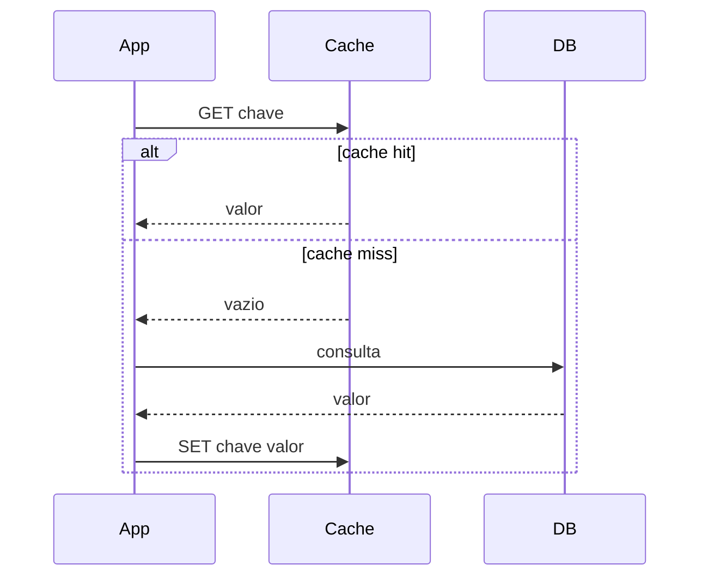

---
aliases:
  - Aula 14.6
modulo: 14
aula: 6
parte: "IV Bancos de dados"
dominios:
  - 2
  - 3
  - 4
lida: false
tags:
  - aula
  - saa-c03
  - modulo-14
---

# Aula 14.6: Estratégias de cache e DAX

[[14 - DynamoDB Cache e Bancos de Proposito Especifico|Voltar ao módulo]]

> [!question] Pergunta que esta aula responde
> Por que um cache reduz [[Latencia|latência]] e custo, em que camada colocá-lo, como popular e [[Invalidacao de Cache|invalidar o cache]] ([[Lazy Loading|lazy loading]], [[Write-Through|write-through]], [[TTL]]), o que é o efeito manada ([[Thundering Herd|thundering herd]]) e quando o [[DAX]] é a resposta certa para o [[DynamoDB]]?

## O problema: ler o mesmo dado mil vezes do lugar mais caro

Em quase toda aplicação, uma pequena fração dos dados recebe a maioria das leituras: o produto em promoção, o perfil do usuário logado, a configuração que quase nunca muda. Se cada leitura vai até o banco, você paga em duas moedas: **[[Latencia|latência]]** (disco e rede, de milissegundos) e **capacidade** ([[RCU]] no [[DynamoDB]], CPU e [[IOPS]] no [[RDS]]). Um [[Cache]] guarda o resultado perto de quem pergunta, geralmente na memória, e responde em microssegundos sem incomodar o banco.

Dois ganhos de uma vez: a aplicação fica mais rápida e o banco precisa de menos capacidade. É por isso que o exame trata cache tanto em desempenho (Task 3.3) quanto em custo (Task 4.3).

## Onde cachear: cada camada guarda uma coisa diferente

| Camada | Serviço | O que guarda | Detalhe |
|---|---|---|---|
| Borda | [[CloudFront]] | Respostas [[HTTP]] (páginas, imagens, API cacheável) perto do usuário | [[18 - Borda e DNS CloudFront Global Accelerator e Route 53|Módulo 18]] |
| API | [[Cache]] do [[API Gateway]] | Respostas de endpoints da API | [[16 - Serverless Lambda e API Gateway|Módulo 16]] |
| Aplicação | [[Cache]] distribuído: [[ElastiCache]] | Qualquer chave-valor: resultado de consulta, sessão, objeto calculado | aula 14.7 |
| Banco | [[DAX]] | Leituras do [[DynamoDB]] | esta aula |
| Dado | [[Read Replica\|Read replica]] | Cópia de leitura do banco (não é cache, mas alivia a escrita) | [[13 - Bancos Relacionais RDS e Aurora|Módulo 13]] |

A regra de ouro: **cache o mais perto possível de quem consome e o mais caro de recalcular**. Conteúdo estático e público para muitos usuários vai para o [[CloudFront]]. Resultado de consulta que muitos usuários repetem vai para o [[ElastiCache]]. Leitura de chave do [[DynamoDB]], sem querer mudar o código além de trocar o cliente, vai para o [[DAX]].

## As estratégias de popular o cache

A documentação do [[ElastiCache]] descreve as estratégias com pseudocódigo, e elas valem para qualquer cache.

### Lazy loading (cache-aside)

O cache só é preenchido **quando alguém pede** ([[Lazy Loading]], também chamado **cache-aside**):

**Vantagens:** só entra no cache o que é lido (a maior parte dos dados nunca é pedida); se um nó do cache falha e é substituído por um vazio, a aplicação **continua funcionando**, só mais lenta enquanto o cache reaquece.
**Desvantagens:** a primeira leitura paga **três viagens** (cache, banco, escrita no cache), o chamado *cache miss penalty*, e o dado pode ficar **desatualizado**, porque ninguém atualiza o cache quando o banco muda.

### Write-through

O cache é atualizado **no momento da escrita** ([[Write-Through]]): a aplicação grava no banco e grava no cache.

**Vantagens:** o cache nunca está desatualizado; o custo extra vai para a escrita, e usuários toleram escrita mais lenta melhor que leitura lenta.
**Desvantagens:** um nó novo (por falha ou por escalar) vem **vazio**, e os dados faltam até serem escritos de novo; e o cache enche de dados que ninguém lê (*cache churn*).

### TTL: o antídoto para os dois

Um **[[TTL]] de cache** ([[TTL de Cache]]) é o número de segundos até a chave expirar. Combinado com as estratégias acima, limita o quanto o dado pode ficar velho e remove o que ninguém usa. Ao ler uma chave expirada, o cache responde "não achei", e o banco é consultado de novo. A documentação ressalva que o TTL **não garante** que o dado nunca esteja velho, só que ele não envelhece além do limite.

| | [[Lazy Loading\|Lazy loading]] | [[Write-Through\|Write-through]] | + [[TTL]] |
|---|---|---|---|
| Atualidade | Pode ficar velho | Sempre atual | Limitada pelo [[TTL]] |
| Falha de nó | Tolera (reaquece) | Faltam dados até reescrever | Combina os dois |
| [[Cache]] cheio de lixo | Não | Sim | Reduzido pelo [[TTL]] |
| Penalidade | Na primeira leitura | Na escrita | Ambas, menores |

O padrão mais usado na prática é **[[Lazy Loading|lazy loading]] com [[TTL]]**, e muitas vezes [[Write-Through|write-through]] nos dados que precisam estar sempre frescos.

> [!example] Perfil de usuário
> A aplicação lê o perfil do usuário a cada requisição. Com [[Lazy Loading|lazy loading]] e [[TTL]] de 5 minutos: a primeira leitura vai ao banco e preenche o cache; as seguintes, por 5 minutos, saem da memória. Se o usuário muda o nome, a aplicação **apaga a chave** do cache na hora ([[Invalidacao de Cache|invalidação]] ativa), então a próxima leitura já traz o dado novo. Sem a invalidação, o nome antigo apareceria até 5 minutos.

### Invalidação

Há três formas de tirar dado velho: **expirar** ([[TTL]]), **apagar a chave** quando o dado muda, ou **atualizar a chave** ([[Write-Through|write-through]]). Expirar é simples e barato, mas tolera atraso; apagar é preciso, mas exige que toda escrita lembre de invalidar. A dificuldade clássica de cache é essa: a [[Invalidacao de Cache|invalidação]] precisa estar certa em todos os caminhos de escrita.

### O efeito manada (thundering herd)

Imagine uma chave muito lida com [[TTL]] de 5 minutos. Quando ela expira, **milhares de requisições** chegam juntas, todas dão miss e todas vão ao banco ao mesmo tempo, que pode cair. É o *[[Thundering Herd|thundering herd]]*. O whitepaper de [[ElastiCache]] da AWS cita duas mitigações: **pré-aquecer** o cache (popular as chaves antes de colocar o nó no ar) e **acrescentar aleatoriedade ([[Jitter|jitter]]) ao TTL**, para que as chaves não expirem juntas. Outra técnica comum, de aplicação, é deixar **uma única requisição** recalcular enquanto as demais esperam ou recebem o valor antigo.

## DAX: cache gerenciado do DynamoDB

O **[[DynamoDB]] Accelerator** ([[DAX]]) é um [[Cache|cache em memória]] **compatível com a API do DynamoDB**, desenhado para leituras **eventualmente consistentes**, reduzindo a [[Latencia|latência]] de milissegundos para **microssegundos**. A grande vantagem é a mudança mínima no código: você usa o cliente do DAX (há para Go, Java, Node.js, Python e .NET) apontando para o [[Cluster Endpoint|endpoint do cluster]], em vez do endpoint do DynamoDB. O DAX gerencia o cache, a [[Invalidacao de Cache|invalidação]] e o preenchimento sozinho.

### Como o DAX processa os pedidos

- **[[Consistencia Eventual|Leitura eventual]]** (`GetItem`, `BatchGetItem`, `Query`, `Scan`): se o [[DAX]] tem o dado (cache hit), responde sem tocar no [[DynamoDB]]. Se não (miss), repassa ao DynamoDB, guarda o resultado no cache do nó primário e devolve.
- **[[Consistencia Forte|Leitura fortemente consistente]]**: o [[DAX]] **repassa ao [[DynamoDB]] e não guarda** o resultado. Quem exige leitura forte não ganha nada com o DAX.
- **Escritas** (`PutItem`, `UpdateItem`, `DeleteItem`, `BatchWriteItem`): são **[[Write-Through|write-through]]**. Gravam primeiro na tabela e depois no [[DAX]], e só têm sucesso se ambos aceitarem.
- Operações de gerência de tabela (`CreateTable` e semelhantes) o [[DAX]] não reconhece: a aplicação as faz direto no [[DynamoDB]].

O [[DAX]] mantém dois caches: o **item cache** (resultados de `GetItem` e `BatchGetItem`, por chave primária) e o **query cache** (resultados de `Query` e `Scan`, por parâmetros). O [[TTL]] padrão é de **5 minutos** (configurável na criação do cluster), e há descarte por **LRU** (o menos usado recentemente sai quando enche). Isso significa que o DAX pode devolver um valor de até 5 minutos atrás, por desenho.

> [!warning] Escrita fora do DAX deixa o cache velho
> O [[Write-Through|write-through]] só vale para escritas que **passam pelo cliente [[DAX]]**. Uma escrita feita direto no [[DynamoDB]] (por uma Lambda, outra aplicação ou o console) não atualiza nem invalida o item cache, e o DAX continua servindo o valor antigo até o [[TTL]] vencer. Regra: leituras e escritas da mesma aplicação devem usar o endpoint do DAX (documentação de consistência do DAX, verificado em novembro de 2026).

### O cluster

Um cluster tem **1 nó primário e de 0 a 10 réplicas** (até 11 nós). O primário atende leituras e as escritas para o [[DynamoDB]]; as réplicas atendem leituras e assumem em caso de falha. Para **produção**, a documentação recomenda **no mínimo três nós em [[Zona de Disponibilidade|AZs]] diferentes**: um ou dois nós são para desenvolvimento e não toleram falhas. O [[DAX]] roda **dentro de uma [[VPC]]**, controlado por [[Security Group|security groups]] (acesso privado). Um cluster suporta no máximo **500 tabelas** do DynamoDB. Há [[Criptografia em Repouso|criptografia em repouso]] e em trânsito.

### Quando usar e quando não usar

**Bom para:**

- Leituras de **menor [[Latencia|latência]] possível** (leilões em tempo real, jogos sociais, trading).
- Poucos itens lidos muito mais vezes que os outros (a promoção de um dia, o "hot key"), poupando a [[Hot Partition|partição quente]].
- Cargas pesadas em leitura e **sensíveis a custo**: em vez de provisionar mais [[RCU]], serve do cache.
- Leituras repetidas sobre um grande conjunto, que, sem cache, roubariam a capacidade de outras aplicações.

**Não serve para:**

- Aplicações que exigem **[[Consistencia Forte|leitura fortemente consistente]]**.
- Aplicações **pesadas em escrita** (a replicação entre nós vira gargalo).
- Poucas leituras repetidas (a taxa de acerto cai; a documentação cita **mais de 90% de cache hit** como o ponto em que o [[DAX]] rende).
- Quem não precisa de microssegundos nem precisa aliviar leituras repetidas.

> [!example] A conta do DAX
> Uma tabela recebe **10.000 leituras eventuais por segundo** de itens de até 4 KB: cada leitura custa 0,5 [[RCU]], então são **5.000 RCU**. Com o [[DAX]] e **90% de acerto**, só 1.000 leituras por segundo chegam à tabela: **500 RCU**. A tabela provisionada cai a um décimo, e o custo do cluster DAX (instâncias) precisa ser menor que a economia para valer a pena.

### DAX ou ElastiCache?

| | [[DAX]] | [[ElastiCache]] |
|---|---|---|
| Para qual banco | Só [[DynamoDB]] | Qualquer banco ou resultado calculado |
| Integração | Cliente [[DAX]], quase sem mudar o código | Você escreve a lógica de cache ([[Lazy Loading\|lazy loading]], etc.) |
| Consistência | Eventual ([[TTL]] padrão de 5 min) | Depende da sua lógica |
| Estruturas de dados | Itens e consultas do [[DynamoDB]] | Chave-valor e estruturas ricas (listas, sorted sets) |
| Quando | "Acelerar o [[DynamoDB]] com mínimo de mudança" | "[[Cache]] de consulta SQL", sessão, ranking, uso geral |

> [!info] Ligando os pontos
> No [[12 - Balanceamento de Carga e Auto Scaling|Módulo 12]] você viu que sessões em memória local impedem [[Escalabilidade Horizontal|escalar horizontalmente]]; guardar a sessão em um cache externo resolve. O cache externo é aqui o [[ElastiCache]] (aula 14.7), e o [[DynamoDB]] com [[TTL]] é a outra alternativa para sessão.

## Como isso cai na prova

**Task statements:** Task 3.3 (integração de cache, padrões de leitura intensa), Task 2.1 (estratégias de cache) e Task 4.3 (cache para reduzir leituras e custo). Verificado em novembro de 2026.

**Palavras-chave:**

- "microsecond [[Latencia|latency]] for [[DynamoDB]]", "without changing application code" puxam [[DAX]].
- "read-heavy", "repeated reads of the same items", "hot key" puxam cache.
- "strongly consistent reads" e [[DAX]]: não combinam.
- "session store", "leaderboard", "cache SQL query results" puxam [[ElastiCache]].
- "stale data", "always current" puxam [[Write-Through|write-through]]; "only cache what is requested" puxa [[Lazy Loading|lazy loading]].

**Pegadinhas clássicas:**

- Colocar [[DAX]] para carga de escrita ou [[Consistencia Forte|leitura fortemente consistente]].
- Achar que [[Write-Through|write-through]] resolve o cache cheio (o oposto: enche mais).
- Esquecer que o [[DAX]] é só para [[DynamoDB]].
- Esquecer o [[TTL]] e deixar o dado velho para sempre.

| Requisito no enunciado | Resposta provável | Por quê |
|---|---|---|
| [[DynamoDB]] com leituras em microssegundos e pouca mudança no código | [[DAX]] | API compatível, cache gerenciado |
| [[Cache]] de resultados de consulta de um [[RDS]] | [[ElastiCache]] com [[Lazy Loading\|lazy loading]] e [[TTL]] | [[DAX]] só serve [[DynamoDB]] |
| Dado sempre atual no cache | [[Write-Through\|Write-through]] | Atualiza na escrita |
| [[Cache]] tolerante a falha de nó | [[Lazy Loading\|Lazy loading]] | Reaquece sozinho |
| Muitas chaves expirando juntas e derrubando o banco | [[Jitter]] no [[TTL]] e pré-aquecimento | Mitiga o [[Thundering Herd\|thundering herd]] |
| [[Consistencia Forte\|Leitura forte]] obrigatória | Sem [[DAX]] (ler direto do [[DynamoDB]]) | O DAX repassa a leitura forte |

## Resumo

> [!abstract] A aula em uma frase
> [[Cache]] troca atualidade por velocidade e custo menor: popule com [[Lazy Loading|lazy loading]] ou [[Write-Through|write-through]], limite o envelhecimento com [[TTL]] (com [[Jitter|jitter]]), e use o [[DAX]] para acelerar leituras eventuais do [[DynamoDB]] com o mínimo de mudança de código.

**A lógica, em passos**

1. Poucos dados recebem a maioria das leituras, então guardá-los em memória reduz [[Latencia|latência]] e capacidade do banco.
2. [[Cache]] na camada certa: borda, API, aplicação ([[ElastiCache]]) ou banco ([[DAX]]).
3. [[Lazy Loading|Lazy loading]] só carrega o que é lido e tolera falhas, mas pode ficar velho.
4. [[Write-Through|Write-through]] mantém atual, mas enche o cache e perde dados em nó novo.
5. [[TTL]] limita o envelhecimento; [[Jitter|jitter]] e pré-aquecimento evitam o [[Thundering Herd|thundering herd]].
6. O [[DAX]] atende leituras eventuais, repassa as fortes e é [[Write-Through|write-through]] nas escritas.

**Números para lembrar**

| O quê | Valor | Por que importa |
|---|---|---|
| [[TTL]] padrão do [[DAX]] | 5 minutos | Dado pode ter até 5 min |
| Nós do [[DAX]] | 1 primário e até 10 réplicas | Escala de leitura |
| Produção no [[DAX]] | Mínimo de 3 nós em [[Zona de Disponibilidade\|AZs]] diferentes | [[Tolerancia a Falhas\|Tolerância a falhas]] |
| Tabelas por cluster [[DAX]] | 500 | Limite |
| Taxa de acerto desejada | Acima de 90% | Condição para rentabilizar |

**Tabela-síntese**

| Estratégia | Atualidade | Falha de nó |
|---|---|---|
| [[Lazy Loading\|Lazy loading]] | Pode ficar velho | Tolera |
| [[Write-Through\|Write-through]] | Atual | Faltam dados |
| Com [[TTL]] | Limitada | Equilibra |

**Na prática, isso significa**

- Use [[DAX]] quando a pergunta é "acelerar leituras do [[DynamoDB]] com mínimo de mudança".
- Use [[ElastiCache]] para cachear consultas de qualquer banco e sessões.
- Sempre defina [[TTL]] e planeje a [[Invalidacao de Cache|invalidação]].
- Evite [[DAX]] em carga de escrita ou [[Consistencia Forte|leitura forte]].

> [!tip] Liga com
> Vem da [[14.05 - DynamoDB Streams TTL Backup e Global Tables|aula 14.5]]. Segue para a [[14.07 - ElastiCache e MemoryDB|aula 14.7]], onde o cache de uso geral é detalhado.

## Erros comuns

- **Cachear sem [[TTL]] nem [[Invalidacao de Cache|invalidação]].** O dado velho vira bug permanente.
- **Esperar [[Consistencia Forte|leitura forte]] do [[DAX]].** Ela passa direto para o [[DynamoDB]].
- **Escrever na tabela sem passar pelo [[DAX]].** O cache fica desatualizado até o [[TTL]]; leitura e escrita da aplicação devem usar o cliente DAX.
- **Usar [[DAX]] com pouca leitura repetida.** O custo do cluster não se paga.
- **Cluster [[DAX]] de um nó em produção.** Perde cache e [[Disponibilidade|disponibilidade]] na falha.
- **Deixar todas as chaves com o mesmo [[TTL]].** Expiram juntas e geram o [[Thundering Herd|efeito manada]].

## Pratique

**1.** Uma aplicação usa o [[DynamoDB]] com leituras eventualmente consistentes e precisa reduzir a [[Latencia|latência]] de leitura de milissegundos para microssegundos, alterando o mínimo possível do código. O que usar?

- [ ] a) Aumentar o RCU provisionado da tabela em dez vezes
- [ ] b) Colocar um cluster DAX e usar o cliente do DAX
- [ ] c) Criar um GSI para cada consulta
- [ ] d) Migrar a tabela para o Amazon RDS

**2.** Uma aplicação de e-commerce lê o catálogo de um [[RDS]] for PostgreSQL milhões de vezes por hora, e as mudanças são raras. A equipe quer aliviar o banco e aceita dados com até 10 minutos de atraso. Qual solução é adequada?

- [ ] a) DAX na frente do RDS, aproveitando a compatibilidade da API
- [ ] b) Aumentar a instância do banco para suportar mais leituras
- [ ] c) Criar um GSI no PostgreSQL para acelerar a consulta
- [ ] d) ElastiCache com lazy loading e TTL de 10 minutos

**3.** Um cache usa [[Lazy Loading|lazy loading]] e um nó é substituído por um vazio. O que acontece com a aplicação?

- [ ] a) Continua funcionando, mais lenta, enquanto o cache reaquece por misses
- [ ] b) Ela falha por completo e só volta quando alguém repopular o cache manualmente
- [ ] c) Ela passa a ler dados incorretos, que permanecem no cache para sempre
- [ ] d) Ela deixa de poder gravar no banco

**4.** Uma equipe precisa que o dado no cache seja sempre o mais atual possível, atualizado a cada gravação, aceitando uma escrita um pouco mais lenta. Qual estratégia usar?

- [ ] a) Lazy loading sem TTL
- [ ] b) Apenas TTL curto, sem invalidação
- [ ] c) Write-through
- [ ] d) Cache apenas na borda, no CloudFront

**5.** Quais DUAS afirmações sobre o [[DAX]] são verdadeiras? (Escolha DUAS.)

- [ ] a) O DAX serve leituras fortemente consistentes diretamente do cache
- [ ] b) As escritas passam pelo DAX em modo write-through
- [ ] c) O DAX pode cachear resultados de qualquer banco relacional
- [ ] d) O DAX roda fora da VPC, em um endpoint público
- [ ] e) O item cache do DAX tem TTL padrão de 5 minutos

**6.** Uma aplicação exige leituras fortemente consistentes do [[DynamoDB]]. Um arquiteto propõe o [[DAX]] para acelerá-las. Qual é a resposta correta?

- [ ] a) O DAX acelera leituras fortes e as guarda em cache por 5 minutos
- [ ] b) O DAX só funciona com tabelas em modo on-demand
- [ ] c) O DAX repassa as leituras fortes ao DynamoDB, sem cachear
- [ ] d) O DAX converte as leituras fortes em eventuais automaticamente

**7.** Muitas chaves de um cache expiram ao mesmo tempo, e o banco recebe uma enxurrada de consultas que o derruba. Qual mitigação ajuda?

- [ ] a) Acrescentar aleatoriedade ao TTL e pré-aquecer o cache
- [ ] b) Reduzir o TTL de todas as chaves para 1 segundo
- [ ] c) Desligar o cache durante os picos
- [ ] d) Usar write-through em todas as chaves

**8.** Uma aplicação grava intensamente na tabela [[DynamoDB]] e raramente repete leituras. Um colega sugere o [[DAX]]. Qual é a avaliação correta?

- [ ] a) Ideal, pois o DAX acelera todas as escritas feitas na tabela do DynamoDB
- [ ] b) Ideal, pois o DAX elimina por completo o custo de escrita da tabela
- [ ] c) Aceitável, desde que o cluster tenha apenas um nó para reduzir custo
- [ ] d) Pouco indicado: a carga é de escrita, com poucas leituras repetidas

**9.** Quais DUAS recomendações se aplicam a um cluster [[DAX]] de produção? (Escolha DUAS.)

- [ ] a) Usar um único nó, para reduzir custo
- [ ] b) Colocar o cluster em uma sub-rede pública sem controle
- [ ] c) Usar pelo menos três nós, em AZs diferentes
- [ ] d) Monitorar o ThrottledRequestCount e escalar quando houver throttling
- [ ] e) Associar mais de 500 tabelas ao mesmo cluster

**10.** Uma tabela recebe 10.000 leituras eventuais por segundo de itens de 4 KB (5.000 [[RCU]]). Com um [[DAX]] de 90% de acerto, quantas RCU as leituras que chegam à tabela passam a consumir, aproximadamente?

- [ ] a) 50
- [ ] b) 500
- [ ] c) 1.000
- [ ] d) 2.500

> [!success]- Gabarito
> **1. b)** O [[DAX]] é cache compatível com a API do [[DynamoDB]] e entrega microssegundos trocando só o cliente; a) custa mais e não muda a [[Latencia|latência]], c) não cria cache, d) o [[RDS]] não é mais rápido.
> **2. d)** [[ElastiCache]] serve qualquer banco, e [[Lazy Loading|lazy loading]] com [[TTL]] de 10 minutos alivia o [[RDS]] e respeita o atraso aceito; a) o [[DAX]] só serve [[DynamoDB]], b) é caro e não ataca a repetição, c) o [[GSI]] não existe no PostgreSQL.
> **3. a)** [[Lazy Loading|Lazy loading]] tolera nó vazio e reaquece por misses; b) não precisa de repopulação manual, c) o dado errado não persiste só por isso, d) o cache não bloqueia gravações no banco.
> **4. c)** [[Write-Through|Write-through]] atualiza o cache na escrita; a) e b) deixam o dado ficar velho, d) é outra camada e não resolve a atualização.
> **5. b) e e)** As escritas são [[Write-Through|write-through]] e o [[TTL]] padrão do item cache é 5 minutos; a) leituras fortes passam direto, c) é só para [[DynamoDB]], d) roda dentro da [[VPC]].
> **6. c)** O [[DAX]] repassa leituras fortes sem cachear; a) e d) inventam comportamento, b) o modo da tabela não importa.
> **7. a)** [[Jitter]] no [[TTL]] e pré-aquecimento evitam a expiração simultânea; b) piora o problema, c) tira a proteção do banco, d) não impede a expiração conjunta.
> **8. d)** O [[DAX]] é pouco indicado para cargas de escrita e poucas leituras repetidas; a) e b) o DAX não acelera nem barateia escrita, c) um nó não resolve o problema.
> **9. c) e d)** Três nós em [[Zona de Disponibilidade|AZs]] diferentes e monitorar o [[Throttling|throttling]] são práticas recomendadas; a) um nó não tolera falhas, b) o [[DAX]] fica na [[VPC]] com [[Security Group|security groups]], e) 500 tabelas é o limite.
> **10. b)** Com 90% de acerto só 1.000 leituras por segundo chegam, 0,5 [[RCU]] cada: 500 RCU; a) subestima, c) esquece o fator eventual, d) supõe 50% de acerto.

## Para aprofundar

- [DAX: How it works](https://docs.aws.amazon.com/amazondynamodb/latest/developerguide/DAX.concepts.html) (AWS Docs): item cache, query cache e o comportamento de leitura e escrita.
- [In-memory acceleration with DynamoDB Accelerator (DAX)](https://docs.aws.amazon.com/amazondynamodb/latest/developerguide/DAX.html) (AWS Docs): casos de uso e quando o [[DAX]] não é indicado.
- [Caching strategies for Memcached](https://docs.aws.amazon.com/AmazonElastiCache/latest/dg/Strategies.html) (AWS Docs): [[Lazy Loading|lazy loading]], [[Write-Through|write-through]] e [[TTL]] com pseudocódigo (valem para qualquer cache).

Próxima aula: [[14.07 - ElastiCache e MemoryDB|Aula 14.7: ElastiCache e MemoryDB]].
