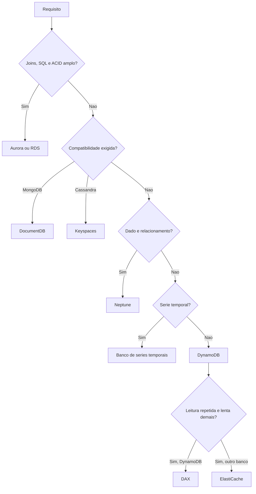

---
aliases:
  - Aula 14.9
modulo: 14
aula: 9
parte: "IV Bancos de dados"
dominios:
  - 2
  - 3
  - 4
lida: false
tags:
  - aula
  - saa-c03
  - modulo-14
---

# Aula 14.9: Decisão, qual banco para qual requisito

[[14 - DynamoDB Cache e Bancos de Proposito Especifico|Voltar ao módulo]]

> [!question] Pergunta que esta aula responde
> Diante de um enunciado com requisitos de [[Latencia|latência]], volume, consistência, compatibilidade e custo, como chegar ao banco certo em poucos passos, e como reconhecer as pegadinhas em que duas respostas parecem boas?

## O problema: muitas opções, um enunciado curto

Nos módulos 13 e 14 você viu relacionais ([[13 - Bancos Relacionais RDS e Aurora|Módulo 13]]), [[DynamoDB]], [[DAX]], [[ElastiCache]], [[DocumentDB]], [[Keyspaces]] e [[Neptune]]. A prova raramente pergunta "o que é o DynamoDB?". Ela descreve um sistema e pede o serviço que atende aos requisitos **com o menor [[Overhead Operacional|esforço operacional]]** (ou o menor custo, ou a maior [[Disponibilidade|disponibilidade]]). Esta aula organiza a decisão em perguntas na ordem em que elas eliminam alternativas.

## Passo 1: qual é o padrão de acesso?

Retome a [[14.01 - Por que NoSQL e Escolha pelo Padrao de Acesso|aula 14.1]]: o modelo de dados segue o padrão de acesso.

- **Consultas variadas, joins, agregações, transações entre várias tabelas:** relacional. [[Aurora]] ou [[RDS]].
- **Busca por chave com milhões de requisições, [[Latencia|latência]] de milissegundos de um dígito e escala quase ilimitada:** [[DynamoDB]].
- **Documentos JSON e a aplicação já fala MongoDB:** [[DocumentDB]].
- **Cassandra e CQL:** [[Keyspaces]].
- **Relacionamentos como foco (vários saltos):** [[Neptune]].
- **Pontos de dados ordenados no tempo:** banco de séries temporais.
- **Resposta em microssegundos ou alívio de um banco sobrecarregado:** cache ([[DAX]] ou [[ElastiCache]]).

## Passo 2: existe um requisito que decide sozinho?

Alguns enunciados trazem uma palavra que elimina quase tudo:

| Palavra no enunciado | Decide por quê |
|---|---|
| "Sem gerenciar servidores", "escala automática" | [[Serverless]]: [[DynamoDB]], [[Aurora Serverless]], [[Keyspaces]] |
| "Mínimas alterações no código" com MongoDB ou Cassandra | A compatibilidade de API manda: [[DocumentDB]] ou [[Keyspaces]] |
| "Microssegundos" para leituras do [[DynamoDB]] | [[DAX]] (compatível com a API, sem mudar a lógica) |
| "Compartilhar cache entre aplicações de vários tipos" | [[ElastiCache]] (Redis ou [[Valkey]] ou [[Memcached]]) |
| "Multi-Região ativa-ativa" para dados de chave-valor | [[Global Tables\|DynamoDB Global Tables]] |
| "SQL", "joins", "relatórios ad hoc" | Relacional, mesmo que o volume seja grande |
| "Expirar dados sozinho" | [[DynamoDB TTL\|TTL do DynamoDB]] ou [[TTL de Cache\|TTL de cache]] |

## Passo 3: como o dado escala e se protege?

Compare o que cada família entrega **por padrão**:

| Aspecto | Relacional ([[RDS]], [[Aurora]]) | [[DynamoDB]] | [[Cache]] ([[ElastiCache]]) |
|---|---|---|---|
| Escala de escrita | Vertical (instância maior) e, no [[Aurora]], limites de um escritor | Horizontal, por partições | Depende do modo (cluster mode escala [[Shard\|shards]]) |
| Escala de leitura | Réplicas | Automática, mais [[DAX]] | Réplicas |
| [[Alta Disponibilidade\|Alta disponibilidade]] | [[Multi-AZ]] configurado | Replicação em várias [[Zona de Disponibilidade\|AZs]] sem configurar | Multi-AZ configurado |
| [[Durabilidade]] | Alta, com backups | Alta, com [[Point-in-Time Recovery\|PITR]] e backups | Não é o armazenamento de origem |
| Consistência | Forte | Eventual por padrão, forte opcional na leitura | Depende do uso |

> [!info] Ligando os pontos
> O [[DynamoDB]] e os serviços de armazenamento compartilhado ([[Aurora]], [[DocumentDB]], [[Neptune]], [[Keyspaces]]) já replicam os dados entre [[Zona de Disponibilidade|AZs]]. O que ainda **você** decide é a recuperação entre [[Regiao AWS|Regiões]] ([[Global Tables]] no DynamoDB, [[Aurora Global Database]] no [[13 - Bancos Relacionais RDS e Aurora|Módulo 13]]) e o backup, tema do [[20 - Alta Disponibilidade e Recuperacao de Desastres|Módulo 20]].

## Passo 4: qual é o custo e o esforço?

O exam guide pede, na Task 4.3, o tipo de banco **de menor custo** para o requisito. Heurísticas:

- **Carga imprevisível ou esporádica:** [[DynamoDB]] on-demand (a documentação recomenda como modo padrão, [[14.03 - DynamoDB Capacidade RCU WCU e Custo|aula 14.3]]) ou [[Aurora Serverless]].
- **Carga previsível e constante:** [[DynamoDB]] provisioned com auto scaling, ou [[Reserved Instance|instâncias reservadas]] no relacional ([[09 - EC2 a Fundo|Módulo 9]] explica os compromissos).
- **Muita leitura repetida:** cache reduz o custo do banco principal. A conta da [[14.06 - Estrategias de Cache e DAX|aula 14.6]] mostrou 10.000 leituras por segundo virando cerca de 1.000 no banco com 90% de acertos.
- **Dado frio:** exportar ou arquivar, em vez de pagar leitura de alto desempenho ([[TTL]] mais exportação para o [[S3]]).
- **[[Overhead Operacional|Esforço operacional]]:** serviços [[Serverless|serverless]] e gerenciados vencem [[EC2]] com banco instalado. Rodar banco em EC2 só ganha quando o requisito é um recurso que nenhum serviço gerenciado oferece.

## Combinar serviços é normal

Arquiteturas reais usam vários bancos, cada um no que faz melhor:

- **[[Aurora]] para o cadastro e transações, [[ElastiCache]] para sessões e cache de consultas.**
- **[[DynamoDB]] para o carrinho de compras e [[DAX]] para o catálogo lido milhões de vezes.**
- **[[Aurora]] como fonte de verdade e [[Neptune]] para o grafo de recomendações**, alimentado por eventos.
- **[[DynamoDB Streams]] alimentando [[Lambda]]** para projetar dados em outro armazenamento ([[14.05 - DynamoDB Streams TTL Backup e Global Tables|aula 14.5]]).

> [!example] Plataforma de e-commerce
> O cadastro de clientes e os pedidos, que exigem joins e transações, ficam no [[Aurora]]. O carrinho (acesso por chave, picos na Black Friday) fica no [[DynamoDB]] on-demand. As sessões de login ficam no [[ElastiCache]] com [[TTL]]. O catálogo, lido o tempo todo e quase nunca alterado, passa pelo [[DAX]]. A busca por texto usa o [[OpenSearch Service|OpenSearch]]. Cada escolha responde a um padrão de acesso diferente.

## Três enunciados resolvidos, passo a passo

**Enunciado 1.** "Uma aplicação de telemetria recebe 200 mil gravações por segundo, sempre por ID do dispositivo, e a equipe não quer administrar servidores."

1. Padrão de acesso: gravação e leitura por chave, sem joins. Isso elimina o relacional como primeira opção.
2. Palavra decisiva: "sem administrar servidores" e volume muito alto apontam o [[DynamoDB]].
3. Capacidade: se o ritmo é constante, provisioned com auto scaling pode custar menos; se oscila muito, on-demand.
4. Resposta: [[DynamoDB]], com o ID do dispositivo (muitos valores distintos) como [[Partition Key|chave de partição]].

**Enunciado 2.** "Uma aplicação Java usa o [[Hibernacao de EC2|Hibernate]] sobre MySQL e começa a travar nas leituras do catálogo, que quase nunca muda. A equipe quer uma solução rápida, sem trocar o banco."

1. Padrão de acesso: relacional, com leitura repetida do mesmo conteúdo.
2. Palavra decisiva: "sem trocar o banco". Isso descarta migrar para o [[DynamoDB]].
3. Solução: cache na frente ([[ElastiCache]] com [[Lazy Loading|lazy loading]] e [[TTL]]) ou [[Read Replica|réplicas de leitura]], o que o enunciado preferir como "menor mudança".
4. Resposta: [[ElastiCache]]. O [[DAX]] não serve, porque o banco não é [[DynamoDB]].

**Enunciado 3.** "Um site de [[Streaming de Dados|streaming]] precisa sugerir filmes com base no que os amigos de cada usuário assistiram, em milissegundos."

1. Padrão de acesso: percorrer relacionamentos em vários níveis.
2. Palavra decisiva: "amigos dos amigos" e "sugerir" indicam grafo.
3. Resposta: [[Neptune]]. Um relacional faria joins em cascata, e o [[DynamoDB]] exigiria materializar cada travessia antes.

> [!example] Enunciado 4, resolvido pelo fluxo completo
> "Um aplicativo móvel de jogo guarda o progresso de milhões de jogadores. Cada jogador só pode ler e gravar os próprios dados, a leitura precisa ser em milissegundos e a equipe não quer administrar servidores nem criar um backend só para filtrar dados."
>
> 1. **Padrão de acesso (passo 1):** leitura e gravação pela chave (ID do jogador), sem joins: chave-valor, não relacional.
> 2. **Requisito decisivo (passo 2):** "sem servidores" e escala de milhões apontam o [[DynamoDB]]. "Só os próprios dados, sem backend" aponta o controle de acesso fino.
> 3. **Escala e proteção (passo 3):** [[Partition Key|partition key]] com o ID do jogador (alta cardinalidade); [[Cognito]] identity pool entrega [[Credencial Temporaria|credenciais temporárias]], e a role tem a condição `dynamodb:LeadingKeys` igual à identidade do jogador ([[14.02 - DynamoDB Modelo de Dados Chaves e Particoes|aula 14.2]]).
> 4. **Custo (passo 4):** tráfego de jogo oscila, então on-demand para começar.
> 5. **Resposta:** [[DynamoDB]] on-demand com [[Cognito]] e [[IAM]] `LeadingKeys`.

> [!tip] Método para o dia da prova
> Antes de olhar as alternativas, escreva a resposta em uma frase ("preciso de um banco de grafo", "preciso de um cache para [[DynamoDB]]"). Depois procure a alternativa que corresponde. Isso evita ser seduzido por serviços famosos que não atendem ao padrão de acesso.

## Limites que mudam a resposta

Alguns detalhes técnicos decidem o enunciado quando duas opções parecem boas:

- **Tamanho do item no [[DynamoDB]]:** o limite é de 400 KB por item ([[14.02 - DynamoDB Modelo de Dados Chaves e Particoes|aula 14.2]]). Conteúdo maior, como PDFs e imagens, vai para o [[S3]], e o item guarda só a referência.
- **Consistência:** o [[DynamoDB]] lê de forma [[Consistencia Eventual|eventualmente consistente]] por padrão, e a [[Consistencia Forte|leitura forte]] é opcional e custa o dobro em RCUs. O [[DAX]] não cacheia leituras fortes.
- **Índices:** o [[LSI]] nasce com a tabela e impõe um limite por [[Item Collection|item collection]]; o [[GSI]] pode ser criado depois ([[14.04 - DynamoDB Indices Secundarios Query e Scan|aula 14.4]]).
- **[[Durabilidade]] do cache:** [[ElastiCache]] é cache, e o [[MemoryDB]] é o banco durável em memória com compatibilidade Redis ([[14.07 - ElastiCache e MemoryDB|aula 14.7]]).
- **Escopo de Região:** o [[DynamoDB]] comum vive em uma Região; só [[Global Tables]] replica entre [[Regiao AWS|Regiões]] ([[14.05 - DynamoDB Streams TTL Backup e Global Tables|aula 14.5]]).

Cada um desses itens já apareceu como pegadinha em uma aula anterior; vale revisar a tabela "Requisito no enunciado" de cada uma antes do simulado.

## Como isso cai na prova

**Task statements:** Task 2.1 e 2.2 ([[Desacoplamento|desacoplamento]] e resiliência com bancos), Task 3.3 (soluções de banco de alto desempenho) e Task 4.3 (banco de menor custo). Verificado em novembro de 2026.

**Palavras-chave e atalhos:**

- "Chave-valor", "milhões de requisições", "[[Latencia|latência]] de milissegundos", "sem servidores" apontam [[DynamoDB]].
- "Microssegundos" e "[[DynamoDB]]" juntos apontam [[DAX]].
- "Compatível com MongoDB" ou "Cassandra" apontam o serviço compatível.
- "Joins", "SQL", "transações complexas" apontam o relacional.
- "Alta taxa de leitura repetida no banco relacional" aponta [[ElastiCache]] ou [[Read Replica|réplicas de leitura]].

**Pegadinhas clássicas:**

- Colocar [[DAX]] na frente de um banco que não é [[DynamoDB]].
- Escolher [[DynamoDB]] só porque o volume é grande, quando o requisito exige joins.
- Escolher [[Aurora]] para uma carga de chave-valor com picos extremos e sem previsão, onde o [[DynamoDB]] on-demand é mais simples.
- Usar cache como única cópia dos dados.
- Esquecer que "resposta em tempo real com leituras fortemente consistentes" desfavorece [[DAX]] (as leituras fortemente consistentes passam direto ao [[DynamoDB]]).

| Requisito no enunciado | Resposta provável | Por quê |
|---|---|---|
| Chave-valor com picos imprevisíveis e sem administração | [[DynamoDB]] on-demand | [[Serverless]], escala sozinho |
| Reduzir leituras repetidas no [[DynamoDB]], sem mudar o código | [[DAX]] | [[Cache]] compatível com a API |
| Reduzir carga de leitura de um [[RDS]] sem mudar o modelo | [[ElastiCache]] ou [[Read Replica\|réplicas de leitura]] | [[Cache]] ou escala de leitura |
| Sessões de usuário com expiração e [[Latencia\|latência]] mínima | [[ElastiCache]] com [[TTL]] | Memória, expiração nativa |
| Migrar MongoDB com poucas mudanças | [[DocumentDB]] | API compatível |
| Descobrir relações de vários saltos | [[Neptune]] | Grafo |

## Resumo

> [!abstract] A aula em uma frase
> Escolha o banco pelo padrão de acesso e pelo requisito que decide sozinho (compatibilidade, [[Latencia|latência]], [[Serverless|serverless]], joins), confira escala, [[Disponibilidade|disponibilidade]] e custo, e use cache e combinações quando um serviço só não basta.

**A lógica, em passos**

1. Padrão de acesso: relacional para joins e [[Transacoes ACID|ACID]], [[DynamoDB]] para chave-valor em escala, serviços de propósito específico para documento, Cassandra, grafo e série temporal.
2. Procure a palavra que decide sozinha: compatibilidade, microssegundos, [[Serverless|serverless]], multi-Região.
3. Confira como o banco escala e se protege por padrão.
4. Otimize custo: on-demand para o imprevisível, provisioned ou reservado para o constante, cache para leitura repetida.
5. Combine serviços quando os padrões de acesso forem diferentes.

**Números para lembrar**

| O quê | Valor | Por que importa |
|---|---|---|
| Réplicas do [[Aurora]], [[DocumentDB]] e [[Neptune]] | Até 15 | Escala de leitura |
| Acertos de cache de 90% | 10x menos leituras no banco | Custo e [[Latencia\|latência]] |
| [[DAX]] | Microssegundos | Só para [[DynamoDB]] |

**Tabela-síntese**

| Cenário | Serviço |
|---|---|
| SQL, joins, transações | [[Aurora]] ou [[RDS]] |
| Chave-valor em escala | [[DynamoDB]] |
| [[Cache]] de [[DynamoDB]] | [[DAX]] |
| [[Cache]] de uso geral | [[ElastiCache]] |
| MongoDB | [[DocumentDB]] |
| Cassandra | [[Keyspaces]] |
| Grafo | [[Neptune]] |

**Na prática, isso significa**

- Releia o enunciado procurando a palavra decisiva antes de comparar opções.
- Se duas respostas funcionam, escolha a que exige menos administração.
- [[Cache]] é complemento, nunca a única cópia do dado.

> [!tip] Liga com
> Fecha o módulo, reunindo as aulas [[14.01 - Por que NoSQL e Escolha pelo Padrao de Acesso|14.1]] a [[14.08 - Bancos de Proposito Especifico|14.8]]. Segue para o [[15 - Desacoplamento Filas Eventos e Workflows|Módulo 15]].

## Erros comuns

- **Escolher pelo volume e esquecer o padrão de acesso.** Volume grande com joins ainda pede relacional.
- **Colocar [[DAX]] na frente de qualquer banco.** O DAX é só do [[DynamoDB]].
- **Tratar o cache como armazenamento durável.**
- **Ignorar o requisito de compatibilidade.** Ele pesa mais que a preferência do arquiteto.
- **Escolher a solução mais sofisticada.** A mais simples que atende aos requisitos costuma ser a resposta.

## Pratique

**1.** Uma startup lança um jogo móvel com picos imprevisíveis de jogadores e quer armazenar o perfil de cada jogador acessado por ID, sem administrar servidores e sem planejar capacidade. Qual solução atende com menor esforço?

- [ ] a) Amazon RDS for MySQL Multi-AZ com instâncias grandes, dimensionadas para o pior pico possível
- [ ] b) Amazon DocumentDB com um cluster de três instâncias
- [ ] c) Amazon DynamoDB no modo on-demand
- [ ] d) MySQL em EC2 com Auto Scaling

**2.** Uma aplicação de relatórios usa o [[RDS]] e executa as mesmas consultas pesadas milhares de vezes por hora, com resultados que mudam pouco. O que reduz a carga do banco com a menor mudança?

- [ ] a) Um cache ElastiCache à frente do banco com os resultados repetidos
- [ ] b) Migrar todos os dados para o Amazon Neptune, banco de grafo
- [ ] c) Aumentar o tamanho do volume de armazenamento do banco
- [ ] d) Trocar o banco por um arquivo CSV no S3 consultado a cada pedido

**3.** Uma tabela do [[DynamoDB]] recebe milhões de leituras por segundo sobre os mesmos itens populares e a equipe quer reduzir a [[Latencia|latência]] para microssegundos sem reescrever a lógica da aplicação. Qual opção atende?

- [ ] a) ElastiCache for Redis, com a lógica de cache escrita na aplicação e invalidação manual
- [ ] b) Um segundo DynamoDB em outra Região
- [ ] c) Amazon MemoryDB em lugar do DynamoDB
- [ ] d) Um cluster DAX na frente da tabela, usando o cliente DAX

**4.** Uma empresa precisa de um banco para um sistema financeiro com joins entre muitas tabelas, [[Transacoes ACID|transações ACID]] e relatórios ad hoc em SQL. Qual é a escolha adequada?

- [ ] a) Amazon DynamoDB, com índices secundários globais para todos os relatórios
- [ ] b) Amazon Aurora, um banco relacional compatível com MySQL e PostgreSQL
- [ ] c) Amazon Keyspaces
- [ ] d) Amazon ElastiCache

**5.** Uma equipe migra uma aplicação que usa o driver do MongoDB e quer evitar reescrever a camada de acesso a dados. Qual serviço escolher?

- [ ] a) Amazon DynamoDB, reescrevendo o acesso com o SDK
- [ ] b) Amazon Keyspaces, convertendo os documentos em linhas
- [ ] c) Amazon Neptune, modelando os documentos como nós
- [ ] d) Amazon DocumentDB

**6.** Quais DUAS opções reduzem o custo de uma carga em que uma pequena parte dos itens do [[DynamoDB]] responde pela maior parte das leituras? (Escolha DUAS.)

- [ ] a) Usar o DAX para absorver as leituras repetidas
- [ ] b) Migrar a tabela para o Amazon Neptune
- [ ] c) Provisionar o dobro das RCUs por segurança
- [ ] d) Usar leituras eventualmente consistentes onde a aplicação tolerar algum atraso, pagando metade do RCU
- [ ] e) Desativar o TTL e guardar todos os itens para sempre

**7.** Uma plataforma precisa guardar sessões de login com expiração automática e acesso em submilissegundos, compartilhadas por vários servidores web. Qual solução atende com menos esforço?

- [ ] a) Amazon ElastiCache com TTL nas chaves
- [ ] b) Um volume EBS compartilhado entre os servidores
- [ ] c) Uma tabela do Amazon Redshift
- [ ] d) Arquivos no Amazon S3 com versionamento

**8.** Uma rede social quer recomendar "amigos de amigos" e detectar comunidades, com consultas de vários saltos em milissegundos sobre bilhões de conexões. Qual serviço foi projetado para isso?

- [ ] a) Amazon DynamoDB com GSIs
- [ ] b) Amazon RDS for PostgreSQL com uma tabela de arestas
- [ ] c) Amazon Neptune
- [ ] d) Amazon ElastiCache for Memcached

**9.** Um arquiteto propõe colocar o [[DAX]] na frente de um banco [[Aurora]] para acelerar leituras. Qual é o problema dessa proposta?

- [ ] a) O DAX só funciona na frente de tabelas do DynamoDB
- [ ] b) O DAX só funciona com o Amazon S3
- [ ] c) O DAX cobra por consulta SQL executada
- [ ] d) O DAX exige que o Aurora esteja em outra Região

**10.** Quais DUAS afirmações sobre escolher um banco na AWS estão corretas? (Escolha DUAS.)

- [ ] a) O cache pode ser a única cópia dos dados, desde que o TTL seja longo
- [ ] b) Requisitos de compatibilidade (MongoDB, Cassandra) podem decidir o serviço
- [ ] c) O DynamoDB é sempre a melhor escolha para qualquer carga
- [ ] d) Quando duas opções atendem, a que exige menos administração costuma ser a esperada
- [ ] e) Bancos relacionais são sempre mais baratos que NoSQL

> [!success]- Gabarito
> **1. c)** [[DynamoDB]] on-demand é [[Serverless|serverless]], escala com os picos e dispensa planejar capacidade; a) e d) exigem dimensionar e administrar, b) é para documentos MongoDB.
> **2. a)** O cache guarda resultados repetidos e alivia o banco sem mudar o modelo; b) muda o modelo inteiro, c) não reduz consultas, d) perde o SQL e a consistência.
> **3. d)** O [[DAX]] é cache compatível com a API do [[DynamoDB]], entrega microssegundos e dispensa reescrever a lógica; a) exige código de cache próprio, b) não reduz a [[Latencia|latência]] de leitura, c) substituiria o banco em vez de acelerá-lo.
> **4. b)** [[Aurora]] é relacional, com joins, [[Transacoes ACID|ACID]] e SQL; a) não faz joins entre tabelas, c) é Cassandra, d) é cache.
> **5. d)** [[DocumentDB]] tem API compatível com o MongoDB; as demais exigem reescrita ou mudam o modelo.
> **6. a) e d)** O [[DAX]] absorve leituras repetidas dos itens quentes e a leitura [[Consistencia Eventual|eventualmente consistente]] custa metade do [[RCU]]; b) muda de modelo sem motivo, c) aumenta o custo, e) o [[TTL]] ajuda a reduzir o volume armazenado, não o contrário.
> **7. a)** O [[ElastiCache]] dá memória, submilissegundo e [[TTL]] por chave, compartilhado entre servidores; b) [[EBS]] não é compartilhado assim, c) [[Redshift]] é analítico, d) o [[S3]] é lento para sessões.
> **8. c)** [[Neptune]] é banco de grafo para travessias de vários saltos; a), b) e d) simulam o grafo com custo e lentidão.
> **9. a)** O [[DAX]] é um cache específico do [[DynamoDB]] e não atende o [[Aurora]]; para o Aurora use [[ElastiCache]] ou [[Read Replica|réplicas de leitura]]. As demais afirmações não existem.
> **10. b) e d)** A compatibilidade pesa e a opção mais simples costuma ser a esperada; a) o cache não é durável, c) e e) são generalizações falsas.

## Para aprofundar

- [Amazon DynamoDB Developer Guide](https://docs.aws.amazon.com/amazondynamodb/latest/developerguide/Introduction.html) (AWS Docs): referência para os modos de capacidade e o [[DAX]].
- Releia as aulas do módulo na ordem, com atenção às tabelas "Requisito no enunciado".

Fim do módulo. Próximo: [[15 - Desacoplamento Filas Eventos e Workflows|Módulo 15: Desacoplamento, filas, eventos e workflows]].
