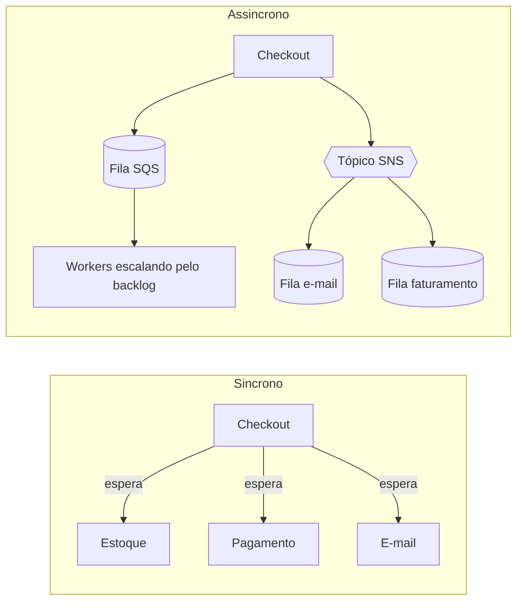

---
aliases:
  - Aula 15.1
modulo: 15
aula: 1
parte: "V Arquiteturas modernas"
dominios:
  - 2
  - 3
lida: false
tags:
  - aula
  - saa-c03
  - modulo-15
---

# Aula 15.1: Por que desacoplar e os padrões de mensageria

[[15 - Desacoplamento Filas Eventos e Workflows|Voltar ao módulo]]

> [!question] Pergunta que esta aula responde
> Por que uma cadeia de chamadas síncronas entre componentes é frágil, que problema o [[Desacoplamento]] resolve de fato, e quais são os quatro padrões de mensageria (fila, [[Pub-Sub|publicação e assinatura]], [[Event Bus|barramento de eventos]] e [[Streaming de Dados|streaming]]) que a AWS oferece para isso?

## O problema: chamar o outro e esperar

Um checkout de e-commerce recebe o pedido e, dentro da mesma [[HTTP|requisição HTTP]], chama o serviço de estoque, depois o de pagamento, depois o de nota fiscal e por fim o de e-mail. Cada chamada é **síncrona**: quem chama fica bloqueado até a resposta chegar. Isso cria três fragilidades que a prova cobra o tempo todo.

**1. A [[Disponibilidade|disponibilidade]] se multiplica.** Quando uma requisição só termina se todos os componentes responderem, eles estão "em série". Se cada um de quatro componentes tem 99,9% de disponibilidade, o conjunto tem `0,999 x 0,999 x 0,999 x 0,999 = 99,6%`, algo como 35 horas de indisponibilidade por ano em vez de 8,8 horas. O cálculo de componentes em série e em paralelo é detalhado no [[20 - Alta Disponibilidade e Recuperacao de Desastres|Módulo 20]]; aqui basta a intuição: cada dependência síncrona é um novo motivo para a requisição falhar.

**2. A falha se propaga (falha em cascata).** O serviço de e-mail fica lento. As threads do checkout que o chamam ficam presas esperando. O pool de threads enche, o checkout para de atender até pedidos que nem usam e-mail, o balanceador marca as instâncias como não saudáveis e a falha de um componente periférico derruba o fluxo principal. As tentativas automáticas (retries) dos clientes pioram a situação, porque multiplicam a carga sobre quem já está sofrendo.

**3. O pico de carga atravessa tudo.** Se o checkout recebe dez vezes mais pedidos em uma promoção, os quatro serviços precisam suportar dez vezes mais ao mesmo tempo, no mesmo segundo. Quem tem um banco com limite de conexões ([[13 - Bancos Relacionais RDS e Aurora|Módulo 13]]) ou uma API de terceiros com [[Rate-Based Rule|limite de taxa]] não consegue acompanhar, e a aplicação inteira vira refém do elo mais lento.

> [!example] Os números da cascata
> O checkout atende 200 requisições por segundo e cada thread fica presa por 100 ms esperando o e-mail. Com 50 threads, a capacidade é `50 / 0,1 = 500 req/s`. Se o serviço de e-mail passa a demorar 5 s, a capacidade cai para `50 / 5 = 10 req/s`. Com 200 req/s chegando, as threads esgotam em menos de um segundo e o checkout inteiro falha por causa de um e-mail.

## O que "desacoplar" significa: três dimensões

Acoplamento é o quanto um componente precisa saber ou esperar do outro. **Desacoplar** é remover essas dependências. Há três dimensões, e cada serviço deste módulo ataca algumas delas:

| Dimensão | Acoplado quando... | [[Desacoplamento\|Desacoplado]] quando... |
|---|---|---|
| **Tempo** | Quem envia espera quem recebe estar de pé e responder | O remetente grava a mensagem e segue; o destinatário processa depois |
| **Espaço (endereço)** | O remetente conhece o endereço e o número de cada destinatário | O remetente publica em um canal (fila, tópico, barramento) e não sabe quem consome |
| **Carga (ritmo)** | O destinatário precisa suportar o ritmo do remetente | Um buffer absorve o pico e o destinatário consome no ritmo que aguenta |

O elemento que entra no meio é sempre um **intermediário durável**: um serviço gerenciado que guarda a mensagem com redundância (o [[SQS]] grava em várias [[Zona de Disponibilidade|AZs]] antes de confirmar o envio) e entrega quando o consumidor estiver pronto. Na prova, "desacoplar" quase sempre significa colocar um desses intermediários entre dois componentes.

> [!info] Ligando os pontos
> Você já viu [[Desacoplamento|desacoplamento]] sem chamar assim: o [[Elastic Load Balancing|balanceador]] do [[12 - Balanceamento de Carga e Auto Scaling|Módulo 12]] desacopla o cliente de cada instância (espaço), e o [[Stateless|estado externo]] desacopla a sessão do servidor. Neste módulo o desacoplamento passa a ser também no tempo e na carga.

## Os quatro padrões de mensageria

A AWS tem vários serviços de integração, e a escolha certa vem de entender o **modelo** de cada um, não de decorar o nome.

### 1. Fila (ponto a ponto, "pull")

O produtor coloca mensagens em uma **fila**. Vários consumidores **puxam** (fazem polling) e cada mensagem é processada por **um** deles. A fila guarda as mensagens até alguém processar ou o prazo de retenção acabar. É o padrão de **trabalho a fazer**: gerar miniatura de imagem, enviar e-mail, cobrar cartão. Serviço: [[SQS]] (e [[Amazon MQ]] quando a aplicação já usa um broker tradicional).

Duas propriedades definem o valor da fila: ela **absorve picos** (mensagens se acumulam em vez de derrubar o consumidor) e permite **escala independente** (o número de consumidores varia com o tamanho do backlog, que é o acúmulo de mensagens ainda não processadas).

### 2. Publicação e assinatura (pub/sub, "push")

O publicador envia uma mensagem a um **tópico**; todos os assinantes recebem **uma cópia**. É o padrão de **aviso a vários interessados**: um pedido foi criado e estoque, faturamento e análise precisam saber. O serviço empurra (push) a mensagem aos assinantes, sem polling, e **não guarda** a mensagem para quem chegar depois. Serviço: [[SNS]]. A distribuição de uma mensagem para várias filas é o [[Fan-out]], tratado na [[15.04 - SNS Topicos Fan-out e Filtros|aula 15.4]].

### 3. Barramento de eventos (roteamento por conteúdo)

Produtores publicam **eventos** (fatos que já aconteceram: "[[EC2|instância EC2]] parou", "fatura paga") em um **barramento**. **Regras** examinam o conteúdo de cada evento e roteiam para zero, um ou vários destinos. É a base da [[Arquitetura Orientada a Eventos]]. O diferencial frente ao [[Pub-Sub|pub/sub]] é a **filtragem rica por conteúdo**, as **fontes prontas** (eventos de serviços AWS e de parceiros SaaS) e a capacidade de agendar. Serviço: [[EventBridge]] ([[15.05 - EventBridge Barramento Regras Scheduler e Pipes|aula 15.5]]).

### 4. Streaming (log ordenado e retido)

Um **stream** é um log em que os registros ficam guardados por um período (de horas a dias) e **vários consumidores independentes** leem o mesmo dado, cada um no seu ritmo, podendo **reler** (replay) do passado. É o padrão de **fluxo contínuo de dados**: cliques, telemetria, logs, mudanças de banco. Serviço: [[Kinesis Data Streams]] (e [[MSK]] para quem já usa [[Apache Kafka]]), detalhado no [[22 - Dados Analytics e Ingestao|Módulo 22]]. A [[15.08 - Escolhendo entre SQS SNS EventBridge Kinesis e Step Functions|aula 15.8]] compara com a fila.

| Padrão | Quem recebe cada mensagem | Guarda a mensagem? | Modelo | Serviço típico |
|---|---|---|---|---|
| Fila | Um consumidor | Sim, até processar ou expirar | Pull | [[SQS]] |
| [[Pub-Sub\|Pub/sub]] | Todos os assinantes | Não | Push | [[SNS]] |
| Barramento | Os destinos cujas regras casam | Não (há archive opcional) | Push por regra | [[EventBridge]] |
| Stream | Todos os leitores, cada um no seu ritmo | Sim, por dias, com replay | Pull | [[Kinesis Data Streams]] |

## Síncrono ou assíncrono: quando cada um

Assíncrono não é sempre melhor. A regra é perguntar **quem espera a resposta e para quê**.

- **Síncrono** quando o usuário precisa do resultado para continuar: "esse CPF é válido?", "login permitido?". A resposta faz parte do fluxo.
- **Assíncrono** quando o resultado pode vir depois: enviar e-mail, gerar relatório, redimensionar imagem. A API responde `202 Accepted` com um identificador, e o cliente consulta o estado depois ou recebe um aviso (callback, notificação).

Quando o pedido precisa de resposta rápida e o trabalho é pesado, o padrão é **aceitar rápido, processar depois**: a API grava a mensagem na fila, devolve `202` e o worker faz o trabalho. Quem já trabalha com [[ECS]] e [[Fargate]] reconhece o desenho: o serviço da API e o serviço de workers são dois serviços ECS separados, cada um com seu próprio ritmo de escala.

## A consequência que a prova adora: entrega "pelo menos uma vez" e idempotência

Intermediários distribuídos priorizam **não perder** mensagem. Para não perder, às vezes entregam a mesma mensagem **mais de uma vez** (um consumidor processa, cai antes de confirmar, e a mensagem volta). Isso se chama **entrega at-least-once** (pelo menos uma vez). A alternativa, **at-most-once**, aceita perder para nunca duplicar. A entrega "exatamente uma vez" ponta a ponta, na prática, é construída: o intermediário deduplica o que consegue (as [[Fila FIFO|filas FIFO]] fazem isso numa janela de tempo) e o consumidor precisa ser **[[Idempotencia|idempotente]]**.

[[Idempotencia]] é a propriedade de uma operação produzir o mesmo resultado se executada uma ou várias vezes. "Definir o status do pedido como PAGO" é idempotente; "somar 10 ao saldo" não é.

> [!example] Cobrança duplicada
> Um worker lê a mensagem "cobrar pedido 4711", chama o gateway de pagamento, e a instância é encerrada antes de apagar a mensagem. A mensagem reaparece e outro worker cobra de novo. A defesa: usar o identificador do pedido como **chave de [[Idempotencia|idempotência]]**, gravando "pedido 4711 cobrado" com uma escrita condicional (por exemplo, `PutItem` com condição de que o item ainda não exista no [[DynamoDB]]) antes de cobrar, e passando a mesma chave ao gateway.

## Backpressure e o buffer como amortecedor

Quando o produtor é mais rápido que o consumidor, alguém precisa segurar o excesso. Sem intermediário, o excesso vira erro ([[Timeout|timeout]], 503). Com fila, vira **backlog**: as mensagens esperam, a [[Latencia|latência]] de ponta a ponta sobe, mas nada se perde, e o consumidor pode escalar (mais instâncias, mais funções) até esvaziar. O contrário também vale: o consumidor protege recursos escassos. Com um banco relacional ([[13 - Bancos Relacionais RDS e Aurora|Módulo 13]]) que aceita 200 conexões, limitar a **concorrência dos consumidores** a 50 faz o banco trabalhar no ritmo dele, algo impossível quando a carga chega direto da internet.

O custo é **[[Latencia|latência]] adicional e complexidade**: a resposta deixa de ser imediata, é preciso monitorar o backlog e tratar mensagens que falham. A [[15.02 - SQS Filas Standard e o Ciclo de Vida da Mensagem|aula 15.2]] mostra como.

## Coreografia e orquestração

Quando vários passos precisam acontecer em sequência (reservar estoque, cobrar, emitir nota), há duas formas de coordenar:

- **[[Coreografia]]**: cada componente reage a eventos e publica novos eventos. Não há maestro. Ganha em [[Desacoplamento|desacoplamento]]; perde em visibilidade (difícil ver "em que passo esse pedido está").
- **[[Orquestracao|Orquestração]]**: um coordenador central chama cada passo na ordem, guarda o estado, trata erros e compensações. Ganha em clareza e controle; o coordenador conhece todos os passos. Serviço: [[Step Functions]] ([[15.06 - Step Functions Orquestracao de Workflows|aula 15.6]]).

## Como isso cai na prova

Cobre a **Task 2.1** (arquiteturas escaláveis e fracamente acopladas: filas, [[Pub-Sub|pub/sub]], event-driven) e a **Task 3.2** (desacoplar cargas para que os componentes escalem de forma independente).

**Palavras-chave em inglês e o que apontam:**

- "decouple", "loosely coupled", "asynchronous": fila ([[SQS]]), tópico ([[SNS]]) ou barramento ([[EventBridge]]).
- "spiky traffic", "unpredictable bursts", "buffer", "absorb spikes": fila entre produtor e consumidor.
- "must not lose messages", "process each message once": fila com [[Dead-Letter Queue]] (aula 15.2) e [[Idempotencia|consumidor idempotente]] ([[Fila FIFO|FIFO]], aula 15.3, se a duplicação for inaceitável).
- "multiple subscribers", "send to multiple systems", "fan out": [[SNS]] com filas [[SQS]].
- "react to changes in AWS resources", "schedule", "SaaS events": [[EventBridge]].
- "coordinate multiple steps", "workflow", "human approval": [[Step Functions]].
- "LEAST [[Overhead Operacional|operational overhead]]": serviços gerenciados e [[Serverless|serverless]] em vez de brokers ou filas autogeridas em [[EC2]].

**Pegadinhas clássicas:**

- Colocar mais instâncias atrás de um balanceador **não** desacopla no tempo: a chamada continua síncrona.
- Aumentar o [[Timeout|timeout]] ou o número de retries **piora** a cascata em vez de resolvê-la.
- "Ordem estrita" e "sem duplicatas" são requisitos de FIFO, não de uma fila padrão.
- Fila não é [[Streaming de Dados|streaming]]: depois que a mensagem é consumida e apagada, ela some (sem replay).

| Requisito no enunciado | Resposta provável | Por quê |
|---|---|---|
| Picos imprevisíveis de pedidos, processamento pode atrasar | [[SQS]] entre a API e os workers | Buffer durável, escala pelo backlog |
| Um evento precisa chegar a 3 sistemas independentes | [[SNS]] com 3 filas [[SQS]] ([[Fan-out\|fan-out]]) | Cada sistema tem seu buffer e seu ritmo |
| Reagir quando uma [[EC2\|instância EC2]] muda de estado | [[EventBridge]] (regra sobre evento da AWS) | Fonte de eventos pronta, sem código de polling |
| Vários passos, com retry, espera e aprovação humana | [[Step Functions]] | [[Orquestracao\|Orquestração]] [[Stateful e Stateless (Firewall)\|com estado]] e tratamento de erro |
| Telemetria contínua lida por vários consumidores, com replay | [[Kinesis Data Streams]] | Log retido, múltiplos leitores |

## Resumo

> [!abstract] A aula em uma frase
> Desacoplar é colocar um intermediário durável (fila, tópico, barramento ou stream) entre dois componentes para que eles não precisem estar vivos, rápidos nem na mesma escala ao mesmo tempo, trocando resposta imediata por resiliência e [[Elasticidade|elasticidade]].

**A lógica, em 5 passos**

1. Chamadas síncronas em série multiplicam indisponibilidades, propagam falhas e transmitem picos de carga até o elo mais fraco.
2. Um intermediário durável remove a dependência de tempo, de endereço e de ritmo entre produtor e consumidor.
3. Quatro padrões cobrem os casos: fila (um consumidor, pull), [[Pub-Sub|pub/sub]] (todos os assinantes, push), barramento (roteamento por conteúdo) e stream (log com replay).
4. Intermediários entregam pelo menos uma vez, então o consumidor precisa ser [[Idempotencia|idempotente]].
5. Para vários passos coordenados, escolhe-se [[Coreografia|coreografia]] (eventos) ou [[Orquestracao|orquestração]] ([[Step Functions]]).

**Números para lembrar**

| O quê | Valor | Por que importa |
|---|---|---|
| 4 componentes de 99,9% em série | cerca de 99,6% | Cada dependência síncrona reduz a [[Disponibilidade\|disponibilidade]] |
| Capacidade de um pool de threads | `threads / tempo de espera` | Um componente lento derruba quem o chama |
| Entrega padrão de [[SQS]], [[SNS]] e [[EventBridge]] | at-least-once | Exige [[Idempotencia\|consumidor idempotente]] |

**Tabela-síntese**

| Padrão | Serviço | Cada mensagem vai para | Retém para replay |
|---|---|---|---|
| Fila | [[SQS]] | Um consumidor | Até processar (máx. 14 dias) |
| [[Pub-Sub\|Pub/sub]] | [[SNS]] | Todos os assinantes | Não |
| Barramento | [[EventBridge]] | Destinos cujas regras casam | Só com archive |
| Stream | [[Kinesis Data Streams]] | Todos os leitores | Sim |

**Na prática, isso significa**

- "Desacoplar" na prova aponta para [[SQS]], [[SNS]], [[EventBridge]] ou [[Step Functions]], não para mais instâncias.
- Pico imprevisível ou consumidor lento pede fila; vários interessados pedem tópico; roteamento por conteúdo e eventos da AWS pedem [[EventBridge]].
- Mensagem duplicada é normal: projete o consumidor para suportá-la.
- Resposta imediata ao usuário pede síncrono; trabalho que pode esperar pede assíncrono com `202 Accepted`.

> [!tip] Liga com
> Vem do [[12 - Balanceamento de Carga e Auto Scaling|Módulo 12]] (escala horizontal e [[Stateless|stateless]]) e do [[13 - Bancos Relacionais RDS e Aurora|Módulo 13]] (limite de conexões). Segue para a [[15.02 - SQS Filas Standard e o Ciclo de Vida da Mensagem|aula 15.2]] e prepara o [[20 - Alta Disponibilidade e Recuperacao de Desastres|Módulo 20]].

## Erros comuns

- **"Um balanceador na frente já desacopla."** Ele distribui carga, mas a chamada continua síncrona: se o destino demora, o chamador espera.
- **"Mais retries resolvem o serviço lento."** Retries sem limite e sem intervalo crescente multiplicam a carga sobre o componente que já falha.
- **"A fila garante que a mensagem é processada uma única vez."** Garante que não se perde; duplicata é possível, a menos que se use FIFO e ainda assim o consumidor deve ser [[Idempotencia|idempotente]].
- **"[[Pub-Sub|Pub/sub]] e fila são a mesma coisa."** Na fila cada mensagem vai a um consumidor; no tópico, a todos os assinantes.
- **"Assíncrono é sempre melhor."** Quando o usuário precisa da resposta para continuar, o fluxo síncrono é o correto.

## Pratique

**1.** Uma loja online tem uma API de checkout que chama de forma síncrona um serviço de envio de e-mail. Quando o serviço de e-mail fica lento, o checkout inteiro trava. Qual mudança elimina a dependência de tempo com o MENOR [[Overhead Operacional|overhead operacional]]?

- [ ] a) Aumentar o timeout das chamadas HTTP do checkout para sessenta segundos e repetir em caso de erro
- [ ] b) Enviar o evento do pedido a uma fila do Amazon SQS e fazer o serviço de e-mail consumir a fila no seu ritmo
- [ ] c) Colocar um Application Load Balancer na frente do serviço de e-mail para espalhar as chamadas entre as instâncias
- [ ] d) Replicar o serviço de e-mail em três AZs com políticas de Auto Scaling mais agressivas

**2.** Quatro [[Microsservicos|microsserviços]], cada um com 99,9% de [[Disponibilidade|disponibilidade]], são chamados em série de forma síncrona para atender uma requisição. Qual é a disponibilidade aproximada da requisição?

- [ ] a) 99,9%, porque a disponibilidade do conjunto é a do melhor componente
- [ ] b) 99,99%, porque as chamadas em série se reforçam
- [ ] c) 99,95%, pela média simples dos componentes
- [ ] d) Cerca de 99,6%, pois as disponibilidades se multiplicam

**3.** Um aplicativo recebe picos de dez vezes o tráfego normal durante promoções, e o processamento do pedido pode demorar alguns minutos sem prejuízo para o cliente. A equipe quer que o banco de dados não seja sobrecarregado. Qual arquitetura atende?

- [ ] a) API grava o pedido em uma fila SQS; workers limitados em concorrência consomem e gravam no banco
- [ ] b) API grava direto no banco, que passa a usar uma instância dez vezes maior durante o ano inteiro, sem fila
- [ ] c) API chama os workers por HTTP e repete a chamada até receber sucesso
- [ ] d) API publica em um tópico SNS cujas assinaturas HTTP chamam os workers direto, sem fila

**4.** Uma operação de "cobrar pedido" é executada por consumidores de uma fila padrão do [[SQS]]. Alguns pedidos são cobrados duas vezes. Qual é a causa raiz e a correção mais adequada?

- [ ] a) O SQS é instável; migrar para o Amazon MQ elimina o problema por completo e dispensa qualquer ajuste
- [ ] b) As retentativas do consumidor estão ligadas; desligá-las evita a duplicação
- [ ] c) A entrega é at-least-once; tornar o consumidor idempotente usando o ID do pedido como chave
- [ ] d) Faltam mensagens na fila; aumentar o número de consumidores elimina duplicatas

**5.** Qual descrição corresponde ao padrão de [[Pub-Sub|publicação e assinatura]] (pub/sub)?

- [ ] a) Cada mensagem é entregue a exatamente um consumidor, que a puxa da fila
- [ ] b) Cada mensagem publicada em um tópico é enviada a todos os assinantes do tópico
- [ ] c) Os registros ficam em um log retido e podem ser relidos várias vezes por consumidores independentes
- [ ] d) Um coordenador central chama cada etapa em sequência e guarda o estado

**6.** Uma empresa precisa processar telemetria contínua de milhares de dispositivos. Três sistemas independentes leem o mesmo dado, cada um no seu ritmo, e um deles precisa reler as últimas 24 horas após um bug. Qual padrão se encaixa melhor?

- [ ] a) Uma fila SQS padrão compartilhada pelos três sistemas, cada um lendo as mesmas mensagens
- [ ] b) Amazon Data Firehose entregando o dado ao S3 como único consumidor
- [ ] c) Um barramento EventBridge sem archive configurado
- [ ] d) Um stream do Kinesis Data Streams com três consumidores

**7.** Qual situação justifica manter uma chamada síncrona em vez de torná-la assíncrona?

- [ ] a) Uma etapa de login que precisa saber, naquele instante, se as credenciais são válidas
- [ ] b) O envio de e-mail de confirmação depois que o pedido é concluído e gravado no banco de dados principal
- [ ] c) A geração noturna de um relatório de vendas em PDF para a diretoria
- [ ] d) O redimensionamento de imagens enviadas pelos usuários para um bucket

**8.** Uma equipe quer que, quando uma [[EC2|instância EC2]] do ambiente mudar para o estado "stopped", uma função seja executada automaticamente, sem escrever código de polling. Qual serviço entrega os eventos prontos e o roteamento?

- [ ] a) Amazon SQS, com uma função consultando a fila a cada minuto
- [ ] b) Amazon MQ com um tópico JMS para cada instância
- [ ] c) Amazon EventBridge, com uma regra sobre o evento de mudança de estado
- [ ] d) AWS AppFlow, com um fluxo agendado a cada cinco minutos para consultar o estado das instâncias

**9.** Uma API deve aceitar solicitações de geração de relatórios pesados e responder rápido ao cliente. O relatório pode ficar pronto minutos depois. Qual desenho é o mais adequado?

- [ ] a) Gerar o relatório dentro da requisição e subir o timeout do balanceador ao máximo permitido para a conexão
- [ ] b) Gerar o relatório na API usando instâncias com muito mais memória
- [ ] c) Gravar o pedido em uma fila, responder 202 Accepted com um identificador e processar depois
- [ ] d) Pedir ao cliente que repita a requisição a cada segundo até o relatório existir

**10.** Qual afirmação descreve melhor o papel do [[Desacoplamento|desacoplamento]] de carga (ritmo) entre produtor e consumidor?

- [ ] a) Garante que o consumidor sempre processe na mesma velocidade do produtor
- [ ] b) Elimina a necessidade de monitorar qualquer métrica do consumidor
- [ ] c) Impede que mensagens sejam entregues mais de uma vez
- [ ] d) Permite que a fila acumule o excesso e o consumidor processe no ritmo que suporta

**11.** (Escolha DUAS.) Quais benefícios o [[Desacoplamento|desacoplamento]] com um intermediário durável (como uma fila) traz para uma aplicação?

- [ ] a) O produtor continua aceitando trabalho mesmo se o consumidor estiver temporariamente indisponível
- [ ] b) A latência de ponta a ponta de cada mensagem diminui em relação à chamada direta
- [ ] c) Garante que cada mensagem seja processada exatamente uma vez sem nenhum cuidado do consumidor
- [ ] d) Produtor e consumidor podem escalar de forma independente, guiados pelo tamanho do backlog
- [ ] e) Elimina a necessidade de qualquer tratamento de erro na aplicação

**12.** (Escolha DUAS.) Uma API síncrona em cadeia sofre falha em cascata quando um serviço dependente fica lento. Quais medidas reduzem esse risco?

- [ ] a) Aumentar o número de retries imediatos sem intervalo entre as tentativas
- [ ] b) Colocar uma fila entre a API e o serviço lento, com o trabalho processado de forma assíncrona
- [ ] c) Definir timeouts curtos e retries com intervalo crescente e aleatoriedade nas chamadas que restarem síncronas
- [ ] d) Remover todos os timeouts para que nenhuma chamada seja interrompida
- [ ] e) Executar todos os serviços no mesmo processo para evitar chamadas de rede

> [!success]- Gabarito
> **1. b)** a fila quebra a dependência de tempo: o checkout grava e segue, e o e-mail consome depois; a) [[Timeout|timeout]] maior e retry aumentam a espera e a carga; c) um [[Application Load Balancer|ALB]] distribui chamadas mas a chamada continua síncrona; d) mais capacidade ajuda a lentidão, não remove o acoplamento.
> **2. d)** componentes em série multiplicam: `0,999^4` é cerca de 99,6%; a) 99,9% seria o valor de um único componente; em série o conjunto é sempre pior que o pior componente; b) seria maior que qualquer componente, impossível em série; c) a média simples não representa a dependência de todos.
> **3. a)** a fila absorve o pico e a concorrência limitada dos workers protege o banco; b) paga capacidade de pico o ano todo e não protege conexões; c) [[HTTP]] síncrono com retry repete o problema e amplifica a carga; d) o [[SNS]] empurra sem buffer durável por consumidor, então o pico chega inteiro ao banco e pedidos se perdem se o worker estiver indisponível.
> **4. c)** [[SQS]] padrão entrega pelo menos uma vez, então a duplicata é esperada e a defesa é a [[Idempotencia|idempotência]] com chave natural; a) o [[Amazon MQ]] também pode reentregar e não é a solução; b) sem retentativa a mensagem falha de vez e se perde, e a duplicata por reentrega continua possível; d) mais consumidores não evitam reentrega.
> **5. b)** [[Pub-Sub|pub/sub]] entrega uma cópia a cada assinante; a) descreve a fila (um consumidor, pull); c) descreve o stream (log retido, replay); d) descreve [[Orquestracao|orquestração]], como no [[Step Functions]].
> **6. d)** o stream guarda os registros, permite vários leitores independentes e replay (a retenção padrão do [[Kinesis Data Streams]] é de 24 h, e a estendida chega a 365 dias); a) em uma fila cada mensagem vai a um só consumidor e some depois de apagada; b) o [[Data Firehose|Firehose]] entrega ao destino mas não tem consumidores próprios nem replay; c) o [[EventBridge]] não guarda eventos sem archive e não é feito para telemetria em alto volume.
> **7. a)** o login precisa da resposta para continuar, então síncrono é o correto; b), c) e d) são trabalhos que podem esperar e se beneficiam de processamento assíncrono.
> **8. c)** o [[EventBridge]] recebe eventos de serviços AWS e roteia por regra sem polling; a) obrigaria a escrever o código de polling e a AWS não publica esse evento em fila por conta própria; b) o [[Amazon MQ]] é para brokers de protocolo padrão, não recebe eventos de serviços; d) o [[AppFlow]] transfere dados de SaaS, não eventos de infraestrutura.
> **9. c)** aceitar rápido, responder 202 com um identificador e processar depois mantém a API leve e escala os workers à parte; a) e b) mantêm o trabalho pesado dentro da requisição; d) polling agressivo do cliente aumenta carga sem resolver a espera.
> **10. d)** o buffer segura o excesso e o consumidor segue no seu ritmo; a) sem buffer o ritmo teria de ser igual, que é justamente o acoplamento; b) o backlog é uma [[Metrica|métrica]] essencial a monitorar; c) a duplicação é tratada com [[Idempotencia|idempotência]] e FIFO, não pelo [[Desacoplamento|desacoplamento]] em si.
> **11. a) e d)** o intermediário aceita o trabalho mesmo com o consumidor fora do ar e permite escalar cada lado pelo backlog; b) a [[Latencia|latência]] por mensagem tende a aumentar; c) a entrega continua at-least-once, exige [[Idempotencia|idempotência]]; e) tratamento de erro continua necessário ([[Dead-Letter Queue|DLQ]], retries).
> **12. b) e c)** a fila remove a dependência síncrona e [[Timeout|timeouts]] curtos com backoff e [[Jitter|jitter]] evitam que a lentidão se espalhe; a) retries imediatos multiplicam a carga; d) sem timeout as threads ficam presas para sempre; e) juntar tudo no mesmo processo elimina o isolamento e a escala independente.

## Para aprofundar

- [ ] [Amazon SQS, Amazon SNS, or Amazon EventBridge?](https://docs.aws.amazon.com/decision-guides/latest/sns-or-sqs-or-eventbridge/sns-or-sqs-or-eventbridge.html) (AWS Decision Guides): comparação oficial dos três serviços em modelo de comunicação, persistência, ordem e filtragem; vale reler depois da aula 15.8.
- [ ] [Using Lambda with Amazon SQS](https://docs.aws.amazon.com/lambda/latest/dg/with-sqs.html) (documentação do Lambda): mostra na prática uma fila servindo de buffer entre produtor e consumidor [[Serverless|serverless]].

Próxima aula: [[15.02 - SQS Filas Standard e o Ciclo de Vida da Mensagem|Aula 15.2: SQS, filas standard e o ciclo de vida da mensagem]].
