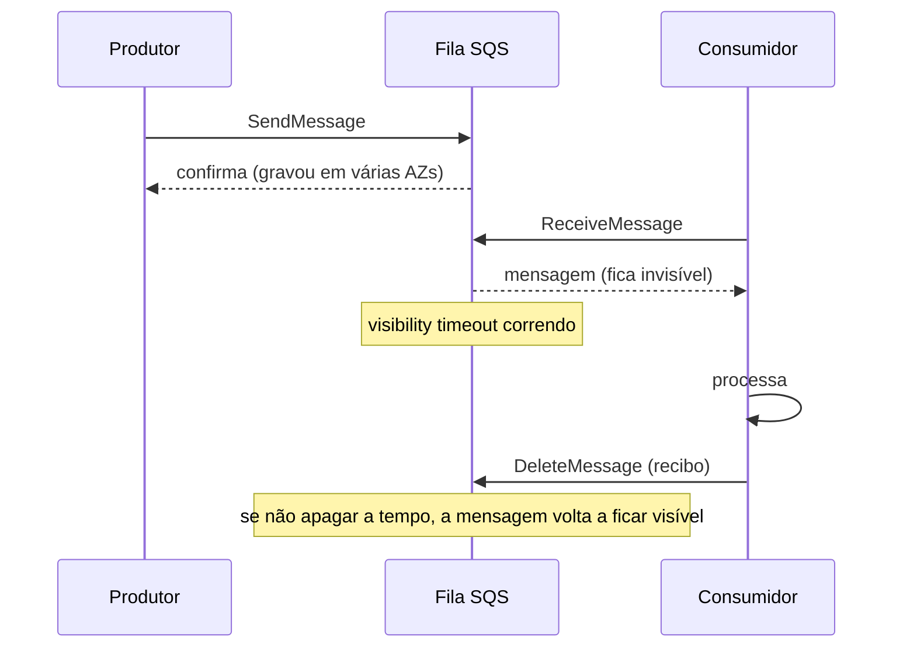

---
aliases:
  - Aula 15.2
modulo: 15
aula: 2
parte: "V Arquiteturas modernas"
dominios:
  - 2
  - 3
lida: false
tags:
  - aula
  - saa-c03
  - modulo-15
---

# Aula 15.2: SQS, filas standard e o ciclo de vida da mensagem

[[15 - Desacoplamento Filas Eventos e Workflows|Voltar ao módulo]]

> [!question] Pergunta que esta aula responde
> O que acontece com uma mensagem desde o envio até ser apagada na [[SQS]], por que ela "some" e "reaparece" ([[Visibility Timeout]]), como o consumidor busca mensagens sem desperdiçar requisições ([[Long Polling]]) e o que fazer com a mensagem que nunca consegue ser processada ([[Dead-Letter Queue]])?

## O problema que a fila resolve

Na [[15.01 - Por Que Desacoplar e os Padroes de Mensageria|aula 15.1]] você viu que um intermediário durável separa produtor e consumidor. O **Amazon [[SQS|Simple Queue Service]] (SQS)** é o intermediário mais usado da AWS: uma fila gerenciada, [[Serverless|sem servidor]] para provisionar, que aceita volume praticamente ilimitado e guarda cada mensagem com redundância. A documentação diz que, ao receber um `SendMessage`, o SQS armazena a mensagem de forma redundante em várias [[Zona de Disponibilidade|AZs]] antes de confirmar o envio (verificado em novembro de 2026), por isso nenhuma falha isolada de máquina, rede ou AZ torna a mensagem inacessível.

Você provavelmente já usa [[SQS]] no dia a dia. A aula entende o que acontece por baixo, porque é no detalhe ([[Timeout|timeouts]], polling, falhas) que a prova pega.

[[SQS]] tem dois tipos de fila: a **[[Fila Padrao|fila standard]]** (padrão, esta aula) e a **[[Fila FIFO]]** (ordem e deduplicação, [[15.03 - SQS FIFO e Padroes de Consumo|aula 15.3]]). **O tipo não muda depois da criação**: não existe converter uma standard em FIFO, é preciso criar outra.

## O que a fila standard garante e o que não garante

| Propriedade | Fila standard |
|---|---|
| [[Throughput]] | Praticamente ilimitado de chamadas por segundo por ação (`SendMessage`, `ReceiveMessage`, `DeleteMessage`) |
| Entrega | **At-least-once**: cada mensagem é entregue pelo menos uma vez; uma cópia a mais pode aparecer |
| Ordem | **Best-effort**: tenta manter a ordem de envio, mas mensagens podem chegar fora de ordem |
| Retenção | Mensagem fica até ser apagada ou expirar (padrão 4 dias) |

Isso está na documentação oficial de standard queues. Para a prova, memorize a frase: **standard = [[Throughput|throughput]] quase ilimitado, at-least-once, ordem best-effort**. O que exige ordem estrita ou ausência de duplicatas aponta para FIFO.

> [!example] Quando o standard serve
> Usuários enviam fotos; o sistema redimensiona e codifica em segundo plano. Se uma foto for redimensionada duas vezes ou duas fotos forem processadas fora de ordem, nada de ruim acontece. A própria AWS cita esse caso, junto com "distribuir tarefas entre vários workers" e "agrupar mensagens para processar depois".

## O ciclo de vida de uma mensagem



Passo a passo:

1. O **produtor** chama `SendMessage` (ou `SendMessageBatch`, até 10 mensagens por requisição).
2. O **consumidor** chama `ReceiveMessage`. A mensagem **não sai da fila**: ela fica **invisível** para os outros consumidores.
3. O consumidor processa e chama `DeleteMessage` com o *receipt handle* (um identificador daquela recepção). Só então a mensagem desaparece.
4. Se o consumidor falhar e não apagar a tempo, a mensagem **volta a ficar visível** e outro consumidor a pega. É assim que o [[SQS]] garante que a mensagem não se perde quando um worker morre no meio.

O ponto 4 é a razão da entrega at-least-once, e é por isso que o consumidor precisa ser [[Idempotencia|idempotente]].

## Visibility timeout: quanto tempo a mensagem fica escondida

O **[[Visibility Timeout|visibility timeout]]** é o intervalo, contado a partir da entrega ao consumidor, em que a mensagem fica invisível. Valores confirmados na documentação (novembro de 2026):

- **Padrão: 30 segundos.** Mínimo 0 segundo, **máximo 12 horas**.
- Pode ser definido na fila ou **por mensagem**. A API `ChangeMessageVisibility` estende ou encurta o prazo de uma mensagem já recebida.
- Definir `VisibilityTimeout` como 0 via `ChangeMessageVisibility` devolve a mensagem imediatamente à fila (útil quando o consumidor desiste de processá-la).

**Como escolher o valor.** A regra da documentação: comece com o tempo máximo que o processamento costuma levar. Muito curto, e a mensagem reaparece enquanto você ainda trabalha nela, gerando duplicata. Muito longo, e uma falha só será reprocessada depois de esperar o prazo todo. Se o tempo varia, use um valor moderado e um **heartbeat**: o consumidor chama `ChangeMessageVisibility` periodicamente para estender o prazo enquanto ainda está vivo.

> [!example] A conta do visibility timeout
> Um worker converte vídeos e cada conversão leva entre 1 e 4 minutos. Com o padrão de 30 segundos, toda mensagem reaparece após 30 s e outro worker começa a mesma conversão, que nunca termina de forma limpa (duplicação em cascata). Configurando 5 minutos, a mensagem fica escondida o tempo necessário; se o worker cair, a mensagem volta após 5 minutos.

**Integração com Lambda:** a documentação do [[Lambda]] manda configurar o [[Visibility Timeout|visibility timeout]] da fila em **pelo menos 6 vezes o [[Timeout|timeout]] da função** (o tempo extra permite novas tentativas se a função for limitada por [[Throttling|throttling]]) e exige que o timeout da função seja menor ou igual ao da fila. Detalhes no [[16 - Serverless Lambda e API Gateway|Módulo 16]] e na [[15.03 - SQS FIFO e Padroes de Consumo|aula 15.3]].

### Mensagens em voo

Uma mensagem recebida e ainda não apagada está **em voo** (in flight). Para filas standard há um limite de cerca de **120.000 mensagens em voo** (depende do tráfego e do backlog). Ao atingi-lo, com short polling o [[SQS]] retorna o erro `OverLimit`; com [[Long Polling|long polling]] não retorna erro, mas não entrega novas mensagens até o número cair. A solução é apagar as mensagens logo após processar, usar mais filas ou pedir aumento de cota.

## Polling: short vs long

O consumidor **puxa** mensagens (modelo pull). O `ReceiveMessage` tem dois comportamentos (verificado em novembro de 2026):

| | Short polling | [[Long Polling\|Long polling]] |
|---|---|---|
| Quando | Padrão (`WaitTimeSeconds = 0`) | `WaitTimeSeconds` de 1 a 20 |
| O que faz | Consulta um **subconjunto** dos servidores e responde na hora, mesmo vazio | Consulta **todos** os servidores e **espera** até haver mensagem ou o tempo acabar |
| Respostas vazias | Muitas, e há "falsas vazias" (a mensagem existe em outro servidor) | Poucas |
| Custo | Mais requisições pagas | Menos requisições |

O tempo máximo de espera é **20 segundos**. [[Long Polling|Long polling]] reduz o custo (menos chamadas vazias cobradas), reduz respostas falsamente vazias e entrega a mensagem **assim que ela chega**. Pode ser habilitado na fila (atributo `ReceiveMessageWaitTimeSeconds`) ou na chamada (`WaitTimeSeconds`). Receber em lotes (até 10 mensagens por chamada) também reduz o número de requisições.

> [!tip] Macete
> Na prova, "reduzir custo de requisições vazias" ou "reduzir falsos vazios" é **[[Long Polling|long polling]] com 20 segundos**. Não existe mágica de mexer no retention para isso.

## Delay queue e message timer

Às vezes a mensagem só deve ficar disponível mais tarde (esperar um sistema externo, dar tempo de uma gravação replicar). Há duas formas:

- **Delay queue**: um atraso de fila (`DelaySeconds`) que vale para toda mensagem nova. Padrão 0, **máximo 15 minutos**.
- **Message timer**: um atraso definido **por mensagem** no envio, também com máximo de 15 minutos. O timer da mensagem **sobrepõe** o `DelaySeconds` da fila nas filas standard.

> [!warning] Pegadinha: FIFO não tem message timer
> **Filas FIFO não suportam message timers por mensagem**; só o `DelaySeconds` no nível da fila (máximo de 15 minutos). Se o enunciado pedir "atraso diferente para cada mensagem" com ordem estrita, a combinação não existe no [[SQS]]: ou se usa uma [[Fila Padrao|fila standard]] (e perde a ordem) ou outro mecanismo, como o [[EventBridge Scheduler]] (verificado em novembro de 2026, [Amazon SQS message timers](https://docs.aws.amazon.com/AWSSimpleQueueService/latest/SQSDeveloperGuide/sqs-message-timers.html)).

Para atrasos maiores que 15 minutos, a solução é outra: [[EventBridge Scheduler]] para agendar para uma data futura ([[15.05 - EventBridge Barramento Regras Scheduler e Pipes|aula 15.5]]) ou [[Step Functions]] com um estado `Wait` ([[15.06 - Step Functions Orquestracao de Workflows|aula 15.6]]).

## Retenção e tamanho da mensagem

- **Retenção**: padrão **4 dias**; mínimo **60 segundos**; máximo **14 dias (1.209.600 s)**. Depois disso o [[SQS]] apaga a mensagem, tenha sido processada ou não.
- **Tamanho**: mínimo 1 byte; máximo **1 MiB (1.048.576 bytes)** (verificado em novembro de 2026).

> [!warning] Cuidado com questões antigas
> Até 2025 o limite era **256 KiB**, e muitos simulados e vídeos ainda o citam. A documentação atual indica 1 MiB. Se uma questão disser "mensagens de até 256 KB", ela provavelmente é antiga; o raciocínio (usar [[S3]] para o que não cabe) continua o mesmo.

- **Mensagens maiores que o limite**: use a **[[SQS|Amazon SQS]] Extended Client Library** (para Java e para Python), que guarda o conteúdo no [[S3]] e envia na fila só uma **referência**. O tamanho máximo do payload com a biblioteca é de **2 GB**, e ela funciona apenas com clientes síncronos (conforme a documentação). Na prova: "mensagens de centenas de megabytes" aponta para S3 mais referência na fila.
- **Atributos**: uma mensagem pode ter até 10 atributos de metadados.
- O corpo só aceita texto: XML, JSON e texto simples (binário precisa ser codificado, por exemplo em Base64).

## Dead-letter queue: o destino das mensagens que não funcionam

Uma **[[Poison Message|poison message]]** (mensagem venenosa) é a que **sempre** falha: JSON inválido, referência a um registro que não existe. Sem proteção, ela reaparece a cada [[Visibility Timeout|visibility timeout]], consome recursos e esconde um bug. A solução é a **[[Dead-Letter Queue|dead-letter queue]] (DLQ)**: uma fila comum para a qual o [[SQS]] move a mensagem depois de **N** tentativas de recebimento.

Como configurar (verificado em novembro de 2026):

1. **Crie antes** a fila que será a [[Dead-Letter Queue|DLQ]] (o [[SQS]] não a cria sozinho).
2. Na fila de origem, defina a **redrive policy** com o [[ARN]] da [[Dead-Letter Queue|DLQ]] e o **`maxReceiveCount`**: quantas vezes a mensagem pode ser **recebida** sem ser apagada antes de ir para a DLQ (faixa válida de 1 a 1.000 no console). Um valor muito baixo, como 1, manda a mensagem para a DLQ na primeira falha; escolha um valor que permita retentativas razoáveis (para consumidores Lambda a documentação recomenda pelo menos 5).
3. Opcional: a **redrive allow policy** na [[Dead-Letter Queue|DLQ]] define quais filas de origem podem usá-la (todas, uma lista de até 10 ou nenhuma).

**Regras que caem na prova:**

- A [[Dead-Letter Queue|DLQ]] precisa estar na **mesma conta e na mesma Região** da fila de origem.
- O **tipo da [[Dead-Letter Queue|DLQ]] deve combinar com o da fila**: [[Fila FIFO|fila FIFO]] usa DLQ FIFO e [[Fila Padrao|fila standard]] usa DLQ standard.
- Em filas standard, a expiração da mensagem na [[Dead-Letter Queue|DLQ]] conta a partir do **horário original de envio**, que não é reiniciado ao mover. Por isso a retenção da DLQ deve ser **maior** que a da fila de origem (exemplo da documentação: 1 dia na fila original e retenção de 4 dias na DLQ deixa só 3 dias na DLQ). Em FIFO o carimbo é reiniciado.
- Não use [[Dead-Letter Queue|DLQ]] com FIFO se não quiser quebrar a ordem exata.

**Operação:** crie um [[CloudWatch Alarm|alarme do CloudWatch]] sobre a quantidade de mensagens visíveis na [[Dead-Letter Queue|DLQ]] (a documentação tem um guia de alarmes para DLQ) para ser avisado quando algo cair lá, e use **DLQ redrive** para devolver as mensagens à fila de origem depois de corrigir o bug. O redrive (`StartMessageMoveTask`) move por padrão da DLQ para a fila de origem, pode usar outra fila de destino do mesmo tipo e tem controle de velocidade. As mensagens movidas recebem novo ID e tempo de enfileiramento (a retenção recomeça).

> [!example] Pedido que nunca processa
> Um pedido chega com `customer_id` inexistente. O worker lança exceção, não apaga, e a mensagem volta. Com `maxReceiveCount = 5`, na quinta recepção sem apagar o [[SQS]] a move para `pedidos-dlq`. Um alarme avisa o time, que corrige o cadastro e executa o redrive: os pedidos voltam à fila e processam normalmente.

## Segurança e acesso

- **[[Criptografia em Repouso|Criptografia em repouso]]**: [[SQS]] oferece **[[SSE-SQS]]** (chaves gerenciadas pelo SQS, **padrão em filas novas**) e **[[SSE-KMS]]** (chaves do [[KMS]]). Requisições a filas com SSE exigem HTTPS e assinatura [[SigV4|Signature Version 4]].
- **Pegadinha do [[SSE-KMS]] com [[Customer Managed Key|chave gerenciada pelo cliente]]**: o **produtor** também precisa de `kms:GenerateDataKey` e `kms:Decrypt`, e o consumidor precisa de `kms:Decrypt`. Quando quem envia é outro serviço ([[SNS]], [[EventBridge]], [[S3]]), a **[[Key Policy|key policy]]** da chave precisa conceder acesso ao principal do serviço; sem isso, as mensagens não chegam à fila.
- **Quem acessa**: [[IAM Policy|policies do IAM]] e a **queue policy** (uma [[Resource-Based Policy|resource-based policy]] de até 8.192 bytes). A queue policy é o que permite que **outros serviços e contas** enviem mensagens à fila ([[SNS]], [[EventBridge]], [[S3]] precisam dela; veja [[04 - IAM Identidade e Acesso|Módulo 4]]).
- **Rede**: o tráfego pode ficar privado com um [[Interface Endpoint]] na [[VPC]] ([[06 - VPC a Fundo|Módulo 6]]).

## Escalando consumidores pelo backlog

O sinal certo para escalar workers é o **[[Backlog por Instancia|backlog por instância]]**: a [[Metrica|métrica]] do [[CloudWatch]] `ApproximateNumberOfMessagesVisible` (mensagens disponíveis) dividida pelo número de instâncias em serviço. Outra métrica que a prova associa a esse cenário é `ApproximateAgeOfOldestMessage`, a idade da mensagem mais antiga (se cresce, os consumidores não dão conta; [métricas do SQS](https://docs.aws.amazon.com/AWSSimpleQueueService/latest/SQSDeveloperGuide/sqs-available-cloudwatch-metrics.html)). A documentação do [[EC2 Auto Scaling]] descreve exatamente isso: criar uma métrica custom de backlog por instância e uma [[Scaling Policy|política de target tracking]] sobre ela. Um alarme só em CPU escala mal, porque o worker pode estar ocioso esperando I/O com a fila crescendo. O backlog é a métrica que diz "há trabalho esperando". A [[12 - Balanceamento de Carga e Auto Scaling|aula de Auto Scaling]] do Módulo 12 trata da mecânica; a [[15.03 - SQS FIFO e Padroes de Consumo|aula 15.3]] mostra a conta completa.

## Como isso cai na prova

Cobre a **Task 2.1** (filas para [[Desacoplamento|acoplamento fraco]]) e a **Task 3.2** (desacoplar para escalar de forma independente).

**Palavras-chave em inglês e o que apontam:**

- "messages are processed more than once", "duplicate processing" com tarefa longa: [[Visibility Timeout|visibility timeout]] curto demais (aumentar ou estender com `ChangeMessageVisibility`).
- "reduce the number of empty responses", "reduce cost of polling": [[Long Polling|long polling]], `WaitTimeSeconds` até 20.
- "messages that cannot be processed", "isolate failed messages", "troubleshoot": [[Dead-Letter Queue|dead-letter queue]] com `maxReceiveCount`.
- "process after a delay of 5 minutes": delay queue ou message timer (até 15 min); em FIFO, só delay de fila.
- "messages larger than ...", "payload of 500 MB": [[SQS]] Extended Client Library com [[S3]].
- "retain messages for 10 days": retention period (até 14 dias).

**Pegadinhas clássicas:**

- Achar que `ReceiveMessage` remove a mensagem. Quem remove é `DeleteMessage`.
- Achar que [[Visibility Timeout|visibility timeout]] "impede" duplicatas por completo. Reduz a chance, mas a entrega continua at-least-once.
- Esquecer que a [[Dead-Letter Queue|DLQ]] precisa estar na mesma conta e Região, e ser do mesmo tipo.
- Confundir **retenção** (quanto a mensagem vive na fila) com **delay** (quanto demora para ficar disponível) e com **[[Visibility Timeout|visibility timeout]]** (quanto fica escondida depois de recebida).

| Requisito no enunciado | Resposta provável | Por quê |
|---|---|---|
| Mensagem reaparece enquanto o worker ainda processa | Aumentar o [[Visibility Timeout\|visibility timeout]] (ou heartbeat) | O prazo é menor que o tempo de processamento |
| Reduzir custo e respostas vazias do polling | [[Long Polling\|Long polling]] com 20 s | Menos chamadas e consulta a todos os servidores |
| Mensagem corrompida trava o processamento | [[Dead-Letter Queue\|DLQ]] com `maxReceiveCount` | Isola a [[Poison Message\|poison message]] sem bloquear a fila |
| Reprocessar as mensagens da [[Dead-Letter Queue\|DLQ]] após o conserto | DLQ redrive para a fila de origem | Move em [[Processamento em Lote\|lote]], sem script próprio |
| Mensagem maior que o limite do [[SQS]] | Extended Client Library com [[S3]] | Payload no S3, referência na fila |
| Processar só 10 minutos depois | Delay queue ou message timer | Atraso nativo de até 15 minutos |

## Resumo

> [!abstract] A aula em uma frase
> A [[Fila Padrao|fila standard]] do [[SQS]] guarda cada mensagem com redundância e a entrega pelo menos uma vez: a mensagem recebida fica invisível por um [[Visibility Timeout|visibility timeout]] e só desaparece com `DeleteMessage`, e as que nunca funcionam vão para uma [[Dead-Letter Queue|DLQ]] depois de `maxReceiveCount` tentativas.

**A lógica, em 6 passos**

1. O produtor envia; o [[SQS]] grava em várias [[Zona de Disponibilidade|AZs]] e confirma.
2. O consumidor recebe; a mensagem fica invisível pelo [[Visibility Timeout|visibility timeout]].
3. Processou com sucesso: o consumidor apaga com o receipt handle.
4. Falhou ou demorou demais: a mensagem volta a ficar visível e é reentregue (at-least-once).
5. Depois de `maxReceiveCount` recepções sem apagar, a mensagem vai para a [[Dead-Letter Queue|DLQ]].
6. O backlog (e não a CPU) é o sinal para escalar os consumidores.

**Números para lembrar** (verificado em novembro de 2026)

| O quê | Valor | Por que importa |
|---|---|---|
| [[Visibility Timeout\|Visibility timeout]] | padrão 30 s, de 0 s a 12 h | Dimensione pelo tempo de processamento |
| Retenção | padrão 4 dias, de 60 s a 14 dias | Prazo máximo de espera na fila |
| Tamanho da mensagem | até 1 MiB (antes 256 KiB) | Maior que isso: Extended Client com [[S3]] (até 2 GB) |
| [[Long Polling\|Long polling]] | até 20 s | Menos requisições vazias |
| Delay | até 15 min | Atraso nativo |
| Lote | até 10 mensagens | Menos chamadas |
| Em voo (standard) | cerca de 120.000 | Apague logo após processar |
| `maxReceiveCount` | 1 a 1.000 | Quantas tentativas antes da [[Dead-Letter Queue\|DLQ]] |

**Na prática, isso significa**

- Meça o tempo de processamento e defina o [[Visibility Timeout|visibility timeout]] acima dele.
- Use [[Long Polling|long polling]] com 20 s e receba em [[Processamento em Lote|lote]].
- Toda fila de produção tem [[Dead-Letter Queue|DLQ]], alarme sobre ela e plano de redrive.
- Retenção da [[Dead-Letter Queue|DLQ]] maior que a da fila de origem.

> [!tip] Liga com
> Vem da [[15.01 - Por Que Desacoplar e os Padroes de Mensageria|aula 15.1]] (por que desacoplar). Segue para a [[15.03 - SQS FIFO e Padroes de Consumo|aula 15.3]] (FIFO, [[Idempotencia|idempotência]] e consumo com Lambda) e para o [[20 - Alta Disponibilidade e Recuperacao de Desastres|Módulo 20]] (padrões de resiliência).

## Erros comuns

- **"Ler a mensagem a remove da fila."** Só `DeleteMessage` remove; sem ele a mensagem reaparece depois do [[Visibility Timeout|visibility timeout]].
- **"[[Visibility Timeout|Visibility timeout]] de 30 s serve para tudo."** O padrão só serve para processamentos curtos; tarefa longa precisa de valor maior ou heartbeat.
- **"[[Long Polling|Long polling]] é só para economizar."** Também reduz respostas falsamente vazias e entrega a mensagem assim que ela chega.
- **"A [[Dead-Letter Queue|DLQ]] pode ficar em outra Região."** Precisa estar na mesma conta e Região, e ser do mesmo tipo que a fila.
- **"Retenção da [[Dead-Letter Queue|DLQ]] igual à da fila é suficiente."** Em filas standard a contagem usa o horário original de envio, então a DLQ pode expirar antes do esperado.
- **"O limite de 256 KiB é o atual."** Hoje é 1 MiB; acima disso usa-se o Extended Client com [[S3]].

## Pratique

**1.** Um worker converte vídeos e cada conversão leva entre 1 e 4 minutos. A [[SQS|fila SQS]] usa o [[Visibility Timeout|visibility timeout]] padrão e várias conversões começam em duplicidade. Qual mudança resolve com o MENOR esforço?

- [ ] a) Trocar a fila standard por uma fila FIFO sem alterar nenhuma configuração
- [ ] b) Aumentar a retenção da fila para 14 dias para evitar reentregas
- [ ] c) Definir o visibility timeout acima do tempo máximo de conversão, por exemplo 5 minutos
- [ ] d) Reduzir o visibility timeout para 1 segundo, de forma que a mensagem volte rápido para a fila de novo

**2.** Dezenas de instâncias consultam uma [[SQS|fila SQS]] em loop e quase todas as respostas vêm vazias, elevando o custo de requisições. Qual ajuste reduz as respostas vazias e o custo?

- [ ] a) Habilitar long polling com WaitTimeSeconds de 20 segundos
- [ ] b) Configurar short polling com um intervalo de zero segundo
- [ ] c) Aumentar o período de retenção da fila de 4 para 14 dias
- [ ] d) Criar uma segunda fila e dividir os consumidores entre as duas

**3.** Uma mensagem com JSON inválido faz o consumidor lançar uma exceção toda vez que a recebe, e ela volta à fila repetidamente, atrasando o resto. Qual é a solução recomendada?

- [ ] a) Trocar a fila standard por uma fila FIFO, que descarta mensagens com formato inválido
- [ ] b) Diminuir o número de consumidores para que a mensagem seja lida menos vezes
- [ ] c) Habilitar long polling para que o SQS filtre mensagens inválidas
- [ ] d) Configurar uma dead-letter queue com maxReceiveCount adequado na fila de origem

**4.** Por exigência operacional, as mensagens de uma fila precisam ficar disponíveis por 10 dias, caso os consumidores fiquem fora do ar durante um recesso longo. O que configurar?

- [ ] a) Um delay queue de 10 dias configurado na fila
- [ ] b) O período de retenção da fila em 10 dias
- [ ] c) O visibility timeout em 10 dias
- [ ] d) Long polling com WaitTimeSeconds de 20 segundos

**5.** Uma aplicação precisa enviar pela fila arquivos de relatório de 80 MB para processamento assíncrono. Qual abordagem usa o [[SQS]] de forma suportada?

- [ ] a) Usar a Amazon SQS Extended Client Library para guardar o payload no S3 e enviar a referência
- [ ] b) Dividir manualmente o arquivo em pedaços de 1 byte e enviar milhões de mensagens separadas pela fila
- [ ] c) Aumentar o limite de tamanho da mensagem do SQS para 100 MB no console
- [ ] d) Compactar o arquivo e enviá-lo como atributo de mensagem

**6.** Um sistema deve processar cada pedido somente 10 minutos depois do envio, para dar tempo de uma gravação replicar entre sistemas. Qual recurso nativo do [[SQS]] atende?

- [ ] a) Um visibility timeout de 10 minutos definido no produtor
- [ ] b) Uma retenção de 10 minutos configurada na fila
- [ ] c) Um delay (delay queue ou message timer) de 600 segundos
- [ ] d) Uma DLQ configurada com maxReceiveCount de 600

**7.** Um engenheiro criou uma [[Dead-Letter Queue|DLQ]] em outra Região para centralizar falhas e a configuração de redrive policy foi rejeitada. Qual é a causa?

- [ ] a) A DLQ precisa ser criada depois, pelo próprio SQS, ao definir a redrive policy
- [ ] b) Uma DLQ precisa ser criptografada com uma chave do KMS própria, caso contrário a associação falha
- [ ] c) Uma DLQ só pode ter retenção de 4 dias, o mesmo valor padrão
- [ ] d) A DLQ precisa estar na mesma conta e na mesma Região da fila de origem

**8.** A equipe quer ser avisada assim que qualquer mensagem chegar à [[Dead-Letter Queue|dead-letter queue]] de uma fila de pedidos. Qual é a abordagem adequada?

- [ ] a) Ler a DLQ manualmente todas as manhãs com um script na máquina do engenheiro
- [ ] b) Criar um alarme do CloudWatch sobre a métrica de mensagens visíveis da DLQ e notificar via SNS
- [ ] c) Reduzir o maxReceiveCount para 1 e monitorar a fila de origem
- [ ] d) Monitorar a métrica NumberOfMessagesSent da fila de origem

**9.** Depois de corrigir um bug, uma equipe quer reprocessar as 5.000 mensagens que estão na [[Dead-Letter Queue|DLQ]], sem escrever um programa. Qual recurso usar?

- [ ] a) Apagar a DLQ e recriar a fila de origem do zero
- [ ] b) Aumentar o visibility timeout da DLQ para que as mensagens voltem sozinhas
- [ ] c) DLQ redrive, movendo as mensagens da DLQ para a fila de origem
- [ ] d) Configurar uma segunda DLQ para a DLQ, de forma que as mensagens circulem

**10.** Qual conjunto descreve corretamente as garantias de uma [[Fila Padrao|fila standard]] do [[SQS]]?

- [ ] a) Entrega at-least-once, ordem best-effort e throughput quase ilimitado
- [ ] b) Entrega exatamente uma vez, ordem estrita e throughput limitado
- [ ] c) Entrega at-most-once, ordem estrita e retenção de 14 dias fixa
- [ ] d) Entrega exatamente uma vez, ordem best-effort e máximo de 300 mensagens por segundo

**11.** (Escolha DUAS.) Quais afirmações sobre o [[Visibility Timeout|visibility timeout]] do [[SQS]] estão corretas?

- [ ] a) A mensagem é removida da fila assim que o consumidor a recebe
- [ ] b) O padrão é 30 segundos e o valor pode ir de 0 segundo até 12 horas
- [ ] c) Com o visibility timeout configurado, a entrega duplicada fica impossível
- [ ] d) O valor máximo é de 15 minutos, igual ao do delay
- [ ] e) ChangeMessageVisibility permite estender ou encurtar o prazo de uma mensagem já recebida

**12.** (Escolha DUAS.) Uma frota de consumidores gera muitas requisições vazias ao [[SQS]] e a conta de requisições está alta. Quais medidas reduzem o custo?

- [ ] a) Usar long polling com WaitTimeSeconds de até 20 segundos
- [ ] b) Usar short polling em loop contínuo para esvaziar a fila mais rápido
- [ ] c) Aumentar a retenção da fila para 14 dias
- [ ] d) Receber e apagar mensagens em lotes de até 10
- [ ] e) Criar uma fila separada por consumidor

> [!success]- Gabarito
> **1. c)** o prazo precisa superar o tempo máximo de processamento, assim a mensagem não reaparece enquanto o worker ainda trabalha; a) FIFO não resolve [[Visibility Timeout|visibility timeout]] curto; b) a retenção define quanto a mensagem vive, não quando reaparece; d) 1 segundo agravaria as duplicatas.
> **2. a)** [[Long Polling|long polling]] consulta todos os servidores e espera até 20 s, reduzindo respostas vazias e requisições pagas; b) short polling com zero segundo aumenta as respostas vazias; c) a retenção não influencia o polling; d) duas filas dividem consumidores sem reduzir as respostas vazias.
> **3. d)** a [[Dead-Letter Queue|DLQ]] isola a [[Poison Message|poison message]] depois de `maxReceiveCount` recepções; a) FIFO não valida conteúdo: a mensagem inválida também reapareceria; b) menos consumidores não corrigem a falha; c) [[Long Polling|long polling]] não valida conteúdo.
> **4. b)** a retenção (até 14 dias) define quanto a mensagem permanece disponível; a) o delay só adia a [[Disponibilidade|disponibilidade]], até 15 minutos; c) o [[Visibility Timeout|visibility timeout]] máximo é 12 horas e não guarda a mensagem; d) [[Long Polling|long polling]] só controla como o consumidor busca mensagens, não por quanto tempo elas ficam na fila.
> **5. a)** a Extended Client Library guarda o payload (até 2 GB) no [[S3]] e manda a referência pela fila; b) milhões de mensagens de 1 byte são inviáveis e perdem a coerência; c) o limite é fixo em 1 MiB e não é editável; d) atributos têm limite próprio e contam no tamanho total.
> **6. c)** delay queue ou message timer adia a [[Disponibilidade|disponibilidade]] até 15 minutos, e 600 s cabe; a) o [[Visibility Timeout|visibility timeout]] só vale depois que a mensagem é recebida; b) com retenção de 10 minutos a mensagem seria apagada ao fim do prazo; d) a [[Dead-Letter Queue|DLQ]] trata falhas, não adia mensagens.
> **7. d)** a [[Dead-Letter Queue|DLQ]] deve estar na mesma conta e Região da fila e ser do mesmo tipo; a) o [[SQS]] não cria a DLQ sozinho, ela é criada antes, mas isso não explica a rejeição por Região; b) a criptografia da DLQ não é obrigatória; c) a retenção da DLQ é configurável e deve ser maior que a da origem.
> **8. b)** um [[CloudWatch Alarm|alarme do CloudWatch]] sobre as mensagens visíveis da [[Dead-Letter Queue|DLQ]] com ação [[SNS]] avisa na hora; a) manual e tardio; c) maxReceiveCount 1 manda para a DLQ na primeira falha e agrava o problema; d) essa [[Metrica|métrica]] mede o envio à fila de origem e não indica o que foi movido para a DLQ.
> **9. c)** o [[Dead-Letter Queue|DLQ]] redrive move as mensagens para a fila de origem por API ou console, com controle de velocidade; a) recriar a fila perde as mensagens e a configuração; b) o [[Visibility Timeout|visibility timeout]] não move mensagens entre filas; d) DLQ de DLQ não reprocessa nada.
> **10. a)** standard = at-least-once, ordem best-effort e [[Throughput|throughput]] quase ilimitado; b) ordem estrita e deduplicação são características de FIFO, e o standard não tem throughput limitado; c) at-most-once não é a garantia do standard e a retenção padrão é 4 dias, não 14; d) o standard entrega pelo menos uma vez e os 300 por segundo são limite de FIFO sem batching.
> **11. b) e e)** o padrão é 30 s com faixa de 0 a 12 h e `ChangeMessageVisibility` ajusta mensagens já recebidas; a) a mensagem fica invisível, não removida; c) a entrega é at-least-once mesmo assim; d) o máximo é 12 horas, 15 minutos é o do delay.
> **12. a) e d)** [[Long Polling|long polling]] reduz chamadas vazias e o [[Processamento em Lote|lote]] de até 10 reduz o número de requisições por mensagem; b) short polling em loop gera mais chamadas vazias; c) a retenção não altera o número de requisições; e) uma fila por consumidor multiplica o polling.

### Laboratório (opcional): fila com DLQ pela AWS CLI

> [!warning] Use uma conta AWS pessoal
> Faça este laboratório em uma **[[Conta AWS|conta AWS]] pessoal separada, com [[Budgets|AWS Budgets]] configurado**, nunca na conta de produção da empresa. O [[SQS]] cobra por requisição e o volume deste laboratório é irrisório, mas apague tudo no final.

Custo estimado: centavos de dólar (poucas requisições; confirme o preço atual na página de preços do [[SQS]]). Os comandos seguem a referência da AWS CLI (`create-queue`, `receive-message`).

1. Crie a [[Dead-Letter Queue|DLQ]]: `aws sqs create-queue --queue-name lab-pedidos-dlq` e anote o [[ARN]] com `aws sqs get-queue-attributes --queue-url <URL> --attribute-names QueueArn`.
2. Crie a fila de origem com a redrive policy (`maxReceiveCount` 2) e `VisibilityTimeout` de 10 segundos. Para evitar problemas de aspas no PowerShell e no cmd, passe os atributos por arquivo: crie `attrs.json` com o conteúdo abaixo (troque o [[ARN]]) e rode `aws sqs create-queue --queue-name lab-pedidos --attributes file://attrs.json`. O valor de `RedrivePolicy` é um JSON serializado como texto, por isso as aspas escapadas:

   ```json
   {
     "VisibilityTimeout": "10",
     "RedrivePolicy": "{\"deadLetterTargetArn\":\"<ARN da DLQ>\",\"maxReceiveCount\":\"2\"}"
   }
   ```
3. Envie uma mensagem com `aws sqs send-message --queue-url <URL> --message-body "pedido-1"`.
4. Receba com [[Long Polling|long polling]]: `aws sqs receive-message --queue-url <URL> --wait-time-seconds 20`. **Não apague.** Espere os 10 segundos do [[Visibility Timeout|visibility timeout]] passarem e receba de novo (segunda recepção). Sempre espere o [[Timeout|timeout]] antes de cada `receive-message`, senão a mensagem ainda está invisível e a resposta vem vazia por esse motivo.
5. Regra da contagem: com `maxReceiveCount` igual a 2, a mensagem pode ser recebida 2 vezes; a tentativa de receber uma **terceira** vez é a que dispara a movimentação para a [[Dead-Letter Queue|DLQ]]. Espere mais 10 segundos e tente a terceira recepção: a fila de origem deve vir vazia. Como a movimentação pode levar alguns instantes, se ainda vier a mensagem, espere o [[Timeout|timeout]] e repita.
6. Receba na [[Dead-Letter Queue|DLQ]] (`--queue-url` da DLQ) e confirme o corpo `pedido-1`.
7. Observe no console do [[SQS]] a opção de [[Dead-Letter Queue|DLQ]] redrive e mova a mensagem de volta para a fila de origem (se preferir, use a API `StartMessageMoveTask`).
8. **Limpeza:** apague as duas filas com `aws sqs delete-queue --queue-url <URL>`. Se criou algum alarme, apague-o também.

## Para aprofundar

- [ ] [Amazon SQS visibility timeout](https://docs.aws.amazon.com/AWSSimpleQueueService/latest/SQSDeveloperGuide/sqs-visibility-timeout.html) (documentação do [[SQS]]): prazo, mensagens em voo e boas práticas de heartbeat.
- [ ] [Amazon SQS message quotas](https://docs.aws.amazon.com/AWSSimpleQueueService/latest/SQSDeveloperGuide/quotas-messages.html) (documentação do [[SQS]]): tabela oficial de limites (retenção, tamanho, delay, [[Processamento em Lote|lote]]).
- [ ] [Using dead-letter queues in Amazon SQS](https://docs.aws.amazon.com/AWSSimpleQueueService/latest/SQSDeveloperGuide/sqs-dead-letter-queues.html) (documentação do [[SQS]]): redrive policy, `maxReceiveCount` e retenção na [[Dead-Letter Queue|DLQ]].
- [ ] [Amazon SQS short and long polling](https://docs.aws.amazon.com/AWSSimpleQueueService/latest/SQSDeveloperGuide/sqs-short-and-long-polling.html) (documentação do [[SQS]]): diferença entre os dois modos.

Próxima aula: [[15.03 - SQS FIFO e Padroes de Consumo|Aula 15.3: SQS FIFO e padrões de consumo]].
