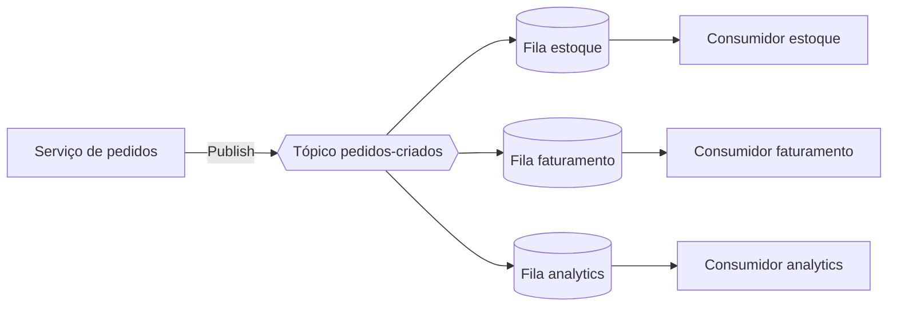

---
aliases:
  - Aula 15.4
modulo: 15
aula: 4
parte: "V Arquiteturas modernas"
dominios:
  - 2
  - 3
lida: false
tags:
  - aula
  - saa-c03
  - modulo-15
---

# Aula 15.4: SNS, tópicos, fan-out e filtros

[[15 - Desacoplamento Filas Eventos e Workflows|Voltar ao módulo]]

> [!question] Pergunta que esta aula responde
> Como um produtor avisa vários consumidores de uma vez sem conhecê-los ([[Pub-Sub]] no [[SNS]]), por que o desenho SNS mais [[SQS]] ([[Fan-out]]) é tão usado, como cada assinante recebe só o que interessa ([[Filter Policy]]) e o que muda em um tópico FIFO?

## O problema: um evento, vários interessados

Um pedido foi criado. O serviço de estoque precisa baixar a quantidade, o de faturamento precisa emitir a cobrança, o de análise precisa registrar a venda, e o de notificação precisa avisar o cliente. Se o serviço de pedidos chamar os quatro (síncrono, como na [[15.01 - Por Que Desacoplar e os Padroes de Mensageria|aula 15.1]]), ele precisa conhecer cada um, esperar cada um, e toda vez que surgir um quinto consumidor alguém precisa mexer no código do produtor.

Uma fila não resolve isso: na fila, cada mensagem vai para **um** consumidor. Aqui você quer que **todos** recebam. É o padrão de [[Pub-Sub|publicação e assinatura]] (**pub/sub**): o produtor publica **uma vez** em um canal, e quem tiver interesse assina. O **Amazon [[SNS|Simple Notification Service]] (SNS)** é esse canal na AWS.

## O modelo do SNS

- **Tópico (topic)**: o canal. O publicador envia mensagens ao tópico e não sabe quem está do outro lado.
- **Assinatura (subscription)**: a ligação entre um tópico e um **endpoint** (o destino). Cada assinante recebe **uma cópia** de cada mensagem.
- **Modelo push**: o [[SNS]] **empurra** a mensagem aos assinantes, sem polling. Ao contrário do [[SQS]], o SNS **não guarda** a mensagem para quem chegar depois (a comparação oficial diz que, no SNS, as mensagens "não persistem" e são entregues em tempo real; verificado em novembro de 2026).

### Destinos (assinantes)

A documentação organiza os destinos em duas famílias (verificado em novembro de 2026):

| Família | Para quem | Destinos |
|---|---|---|
| **A2A** (aplicação para aplicação) | Sistemas | [[SQS]], [[Lambda]], [[Data Firehose]] (Amazon Data Firehose, antigo Kinesis Data Firehose), [[HTTP]]/S, AWS Event Fork Pipelines |
| **A2P** (aplicação para pessoa) | Humanos | SMS, e-mail, notificação push móvel (mobile push) |

O uso A2P é o mais simples e aparece em muita questão: um [[CloudWatch Alarm|alarme do CloudWatch]] aciona um tópico [[SNS]] com assinantes de e-mail e SMS para avisar o time de plantão ([[21 - Observabilidade Automacao e Operacoes|Módulo 21]]). O uso A2A é o do [[Desacoplamento|desacoplamento]].

## Fan-out: SNS mais SQS

O desenho mais importante desta aula é o **[[Fan-out]]**: um tópico [[SNS]] com **várias filas [[SQS]]** como assinantes.



Por que **fila na frente de cada consumidor** em vez de [[SNS]] entregando direto no consumidor? A documentação resume: o SNS entrega com urgência (push) e o [[SQS]] **persiste** a mensagem para o consumidor processar depois. Na prática isso dá:

1. **Buffer por consumidor.** Se o faturamento é lento, a fila dele cresce e os outros não são afetados.
2. **Retentativa independente.** Cada fila tem seu [[Visibility Timeout|visibility timeout]] e sua [[Dead-Letter Queue]].
3. **Escala independente.** Cada consumidor escala pelo backlog da sua fila ([[15.03 - SQS FIFO e Padroes de Consumo|aula 15.3]]).
4. **Extensibilidade.** Para incluir um quinto consumidor, crie uma fila e assine o tópico. O produtor não muda.

> [!example] O pedido que alimenta três sistemas
> A loja publica "pedido 4711 criado" em `pedidos-criados`. O [[SNS]] entrega uma cópia em cada uma das três filas. O faturamento está fora do ar por duas horas: a fila dele acumula, estoque e analytics seguem normais, e quando o faturamento volta, drena o backlog sem perder nenhuma mensagem.

### Permissão: a queue policy

Assinar uma [[SQS|fila SQS]] a um tópico **não basta**: a fila precisa de uma **queue policy** ([[Resource-Based Policy]]) que permita ao serviço [[SNS]] enviar mensagens a ela, normalmente com uma condição `aws:SourceArn` apontando para o [[ARN]] do tópico (para impedir que outro tópico use sua fila, o problema do "[[Confused Deputy|confused deputy]]" do [[04 - IAM Identidade e Acesso|Módulo 4]]). O erro clássico é criar a assinatura e as mensagens não chegarem porque a queue policy falta. Se a fila tiver criptografia [[SSE-KMS]], a chave também precisa permitir que o SNS a use.

### O formato da mensagem na fila

Por padrão, o [[SNS]] entrega à fila um **envelope JSON** que contém campos como `Type`, `MessageId`, `TopicArn`, `Subject`, `Message` (o seu conteúdo), `Timestamp` e dados de assinatura (exemplo da documentação). O consumidor precisa abrir o campo `Message`. 

### Raw message delivery: tirar o envelope

Abrir o campo `Message` em todo consumidor é trabalho repetido. A opção **[[Raw Message Delivery|raw message delivery]]** resolve: é um atributo **por assinatura** (`RawMessageDelivery=true`, definido com `SetSubscriptionAttributes`) que vale para assinaturas **[[SQS]], [[Data Firehose]] e [[HTTP]]/S** (verificado em novembro de 2026).

- **[[SQS]]**: os metadados do [[SNS]] são removidos e o corpo da fila é exatamente a mensagem publicada. Com raw delivery, a fila aceita no máximo **10 atributos de mensagem**; mais que isso é tratado como erro do lado do cliente e a mensagem é descartada.
- **[[HTTP]]/S**: o [[SNS]] acrescenta o header `x-amz-sns-rawdelivery: true`; atributos de mensagem não são enviados.
- **[[Data Firehose|Firehose]]**: só o corpo é entregue; atributos de mensagem não são enviados.

```bash
aws sns set-subscription-attributes --subscription-arn <ARN da assinatura> \
  --attribute-name RawMessageDelivery --attribute-value true
```

Fonte: [Amazon SNS raw message delivery](https://docs.aws.amazon.com/sns/latest/dg/sns-large-payload-raw-message-delivery.html).

## Filtros: cada assinante recebe só o que interessa

Por padrão, **todo assinante recebe todas as mensagens** do tópico. Para receber só um subconjunto, a assinatura ganha uma **[[Filter Policy|filter policy]]**, um JSON que descreve as propriedades que a mensagem precisa ter. O [[SNS]] avalia cada mensagem contra a policy de cada assinatura e **só entrega** se casar. Sem filter policy, entrega tudo.

Pontos confirmados na documentação (novembro de 2026):

- **Escopo (`FilterPolicyScope`)**: a policy pode agir sobre os **atributos da mensagem** (`MessageAttributes`, o padrão) ou sobre o **corpo** (`MessageBody`, que pressupõe um JSON bem formado).
- **Operadores**: correspondência exata de string e de número, prefixo, "anything-but" (tudo menos), faixas numéricas, presença da chave (exists), `equals-ignore-case` e correspondência de endereço IP, além da lógica AND (entre chaves) e OR (entre valores da mesma chave).
- **Propagação**: alterações em uma [[Filter Policy|filter policy]] levam **até 15 minutos** para valer por completo ([[Consistencia Eventual|consistência eventual]]).

> [!example] Filtro por tipo de pedido
> Todos os pedidos vão ao tópico, mas a fila `pedidos-internacionais` só deve receber os de fora do país. A assinatura dessa fila recebe a policy `{"pais": [{"anything-but": ["BR"]}]}` sobre os atributos da mensagem, e a fila `pedidos-nacionais` recebe `{"pais": ["BR"]}`. O produtor publica sempre do mesmo jeito, com o atributo `pais`; quem filtra é o [[SNS]], antes de entregar.

O filtro no [[SNS]] reduz custo e código: sem ele, cada consumidor receberia tudo, descartaria o que não é seu e pagaria por isso. A comparação entre [[SQS]], SNS e EventBridge mostra um detalhe importante: **o SQS sozinho não escolhe consumidor por conteúdo**, e a forma recomendada de ter filtragem com filas é colocar o **SNS com [[Filter Policy|filter policy]]** na frente. O [[EventBridge]], na [[15.05 - EventBridge Barramento Regras Scheduler e Pipes|aula 15.5]], tem filtragem mais rica ainda.

## Tópicos FIFO

Um **tópico FIFO** (lançado em outubro de 2020, conforme a documentação) traz ordem e deduplicação ao [[Pub-Sub|pub/sub]]:

- Cada mensagem tem um **`MessageGroupId`** obrigatório. Dentro do grupo a ordem é estrita; entre grupos a entrega é paralela, como nas filas FIFO.
- O [[SNS]] passa o `MessageGroupId` às filas **[[Fila FIFO|SQS FIFO]]** assinantes, e a ordem é preservada ponta a ponta. O ID do grupo **não é passado às filas [[SQS]] standard** (o tópico FIFO pode entregar a elas, para reduzir custo ou compartilhar a fila, mas sem ordem).
- **High [[Throughput|throughput]]**: por padrão o tópico FIFO tem `FifoThroughputScope=Topic` (deduplicação no escopo do tópico e quotas mais restritas). Mudar para `MessageGroup` habilita o modo de alta vazão, e a recomendação é usar **muitos valores distintos de `MessageGroupId`**, porque o [[SNS]] distribui os grupos entre partições gerenciadas por ele. As quotas numéricas variam por Região e ficam em [Amazon SNS service quotas](https://docs.aws.amazon.com/general/latest/gr/sns.html) (fonte do modo: [High throughput FIFO topics](https://docs.aws.amazon.com/sns/latest/dg/fifo-high-throughput.html); verificado em novembro de 2026).
- A deduplicação por ID (ou por [[Hash|hash]] do conteúdo) funciona como no [[Fila FIFO|SQS FIFO]], com janela de 5 minutos.
- Tópicos FIFO têm nome terminado em `.fifo`.

> [!warning] Tópico FIFO só entrega a filas SQS
> **Tópico FIFO entrega apenas a filas [[SQS]] (FIFO e standard).** Lambda, [[HTTP]]/S, e-mail, SMS e push **não podem assinar** um tópico FIFO: a tentativa de assinar gera erro, porque esses destinos não garantem ordem estrita. Para chegar a uma [[Lambda|função Lambda]] com ordem por entidade: tópico FIFO, fila SQS FIFO assinante e a fila como event source da função ([[Event Source Mapping|event source mapping]], [[16 - Serverless Lambda e API Gateway|Módulo 16]]). Fonte: [Message delivery for FIFO topics](https://docs.aws.amazon.com/sns/latest/dg/fifo-message-delivery.html) (verificado em novembro de 2026).

Regra de uso: **ordem estrita com [[Fan-out|fan-out]]** é [[SNS]] FIFO mais [[Fila FIFO|SQS FIFO]]; **ordem sem fan-out** é só SQS FIFO; **fan-out sem ordem** é SNS standard mais [[SQS]] standard.

## Entrega, retentativas e DLQ da assinatura

O [[SNS]] é um serviço de entrega "melhor esforço com retentativas", e a documentação define o comportamento (verificado em novembro de 2026):

- **Erros do lado do cliente** (o endpoint foi apagado, a permissão mudou): o [[SNS]] **não retenta** a entrega.
- **Erros do lado do servidor** (o endpoint está indisponível): o [[SNS]] **retenta** com backoff. Para endpoints gerenciados pela AWS ([[SQS]] e Lambda), retenta **até 100.015 vezes ao longo de 23 dias**. Para **e-mail, SMS e push**, a política é fixa e mais curta: **50 tentativas em 6 horas**. Para **[[HTTP]]/S**, a política pode ser **customizada** (por tópico ou por assinatura), mas o tempo total de retentativa tem teto rígido de **3.600 segundos** (1 hora), que não pode ser aumentado; só o HTTP/S aceita política customizada (verificado em novembro de 2026, [Message delivery retries](https://docs.aws.amazon.com/sns/latest/dg/sns-message-delivery-retries.html)). Consequência prática: um assinante HTTP fora do ar por 2 horas **perde** as mensagens que esgotaram a política, a menos que a assinatura tenha [[Dead-Letter Queue|DLQ]].
- Se a entrega falha de vez e **não há [[Dead-Letter Queue|DLQ]]**, a mensagem é **descartada**. A **DLQ da assinatura** é uma [[SQS|fila SQS]] (mesma conta e mesma Região da assinatura; FIFO para assinatura de tópico FIFO) que guarda as mensagens não entregues para análise ou reprocessamento. Se a DLQ for criptografada, precisa usar uma chave [[KMS]] própria cuja policy conceda acesso ao [[SNS]].
- **Tópico standard: at-least-once para todos os destinos.** Pode haver duplicata, então o consumidor precisa ser [[Idempotencia|idempotente]]. A deduplicação (janela de 5 minutos) só existe em **tópico FIFO**.

> [!tip] Lembrete
> Duas DLQs diferentes: a **[[Dead-Letter Queue|DLQ]] da assinatura [[SNS]]** pega o que o SNS **não conseguiu entregar** ao endpoint; a **DLQ da [[SQS|fila SQS]]** pega o que o **consumidor não conseguiu processar**. A prova mistura as duas.

## Tamanho e segurança

- **Tamanho**: o padrão é **256 KiB** por mensagem (corpo e atributos somados). Há como elevar até **1 MiB** com o atributo `MaximumMessageSize` do tópico, com restrições (até 100 assinaturas, só destinos [[Data Firehose]], [[SQS]] e Lambda; verificado em novembro de 2026), mas é recurso recente e de baixa chance na prova. Acima disso, o padrão é guardar o conteúdo no [[S3]] e publicar a referência, com a biblioteca estendida do [[SNS]].
- **Criptografia**: o tópico pode usar SSE com [[KMS]]. O acesso de publicadores e de assinantes entre contas passa pela **topic policy**, também uma [[Resource-Based Policy|resource-based policy]].
- **Rede**: o [[SNS]] tem endpoints de interface na [[VPC]] para publicar sem sair para a internet ([[06 - VPC a Fundo|Módulo 6]]).

## S3 como produtor de eventos

Um dos cenários mais frequentes de [[Desacoplamento|desacoplamento]]: "um arquivo chega ao S3 e algo precisa processá-lo de forma assíncrona". O [[S3]] tem **event notifications** que publicam um evento (por exemplo `s3:ObjectCreated:*`) em um destino, com filtro opcional por prefixo e sufixo da chave. Os destinos são **[[SQS]], [[SNS]], Lambda e [[EventBridge]]** (verificado em novembro de 2026, [S3 Event Notifications](https://docs.aws.amazon.com/AmazonS3/latest/userguide/EventNotifications.html)).

- **Permissão**: o destino precisa de uma [[Resource-Based Policy|resource-based policy]] que permita ao principal `s3.amazonaws.com` agir (por exemplo `sqs:SendMessage` na fila ou `sns:Publish` no tópico), com condição `aws:SourceArn` do [[Bucket|bucket]] (e `aws:SourceAccount`) para evitar o [[Confused Deputy|confused deputy]]. Para Lambda, a permissão entra na resource policy da função.
- **[[Fan-out]]**: para vários consumidores reagirem ao mesmo upload, **ponha o [[SNS]] (ou o [[EventBridge]]) como destino** e deixe filas assinarem o tópico. Apontar vários destinos diretos para o mesmo evento e o mesmo prefixo não é o desenho recomendado (o [[S3]] rejeita configurações com prefixos e eventos sobrepostos).
- **[[EventBridge]]** como destino traz filtragem mais rica e mais alvos ([[15.05 - EventBridge Barramento Regras Scheduler e Pipes|aula 15.5]]).

## Como isso cai na prova

Cobre a **Task 2.1** ([[Pub-Sub|publicação e assinatura]], event-driven, [[Desacoplamento|acoplamento fraco]]) e a **Task 3.2** (desacoplar para escalar de forma independente).

**Palavras-chave em inglês e o que apontam:**

- "publish/subscribe", "notify multiple subscribers", "fan out": [[SNS]], normalmente com filas [[SQS]].
- "each subscriber should process at its own pace", "durable": filas [[SQS]] assinando o tópico.
- "only some subscribers should receive certain messages": [[Filter Policy|filter policy]] na assinatura.
- "send email or SMS to the operations team": [[SNS]] com assinantes e-mail e SMS.
- "ordered", "[[Fan-out|fan-out]]", "exactly-once": tópico FIFO com filas FIFO.
- "capture messages that failed delivery": [[Dead-Letter Queue|DLQ]] da assinatura [[SNS]].

**Pegadinhas clássicas:**

- Dizer que o [[SNS]] "guarda" mensagens para novos assinantes. Ele não persiste; quem chega depois não recebe o histórico.
- Esquecer a queue policy: a assinatura existe, mas nada chega.
- Usar [[SQS]] para [[Fan-out|fan-out]]. A fila entrega a um consumidor; fan-out é [[SNS]] (ou [[EventBridge]]) na frente de filas.
- Confundir a [[Dead-Letter Queue|DLQ]] da assinatura (entrega) com a DLQ da fila (processamento).
- Achar que o produtor precisa filtrar por destino. Quem filtra é a [[Filter Policy|filter policy]].

| Requisito no enunciado | Resposta provável | Por quê |
|---|---|---|
| Um evento para vários sistemas, cada um no seu ritmo | [[SNS]] mais uma [[SQS\|fila SQS]] por consumidor | [[Fan-out]] com buffer e retry independentes |
| Só a fila de pagamentos recebe mensagens de pagamento | [[Filter Policy\|Filter policy]] na assinatura | Filtragem no [[SNS]], sem código |
| Avisar o time por e-mail e SMS quando um alarme dispara | Tópico [[SNS]] com assinaturas de e-mail e SMS | Destinos A2P nativos |
| Ordem estrita por entidade e vários consumidores | Tópico FIFO mais filas [[Fila FIFO\|SQS FIFO]] | Ordem preservada ponta a ponta por grupo |
| Guardar mensagens que o [[SNS]] não conseguiu entregar | [[Dead-Letter Queue\|DLQ]] da assinatura ([[SQS\|fila SQS]]) | Evita descartar a mensagem |
| Consumidor não deve abrir envelope JSON | `RawMessageDelivery=true` na assinatura | Metadados do [[SNS]] removidos ([[SQS]], [[Data Firehose\|Firehose]], [[HTTP]]/S) |
| Upload no [[S3]] deve acionar vários consumidores | S3 para [[SNS]] (ou [[EventBridge]]), com filas assinantes | [[Fan-out]]; policy para `s3.amazonaws.com` |
| Ordem estrita por entidade chegando a uma Lambda | Tópico FIFO, [[SQS\|fila SQS]] FIFO, [[Event Source Mapping\|event source mapping]] | Tópico FIFO só entrega a SQS |

## Resumo

> [!abstract] A aula em uma frase
> O [[SNS]] publica uma mensagem em um tópico e a empurra para todos os assinantes, e o desenho SNS mais uma [[SQS|fila SQS]] por consumidor ([[Fan-out|fan-out]]) dá a cada consumidor seu buffer, suas retentativas e sua escala, com filter policies decidindo quem recebe o quê.

**A lógica, em 6 passos**

1. O produtor publica uma vez no tópico; o [[SNS]] não guarda a mensagem, ele empurra.
2. Cada assinatura recebe uma cópia; filas [[SQS]] como assinantes persistem a mensagem.
3. A queue policy precisa permitir que o [[SNS]] escreva na fila.
4. A [[Filter Policy|filter policy]] filtra por atributos ou corpo, por assinatura.
5. Tópico FIFO mais filas FIFO mantém ordem por grupo; falhas de entrega vão para a [[Dead-Letter Queue|DLQ]] da assinatura.
6. `RawMessageDelivery=true` tira o envelope JSON; o [[S3]] publica eventos em [[SNS]], [[SQS]], Lambda ou [[EventBridge]].

**Números para lembrar** (verificado em novembro de 2026)

| O quê | Valor | Por que importa |
|---|---|---|
| Tamanho padrão da mensagem | 256 KiB | Acima disso, referência a objeto no [[S3]] |
| Vigência de mudança na [[Filter Policy\|filter policy]] | até 15 minutos | [[Consistencia Eventual\|Consistência eventual]] |
| Retentativas para [[SQS]] e Lambda | até 100.015 vezes em 23 dias | Entrega muito persistente |
| Retentativas de e-mail, SMS e push | 50 tentativas em 6 horas | Política fixa |
| Teto de retentativa [[HTTP]]/S | 3.600 segundos | Limite rígido; sem [[Dead-Letter Queue\|DLQ]] a mensagem se perde |
| Destinos de tópico FIFO | só filas [[SQS]] | Lambda exige fila no meio |

**Tabela-síntese**

| | [[SQS]] | [[SNS]] |
|---|---|---|
| Modelo | Pull, um consumidor por mensagem | Push, todos os assinantes |
| Persistência | Sim | Não |
| Filtro | Não | [[Filter Policy\|Filter policy]] por assinatura |
| Destinos | Consumidores que fazem polling | [[SQS]], Lambda, [[Data Firehose\|Firehose]], [[HTTP]]/S, SMS, e-mail, push |

**Na prática, isso significa**

- "Vários consumidores" pede [[SNS]] mais [[SQS]]; um só consumidor pede SQS.
- Filtro é configuração da assinatura, não código do produtor.
- Toda assinatura [[SQS]] precisa da queue policy.
- Ordem estrita com [[Fan-out|fan-out]] pede tópico FIFO e filas FIFO; Lambda só entra por uma fila.
- Upload no [[S3]] com vários consumidores pede [[SNS]] ou [[EventBridge]] no meio.

> [!tip] Liga com
> Vem da [[15.02 - SQS Filas Standard e o Ciclo de Vida da Mensagem|aula 15.2]] e da [[15.03 - SQS FIFO e Padroes de Consumo|aula 15.3]]. Segue para a [[15.05 - EventBridge Barramento Regras Scheduler e Pipes|aula 15.5]] ([[EventBridge]]) e para a comparação final na [[15.08 - Escolhendo entre SQS SNS EventBridge Kinesis e Step Functions|aula 15.8]].

## Erros comuns

- **"O [[SNS]] guarda a mensagem para o assinante que chegar depois."** Não guarda; a persistência é do [[SQS]].
- **"Assinei a fila e já funciona."** Falta a queue policy permitindo o [[SNS]].
- **"O [[SNS]] é uma fila."** É um canal push; fila é o [[SQS]].
- **"A [[Filter Policy|filter policy]] vale na hora."** A mudança pode levar até 15 minutos.
- **"A [[Dead-Letter Queue|DLQ]] da assinatura é a mesma da fila."** Uma trata falha de entrega do [[SNS]]; a outra, falha de processamento do consumidor.
- **"O tópico FIFO entrega direto à Lambda."** Não entrega: só a filas [[SQS]]; a Lambda lê da fila.
- **"O [[SNS]] standard entrega exatamente uma vez."** É at-least-once; duplicata exige [[Idempotencia|idempotência]].
- **"O consumidor [[SQS]] sempre recebe só o corpo."** Sem [[Raw Message Delivery|raw message delivery]], ele recebe o envelope JSON e precisa abrir `Message`.

## Pratique

**1.** Quando um pedido é criado, os serviços de estoque, faturamento e análise precisam ser avisados, cada um no seu ritmo e com retentativas independentes. A equipe quer poder adicionar novos consumidores sem mudar o produtor. Qual arquitetura atende?

- [ ] a) Um tópico SNS com uma fila SQS assinante para cada consumidor
- [ ] b) Uma única fila SQS lida pelos três serviços em disputa pelas mensagens
- [ ] c) Três chamadas HTTP síncronas feitas pelo serviço de pedidos, em sequência
- [ ] d) Um stream do Kinesis lido pelo serviço de pedidos antes de cada operação

**2.** Todos os pedidos são publicados em um tópico [[SNS]], mas a fila de pagamentos deve receber somente as mensagens com o atributo tipo igual a pagamento. Qual é a solução com o MENOR esforço?

- [ ] a) Fazer o consumidor da fila descartar o que não é de pagamento
- [ ] b) Criar um tópico SNS separado por tipo e alterar todos os produtores
- [ ] c) Atribuir uma filter policy à assinatura da fila de pagamentos
- [ ] d) Usar uma função Lambda entre o tópico e a fila para filtrar as mensagens

**3.** Um assinante [[HTTP]] de um tópico [[SNS]] fica indisponível por duas horas e a equipe não quer perder as mensagens não entregues, quer analisá-las depois. O que configurar?

- [ ] a) Aumentar o visibility timeout do tópico para duas horas
- [ ] b) Uma DLQ (fila SQS) na assinatura SNS
- [ ] c) Habilitar a deduplicação baseada em conteúdo no tópico
- [ ] d) Trocar o tópico por uma fila FIFO, que guarda tudo por padrão

**4.** Uma plataforma de mercado financeiro precisa notificar vários sistemas sobre atualizações de preço, preservando a ordem das atualizações de cada produto. Qual desenho atende?

- [ ] a) Um tópico SNS standard com filas SQS standard, ordenando no consumidor
- [ ] b) Várias filas standard, uma por produto, criadas sob demanda
- [ ] c) Um stream único do Kinesis com um único shard e consumo manual
- [ ] d) Um tópico SNS FIFO com o MessageGroupId igual ao produto e filas SQS FIFO assinantes

**5.** A equipe de operações precisa receber e-mail e SMS sempre que um [[CloudWatch Alarm|alarme do CloudWatch]] dispara. Qual é a abordagem mais simples e gerenciada?

- [ ] a) Uma fila SQS lida por uma instância EC2 que envia as mensagens
- [ ] b) Um barramento EventBridge com uma regra para cada pessoa da equipe
- [ ] c) Um tópico SNS com assinaturas de e-mail e SMS como ação do alarme
- [ ] d) Uma função Lambda agendada que consulta o alarme a cada minuto

**6.** Uma [[SQS|fila SQS]] foi assinada a um tópico [[SNS]], a assinatura aparece como confirmada, mas nenhuma mensagem chega. Qual é a causa mais provável?

- [ ] a) A queue policy da fila não permite que o SNS envie mensagens para ela
- [ ] b) O tópico SNS só entrega mensagens entre as 08h e as 18h
- [ ] c) A fila SQS precisa estar em uma VPC diferente da do tópico
- [ ] d) A retenção da fila está acima de 4 dias

**7.** Um dos consumidores de um [[Fan-out|fan-out]] é lento e instável, e a equipe quer que ele não afete os outros nem perca mensagens quando estiver fora do ar. Qual característica do desenho garante isso?

- [ ] a) Todos os consumidores lerem a mesma fila compartilhada
- [ ] b) O SNS reenviar a mesma mensagem ao consumidor sem limite de tempo
- [ ] c) O produtor publicar de novo cada mensagem a cada falha do consumidor
- [ ] d) Cada consumidor ter a sua própria fila SQS assinando o tópico

**8.** Os consumidores de várias filas [[SQS]] assinantes de um tópico [[SNS]] precisam receber exatamente o texto publicado, sem o envelope JSON com `Type`, `MessageId` e `TopicArn`, e sem alterar o produtor. O que configurar?

- [ ] a) Uma filter policy com escopo MessageBody em cada assinatura
- [ ] b) O atributo RawMessageDelivery igual a true em cada assinatura SQS
- [ ] c) Uma função Lambda entre o tópico e cada fila que extrai o campo Message
- [ ] d) A troca do tópico standard por um tópico FIFO com deduplicação

**9.** As mensagens publicadas em um tópico [[SNS]] são JSON e a assinatura precisa filtrar por um campo do corpo (por exemplo, valor maior que 100), e não por atributos. O que configurar?

- [ ] a) Uma filter policy com escopo MessageAttributes, o escopo padrão
- [ ] b) Uma segunda assinatura sem filtro e uma regra no consumidor
- [ ] c) Uma filter policy com o escopo MessageBody
- [ ] d) Um tópico FIFO, que filtra o corpo por padrão

**10.** Depois de alterar a [[Filter Policy|filter policy]] de uma assinatura [[SNS]], o comportamento antigo ainda aparece por alguns minutos. Qual é o motivo?

- [ ] a) Mudanças em filter policies são consistentes eventualmente e podem levar até 15 minutos
- [ ] b) O SNS só aplica filtros novos à meia-noite UTC de cada dia
- [ ] c) A assinatura precisa ser confirmada de novo por e-mail a cada mudança
- [ ] d) Filter policies só valem para mensagens publicadas por outra conta

**11.** (Escolha DUAS.) Quais afirmações sobre o [[SNS]] estão corretas?

- [ ] a) O SNS empurra (push) a mensagem para os assinantes, sem polling
- [ ] b) O SNS guarda as mensagens por 14 dias para assinantes tardios
- [ ] c) Cada mensagem do tópico é entregue a um único assinante, em rodízio
- [ ] d) Cada assinante recebe uma cópia, e filter policies escolhem quais mensagens cada um recebe
- [ ] e) Os assinantes precisam fazer polling no tópico para receber mensagens

**12.** (Escolha DUAS.) Quais vantagens o desenho [[SNS]] com uma [[SQS|fila SQS]] por consumidor ([[Fan-out|fan-out]]) oferece?

- [ ] a) Garante ordem global de todas as mensagens entre todos os consumidores
- [ ] b) Cada consumidor tem buffer, retentativas e DLQ próprios, isolando falhas
- [ ] c) Dispensa qualquer cuidado de idempotência nos consumidores
- [ ] d) Torna a entrega exatamente uma vez em tópicos standard, sem duplicatas
- [ ] e) Permite adicionar novos consumidores sem alterar o produtor

**13.** Uma empresa recebe arquivos em um [[Bucket|bucket]] [[S3]], e cada novo objeto deve acionar três sistemas independentes (indexação, antivírus e relatório), cada um no seu ritmo e com retentativas próprias. Qual desenho tem o MENOR esforço de manutenção?

- [ ] a) Três configurações de notificação do S3, cada uma apontando para uma fila diferente, no mesmo prefixo e evento
- [ ] b) Notificação do S3 para um tópico SNS com uma fila SQS assinante por sistema
- [ ] c) Notificação do S3 para uma fila SQS lida pelos três sistemas em conjunto
- [ ] d) Um tópico SNS FIFO como destino direto do S3, com uma fila para cada sistema

**14.** Pedidos de uma mesma conta precisam chegar em ordem estrita a uma [[Lambda|função Lambda]], e outros sistemas também precisam receber os eventos. Qual arquitetura atende?

- [ ] a) Tópico SNS FIFO com a função Lambda como assinante direta
- [ ] b) Tópico SNS standard com a função Lambda como assinante e um atributo de sequência no corpo
- [ ] c) Tópico SNS FIFO, fila SQS FIFO assinante e a fila como event source da função Lambda
- [ ] d) Uma regra do EventBridge com a função Lambda como alvo e MessageGroupId na regra

> [!success]- Gabarito
> **1. a)** o [[Fan-out|fan-out]] entrega uma cópia a cada fila e cada consumidor tem seu ritmo; novos consumidores são novas filas assinantes; b) em uma fila compartilhada cada mensagem vai a um só consumidor; c) chamadas síncronas acoplam e exigem mudar o produtor; d) Kinesis não resolve fan-out com retentativas por consumidor nesse desenho.
> **2. c)** a [[Filter Policy|filter policy]] na assinatura filtra no [[SNS]] sem código; a) o consumidor receberia tudo e pagaria por isso; b) multiplica tópicos e obriga mudar os produtores; d) a Lambda extra adiciona custo e manutenção.
> **3. b)** a [[Dead-Letter Queue|DLQ]] da assinatura guarda mensagens que o [[SNS]] não conseguiu entregar; a) o [[Visibility Timeout|visibility timeout]] é conceito do [[SQS]], não do tópico; c) deduplicação não guarda mensagens; d) o FIFO não substitui a DLQ da assinatura.
> **4. d)** o tópico FIFO com [[Message Group|MessageGroupId]] por produto e filas FIFO preservam a ordem por produto com [[Fan-out|fan-out]]; a) o standard não garante ordem; b) uma fila por produto não escala nem faz fan-out; c) um shard único limita o [[Throughput|throughput]] e não é um desenho de fan-out.
> **5. c)** o [[SNS]] com assinaturas e-mail e SMS é o destino A2P nativo para alarmes; a) uma [[EC2|instância EC2]] dedicada é overhead sem necessidade; b) regras por pessoa são trabalhosas e não entregam e-mail ou SMS nativamente; d) polling de alarme duplica algo que o [[CloudWatch]] faz por conta própria.
> **6. a)** sem a queue policy permitindo o [[SNS]] (idealmente com aws:SourceArn do tópico) as mensagens não são entregues; b) o SNS não tem janela de horário; c) fila e tópico não dependem de [[VPC]]; d) a retenção não impede entrega.
> **7. d)** com uma fila por consumidor, cada um tem seu buffer e suas retentativas e a lentidão de um não afeta os demais; a) uma fila compartilhada divide as mensagens entre consumidores; b) retentativa sem limite não existe e não isola; c) republicar acopla o produtor.
> **8. b)** `RawMessageDelivery=true` na assinatura remove os metadados do [[SNS]] e entrega o corpo cru à fila; a) o escopo do filtro escolhe quais mensagens chegam, não o formato; c) funciona, mas adiciona custo e código para algo que é uma opção da assinatura; d) FIFO não remove o envelope.
> **9. c)** o escopo MessageBody filtra por propriedades do corpo JSON; a) o escopo padrão olha os atributos; b) a regra no consumidor desperdiça entregas; d) o FIFO não altera o escopo do filtro.
> **10. a)** mudanças de [[Filter Policy|filter policy]] são eventualmente consistentes, até 15 minutos; b) não há horário fixo de aplicação; c) a confirmação é feita na criação da assinatura; d) as filter policies funcionam para qualquer publicador autorizado.
> **11. a) e d)** o [[SNS]] é push e cada assinante recebe uma cópia, com filtros por assinatura; b) o SNS não persiste; c) todos os assinantes recebem uma cópia, não um rodízio; e) o polling é característica do [[SQS]].
> **12. b) e e)** cada fila isola buffer, retry e [[Dead-Letter Queue|DLQ]] e novos consumidores são novas filas; a) a ordem global não é garantida; c) a entrega continua at-least-once e exige [[Idempotencia|idempotência]]; d) tópico standard é at-least-once e a deduplicação existe só em tópico FIFO.
> **13. b)** o [[S3]] publica uma vez no [[SNS]] e o [[Fan-out|fan-out]] entrega uma cópia a cada fila, cada uma com buffer e [[Dead-Letter Queue|DLQ]]; a) o desenho recomendado não aponta vários destinos diretos para o mesmo evento e prefixo, usa SNS ou [[EventBridge]] no meio; c) em uma fila compartilhada cada mensagem vai a um só sistema; d) FIFO não é necessário nem resolve esse requisito.
> **14. c)** o tópico FIFO só entrega a filas [[SQS]], e a [[Fila FIFO|fila FIFO]] como event source preserva a ordem por grupo até a Lambda; a) Lambda não pode assinar tópico FIFO (a tentativa gera erro); b) o standard não garante ordem, e um atributo no corpo obriga o consumidor a reordenar; d) o [[EventBridge]] não oferece ordem estrita por grupo para a função.

### Laboratório (opcional): fan-out com filtro pela AWS CLI

> [!warning] Use uma conta AWS pessoal
> Faça este laboratório em uma **[[Conta AWS|conta AWS]] pessoal separada, com [[Budgets|AWS Budgets]] configurado**, nunca na conta de produção da empresa. O volume é mínimo, mas apague tudo no final.

Custo estimado: centavos de dólar (confirme preços de [[SNS]] e [[SQS]] nas páginas oficiais). Os comandos `create-topic`, `subscribe` e `create-queue` seguem a referência da AWS CLI; a queue policy segue o padrão descrito na documentação.

1. Crie o tópico: `aws sns create-topic --name lab-pedidos` e anote o [[ARN]].
2. Crie duas filas: `aws sqs create-queue --queue-name lab-nacionais` e `aws sqs create-queue --queue-name lab-internacionais`; obtenha o [[ARN]] de cada uma com `aws sqs get-queue-attributes --queue-url <URL> --attribute-names QueueArn`.
3. Em cada fila, defina a queue policy. Salve o arquivo `policy-nacionais.json` (troque os [[ARN|ARNs]]) e depois crie `attrs-nacionais.json` com a policy serializada como string, porque o [[SQS]] espera o atributo `Policy` como texto:

   ```json
   {
     "Version": "2012-10-17",
     "Statement": [{
       "Effect": "Allow",
       "Principal": {"Service": "sns.amazonaws.com"},
       "Action": "sqs:SendMessage",
       "Resource": "<ARN da fila>",
       "Condition": {"ArnEquals": {"aws:SourceArn": "<ARN do tópico>"}}
     }]
   }
   ```

   Aplique com `aws sqs set-queue-attributes --queue-url <URL> --attributes file://attrs-nacionais.json`, onde o arquivo tem a forma `{"Policy": "<o JSON acima como string, com aspas escapadas>"}`. Passar o JSON por arquivo (`file://`) evita os problemas de aspas do PowerShell e do cmd. Repita para a fila internacional.
4. Assine as filas passando os atributos por arquivo: `aws sns subscribe --topic-arn <ARN> --protocol sqs --notification-endpoint <ARN da fila> --attributes file://sub-nacionais.json`, com `{"FilterPolicy": "{\"pais\":[\"BR\"]}", "RawMessageDelivery": "true"}` para a fila nacional, e `{"FilterPolicy": "{\"pais\":[{\"anything-but\":[\"BR\"]}]}", "RawMessageDelivery": "true"}` para a internacional.
5. Publique duas mensagens: `aws sns publish --topic-arn <ARN> --message "pedido-1" --message-attributes '{"pais":{"DataType":"String","StringValue":"BR"}}'` e outra com `StringValue` `US`. Aguarde até alguns minutos para as policies valerem.
6. Receba em cada fila com `aws sqs receive-message --queue-url <URL> --wait-time-seconds 20` e confirme que cada fila recebeu só a mensagem do seu país (com `RawMessageDelivery` ativo, o corpo é o texto puro; para ver o envelope, desative a opção em uma assinatura e repita).
7. **Limpeza:** apague as assinaturas e o tópico (`aws sns delete-topic --topic-arn <ARN>`) e as duas filas (`aws sqs delete-queue --queue-url <URL>`).

## Para aprofundar

- [ ] [Fanout Amazon SNS notifications to Amazon SQS queues](https://docs.aws.amazon.com/sns/latest/dg/sns-sqs-as-subscriber.html) (documentação do [[SNS]]): como SNS e [[SQS]] trabalham juntos e o formato do envelope.
- [ ] [Amazon SNS message filtering](https://docs.aws.amazon.com/sns/latest/dg/sns-message-filtering.html) (documentação do [[SNS]]): filter policies por atributo e por corpo.
- [ ] [Amazon SNS dead-letter queues](https://docs.aws.amazon.com/sns/latest/dg/sns-dead-letter-queues.html) (documentação do [[SNS]]): erros de cliente e de servidor, retentativas e [[Dead-Letter Queue|DLQ]] da assinatura.
- [ ] [Publishing large messages with Amazon SNS](https://docs.aws.amazon.com/sns/latest/dg/large-message-payloads.html) (documentação do [[SNS]]): `MaximumMessageSize` de até 1 MiB e restrições.

Próxima aula: [[15.05 - EventBridge Barramento Regras Scheduler e Pipes|Aula 15.5: EventBridge, barramento, regras, Scheduler e Pipes]].
