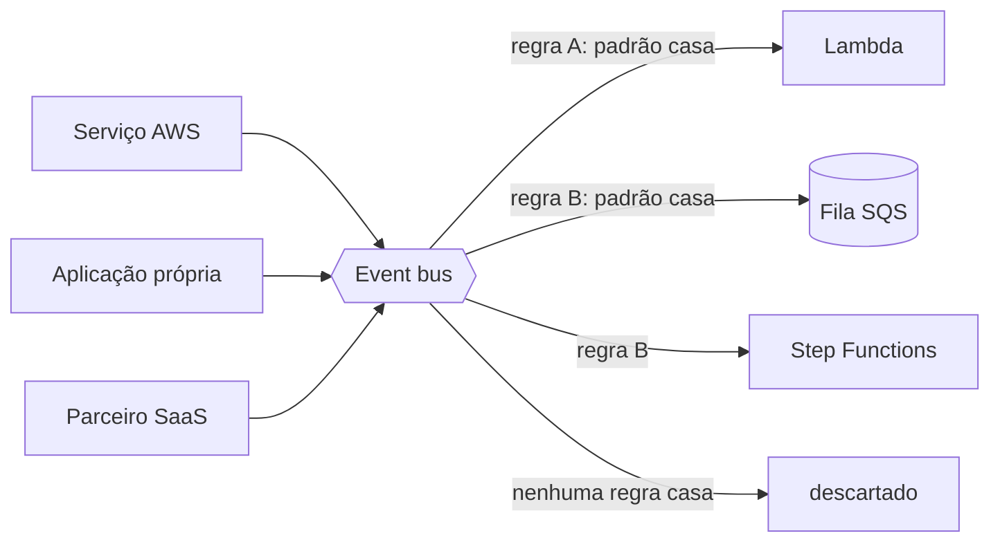
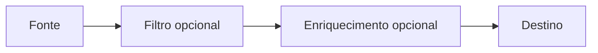

---
aliases:
  - Aula 15.5
modulo: 15
aula: 5
parte: "V Arquiteturas modernas"
dominios:
  - 2
  - 3
lida: false
tags:
  - aula
  - saa-c03
  - modulo-15
---

# Aula 15.5: EventBridge, barramento, regras, Scheduler e Pipes

[[15 - Desacoplamento Filas Eventos e Workflows|Voltar ao módulo]]

> [!question] Pergunta que esta aula responde
> Como reagir a fatos que acontecem (um recurso AWS mudou, um parceiro SaaS enviou algo, chegou a hora de uma tarefa) roteando cada [[Event Bus|evento]] pelo conteúdo ([[EventBridge]]), como agendar tarefas [[Serverless|sem servidor]] ([[EventBridge Scheduler]]) e como ligar uma fonte a um destino com enriquecimento ([[EventBridge Pipes]])?

## O problema: o mundo emite eventos, e você quer reagir sem polling

Um **evento** é um registro de que algo aconteceu: "a instância i-0abc passou para `stopped`", "o pipeline falhou", "o cliente do Zendesk abriu um ticket", "chegou a hora do fechamento mensal". Reagir a isso sem [[EventBridge]] significa escrever e operar código de polling ("de minuto em minuto, pergunte se algo mudou"), cada serviço com seu jeito de avisar, e toda mudança exige tocar no produtor.

O **[[EventBridge|Amazon EventBridge]]** (o antigo **[[CloudWatch]] Events**; questões antigas ainda usam o nome velho) é o serviço [[Serverless|serverless]] que **recebe eventos, filtra, transforma e entrega** a destinos, e é a base da [[Arquitetura Orientada a Eventos]] na AWS. A documentação (verificado em novembro de 2026) apresenta três peças: **event buses** (roteadores), **Pipes** (ponto a ponto) e **Scheduler** (agendamento).

## O barramento (event bus), as regras e os alvos



- **Evento**: um JSON. Os campos que mais importam nos padrões são `source` (quem emitiu, como `aws.ec2`), `detail-type` (o tipo, como `EC2 Instance State-change Notification`) e `detail` (o conteúdo específico).
- **[[Event Bus|Event bus]]**: o roteador que recebe os eventos. Tipos: o **default event bus**, que **todo** conta tem e que recebe **automaticamente** os eventos dos serviços AWS; **custom event buses**, que você cria para eventos da sua aplicação; e **partner event buses**, que recebem eventos de parceiros SaaS integrados.
- **Regra (rule)**: associada a **um** barramento; cada evento que chega é avaliado contra **todas** as regras do barramento. A regra tem um **event pattern** (o que casar) ou uma programação, e **alvos** (targets).
- **Alvos**: cada regra aceita **até 5 alvos**, e um mesmo evento pode casar com várias regras. Entre os destinos, a documentação cita [[Lambda]], [[Step Functions]], [[SQS]], [[SNS]], [[Kinesis Data Streams]], endpoints [[HTTP]] por **API destinations** e **barramentos em outras [[Conta AWS|contas AWS]]**.
- Se **nenhuma regra casar**, o [[EventBridge]] não faz nada com o evento.
- **Input transformer**: ajusta o evento **antes** de entregá-lo ao alvo. Você extrai campos do evento com JSON paths e monta um novo texto ou JSON (por exemplo, mandar só `instance-id` e `state` em uma frase para um tópico [[SNS]]), sem precisar de uma Lambda no meio ([documentação](https://docs.aws.amazon.com/eventbridge/latest/userguide/eb-transform-target-input.html)).
- **Eventos de chamadas de API via CloudTrail**: o [[CloudTrail]] registra chamadas de API e o [[EventBridge]] as recebe como eventos do tipo `AWS API Call via CloudTrail`. É assim que se reage a "alguém criou um [[Bucket|bucket]]", "alguém desligou o logging" ou "o [[Usuario Root|usuário root]] fez login", casando `source` e `detail.eventName` na regra. Exige que o CloudTrail esteja registrando os [[Management Event|eventos de gerenciamento]].
- **API destinations**: alvo que chama um **endpoint [[HTTP]]** externo (um SaaS, por exemplo) com autenticação e [[Rate-Based Rule|limite de taxa]] configuráveis, sem Lambda de cola.

### Event pattern: filtrar por conteúdo

O **event pattern** é um JSON com os campos e valores que o evento precisa ter. O exemplo da documentação para reagir quando uma [[EC2|instância EC2]] entra em `running`:

```json
{
  "source": ["aws.ec2"],
  "detail-type": ["EC2 Instance State-change Notification"],
  "detail": { "state": ["running"] }
}
```

A diferença para o [[SNS]] é a riqueza do casamento: o [[EventBridge]] faz **filtragem por conteúdo** em qualquer parte do evento, e tem **fontes prontas** (eventos de serviços AWS e de parceiros) que o SNS não tem. A comparação oficial resume: SNS filtra por atributos de mensagem; EventBridge faz "complex event pattern matching and content-based filtering".

> [!example] Reagir sem escrever polling
> Quando o [[Config|AWS Config]] marca um [[Bucket|bucket]] como não conforme, ele emite um evento para o barramento default. Uma regra com o padrão desse evento aciona uma função [[Lambda]] que corrige o bucket e uma [[SQS|fila SQS]] que alimenta o time de segurança. Nenhum código consulta o Config de tempos em tempos, e adicionar um terceiro destino é criar mais um alvo na regra (ou uma nova regra).

### Entrega, retentativas e DLQ

O [[EventBridge]] entrega **pelo menos uma vez** e, se o alvo estiver indisponível, **retenta**. Os padrões (verificado em novembro de 2026):

- **24 horas e até 185 tentativas**, com [[Backoff Exponencial|backoff exponencial]] e [[Jitter|jitter]] (atraso aleatório). Você pode mudar esses dois valores na **retry policy** de cada alvo.
- Passado o prazo, o evento é **descartado**, a menos que o alvo tenha uma **[[Dead-Letter Queue|DLQ]]**.
- No barramento clássico (regras e alvos), a [[Dead-Letter Queue|DLQ]] do alvo é uma **[[SQS|fila SQS]] standard** (a documentação diz que apenas filas standard são suportadas nesse caso; verificado em novembro de 2026, [Using dead-letter queues](https://docs.aws.amazon.com/eventbridge/latest/userguide/eb-rule-dlq.html)). Cada mensagem na DLQ leva atributos como `RULE_ARN`, `TARGET_ARN` e `ERROR_CODE`.
- Alguns erros **não geram retentativa**: falta de permissão no alvo, recurso que não existe mais, endereço inválido. Esses eventos vão **direto** para a [[Dead-Letter Queue|DLQ]], se houver uma, ou se perdem.

A comparação oficial alerta ainda que, no barramento clássico, o [[EventBridge]] **não garante ordem** (entrega em ordem arbitrária) e não persiste os eventos (a menos que você crie um archive). Se a ordem importa, a resposta é [[Fila FIFO|SQS FIFO]] ou tópico [[SNS]] FIFO.

### Archive e replay

Para **reprocessar o passado**, o [[EventBridge]] oferece **archive** (arquivo) e **replay** (reexecução), conforme a documentação:

- Um **archive** recebe eventos de **um** barramento de origem (não dá para mudar depois). Você define um **event pattern** para escolher o que arquivar e **quantos dias reter**; o padrão é guardar **indefinidamente**. Por padrão os dados são cifrados (AES-256, [[AWS Owned Key|chave de propriedade da AWS]]).
- Um **replay** reenvia eventos arquivados **ao barramento original**, em um **intervalo de tempo** escolhido, opcionalmente só para regras específicas. Os eventos reexecutados ganham um campo `replay-name`, e uma regra gerenciada impede que sejam arquivados de novo.
- A recomendação é **esperar 10 minutos** antes de reexecutar eventos recentes, para garantir que todos já chegaram ao archive.
- Há cobrança para archives.

> [!example] O bug no consumidor
> Um deploy ruim fez a função de faturamento ignorar eventos por 6 horas. Corrigido o bug, a equipe cria um replay do archive do barramento para as últimas 6 horas, apontando só para a regra do faturamento. Os eventos são reprocessados sem pedir nada aos produtores.

### Entre contas e a nova versão do barramento

Barramentos podem enviar eventos a **barramentos de outras [[Conta AWS|contas AWS]]** (útil para centralizar eventos de várias contas em uma de auditoria, conectando com o [[05 - Multiconta Governanca e Federacao|Módulo 5]]).

> [!info] Novidade na documentação
> A documentação de novembro de 2026 separa o **Custom [[Event Bus]]** (novo, com retenção de 1 a 365 dias, ordem por grupo de eventos e assinantes no lugar de regras) do **Custom Event Bus - Classic**, que é o modelo de regras e alvos descrito acima. A prova trabalha com regras e alvos; trate o novo barramento como contexto e consulte a [documentação do EventBridge](https://docs.aws.amazon.com/eventbridge/latest/userguide/eb-what-is.html).

## EventBridge Scheduler: agendamento sem servidor

Executar algo "toda noite às 02:00" ou "daqui a 30 dias" costumava significar um cron em uma [[EC2|instância EC2]] que precisa estar sempre ligada. O **[[EventBridge Scheduler]]** é o agendador gerenciado, e a documentação o recomenda como a forma de invocar alvos por agenda (em vez das antigas regras agendadas), pela maior escala e variedade de alvos:

- **Tipos de agenda**: **cron** e **rate** para padrões recorrentes, e **invocação única** (one-time) para uma data e hora específicas.
- **Alvos**: **templated targets** para operações comuns ([[SQS]], [[SNS]], Lambda, [[EventBridge]]) e **universal targets**, que chamam mais de 270 serviços e mais de 6.000 operações de API.
- **Flexible time windows** (janela flexível): espalha as execuções dentro de uma janela quando a hora exata não importa, o que melhora a confiabilidade.
- **Retentativas**: entrega **at-least-once**, com limite de tentativas e tempo máximo de retenção para invocações que falham.
- **Execution role**: o Scheduler assume uma [[IAM Role|role IAM]] sua para chamar o alvo; o console cria a role, mas na CLI, SDK ou [[CloudFormation]] você a fornece.
- Agendas ficam em **schedule groups** (usados para tags).

> [!tip] Scheduler e o limite de 15 minutos do SQS
> O atraso máximo de uma mensagem [[SQS]] é de 15 minutos ([[15.02 - SQS Filas Standard e o Ciclo de Vida da Mensagem|aula 15.2]]). Para "enviar um lembrete em 30 dias", a resposta é uma agenda **one-time** do Scheduler que publica no SQS ou aciona a função na data. Outra opção é um estado `Wait` do [[Step Functions]].

## EventBridge Pipes: ponto a ponto com enriquecimento

Nem tudo é um barramento com muitos destinos. Quando há **uma fonte e um destino**, com algum filtro e talvez uma consulta extra no meio, o **Pipes** substitui o código de cola (uma Lambda que lê da fila, chama uma API e escreve em outro lugar). Estrutura (verificado em novembro de 2026):



- **Fontes** suportadas: stream do [[DynamoDB]], [[Kinesis Data Streams|stream do Kinesis]], broker do [[Amazon MQ]], [[MSK]], fila [[SQS]] e [[Apache Kafka]] (autogerenciado ou de terceiros).
- **Filtro**: o pipe só envia ao destino o que casar, e **você paga apenas pelos eventos que casam** com o filtro.
- **Enriquecimento** (opcional): uma etapa síncrona que busca dados adicionais. Opções: **API destination**, **[[API Gateway]]**, **Lambda** e **[[Step Functions]]** (apenas **Express workflows**). A resposta do enriquecimento é limitada a **6 MB**. Devolver resposta vazia faz o enriquecimento atuar como filtro adicional.
- **Ordem**: se a fonte impõe ordem, o pipe a mantém até o destino.
- Um pipe com **barramento como destino** é um padrão comum: o pipe leva eventos do [[DynamoDB Streams|stream do DynamoDB]] ao barramento, e as regras distribuem a vários alvos.

> [!example] Pedido da fila ao workflow
> Uma [[SQS|fila SQS]] recebe "pedido recebido" (só o ID). Um pipe lê a fila, usa uma **API destination** como enriquecimento para buscar o endereço do cliente e entrega o pedido completo a um workflow [[Step Functions]]. Antes, isso era uma Lambda de cola para escrever, versionar e operar.

**Barramento ou pipe?** Barramento: **muitas fontes para muitos destinos**, roteamento por regra. Pipe: **uma fonte para um destino**, com transformação e enriquecimento.

## Quando EventBridge (resumo; comparação completa na aula 15.8)

- Reagir a **eventos de serviços AWS** ou de **parceiros SaaS**: [[EventBridge]].
- **Roteamento por conteúdo** para destinos diferentes: [[EventBridge]].
- **Agendar** execuções: [[EventBridge Scheduler]].
- **Reprocessar o passado** (replay): [[EventBridge]] com archive.
- **[[Pub-Sub|Pub/sub]] simples com SMS, e-mail ou push**: [[SNS]].
- **Buffer durável e ordem estrita**: [[SQS]] (FIFO).

## Como isso cai na prova

Cobre a **Task 2.1** (event-driven, fracamente acoplado) e apoia a **Task 3.2** ([[Desacoplamento|desacoplamento]]).

**Palavras-chave em inglês e o que apontam:**

- "react to events from AWS services", "when an [[EC2]] instance changes state", "rule": [[EventBridge]] no barramento default.
- "SaaS partner events", "integrate with Zendesk/Datadog": partner event source do [[EventBridge]].
- "run a task on a schedule", "cron", "one-time schedule", "at a specific time in the future": [[EventBridge Scheduler]].
- "replay events", "reprocess past events": archive e replay.
- "point-to-point", "enrich", "poll a queue/stream and call an API": [[EventBridge Pipes]].
- "formerly [[CloudWatch]] Events": [[EventBridge]].

**Pegadinhas clássicas:**

- Dizer que o [[EventBridge]] garante ordem. No barramento clássico, não garante.
- Usar a [[Dead-Letter Queue|DLQ]] errada: no barramento clássico, a DLQ do alvo é uma [[SQS|fila SQS]] standard.
- Achar que o barramento retém eventos por padrão. Sem archive, não retém.
- Confundir regra agendada (antiga) com Scheduler (recomendado hoje).
- Esquecer que cada regra aceita até 5 alvos; para mais destinos, use mais regras ou um tópico [[SNS]] como alvo.
- Pensar que o enriquecimento do Pipes aceita [[Step Functions]] Standard: só Express.

| Requisito no enunciado | Resposta provável | Por quê |
|---|---|---|
| Executar algo quando um recurso AWS muda de estado | Regra no barramento default | Os serviços AWS emitem eventos nele automaticamente |
| Receber eventos de um parceiro SaaS sem polling | Partner event source no [[EventBridge]] | Integração nativa |
| Disparar uma função daqui a 30 dias | [[EventBridge Scheduler]] (one-time) | O delay do [[SQS]] é de no máximo 15 minutos |
| Reprocessar os eventos das últimas 6 horas | Archive e replay | Reexecuta no barramento original |
| Ler da fila, enriquecer via API e chamar um workflow | [[EventBridge Pipes]] | Substitui código de cola |
| Não perder eventos que o alvo recusou | [[Dead-Letter Queue\|DLQ]] ([[SQS\|fila SQS]] standard) no alvo | Sem DLQ, o evento é descartado após as retentativas |

## Resumo

> [!abstract] A aula em uma frase
> O [[EventBridge]] recebe eventos (de serviços AWS, parceiros e aplicações), roteia cada um por regras com event patterns a até 5 alvos, retenta por 24 horas e 185 tentativas, permite replay de archives, agenda tarefas com o Scheduler e liga fonte a destino com enriquecimento no Pipes.

**A lógica, em 5 passos**

1. Um evento chega ao barramento (o default já recebe os eventos dos serviços AWS).
2. Cada regra do barramento avalia o evento contra seu event pattern.
3. Regras que casam entregam a até 5 alvos; falhas retentam e, se esgotarem, vão para a [[Dead-Letter Queue|DLQ]] ([[SQS|fila SQS]] standard) ou se perdem.
4. Um archive guarda eventos e o replay os reexecuta no barramento de origem.
5. O Scheduler agenda (cron, rate, one-time) e o Pipes liga uma fonte a um destino com filtro e enriquecimento.

**Números para lembrar** (verificado em novembro de 2026)

| O quê | Valor | Por que importa |
|---|---|---|
| Alvos por regra | até 5 | Mais destinos: mais regras ou [[SNS]] como alvo |
| Retentativa padrão | 24 horas e 185 tentativas | Ajustável por alvo |
| Espera antes de replay | 10 minutos | Garante que o archive recebeu tudo |
| Resposta de enriquecimento no Pipes | até 6 MB | Limite do enriquecimento |
| Alcance do Scheduler | mais de 270 serviços e 6.000 APIs | Agenda quase qualquer API |

**Tabela-síntese**

| Peça | Para quê | Modelo |
|---|---|---|
| [[Event Bus\|Event bus]] e regras | Rotear eventos por conteúdo | Muitas fontes, muitos destinos |
| Archive e replay | Reprocessar o passado | Guardar e reenviar ao barramento |
| Scheduler | Executar no tempo | Cron, rate, one-time |
| Pipes | Ligar uma fonte a um destino com enriquecimento | Ponto a ponto |

**Na prática, isso significa**

- Evento de serviço AWS ou de parceiro: [[EventBridge]], sem polling.
- Agendamento [[Serverless|sem servidor]]: Scheduler; ordem estrita: [[SQS]] ou [[SNS]] FIFO.
- Evite perder eventos: configure [[Dead-Letter Queue|DLQ]] no alvo.
- Cola de código entre fila, API e workflow: considere Pipes.

> [!tip] Liga com
> Vem da [[15.04 - SNS Topicos Fan-out e Filtros|aula 15.4]] ([[Pub-Sub|pub/sub]]) e do [[05 - Multiconta Governanca e Federacao|Módulo 5]] (Config e [[CloudTrail]] emitem eventos). Segue para a [[15.06 - Step Functions Orquestracao de Workflows|aula 15.6]] ([[Step Functions]], alvo e enriquecimento comuns) e para o [[21 - Observabilidade Automacao e Operacoes|Módulo 21]] ([[Remediacao Automatica|remediação automática]] com [[EventBridge]]).

## Erros comuns

- **"O [[EventBridge]] garante a ordem dos eventos."** O barramento clássico entrega em ordem arbitrária.
- **"Eventos ficam guardados no barramento."** Só com archive.
- **"A [[Dead-Letter Queue|DLQ]] do alvo de uma regra pode ser FIFO."** No barramento clássico, precisa ser [[SQS|fila SQS]] standard.
- **"Preciso de código para escutar mudanças dos serviços AWS."** O barramento default já recebe esses eventos; basta uma regra.
- **"Regra com cron é a melhor forma de agendar."** A documentação recomenda o Scheduler.
- **"Pipes serve para rotear para vários destinos."** O pipe é ponto a ponto; para vários destinos, use um barramento como destino do pipe.

## Pratique

**1.** Uma empresa quer reagir automaticamente quando um ticket é aberto na ferramenta SaaS de suporte de um parceiro integrado, sem escrever código de polling. Qual solução tem o MENOR [[Overhead Operacional|overhead operacional]]?

- [ ] a) Uma função Lambda agendada a cada minuto que consulta a API do parceiro
- [ ] b) Um partner event source do EventBridge, com uma regra que aciona o destino
- [ ] c) Uma fila SQS em que o parceiro escreve com credenciais de longo prazo
- [ ] d) Um tópico SNS com assinantes HTTP configurados manualmente por evento

**2.** Uma aplicação precisa executar uma função todo dia às 02:00 UTC e, além disso, uma única vez 30 dias depois do cadastro de cada cliente, sem manter servidores. Qual serviço atende as duas necessidades?

- [ ] a) Uma instância EC2 com cron e um banco para guardar as datas de cada cliente
- [ ] b) Uma fila SQS com delay de 30 dias para cada cliente
- [ ] c) Um tópico SNS com mensagens agendadas por assinante
- [ ] d) O EventBridge Scheduler, com uma agenda cron e agendas one-time

**3.** O alvo de uma regra do [[EventBridge]] é uma API destination cujo endpoint [[HTTP]] ficou indisponível por dois dias, e os eventos que esgotaram as retentativas foram perdidos. Como evitar a perda?

- [ ] a) Configurar uma DLQ do tipo fila SQS standard no alvo da regra
- [ ] b) Configurar uma DLQ FIFO para preservar a ordem dos eventos que falharam na entrega
- [ ] c) Reduzir a retry policy do alvo para uma única tentativa
- [ ] d) Trocar a regra por um tópico SNS com assinatura HTTP e sem DLQ

**4.** Um bug no consumidor fez com que os eventos das últimas 6 horas fossem ignorados. Depois de corrigir o bug, a equipe quer reprocessá-los sem pedir nada aos produtores. O que usar?

- [ ] a) Reduzir o visibility timeout do barramento e aguardar a reentrega
- [ ] b) Pedir que cada produtor reenvie os eventos manualmente
- [ ] c) Um archive do barramento e um replay do período afetado
- [ ] d) Criar uma nova regra no barramento default com o mesmo padrão

**5.** Uma [[SQS|fila SQS]] recebe somente o ID do pedido. A equipe quer ler a fila, buscar os dados completos em uma API e acionar um workflow do [[Step Functions]], sem manter uma função de cola. Qual recurso atende?

- [ ] a) Uma regra do EventBridge no barramento default com três alvos que fazem cada etapa em sequência
- [ ] b) Um tópico SNS com assinatura SQS e Lambda
- [ ] c) Um stream do Kinesis lido por uma função com polling manual
- [ ] d) Um EventBridge Pipe com enriquecimento por API destination e destino Step Functions

**6.** Eventos de cinco serviços diferentes precisam ser entregues a oito destinos distintos, conforme o conteúdo de cada evento. Qual desenho se encaixa melhor?

- [ ] a) Oito pipes, um para cada destino, cada um lendo a mesma fonte e filtrando por conteúdo
- [ ] b) Um event bus com regras que casam o conteúdo e roteiam aos alvos
- [ ] c) Uma única fila SQS lida pelos oito destinos em disputa
- [ ] d) Um tópico SNS sem filter policy e oito assinantes

**7.** Um pipeline de eventos exige que as mudanças de status de um pedido sejam processadas estritamente na ordem em que ocorreram. Qual serviço atende, entre as opções?

- [ ] a) O barramento clássico do EventBridge, que entrega eventos sempre em ordem de chegada
- [ ] b) Um tópico SNS standard com assinaturas HTTP
- [ ] c) Uma fila SQS FIFO com MessageGroupId igual ao pedido
- [ ] d) Um replay de archive do EventBridge a cada minuto

**8.** O alvo de uma regra, sem [[Dead-Letter Queue|DLQ]] e com a retry policy padrão, ficou fora do ar por 3 dias por um erro retentável do lado dele. O que acontece com os eventos enviados nesse período?

- [ ] a) Cada evento é retentado por até 24 horas ou 185 tentativas e depois descartado, então os dos dois primeiros dias se perdem
- [ ] b) Cada evento é tentado uma única vez e descartado, e nenhuma retentativa acontece
- [ ] c) Os eventos ficam retidos no barramento por 14 dias e são entregues quando o alvo voltar
- [ ] d) O EventBridge retenta sem limite de tempo até o alvo responder com sucesso

**9.** Um pipe lê pedidos de uma [[SQS|fila SQS]] e precisa de uma etapa de enriquecimento que execute um workflow do [[Step Functions]] e devolva o resultado de forma síncrona antes de entregar ao destino. Qual tipo de workflow é aceito nessa etapa?

- [ ] a) Standard workflows apenas
- [ ] b) Express workflows apenas
- [ ] c) Standard ou Express, à escolha do usuário
- [ ] d) Nenhum, Step Functions só pode ser destino

**10.** Uma regra do [[EventBridge]] aciona uma [[Lambda|função Lambda]] que foi excluída. A regra tem uma [[Dead-Letter Queue|DLQ]] configurada. O que acontece com os eventos?

- [ ] a) Ficam em retentativa por 24 horas, até que a função seja recriada com o mesmo nome
- [ ] b) São apagados silenciosamente pelo barramento sem registro
- [ ] c) São reenviados ao produtor, que precisa tratá-los
- [ ] d) Vão direto para a DLQ, sem retentativas, pois o recurso não existe mais

**11.** (Escolha DUAS.) Quais afirmações sobre o [[EventBridge]] estão corretas?

- [ ] a) Um evento só pode casar com uma regra por barramento
- [ ] b) Um event pattern descreve campos e valores que o evento precisa ter para acionar uma regra
- [ ] c) O barramento clássico garante entrega estritamente ordenada dos eventos
- [ ] d) O barramento default de cada conta recebe automaticamente os eventos dos serviços AWS
- [ ] e) Os eventos ficam retidos no barramento por 14 dias por padrão

**12.** (Escolha DUAS.) Quais capacidades o [[EventBridge Scheduler]] oferece?

- [ ] a) Agendas recorrentes (cron e rate) e invocações únicas em data e hora específicas
- [ ] b) Invocar apenas funções Lambda, sem outros serviços
- [ ] c) Janelas flexíveis de execução e configuração de retentativas para falhas
- [ ] d) Exigir uma instância EC2 sempre ligada para disparar as agendas
- [ ] e) Reter os eventos disparados para replay posterior

> [!success]- Gabarito
> **1. b)** o partner event source entrega os eventos do SaaS ao [[EventBridge]] sem polling; a) polling agendado é código e custo a operar; c) credenciais de longo prazo e fila própria aumentam o risco e o trabalho; d) assinantes [[HTTP]] manuais não são a integração nativa.
> **2. d)** o Scheduler oferece cron, rate e agendas one-time, [[Serverless|sem servidor]]; a) [[EC2]] ligada o tempo todo é overhead; b) o delay do [[SQS]] vai até 15 minutos; c) o [[SNS]] não agenda mensagens para o futuro.
> **3. a)** a [[Dead-Letter Queue|DLQ]] do alvo é uma [[SQS|fila SQS]] standard e guarda os eventos que esgotaram as retentativas (24 h ou 185 tentativas por padrão), para reprocessar depois; b) a DLQ FIFO não é suportada no barramento clássico; c) menos retentativas aumenta a perda; d) sem DLQ os eventos seriam descartados do mesmo jeito.
> **4. c)** o archive guarda os eventos e o replay os reenvia ao barramento de origem para o intervalo desejado; a) o barramento não tem [[Visibility Timeout|visibility timeout]]; b) transfere trabalho aos produtores; d) uma nova regra só vale para eventos futuros.
> **5. d)** o Pipe liga fonte ([[SQS]]), enriquecimento (API destination) e destino ([[Step Functions]]) sem código de cola; a) a regra do barramento não lê da fila nem enriquece; b) [[SNS]] não enriquece; c) Kinesis e polling manual voltam ao código de cola.
> **6. b)** muitas fontes, muitos destinos e roteamento por conteúdo são o caso do [[Event Bus|event bus]] com regras; a) os pipes são ponto a ponto, oito pipes repetiriam a configuração; c) a fila compartilhada entrega cada mensagem a um só destino; d) sem [[Filter Policy|filter policy]] todos recebem tudo.
> **7. c)** só a [[SQS|fila SQS]] FIFO garante ordem estrita por grupo; a) o barramento clássico não garante ordem; b) o [[SNS]] standard também não; d) o replay reexecuta eventos, não ordena.
> **8. a)** o padrão é 24 horas e 185 tentativas com [[Backoff Exponencial|backoff exponencial]] e [[Jitter|jitter]], e sem [[Dead-Letter Queue|DLQ]] o evento é descartado ao esgotar; b) o padrão retenta; c) o barramento não retém eventos sem archive; d) há limite de tempo e de tentativas.
> **9. b)** só workflows Express são aceitos como enriquecimento, porque a invocação é síncrona; a) Standard não é aceito; c) não há escolha; d) o [[Step Functions]] também pode ser enriquecimento, além de destino.
> **10. d)** erros como recurso inexistente ou falta de permissão não são retentados e os eventos vão direto para a [[Dead-Letter Queue|DLQ]]; a) não há retentativa para esse tipo de erro; b) com DLQ há registro; c) o barramento não devolve eventos ao produtor.
> **11. b) e d)** o event pattern define o casamento e o barramento default recebe os eventos dos serviços AWS; a) um evento pode casar com várias regras; c) o barramento clássico não garante ordem; e) sem archive não há retenção.
> **12. a) e c)** o Scheduler tem cron, rate, one-time, janelas flexíveis e retentativas; b) há templated e universal targets com centenas de serviços; d) é [[Serverless|serverless]]; e) a retenção para replay é função do archive, não do Scheduler.

### Laboratório (opcional): regra de evento e agenda one-time para uma fila SQS

> [!warning] Use uma conta AWS pessoal
> Faça este laboratório em uma **[[Conta AWS|conta AWS]] pessoal separada, com [[Budgets|AWS Budgets]] configurado**, nunca na conta de produção da empresa. O custo é de centavos; apague tudo no mesmo dia.

1. Crie uma fila: `aws sqs create-queue --queue-name lab-eventos` e anote URL e [[ARN]] (`get-queue-attributes`).
2. Crie uma regra no barramento default que case eventos que você mesmo vai publicar: `aws events put-rule --name lab-regra --event-pattern file://pattern.json`, com `{"source": ["lab.app"], "detail-type": ["PedidoCriado"]}` no arquivo.
3. Dê permissão à regra: na queue policy da fila, permita `sqs:SendMessage` ao principal `events.amazonaws.com` com condição `aws:SourceArn` igual ao [[ARN]] da regra. Depois adicione a fila como alvo: `aws events put-targets --rule lab-regra --targets Id=1,Arn=<ARN da fila>`.
4. Publique um evento de teste: `aws events put-events --entries file://entry.json`, com `Source` `lab.app`, `DetailType` `PedidoCriado` e `Detail` como texto JSON. Receba na fila com `aws sqs receive-message` e veja o evento completo.
5. Crie uma agenda one-time: o Scheduler precisa de uma role ([[Trust Policy|trust policy]] para `scheduler.amazonaws.com`, permissão `sqs:SendMessage` na fila). Com a role criada, rode `aws scheduler create-schedule --name lab-agenda --schedule-expression "at(AAAA-MM-DDTHH:MM:SS)" --flexible-time-window Mode=OFF --target file://target.json`, com `Arn` da fila e `RoleArn` no arquivo (confira os campos na referência da AWS CLI do Scheduler). Escolha uma hora poucos minutos à frente e confirme que a mensagem chega à fila.
6. **Limpeza:** `aws scheduler delete-schedule --name lab-agenda`, `aws events remove-targets --rule lab-regra --ids 1`, `aws events delete-rule --name lab-regra`, apague a fila e a role do Scheduler.

## Para aprofundar

- [ ] [What Is Amazon EventBridge?](https://docs.aws.amazon.com/eventbridge/latest/userguide/eb-what-is.html) (documentação do [[EventBridge]]): barramentos, Pipes e Scheduler lado a lado.
- [ ] [How EventBridge retries delivering events](https://docs.aws.amazon.com/eventbridge/latest/userguide/eb-rule-retry-policy.html) (documentação do [[EventBridge]]): padrões de 24 horas e 185 tentativas.
- [ ] [Archiving and replaying events in Amazon EventBridge](https://docs.aws.amazon.com/eventbridge/latest/userguide/eb-archive.html) (documentação do [[EventBridge]]): archive, replay e a espera de 10 minutos.
- [ ] [Amazon EventBridge Pipes](https://docs.aws.amazon.com/eventbridge/latest/userguide/eb-pipes.html) (documentação do [[EventBridge]]): fontes, filtro, enriquecimento e destino.

Próxima aula: [[15.06 - Step Functions Orquestracao de Workflows|Aula 15.6: Step Functions, orquestração de workflows]].
