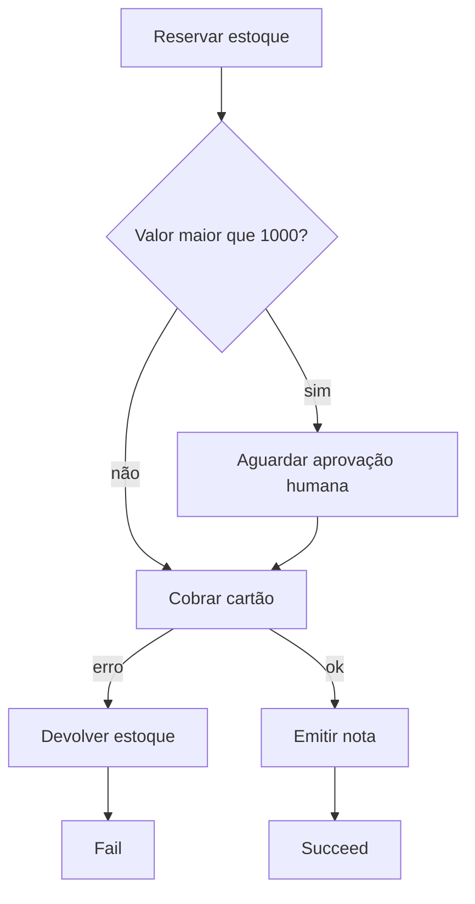

---
aliases:
  - Aula 15.6
modulo: 15
aula: 6
parte: "V Arquiteturas modernas"
dominios:
  - 2
  - 3
lida: false
tags:
  - aula
  - saa-c03
  - modulo-15
---

# Aula 15.6: Step Functions, orquestração de workflows

[[15 - Desacoplamento Filas Eventos e Workflows|Voltar ao módulo]]

> [!question] Pergunta que esta aula responde
> Quando vários passos precisam acontecer em ordem, com decisões, paralelismo, retentativas, esperas e até aprovação humana, por que um coordenador gerenciado ([[Step Functions]]) é melhor que código de cola, e como escolher entre workflows Standard e Express?

## O problema: coordenar passos é difícil de fazer no código

Um pedido passa por reservar estoque, cobrar o cartão, emitir a nota e avisar o cliente. Se a cobrança falha, é preciso devolver o estoque. Se a emissão da nota demora, é preciso esperar. Se o valor é alto, um gerente precisa aprovar. Quando isso vira "uma [[Lambda]] chama outra Lambda que chama outra", aparecem problemas conhecidos:

- Você **paga pela espera**: a função que aguarda a próxima fica rodando (e cobrando) enquanto nada acontece.
- **Não há estado visível**: se algo quebra no meio, ninguém sabe em que passo o pedido está.
- **Retry, [[Timeout|timeout]] e compensação viram código repetido** em cada função.
- Funções com limite de tempo ([[16 - Serverless Lambda e API Gateway|Módulo 16]]) não esperam horas ou dias por uma aprovação.

O **[[Step Functions|AWS Step Functions]]** é o serviço de **[[Orquestracao|orquestração]]**: você descreve o fluxo como uma **máquina de estados** ([[State Machine]]) e o serviço executa cada passo, guarda o estado entre eles, aplica retry e tratamento de erro e mostra o caminho percorrido. Você já viu a diferença entre [[Coreografia|coreografia]] e orquestração na [[15.01 - Por Que Desacoplar e os Padroes de Mensageria|aula 15.1]]; esta é a ferramenta da **orquestração**.

| | [[Coreografia]] | [[Orquestracao\|Orquestração]] |
|---|---|---|
| Quem coordena | Ninguém: cada componente reage a eventos | Um coordenador central que conhece o fluxo |
| Acoplamento | Mínimo | Os passos são chamados pelo coordenador |
| Visibilidade | Difícil ("onde está o pedido 4711?") | Fácil: histórico por execução |
| Serviços | [[SNS]], [[SQS]], [[EventBridge]] | [[Step Functions]] |
| Bom para | Reações independentes a fatos | Processos de negócio com passos dependentes |

## Como o Step Functions funciona

Um workflow é uma **[[State Machine|state machine]]** definida em **Amazon States Language (ASL)**, um JSON. Cada passo é um **estado** (state). Uma **execução** é uma rodada da máquina com uma entrada. Os principais tipos de estado:

| Estado | O que faz |
|---|---|
| **Task** | Executa uma unidade de trabalho: invoca uma Lambda, chama um serviço AWS, uma atividade ou uma API HTTPS |
| **Choice** | Ramifica por condição sobre os dados (um `if` visual) |
| **Parallel** | Executa **ramos diferentes** ao mesmo tempo e junta os resultados |
| **Map** | Executa os **mesmos passos para cada item** de uma lista (um `for each`) |
| **Wait** | Espera um tempo ou até uma data |
| **Pass** | Repassa ou transforma dados sem trabalho externo |
| **Succeed** e **Fail** | Terminam a execução com sucesso ou falha |



### Task: integrações, três padrões

A documentação (verificado em novembro de 2026) lista os tipos de Task: **atividade** (um worker seu que busca trabalho), **[[Lambda|função Lambda]]**, **serviço AWS suportado** (integração otimizada ou **AWS SDK integration**, que cobre mais de 200 serviços) e **tarefa [[HTTP]]** (chamar APIs HTTPS, como a de um provedor de pagamento). A forma de integrar vem do `Resource` do estado e há **três padrões**:

1. **Request Response** (padrão): chama o serviço, recebe a resposta [[HTTP]] e **segue** ao próximo estado, sem esperar o trabalho terminar. Exemplo: publicar em um tópico [[SNS]].
2. **Run a Job (`.sync`)**: chama o serviço e **espera o job terminar** (Batch, Athena, [[ECS]], entre outros). Você não precisa fazer polling.
3. **Wait for Callback (`.waitForTaskToken`)**: chama o serviço **passando um [[Task Token|task token]]** e **pausa** até alguém devolver esse token (com `SendTaskSuccess` ou `SendTaskFailure`). É o padrão de **aprovação humana** e de integração com sistemas externos lentos.

> [!example] Aprovação humana em um workflow
> O pedido de R$ 5.000 chega ao estado de aprovação. O workflow publica no [[SNS]] (e-mail ao gerente) uma mensagem com o **[[Task Token|task token]]** e pausa. O gerente clica em "aprovar", uma API chama `SendTaskSuccess` com o token, e o workflow continua. Se ninguém responder, um **[[Timeout|timeout]]** do estado leva a um ramo de cancelamento. O workflow ficou parado por dias sem consumir nada.

Observação importante: os workflows **Express** só suportam Request Response. `.sync` e `.waitForTaskToken` exigem **Standard**.

## Tratamento de erro: Retry e Catch

Em vez de escrever `try/catch` e laços de retry em cada função, o [[Step Functions]] oferece dois campos nos estados `Task`, `Parallel` e `Map`:

**`Retry`** (lista de "retriers"): quando o estado falha, o serviço procura um retrier cujo `ErrorEquals` contenha o nome do erro e repete. Campos e padrões confirmados na documentação:

| Campo | Significado | Padrão |
|---|---|---|
| `ErrorEquals` | Lista de nomes de erro (obrigatório) | sem padrão |
| `IntervalSeconds` | Espera antes da primeira tentativa | 1 |
| `MaxAttempts` | Máximo de retentativas (0 = nunca retentar) | 3 |
| `BackoffRate` | Multiplicador do intervalo a cada tentativa | 2,0 |
| `MaxDelaySeconds` | Teto do intervalo | sem teto |
| `JitterStrategy` | `FULL` (aleatoriza o intervalo) ou `NONE` | `NONE` |

Exemplo da documentação: com `IntervalSeconds` 3, `MaxAttempts` 3 e `BackoffRate` 2, as esperas são 3 s, 6 s e 12 s. O **[[Backoff Exponencial|backoff exponencial]] com [[Jitter|jitter]]** é exatamente o padrão que a prova descreve para "retry com intervalo crescente e aleatoriedade".

**`Catch`**: se não houver retry ou se ele se esgotar, o catcher desvia a execução para outro estado (`Next`), levando o erro (e opcionalmente um `ResultPath` para anexar o erro à entrada). É o lugar da **compensação** (devolver o estoque, notificar). Regras: **`Retry` é aplicado antes do `Catch`**; `States.ALL` casa qualquer erro e **deve ser o último**; `States.TaskFailed` casa tudo exceto `States.Timeout`.

Nas execuções Standard, **retentativas contam como transições de estado** na cobrança.

## Standard ou Express

O tipo é escolhido na criação e é **imutável** (não dá para converter depois). A tabela abaixo reúne a documentação oficial (novembro de 2026):

| | **Standard** | **Express** |
|---|---|---|
| Duração máxima | **1 ano** | **5 minutos** |
| Semântica de execução | **Exactly-once** (cada tarefa roda no máximo uma vez, salvo `Retry`) | **At-least-once** (assíncrono); **at-most-once** (síncrono) |
| Cobrança | Por **transições de estado** | Por **número de execuções, duração e memória** |
| Histórico | API por até **90 dias** após o fim; console; opcional no [[CloudWatch Logs]] | Sem histórico próprio; consulta pelo **CloudWatch Logs** |
| `.sync` e `.waitForTaskToken` | Suportados | **Não suportados** |
| Distributed Map e atividades | Suportados | Não suportados |
| Ideal para | Processos longos, duráveis e auditáveis; ações **não idempotentes** (cobrança, iniciar cluster [[EMR]]) | Alto volume de eventos curtos (ingestão IoT, transformação de [[Streaming de Dados\|streaming]], backend mobile); ações **idempotentes** |

Duas leituras importantes:

- Express **assíncrono** devolve só a confirmação de início (o resultado vem pelo [[CloudWatch Logs]]); Express **síncrono** espera e devolve o resultado, usado por exemplo por trás de uma API ([[API Gateway]]).
- A escolha também é de **custo**: um fluxo com milhões de execuções curtas costuma ser bem mais barato em Express; um fluxo raro e longo é natural em Standard. Para a conta exata consulte os preços na página oficial (não conferidos aqui).

## Map e Parallel

**Parallel** executa **ramos distintos** simultaneamente (por exemplo, "gerar PDF" e "enviar e-mail" ao mesmo tempo). **Map** repete os mesmos passos sobre cada item de uma coleção. O Map tem dois modos (documentação de novembro de 2026):

| | Inline | Distributed |
|---|---|---|
| Concorrência | Até **40** iterações simultâneas | Até **10.000** execuções-filhas em paralelo |
| Entrada | Array JSON vindo do passo anterior | Array JSON, ou fonte no **[[S3]]** (arquivo JSON, CSV, lista de objetos, inventário) |
| Histórico | Entra no histórico da execução-mãe (limite de 25.000 entradas) | Cada filha tem histórico próprio |
| Quando usar | Poucos itens, até 40 em paralelo | Dataset maior que 256 KiB, mais de 25.000 eventos de histórico ou mais de 40 em paralelo |
| Tipo de workflow | Standard e Express | Só Standard |

> [!example] Um milhão de objetos
> Uma empresa precisa gerar miniaturas de 1 milhão de imagens em um [[Bucket|bucket]] do [[S3]]. Um Map Distributed lê a lista de objetos do bucket e dispara até 10.000 execuções-filhas em paralelo, cada uma chamando uma Lambda. Um Map Inline pararia em 40 em paralelo e estouraria o histórico.

## Como disparar e recuperar

- **Início**: por `StartExecution` (SDK/CLI), por [[API Gateway]], por [[EventBridge]] (regra ou Scheduler), por outra [[State Machine|state machine]] ou por uma etapa de pipeline. A documentação diz que workflows podem ser iniciados por mais de 140 fontes de eventos do EventBridge.
- **Redrive**: uma execução **Standard** que falhou, foi abortada ou expirou pode ser **reiniciada do ponto de falha**, preservando os resultados dos passos bem-sucedidos e reaproveitando o mesmo [[ARN]] de execução (documentação do redrive). É uma proteção contra um erro temporário no meio de um fluxo caro. Prazo: o redrive de uma execução Standard só é possível por **14 dias** depois que ela termina, e workflows **Express não suportam redrive** (verificado em novembro de 2026, [quotas do Step Functions](https://docs.aws.amazon.com/step-functions/latest/dg/service-quotas.html)).
- **[[Observabilidade]]**: o console mostra a execução passo a passo; integra com [[CloudWatch]] e [[X-Ray]] ([[21 - Observabilidade Automacao e Operacoes|Módulo 21]]).

## Quando usar, quando não

Use [[Step Functions]] quando há **vários passos dependentes**, **decisões e paralelismo**, **retry e compensação**, **esperas longas** ou **aprovação humana**, e quando a **visibilidade do processo** é um requisito. Evite quando um único passo basta (uma Lambda direta, ou uma fila com consumidor) ou quando a lógica é só "reagir a um evento" ([[EventBridge]]). A [[15.08 - Escolhendo entre SQS SNS EventBridge Kinesis e Step Functions|aula 15.8]] compara os serviços lado a lado.

> [!info] Ligando os pontos
> [[Step Functions]] combina com o resto do módulo: uma regra ou agenda do [[EventBridge]] o dispara, uma fila [[SQS]] pode alimentá-lo via Pipes ([[15.05 - EventBridge Barramento Regras Scheduler e Pipes|aula 15.5]]) e ele pode publicar em [[SNS]] ou escrever no [[DynamoDB]] diretamente, sem Lambda de cola.

## Como isso cai na prova

Cobre a **Task 2.1** (workflow orchestration com [[Step Functions]] é citado no exam guide) e a **Task 3.2**.

**Palavras-chave em inglês e o que apontam:**

- "orchestrate", "coordinate multiple steps", "workflow", "[[State Machine|state machine]]": [[Step Functions]].
- "human approval", "wait for a callback", "pause until": Standard com `.waitForTaskToken`.
- "long-running workflow up to a year", "audit trail": Standard.
- "high-volume, short-duration, event processing, IoT ingestion": Express.
- "retry with [[Backoff Exponencial|exponential backoff]]", "handle errors without custom code": `Retry` e `Catch`.
- "process millions of [[S3]] objects in parallel": Map Distributed.
- "wait for the job to complete" (Batch, [[ECS]], Glue, Athena): integração `.sync`.

**Pegadinhas clássicas:**

- Escolher Express para um fluxo com aprovação humana ou duração de horas: Express acaba em 5 minutos e não tem `.waitForTaskToken`.
- Achar que "exatamente uma vez" vale para qualquer workflow: Standard sim; Express é at-least-once (assíncrono).
- Colocar o `Catch` esperando que ele rode antes do `Retry`: primeiro o retry, depois o catch.
- Usar Lambda chamando Lambda no lugar de um workflow.
- Tentar mudar o tipo da [[State Machine|state machine]] depois de criada: é imutável.
- Pensar que o [[Step Functions]] só chama Lambda: ele integra com mais de 200 serviços da AWS e com APIs HTTPS.

| Requisito no enunciado | Resposta provável | Por quê |
|---|---|---|
| Fluxo de pedido com passos, retry e compensação | [[Step Functions]] Standard | [[Orquestracao\|Orquestração]] [[Stateful e Stateless (Firewall)\|com estado]] e `Retry`/`Catch` |
| Aprovação humana que pode levar dias | Standard com `.waitForTaskToken` | Pausa durável até o callback |
| Milhões de eventos curtos por dia, idempotentes | Express | Cobrança por execução e duração, até 5 minutos |
| Esperar um job do Batch terminar sem polling | Integração `.sync` | O serviço espera pelo job |
| Processar 1 milhão de objetos do [[S3]] em paralelo | Map Distributed | Até 10.000 execuções-filhas |
| Ação não [[Idempotencia\|idempotente]] (cobrança) | Standard | Semântica exactly-once |

## Resumo

> [!abstract] A aula em uma frase
> O [[Step Functions]] orquestra passos como uma [[State Machine|máquina de estados]] que guarda o estado, aplica `Retry` e `Catch`, integra com mais de 200 serviços e espera o que for preciso, e o tipo (Standard para longo, durável e exactly-once; Express para alto volume e curto) se escolhe por duração, semântica e custo.

**A lógica, em 5 passos**

1. Passos dependentes, esperas e compensações viram código de cola frágil; o orquestrador assume o estado e o fluxo.
2. Você define estados (Task, Choice, Parallel, Map, Wait, Pass, Succeed, Fail) em JSON (ASL).
3. Tasks usam Request Response, `.sync` ou `.waitForTaskToken`, conforme precisem esperar.
4. Erros se tratam com `Retry` (backoff e [[Jitter|jitter]]) e `Catch` (compensação), nessa ordem.
5. Standard é longo, auditável e exactly-once; Express é curto, barato por volume e at-least-once.

**Números para lembrar** (verificado em novembro de 2026)

| O quê | Valor | Por que importa |
|---|---|---|
| Duração máxima | Standard 1 ano; Express 5 minutos | Decide o tipo |
| Histórico Standard | até 90 dias via API | Auditoria |
| Retry padrão | IntervalSeconds 1, MaxAttempts 3, BackoffRate 2,0 | Valores sem configuração |
| Map Inline / Distributed | 40 / 10.000 em paralelo | Escolha pelo volume |
| Cobrança | Standard: transições; Express: execuções, duração e memória | Impacta o custo |

**Tabela-síntese**

| | Standard | Express |
|---|---|---|
| Duração | até 1 ano | até 5 min |
| Semântica | exactly-once | at-least-once (async) / at-most-once (sync) |
| `.sync` e `.waitForTaskToken` | sim | não |
| Uso típico | Processo de negócio, aprovação | Ingestão de alto volume |

**Na prática, isso significa**

- "[[Orquestracao|Orquestrar]]" e "workflow" apontam para [[Step Functions]].
- Aprovação humana ou espera longa pede Standard com `.waitForTaskToken`.
- Alto volume e curto pede Express.
- Retry com backoff e compensação saem de configuração, não de código.

> [!tip] Liga com
> Vem da [[15.01 - Por Que Desacoplar e os Padroes de Mensageria|aula 15.1]] ([[Coreografia|coreografia]] e [[Orquestracao|orquestração]]) e da [[15.05 - EventBridge Barramento Regras Scheduler e Pipes|aula 15.5]]. Segue para a [[15.07 - Amazon MQ e AppFlow|aula 15.7]] e prepara o [[16 - Serverless Lambda e API Gateway|Módulo 16]] (Lambda e [[API Gateway]]).

## Erros comuns

- **"Express serve para qualquer workflow."** Termina em 5 minutos e não tem `.sync` nem `.waitForTaskToken`.
- **"O Catch roda antes do Retry."** O retry vem primeiro.
- **"[[Step Functions]] é só para Lambda."** Integra com mais de 200 serviços e APIs HTTPS.
- **"Posso trocar Standard por Express depois."** O tipo é imutável.
- **"Todo workflow é exactly-once."** Só o Standard.
- **"Lambda chamando Lambda resolve a [[Orquestracao|orquestração]]."** Paga a espera e perde estado e visibilidade.

## Pratique

**1.** Uma empresa processa pedidos em cinco passos (reservar estoque, cobrar, emitir nota, notificar, atualizar o ERP), com retentativas e devolução do estoque se a cobrança falhar, e precisa ver em que passo cada pedido está. Qual solução atende com o MENOR overhead?

- [ ] a) Cinco funções Lambda encadeadas, cada uma invocando a próxima e guardando o estado em variáveis
- [ ] b) Uma fila SQS por passo com consumidores em instâncias EC2
- [ ] c) Uma state machine Standard do AWS Step Functions com Retry e Catch
- [ ] d) Um tópico SNS com cinco assinaturas Lambda independentes

**2.** Um fluxo de aprovação de despesas pode ficar parado por dias aguardando um gerente. Como implementar sem manter recursos rodando?

- [ ] a) Workflow Standard com um estado Task usando .waitForTaskToken
- [ ] b) Workflow Express com um estado Wait de cinco dias
- [ ] c) Uma função Lambda com timeout de 15 minutos e polling a cada minuto
- [ ] d) Uma instância EC2 pequena rodando um loop de verificação

**3.** Uma plataforma de IoT precisa processar milhões de eventos curtos por hora, cada transformação dura segundos e é [[Idempotencia|idempotente]]. O objetivo é o menor custo com [[Orquestracao|orquestração]]. Qual opção escolher?

- [ ] a) Step Functions Standard, cobrado por transições de estado
- [ ] b) Um job do AWS Batch iniciado para cada evento recebido
- [ ] c) Uma função Lambda por evento chamando outra função
- [ ] d) Step Functions Express, cobrado por execuções, duração e memória

**4.** Uma [[Lambda|função Lambda]] chamada por um estado Task falha ocasionalmente com erros de [[Throttling|throttling]]. A equipe quer tentar novamente com intervalo crescente e aleatório e, se esgotar, ir para um estado de notificação. Como configurar?

- [ ] a) Um estado Choice que repete a Task em um laço sem limite
- [ ] b) Retry com IntervalSeconds, BackoffRate e JitterStrategy FULL, mais um Catch para o estado de notificação
- [ ] c) Um estado Wait fixo de 1 segundo antes de cada tentativa
- [ ] d) Um Catch com States.ALL no lugar do Retry, já que o Catch repete a Task com intervalo crescente e aleatório

**5.** Uma empresa precisa gerar miniaturas para 1 milhão de objetos de um [[Bucket|bucket]] do [[S3]], com alto paralelismo. Qual recurso do [[Step Functions]] atende?

- [ ] a) Um estado Parallel com um milhão de ramos escritos no JSON
- [ ] b) Um estado Map no modo Inline, que roda até 40 em paralelo
- [ ] c) Um estado Map no modo Distributed lendo a lista de objetos do S3
- [ ] d) Um workflow Express com um estado Wait para espaçar as chamadas ao longo do tempo

**6.** Um workflow precisa iniciar um job no [[Batch|AWS Batch]] e só seguir quando ele terminar, sem escrever código de polling. Qual padrão de integração usar?

- [ ] a) Request Response, que aguarda a conclusão do job por padrão
- [ ] b) Um estado Wait de 30 minutos, depois uma Choice
- [ ] c) Uma função Lambda com um laço de consulta ao status
- [ ] d) A integração Run a Job com o sufixo .sync

**7.** Um workflow executa cobranças em cartão, uma ação não [[Idempotencia|idempotente]] que não pode ser rodada duas vezes pelo serviço. Qual tipo de workflow é mais adequado?

- [ ] a) Standard, com semântica exactly-once
- [ ] b) Express assíncrono, com semântica at-least-once
- [ ] c) Express síncrono, que executa no máximo uma vez e portanto nunca repete a cobrança
- [ ] d) Qualquer um, porque o serviço sempre deduplica as execuções

**8.** Um processo de negócio tem vários passos dependentes e a equipe quer um ponto central que conheça o fluxo, trate erros e mostre o estado de cada execução. Que abordagem descreve melhor essa necessidade?

- [ ] a) Coreografia, com cada serviço reagindo a eventos sem coordenador
- [ ] b) Orquestração, com um coordenador central como o Step Functions
- [ ] c) Fan-out, com um tópico SNS e muitas assinaturas independentes
- [ ] d) Streaming, com um shard por etapa do processo

**9.** Uma equipe criou uma [[State Machine|state machine]] Express e agora precisa de execuções que durem horas e de espera por callback. O que fazer?

- [ ] a) Alterar o tipo da state machine existente para Standard no console
- [ ] b) Aumentar o timeout da Express para 12 horas
- [ ] c) Criar uma nova state machine Standard, pois o tipo é imutável
- [ ] d) Habilitar .waitForTaskToken na Express por configuração

**10.** Uma auditoria exige consultar, por API, o histórico detalhado de execuções de um workflow de pagamento de até 60 dias atrás. Qual opção atende?

- [ ] a) Standard workflow, com histórico disponível via API por até 90 dias após o fim
- [ ] b) Express workflow, que mantém histórico permanente na própria API por tempo indeterminado
- [ ] c) Um workflow sem logs, pois o histórico é sempre ilimitado por padrão
- [ ] d) Uma fila SQS com retenção de 14 dias, no lugar do histórico

**11.** (Escolha DUAS.) Quais afirmações sobre tratamento de erro no [[Step Functions]] estão corretas?

- [ ] a) O Catch é avaliado antes do Retry em um estado Task
- [ ] b) As retentativas do Retry nunca contam na cobrança de workflows Standard
- [ ] c) Quando há Retry e Catch, o Retry é aplicado primeiro e o Catch só atua se as retentativas se esgotarem
- [ ] d) States.ALL deve ser o primeiro item da lista de ErrorEquals
- [ ] e) Os padrões do Retry são MaxAttempts 3 e BackoffRate 2,0

**12.** (Escolha DUAS.) Quais afirmações sobre workflows Express estão corretas?

- [ ] a) Podem durar até um ano
- [ ] b) A duração máxima é de cinco minutos
- [ ] c) Têm semântica exactly-once em qualquer modo
- [ ] d) Não suportam os padrões .sync e .waitForTaskToken
- [ ] e) Suportam o modo Distributed Map para até 10.000 execuções-filhas

> [!success]- Gabarito
> **1. c)** uma [[State Machine|state machine]] Standard orquestra os passos com Retry, Catch para compensar e histórico por execução; a) funções encadeadas pagam a espera e perdem visibilidade; b) filas por passo exigem coordenação e compensação manuais; d) assinaturas independentes são [[Coreografia|coreografia]], sem ordem nem visão do processo.
> **2. a)** Standard com `.waitForTaskToken` pausa de forma durável até o callback, sem consumir recursos; b) Express acaba em 5 minutos e não tem esse padrão; c) o Lambda não espera dias e o polling desperdiça execuções; d) uma [[EC2]] ligada é overhead sem necessidade.
> **3. d)** o Express é cobrado por execução, duração e memória e foi feito para alto volume de eventos curtos idempotentes; a) Standard cobra por transição e fica caro nesse volume; b) um job de Batch por evento tem [[Slow Start|partida lenta]] e custo desproporcional para eventos de segundos; c) Lambda chamando Lambda é o anti-padrão e não orquestra.
> **4. b)** Retry com backoff e [[Jitter|jitter]] cobre a retentativa e o Catch desvia ao esgotar; a) um laço de Choice sem limite não tem backoff nem teto; c) um Wait fixo não é crescente nem aleatório; d) o Catch só atua depois do Retry, e com States.ALL sozinho não repete.
> **5. c)** o Map Distributed lê a lista do [[S3]] e roda até 10.000 execuções-filhas em paralelo; a) escrever milhões de ramos no JSON é inviável; b) o Inline limita a 40 em paralelo e o histórico em 25.000 entradas; d) o Wait não paraleliza.
> **6. d)** `.sync` (Run a Job) faz o [[Step Functions]] esperar o job terminar sem polling; a) Request Response segue assim que recebe a resposta [[HTTP]], sem esperar o job; b) um Wait fixo é chute de tempo; c) polling em Lambda é o código que o padrão elimina.
> **7. a)** Standard é exactly-once e indicado para ações não idempotentes como cobranças; b) Express assíncrono é at-least-once e pode repetir; c) Express síncrono é at-most-once: não repete, mas pode simplesmente não executar a cobrança, e o chamador precisa tratar a falha, então não dá a garantia de execução que o requisito pede; d) o serviço não deduplica mágica em qualquer tipo.
> **8. b)** a [[Orquestracao|orquestração]] tem um coordenador central que conhece o fluxo e guarda o estado; a) [[Coreografia|coreografia]] não tem coordenador; c) [[Fan-out|fan-out]] distribui avisos, não coordena passos; d) [[Streaming de Dados|streaming]] é um padrão de dados, não de processo.
> **9. c)** o tipo é imutável, então é preciso criar uma [[State Machine|state machine]] Standard; a) o tipo não pode ser alterado; b) o limite do Express é de 5 minutos e não é configurável para 12 horas; d) `.waitForTaskToken` não existe no Express.
> **10. a)** workflows Standard mantêm o histórico consultável por API por até 90 dias após a conclusão; b) o Express consulta pelo [[CloudWatch Logs]], não por histórico próprio na API; c) o histórico não é ilimitado por padrão; d) uma fila de 14 dias não substitui o histórico detalhado.
> **11. c) e e)** o Retry vem antes do Catch e os padrões são MaxAttempts 3 e BackoffRate 2,0; a) o catch vem depois; b) as retentativas contam como transições na cobrança Standard; d) States.ALL deve ser o último.
> **12. b) e d)** o Express dura até 5 minutos e não suporta `.sync` nem `.waitForTaskToken`; a) o ano é do Standard; c) o Express é at-least-once (assíncrono) ou at-most-once (síncrono); e) o Distributed Map é só do Standard.

### Laboratório (opcional): uma state machine mínima pela AWS CLI

> [!warning] Use uma conta AWS pessoal
> Faça em uma **[[Conta AWS|conta AWS]] pessoal separada, com [[Budgets|AWS Budgets]] configurado**, nunca na conta de produção. Os estados abaixo (Choice, Wait, Succeed) não chamam serviços AWS, então o custo é praticamente zero, mas apague a [[State Machine|state machine]] e a role ao terminar.

Os comandos seguem o padrão da CLI (`aws stepfunctions create-state-machine`, `start-execution`, `describe-execution`; confirme as opções com `aws stepfunctions help`).

1. Crie a role. Salve `trust.json` e rode `aws iam create-role --role-name lab-sfn-role --assume-role-policy-document file://trust.json`; anote o [[ARN]]. A role pode ficar sem permissões extras, pois os estados do laboratório não chamam serviços:

   ```json
   {
     "Version": "2012-10-17",
     "Statement": [{
       "Effect": "Allow",
       "Principal": {"Service": "states.amazonaws.com"},
       "Action": "sts:AssumeRole"
     }]
   }
   ```
2. Salve a definição ASL em `def.json`. O `Choice` testa `$.valor` maior que 1000 e, **obrigatoriamente com um `Default`** (sem ele, uma entrada que não casa nenhuma regra falha a execução), cai no `Succeed`; acima de 1000 passa por um `Wait` de 5 segundos:

   ```json
   {
     "Comment": "Aprovacao minima",
     "StartAt": "Avaliar",
     "States": {
       "Avaliar": {
         "Type": "Choice",
         "Choices": [
           {"Variable": "$.valor", "NumericGreaterThan": 1000, "Next": "AguardarAprovacao"}
         ],
         "Default": "Concluir"
       },
       "AguardarAprovacao": {"Type": "Wait", "Seconds": 5, "Next": "Concluir"},
       "Concluir": {"Type": "Succeed"}
     }
   }
   ```
3. Crie a máquina: `aws stepfunctions create-state-machine --name lab-aprovacao --definition file://def.json --role-arn <ARN da role> --type STANDARD`.
4. Inicie duas execuções passando a entrada por arquivo (evita problemas de aspas no Windows): `aws stepfunctions start-execution --state-machine-arn <ARN> --input file://baixo.json` e `--input file://alto.json`, com `{"valor": 500}` e `{"valor": 5000}`.
5. Consulte cada uma com `aws stepfunctions describe-execution --execution-arn <ARN>` e compare a duração; no console do [[Step Functions]], observe o caminho percorrido por cada execução.
6. **Limpeza:** apague a máquina (`aws stepfunctions delete-state-machine --state-machine-arn <ARN>`) e a role (`aws iam delete-role --role-name lab-sfn-role`).

## Para aprofundar

- [ ] [Choosing workflow type in Step Functions](https://docs.aws.amazon.com/step-functions/latest/dg/choosing-workflow-type.html) (documentação do [[Step Functions]]): tabela oficial Standard vs Express.
- [ ] [Discover service integration patterns in Step Functions](https://docs.aws.amazon.com/step-functions/latest/dg/connect-to-resource.html) (documentação do [[Step Functions]]): Request Response, `.sync` e `.waitForTaskToken`.
- [ ] [Handling errors in Step Functions workflows](https://docs.aws.amazon.com/step-functions/latest/dg/concepts-error-handling.html) (documentação do [[Step Functions]]): campos de Retry e Catch.
- [ ] [Map workflow state](https://docs.aws.amazon.com/step-functions/latest/dg/state-map.html) (documentação do [[Step Functions]]): modos Inline e Distributed.

Próxima aula: [[15.07 - Amazon MQ e AppFlow|Aula 15.7: Amazon MQ e AppFlow]].
