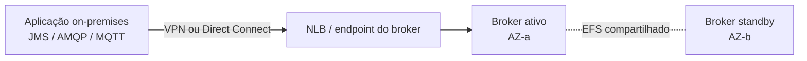

---
aliases:
  - Aula 15.7
modulo: 15
aula: 7
parte: "V Arquiteturas modernas"
dominios:
  - 2
  - 3
lida: false
tags:
  - aula
  - saa-c03
  - modulo-15
---

# Aula 15.7: Amazon MQ e AppFlow

[[15 - Desacoplamento Filas Eventos e Workflows|Voltar ao módulo]]

> [!question] Pergunta que esta aula responde
> Se uma aplicação já fala AMQP, MQTT ou JMS com um [[Message Broker]] como ActiveMQ ou RabbitMQ, por que migrar para o [[SQS]] seria um erro de custo e prazo, e quando o [[Amazon MQ]] é a resposta? E, em outro canto do módulo, como trazer dados de um SaaS (Salesforce, Slack, Zendesk) para o [[S3]] sem escrever código, com o [[AppFlow]]?

## Duas peças de nicho que a prova adora

Até aqui o módulo mostrou serviços **nativos da AWS**, com APIs próprias (`SendMessage`, `Publish`, `PutEvents`). Eles são ótimos para sistemas novos. Mas existem dois cenários em que "usar o serviço mais moderno" é a resposta errada:

1. **Migração de uma aplicação que já usa um broker de mercado.** Reescrever o código para a API do [[SQS]] custa meses, tem risco e não entrega valor de negócio. A AWS oferece o mesmo broker, gerenciado: o **[[Amazon MQ]]**.
2. **Integração com aplicações SaaS.** Em vez de escrever e manter um conector para cada API de terceiros, o **[[AppFlow|Amazon AppFlow]]** move os dados entre SaaS e AWS por configuração.

Os dois aparecem na prova como "a opção que NÃO exige reescrever/codificar", e a aula mostra o raciocínio por trás.

## Parte 1: Amazon MQ

### O que é e por que existe

O **[[Amazon MQ]]** é um serviço de **[[Message Broker|message broker]] gerenciado** para dois motores de código aberto: **Apache ActiveMQ Classic** e **RabbitMQ** (verificado em novembro de 2026). A AWS cuida de provisionamento, patches, backups, detecção de falha e [[Failover|failover]] entre zonas; você continua usando o broker pelas mesmas **APIs e protocolos de mercado**.

A diferença para o [[SQS]]/SNS está no contrato:

| | [[SQS]] / [[SNS]] | [[Amazon MQ]] |
|---|---|---|
| API | API proprietária da AWS (HTTPS, SDK) | **Protocolos padrão** do mercado |
| Quem escolhe o protocolo | A AWS | A sua aplicação (já existente) |
| Modelo | [[Serverless]], sem servidor para dimensionar | **Broker provisionado** (instâncias que você escolhe) |
| Escala | Praticamente ilimitada, automática | Limitada ao tamanho do broker |
| Melhor para | Aplicações novas na nuvem | **Migrar aplicações existentes** sem reescrever |

> [!info] A regra de ouro da prova
> "Aplicação **on-premises** que usa **JMS**, **AMQP**, **MQTT**, **OpenWire** ou **STOMP**, e a empresa quer migrar para a AWS **sem alterar o código**": **[[Amazon MQ]]**. Aplicação **nova**, sem requisito de protocolo: **[[SQS]]/SNS**.

### Protocolos suportados

**ActiveMQ** (verificado em novembro de 2026): AMQP, MQTT, MQTT sobre WebSocket, OpenWire, STOMP e STOMP sobre WebSocket; do lado das APIs, o whitepaper de visão geral cita **JMS** e **NMS**. **RabbitMQ**: AMQP 0-9-1, além de AMQP 1.0 e clientes JMS conforme a documentação. Você não precisa decorar a lista inteira; precisa reconhecer que **JMS, AMQP, MQTT, OpenWire e STOMP** são sinais de [[Amazon MQ]].

> [!example] A matriz de ordens
> Uma financeira roda há dez anos um sistema Java que publica ordens em filas JMS no ActiveMQ do datacenter. O contrato do datacenter vence em seis meses. Trocar por [[SQS]] significaria reescrever a camada de mensageria e retestar tudo. Com o [[Amazon MQ]] (ActiveMQ), o código só muda a URL do broker, e o time ganha [[Failover|failover]] gerenciado.

### Modelos de implantação e alta disponibilidade

A escolha de implantação é a pergunta de **[[Disponibilidade|disponibilidade]]** do [[Amazon MQ]]:

**ActiveMQ**

- **Single-instance broker**: uma instância em uma [[Zona de Disponibilidade|AZ]]; o armazenamento pode ser **[[EBS]]** ([[Durabilidade|durabilidade]] em uma AZ) ou **[[EFS]]**. Mais barato, sem [[Alta Disponibilidade|alta disponibilidade]] entre zonas.
- **Active/standby broker**: duas instâncias em **duas [[Zona de Disponibilidade|AZs]]** com armazenamento em **[[EFS]]**; se a ativa falha, a standby assume. É a configuração de **[[Alta Disponibilidade|alta disponibilidade]]** para ActiveMQ.
- Replicação de dados entre [[Regiao AWS|Regiões]] (**CRDR**, cross-Region data replication) existe para o ActiveMQ, como apoio a [[Recuperacao de Desastres|recuperação de desastres]] ([[20 - Alta Disponibilidade e Recuperacao de Desastres|Módulo 20]]).

**RabbitMQ**

- **Single-instance broker**: uma instância atrás de um **[[Network Load Balancer]]**.
- **Cluster deployment**: **3 nós** em **diferentes [[Zona de Disponibilidade|AZs]]**, atrás de um [[Network Load Balancer|NLB]], com espelhamento ou **quorum queues** para a [[Durabilidade|durabilidade]] das mensagens.

Em todos os casos, o broker fica em uma [[VPC]]; você pode usá-lo com **acesso privado** (sem IP público) e usar criptografia **em repouso** e **em trânsito** (verificado em novembro de 2026).

### Quando NÃO usar o Amazon MQ

- **Aplicação nova** sem dependência de protocolo: o [[SQS]]/SNS é [[Serverless|serverless]], mais barato e escala sem esforço.
- [[Throughput]] gigantesco e elástico: o broker tem teto de acordo com a instância.
- Quem quer não administrar nada: o [[Amazon MQ]] é gerenciado, mas ainda é uma **instância provisionada** com janelas de manutenção e [[Instance Type|tipo de instância]].

Para a prova, a pegadinha é a "modernização forçada": a pergunta diz que a aplicação **já usa** um protocolo padrão e o time **não pode reescrever** o código; trocar por [[SQS]] está errado por definição.

### Custo: broker por hora, fila por requisição

O modelo de cobrança explica a regra de decisão. O [[Amazon MQ]] cobra pelo **tempo de instância do broker** (ligado 24 horas, mesmo ocioso) mais armazenamento, e em implantações de [[Alta Disponibilidade|alta disponibilidade]] você paga por mais de uma instância. O [[SQS]] cobra por **requisição**, então uma fila ociosa custa quase nada. Para volume baixo ou muito variável, o SQS tende a ser bem mais barato; para uma aplicação legada, o custo que pesa é o de **engenharia** (reescrever, retestar, migrar mensagens em voo), e ele quase sempre supera a diferença de preço do broker. Confira os valores atuais nas páginas oficiais de preços; a aula não fixa números porque eles mudam.

### Amazon MQ ou SQS com a biblioteca JMS?

> [!warning] A SQS Java Messaging Library existe, mas não resolve "sem alterar o código"
> A **[[SQS|Amazon SQS]] Java Messaging Library** dá uma interface **JMS 1.1** sobre o SQS ([documentação](https://docs.aws.amazon.com/AWSSimpleQueueService/latest/SQSDeveloperGuide/sqs-jms.html)). Só que ela exige **trocar a connection factory e as dependências** da aplicação, serve apenas o subconjunto de JMS 1.1 que o SQS consegue emular e **não preserva** as capacidades do ActiveMQ (protocolos como OpenWire e STOMP, tópicos JMS nativos, configurações do broker). Quando o enunciado diz "sem alterar o código" e "mantendo o broker e o protocolo", a resposta é **[[Amazon MQ]]**; a biblioteca JMS do SQS é o [[Distrator|distrator]] plausível.

### MQTT: Amazon MQ ou AWS IoT Core?

> [!tip] MQTT aparece em dois serviços
> **[[IoT Core|AWS IoT Core]]** é o serviço para **dispositivos IoT novos, em grande escala**, que falam MQTT e precisam de regras que encaminhem mensagens a serviços AWS, gerenciamento de dispositivos e autenticação por certificado ([documentação](https://docs.aws.amazon.com/iot/latest/developerguide/what-is-aws-iot.html)). **[[Amazon MQ]]** é para um **broker MQTT existente** que precisa migrar **sem mudar os clientes** nem o broker. Critério: dispositivos novos e escala de milhões, IoT Core; broker já existente que precisa ser preservado, Amazon MQ.

## Parte 2: Amazon AppFlow

### O problema da integração com SaaS

Marketing guarda leads no Salesforce, suporte guarda tickets no Zendesk, o time financeiro quer tudo no [[S3]] e no [[Redshift]] para análise. Sem ferramenta, cada integração é um script que autentica na API do SaaS, pagina, trata limites de taxa, transforma e grava, e que precisa ser mantido quando a API muda.

O **[[AppFlow|Amazon AppFlow]]** é um serviço **gerenciado e sem código** que transfere dados de forma segura entre **aplicações SaaS** (Salesforce, SAP, Zendesk, Slack, ServiceNow, entre outras) e **serviços AWS** como [[S3]] e [[Redshift]]. Você define um **flow**: origem, destino, mapeamento de campos, filtros e **gatilho**.

### Gatilhos (triggers)

Um flow dispara de três jeitos (verificado em novembro de 2026):

| Gatilho | Quando roda | Exemplo |
|---|---|---|
| **On demand** | Quando você manda, manualmente ou por API | Carga única de dados históricos |
| **On event** | Quando o SaaS emite um evento (por exemplo, "oportunidade fechada") | Reagir a mudança no Salesforce |
| **On schedule** | Em intervalos definidos, **full** (tudo de novo) ou **incremental** (só o que mudou desde a última execução) | Sincronização noturna |

Em agendamentos incrementais, a **primeira** execução traz um volume maior (a primeira execução incremental puxa 30 dias de registros passados, conforme a [documentação de gatilhos](https://docs.aws.amazon.com/appflow/latest/userguide/flow-triggers.html)) e as seguintes trazem só as mudanças.

### Segurança e rede

Por padrão os dados trafegam pela internet pública com criptografia, mas o [[AppFlow]] tem suporte a **[[PrivateLink|AWS PrivateLink]]** para SaaS que o oferecem, mantendo o tráfego na rede da AWS. Os [[Criptografia em Transito|dados em trânsito]] e em repouso são criptografados, e o resultado pode ser catalogado no **[[Glue|AWS Glue]] [[Glue Data Catalog|Data Catalog]]** para consulta com o Athena ([[22 - Dados Analytics e Ingestao|Módulo 22]]).

### Destinos e transformações

Além de [[S3]] e [[Redshift]], o [[AppFlow]] entrega a destinos como Snowflake e a outros SaaS (a lista de conectores muda; consulte a documentação). Durante o flow, ele faz transformações simples e sem código: **mapeamento de campos**, **filtros** de registros, **mascaramento** de campos sensíveis, concatenação e validações.

| Destino típico | Uso |
|---|---|
| [[S3]] | [[Data Lake\|Data lake]], consulta com Athena |
| [[Redshift]] | Análise em [[Data Warehouse\|data warehouse]] |
| Snowflake | Warehouse de terceiros |
| Outro SaaS | Sincronizar sistemas (por exemplo, SaaS para SaaS) |

### O que o AppFlow não é

[[AppFlow]] **não** é uma fila nem um barramento: não entrega mensagens a consumidores. É **[[Data Transfer|transferência de dados]]** entre SaaS e AWS, em [[Processamento em Lote|lote]] ou por evento, sem código.

## Como escolher na prova

| Sinal no enunciado | Serviço |
|---|---|
| Migrar app com JMS/AMQP/MQTT sem reescrever | [[Amazon MQ]] |
| App nova, fila simples, escala enorme | [[SQS]] |
| Transferir dados do Salesforce/Zendesk para [[S3]] sem código | [[AppFlow]] |
| Reagir a eventos de SaaS parceiro no barramento | [[EventBridge]] (parceiros SaaS) |
| [[Orquestracao\|Orquestrar]] passos com aprovação | [[Step Functions]] |

## Como isso cai na prova

Cobre a **Task 2.1** ([[Desacoplamento|loose coupling]], escolha do serviço de mensageria) e a **Task 3.2** (integração e [[Alta Disponibilidade|alta disponibilidade]]).

**Palavras-chave em inglês e o que apontam:**

- "migrate an existing application", "without changing the code", "JMS", "AMQP", "MQTT", "OpenWire", "STOMP": [[Amazon MQ]].
- "[[Message Broker|message broker]]", "ActiveMQ", "RabbitMQ": [[Amazon MQ]].
- "SaaS", "Salesforce", "Zendesk", "SAP", "no code", "transfer data to [[S3]] or [[Redshift]]": [[AppFlow]].
- "[[Alta Disponibilidade|highly available]] broker across two [[Zona de Disponibilidade|AZs]]": ActiveMQ active/standby ([[EFS]]) ou RabbitMQ cluster de 3 nós.

**Pegadinhas clássicas:**

- Responder [[SQS]] para uma app legada com JMS que "não pode ser reescrita".
- Achar que [[Amazon MQ]] é [[Serverless|serverless]]: é broker provisionado (você escolhe instância).
- Confundir single-instance com [[Alta Disponibilidade|alta disponibilidade]]: apenas active/standby (ActiveMQ) e cluster (RabbitMQ) cobrem falha de [[Zona de Disponibilidade|AZ]].
- Propor Lambda com código customizado para trazer dados de SaaS quando "sem código" é requisito: [[AppFlow]].
- Achar que [[AppFlow]] é fila ou [[Event Bus|barramento de eventos]].

| Requisito no enunciado | Resposta provável | Por quê |
|---|---|---|
| App on-premises com JMS migra sem mudar código | [[Amazon MQ]] (ActiveMQ) | Mesmo protocolo, broker gerenciado |
| Broker com [[Failover\|failover]] entre duas [[Zona de Disponibilidade\|AZs]] | ActiveMQ active/standby com [[EFS]] | Standby em outra AZ |
| Cluster RabbitMQ de [[Alta Disponibilidade\|alta disponibilidade]] | Cluster de 3 nós em [[Zona de Disponibilidade\|AZs]] diferentes atrás de [[Network Load Balancer\|NLB]] | Tolera falha de nó e AZ |
| Broker MQTT existente migra sem mudar os clientes | [[Amazon MQ]] (MQTT) | Mantém o protocolo e o broker |
| Milhões de dispositivos IoT novos com regras para serviços AWS | [[IoT Core\|AWS IoT Core]] | Serviço de propósito específico para IoT |
| Copiar dados do Salesforce para [[S3]] sem código | [[AppFlow]] | Conector gerenciado, sem código |
| Sincronizar tickets do Zendesk toda noite | [[AppFlow]] com gatilho agendado incremental | Só o que mudou |

## Resumo

> [!abstract] A aula em uma frase
> O [[Amazon MQ]] é o broker gerenciado (ActiveMQ e RabbitMQ) para migrar aplicações que já usam JMS, AMQP, MQTT, OpenWire ou STOMP sem reescrever código, e o [[AppFlow]] é a transferência sem código de dados entre SaaS e AWS por demanda, evento ou agenda.

**A lógica, em 4 passos**

*[[Amazon MQ]]*

1. Serviços nativos exigem reescrever o código para a API da AWS; migrações legadas não podem.
2. O [[Amazon MQ]] oferece o mesmo broker e os mesmos protocolos, gerenciado em instâncias provisionadas.
3. [[Alta Disponibilidade|Alta disponibilidade]] vem de active/standby em 2 [[Zona de Disponibilidade|AZs]] (ActiveMQ) ou cluster de 3 nós (RabbitMQ).

*[[AppFlow]]*

4. Para dados de SaaS, o [[AppFlow]] substitui conectores customizados por flows configurados (gatilhos on demand, on event, on schedule).

**Números para lembrar** (verificado em novembro de 2026)

| O quê | Valor | Por que importa |
|---|---|---|
| Motores do [[Amazon MQ]] | ActiveMQ Classic e RabbitMQ | Escolha por protocolo |
| ActiveMQ [[Alta Disponibilidade\|HA]] | 2 [[Zona de Disponibilidade\|AZs]] com [[EFS]] | Active/standby |
| RabbitMQ [[Alta Disponibilidade\|HA]] | 3 nós em [[Zona de Disponibilidade\|AZs]] diferentes + [[Network Load Balancer\|NLB]] | Cluster |
| Gatilhos do [[AppFlow]] | on demand, on event, on schedule | Escolha do disparo |
| Primeira execução incremental | cerca de 30 dias de dados | Volume inicial |

**Tabela-síntese**

| | [[Amazon MQ]] | [[SQS]]/SNS | [[AppFlow]] |
|---|---|---|---|
| Natureza | Broker provisionado | [[Serverless]] | [[Data Transfer\|Transferência de dados]] |
| API | Protocolos padrão | API AWS | Conectores SaaS |
| Use para | Migrar apps legadas | Apps novas | Dados de SaaS para AWS |

**Na prática, isso significa**

- Protocolo padrão e "sem alterar o código" aponta para [[Amazon MQ]].
- Aplicação nova aponta para [[SQS]]/SNS.
- "SaaS" e "sem código" apontam para [[AppFlow]].

> [!tip] Liga com
> Vem da [[15.06 - Step Functions Orquestracao de Workflows|aula 15.6]]. Segue para a [[15.08 - Escolhendo entre SQS SNS EventBridge Kinesis e Step Functions|aula 15.8]], que compara todos os serviços de mensageria. Conecta-se ao [[22 - Dados Analytics e Ingestao|Módulo 22]] (dados e analytics) e ao [[20 - Alta Disponibilidade e Recuperacao de Desastres|Módulo 20]] ([[Alta Disponibilidade|HA]]).

## Erros comuns

- **"[[SQS]] é sempre melhor que o broker."** Para aplicação legada que não pode mudar, o [[Amazon MQ]] é a resposta.
- **"[[Amazon MQ]] é [[Serverless|serverless]]."** É broker em instâncias provisionadas.
- **"Single-instance tem [[Alta Disponibilidade|alta disponibilidade]]."** Só active/standby e cluster toleram falha de [[Zona de Disponibilidade|AZ]].
- **"[[AppFlow]] é uma fila de eventos."** É [[Data Transfer|transferência de dados]] sem código entre SaaS e AWS.
- **"Para trazer dados do Salesforce preciso de Lambda."** O [[AppFlow]] elimina o código.

## Pratique

**1.** Uma empresa tem uma aplicação Java on-premises que usa JMS com um ActiveMQ local. Ela vai migrar para a AWS e não pode alterar o código da aplicação. Qual solução atende com o MENOR esforço?

- [ ] a) Usar a Amazon SQS Java Messaging Library, trocando a connection factory e as dependências
- [ ] b) Migrar o broker para o Amazon MQ com ActiveMQ
- [ ] c) Substituir o broker por um tópico do Amazon SNS
- [ ] d) Usar o Amazon EventBridge como barramento de mensagens

**2.** Uma solução de IoT usa dispositivos que publicam via MQTT em um broker existente. A empresa quer um broker gerenciado na AWS sem mudar os dispositivos. Qual serviço escolher?

- [ ] a) Amazon SQS Standard
- [ ] b) AWS IoT Core
- [ ] c) Amazon AppFlow
- [ ] d) Amazon MQ

**3.** Um broker ActiveMQ no [[Amazon MQ]] precisa continuar funcionando se uma [[Zona de Disponibilidade]] falhar. Qual implantação usar?

- [ ] a) Single-instance broker com armazenamento EBS
- [ ] b) Active/standby broker em duas AZs com EFS
- [ ] c) Single-instance broker em uma AZ com backups diários
- [ ] d) Duas contas AWS com brokers independentes

**4.** Uma equipe precisa de um cluster RabbitMQ [[Alta Disponibilidade|altamente disponível]] na AWS, gerenciado. Como o [[Amazon MQ]] entrega isso?

- [ ] a) Um cluster de 3 nós em AZs diferentes atrás de um Network Load Balancer
- [ ] b) Uma única instância pequena em uma AZ
- [ ] c) Dois nós na mesma AZ com failover manual
- [ ] d) Uma fila SQS FIFO com réplicas entre Regiões

**5.** Uma startup constrói do zero um sistema de pedidos, sem requisito de protocolo específico, e quer o menor custo operacional com escala automática. Qual opção é mais adequada?

- [ ] a) Amazon MQ com ActiveMQ em active/standby
- [ ] b) Amazon MQ com RabbitMQ em cluster
- [ ] c) Amazon SQS, que é serverless e escala automaticamente
- [ ] d) Um broker RabbitMQ instalado em instâncias EC2

**6.** O time de vendas usa o Salesforce e a equipe de dados precisa copiar os dados de oportunidades para um [[Bucket|bucket]] do [[S3]] toda noite, sem escrever código. Qual solução usar?

- [ ] a) Uma função Lambda customizada com a API do Salesforce
- [ ] b) Amazon AppFlow com um flow agendado
- [ ] c) Um tópico SNS assinado pelo Salesforce
- [ ] d) Amazon MQ com um conector para SaaS

**7.** Um flow do [[AppFlow]] deve rodar apenas quando uma oportunidade for fechada no SaaS de origem. Qual gatilho usar?

- [ ] a) On demand
- [ ] b) On schedule com intervalo de um minuto
- [ ] c) On event
- [ ] d) Full transfer manual

**8.** Uma carga diária do [[AppFlow]] deve transferir apenas os registros alterados desde a última execução, para reduzir o volume. Como configurar?

- [ ] a) Gatilho on demand repetido manualmente
- [ ] b) Schedule com transferência incremental
- [ ] c) Schedule com transferência completa (full) todos os dias
- [ ] d) Um flow para cada registro alterado

**9.** O tráfego entre o SaaS e a AWS não deve passar pela internet pública, e o SaaS suporta o recurso. Que capacidade do [[AppFlow]] atende?

- [ ] a) Suporte ao AWS PrivateLink
- [ ] b) Criptografia com chave simétrica apenas
- [ ] c) Filtros de campo no flow
- [ ] d) Replicação cross-Region de objetos do S3

**10.** Uma aplicação legada precisa de um broker com protocolos OpenWire e STOMP, hoje em ActiveMQ. Qual afirmação descreve melhor o [[Amazon MQ]]?

- [ ] a) Serviço serverless que substitui qualquer broker sem custo
- [ ] b) Serviço que só aceita chamadas HTTPS do SDK da AWS
- [ ] c) Broker gerenciado que mantém os protocolos de mercado do ActiveMQ
- [ ] d) Fila nativa que traduz OpenWire para a API do SQS automaticamente

**11.** (Escolha DUAS.) Quais afirmações sobre o [[Amazon MQ]] estão corretas?

- [ ] a) Suporta os motores Apache ActiveMQ Classic e RabbitMQ
- [ ] b) É serverless e escala sem limite de instância
- [ ] c) É indicado para migrar aplicações que já usam protocolos como JMS e AMQP
- [ ] d) Exige reescrever a aplicação para a API proprietária da AWS
- [ ] e) O single-instance broker já tolera a falha de uma AZ

**12.** (Escolha DUAS.) Quais afirmações sobre o [[AppFlow]] estão corretas?

- [ ] a) Transfere dados entre aplicações SaaS e serviços AWS sem código
- [ ] b) É um barramento que entrega mensagens a consumidores
- [ ] c) Suporta gatilhos on demand, on event e on schedule
- [ ] d) Só funciona com fontes dentro da própria AWS
- [ ] e) Substitui o uso de filas em arquiteturas de microsserviços

> [!success]- Gabarito
> **1. b)** o [[Amazon MQ]] mantém o mesmo broker e protocolo JMS, sem alterar o código; a) a biblioteca dá JMS 1.1 sobre o [[SQS]], mas exige mudar a connection factory e as dependências, não preserva as capacidades do ActiveMQ e não mantém o broker, então não cumpre "sem alterar o código"; c) [[SNS]] não fala JMS; d) [[EventBridge]] é [[Event Bus|barramento de eventos]], não broker JMS.
> **2. d)** o [[Amazon MQ]] suporta MQTT em broker gerenciado; a) [[SQS]] usa API da AWS; b) o [[IoT Core]] serve dispositivos IoT novos em escala, mas aqui o requisito é preservar o broker MQTT existente sem mudar os dispositivos; c) [[AppFlow]] transfere dados de SaaS.
> **3. b)** active/standby em duas [[Zona de Disponibilidade|AZs]] com [[EFS]] tolera a falha de uma AZ; a) single-instance fica em uma AZ; c) backups não dão [[Failover|failover]]; d) dois brokers independentes não são um broker de [[Alta Disponibilidade|alta disponibilidade]].
> **4. a)** o cluster de 3 nós em [[Zona de Disponibilidade|AZs]] diferentes atrás de um [[Network Load Balancer|NLB]] é a implantação de [[Alta Disponibilidade|alta disponibilidade]] do RabbitMQ; b) única instância não tolera falha; c) mesma AZ e [[Failover|failover]] manual não atendem; d) [[Fila FIFO|SQS FIFO]] não é cluster RabbitMQ.
> **5. c)** aplicação nova sem requisito de protocolo se beneficia do [[SQS]] [[Serverless|serverless]]; a) e b) brokers provisionados custam e exigem dimensionamento; d) RabbitMQ em [[EC2]] é o maior [[Overhead Operacional|overhead operacional]].
> **6. b)** o [[AppFlow]] transfere dados do Salesforce para o [[S3]] sem código e com agenda; a) Lambda exige código; c) [[SNS]] não é conector de SaaS; d) o [[Amazon MQ]] não integra SaaS.
> **7. c)** o gatilho on event dispara quando o SaaS emite o evento; a) on demand é manual; b) agendar a cada minuto não é por evento e desperdiça execuções; d) full manual não é reativo.
> **8. b)** o schedule incremental traz só o que mudou desde a última execução; a) manual não é diário automático; c) full reenvia tudo; d) um flow por registro é inviável.
> **9. a)** o [[AppFlow]] suporta [[PrivateLink|AWS PrivateLink]] para manter o tráfego na rede da AWS; b) criptografia não evita a internet pública; c) filtros não mudam a rota; d) [[Replicacao do S3|replicação do S3]] é outro assunto.
> **10. c)** o [[Amazon MQ]] é broker gerenciado que mantém os protocolos de mercado; a) não é [[Serverless|serverless]]; b) aceita protocolos nativos, não só HTTPS; d) não existe tradução automática para [[SQS]].
> **11. a) e c)** o [[Amazon MQ]] suporta ActiveMQ e RabbitMQ e serve para migrar apps com JMS e AMQP; b) é broker provisionado; d) o ponto é justamente não reescrever; e) o single-instance fica em uma [[Zona de Disponibilidade|AZ]].
> **12. a) e c)** o [[AppFlow]] transfere dados SaaS e AWS sem código e tem os três gatilhos; b) não é barramento; d) a origem típica é SaaS; e) não substitui filas.

## Para aprofundar

- [ ] [What is Amazon MQ?](https://docs.aws.amazon.com/amazon-mq/latest/developer-guide/welcome.html) (documentação do [[Amazon MQ]]): visão geral, motores e protocolos.
- [ ] [Amazon MQ broker architecture](https://docs.aws.amazon.com/amazon-mq/latest/developer-guide/amazon-mq-broker-architecture.html) (documentação do [[Amazon MQ]]): single-instance, active/standby e cluster.
- [ ] [What is Amazon AppFlow?](https://docs.aws.amazon.com/appflow/latest/userguide/what-is-appflow.html) (documentação do [[AppFlow]]): flows, gatilhos e destinos.

Próxima aula: [[15.08 - Escolhendo entre SQS SNS EventBridge Kinesis e Step Functions|Aula 15.8: Escolhendo entre SQS, SNS, EventBridge, Kinesis e Step Functions]].
