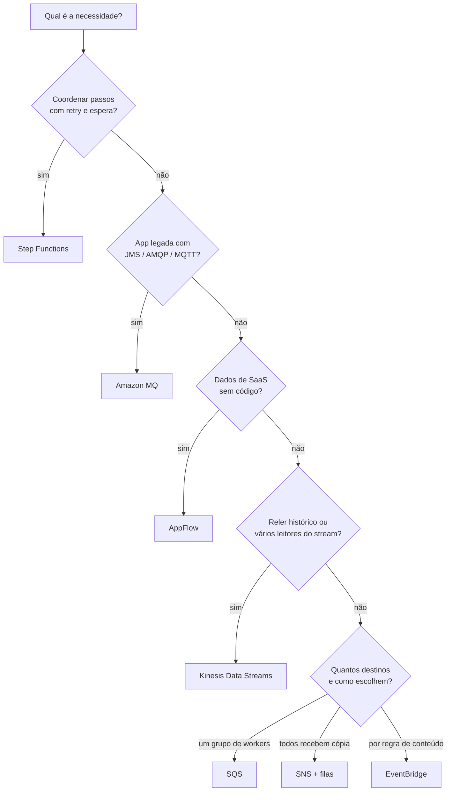

---
aliases:
  - Aula 15.8
modulo: 15
aula: 8
parte: "V Arquiteturas modernas"
dominios:
  - 2
  - 3
lida: false
tags:
  - aula
  - saa-c03
  - modulo-15
---

# Aula 15.8: Escolhendo entre SQS, SNS, EventBridge, Kinesis e Step Functions

[[15 - Desacoplamento Filas Eventos e Workflows|Voltar ao módulo]]

> [!question] Pergunta que esta aula responde
> Diante de um enunciado com cinco serviços plausíveis, qual pergunta de decisão separa [[SQS]], [[SNS]], [[EventBridge]], [[Kinesis Data Streams]], [[Step Functions]], [[Amazon MQ]] e [[AppFlow]], e por que a escolha errada costuma custar [[Disponibilidade|disponibilidade]], ordem ou dinheiro?

## O mapa mental: o que cada um entrega

Esta aula não ensina serviço novo: ela organiza os sete que você viu. A forma mais segura de decidir é perguntar **o que o consumidor precisa receber e como**.

| Serviço | Modelo | Quem recebe | Ideia central |
|---|---|---|---|
| **[[SQS]]** | Fila (pull) | **Um** consumidor por mensagem (o grupo de workers divide a carga) | Buffer durável: o consumidor puxa no seu ritmo |
| **[[SNS]]** | [[Pub-Sub\|Pub/sub]] (push) | **Todos** os assinantes | Um aviso para muitos, em [[Fan-out]] |
| **[[EventBridge]]** | [[Event Bus\|Barramento de eventos]] | Alvos escolhidos **por regra** | Roteamento por conteúdo, parceiros SaaS, agenda |
| **[[Kinesis Data Streams]]** | Stream ordenado por shard | Vários consumidores, **relendo** o histórico | Ordem por shard, retenção longa, replay |
| **[[Step Functions]]** | Orquestrador | Passos definidos no fluxo | Coordenar passos, erro e espera |
| **[[Amazon MQ]]** | Broker com protocolos de mercado | Conforme o protocolo (JMS, AMQP, MQTT) | Migrar sem reescrever |
| **[[AppFlow]]** | [[Data Transfer\|Transferência de dados]] | Destinos AWS ([[S3]], [[Redshift]]) | SaaS para AWS, sem código |

Para os três primeiros, a documentação da AWS tem um guia de decisão (atualizado em novembro de 2025, verificado em novembro de 2026), que resume assim: o **[[SQS]]** é para desacoplar com uma fila em que o consumidor **puxa**; o **[[SNS]]** é para **enviar o mesmo evento a muitos** destinos; o **[[EventBridge]]** é para **rotear eventos** entre aplicações, serviços AWS e SaaS com regras e filtros.

## As perguntas de decisão, na ordem

**1. Há um fluxo de passos, com decisões, retry e espera?** [[Step Functions]]. Os outros serviços entregam mensagens; só ele coordena um processo.

**2. A aplicação já usa um protocolo de broker e não pode ser reescrita?** [[Amazon MQ]].

**3. Os dados vêm de um SaaS e a exigência é "sem código"?** [[AppFlow]].

**4. Quantos destinos precisam receber o mesmo evento?**

- **Um** grupo de workers dividindo a carga: [[SQS]].
- **Vários, todos recebendo uma cópia**: [[SNS]] (e, para persistir cada cópia, uma [[SQS|fila SQS]] por assinante: o padrão de [[Fan-out|fan-out]] da [[15.04 - SNS Topicos Fan-out e Filtros|aula 15.4]]).
- **Vários, mas cada um só com certos eventos, decidido pelo conteúdo, ou com origem em SaaS parceiro**: [[EventBridge]].

**5. O consumidor precisa reler mensagens antigas, ter vários leitores independentes do mesmo dado ou ordem por chave em alto volume?** [[Kinesis Data Streams]]. A mensagem do [[SQS]] some depois de processada; o stream **guarda** os registros pelo período de retenção, e cada consumidor mantém sua própria posição.

**6. O consumidor deve ser protegido de picos e processar no seu ritmo?** Fila ([[SQS]]), com escala pela profundidade ([[15.03 - SQS FIFO e Padroes de Consumo|aula 15.3]]).

## Firehose, MSK e a ordem em alto volume

Três pares de [[Streaming de Dados|streaming]] que a prova mistura:

- **[[Kinesis Data Streams]] contra [[Data Firehose]]** (Amazon Data Firehose, antigo Kinesis Data Firehose). O Data Streams é para quem escreve **consumidores próprios**, relê o histórico (replay) e quer vários leitores independentes. O **Firehose** é a **entrega gerenciada, quase em tempo real, para destinos como [[S3]], [[Redshift]] e [[OpenSearch Service|OpenSearch]]**, sem código de consumidor, mas **sem replay** e sem consumidores próprios: ele faz buffering e entrega ([documentação do Firehose](https://docs.aws.amazon.com/firehose/latest/dev/what-is-this-service.html)). Os dois se combinam: o stream alimenta o Firehose, que arquiva no S3.
- **[[Fila FIFO|SQS FIFO]] contra Kinesis para ordem em alto volume.** No SQS FIFO a ordem é **por `MessageGroupId`**, o consumidor apaga a mensagem e não há replay; o ganho é zero capacidade para gerenciar. No Kinesis a ordem é **por shard**, definida pela **[[Partition Key|chave de partição]]**, com replay e vários leitores, ao custo de pensar em [[Shard|shards]]. Sem requisito de releitura nem de vários leitores, o desempate de "LEAST [[Overhead Operacional|operational overhead]]" é SQS FIFO.
- **[[MSK]] ([[Apache Kafka]] gerenciado).** Quando a empresa **já usa Kafka** e quer manter clientes e ferramentas do ecossistema, a resposta é MSK, não Kinesis ([[22 - Dados Analytics e Ingestao|Módulo 22]]).

## SQS contra Kinesis: a comparação que mais cai

Ambos recebem dados de produtores e entregam a consumidores, mas o contrato é outro:

| | **[[SQS]]** | **[[Kinesis Data Streams]]** |
|---|---|---|
| Após o consumo | A mensagem **é apagada** pelo consumidor | O registro **permanece** até expirar |
| Releitura (replay) | Não | **Sim**, dentro da retenção |
| Consumidores do mesmo dado | Competem pelas mensagens | Cada consumidor lê **tudo** de forma independente |
| Ordem | Só em FIFO, por [[Message Group\|grupo de mensagens]] | **Por shard** ([[Partition Key\|chave de partição]]) |
| Retenção | 60 s a **14 dias** (padrão 4 dias) | 24 h a **365 dias** (8.760 h) |
| Escala | Automática, sem [[Shard\|shards]] | Por **shards** (provisionado) ou sob demanda |
| Caso típico | Fila de tarefas, buffer de pico | Telemetria, logs, clickstream, análise em tempo real |

A retenção do [[Kinesis Data Streams]] vai de **24 horas** (padrão e mínimo) a **8.760 horas, ou 365 dias** (máximo, com **retenção estendida** configurada), verificado em novembro de 2026. Reler 30 dias de dados, portanto, exige ligar a retenção estendida; por padrão o stream guarda só 24 horas. Os detalhes de [[Streaming de Dados|streaming]] ([[Shard|shards]], [[Data Firehose|Firehose]], [[MSK]], analytics) são do [[22 - Dados Analytics e Ingestao|Módulo 22]]; aqui basta saber **quando** o stream é a resposta: replay, vários leitores independentes e ordem por chave.

> [!example] Mesmo evento, três escolhas
> Um e-commerce emite "pedido criado". O faturamento, a logística e o marketing precisam saber: **[[SNS]]** com uma fila por área (cada uma processa no seu ritmo). Só a logística de uma região específica deve receber certos pedidos: **[[EventBridge]]** com regra por região. O time de dados quer reprocessar o último mês de pedidos com uma lógica nova: o histórico precisa ser relido, o que pede um **stream**. Os três sinais do enunciado mudaram só uma frase, e a resposta mudou.

> [!example] SNS mais SQS ou EventBridge: a conta de volume
> Um e-commerce publica 100 milhões de eventos de pedido por dia, algo como 1.157 por segundo em média, e cada evento deve virar uma cópia em 3 filas, **sem** roteamento por conteúdo nem fontes SaaS. Os dois desenhos funcionam. O [[SNS]] com 3 filas é o mais simples e costuma ser o de menor custo por evento nesse perfil; o [[EventBridge]] cobra por evento publicado no barramento e se justifica quando você usa event patterns ricos, parceiros SaaS, archive e replay ou agendamento. Preços mudam: confira as páginas oficiais de SNS, [[SQS]] e EventBridge antes de fazer a conta. A pegadinha da prova é escolher o serviço mais rico quando o requisito pede só [[Fan-out|fan-out]].

## Como combinar: os padrões que aparecem juntos

| Padrão | Composição | Por que funciona |
|---|---|---|
| [[Fan-out]] durável | [[SNS]] para várias [[SQS]] | Aviso para muitos, buffer e [[Dead-Letter Queue\|DLQ]] por consumidor |
| Roteamento seletivo | [[EventBridge]] para [[SQS]]/Lambda/Step Functions | Regra decide quem recebe |
| Fila para workflow | [[SQS]] para Pipes para [[Step Functions]] | [[Orquestracao\|Orquestração]] com buffer na frente |
| Agenda de tarefas | [[EventBridge Scheduler]] para [[SQS]]/Lambda | Disparo recorrente [[Serverless\|sem servidor]] |
| Ingestão e análise | Kinesis para [[Data Firehose\|Firehose]] ou Lambda | Stream com vários leitores |
| Stream arquivado no [[S3]] sem código | [[Kinesis Data Streams]] para [[Data Firehose\|Firehose]] para S3 | Firehose entrega, o stream mantém replay |

## Atributos que desempatam: ordem, entrega, volume e operação

Quando dois serviços parecem servir, compare os atributos abaixo. Eles são o que a prova usa para fazer uma alternativa "quase certa" virar errada.

| Atributo | [[SQS]] | [[SNS]] | [[EventBridge]] | [[Kinesis Data Streams]] |
|---|---|---|---|---|
| Entrega | At-least-once (Standard); exatamente uma vez na janela de deduplicação (FIFO) | At-least-once, com retentativas | At-least-once, com retentativa de 24 h e até 185 tentativas | At-least-once, com leitura pela posição de cada consumidor |
| Ordem | Só em FIFO, por [[Message Group\|grupo de mensagens]] | Só em tópico FIFO, por grupo | O barramento clássico não garante ordem | Por shard, pela [[Partition Key\|chave de partição]] |
| Destinos por evento | Um consumidor lógico | Muitos assinantes | Até 5 alvos por regra | Quantos consumidores quiser |
| Retenção | 60 s a 14 dias | Não retém (entrega e segue) | Opcional, por archive | 24 h a 365 dias |
| Filtro por conteúdo | Não | [[Filter Policy\|Filter policy]] | Event pattern | No consumidor |
| Gerenciamento de capacidade | Nenhum | Nenhum | Nenhum | [[Shard\|Shards]] (ou modo sob demanda) |

Três leituras desta tabela evitam a maior parte dos erros:

- **Quem retém e quem não retém.** [[SQS]] e Kinesis guardam; [[SNS]] e [[EventBridge]] entregam. Por isso o [[Fan-out|fan-out]] durável junta SNS (distribui) com SQS (guarda). Se o enunciado fala em "não perder" quando o consumidor está fora do ar, procure o componente que retém.
- **Quem filtra no serviço e quem filtra no consumidor.** [[SNS]] e [[EventBridge]] filtram antes de entregar, o que reduz custo e código. No Kinesis o consumidor lê tudo e filtra sozinho.
- **Quem exige capacidade.** [[SQS]], [[SNS]] e [[EventBridge]] escalam sem você pensar em [[Shard|shards]] ou instâncias. O [[Amazon MQ]] exige escolher o tamanho do broker; o Kinesis exige pensar em shards (ou no modo sob demanda).

> [!warning] Armadilha de custo e operação
> Colocar um serviço mais pesado do que o necessário é um erro de arquitetura, não um "excesso de zelo". Usar Kinesis para uma fila de tarefas simples cria [[Shard|shards]] para gerenciar; usar [[Amazon MQ]] numa aplicação nova cria um broker para operar; usar [[Step Functions]] para um único passo cria uma [[State Machine|state machine]] sem ganho. A prova costuma recompensar a opção **mais simples que atende todos os requisitos do enunciado**.

## Como isso cai na prova

Cobre a **Task 2.1** ([[Desacoplamento|desacoplamento]] e escolha de serviços para arquiteturas fracamente acopladas) e a **Task 3.2** (integração em soluções de alta performance).

**Palavras-chave em inglês e o que apontam:**

- "decouple", "buffer", "absorb spikes", "process at its own pace": [[SQS]].
- "notify multiple subscribers", "fan out", "publish once": [[SNS]].
- "route events based on content", "SaaS partner events", "schedule": [[EventBridge]].
- "replay", "multiple consumers read the same data", "real-time analytics", "ordering per [[Partition Key|partition key]]": [[Kinesis Data Streams]].
- "deliver [[Streaming de Dados|streaming]] data to [[S3]], [[Redshift]] or [[OpenSearch Service|OpenSearch]] with no consumer code", "near real-time delivery": [[Data Firehose|Amazon Data Firehose]].
- "existing [[Apache Kafka]] applications": [[MSK|Amazon MSK]].
- "orchestrate", "workflow", "human approval": [[Step Functions]].
- "existing application protocol", "JMS", "AMQP", "MQTT": [[Amazon MQ]].
- "SaaS data to [[S3]] without code": [[AppFlow]].

**Pegadinhas clássicas:**

- Usar [[SQS]] quando o enunciado exige **replay** ou **vários leitores independentes** do mesmo dado: é stream.
- Usar Kinesis para uma fila de tarefas simples: complexidade e custo desnecessários.
- Usar [[SNS]] sozinho quando cada consumidor precisa de buffer, retry e [[Dead-Letter Queue|DLQ]]: faltam as filas.
- Usar [[EventBridge]] no lugar de [[SNS]] para um alto volume de [[Fan-out|fan-out]] simples sem roteamento por conteúdo.
- Propor [[Amazon MQ]] para uma aplicação nova.
- Propor [[Step Functions]] para entregar mensagens.

| Requisito no enunciado | Resposta provável | Por quê |
|---|---|---|
| Absorver picos e processar no ritmo do consumidor | [[SQS]] | Buffer durável com pull |
| Um evento para muitos sistemas, cada um com buffer | [[SNS]] com várias filas [[SQS]] | [[Fan-out]] durável |
| Eventos filtrados por conteúdo e de SaaS parceiro | [[EventBridge]] | Regras e barramento de parceiros |
| Reprocessar o último mês de eventos | [[Kinesis Data Streams]] (ou arquivo e replay do [[EventBridge]]) | Retenção e releitura |
| Vários leitores independentes do mesmo fluxo | [[Kinesis Data Streams]] | Cada consumidor tem posição própria |
| Entregar um stream ao [[S3]], [[Redshift]] ou [[OpenSearch Service\|OpenSearch]] sem código de consumidor | [[Data Firehose\|Amazon Data Firehose]] | Entrega gerenciada, sem replay |
| Já usa [[Apache Kafka]] e quer manter os clientes | [[MSK\|Amazon MSK]] | Kafka gerenciado |
| Ordem estrita por entidade com o MENOR overhead | [[Fila FIFO\|SQS FIFO]] com `MessageGroupId` | Sem [[Shard\|shards]] para gerenciar |
| Fluxo com aprovação humana e retry | [[Step Functions]] Standard | [[Orquestracao\|Orquestração]] [[Stateful e Stateless (Firewall)\|com estado]] |
| App on-premises com JMS migra sem reescrever | [[Amazon MQ]] | Protocolo mantido |
| Dados do SaaS para [[S3]] sem código | [[AppFlow]] | Conector gerenciado |

## Resumo

> [!abstract] A aula em uma frase
> Escolha pelo contrato de entrega: [[SQS]] para fila com pull, [[SNS]] para um aviso a muitos, [[EventBridge]] para rotear por regra e SaaS, Kinesis para releitura e vários leitores, [[Step Functions]] para coordenar passos, [[Amazon MQ]] para migrar protocolo e [[AppFlow]] para dados de SaaS sem código.

**A lógica, em 5 passos**

1. Passos com retry e espera pedem orquestrador ([[Step Functions]]).
2. Protocolo legado pede [[Amazon MQ]]; dados de SaaS sem código pedem [[AppFlow]].
3. Para mensagens, conte os destinos e como eles escolhem o que recebem.
4. Releitura ou vários leitores independentes pedem stream, não fila.
5. Combine: [[SNS]] com [[SQS]], [[EventBridge]] com alvos, fila na frente de workflow.

**Números para lembrar** (verificado em novembro de 2026)

| O quê | Valor | Por que importa |
|---|---|---|
| Retenção do [[SQS]] | 60 s a 14 dias (padrão 4 dias) | Limite do buffer |
| Retenção do [[Kinesis Data Streams]] | 24 h a 365 dias | Replay |
| Alvos por regra do [[EventBridge]] | até 5 | [[Fan-out]] do barramento |
| Standard vs Express | 1 ano vs 5 minutos | Tipo de workflow |

**Tabela-síntese**

| Pergunta | Serviço |
|---|---|
| Buffer e pull | [[SQS]] |
| Cópia para todos | [[SNS]] |
| Rotear por conteúdo | [[EventBridge]] |
| Reler e vários leitores | [[Kinesis Data Streams]] |
| Coordenar passos | [[Step Functions]] |
| Protocolo legado | [[Amazon MQ]] |
| SaaS sem código | [[AppFlow]] |

**Na prática, isso significa**

- Leia o verbo do enunciado: "enfileirar", "notificar", "rotear", "reprocessar", "[[Orquestracao|orquestrar]]", "migrar".
- Quando houver dois serviços plausíveis, procure o requisito que desempata (replay, protocolo, código).
- Combinações são a resposta frequente: [[SNS]] com [[SQS]] é o exemplo clássico.

> [!tip] Liga com
> Fecha o módulo ligando todas as aulas: [[15.02 - SQS Filas Standard e o Ciclo de Vida da Mensagem|15.2]] a [[15.07 - Amazon MQ e AppFlow|15.7]]. Segue para o [[16 - Serverless Lambda e API Gateway|Módulo 16]] e se aprofunda em [[Streaming de Dados|streaming]] no [[22 - Dados Analytics e Ingestao|Módulo 22]].

## Erros comuns

- **"[[SQS]] e Kinesis são equivalentes."** Um apaga ao consumir; o outro guarda e permite reler.
- **"[[SNS]] guarda mensagens."** O SNS entrega e segue; o buffer vem das filas assinantes.
- **"[[EventBridge]] sempre no lugar do [[SNS]]."** Para [[Fan-out|fan-out]] simples e de alto volume sem regras por conteúdo, o SNS basta.
- **"[[Step Functions]] entrega mensagens."** Ele coordena passos.
- **"[[Amazon MQ]] é a escolha moderna."** É a escolha de migração.

## Pratique

**1.** Um e-commerce publica 100 milhões de eventos de pedido por dia e cada evento deve virar uma cópia em três filas, sem roteamento por conteúdo e sem fontes SaaS. Qual solução atende com o MENOR custo e a solução mais simples?

- [ ] a) Um tópico SNS com três filas SQS assinantes
- [ ] b) Um barramento EventBridge com três regras, cada uma com uma fila como alvo
- [ ] c) Um stream do Kinesis Data Streams com três consumidores independentes
- [ ] d) Uma state machine Express que grava nas três filas em paralelo

**2.** Uma empresa quer reprocessar, com uma nova lógica, todos os eventos de cliques dos últimos 30 dias, e vários times leem o mesmo fluxo de forma independente. Qual serviço escolher?

- [ ] a) Amazon SQS Standard com retenção de 14 dias
- [ ] b) Um tópico SNS com assinaturas HTTP
- [ ] c) AWS Step Functions Standard
- [ ] d) Amazon Kinesis Data Streams com retenção estendida

**3.** Eventos de um parceiro SaaS devem ser encaminhados para uma [[Lambda|função Lambda]] diferente conforme o tipo de evento, sem código de roteamento. Qual solução usar?

- [ ] a) Amazon EventBridge com regras por padrão de evento
- [ ] b) Uma fila SQS FIFO com um único consumidor que decide o destino de cada evento
- [ ] c) Um tópico SNS sem filtros
- [ ] d) Um cluster Amazon MQ com tópicos

**4.** Uma API recebe picos de tráfego, e o processamento por [[EC2|instâncias EC2]] é mais lento que a chegada. O objetivo é não perder pedidos e processar no ritmo dos workers. Qual serviço entre os dois componentes?

- [ ] a) Um tópico SNS com assinatura de e-mail
- [ ] b) Uma fila Amazon SQS
- [ ] c) Uma regra do EventBridge Scheduler
- [ ] d) Um workflow Express do Step Functions

**5.** Um sistema de contas processa operações em ordem estrita por conta, a cerca de 5.000 mensagens por segundo, com vários consumidores em paralelo e sem necessidade de reler o histórico. Qual solução tem o MENOR [[Overhead Operacional|overhead operacional]]?

- [ ] a) Um stream do Kinesis Data Streams com chave de partição igual à conta, dimensionando os shards
- [ ] b) Uma fila SQS standard com consumidores que reordenam as mensagens em memória
- [ ] c) Uma fila SQS FIFO com MessageGroupId igual à conta, usando o modo high throughput
- [ ] d) Um tópico SNS standard com uma fila SQS standard para cada consumidor

**6.** Cliques de um site precisam chegar ao [[S3]] em [[Parquet]] quase em tempo real, sem que a equipe escreva e opere um consumidor, e sem necessidade de releitura. Qual serviço atende?

- [ ] a) Kinesis Data Streams com uma função Lambda que grava cada registro no S3
- [ ] b) Uma fila SQS com um worker que converte e grava em lotes
- [ ] c) Amazon Data Firehose entregando ao S3, com conversão de formato
- [ ] d) Amazon MSK com um conector escrito pela equipe

**7.** Um processo de pedido tem pagamento, reserva de estoque e emissão de nota, em sequência, com compensação (desfazer a reserva) se a nota falhar e visibilidade do estado de cada execução. Qual solução exige MENOS código de coordenação?

- [ ] a) Uma regra do EventBridge por passo, cada serviço publicando o evento do passo seguinte
- [ ] b) AWS Step Functions Standard com estados Task e Catch para a compensação
- [ ] c) Um tópico SNS com uma fila SQS por passo e consumidores encadeados
- [ ] d) Uma fila SQS FIFO com um grupo por pedido e consumidores encadeados

**8.** Um mesmo evento deve ir para duas filas, mas cada fila só deve receber eventos de um determinado tipo, definido no atributo da mensagem. Qual solução tem o menor overhead?

- [ ] a) Um tópico SNS com filter policy em cada assinatura SQS
- [ ] b) Duas funções Lambda que filtram e reenviam
- [ ] c) Um stream do Kinesis lido por duas aplicações
- [ ] d) Uma state machine Express com um Choice

**9.** Uma empresa opera aplicações que usam clientes [[Apache Kafka]] no datacenter e quer migrar para a AWS com um serviço gerenciado, sem trocar os clientes. Qual serviço escolher?

- [ ] a) Amazon Kinesis Data Streams
- [ ] b) Amazon MSK
- [ ] c) Amazon SQS FIFO
- [ ] d) Amazon MQ com RabbitMQ

**10.** Para cada cliente cadastrado, um lembrete deve ser enviado 45 dias depois, sem manter servidores e sem guardar o estado em um banco só para isso. Qual solução atende?

- [ ] a) Uma fila SQS com delay de 45 dias por mensagem
- [ ] b) Um workflow Step Functions Express com um estado Wait de 45 dias
- [ ] c) Um tópico SNS com publicação agendada
- [ ] d) Uma agenda one-time do EventBridge Scheduler por cliente

**11.** (Escolha DUAS.) Quais afirmações comparando [[SQS]] e [[Kinesis Data Streams]] estão corretas?

- [ ] a) No SQS a mensagem é apagada pelo consumidor após o processamento
- [ ] b) No Kinesis cada consumidor pode reler registros dentro da retenção
- [ ] c) O SQS permite replay de qualquer mensagem de 30 dias atrás
- [ ] d) O Kinesis apaga o registro assim que o primeiro consumidor o lê
- [ ] e) A retenção máxima do SQS é de 365 dias

**12.** (Escolha DUAS.) Quais afirmações sobre a escolha de serviços estão corretas?

- [ ] a) O Amazon MQ é indicado para migrar aplicações que usam JMS ou AMQP
- [ ] b) O Step Functions é um serviço de entrega de mensagens em fila
- [ ] c) SNS com filas SQS é um padrão de fan-out durável
- [ ] d) O AppFlow substitui o EventBridge no roteamento por conteúdo
- [ ] e) O Amazon Data Firehose permite que consumidores releiam os registros dentro da retenção

**13.** Uma empresa ingere telemetria. Um time precisa de um consumidor próprio em tempo real, com replay de 7 dias, e outro time só quer os dados no [[S3]], sem escrever código. Qual combinação atende?

- [ ] a) Uma fila SQS FIFO com uma função Lambda e uma segunda fila para o S3
- [ ] b) Amazon Data Firehose sozinho, com o consumidor próprio lendo do Firehose
- [ ] c) Um tópico SNS com uma fila SQS e uma assinatura para o S3
- [ ] d) Kinesis Data Streams, com o Firehose como consumidor que entrega ao S3

> [!success]- Gabarito
> **1. a)** o [[SNS]] com filas entrega uma cópia a cada uma e é o desenho mais simples e barato para [[Fan-out|fan-out]] sem regras por conteúdo; b) funciona, mas o [[EventBridge]] só compensa quando há event patterns ricos, parceiros SaaS ou replay; c) um stream exige [[Shard|shards]] e consumidores próprios sem necessidade; d) a [[State Machine|state machine]] coordena passos e adiciona custo por execução.
> **2. d)** o Kinesis guarda os registros e permite que vários times releiam o mesmo fluxo, desde que a retenção estendida esteja configurada (padrão de 24 h, máximo de 365 dias); a) [[SQS]] apaga ao consumir e não permite replay; b) [[SNS]] não guarda; c) [[Step Functions]] não é fluxo de dados.
> **3. a)** o [[EventBridge]] roteia por padrão de evento e aceita parceiros SaaS; b) uma [[Fila FIFO|fila FIFO]] não roteia; c) [[SNS]] sem filtros enviaria tudo a todos; d) o [[Amazon MQ]] não é barramento para parceiros SaaS.
> **4. b)** a fila absorve o pico e o consumidor puxa no seu ritmo; a) e-mail não faz buffer; c) o Scheduler dispara no tempo; d) o Express não guarda mensagens.
> **5. c)** o [[Fila FIFO|SQS FIFO]] ordena por [[Message Group|MessageGroupId]], paraleliza entre contas e dispensa gerenciar [[Shard|shards]], e o high [[Throughput|throughput]] cobre o volume; a) o Kinesis também ordena por shard, mas exige dimensionar shards e só compensa com replay ou vários leitores; b) o standard não garante ordem e reordenar em memória é frágil; d) o [[SNS]] standard não preserva ordem.
> **6. c)** o [[Data Firehose|Firehose]] é a entrega gerenciada quase em tempo real ao [[S3]], com conversão de formato e sem código de consumidor; a) o Data Streams exige escrever e operar o consumidor, e o replay não foi pedido; b) a fila exige worker próprio; d) o [[MSK]] é Kafka gerenciado e exige conector e operação.
> **7. b)** o [[Step Functions]] Standard coordena a sequência, trata o erro com Catch e mostra o estado de cada execução; a) a [[Coreografia|coreografia]] por eventos funciona, mas ninguém enxerga o fluxo inteiro nem centraliza a compensação; c) as filas encadeadas exigem código de cola e controle de estado; d) a ordem do FIFO não coordena erro nem compensação.
> **8. a)** a [[Filter Policy|filter policy]] do [[SNS]] entrega cada tipo à fila certa sem código; b) as Lambdas são overhead; c) o stream não filtra por assinante; d) o Express não é [[Fan-out|fan-out]] durável.
> **9. b)** o [[MSK]] é Kafka gerenciado e mantém os clientes e o ecossistema; a) o Kinesis tem API própria e exigiria reescrever os clientes; c) o [[SQS]] usa a API da AWS; d) o RabbitMQ é outro broker e outro protocolo.
> **10. d)** o Scheduler cria agendas únicas para datas distantes, [[Serverless|sem servidor]]; a) o delay do [[SQS]] vai só até 15 minutos; b) o Express dura no máximo 5 minutos (o Standard aceitaria o Wait); c) o [[SNS]] não agenda publicações.
> **11. a) e b)** no [[SQS]] o consumidor apaga a mensagem e no Kinesis cada consumidor relê dentro da retenção; c) o SQS retém no máximo 14 dias e não tem replay; d) o Kinesis mantém o registro; e) o máximo do SQS é 14 dias.
> **12. a) e c)** o [[Amazon MQ]] serve para migrar JMS e AMQP e [[SNS]] com [[SQS]] é [[Fan-out|fan-out]] durável; b) [[Step Functions]] orquestra; d) o [[AppFlow]] transfere dados; e) o [[Data Firehose|Firehose]] entrega e segue, sem replay.
> **13. d)** o Data Streams dá retenção e replay ao consumidor próprio (7 dias exige retenção estendida) e o [[Data Firehose|Firehose]] lê o mesmo stream e entrega ao [[S3]] sem código; a) o [[SQS]] apaga ao consumir e não faz replay; b) o Firehose não tem consumidores próprios nem replay; c) o [[SNS]] não retém nem permite releitura.

## Para aprofundar

- [ ] [Choosing between SQS, SNS and EventBridge](https://docs.aws.amazon.com/decision-guides/latest/sns-or-sqs-or-eventbridge/sns-or-sqs-or-eventbridge.html) (guia de decisão da AWS): comparação oficial dos três serviços.
- [ ] [Amazon Kinesis Data Streams: retention](https://docs.aws.amazon.com/streams/latest/dev/kinesis-extended-retention.html) (documentação do Kinesis): retenção de 24 horas a 365 dias.

Próximo passo: volte ao [[15 - Desacoplamento Filas Eventos e Workflows|módulo 15]] para o teste final.
