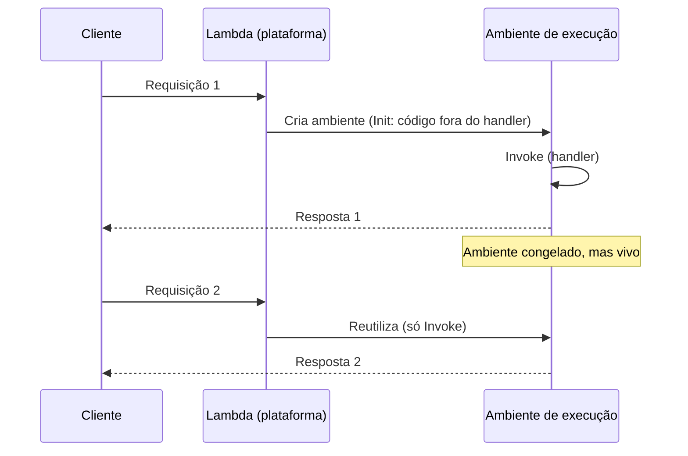

---
aliases:
  - Aula 16.1
modulo: 16
aula: 1
parte: "V Arquiteturas modernas"
dominios:
  - 2
  - 3
  - 4
lida: false
tags:
  - aula
  - saa-c03
  - modulo-16
---

# Aula 16.1: Serverless e a anatomia do Lambda

[[16 - Serverless Lambda e API Gateway|Voltar ao módulo]]

> [!question] Pergunta que esta aula responde
> O que significa "[[Serverless|serverless]]" de verdade (a palavra engana, servidor existe), que problema ele resolve, e o que acontece por dentro do [[Lambda]] entre o evento chegar e o seu código responder? Por que memória, [[Timeout|timeout]] e [[Cold Start|cold start]] são as três alavancas que a prova cobra?

## O problema: pagar e operar servidor ocioso

Você já roda aplicações em [[Fargate]] e [[EC2]]. Mesmo no Fargate, uma tarefa fica de pé o tempo todo: você paga pelos [[vCPU]] e GB reservados, mesmo às 3 da manhã sem nenhum usuário, e ainda precisa decidir quantas tarefas manter, quando escalar e como distribuir entre [[Zona de Disponibilidade|AZs]]. Para um job que roda 200 vezes por dia durante 2 segundos, isso é desperdício e trabalho.

**[[Serverless]]** é o modelo em que você entrega só o código (ou a configuração) e a AWS cuida do resto. Quatro propriedades definem o termo:

1. **Sem gestão de servidor:** você não escolhe sistema operacional, não aplica patch, não dimensiona frota.
2. **Escala automática, inclusive até zero:** sem tráfego, sem instância rodando.
3. **Cobrança por uso real:** por requisição e por tempo de execução, não por hora reservada.
4. **[[Alta Disponibilidade|Alta disponibilidade]] embutida:** o serviço já distribui a execução entre [[Zona de Disponibilidade|AZs]] da [[Regiao AWS|Região]] (você não monta [[Multi-AZ]]).

No vocabulário da prova isso aparece como "LEAST operational overhead" ([[Overhead Operacional]] mínimo). [[Serverless]] é a resposta clássica quando o enunciado fala em carga imprevisível, picos curtos ou equipe pequena.

> [!info] Ligando os pontos
> No [[12 - Balanceamento de Carga e Auto Scaling|Módulo 12]] você escalou instâncias com [[Auto Scaling Group|Auto Scaling Groups]]: você define [[Metrica|métrica]], mínimo e máximo. No Lambda quem escala é a plataforma, uma execução por requisição concorrente. Os serviços [[Serverless|serverless]] da AWS que a prova mistura: [[Lambda]] (computação), [[Fargate]] ([[Container|containers]] sem servidor, [[17 - Containers ECS EKS e Fargate|Módulo 17]]), [[API Gateway]] (porta [[HTTP]]), [[DynamoDB]], [[SQS]], [[SNS]], [[EventBridge]], [[Step Functions]] e [[S3]].

### Trade-offs: o que você troca

| Ganha | Paga com |
|---|---|
| Zero administração de servidor | Menos controle: você não escolhe SO, kernel nem hardware (só memória, arquitetura e rede) |
| Escala de zero a milhares sem planejar | Limites de plataforma: [[Timeout\|timeout]], payload, concorrência da conta |
| Custo proporcional ao uso | Carga alta e constante costuma ficar mais cara que [[Reserved Instance\|instância reservada]] |
| Menos código de infraestrutura | [[Latencia\|Latência]] de partida ([[Cold Start\|cold start]]) e depuração distribuída mais difícil |

## O que é o Lambda

O **[[Lambda|AWS Lambda]]** executa uma função (um pedaço de código com um *handler*, o ponto de entrada) em resposta a um evento. Você sobe o código (zip ou [[Imagem de Container|imagem de container]]), define memória, [[Timeout|timeout]] e permissões, e o Lambda cria os ambientes necessários, executa e destrói quando não precisa mais.

> [!info] Nomes novos na documentação (verificado em novembro de 2026)
> A documentação atual chama as funções tradicionais de "Lambda Event Functions" e apresenta duas variações: **Lambda [[ECS Managed Instances|Managed Instances]]** (funções rodando em infraestrutura de propriedade do cliente, com invocações concorrentes no mesmo ambiente) e **durable functions** (execuções que pausam e retomam, com duração de até um ano). Neste curso, "Lambda" quer dizer a função tradicional, que é o que a prova SAA-C03 cobra. Se as variações novas aparecem na prova: não confirmado; a lista oficial de serviços do exam guide cita apenas Lambda.

> [!example] Exemplo: redimensionar imagens
> Usuários sobem fotos para um [[Bucket|bucket]] [[S3]]. Cada upload dispara um evento; o Lambda baixa a foto, gera a miniatura e grava em outro bucket. Em um dia com 50 uploads, o custo é de 50 execuções de poucos segundos. Em um dia com 50 mil, a AWS cria dezenas de ambientes em paralelo sem você tocar em nada.

## Por dentro: o ambiente de execução e seu ciclo de vida

Para cada requisição concorrente, o Lambda precisa de um **[[Ambiente de Execucao|ambiente de execução]]** (*execution environment*): um sandbox isolado (microVM) com o runtime da linguagem, seu código, a memória configurada e um diretório `/tmp`. O ciclo tem três fases (verificado em novembro de 2026 na documentação do Lambda):

| Fase | O que acontece | Observações |
|---|---|---|
| **Init** | Inicia extensões, inicia o runtime, executa o código **fora do handler** (importar bibliotecas, criar clientes SDK, abrir conexões) | Limitada a 10 segundos; se estourar, o Lambda tenta de novo no primeiro invoke com o [[Timeout\|timeout]] da função. O limite de 10 s não vale para [[Concorrencia Provisionada\|concorrência provisionada]], [[SnapStart]] e Lambda [[ECS Managed Instances\|Managed Instances]] (nesses casos o Init pode rodar até 15 minutos). A duração do Init **entra na cobrança** (Aula 16.5) |
| **Invoke** | Executa o handler com o evento recebido | Limitada ao [[Timeout\|timeout]] configurado |
| **Shutdown** | Encerra o runtime e as extensões | O ambiente é descartado depois de um tempo ocioso |

Depois que um invoke termina, o ambiente é **congelado** e fica disponível para a próxima requisição. Se ela chegar a tempo, o Lambda **reutiliza** o ambiente e pula o Init. Se todos os ambientes estiverem ocupados, cria um novo.

### Cold start: o preço do Init

**[[Cold Start|Cold start]]** é o atraso extra de uma invocação que precisou criar um ambiente novo (Init completo). Uma invocação que reutiliza um ambiente é *warm*. O cold start aparece quando o tráfego sobe de repente, depois de períodos ociosos e a cada deploy de nova versão do código. A duração depende do runtime, do tamanho do pacote e do que o seu Init faz (carregar framework, abrir conexão de banco).

Consequências práticas, que a prova transforma em perguntas:

- Coloque no escopo global (fora do handler) tudo que pode ser reutilizado: clientes do AWS SDK, conexões, configuração lida do [[Parameter Store]] ou do [[Secrets Manager]]. Dentro do handler fica só o que depende do evento.
- Nunca presuma que variáveis globais persistem: o ambiente pode sumir a qualquer momento. Trate-as como cache oportunista, nunca como armazenamento.
- [[Cold Start|Cold start]] incomoda APIs interativas (usuário esperando) e quase nunca incomoda processamento assíncrono. As soluções ([[Concorrencia Provisionada|concorrência provisionada]], [[SnapStart]]) estão na [[16.03 - Concorrencia Escala e Cold Start|Aula 16.3]].

## Memória, CPU, timeout e armazenamento

### Memória é também CPU

O Lambda não deixa escolher [[vCPU]]. Você escolhe a **memória** (de 128 MB a 10.240 MB, em passos de 1 MB) e a CPU vem **proporcional**: com 1.769 MB a função tem o equivalente a 1 vCPU (verificado em novembro de 2026). O default é 128 MB, que a documentação recomenda só para funções simples que transformam e roteiam eventos.

Por isso "a função está lenta" quase sempre se resolve **aumentando a memória**, mesmo que ela use pouca [[RAM]]: mais memória traz mais CPU, e a documentação também cita ganho para funções que usam bibliotecas, layers, [[S3]] ou [[EFS]]. O exam guide (Task 3.2) lista literalmente a habilidade "selecionar tipo e tamanho de recurso (quantidade de memória do Lambda)".

### Timeout

O **[[Timeout|timeout]]** é o tempo máximo de uma execução. O padrão é **3 segundos** e o máximo atual é **1.800 segundos (30 minutos)**, em incrementos de 1 segundo (verificado em novembro de 2026).

> [!warning] Cuidado com material antigo
> Durante anos o máximo foi **15 minutos (900 segundos)**, e é o número que aparece em muitos simulados e vídeos. A documentação de novembro de 2026 traz 30 minutos. Se uma questão da prova disser "função com limite máximo de 15 minutos", ela segue a regra antiga; o raciocínio é o mesmo: Lambda não serve para processo de horas. Para fluxos mais longos use [[Step Functions]], [[Fargate]] ou [[Batch]] (Aula 16.8).

Quem chama também tem [[Timeout|timeout]]: o [[API Gateway]] espera no máximo cerca de 29 segundos (Aula 16.6), então uma função de 10 minutos atrás dele precisa de padrão assíncrono.

### Armazenamento temporário

- **/tmp** (armazenamento efêmero): de 512 MB a 10.240 MB, configurável. 512 MB estão incluídos no preço; acima disso cobra-se por GB-segundo. É local ao ambiente, some quando o ambiente some, e não é compartilhado entre ambientes simultâneos.
- Para persistir ou compartilhar: [[S3]] (objetos), [[EFS]] (sistema de arquivos compartilhado, exige [[VPC]]) ou [[DynamoDB]].

## Pacotes e limites que valem decorar

| Item | Limite (verificado em novembro de 2026) |
|---|---|
| Memória | 128 a 10.240 MB |
| [[Timeout]] | até 1.800 s (padrão 3 s) |
| /tmp | 512 a 10.240 MB |
| Variáveis de ambiente | 4 KB no total |
| Pacote .zip enviado pela API/SDK | 50 MB zipado; conteúdo descompactado (incluindo layers) até 250 MB; maior que 50 MB: suba pelo [[S3]] |
| [[Imagem de Container\|Imagem de container]] | até 10 GB descompactada, armazenada no [[ECR]] |
| Layers por função | 5 (só em funções .zip) |
| Payload síncrono | 6 MB na requisição e 6 MB na resposta (modo buffered; com **response [[Streaming de Dados\|streaming]]** a resposta pode chegar a 200 MB segundo a página de quotas, mas a regra de prova continua sendo 6 MB) |
| Payload assíncrono | 1 MB |
| Concorrência padrão da conta | 1.000 por Região (aumentável) |

> [!tip] Macete para a prova
> Número que aparece muito: **6 MB** (síncrono), **10 GB** ([[Imagem de Container|imagem de container]]), **10.240 MB** (memória máxima), **250 MB** (zip descompactado). Pacote grande ou dependência pesada (ML, bibliotecas nativas) aponta para **imagem de container**. Dependências compartilhadas por várias funções apontam para **layers** (detalhes na [[16.05 - Empacotamento Versoes e Custo do Lambda|Aula 16.5]]).

## Permissões: a execution role

Toda função tem uma **execution role** ([[IAM Role]]): é o que o código pode fazer na AWS (gravar no [[S3]], ler do [[DynamoDB]], escrever logs no [[CloudWatch Logs]]). A [[Trust Policy|trust policy]] da role permite que o serviço `lambda.amazonaws.com` a assuma, e o [[Menor Privilegio]] vale: uma role por função, só com as ações necessárias. Os logs vão para o CloudWatch Logs automaticamente se a role tiver permissão (a política gerenciada `AWSLambdaBasicExecutionRole` cobre isso).

O caminho inverso, **quem pode invocar a função**, é uma [[Resource-Based Policy]] anexada à função. Quando o [[S3]], o [[API Gateway]] ou o [[EventBridge]] invocam seu Lambda, é essa policy que autoriza (o [[04 - IAM Identidade e Acesso|Módulo 4]] explicou a diferença entre identity-based e resource-based).

## O Lambda é stateless por natureza

Como ambientes nascem e morrem, o código deve ser [[Stateless]]: nada de sessão em memória, nada de arquivo local como fonte de verdade. Estado vai para [[DynamoDB]], [[S3]], [[ElastiCache]] ou outro serviço. Isso é o mesmo princípio do [[12 - Balanceamento de Carga e Auto Scaling|Módulo 12]] (sessão fora da instância), levado ao extremo.

## Como isso cai na prova

Cobertura: **Task 2.1** (arquiteturas escaláveis e fracamente acopladas: "quando usar [[Serverless|serverless]]"), **Task 3.2** (selecionar computação, inclusive memória do Lambda) e **Task 4.2** (computação com custo otimizado: Lambda para carga intermitente).

**Palavras-chave em inglês:**
- "LEAST [[Overhead Operacional|operational overhead]]", "no servers to manage", "unpredictable traffic", "sporadic", "event-driven" puxam Lambda.
- "Function runs slowly / CPU-bound" puxa **aumentar a memória** (CPU vem junto).
- "Dependencies larger than 250 MB" ou "custom runtime, 5 GB image" puxa **[[Imagem de Container|container image]]** (até 10 GB).
- "Process takes 2 hours" tira Lambda da lista ([[Fargate]], Batch, [[EC2]], [[Step Functions]]).

**Pegadinhas clássicas:**
- Lambda **não** tem "tamanho de instância": só memória, com CPU proporcional.
- Reutilização de ambiente existe, mas **não é garantida**: não guarde estado.
- [[Cold Start|Cold start]] não acontece em toda invocação: só quando um ambiente novo é criado.

| Requisito no enunciado | Resposta provável | Por quê |
|---|---|---|
| Código roda 100 vezes ao dia, 2 s cada, [[Serverless\|sem servidor]] para gerenciar | Lambda | Cobrança por uso e zero administração |
| Função lenta, uso de memória baixo, CPU alta | Aumentar a memória configurada | CPU é proporcional à memória |
| Biblioteca de 2 GB com dependências nativas | Lambda com [[Imagem de Container\|imagem de container]] | Zip é limitado a 250 MB descompactado |
| Várias funções compartilham as mesmas bibliotecas | Layer (definido na Aula 16.5: pacote de dependências montado em `/opt`) | Evita repetir dependências em cada pacote |
| Conexão de banco reaproveitada entre invocações | Criar o cliente fora do handler | Init roda uma vez por ambiente |
| Processamento de 3 horas sem interrupção | [[Fargate]], Batch ou [[EC2]] (não Lambda) | [[Timeout]] máximo do Lambda é de 30 minutos |

## Resumo

> [!abstract] A aula em uma frase
> [[Serverless]] troca controle de servidor por escala automática, cobrança por uso e [[Alta Disponibilidade|alta disponibilidade]] embutida; o Lambda executa seu handler em ambientes isolados reutilizáveis, e memória (que carrega a CPU junto), [[Timeout|timeout]] e [[Cold Start|cold start]] são as alavancas de desempenho.

**A lógica, em 5 passos**
1. Servidor ocioso custa dinheiro e exige operação; [[Serverless|serverless]] elimina os dois para cargas intermitentes.
2. Um evento chega; o Lambda reutiliza um ambiente livre ou cria um novo ([[Cold Start|cold start]], fase Init).
3. O handler roda (fase Invoke) dentro do [[Timeout|timeout]]; o ambiente é congelado para reaproveitamento.
4. Mais requisições simultâneas significam mais ambientes em paralelo (a [[16.03 - Concorrencia Escala e Cold Start|Aula 16.3]] detalha).
5. Estado não pode morar no ambiente: vai para serviços externos.

**Números para lembrar**

| O quê | Valor | Por que importa |
|---|---|---|
| Memória | 128 a 10.240 MB | Única alavanca de CPU; 1.769 MB = 1 [[vCPU]] |
| [[Timeout]] | padrão 3 s, máximo 1.800 s | Define o que cabe em Lambda; simulados antigos dizem 900 s |
| /tmp | 512 a 10.240 MB | Efêmero, não compartilhado |
| Zip descompactado | 250 MB | Acima disso: [[Imagem de Container\|imagem de container]] |
| [[Imagem de Container\|Imagem de container]] | 10 GB | Dependências pesadas |
| Payload síncrono | 6 MB | Arquivos grandes passam pelo [[S3]] |

**Na prática, isso significa**
- Para carga esporádica e equipe enxuta, Lambda é a primeira hipótese.
- Função lenta: suba memória antes de pensar em reescrever.
- Inicialize clientes e conexões fora do handler.
- Job longo ou constante e pesado não é caso de Lambda.

> [!tip] Liga com
> Vem do conceito de [[Overhead Operacional]] e de [[Stateless]] ([[02 - Well-Architected e o Formato da Prova|Módulo 2]] e [[12 - Balanceamento de Carga e Auto Scaling|Módulo 12]]). Leva à [[16.02 - Como o Lambda e Invocado e Como Trata Erros|Aula 16.2]] (como o Lambda é invocado) e à [[16.03 - Concorrencia Escala e Cold Start|Aula 16.3]] (concorrência e [[Cold Start|cold start]]).

## Erros comuns

- Achar que "[[Serverless|serverless]]" significa "sem servidor": existem servidores, só não são seus.
- Acreditar que há CPU configurável separada da memória.
- Guardar sessão ou contador em variável global e esperar que persista.
- Criar o cliente do SDK dentro do handler, refazendo conexões a cada invocação.
- Dar à função a role mais ampla "para facilitar" (viola [[Menor Privilegio]]).
- Usar o limite de 15 minutos em contas de custo sem checar a regra atual (30 minutos na documentação de novembro de 2026), ou o inverso em questão antiga da prova.

## Pratique

**1.** Uma startup processa uploads de foto que chegam de forma esporádica, de zero a milhares por hora. A equipe tem duas pessoas e quer o MENOR [[Overhead Operacional|overhead operacional]]. Qual computação atende?

- [ ] a) Frota de instâncias EC2 em um Auto Scaling Group com ALB.
- [ ] b) Cluster ECS com tarefas EC2 e Capacity Provider.
- [ ] c) Função Lambda acionada por evento do S3.
- [ ] d) Instância EC2 única com cron para varrer o bucket.

**2.** Uma [[Lambda|função Lambda]] processa imagens e leva 8 segundos com 128 MB. O [[CloudWatch]] mostra uso de memória de 90 MB. O que reduz o tempo com a menor mudança?

- [ ] a) Aumentar a memória configurada, o que também aumenta a CPU alocada.
- [ ] b) Trocar o runtime para outra linguagem de programação, mantendo a memória e o restante da configuração.
- [ ] c) Aumentar o timeout para 60 segundos.
- [ ] d) Habilitar o armazenamento efêmero de 10 GB.

**3.** Uma API em Lambda recebe tráfego esporádico. Usuários reclamam que a primeira chamada depois de alguns minutos sem uso é bem mais lenta que as seguintes, e os logs mostram uma fase Init longa só nessas chamadas. Qual é a explicação?

- [ ] a) A função excedeu o timeout padrão de 3 segundos e o Lambda reiniciou o runtime a cada tentativa.
- [ ] b) O CloudWatch Logs atrasa a entrega dos primeiros eventos de log depois de períodos sem tráfego.
- [ ] c) A memória configurada é reduzida pela plataforma quando a função fica ociosa por alguns minutos.
- [ ] d) Não havia ambiente de execução livre, então o Lambda criou um novo e executou o Init, que inclui o código fora do handler.

**4.** Uma função precisa consultar o [[Secrets Manager]] e abrir conexão com um serviço externo. Para reduzir [[Latencia|latência]] média, onde inicializar o cliente?

- [ ] a) Dentro do handler, para ter credenciais sempre frescas a cada invocação recebida.
- [ ] b) No escopo global, fora do handler, para reuso entre invocações no mesmo ambiente.
- [ ] c) Em um arquivo gravado no /tmp, que o handler relê e interpreta a cada invocação.
- [ ] d) No Secrets Manager, que mantém a conexão aberta entre as invocações.

**5.** Quais DUAS afirmações sobre o [[Ambiente de Execucao|ambiente de execução]] do Lambda estão corretas? (Escolha DUAS.)

- [ ] a) Variáveis globais persistem para sempre entre invocações.
- [ ] b) O ambiente pode ser reutilizado em invocações seguintes, mas isso não é garantido.
- [ ] c) O /tmp é compartilhado entre todos os ambientes simultâneos da função.
- [ ] d) O código fora do handler roda na fase Init, uma vez por ambiente novo.
- [ ] e) Cada invocação roda em um ambiente novo que nunca é reutilizado.

**6.** Um processamento de dados leva cerca de 3 horas de forma contínua e não pode ser dividido. Qual alternativa é a MAIS adequada?

- [ ] a) Lambda com timeout configurado no máximo.
- [ ] b) Lambda com concorrência provisionada para evitar interrupção.
- [ ] c) API Gateway chamando o Lambda em loop.
- [ ] d) Tarefa em Fargate ou job no AWS Batch.

**7.** Uma biblioteca de machine learning com dependências nativas gera um pacote de 3 GB. Como implantar no Lambda?

- [ ] a) Como imagem de container de até 10 GB, no ECR.
- [ ] b) Como pacote .zip, pedindo aumento do limite de 250 MB.
- [ ] c) Dividindo em cinco layers de 600 MB cada.
- [ ] d) Guardando a biblioteca no S3 e copiando para o /tmp a cada invocação, sem usar container.

**8.** Depois de uma revisão de segurança, um engenheiro removeu `dynamodb:PutItem` de uma das políticas do Lambda e a função passou a falhar ao gravar na tabela, embora o [[S3]] continue conseguindo invocá-la. Qual configuração ele alterou?

- [ ] a) A resource-based policy da função, que define quem pode invocá-la.
- [ ] b) A execution role, que define o que o código da função pode fazer em outros serviços AWS.
- [ ] c) O limite de tamanho do pacote, que restringe as chamadas ao DynamoDB.
- [ ] d) O security group da função, que bloqueia as chamadas de saída ao DynamoDB.

**9.** Um time quer que o [[S3]] invoque uma [[Lambda|função Lambda]] quando um objeto for criado. Qual mecanismo autoriza o S3 a invocar a função?

- [ ] a) Uma identity-based policy no bucket.
- [ ] b) A execution role da função, com a permissão `s3:GetObject` sobre o bucket de origem.
- [ ] c) Uma resource-based policy na função permitindo o serviço do S3.
- [ ] d) Um security group liberando a porta 443.

**10.** Quais situações apontam o Lambda como boa escolha? (Escolha DUAS.)

- [ ] a) Tarefa agendada que roda 5 segundos uma vez por hora.
- [ ] b) Servidor de jogos com conexões TCP persistentes de horas.
- [ ] c) Tratamento de eventos de upload com picos imprevisíveis.
- [ ] d) Banco de dados relacional com 2 TB e transações constantes.
- [ ] e) Processo de renderização contínuo, 24 horas por dia, com CPU alta e estável.

**11.** Uma empresa precisa processar arquivos enviados ao [[S3]]. Cada processamento leva cerca de 20 minutos, não guarda estado e acontece de forma esporádica. Qual solução atende com o MENOR [[Overhead Operacional|overhead operacional]]?

- [ ] a) Função Lambda com timeout de 1.200 segundos, acionada pela notificação de evento do S3.
- [ ] b) Tarefa no Fargate iniciada por uma regra do EventBridge a cada upload, com imagem própria.
- [ ] c) Instância EC2 sempre ligada, com um script que consulta o bucket a cada minuto.
- [ ] d) Job no AWS Batch com ambiente de computação gerenciado e fila de jobs.

**12.** Um arquiteto precisa dar mais poder de processamento a uma função limitada por CPU e percebe que o Lambda não oferece escolha de [[vCPU]] nem de [[Instance Type|tipo de instância]]. O que ele deve ajustar?

- [ ] a) O tipo de instância do ambiente de execução, como em uma família m5.
- [ ] b) O timeout, pois execuções com limite maior recebem mais CPU.
- [ ] c) A memória configurada, porque a CPU é alocada de forma proporcional a ela.
- [ ] d) O número de layers anexados, pois cada layer adiciona capacidade de CPU.

> [!success]- Gabarito
> **1. c)** o Lambda cobra por uso e elimina servidor; a e b exigem operar frota ou cluster; d é um [[Ponto Unico de Falha|ponto único de falha]] e não escala.
> **2. a)** memória traz CPU proporcional, e a função é limitada por CPU; b muda a linguagem sem endereçar o gargalo; c só adia o corte por tempo; d aumenta /tmp, que não é o problema.
> **3. d)** [[Cold Start|cold start]] é o custo de criar ambiente novo (Init); a descreve um [[Timeout|timeout]], que daria erro e não só lentidão na primeira chamada; b não explica uma fase Init longa nos logs; c inventa um comportamento que o Lambda não tem.
> **4. b)** o escopo global roda no Init e é reaproveitado; a refaz tudo a cada chamada; c recria o cliente a cada leitura do arquivo; d erra porque o [[Secrets Manager]] guarda segredos, não mantém conexões nem clientes vivos.
> **5. b) e d)** reuso é possível mas não garantido, e o Init roda uma vez por ambiente; a e e erram por extremos opostos; c erra porque /tmp é local a cada ambiente.
> **6. d)** [[Fargate]] ou Batch são para jobs longos; a depende de um limite de 30 minutos que não cobre 3 horas; b não altera [[Timeout|timeout]]; c é gambiarra sem sentido.
> **7. a)** [[Imagem de Container|imagem de container]] suporta até 10 GB; b não é aumentável para esse caso; c excede o limite de 250 MB descompactado e o máximo de 5 layers somados; d é lento e frágil.
> **8. b)** a execution role define o que o código pode fazer em outros serviços (aqui, gravar no [[DynamoDB]]); a é a [[Resource-Based Policy|resource-based policy]], que governa quem invoca (e o [[S3]] segue invocando); c não é um controle de permissão; d erra porque o Lambda sem [[VPC]] nem usa [[Security Group|security group]], e a falha foi de autorização.
> **9. c)** quem autoriza serviços a invocar a função é a [[Resource-Based Policy|resource-based policy]] dela; a não existe nesse formato; b dá permissão ao código, não ao [[S3]]; d é rede, irrelevante aqui.
> **10. a) e c)** curto e agendado, e eventos com pico imprevisível, são o caso ideal; b exige conexão longa; d é banco relacional; e é carga alta e constante, onde Lambda tende a ser mais cara.
> **11. a)** 20 minutos cabem no limite atual de 30 minutos (1.800 s), então Lambda acionada pelo [[S3]] é o menor overhead; provas e simulados antigos citam 15 minutos, e nesse caso a resposta passaria a ser [[Fargate]] ou Batch, por isso leia sempre o limite do enunciado; b e d funcionam, mas exigem imagem, cluster ou fila de jobs; c mantém servidor ligado e ocioso.
> **12. c)** a memória define CPU proporcional (1.769 MB = 1 [[vCPU]]); a não existe no Lambda; b não altera a CPU; d erra porque layers só trazem código, não CPU.

### Laboratório (opcional): sua primeira função

> [!warning] Use uma conta AWS pessoal separada
> Faça isto em uma **[[Conta AWS|conta AWS]] pessoal separada**, com [[Budgets]] configurado, **nunca na conta de produção da empresa**. O custo é praticamente zero (a camada gratuita cobre 1 milhão de requisições por mês; verificado em novembro de 2026), mas apague tudo no final.

Custo estimado: centavos ou zero. Pré-requisito: AWS CLI configurada com a conta pessoal.

1. Crie uma role de execução: `aws iam create-role --role-name saa-lab-lambda-role --assume-role-policy-document file://trust.json`, onde `trust.json` permite `lambda.amazonaws.com` a executar `sts:AssumeRole`.
2. Anexe a política de logs: `aws iam attach-role-policy --role-name saa-lab-lambda-role --policy-arn arn:aws:iam::aws:policy/service-role/AWSLambdaBasicExecutionRole`.
3. Escreva um `index.mjs` com um handler que devolva a hora atual e um contador global, e compacte em `function.zip`.
4. Crie a função: `aws lambda create-function --function-name saa-lab-hello --runtime nodejs24.x --handler index.handler --role <ARN da role> --zip-file fileb://function.zip`.
5. Invoque duas vezes: `aws lambda invoke --function-name saa-lab-hello --cli-binary-format raw-in-base64-out --payload '{}' out.json` e observe se o contador global sobe (reuso de ambiente) ou volta a 1 (ambiente novo).
6. Mude a memória: `aws lambda update-function-configuration --function-name saa-lab-hello --memory-size 512 --timeout 10` e compare a duração no [[CloudWatch Logs]].
7. **Limpeza:** cada laboratório deste módulo (Aulas 16.2 a 16.6) recria a própria função; se for fazê-los na sequência, mantenha a role do passo 1 e o `function.zip`, e apague só a função. Para encerrar tudo: `aws lambda delete-function --function-name saa-lab-hello`, depois `aws iam detach-role-policy` e `aws iam delete-role` para a role do passo 1. Apague também o [[Log Group|log group]] `/aws/lambda/saa-lab-hello`.

## Para aprofundar

- [ ] [Understanding the Lambda execution environment lifecycle](https://docs.aws.amazon.com/lambda/latest/dg/lambda-runtime-environment.html) (documentação AWS): fases Init, Invoke e Shutdown, [[Cold Start|cold start]] e o limite de 10 segundos do Init.
- [ ] [Lambda quotas](https://docs.aws.amazon.com/lambda/latest/dg/gettingstarted-limits.html) (documentação AWS): tabela oficial de memória, [[Timeout|timeout]], payload, pacote e concorrência.
- [ ] [Configure Lambda function memory](https://docs.aws.amazon.com/lambda/latest/dg/configuration-memory.html) (documentação AWS): relação memória e CPU e a ferramenta Power Tuning (projeto de código aberto que testa a função em várias memórias e mostra tempo e custo; detalhe na Aula 16.5).

Próxima aula: [[16.02 - Como o Lambda e Invocado e Como Trata Erros|Aula 16.2: como o Lambda é invocado e como trata erros]].
