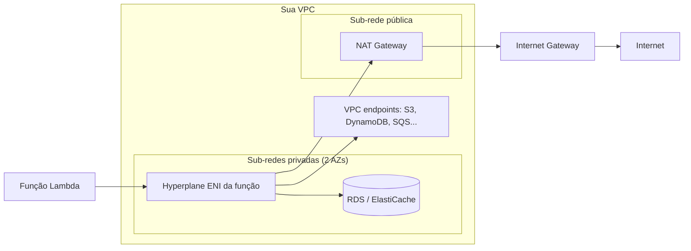

---
aliases:
  - Aula 16.4
modulo: 16
aula: 4
parte: "V Arquiteturas modernas"
dominios:
  - 1
  - 2
  - 3
lida: false
tags:
  - aula
  - saa-c03
  - modulo-16
---

# Aula 16.4: Lambda em VPC, RDS Proxy e Function URLs

[[16 - Serverless Lambda e API Gateway|Voltar ao módulo]]

> [!question] Pergunta que esta aula responde
> Como uma [[Lambda|função Lambda]] alcança um banco em [[Sub-rede Privada|sub-rede privada]], por que ela perde a internet quando entra na [[VPC]], e como evitar que mil execuções simultâneas esgotem as conexões do banco? Quando um endereço [[HTTP]] direto ([[Function URL|function URL]]) basta e quando é preciso o [[API Gateway]]?

## O problema: o Lambda mora fora da sua rede

Por padrão uma [[Lambda|função Lambda]] roda em uma VPC **gerenciada e invisível**, mantida pelo serviço. Dali ela alcança a internet pública e os endpoints públicos de qualquer serviço AWS, mas **não** alcança nada que esteja só em [[Sub-rede Privada|sub-redes privadas]] da sua [[VPC]]: um [[RDS]], um [[ElastiCache]], um serviço interno em [[Fargate]]. Para isso, a função precisa ser **conectada à sua VPC**.

E ao conectar acontece a surpresa que a prova adora: **a função perde o acesso à internet**, porque agora o tráfego sai pela sua rede, que precisa de rota. Esta aula explica o mecanismo, as soluções e o segundo problema que surge: conexões de banco.

> [!info] Ligando os pontos
> Tudo aqui reutiliza o [[06 - VPC a Fundo|Módulo 6]]: [[Sub-rede Publica|sub-rede pública]] (rota para o [[Internet Gateway]]), [[Sub-rede Privada|sub-rede privada]], [[NAT Gateway]], [[VPC Endpoint|VPC endpoints]] e [[Security Group|security groups]] referenciando security groups. Se algum desses termos estiver nebuloso, revise antes.

## Como o Lambda entra na VPC: a Hyperplane ENI

Você informa **[[Sub-rede|sub-redes]]** e **[[Security Group|security groups]]** na configuração da função. O Lambda cria então uma **[[Hyperplane ENI]]**, uma [[ENI]] gerenciada que faz a ponte entre o ambiente da função e os recursos da sua [[VPC]] (verificado em novembro de 2026):

- A [[ENI]] é criada na **primeira vez** que uma combinação de [[Sub-rede|sub-rede]] e [[Security Group|security group]] é usada. Outras funções da conta com a **mesma combinação** reutilizam a mesma ENI.
- Cada [[Hyperplane ENI]] suporta **até 65.000 conexões/portas**; acima disso o Lambda cria mais [[ENI|ENIs]] automaticamente.
- Enquanto a [[ENI]] é criada (pode levar minutos), a função nova fica em estado **Pending** e não pode ser invocada. Funções existentes continuam respondendo nas versões anteriores.
- Se a função ficar ociosa por **14 dias**, o Lambda recolhe as [[ENI|ENIs]] ociosas e marca a função como **Inactive**; a próxima invocação falha e a função volta a Pending até a ENI ser recriada. Não desenhe contando com ENIs persistentes.
- Remover a configuração de [[VPC]] pode levar até **20 minutos** para apagar a [[ENI]].
- O limite de **3.000 [[ENI|ENIs]] por [[VPC]]** (padrão) é **compartilhado** com outros serviços, como [[EFS]].

Permissões: a role de execução precisa de ações [[EC2]] de criação e gestão de interfaces de rede (`ec2:CreateNetworkInterface`, `DescribeNetworkInterfaces`, `DeleteNetworkInterface` e outras). A política gerenciada `AWSLambdaVPCAccessExecutionRole` já traz isso; ao criar a função pelo console com [[VPC]], ela é anexada automaticamente.



### Regras de rede para a função

1. **Escolha [[Sub-rede Privada|sub-redes privadas]]**, em pelo menos duas [[Zona de Disponibilidade|AZs]], para a função continuar funcionando se uma AZ cair.
2. **Anexar a uma [[Sub-rede Publica|sub-rede pública]] não dá internet nem IP público** à função. A documentação é explícita: a função não recebe IP público, e a [[ENI]] não tem rota útil só por estar numa sub-rede pública.
3. O tráfego de **saída** é controlado pelo [[Security Group|security group]] da função (egress) e pela [[Route Table]] da [[Sub-rede|sub-rede]]. O Lambda não recebe tráfego de **entrada** pela [[ENI]]: quem invoca o Lambda usa a API do Lambda, não a [[VPC]].
4. O banco libera o acesso por **referência a [[Security Group|security group]]**: o SG do [[RDS]] permite entrada na porta do banco vinda do SG da função (padrão do Módulo 6, em vez de liberar CIDRs).
5. Uma [[VPC]] com tenancy `dedicated` não é suportada diretamente; é preciso um peering com uma VPC de tenancy padrão.
6. **[[IPv6]]:** a função pode ser anexada a [[Sub-rede|sub-redes]] **[[Dual-Stack|dual-stack]]** e usar IPv6 na saída, se a opção de IPv6 para a configuração de [[VPC]] estiver habilitada e as sub-redes e o [[Security Group|security group]] permitirem esse tráfego.
7. **Remover as permissões [[EC2]] da role** (`ec2:CreateNetworkInterface` e afins) não impede invocar uma função já anexada à [[VPC]]: elas só são necessárias para criar e gerenciar as [[ENI|ENIs]].

> [!info] Lambda com EFS
> Para dar à função um sistema de arquivos compartilhado e persistente, use o [[EFS]]: a função **precisa estar na mesma [[VPC]]** do file system, e a conexão passa por um **[[Access Point|access point]]** (que fixa o diretório raiz e a identidade POSIX) montado em um caminho local sob `/mnt`. Lembre que EFS é **incompatível com [[SnapStart]]** (Aula 16.3). Sem necessidade de arquivos compartilhados, prefira [[S3]] ou [[DynamoDB]].

### Como a função em VPC volta a acessar serviços AWS e a internet

| Necessidade | Solução | Observação de custo |
|---|---|---|
| Internet pública (API de terceiro) | **[[NAT Gateway]]** em [[Sub-rede Publica\|sub-rede pública]], com rota `0.0.0.0/0` na [[Route Table\|route table]] das [[Sub-rede Privada\|sub-redes privadas]] da função | Cobrado por hora e por GB; um por [[Zona de Disponibilidade\|AZ]] para resiliência |
| [[S3]] ou [[DynamoDB]] sem internet | **[[Gateway Endpoint\|Gateway endpoint]]** | Sem custo adicional; entra na [[Route Table\|route table]] |
| Outros serviços AWS ([[SQS]], [[Secrets Manager]], [[KMS]], [[SNS]]) sem [[NAT]] | **[[Interface Endpoint\|Interface endpoint]]** ([[PrivateLink]]) | Cobrado por hora e por GB, mas mantém o tráfego na rede da AWS |
| Mais de uma das anteriores | Combinar: endpoints para serviços AWS, [[NAT]] só para o que for realmente externo | Reduz o tráfego e o custo no NAT |

> [!example] Exemplo: função que lê do RDS e grava no S3
> A função está em duas [[Sub-rede Privada|sub-redes privadas]], com o SG `lambda-sg`. Ela consulta o [[RDS]] (o SG `rds-sg` permite 5432 vindo de `lambda-sg`) e grava um arquivo no [[S3]]. Sem [[NAT]] e sem endpoint, a chamada ao S3 trava até o [[Timeout|timeout]]. A correção barata é um **[[Gateway Endpoint|gateway endpoint]] para o S3**: sem custo adicional, sem NAT, e o tráfego não sai para a internet.

> [!tip] Macete para a prova
> "Lambda in a [[VPC]] cannot reach the internet/S3/DynamoDB" tem duas respostas válidas: **[[NAT Gateway]]** (acesso geral à internet) e **[[VPC Endpoint|VPC endpoint]]** (acesso privado a serviço AWS). Se o enunciado diz "without traffic leaving the AWS network" ou "reduce [[NAT]] costs", é endpoint. Se diz "call a third-party API", é NAT.

> [!warning] Só ponha o Lambda em VPC se precisar
> Se a função só conversa com serviços públicos da AWS ([[DynamoDB]], [[S3]], [[SQS]]) pela API pública, **não** a conecte à [[VPC]]: ela fica mais simples, sem [[NAT]] e sem [[ENI]]. A VPC é para alcançar recursos privados ([[RDS]], [[ElastiCache]], serviços internos). A prova às vezes inclui a VPC como [[Distrator|distrator]] desnecessário.

## O segundo problema: o banco não aguenta tantas conexões

Um banco relacional tem um número máximo de conexões. Cada ambiente Lambda abre a sua. Com 500 execuções simultâneas, são 500 conexões; os ambientes surgem e somem, e conexões são abertas e fechadas o tempo todo. O resultado é um banco sem conexões livres e CPU gasta em handshakes.

O [[RDS Proxy]] resolve isso (Módulo 13): é um proxy gerenciado que **mantém um [[Pool de Conexoes|pool de conexões]]** com o banco e as **multiplexa** entre muitos clientes. A função conecta no proxy, não no banco. Segundo a documentação do Lambda, o proxy é recomendado para funções que abrem conexões curtas e frequentes ou muitas conexões, e para produção em geral; conexões diretas servem a cenários simples (verificado em novembro de 2026).

Pontos que caem:

- A função precisa estar na **mesma [[VPC]]** do banco e do proxy.
- Funciona com [[RDS]] MySQL, MariaDB, PostgreSQL e SQL Server e com [[Aurora]] MySQL e PostgreSQL.
- As credenciais ficam no [[Secrets Manager]]; o [[RDS Proxy]] também permite **autenticação [[IAM]]** (sem senha no código).
- O proxy ainda reduz o tempo de **[[Failover|failover]]** em [[Multi-AZ]], porque preserva as conexões das aplicações.
- Outras defesas, combinadas: limitar a concorrência (Aula 16.3), pôr uma **fila** na frente (Aula 16.2) ou usar [[DynamoDB]], que não depende de conexões persistentes.

> [!example] Exemplo: pico de cadastros
> Uma campanha dispara 800 cadastros por segundo. Sem proxy, 800 ambientes abrem 800 conexões no PostgreSQL e o banco recusa as novas. Com o [[RDS Proxy]], o pool mantém, digamos, 100 conexões reais e as 800 funções se revezam nelas. Combinado a uma [[SQS|fila SQS]], o excedente espera em vez de falhar.

## Function URLs: um endereço HTTPS direto

Nem toda função precisa de [[API Gateway]]. Uma **[[Function URL|function URL]]** é um endpoint HTTPS dedicado para a função, com este formato (verificado em novembro de 2026):

```
https://<url-id>.lambda-url.<região>.on.aws
```

Características:

- Gerada automaticamente e **nunca muda** depois de criada; vale para um **alias** ou para o `$LATEST` (não para outras versões).
- Dois tipos de autenticação: **`AWS_IAM`** (a requisição precisa de assinatura [[SigV4]] de uma identidade autorizada) ou **`NONE`** (pública). O controle de acesso usa a [[Resource-Based Policy]] da função.
- Suporta **[[CORS]]** e é [[Dual-Stack|dual stack]] ([[IPv4]] e [[IPv6]]).
- Só é acessível pela **internet pública**: a [[Function URL|function URL]] **não** suporta [[PrivateLink]], embora a API do Lambda suporte.
- Sem custo adicional além do Lambda; é o caminho mais rápido e barato para expor uma função.

### Function URL ou API Gateway?

| Critério | [[Function URL]] | [[API Gateway]] |
|---|---|---|
| Autenticação | [[IAM]] ou nenhuma | IAM, [[Cognito]] user pools, [[Lambda Authorizer\|Lambda authorizer]], [[JWT]], API keys |
| Recursos de API | Básicos | [[Throttling]] por cliente, cache, validação de requisição, transformação, domínio customizado, [[WAF]] (REST) |
| Complexidade e custo | Mínimos | Maiores; cobrado por requisição |
| Quando usar | Webhooks, protótipos, serviços internos simples | APIs de produção em escala com gestão de tráfego e segurança |

A documentação do Lambda resume: function URLs para simplicidade e baixo custo; [[API Gateway]] quando há necessidade de OpenAPI, múltiplas opções de autenticação, domínio personalizado, [[Throttling|throttling]], cache e transformação de requisições.

## Como isso cai na prova

Cobertura: **Task 1.2** (proteção de rede: Lambda em [[VPC]]), **Task 2.1** ([[Desacoplamento|desacoplamento]] e conexões de banco), **Task 3.2** (computação e conectividade com banco).

**Palavras-chave em inglês:**
- "Lambda function must access an [[RDS]] database in a [[Sub-rede Privada|private subnet]]" puxa **configurar a função na [[VPC]] (sub-redes privadas, [[Security Group|security group]])**.
- "Too many connections", "database connection exhaustion with Lambda" puxam **[[RDS Proxy]]**.
- "Lambda in [[VPC]] must call a public API" puxa **[[NAT Gateway]]**; "access [[S3]] / [[DynamoDB]] privately" puxa **[[Gateway Endpoint|gateway endpoint]]**.
- "Simple [[HTTP]] endpoint, lowest cost, no additional services" puxa **[[Function URL|function URL]]**.
- "[[Cognito]] authentication, [[Throttling|throttling]] per client, caching" puxa **[[API Gateway]]**.

**Pegadinhas clássicas:**
- [[Sub-rede Publica|Sub-rede pública]] não dá internet à função em [[VPC]].
- [[Gateway Endpoint|Gateway endpoint]] só existe para [[S3]] e [[DynamoDB]]; os demais serviços usam [[Interface Endpoint|interface endpoint]].
- [[RDS Proxy]] exige a mesma [[VPC]]; a função fora da VPC não o alcança.
- [[Function URL]] é pública na internet e não passa por [[PrivateLink]].
- Colocar o Lambda na [[VPC]] "por segurança" quando ele só usa [[DynamoDB]] e [[S3]] adiciona custo e complexidade sem benefício.

| Requisito no enunciado | Resposta provável | Por quê |
|---|---|---|
| Função precisa de um banco em [[Sub-rede Privada\|sub-rede privada]] | Anexar a função à [[VPC]] em sub-redes privadas, SG liberado no banco | Só a [[ENI]] da sua VPC alcança recursos privados |
| Função em [[VPC]] não acessa o [[S3]], sem custo extra | [[Gateway Endpoint\|Gateway endpoint]] para S3 | Sem cobrança, sem [[NAT]] |
| Função em [[VPC]] chama API de terceiro | [[NAT Gateway]] em [[Sub-rede Publica\|sub-rede pública]] | Rota de saída para a internet |
| Esgotamento de conexões no [[RDS]] por muitas execuções | [[RDS Proxy]] | Pool e multiplexação de conexões |
| Endpoint [[HTTP]] simples e barato para uma função | [[Function URL]] | Sem [[API Gateway]], sem custo adicional |
| Autenticar usuários com [[Cognito]] e limitar por cliente | [[API Gateway]] | [[Function URL]] só tem [[IAM]] ou nenhuma |

## Resumo

> [!abstract] A aula em uma frase
> O Lambda só alcança recursos privados quando anexado à sua [[VPC]], e ao entrar na VPC ele precisa de [[NAT]] ou endpoints para sair; conexões de banco exigem [[RDS Proxy]], e uma [[Function URL|function URL]] é o jeito mais simples de expor uma função.

**A lógica, em 5 passos**
1. Fora da [[VPC]], o Lambda alcança a internet e os serviços públicos, mas não recursos privados.
2. Anexe a função a [[Sub-rede Privada|sub-redes privadas]]; o Lambda cria uma [[Hyperplane ENI]] compartilhada por [[Sub-rede|sub-rede]] e [[Security Group|security group]].
3. Dentro da [[VPC]], a saída exige [[NAT]] (internet) ou [[VPC Endpoint|VPC endpoints]] (serviços AWS).
4. Muitas execuções esgotam conexões do banco; o [[RDS Proxy]] mantém um pool.
5. Para expor a função por [[HTTP]], use [[Function URL|function URL]] (simples) ou [[API Gateway]] (recursos de API).

**Números para lembrar**

| O quê | Valor | Por que importa |
|---|---|---|
| Conexões por [[Hyperplane ENI]] | 65.000 | Depois disso, mais [[ENI\|ENIs]] |
| [[ENI\|ENIs]] por [[VPC]] (padrão) | 3.000, compartilhado com [[EFS]] | Limite que pode ser atingido |
| Ociosidade até Inactive | 14 dias | Função em [[VPC]] pode falhar na primeira chamada |
| Formato da [[Function URL\|function URL]] | `https://<id>.lambda-url.<região>.on.aws` | Endpoint estável |
| Autenticação da [[Function URL\|function URL]] | `AWS_IAM` ou `NONE` | Sem [[Cognito]] nem API keys |

**Na prática, isso significa**
- Conecte à [[VPC]] só quando precisar de recursos privados.
- Use pelo menos duas [[Zona de Disponibilidade|AZs]] e [[Sub-rede Privada|sub-redes privadas]].
- Prefira endpoints a [[NAT]] para serviços AWS, para economizar.
- Em produção com banco relacional, ponha [[RDS Proxy]].

> [!tip] Liga com
> Vem do [[06 - VPC a Fundo|Módulo 6]] ([[VPC]], [[NAT]], endpoints) e do [[13 - Bancos Relacionais RDS e Aurora|Módulo 13]] ([[RDS Proxy]]). Leva à [[16.05 - Empacotamento Versoes e Custo do Lambda|Aula 16.5]] (empacotamento e custo) e ao [[API Gateway]] ([[16.06 - API Gateway Tipos Endpoints e Integracoes|Aula 16.6]]).

## Erros comuns

- Conectar o Lambda a [[Sub-rede Publica|sub-rede pública]] esperando internet.
- Colocar a função na [[VPC]] sem necessidade e depois pagar [[NAT]] para tudo.
- Esquecer o [[Security Group|security group]] do banco liberando o SG da função.
- Usar uma única [[Sub-rede|sub-rede]] (ou uma única [[Zona de Disponibilidade|AZ]]) para a função.
- Abrir uma conexão de banco por invocação sem proxy nem reutilização.
- Achar que [[Function URL|function URL]] tem autenticação [[Cognito]] ou API keys.

## Pratique

**1.** Uma [[Lambda|função Lambda]] precisa ler dados de um [[RDS]] PostgreSQL que está em [[Sub-rede Privada|sub-redes privadas]]. O que configurar?

- [ ] a) Nada: o Lambda alcança qualquer recurso da conta por padrão, inclusive sub-redes privadas.
- [ ] b) Anexar a função à VPC, em sub-redes privadas, com um SG aceito pelo banco.
- [ ] c) Criar uma rota na route table do banco apontando para o serviço Lambda.
- [ ] d) Colocar a função em sub-rede pública e atribuir um Elastic IP à função.

**2.** Após ser anexada à [[VPC]], uma função deixa de chamar uma API pública de terceiros e dá [[Timeout|timeout]]. A função está em [[Sub-rede Privada|sub-redes privadas]]. Qual é a solução?

- [ ] a) Aumentar o timeout da função para o valor máximo.
- [ ] b) Mover a função para uma sub-rede pública, que dá IP público à função.
- [ ] c) Trocar o security group por outro que libere todo o tráfego de entrada da internet para a função.
- [ ] d) Criar um NAT Gateway em sub-rede pública, com rota 0.0.0.0/0 nas sub-redes da função.

**3.** Uma função em [[VPC]] só precisa gravar no [[S3]] e ler do [[DynamoDB]]. A equipe quer manter o tráfego fora da internet com o MENOR custo, sem [[NAT]]. O que usar?

- [ ] a) Gateway endpoints para S3 e DynamoDB.
- [ ] b) Interface endpoints para S3 e DynamoDB, com private DNS habilitado.
- [ ] c) Um NAT Gateway por AZ com tráfego restrito.
- [ ] d) Um bastion host na sub-rede pública para encaminhar o tráfego.

**4.** Uma campanha de marketing faz o Lambda abrir centenas de conexões simultâneas no [[Aurora]] PostgreSQL e o banco rejeita conexões novas. Qual solução reduz o problema com o MENOR esforço de código?

- [ ] a) Reescrever a aplicação para DynamoDB em todas as tabelas.
- [ ] b) Aumentar a memória da função para 10.240 MB.
- [ ] c) Usar RDS Proxy entre a função e o banco.
- [ ] d) Trocar o Lambda por uma instância EC2 maior com conexões diretas.

**5.** Quais DUAS afirmações sobre Lambda em [[VPC]] estão corretas? (Escolha DUAS.)

- [ ] a) Conectar a função a uma sub-rede pública dá a ela acesso à internet.
- [ ] b) Funções com a mesma combinação de sub-rede e security group podem compartilhar a mesma Hyperplane ENI.
- [ ] c) A função precisa de permissões EC2 para interfaces de rede, como as da AWSLambdaVPCAccessExecutionRole.
- [ ] d) A função recebe tráfego de entrada pelo IP da ENI.
- [ ] e) É obrigatório usar um NAT Gateway para qualquer chamada a serviços AWS.

**6.** Um time precisa expor uma função como webhook público, com o menor custo e sem criar APIs adicionais. Autenticação não é necessária. O que usar?

- [ ] a) Uma REST API no API Gateway com cache habilitado.
- [ ] b) Um Application Load Balancer com target do tipo Lambda.
- [ ] c) Uma function URL com tipo de autenticação NONE.
- [ ] d) Um CloudFront com origem em um bucket S3.

**7.** Qual requisito obriga a escolha do [[API Gateway]] em vez de uma [[Function URL|function URL]]?

- [ ] a) Autenticar usuários com Cognito user pool e limitar requisições por cliente.
- [ ] b) Receber requisições HTTPS em um endereço estável, que não muda com o tempo.
- [ ] c) Invocar a função diretamente a partir de código JavaScript no navegador do usuário.
- [ ] d) Aceitar requisições vindas de clientes que usam endereços IPv6 na internet.

**8.** Uma função que só chama [[DynamoDB]] e [[SQS]] (APIs públicas da AWS) está anexada a uma [[VPC]] "por segurança" e a equipe paga um [[NAT Gateway]] por causa disso. Qual a melhor ação?

- [ ] a) Trocar o NAT Gateway por uma NAT instance.
- [ ] b) Adicionar mais sub-redes à função para dividir o tráfego do NAT.
- [ ] c) Habilitar IPv6 na VPC.
- [ ] d) Remover a função da VPC, pois ela não acessa recursos privados.

**9.** A equipe de segurança exige que o endpoint de uma função só seja alcançável de dentro da [[VPC]], por [[PrivateLink]]. Um desenvolvedor propõe criar uma [[Function URL|function URL]] com autenticação AWS_IAM. Isso atende ao requisito?

- [ ] a) Sim, porque a autenticação AWS_IAM restringe o acesso à rede interna da VPC da conta.
- [ ] b) Não, porque a function URL é um endpoint público da internet e não suporta PrivateLink; seria preciso um endpoint privado de API.
- [ ] c) Sim, desde que um security group seja associado à function URL para limitar a origem.
- [ ] d) Sim, desde que a URL seja criada em um alias, que passa a aceitar somente tráfego privado.

**10.** Quais DUAS ações reduzem o risco de esgotar as conexões de um banco relacional sob muitas execuções simultâneas de Lambda? (Escolha DUAS.)

- [ ] a) Limitar a concorrência da função com reserved concurrency.
- [ ] b) Usar RDS Proxy.
- [ ] c) Aumentar o timeout da função.
- [ ] d) Anexar a função a uma sub-rede pública.
- [ ] e) Reduzir a memória da função para 128 MB.

**11.** Uma equipe cria uma função nova anexada a uma [[VPC]] e tenta invocá-la logo em seguida, mas a invocação falha. Qual é o estado da função enquanto o Lambda cria a [[Hyperplane ENI]]?

- [ ] a) Pending, e a função ainda não pode ser invocada.
- [ ] b) Active, porém com um cold start bem maior que o normal.
- [ ] c) Inactive, aguardando 14 dias para ser reativada.
- [ ] d) Failed, e é necessário recriar a função do zero.

**12.** Uma empresa quer que a função em [[VPC]] acesse o [[Secrets Manager]] sem passar pela internet e sem [[NAT Gateway]]. O que configurar?

- [ ] a) Um gateway endpoint para o Secrets Manager.
- [ ] b) Uma VPC peering com a conta do Secrets Manager.
- [ ] c) Um Internet Gateway com rota apenas para o Secrets Manager.
- [ ] d) Um interface endpoint (PrivateLink) para o Secrets Manager.

> [!success]- Gabarito
> **1. b)** a função precisa de [[ENI]] na sua [[VPC]] e o banco precisa aceitar o SG da função; a é falso, o Lambda não vê [[Sub-rede Privada|sub-redes privadas]] por padrão; c não existe; d não dá acesso nem é necessário.
> **2. d)** a saída para a internet exige [[NAT]] com [[Rota Padrao|rota padrão]]; a só adia o [[Timeout|timeout]]; b é falso, [[Sub-rede Publica|sub-rede pública]] não dá IP público à função; c mexe em entrada, irrelevante.
> **3. a)** [[Gateway Endpoint|gateway endpoints]] para [[S3]] e [[DynamoDB]] não têm custo adicional; b também mantém o tráfego privado, mas [[Interface Endpoint|interface endpoints]] cobram por hora e por GB; c mantém o custo do [[NAT]]; d adiciona servidor sem necessidade.
> **4. c)** o [[RDS Proxy]] faz [[Pool de Conexoes|pool de conexões]] sem reescrever a lógica; a é reescrita enorme; b não limita conexões; d perde a [[Elasticidade|elasticidade]].
> **5. b) e c)** [[ENI]] compartilhada por combinação e permissões [[EC2]] de interface; a erra porque a [[Sub-rede Publica|sub-rede pública]] não dá internet; d erra porque a ENI não recebe entrada; e erra porque endpoints também servem.
> **6. c)** [[Function URL|function URL]] sem autenticação é o caminho mais simples e barato; a e b adicionam serviços cobrados; d serve conteúdo estático, não a função.
> **7. a)** [[Cognito]] e limitação por cliente só existem no [[API Gateway]]; b, c e d a [[Function URL|function URL]] já oferece.
> **8. d)** sem recursos privados, a [[VPC]] é desnecessária, e o [[NAT]] some; a, b e c mantêm a função na VPC e o custo.
> **9. b)** a [[Function URL|function URL]] é pública e não suporta [[PrivateLink]]; o AWS_IAM controla quem assina a requisição, não de onde ela vem, e uma REST API private com [[Interface Endpoint|interface endpoint]] atenderia; a confunde autenticação com origem de rede; c erra porque function URL não tem [[Security Group|security group]]; d erra porque o alias não muda a exposição pública.
> **10. a) e b)** limitar a concorrência e usar proxy controlam as conexões; c não altera o número; d não altera conexões; e pode até aumentar a duração e a concorrência.
> **11. a)** a função fica em Pending até a [[ENI]] existir; b descreve um estado diferente; c é o estado de ociosidade de 14 dias; d não é o comportamento descrito.
> **12. d)** [[Secrets Manager]] usa [[Interface Endpoint|interface endpoint]] ([[PrivateLink]]); a erra porque [[Gateway Endpoint|gateway endpoint]] só existe para [[S3]] e [[DynamoDB]]; b e c não oferecem acesso privado a serviço gerenciado.

## Para aprofundar

- [ ] [Giving Lambda functions access to resources in an Amazon VPC](https://docs.aws.amazon.com/lambda/latest/dg/configuration-vpc.html) (documentação AWS): [[Hyperplane ENI]], permissões, internet em [[VPC]] e limites de [[ENI]].
- [ ] [Using AWS Lambda with Amazon RDS](https://docs.aws.amazon.com/lambda/latest/dg/services-rds.html) (documentação AWS): conexão direta versus [[RDS Proxy]] e critérios de uso.
- [ ] [Creating and managing Lambda function URLs](https://docs.aws.amazon.com/lambda/latest/dg/urls-configuration.html) (documentação AWS): formato, autenticação e limitações.
- [ ] [Select a method to invoke your function using an HTTP request](https://docs.aws.amazon.com/lambda/latest/dg/furls-http-invoke-decision.html) (documentação AWS): quando usar [[Function URL|function URL]] ou [[API Gateway]].

Próxima aula: [[16.05 - Empacotamento Versoes e Custo do Lambda|Aula 16.5: empacotamento, versões e custo do Lambda]].
