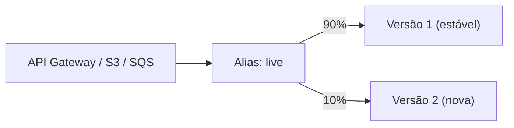

---
aliases:
  - Aula 16.5
modulo: 16
aula: 5
parte: "V Arquiteturas modernas"
dominios:
  - 2
  - 3
  - 4
lida: false
tags:
  - aula
  - saa-c03
  - modulo-16
---

# Aula 16.5: Empacotamento, versões e custo do Lambda

[[16 - Serverless Lambda e API Gateway|Voltar ao módulo]]

> [!question] Pergunta que esta aula responde
> Como empacotar o código (zip, layer ou [[Container|container]]), como publicar uma nova versão sem derrubar quem usa a antiga, e como a conta do Lambda é calculada para escolher memória e arquitetura sem pagar à toa?

## O problema: entregar código com segurança e a um custo previsível

Até aqui você viu como o [[Lambda]] executa, é invocado e escala. Falta a engenharia de entrega: o pacote cabe? As dependências são compartilháveis? Como trocar a versão em produção com risco baixo? E, como a cobrança depende de memória e tempo, qual configuração dá o menor custo para o desempenho exigido? A prova cobra os três assuntos, o último com contas.

## Formas de empacotar

### Arquivo .zip

O formato padrão para linguagens interpretadas e para código simples. Limites (verificado em novembro de 2026): **50 MB zipado** quando enviado direto pela API, SDK ou console; para pacotes maiores, suba o zip pelo [[S3]] e aponte a função para ele. O conteúdo **descompactado**, incluindo layers, pode ter até **250 MB**.

### Imagem de container

Você constrói uma [[Imagem de Container|imagem de container]] ([[Docker]]) e publica no [[ECR]]; a função aponta para a imagem. O limite é **10 GB** descompactada, somando todas as camadas. Existem três caminhos de construção:

- **Imagem base da AWS** para a linguagem: já traz o runtime, o *runtime interface client* e o emulador para teste local.
- **Imagem base só de SO da AWS**: para linguagens compiladas (Go, Rust) ou versões sem imagem pronta; você inclui o *runtime interface client* (RIC).
- **Imagem base de terceiros** (Alpine, Debian, imagem da empresa): também exige o RIC.

> [!warning] Container no Lambda não é o mesmo que ECS ou Fargate
> A [[Imagem de Container|imagem de container]] é só um **formato de pacote**. A função continua sendo Lambda: mesmo modelo de invocação, escala, [[Timeout|timeout]] e cobrança. Ela **não fica rodando**, e nada de servir porta [[HTTP]] persistente. Quando a carga é contínua ou o processo é longo, o lugar é [[Fargate]] ou [[ECS]] ([[17 - Containers ECS EKS e Fargate|Módulo 17]]).

**Quando preferir [[Container|container]]:** dependências pesadas (machine learning, bibliotecas nativas), pacote acima de 250 MB, e equipes que já têm pipeline de imagens e querem o mesmo fluxo de build para tudo.

### Layers

Um **layer** é um arquivo .zip com código ou dados suplementares (bibliotecas, runtime customizado, arquivos de configuração). Ao anexar um layer, o Lambda extrai o conteúdo no diretório `/opt` do ambiente (verificado em novembro de 2026).

Para que servem: reduzir o tamanho do pacote de cada função, separar a lógica das dependências, **compartilhar dependências** entre funções, permitir o editor de código do console em pacotes menores e **fixar a versão do SDK** embutido.

Limites e regras que caem:

- Até **5 layers** por função.
- Só funcionam em funções **.zip**; funções de **[[Imagem de Container|imagem de container]] não usam layers** (as dependências vão na imagem).
- O tamanho do pacote mais todos os layers descompactados não pode passar de **250 MB**: layer não é truque para ultrapassar o limite.
- Para Go e Rust, a documentação **não recomenda** layers, porque o executável já embute as dependências e um layer só adicionaria carga no Init.

| Situação | Melhor opção |
|---|---|
| Função simples, poucas dependências | .zip direto |
| Várias funções usam a mesma biblioteca | .zip + layer |
| Pacote acima de 250 MB ou dependências nativas pesadas | [[Imagem de Container\|Imagem de container]] (até 10 GB) |
| Linguagem compilada (Go, Rust) | Executável no .zip; layer não recomendado |

> [!tip] Configuração e segredos
> Variáveis de ambiente têm limite de **4 KB** no total. Servem para nomes de tabela, URLs e flags, **não** para senhas em texto. Segredos vão para o [[Secrets Manager]] ou para o [[Parameter Store]], lidos no Init e guardados em memória ([[08 - Criptografia e Protecao de Dados|Módulo 8]]).

## Versões e aliases: publicar sem derrubar

Cada função tem uma versão editável chamada **`$LATEST`**. Quando você **publica uma versão**, o Lambda tira uma cópia **imutável** do código e da configuração atual e a numera (1, 2, 3...). Versões publicadas não mudam nunca.

Um **alias** é um ponteiro nomeado (por exemplo `live` ou `prod`) para uma versão. Quem invoca usa o [[ARN]] do alias, e você troca a versão por trás sem mudar nenhum cliente.

O **alias ponderado** (*weighted alias*) divide o tráfego entre duas versões: 90% para a versão estável e 10% para a nova, o que implementa um **[[Canary Deployment|canary deployment]]**. Se as métricas do [[CloudWatch]] estiverem boas, você aumenta o peso; se falharem, volta para a versão anterior sem novo deploy (rollback imediato).

Onde versões e aliases importam:

- Fontes de evento e permissões podem apontar para o alias, desacoplando a configuração do número da versão.
- **Concorrência provisionada** e **[[SnapStart]]** valem para versões publicadas e aliases, não para `$LATEST` (Aula 16.3).
- Function URLs aceitam alias ou `$LATEST` (Aula 16.4).
- Cada versão publicada consome o armazenamento de código da conta, então limpe versões antigas.
- A automação de *traffic shifting* (canário, linear) para Lambda costuma usar o AWS CodeDeploy, ou o [[SAM]] que o configura; o desenho de deploy está mais para o [[21 - Observabilidade Automacao e Operacoes|Módulo 21]].

## Arquitetura: x86 ou arm64

O Lambda executa em **x86_64** ou **arm64** ([[Graviton]]). O arm64 entrega melhor preço e desempenho; a documentação recomenda considerá-lo para cargas intensivas em computação (HPC, codificação de vídeo, simulação). Para linguagens interpretadas a mudança costuma ser só trocar a arquitetura; para código com binários nativos, as dependências precisam ter versão arm64. O preço por GB-segundo no arm64 é cerca de **20% menor** que o x86: US$ 0,0000133334 contra US$ 0,0000166667 em us-east-1, primeira faixa de volume (verificado em novembro de 2026 na [página de preços](https://aws.amazon.com/lambda/pricing/); a tabela por Região deve ser conferida antes de uma conta real). A AWS anuncia até 34% de melhor relação preço-desempenho.

## Como o Lambda cobra

A fatura do Lambda tem componentes simples (valores da região us-east-1, verificados em novembro de 2026 na página de preços da AWS; sempre confira sua Região):

| Componente | Valor de referência | Observação |
|---|---|---|
| Requisições | US$ 0,20 por 1 milhão | Cada invocação conta, inclusive as que falham |
| Duração (x86) | US$ 0,0000166667 por GB-segundo | GB-segundo = memória configurada (GB) x tempo de execução (s); a duração é arredondada para cima em incrementos de 1 ms. **A duração faturada inclui o código de inicialização fora do handler (Init):** [[Cold Start\|cold start]] também custa |
| Duração (arm64) | US$ 0,0000133334 por GB-segundo (cerca de 20% menor) | Mesma conta, preço menor por GB-s |
| Faixas por volume | preço por GB-s cai em faixas conforme o volume mensal | As faixas valem por arquitetura e por Região, no nível da conta (ou da organização, com [[Consolidated Billing\|cobrança consolidada]]); os exemplos abaixo usam só a primeira faixa |
| Camada gratuita mensal | 1 milhão de requisições e 400.000 GB-segundos | A [[Concorrencia Provisionada\|concorrência provisionada]] não usa a camada gratuita |
| /tmp acima de 512 MB | cobrado por GB-segundo | 512 MB já estão incluídos |
| Concorrência provisionada | cobrada pela capacidade ligada, mais a execução | Aula 16.3 |
| [[SnapStart]] (não Java) | cache do [[Snapshot\|snapshot]] e restauração | Aula 16.3 |

Além do Lambda, a conta de uma [[Serverless|arquitetura serverless]] inclui o [[API Gateway]] (por requisição), [[NAT Gateway]] (por hora e por GB, se o Lambda estiver em [[VPC]]), [[CloudWatch Logs]] (ingestão e armazenamento) e a **transferência de dados** ([[Data Transfer]]).

### Contas resolvidas

> [!example] Exemplo 1: dentro da camada gratuita
> Uma API recebe 3 milhões de invocações por mês, com 512 MB e duração média de 200 ms.
> - GB-segundos: 3.000.000 x 0,2 s x 0,5 GB = **300.000 GB-s**. Abaixo dos 400.000 gratuitos: custo de duração **zero**.
> - Requisições: (3.000.000 - 1.000.000 gratuitas) = 2.000.000 x US$ 0,20 por milhão = **US$ 0,40**.
> - Total aproximado: **US$ 0,40 por mês**. Para a mesma carga, uma [[EC2|instância EC2]] ligada o mês todo custaria muito mais.

> [!example] Exemplo 2: volume alto
> 50 milhões de invocações por mês, 1.024 MB (1 GB), duração média de 400 ms.
> - GB-segundos: 50.000.000 x 0,4 s x 1 GB = 20.000.000. Menos 400.000 gratuitos = 19.600.000.
> - Duração: 19.600.000 x US$ 0,0000166667 = **US$ 326,67**.
> - Requisições: 49.000.000 x US$ 0,20 por milhão = **US$ 9,80**.
> - Total aproximado: **US$ 336,47 por mês**, sem considerar preços escalonados por volume. Se a mesma carga fosse constante, 24 horas por dia, o ponto de equilíbrio contra [[Reserved Instance|instâncias reservadas]] ou [[Savings Plans]] deve ser calculado.

> [!example] Exemplo 3: carga contínua
> Um único ambiente de 1 GB ocupado o mês inteiro (2.592.000 segundos em 30 dias) gera 2.592.000 GB-s x US$ 0,0000166667 = **cerca de US$ 43 só de duração**, por ambiente simultâneo. Com centenas de ambientes ocupados o tempo todo, a conta passa a ser comparável à de [[EC2]] ou [[Fargate]] com compromisso de uso. Lambda vence em carga **intermitente e imprevisível**; computação reservada vence em carga **alta e constante**.

> [!info] Savings Plans e Lambda (verificado em novembro de 2026)
> Os **Compute [[Savings Plans]]** se aplicam automaticamente a uso de [[EC2]], [[Fargate]] **e Lambda** (documentação do Savings Plans), então um compromisso de uso também pode abater parte da fatura de Lambda. Os EC2 Instance Savings Plans e as [[Reserved Instance|Reserved Instances]] não cobrem Lambda. Mesmo assim, para carga alta e constante, a comparação de custo segue sendo Lambda contra EC2 ou Fargate com compromisso, porque o desconto por compromisso é maior onde há capacidade ocupada o tempo todo.

## Escolher a memória: custo versus tempo

Como a CPU cresce com a memória, aumentar a memória **encurta a duração**. O custo é memória x tempo, então o preço por milissegundo sobe, mas o tempo cai. Em funções limitadas por CPU, mais memória pode custar **igual ou menos** e responder muito mais rápido.

| Memória | Duração medida | GB-segundos por invocação |
|---|---|---|
| 128 MB | 10,0 s | 0,125 x 10,0 = 1,25 |
| 512 MB | 2,5 s | 0,5 x 2,5 = 1,25 |
| 1.024 MB | 1,4 s | 1,0 x 1,4 = 1,40 |

Dados hipotéticos para ilustrar: 512 MB custa o mesmo que 128 MB e responde quatro vezes mais rápido; 1.024 MB já custa mais. O **ponto ótimo** só aparece medindo.

Ferramentas (verificado em novembro de 2026): o **[[Lambda|AWS Lambda]] Power Tuning**, projeto de código aberto que usa [[Step Functions]] para executar a função em várias configurações de memória e medir tempo e custo; e as **recomendações de memória** que o console do Lambda oferece, geradas pelo [[Compute Optimizer|AWS Compute Optimizer]] (detalhe de custos no [[25 - Otimizacao de Custos|Módulo 25]]). O exam guide (Task 3.2) cita como habilidade a escolha da quantidade de memória do Lambda.

> [!info] Ligando os pontos
> Quando o custo importa, lembre as três alavancas do Lambda: **memória** (otimizar custo e tempo), **arquitetura** (arm64 mais barato) e **duração** (código eficiente reduz o GB-segundo e também a concorrência necessária, Aula 16.3).

## Como isso cai na prova

Cobertura: **Task 4.2** (computação com custo otimizado: Lambda, arm64, memória), **Task 3.2** (selecionar memória e recursos) e **Task 2.1** (implantação segura e arquitetura desacoplada).

**Palavras-chave em inglês:**
- "Dependencies shared across multiple functions" puxa **[[Lambda Layer|Lambda layer]]**.
- "Package exceeds 250 MB", "[[Imagem de Container|container image]] up to 10 GB" puxam **container image**.
- "Gradually shift traffic to a new version", "canary", "rollback quickly" puxam **versões e alias ponderado**.
- "MOST cost-effective" para carga esporádica puxa **Lambda**; carga estável 24 por 7 puxa **[[EC2]]/Fargate com [[Savings Plans]]**.
- "Reduce cost without changing code" em Lambda: **arm64** (se compatível) e **ajustar memória**.

**Pegadinhas clássicas:**
- Layer não aumenta o limite de 250 MB e não funciona em [[Imagem de Container|imagem de container]].
- [[Imagem de Container|Imagem de container]] no Lambda continua sendo Lambda: não roda continuamente.
- Alias não é versão: aponta para uma versão e pode ser reapontado; a versão publicada é imutável.
- "Mais memória custa mais" nem sempre é verdade, porque o tempo diminui.
- A camada gratuita não vale para [[Concorrencia Provisionada|concorrência provisionada]].

| Requisito no enunciado | Resposta provável | Por quê |
|---|---|---|
| Dependências compartilhadas por 10 funções | Layer | Evita duplicar o código em cada pacote |
| Pacote de 4 GB com bibliotecas nativas | [[Imagem de Container\|Imagem de container]] | Zip limitado a 250 MB descompactado |
| Lançar nova versão para 10% do tráfego e voltar se falhar | Alias ponderado entre versões | Canary com rollback imediato |
| Reduzir custo de função compatível com arm | Arquitetura arm64 | Duração cerca de 20% mais barata |
| "[[Cold Start\|Cold start]] também custa?" ou custo de função com Init pesado | Sim: o Init entra na duração faturada | Reduzir o Init (pacote menor, [[SnapStart]]) reduz tempo e custo |
| Função CPU-bound lenta e cara | Aumentar a memória e medir | Tempo menor pode igualar ou reduzir o custo |
| 3 milhões de invocações por mês de 200 ms a 512 MB | Lambda | Cabe na camada gratuita de duração; paga só requisições |

## Resumo

> [!abstract] A aula em uma frase
> Empacote pelo tamanho e pelo compartilhamento (zip, layer ou [[Container|container]]), publique versões imutáveis com alias ponderado para canário e rollback, e otimize custo ajustando memória e arquitetura, porque a conta é memória vezes tempo mais requisições.

**A lógica, em 5 passos**
1. Escolha o pacote: zip até 250 MB descompactado; layer para compartilhar; [[Container|container]] até 10 GB para o que não cabe.
2. Publique uma versão (imutável) a cada release; use alias para apontar.
3. Troque a versão por trás do alias, com peso para canário e rollback.
4. Calcule o custo: GB-s = memória (GB) x segundos; mais US$ 0,20 por milhão de requisições.
5. Meça a memória ideal e considere arm64.

**Números para lembrar**

| O quê | Valor | Por que importa |
|---|---|---|
| Zip enviado direto | 50 MB | Acima disso, via [[S3]] |
| Zip descompactado (com layers) | 250 MB | Teto do pacote tradicional |
| [[Imagem de Container\|Imagem de container]] | 10 GB | Dependências pesadas |
| Layers por função | 5 | Só em funções zip |
| Camada gratuita | 1 milhão de requisições e 400.000 GB-s por mês | Cargas pequenas custam quase nada |
| Preço de referência (x86, us-east-1) | US$ 0,0000166667 por GB-s e US$ 0,20 por milhão | Base das contas da prova |

**Na prática, isso significa**
- Versione e use alias em produção; nunca aponte clientes para `$LATEST`.
- Compare custo por invocação, não só preço por ms, ao mexer na memória.
- Considere arm64 por padrão em código portável.
- Para carga constante e alta, compare com [[EC2]] ou [[Fargate]] reservados.

> [!tip] Liga com
> Vem da [[16.01 - Serverless e a Anatomia do Lambda|Aula 16.1]] (limites) e da [[16.03 - Concorrencia Escala e Cold Start|Aula 16.3]] (provisionada e [[SnapStart]] usam versões). Leva à [[16.06 - API Gateway Tipos Endpoints e Integracoes|Aula 16.6]] e ao [[25 - Otimizacao de Custos|Módulo 25]].

## Erros comuns

- Tentar usar layers para ultrapassar o limite de 250 MB.
- Usar layers em função de [[Imagem de Container|imagem de container]].
- Apontar produção para `$LATEST` e perder imutabilidade e rollback.
- Provisionar memória máxima "para garantir" sem medir.
- Esquecer que o [[NAT Gateway]], a API e os logs também entram na conta [[Serverless|serverless]].
- Colocar senha em variável de ambiente em texto simples.

## Pratique

**1.** Dez [[Lambda|funções Lambda]] usam a mesma biblioteca interna de 40 MB. A equipe quer evitar duplicar a biblioteca em cada pacote e atualizá-la em um só lugar. O que usar?

- [ ] a) Um layer compartilhado entre as funções.
- [ ] b) Um sistema de arquivos EFS montado em cada função, o que exige conectá-las à VPC.
- [ ] c) Uma imagem de container separada para cada função.
- [ ] d) Um bucket S3 lido a cada invocação pela biblioteca.

**2.** Uma função precisa de bibliotecas nativas que somam 3 GB. Qual é o formato de implantação possível?

- [ ] a) Pacote .zip com cinco layers de 600 MB cada.
- [ ] b) Pacote .zip enviado pelo S3, pois o S3 aceita arquivos maiores.
- [ ] c) Imagem de container no ECR, de até 10 GB.
- [ ] d) Duas funções encadeadas, cada uma com metade da biblioteca.

**3.** A equipe quer liberar uma nova versão da função para 10% do tráfego e, se as métricas pioraram, voltar imediatamente. O que configurar?

- [ ] a) Duas funções distintas atrás de um Application Load Balancer.
- [ ] b) Atualizar o código em $LATEST e observar os logs depois.
- [ ] c) Reduzir a reserved concurrency da função para 10.
- [ ] d) Um alias ponderado entre a versão estável e a nova.

**4.** O alias `prod` de uma função aponta para a versão 3. Um desenvolvedor encontra um bug e tenta alterar o código diretamente na versão 3 publicada. O que acontece e qual é o procedimento correto?

- [ ] a) A edição é aceita se o alias estiver temporariamente sem tráfego, e a versão 3 passa a ter o código novo.
- [ ] b) Recusada, pois a versão publicada é imutável: altera o $LATEST, publica a versão 4 e reaponta o alias `prod`.
- [ ] c) O alias guarda uma cópia própria do código da versão 3, então basta editar o alias para corrigir o bug.
- [ ] d) Ele altera o $LATEST e a versão 3 é atualizada automaticamente, por ser a versão publicada mais recente.

**5.** Quais DUAS afirmações sobre layers estão corretas? (Escolha DUAS.)

- [ ] a) Podem ser anexados a funções de imagem de container.
- [ ] b) Permitem até 5 layers por função.
- [ ] c) Ampliam o limite de 250 MB do pacote descompactado.
- [ ] d) São extraídos no diretório /opt do ambiente.
- [ ] e) Substituem a necessidade de execution role.

**6.** Uma função de 512 MB roda 3 milhões de vezes por mês, com 200 ms de duração média. Qual é o custo aproximado, considerando a camada gratuita mensal de 1 milhão de requisições e 400.000 GB-s e US$ 0,20 por milhão de requisições?

- [ ] a) Cerca de US$ 0,40 por mês.
- [ ] b) Cerca de US$ 40 por mês.
- [ ] c) Cerca de US$ 4 por mês.
- [ ] d) Cerca de US$ 0,60 por mês.

**7.** Uma função CPU-bound com 128 MB leva 10 s por invocação. Aumentar para 512 MB reduz a duração para 2,5 s. O que acontece com o custo por invocação?

- [ ] a) Quadruplica, pois a memória configurada é quatro vezes maior que a original.
- [ ] b) Cai pela metade, porque o tempo de execução caiu 75% em relação ao original.
- [ ] c) Fica quase igual: memória x tempo se mantém, e a resposta é 4 vezes mais rápida.
- [ ] d) Fica zero, pois o consumo passa a entrar na camada gratuita mensal do Lambda.

**8.** Uma empresa executa, o dia inteiro e de forma constante, um serviço que mantém 200 ambientes Lambda de 2 GB ocupados. Qual conclusão é mais razoável?

- [ ] a) Lambda será sempre a opção mais barata, qualquer que seja o perfil de carga do serviço.
- [ ] b) Comparar com Fargate ou EC2 com Savings Plans: carga alta e constante os favorece.
- [ ] c) Basta aumentar a memória das funções para reduzir o custo mensal total da carga.
- [ ] d) Basta ativar o SnapStart para diminuir a cobrança de duração dos ambientes ocupados.

**9.** Antes de uma entrega, o time precisa congelar o código e a configuração atuais de uma função, para que nunca mais mudem e possam receber um alias de produção. O que fazer?

- [ ] a) Definir reserved concurrency igual à concorrência atual, para travar a configuração.
- [ ] b) Copiar a função para outra Região da mesma conta, que mantém uma cópia fixa.
- [ ] c) Criar um layer com o código atual e anexá-lo à função, bloqueando novas edições.
- [ ] d) Publicar uma versão, que cria uma cópia imutável do código e da configuração do $LATEST naquele momento.

**10.** Uma função em Python é totalmente compatível com arm64. Quais DUAS ações reduzem o custo sem alterar a lógica? (Escolha DUAS.)

- [ ] a) Mudar a arquitetura da função para arm64.
- [ ] b) Aumentar o timeout para 15 minutos.
- [ ] c) Medir e ajustar a memória ao ponto de menor custo por invocação.
- [ ] d) Habilitar concorrência provisionada em toda a conta.
- [ ] e) Anexar a função a uma VPC com NAT Gateway.

**11.** Uma função precisa da senha de um banco, que deve ser trocada a cada 30 dias sem redeploy da função e com o MENOR [[Overhead Operacional|esforço operacional]]. Qual abordagem atende?

- [ ] a) Variável de ambiente com a senha, atualizada manualmente a cada 30 dias no console.
- [ ] b) Parameter Store do tipo SecureString, atualizado por um script agendado criado pela equipe.
- [ ] c) Secrets Manager com rotação automática, lido pela função no Init e mantido em memória.
- [ ] d) Senha dentro de um layer, publicando uma nova versão do layer todo mês.

**12.** Uma empresa estima o custo mensal de uma API [[Serverless|serverless]]: [[API Gateway]], Lambda em [[VPC]] que chama uma API externa e logs. Qual item NÃO deve entrar na estimativa?

- [ ] a) Requisições e duração (GB-segundos) cobradas pelo próprio Lambda, incluindo o tempo gasto no Init da função.
- [ ] b) NAT Gateway, cobrado por hora e por GB de dados processados.
- [ ] c) CloudWatch Logs, pela ingestão e pelo armazenamento dos logs.
- [ ] d) Cobrança por hora de uma frota mínima de servidores mantida ligada pelo Lambda.

> [!success]- Gabarito
> **1. a)** o layer compartilha dependências entre funções com atualização central; b funciona, mas exige [[VPC]] e [[EFS]] só para uma biblioteca de 40 MB; c replica a biblioteca em cada função; d adiciona [[Latencia|latência]] e custo por invocação.
> **2. c)** só a [[Imagem de Container|imagem de container]] chega a 10 GB; a erra porque 3 GB de layers passam do limite de 250 MB descompactado; b não muda esse limite de 250 MB descompactado; d é um desenho frágil que não resolve a dependência.
> **3. d)** o alias ponderado faz o canário e o rollback é voltar o peso; a adiciona infraestrutura sem necessidade; b não tem rollback imediato; c limita a escala, não divide tráfego.
> **4. b)** versões publicadas são imutáveis e o alias é só um ponteiro reapontável, então a correção vai no $LATEST, em uma nova versão e no novo apontamento; a erra porque a versão publicada nunca muda; c erra porque o alias não guarda código; d erra porque publicar é uma ação explícita, nada atualiza a versão 3.
> **5. b) e d)** até 5 layers e extração em /opt; a erra porque [[Imagem de Container|imagens de container]] não usam layers; c erra porque o limite de 250 MB inclui os layers; e confunde com permissões.
> **6. a)** 300.000 GB-s ficam dentro da camada gratuita e as 2 milhões de requisições pagas custam US$ 0,40; b, c e d não batem com a conta.
> **7. c)** 0,125 GB x 10 s = 1,25 e 0,5 GB x 2,5 s = 1,25 GB-s; a e b ignoram a relação memória x tempo; d erra, pois a camada gratuita é mensal.
> **8. b)** carga alta e constante costuma ser mais barata em computação com compromisso; a ignora o ponto de equilíbrio; c e d não eliminam a cobrança por GB-s de ambientes ocupados.
> **9. d)** publicar cria uma versão numerada e imutável do código e da configuração, que pode receber alias; a só limita a escala; b copia para outra Região sem congelar a original; c erra porque layer não bloqueia edição da função.
> **10. a) e c)** arm64 reduz o preço por GB-s e ajustar a memória otimiza GB-s por invocação; b não reduz custo; d aumenta o custo; e acrescenta custo de [[NAT]].
> **11. c)** o [[Secrets Manager]] faz rotação automática e a função lê o valor atualizado, sem redeploy; a e d exigem trabalho manual e deixam a senha em texto; b funciona, mas o [[Parameter Store]] não tem rotação nativa e exige script próprio.
> **12. d)** o Lambda cobra requisições e duração (incluindo o Init), sem frota mínima ligada que você pague; a, b e c compõem a conta.

### Laboratório (opcional): versão, alias e canário

> [!warning] Use uma conta AWS pessoal separada
> **[[Conta AWS]] pessoal separada**, com [[Budgets]] configurado, **nunca a conta de produção da empresa**. Custo estimado: praticamente zero.

1. Crie a função `saa-lab-hello` repetindo os passos 3 e 4 do laboratório da Aula 16.1 (a role pode ser reutilizada). Altere o handler para devolver `"v1"` e atualize o código (`aws lambda update-function-code --function-name saa-lab-hello --zip-file fileb://function.zip`).
2. Publique a versão 1: `aws lambda publish-version --function-name saa-lab-hello`.
3. Crie o alias: `aws lambda create-alias --function-name saa-lab-hello --name live --function-version 1`.
4. Altere o handler para `"v2"`, atualize o código e publique a versão 2.
5. Mande 10% do tráfego para a v2: `aws lambda update-alias --function-name saa-lab-hello --name live --function-version 1 --routing-config '{"AdditionalVersionWeights":{"2":0.1}}'` (`--routing-config` com `AdditionalVersionWeights` confirmado na referência da AWS CLI em novembro de 2026).
6. Invoque o alias 20 vezes (`--function-name saa-lab-hello:live`) e conte as respostas v1 e v2.
7. **Limpeza:** `aws lambda delete-alias --function-name saa-lab-hello --name live` e `aws lambda delete-function --function-name saa-lab-hello`.

## Para aprofundar

- [ ] [Lambda quotas](https://docs.aws.amazon.com/lambda/latest/dg/gettingstarted-limits.html) (documentação AWS): limites de pacote, layers, imagem e memória.
- [ ] [Managing Lambda function dependencies with layers](https://docs.aws.amazon.com/lambda/latest/dg/chapter-layers.html) (documentação AWS): para que servem layers, /opt e limitações.
- [ ] [Create an alias for a Lambda function](https://docs.aws.amazon.com/lambda/latest/dg/configuration-aliases.html) (documentação AWS): aliases e [[Weighted Routing|roteamento ponderado]].
- [ ] [Selecting and configuring an instruction set architecture](https://docs.aws.amazon.com/lambda/latest/dg/foundation-arch.html) (documentação AWS): arm64 versus x86_64.
- [ ] [AWS Lambda pricing](https://aws.amazon.com/lambda/pricing/) (página oficial de preços): valores por Região, camada gratuita e componentes de cobrança.

Próxima aula: [[16.06 - API Gateway Tipos Endpoints e Integracoes|Aula 16.6: API Gateway, tipos, endpoints e integrações]].
