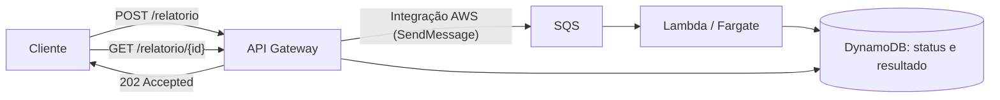

---
aliases:
  - Aula 16.6
modulo: 16
aula: 6
parte: "V Arquiteturas modernas"
dominios:
  - 1
  - 2
  - 3
lida: false
tags:
  - aula
  - saa-c03
  - modulo-16
---

# Aula 16.6: API Gateway, tipos, endpoints e integrações

[[16 - Serverless Lambda e API Gateway|Voltar ao módulo]]

> [!question] Pergunta que esta aula responde
> Por que existe um serviço só para ser a porta de entrada [[HTTP]], quais são os três tipos de API (REST, HTTP e WebSocket), o que muda entre endpoint edge-optimized, regional e private, e como o [[API Gateway]] se conecta a Lambda, a serviços AWS e a backends em [[VPC]]?

## O problema: uma função não é uma API

Você já viu que uma [[Lambda]] pode ter uma [[Function URL|function URL]] (Aula 16.4). Mas uma API de produção precisa de coisas que a função não oferece: autenticação de vários tipos, limite de requisições por cliente, versões e ambientes (dev, prod), validação do corpo antes de gastar execução, transformação de dados, cache de respostas, domínio próprio e métricas por rota. Se cada função implementasse isso, seriam dezenas de cópias do mesmo código.

O **[[API Gateway|Amazon API Gateway]]** é o serviço gerenciado que **publica, protege, monitora e escala APIs** em qualquer volume. Ele fica na frente do backend (Lambda, um serviço [[HTTP]], um serviço AWS) e cuida da camada de borda da API. Em termos de arquitetura é o **front door** de uma aplicação [[Serverless|serverless]] e entra na lista de serviços do domínio de front-end do exam guide.

> [!info] Ligando os pontos
> No [[12 - Balanceamento de Carga e Auto Scaling|Módulo 12]] o [[Application Load Balancer]] também recebe [[HTTP]] e roteia para Lambda. A diferença: o ALB é um balanceador (distribui tráfego, cobrado por hora e [[LCU]]); o [[API Gateway]] é um gerenciador de APIs (autorização, [[Throttling|throttling]], cache, transformação, cobrado por requisição). Escala a zero e pagamento por requisição apontam para API Gateway.

## Os três tipos de API

| Tipo | Para quê | Protocolo |
|---|---|---|
| **REST API** | API completa, com recursos de gestão: API keys, usage plans, cache, [[WAF]], validação, transformação, canary, endpoints private | [[HTTP]] request/response |
| **[[HTTP]] API** | API mais simples e **mais barata**, com menos recursos, boa para proxy a Lambda ou HTTP | HTTP request/response |
| **WebSocket API** | Comunicação **bidirecional** e persistente (servidor empurra mensagens ao cliente) | WebSocket |

A documentação resume a escolha (verificado em novembro de 2026): **REST** quando você precisa de recursos como API keys, [[Throttling|throttling]] por cliente, validação de requisição, integração com [[WAF|AWS WAF]] ou endpoints privados; **[[HTTP]]** quando você não precisa deles e quer preço menor. Todos os tipos compartilham o limite de 10.000 requisições por segundo por conta e Região (com burst) descrito mais adiante.

### REST versus HTTP em detalhe

| Recurso | REST API | [[HTTP]] API |
|---|---|---|
| Endpoint edge-optimized | Sim | Não |
| Endpoint regional | Sim | Sim |
| Endpoint private | Sim | Não |
| [[WAF\|AWS WAF]] | Sim | Não |
| API keys e usage plans (limite por cliente) | Sim | Não |
| [[Cache]] de respostas | Sim | Não |
| Validação de requisição | Sim | Não |
| [[Canary Deployment\|Canary release]] | Sim | Não |
| [[Resource-Based Policy\|Resource policy]] | Sim | Não |
| [[X-Ray]] e execution logs | Sim | Não |
| [[IAM]], [[Cognito]], authorizer Lambda, [[JWT]] | Sim | Sim |
| Deploy automático | Não | Sim |
| Domínio customizado, [[CORS]], [[mTLS]] | Sim | Sim |
| Preço | Maior | Menor |

> [!tip] Macete para a prova
> Se o enunciado pede **API keys, usage plans, cache, [[WAF]], canary, endpoint privado ou validação de requisição**, a resposta é **REST API**. Se pede "lowest cost" e nada disso, é **[[HTTP]] API**. Se pede **mensagens do servidor para o cliente em tempo real** (chat, cotação ao vivo, notificações), é **WebSocket API**.

> [!example] Exemplo: dois produtos, duas escolhas
> A API pública que a empresa vende para parceiros precisa de chave por cliente, cota mensal de 100 mil chamadas e proteção com [[WAF]]: **REST API**. O backend do app móvel só precisa autenticar com [[Cognito]] e chamar Lambdas pelo menor preço: **[[HTTP]] API**.

## Tipos de endpoint (REST API)

O **tipo de endpoint** define o nome de host da API e por onde o tráfego chega (verificado em novembro de 2026):

| Endpoint | Como funciona | Quando usar |
|---|---|---|
| **Edge-optimized** (padrão da REST) | O tráfego entra na [[Edge Location]] da [[CloudFront]] mais próxima do cliente, por uma distribuição gerenciada pelo serviço, e segue pela rede da AWS até a API | Clientes espalhados pelo mundo |
| **Regional** | Endpoint na própria Região, sem [[CloudFront]] do serviço | Clientes na mesma Região; ou quando você usa **sua própria** distribuição CloudFront (mais controle de cache e [[WAF]]) |
| **Private** | Só acessível de dentro da [[VPC]] por um **[[Interface Endpoint\|interface endpoint]]** ([[PrivateLink]]) | APIs internas que não podem tocar a internet |

Detalhes que caem: a [[HTTP]] API só tem endpoint **regional**. Para endpoints regionais, o mesmo domínio customizado pode existir em várias [[Regiao AWS|Regiões]], o que combina com a [[Latency-Based Routing|política de latência]] do [[Route 53]] (Módulo 18). Em edge-optimized, o domínio customizado vale para todas as Regiões. A integração com um certificado do [[ACM]] para o domínio customizado segue as regras do Módulo 8 (para edge-optimized o certificado fica em us-east-1).

## Como uma requisição atravessa a API REST

Quatro etapas nomeadas, que aparecem em questões de transformação:

1. **Method request:** o que o cliente pode enviar (autorização, parâmetros, validação).
2. **Integration request:** como a requisição é traduzida para o backend (mapeamento de dados).
3. Chamada ao **backend** (a integração).
4. **Integration response** e **method response:** como a resposta volta e é entregue ao cliente.

Cada API é implantada em um **stage** (por exemplo `dev`, `prod`): um deployment de um estado da API, com sua própria URL, variáveis de stage, configuração de [[Throttling|throttling]] e cache (Aula 16.7). Em REST, mudanças só valem depois de um **deployment** novo para o stage; [[HTTP]] APIs oferecem deploy automático.

## Tipos de integração

A **integração** liga a rota ao backend. A documentação lista cinco tipos (verificado em novembro de 2026):

| Tipo (`type`) | O que faz | Observação |
|---|---|---|
| **`AWS_PROXY`** (Lambda proxy) | Passa a requisição inteira para a [[Lambda\|função Lambda]], que devolve a resposta completa | O mais simples e **recomendado** para Lambda; sem mapeamento |
| **`AWS`** (Lambda custom ou outros serviços AWS) | Você configura integration request e response e os mapeamentos | Permite chamar serviços AWS **sem Lambda** |
| **`HTTP_PROXY`** | Repassa a requisição a um endpoint [[HTTP]] | Mais simples |
| **`HTTP`** | Integração [[HTTP]] com mapeamentos | Reuso de templates |
| **`MOCK`** | O próprio [[API Gateway]] responde | Testes e respostas fixas |

### Lambda proxy

Na integração proxy o [[API Gateway]] entrega um evento padronizado (método, caminho, cabeçalhos, parâmetros, corpo) à função, e a função devolve um objeto com `statusCode`, `headers` e `body`. Você não configura mapeamento. A permissão para o API Gateway invocar a função é uma [[Resource-Based Policy]] na função (Aula 16.1).

### Serviço AWS direto, sem Lambda

Com a integração `AWS` o [[API Gateway]] chama serviços AWS diretamente, por exemplo gravar no [[DynamoDB]], colocar mensagem no [[SQS]] ou iniciar uma execução do [[Step Functions]]. Isso **elimina uma função** (menos custo, menos [[Latencia|latência]], menos código). É a resposta quando o enunciado diz "without writing code" ou "reduce [[Overhead Operacional|operational overhead]]" para um caso simples de gravar ou enfileirar.

### Backends privados (VPC link)

Para expor um serviço dentro da [[VPC]] (por exemplo, tarefas [[Fargate]] atrás de um balanceador interno) sem abri-lo à internet, o [[API Gateway]] usa um **VPC link**, uma conexão privada com um recurso na sua VPC. Fato verificado em novembro de 2026: o **VPC link V2** permite que REST APIs e [[HTTP]] APIs apontem para um **[[Application Load Balancer]]** ou **[[Network Load Balancer]]** e, só na HTTP API, também para **AWS Cloud Map**; o **VPC link V1** (legado, REST) exigia um **Network [[Elastic Load Balancing|Load Balancer]]**. Por isso simulados antigos citam "NLB". O VPC link V2 fica INACTIVE depois de 60 dias sem tráfego.

## Tempo limite e tamanho: o gargalo que cai na prova

| Limite | Valor (verificado em novembro de 2026) |
|---|---|
| Tempo de integração, REST API | 50 ms a **29 segundos** por padrão |
| Tempo de integração, [[HTTP]] API | máximo de **30 segundos** (não aumentável) |
| Payload, REST API | **10 MB** (não aumentável) |
| Tempo ocioso de conexão, REST | 310 segundos |
| Limite de requisições por conta e Região | **10.000 por segundo**, burst de 5.000 (2.500 e 1.250 em algumas [[Regiao AWS\|Regiões]]; aumentável) |

Para REST regional e privada o limite de 29 s **pode ser aumentado**, com o aviso da documentação de que isso pode exigir **reduzir o limite de [[Throttling|throttling]] da conta na Região**; em endpoints edge-optimized não aumenta.

**Consequência arquitetural:** uma [[Lambda|função Lambda]] pode rodar até 30 minutos, mas o cliente atrás do [[API Gateway]] espera cerca de 29 segundos. Para trabalho longo, **não faça o cliente esperar**: aceite o pedido e responda 202, processe de forma assíncrona e deixe o cliente consultar o resultado ou receber um push.

Variações do mesmo padrão: **WebSocket** para empurrar o resultado ao cliente quando pronto; **[[Step Functions]]** para [[Orquestracao|orquestrar]] o processamento; **notificação** por [[SNS]] ou e-mail.

### Códigos de erro que o API Gateway devolve

Diagnosticar pelo código de status é pegadinha clássica. Distinga quem gerou o erro (verificado em novembro de 2026 na documentação do [[API Gateway]] e do Lambda):

| Código | Causa típica | Onde olhar |
|---|---|---|
| **401** | Token ausente ou inválido no authorizer ([[Cognito]]/JWT/Lambda) | Cabeçalho `Authorization` e configuração do authorizer |
| **403** | Authorizer negou a política, [[WAF]] bloqueou, [[Resource-Based Policy\|resource policy]] negou ou falta permissão [[IAM]] (`execute-api:Invoke`) | Políticas, WAF e resource policy |
| **429** | [[Throttling]] do [[API Gateway]] (limite da conta, do stage ou do [[Usage Plan\|usage plan]]) | Usage plan e limites; cliente com backoff |
| **502 Bad Gateway** | Resposta **malformada** do backend: com Lambda proxy, a função devolveu algo sem o formato esperado (`statusCode`, `headers`, `body`) ou lançou erro; também falha de integração | Logs da função e formato da resposta |
| **504 Gateway [[Timeout]]** | A integração excedeu o tempo limite (29 s por padrão em REST, 30 s em [[HTTP]] API) | Duração da função e padrão assíncrono |

> [!tip] Macete para a prova
> "API returns 502 with Lambda proxy" aponta **formato de resposta inválido** da função, não falta de capacidade. "Returns 504 after about 29 seconds" aponta **[[Timeout|timeout]] de integração**; a saída é arquitetura assíncrona, não aumentar a memória. "429" é [[Throttling|throttling]], não erro da função. Na [[Observabilidade]] (Aula 16.7), 4XX e 5XX aparecem separados no [[CloudWatch]].

## WebSocket API

Uma API REST é pergunta e resposta; o servidor nunca fala primeiro. O **WebSocket** mantém uma conexão aberta e permite mensagens nos dois sentidos, o que serve para chat, painéis em tempo real, jogos multiusuário e notificações.

- **Rotas:** o [[API Gateway]] usa uma *route selection expression* para decidir o destino de cada mensagem; existem rotas especiais `$connect`, `$disconnect` e `$default`.
- Para o backend **enviar** uma mensagem a um cliente conectado, usa-se a API de gerenciamento de conexões (`@connections`).
- O estado das conexões (quem está conectado) precisa ser guardado em um banco, em geral [[DynamoDB]], porque o [[API Gateway]] e as funções são [[Stateless]].
- **Limites** (verificado em novembro de 2026): conexão de até **2 horas**; ociosa por até **10 minutos**; mensagem de até **128 KB** com quadros de até **32 KB**; 500 novas conexões por segundo por conta e Região, aumentável.

## Como isso cai na prova

Cobertura: **Task 2.1** (design de APIs e arquiteturas desacopladas), **Task 1.2** (proteção na borda: private, [[WAF]]) e **Task 3.2** ([[Serverless|computação serverless]]).

**Palavras-chave em inglês:**
- "REST API", "API keys", "[[Usage Plan|usage plan]]", "caching", "request validation", "canary" puxam **[[API Gateway]] REST**.
- "Lowest cost [[HTTP]] API", "[[JWT]]", "simple proxy to Lambda" puxam **HTTP API**.
- "Real-time two-way communication", "server pushes updates", "chat" puxam **WebSocket API**.
- "Clients are globally distributed" puxa **edge-optimized**; "internal only, inside [[VPC]]" puxa **private API**.
- "Long-running request behind [[API Gateway]]", "[[Timeout|timeout]] of 29 seconds" puxam **padrão assíncrono** ([[SQS]], [[Step Functions]], 202).
- "Without Lambda", "directly write to [[DynamoDB]]/SQS from API" puxam **integração com serviço AWS**.

**Pegadinhas clássicas:**
- [[HTTP]] API **não** tem [[WAF]], API keys nem cache; se o enunciado pede qualquer um, é REST.
- O limite de 29 segundos vale mesmo que o Lambda tenha [[Timeout|timeout]] maior.
- Private API é acessada pela [[VPC]] via **[[Interface Endpoint|interface endpoint]]**, não por [[Internet Gateway]].
- Edge-optimized usa a [[CloudFront]] **gerenciada pelo serviço**, não a distribuição da sua conta.
- API key não é mecanismo de autenticação (Aula 16.7).

| Requisito no enunciado | Resposta provável | Por quê |
|---|---|---|
| API para parceiros com chave e cota por cliente | REST API com usage plans e API keys | Só a REST tem |
| App móvel, [[Cognito]], menor custo, sem recursos avançados | [[HTTP]] API | Mais barata |
| Atualizações em tempo real do servidor para o navegador | WebSocket API | Conexão bidirecional |
| API interna que não pode ser acessível da internet | REST API private com [[Interface Endpoint\|interface endpoint]] | Só acessível da [[VPC]] |
| Clientes em vários continentes, API REST | Endpoint edge-optimized | Entrada na [[Edge Location\|edge location]] mais próxima |
| Receber um pedido e gravar na fila, sem código | Integração AWS com [[SQS]] | Elimina a função |
| Expor [[Fargate]]/ECS em [[Sub-rede Privada\|sub-rede privada]] pelo [[API Gateway]] | [[VPC]] link para o balanceador interno ([[Application Load Balancer\|ALB]] ou [[Network Load Balancer\|NLB]]) | O serviço não é aberto à internet |
| API REST com Lambda proxy devolve 502 | Corrigir o formato da resposta da função (`statusCode`, `headers`, `body`) | 502 indica resposta malformada do backend |
| Clientes recebem 504 perto de 29 s | Arquitetura assíncrona (202, fila ou [[Step Functions]]) | [[Timeout]] de integração |
| Processamento de 10 minutos disparado por requisição | API responde 202, processa assíncrono | Cliente não espera além de 29 s |

## Resumo

> [!abstract] A aula em uma frase
> O [[API Gateway]] é a porta de entrada gerenciada de APIs: escolha REST para recursos de gestão, [[HTTP]] para menor custo e WebSocket para mensagens bidirecionais, ajuste o tipo de endpoint à origem dos clientes e lembre que o cliente espera cerca de 29 segundos.

**A lógica, em 5 passos**
1. Uma função não gerencia uma API; o [[API Gateway]] cuida de autorização, limites, cache e versões.
2. Escolha o tipo: REST (completo), [[HTTP]] (barato) ou WebSocket (bidirecional).
3. Escolha o endpoint: edge-optimized (global), regional (mesma Região) ou private (só [[VPC]]).
4. Escolha a integração: Lambda proxy, serviço AWS direto, [[HTTP]]/proxy, [[VPC]] link.
5. Trabalho longo usa 202 e processamento assíncrono, não espera síncrona.

**Números para lembrar**

| O quê | Valor | Por que importa |
|---|---|---|
| Tempo de integração REST | 29 s por padrão | Corta tarefas longas |
| Tempo máximo [[HTTP]] API | 30 s | Também limitado |
| Payload REST | 10 MB | Arquivos grandes vão ao [[S3]] por URL assinada |
| Limite da conta | 10.000 RPS, burst 5.000 | Pode ser menor ou maior que a concorrência do Lambda |
| WebSocket: conexão e ociosidade | 2 h e 10 min | Cliente precisa reconectar |
| WebSocket: mensagem e quadro | 128 KB e 32 KB | Divida mensagens maiores |

**Na prática, isso significa**
- Recursos de gestão (chave, cota, cache, [[WAF]]) exigem REST.
- Para cargas curtas e baratas, [[HTTP]] API.
- Prefira Lambda proxy; use a integração `AWS` quando puder dispensar a função.
- Desenhe processos longos como assíncronos.

> [!tip] Liga com
> Vem da [[16.04 - Lambda em VPC RDS Proxy e Function URLs|Aula 16.4]] ([[Function URL|function URL]] versus [[API Gateway]]) e do [[12 - Balanceamento de Carga e Auto Scaling|Módulo 12]] ([[Application Load Balancer|ALB]]). Leva à [[16.07 - API Gateway Seguranca Throttling Cache e CORS|Aula 16.7]] (segurança, [[Throttling|throttling]] e cache) e ao [[18 - Borda e DNS CloudFront Global Accelerator e Route 53|Módulo 18]] ([[CloudFront]]).

## Erros comuns

- Escolher [[HTTP]] API e depois descobrir que precisa de [[WAF]] ou usage plans.
- Esperar que o [[API Gateway]] aguarde um Lambda de 10 minutos.
- Achar que endpoint private é acessível de fora da [[VPC]].
- Usar edge-optimized para clientes só da mesma Região e pagar a complexidade extra.
- Chamar Lambda só para gravar no [[DynamoDB]] quando a integração direta bastaria.
- Esquecer que o WebSocket não guarda estado de conexões.

## Pratique

**1.** Uma empresa vende uma API a parceiros, com chave por cliente, cota mensal e proteção contra ataques web. Qual opção atende?

- [ ] a) HTTP API com autorizador JWT e limites de taxa configurados por rota.
- [ ] b) REST API com API keys, usage plans e AWS WAF.
- [ ] c) WebSocket API com rota $default.
- [ ] d) Application Load Balancer com target do tipo Lambda.

**2.** Uma API simples para app móvel só precisa de autorização com [[Cognito]] e chamadas a [[Lambda|funções Lambda]], com o menor custo possível. O que usar?

- [ ] a) REST API edge-optimized com cache habilitado.
- [ ] b) REST API privada com interface endpoint.
- [ ] c) WebSocket API com autorizador Lambda.
- [ ] d) HTTP API com autorizador JWT.

**3.** Um painel de ações precisa que o servidor envie cotações ao navegador assim que mudarem. Qual serviço atende?

- [ ] a) REST API do API Gateway com polling a cada segundo.
- [ ] b) WebSocket API do API Gateway.
- [ ] c) Function URL com resposta em lote.
- [ ] d) HTTP API com integração MOCK.

**4.** Uma API interna só deve ser acessada por aplicações dentro de uma [[VPC]], sem passar pela internet. Qual configuração atende?

- [ ] a) REST API regional com security group aplicado na própria API.
- [ ] b) HTTP API com domínio customizado e certificado do ACM.
- [ ] c) REST API private com interface endpoint na VPC.
- [ ] d) REST API edge-optimized com AWS WAF associado à distribuição.

**5.** Quais DUAS afirmações sobre [[HTTP]] APIs estão corretas em comparação com REST APIs? (Escolha DUAS.)

- [ ] a) Têm preço menor, voltado a casos sem recursos avançados.
- [ ] b) Suportam AWS WAF diretamente.
- [ ] c) Oferecem endpoint regional, mas não edge-optimized nem private.
- [ ] d) Suportam API keys e usage plans.
- [ ] e) Incluem cache de respostas por stage.

**6.** Um cliente em Tóquio, um em São Paulo e um em Frankfurt consomem uma API REST hospedada em uma única Região. A equipe quer reduzir a [[Latencia|latência]] de entrada com o MENOR esforço. O que escolher?

- [ ] a) Criar APIs idênticas em 20 Regiões, sem roteamento.
- [ ] b) Endpoint edge-optimized (padrão da REST).
- [ ] c) API regional na Região de origem, com uma distribuição CloudFront própria criada e mantida pela equipe.
- [ ] d) Endpoint private com VPN.

**7.** Uma [[Lambda|função Lambda]] tem [[Timeout|timeout]] de 10 minutos e é chamada por uma REST API com configuração padrão. O que acontece em uma execução de 5 minutos?

- [ ] a) O cliente recebe a resposta normalmente após os 5 minutos de execução.
- [ ] b) O API Gateway devolve 429 ao cliente, porque a função excede a concorrência da conta.
- [ ] c) Erro de timeout por volta de 29 segundos, embora a função continue.
- [ ] d) O API Gateway aumenta o limite para 10 minutos de forma automática.

**8.** Uma API recebe pedidos de relatório que levam de 5 a 15 minutos. O cliente não precisa do resultado imediato. Qual desenho respeita as limitações do [[API Gateway]]?

- [ ] a) Aumentar o timeout da REST edge-optimized para 15 minutos.
- [ ] b) Retornar 202 ao cliente, enfileirar no SQS e processar assíncrono.
- [ ] c) Usar HTTP API, que aceita até 15 minutos.
- [ ] d) Manter o cliente conectado por WebSocket sem fila nem armazenamento de estado.

**9.** Uma API só precisa gravar o corpo da requisição em uma tabela [[DynamoDB]], sem lógica. Qual opção reduz custo e código?

- [ ] a) Lambda proxy que chama PutItem.
- [ ] b) Container no Fargate que recebe e grava.
- [ ] c) Instância EC2 com serviço HTTP.
- [ ] d) Integração do API Gateway com DynamoDB, sem Lambda.

**10.** Quais DUAS afirmações sobre WebSocket APIs estão corretas? (Escolha DUAS.)

- [ ] a) Permitem ao servidor enviar mensagens aos clientes conectados.
- [ ] b) Mantêm o estado das conexões dentro do próprio API Gateway, sem necessidade de banco.
- [ ] c) Têm conexão máxima de 2 horas e ociosidade máxima de 10 minutos.
- [ ] d) Aceitam mensagens de qualquer tamanho sem divisão em quadros.
- [ ] e) São a única opção para chamar funções Lambda.

**11.** Uma equipe quer que a [[Lambda|função Lambda]] receba a requisição inteira (método, cabeçalhos, parâmetros e corpo) e devolva a resposta completa, sem configurar templates de mapeamento, com o MENOR esforço. Qual integração usar?

- [ ] a) Integração AWS (custom) com mapping templates.
- [ ] b) Integração HTTP com mapping templates.
- [ ] c) Integração Lambda proxy (AWS_PROXY).
- [ ] d) Integração MOCK.

**12.** Um app envia uploads de 15 MB por POST a uma REST API que chama uma [[Lambda|função Lambda]], e as requisições falham. Qual é a solução?

- [ ] a) Pedir aumento do limite de payload da API para 20 MB por Service Quotas.
- [ ] b) Trocar a REST API por uma HTTP API, que aceita corpos maiores.
- [ ] c) Entregar ao cliente uma URL assinada do S3 para o upload direto e processar pelo evento do S3.
- [ ] d) Aumentar a memória da função para 10.240 MB, o que amplia o payload aceito.

**13.** Uma REST API com Lambda proxy devolve 502 Bad Gateway em algumas requisições, e os logs da função mostram que ela terminou sem erro, devolvendo apenas a string `ok`. Qual é a causa mais provável?

- [ ] a) A função não devolveu o formato esperado pela integração proxy (objeto com `statusCode`, `headers` e `body`), e o API Gateway responde 502.
- [ ] b) O limite de requisições da conta foi excedido, e o API Gateway responde 502 em vez de 429.
- [ ] c) A integração excedeu o tempo limite de 29 segundos, e o API Gateway responde 502 em vez de 504.
- [ ] d) O authorizer negou a política da requisição, e o API Gateway responde 502 em vez de 403.

> [!success]- Gabarito
> **1. b)** só a REST tem API keys, usage plans e [[WAF]]; a limita por rota, não por cliente, e a [[HTTP]] API não aceita WAF; c é para tempo real; d balanceia sem gestão de cota por cliente.
> **2. d)** [[HTTP]] API tem preço menor e suporta [[JWT]] e [[Cognito]]; a e b são REST mais caras e com recursos não pedidos; c é para comunicação bidirecional.
> **3. b)** WebSocket permite o servidor empurrar dados; a usa polling, ineficiente; c não mantém conexão; d só devolve respostas fixas.
> **4. c)** private API com [[Interface Endpoint|interface endpoint]] só é acessível da [[VPC]]; a e d são acessíveis pela internet; b é regional público.
> **5. a) e c)** [[HTTP]] API é mais barata e só tem endpoint regional; b, d e e são recursos exclusivos da REST.
> **6. b)** edge-optimized entra pela [[Edge Location|edge location]] mais próxima e já é o padrão da REST; a é esforço enorme; c funciona, mas exige criar e operar sua própria distribuição [[CloudFront]]; d é para acesso privado.
> **7. c)** o [[API Gateway]] espera cerca de 29 segundos, mesmo que o Lambda continue; a ignora o limite; b erra porque 429 é [[Throttling|throttling]] e a função nem estourou concorrência; d não ocorre automaticamente.
> **8. b)** 202 mais fila mais processamento assíncrono evita a espera; a não é possível em edge-optimized e arriscaria o throttle; c erra, o máximo é 30 segundos; d perde o trabalho se a conexão cair.
> **9. d)** a integração direta com [[DynamoDB]] dispensa função, servidor e código; a, b e c adicionam componentes.
> **10. a) e c)** o servidor pode enviar mensagens e os limites de 2 h e 10 min são reais; b erra, o estado fica em um banco; d erra, o quadro máximo é de 32 KB; e é falso.
> **11. c)** a integração proxy repassa a requisição inteira sem mapeamento; a e b exigem templates; d não chama Lambda.
> **12. c)** o payload da REST API é de 10 MB e não aumenta, então arquivos grandes vão direto ao [[S3]] por URL assinada; a erra porque o limite não é aumentável; b erra porque a [[HTTP]] API também limita o corpo a 10 MB; d erra porque a memória da função não altera o limite da API.
> **13. a)** com proxy, uma resposta sem o formato esperado (aqui, uma string solta) gera 502; b seria 429; c seria 504; d seria 403.

### Laboratório (opcional): HTTP API na frente de uma função

> [!warning] Use uma conta AWS pessoal separada
> **[[Conta AWS]] pessoal separada**, com [[Budgets]] configurado, **nunca a conta de produção da empresa**. Custo estimado: centavos. O comando `aws apigatewayv2 create-api` com `--protocol-type` e `--target` foi confirmado na referência da AWS CLI em novembro de 2026.

1. Crie a função `saa-lab-hello` repetindo os passos 3 e 4 do laboratório da Aula 16.1 (a role pode ser reutilizada). Para a [[HTTP]] API com proxy, o handler deve devolver um objeto com `statusCode` e `body`.
2. Crie uma [[HTTP]] API: `aws apigatewayv2 create-api --name saa-lab-api --protocol-type HTTP --target <ARN da função>` (criação rápida com destino Lambda).
3. Dê permissão ao [[API Gateway]] para invocar a função: `aws lambda add-permission --function-name saa-lab-hello --statement-id apigw --action lambda:InvokeFunction --principal apigateway.amazonaws.com`.
4. Pegue o endpoint: `aws apigatewayv2 get-apis` e chame com `curl <ApiEndpoint>`.
5. Observe que a resposta depende do formato do evento que o handler recebe e devolve (proxy).
6. **Limpeza:** `aws apigatewayv2 delete-api --api-id <id>` e `aws lambda delete-function --function-name saa-lab-hello`.

## Para aprofundar

- [ ] [Choose between REST APIs and HTTP APIs](https://docs.aws.amazon.com/apigateway/latest/developerguide/http-api-vs-rest.html) (documentação AWS): tabela oficial de recursos por tipo de API.
- [ ] [API endpoint types for REST APIs in API Gateway](https://docs.aws.amazon.com/apigateway/latest/developerguide/api-gateway-api-endpoint-types.html) (documentação AWS): edge-optimized, regional e private.
- [ ] [Choose an API Gateway API integration type](https://docs.aws.amazon.com/apigateway/latest/developerguide/api-gateway-api-integration-types.html) (documentação AWS): AWS, AWS_PROXY, [[HTTP]], HTTP_PROXY e MOCK.
- [ ] [Troubleshoot Lambda function errors with an API Gateway API](https://docs.aws.amazon.com/lambda/latest/dg/services-apigateway-errors.html) (documentação AWS): quando o [[API Gateway]] devolve 502 por erro ou formato inválido da função.
- [ ] [Amazon API Gateway quotas](https://docs.aws.amazon.com/apigateway/latest/developerguide/limits.html) (documentação AWS): limites por conta e Região.

Próxima aula: [[16.07 - API Gateway Seguranca Throttling Cache e CORS|Aula 16.7: API Gateway, segurança, throttling, cache e CORS]].
