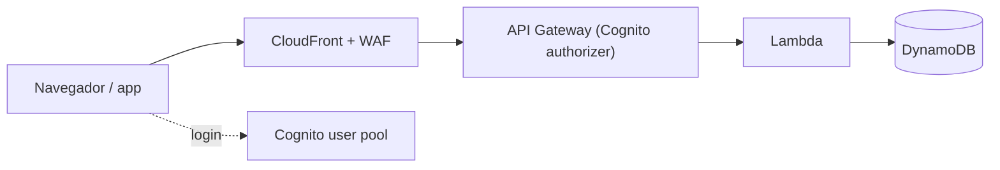

---
aliases:
  - Aula 16.8
modulo: 16
aula: 8
parte: "V Arquiteturas modernas"
dominios:
  - 1
  - 2
  - 3
  - 4
lida: false
tags:
  - aula
  - saa-c03
  - modulo-16
---

# Aula 16.8: Padrões serverless e ferramentas de front-end

[[16 - Serverless Lambda e API Gateway|Voltar ao módulo]]

> [!question] Pergunta que esta aula responde
> Como combinar Lambda, [[API Gateway]], [[DynamoDB]], [[S3]], filas e eventos nos padrões que a prova repete, quando o Lambda é a escolha errada, e para que servem [[Amplify]], [[Device Farm]], [[Serverless Application Repository]] e [[SAM]]?

## O problema: peças soltas não são arquitetura

Nas aulas anteriores você aprendeu cada peça. Uma questão de prova nunca pergunta "o que é o Lambda?". Ela descreve um sistema ("usuários enviam fotos, a empresa quer miniaturas e uma API de consulta, com o menor overhead") e pede a combinação. A habilidade é reconhecer um **padrão**: um arranjo de serviços que resolve uma família de problemas. Esta aula cataloga os padrões [[Serverless|serverless]], mostra o limite do Lambda e apresenta as ferramentas de front-end e implantação que fecham o módulo.

## Padrão 1: API serverless (API Gateway, Lambda, DynamoDB)

O padrão mais cobrado. Um cliente chama uma API; o [[API Gateway]] autentica e limita; o [[Lambda]] aplica a regra de negócio; o [[DynamoDB]] guarda os dados.

Por que funciona: nenhum componente tem servidor para gerenciar, cada camada escala sozinha e a cobrança é por requisição. O [[DynamoDB]] combina com Lambda porque **não exige conexões persistentes**, ao contrário do banco relacional (que pede [[RDS Proxy]], Aula 16.4). Variação para o site: o front-end estático fica em [[S3]] atrás da [[CloudFront]] ([[18 - Borda e DNS CloudFront Global Accelerator e Route 53|Módulo 18]]).

> [!example] Exemplo: lista de tarefas
> O app web em [[S3]] e [[CloudFront]] chama `POST /tarefas`. O [[API Gateway]] valida o [[JWT]] do [[Cognito]], a função grava o item no [[DynamoDB]] e responde. Às 3 da manhã o custo é praticamente zero; na segunda às 9h a AWS cria quantos ambientes forem necessários, até os limites de concorrência da conta.

## Padrão 2: S3 aciona Lambda

O [[S3]] publica uma notificação (objeto criado, removido etc.) que invoca o Lambda de forma **assíncrona** (Aula 16.2). Serve para gerar miniaturas, extrair texto, validar arquivos, catalogar metadados e iniciar fluxos.

- **Upload direto ao [[S3]]:** para não passar arquivos grandes pelo [[API Gateway]] (limite de payload de 10 MB) nem pelo Lambda (6 MB síncrono), a API entrega uma [[Presigned URL]] e o cliente envia o arquivo direto ao S3. O evento do S3 inicia o processamento.
- **Absorver picos:** para uploads em rajada, a notificação pode ir para uma fila [[SQS]] e o Lambda consome da fila, com [[Dead-Letter Queue|DLQ]] e concorrência limitada.
- **[[Idempotencia|Idempotência]] e laço:** se a função grava a saída no mesmo [[Bucket|bucket]] que a aciona, ela pode se invocar em laço; use prefixos distintos ou outro bucket.

## Padrão 3: fan-out com SNS e SQS

Um evento precisa disparar **vários** consumidores independentes. Publique no [[SNS]] e assine várias filas [[SQS]] (ou [[Lambda|funções Lambda]]): cada consumidor recebe sua cópia e falha de forma independente (Módulo 15). Ex.: "pedido confirmado" aciona faturamento, estoque e notificação, cada um com sua fila e sua [[Dead-Letter Queue|DLQ]].

## Padrão 4: fila como amortecedor (queue-based load leveling)

Produtor grava na fila; o Lambda consome em [[Processamento em Lote|lote]]; o ritmo é limitado pela concorrência configurada. Resolve três problemas de uma vez: picos (a fila absorve), proteção do banco (concorrência máxima) e perda de mensagens ([[Dead-Letter Queue|DLQ]]). É o padrão certo quando "o pico não pode derrubar o banco" ou "nenhum pedido pode ser perdido".

## Padrão 5: processamento de stream

O Lambda lê um stream do [[DynamoDB Streams]] ou do [[Kinesis Data Streams]] e reage a cada mudança, na ordem por shard (Aula 16.2): atualizar um índice de busca, replicar para outro lugar, alimentar métricas, enviar notificações. É o equivalente a "gatilhos de banco" no mundo [[Serverless|serverless]].

## Padrão 6: orquestração com Step Functions

Quando o fluxo tem **várias etapas, condições, esperas ou aprovação humana**, uma função que chama outra função fica frágil (falha no meio, estado perdido, custo de espera). O [[Step Functions]] orquestra funções e serviços como uma [[State Machine|máquina de estados]], com retry e catch declarativos (Módulo 15). Padrão correto para processamento longo: o cliente recebe 202, o Step Functions conduz as etapas, e um [[SNS]] avisa no fim.

## Padrão 7: tarefas agendadas e reações a eventos

O [[EventBridge]] (regras ou Scheduler) aciona o Lambda em horários (relatório às 6h) ou em resposta a eventos da própria AWS (instância parada, alerta do [[GuardDuty]], mudança de configuração no [[Config]]), o que dá **[[Remediacao Automatica|remediação automática]]**. Substitui o antigo servidor com `cron`.

## Padrão 8: tempo real com WebSocket

[[API Gateway]] WebSocket mais Lambda mais [[DynamoDB]] para guardar as conexões (Aula 16.6): chat, painéis ao vivo, notificações.

> [!info] Ligando os pontos
> Cada padrão combina serviços de **três famílias**: entrada ([[API Gateway]], [[S3]], [[EventBridge]]), computação (Lambda, [[Step Functions]]) e dados/mensageria ([[DynamoDB]], [[SQS]], [[SNS]]). Na prova, identifique primeiro a **entrada** do enunciado e depois a **falha tolerada** (perda, duplicidade, ordem); isso quase sempre elege o padrão.

## Quando NÃO usar Lambda

Saber recusar o Lambda vale tantos pontos quanto saber escolhê-lo. Ele **não** é a resposta quando:

| Situação | Por que o Lambda falha | Alternativa |
|---|---|---|
| Execução de horas | [[Timeout]] máximo de 30 minutos (documentação de novembro de 2026; simulados antigos: 15) | [[Fargate]], [[Batch]], [[EC2]], ou [[Step Functions]] dividindo o fluxo |
| Carga alta, constante e previsível 24 por 7 | GB-segundo de ambientes sempre ocupados custa mais que computação reservada | [[EC2]] ou [[Fargate]] com [[Savings Plans]] (Aula 16.5) |
| Conexões persistentes do próprio servidor (jogos, [[TCP]] longos) | O Lambda não mantém conexão ociosa; o ambiente some | [[API Gateway]] WebSocket, ou [[ECS]]/EC2 |
| Exigência de hardware ou SO específico (GPU, kernel, agente instalado) | Você não controla SO nem GPU | [[EC2]], [[ECS]] em EC2 |
| Aplicação monolítica legada [[Stateful e Stateless (Firewall)\|com estado]] local | Ambientes efêmeros e sem estado | [[Container\|Containers]] ou [[EC2]] ([[17 - Containers ECS EKS e Fargate|Módulo 17]]) |
| [[Latencia\|Latência]] estável de poucos milissegundos garantida em todas as chamadas | [[Cold Start\|Cold start]] pode ocorrer (mitigável, mas existe) | [[Fargate]]/EC2 sempre aquecidos, ou [[Concorrencia Provisionada\|concorrência provisionada]] |
| Payload síncrono acima de 6 MB | Limite da invocação | Upload ao [[S3]] com URL assinada |

### Tabela de decisão de computação (preview do Módulo 17)

| Critério | Lambda | [[Fargate]] | [[EC2]] |
|---|---|---|---|
| [[Overhead Operacional\|Overhead operacional]] | Mínimo | Baixo | Alto (patch, frota) |
| Escala a zero | Sim | Não (tarefas mínimas) | Não |
| Duração máxima | 30 min | Ilimitada | Ilimitada |
| Perfil de custo | Intermitente | Médio e constante | Alto e constante, com compromisso |
| Controle de SO e hardware | Nenhum | Limitado | Total |
| Pronto para evento | Nativo | Via serviço | Via serviço |

### Quatro formas de expor uma função por HTTP

A prova mistura estas opções como alternativas. Compare pelos quatro critérios:

| Critério | [[API Gateway]] REST | API Gateway [[HTTP]] | [[Application Load Balancer\|ALB]] com target Lambda | [[Function URL]] |
|---|---|---|---|---|
| Autenticação | [[IAM]], [[Cognito]], [[Lambda Authorizer\|Lambda authorizer]], [[Resource-Based Policy\|resource policy]] | IAM, [[JWT]], Lambda authorizer | [[OIDC]] e Cognito no [[Listener\|listener]] do [[Application Load Balancer\|ALB]] (mais regras de segurança de rede) | IAM ou nenhuma |
| Preço | Por requisição (o mais alto) | Por requisição (menor) | Por hora do [[Application Load Balancer\|ALB]] mais [[LCU]] | Sem custo adicional |
| Recursos | Usage plans, API keys, cache, [[WAF]], validação, canary | Proxy simples, [[CORS]], deploy automático | Roteamento por path e host, WAF, sem [[Throttling\|throttling]] por cliente nem cache próprio | Básicos, endpoint estável |
| Quando | API pública gerenciada, com cota e proteção | API barata, [[JWT]], sem [[WAF]] direto | Já existe [[Application Load Balancer\|ALB]] com outros alvos ([[EC2]], [[Container\|containers]]) e a função entra como mais um | Webhook, protótipo, uso interno |

Duas notas de prova. Primeira: o [[Application Load Balancer|ALB]] invoca o Lambda de forma **síncrona**; ele serve quando você quer misturar funções e instâncias atrás do mesmo balanceador, não quando precisa de gestão de API. Segunda: gravar **direto no [[DynamoDB]] sem Lambda** é recurso da **REST API** (integração `AWS` com mapping template); a **[[HTTP]] API** tem integrações de primeira classe com **[[SQS]], [[EventBridge]], Kinesis e [[Step Functions]]**, mas não com DynamoDB (verificado em novembro de 2026 na documentação de integrações da HTTP API).

> [!info] Na borda: Lambda@Edge e CloudFront Functions
> Para executar código perto do usuário, sem chegar à Região, existem o **[[CloudFront Functions]]** (JavaScript leve, tempo de execução em submilissegundos, só manipulação simples de requisição e resposta) e o **[[Lambda@Edge]]** ([[Lambda|funções Lambda]] mais completas, executadas nas [[Edge Location|edge locations]]). Quando o requisito é "reescrever URL ou cabeçalho em escala de milhões de requisições, o mais barato", pense em [[CloudFront]] Functions; para lógica mais pesada, Lambda@Edge. O detalhe vem no [[18 - Borda e DNS CloudFront Global Accelerator e Route 53|Módulo 18]].

## Front-end e mobile: Amplify, Device Farm, Serverless Application Repository e SAM

Quatro serviços do exam guide que costumam aparecer como alternativa curta e específica.

### AWS Amplify

O **[[Amplify]]** ajuda desenvolvedores de front-end e mobile a **construir, hospedar e conectar** aplicações web e mobile na AWS sem dominar cada serviço. A documentação descreve duas frentes (verificado em novembro de 2026):

- **[[Amplify|Amplify Hosting]]:** fluxo baseado em **Git** com **deploy contínuo**: você conecta um repositório (GitHub, Bitbucket, GitLab ou AWS CodeCommit), e cada push compila e publica o app na **[[CDN]]** global da AWS. Suporta frameworks SSR (Next.js, Nuxt, entre outros), SPA (React, Angular, Vue.js, Ionic, Ember) e geradores estáticos. Recursos: branches de funcionalidade (ambientes por branch), domínio personalizado, **pull request previews**, testes ponta a ponta, proteção por senha, redirects e **deploys atômicos** (o site só atualiza quando o deploy termina inteiro).
- **Backend ([[Amplify|Amplify Gen 2]]):** experiência **code-first em TypeScript** para definir dados, autenticação e funções, que o Amplify provisiona na AWS. O Amplify Auth usa o [[Cognito]] e o Amplify Data expõe uma API GraphQL ([[AppSync]]) sobre o [[DynamoDB]] (verificado em novembro de 2026 na documentação do Amplify).

Hook de prova: "front-end developers want to deploy a React/Angular app with CI/CD from a Git repository, with minimal infrastructure knowledge" aponta **[[Amplify]]**. Para controle fino de cache e comportamento por origem, [[S3]] mais [[CloudFront]] montados à mão; para simplicidade e fluxo Git, Amplify.

### AWS AppSync (GraphQL) versus API Gateway

O **[[AppSync|AWS AppSync]]** é um serviço gerenciado de API **GraphQL**: o cliente pede exatamente os campos que quer, em uma só chamada, e pode **assinar mudanças em tempo real** (subscriptions), com resolvers que ligam a API a [[DynamoDB]], Lambda e outras fontes. Ele não está na lista oficial de serviços do exam guide, mas aparece como alternativa. O [[API Gateway]], por sua vez, publica APIs **REST, [[HTTP]] e WebSocket**. Hook de prova: "GraphQL" ou "sincronizar dados em tempo real para um app móvel, com um único endpoint de consulta" aponta **AppSync**; "REST com usage plans e cache" aponta API Gateway. O AppSync também é um dos alvos de [[WAF]] que o [[19 - Seguranca de Aplicacoes e Deteccao de Ameacas|Módulo 19]] cita.

### AWS Device Farm

O **[[Device Farm]]** é um serviço de **teste de apps** em **dispositivos físicos reais** (Android, iOS e web) hospedados pela AWS. Dois modos (verificado em novembro de 2026): **acesso remoto**, interativo no navegador ou com Appium a partir da sua máquina (sessões de até 150 minutos), e **testes automatizados** em vários dispositivos em paralelo, com relatório de resultados, logs e capturas de tela. Os hosts de teste podem se conectar à sua [[VPC]] para alcançar endpoints privados. A documentação indica que o serviço está disponível somente na Região `us-west-2` (Oregon).

Hook de prova: "test a mobile app on many real device models/OS versions without buying devices" aponta **[[Device Farm]]**.

### Serverless Application Repository e SAM

O **[[Serverless Application Repository]]** (SAR) é um catálogo para **encontrar, implantar e publicar** aplicações [[Serverless|serverless]], públicas ou privadas (dentro da equipe ou da organização), integrado ao console do Lambda. O aplicativo é descrito por um manifesto: um **template [[SAM]]**.

O **[[SAM]]** (*AWS [[Serverless]] Application Model*) é um framework de código aberto de **[[Infraestrutura como Codigo|infraestrutura como código]]** para serverless: uma **extensão do [[CloudFormation]]** com sintaxe abreviada para funções, APIs, tabelas [[DynamoDB]] e outros recursos, que se transforma em CloudFormation na implantação. Vem com a **SAM CLI**, que testa funções localmente, simula endpoints do [[API Gateway]] e implanta. Para quem usa OpenTofu/Terraform no dia a dia, SAM ocupa um lugar equivalente para serverless; **na prova a linguagem de IaC é CloudFormation (e SAM)**.

> [!example] Exemplo: reaproveitar um aplicativo pronto
> A equipe precisa de um processador de logs. No [[Serverless Application Repository|SAR]] ela encontra um aplicativo publicado, revisa o template [[SAM]] e o implanta com alguns parâmetros em vez de escrever as funções do zero. Se quiser compartilhar internamente o que construiu, publica de forma privada no SAR.

## Como isso cai na prova

Cobertura: **Task 2.1** (arquiteturas [[Serverless|serverless]], event-driven, desacopladas), **Task 3.2** (computação para cada carga), **Task 4.2** (custo: Lambda versus computação constante) e **Task 1.2** (proteção na borda).

**Palavras-chave em inglês:**
- "[[Serverless]]", "no infrastructure management", "event-driven", "automatically scales" puxam o padrão com Lambda.
- "Upload files to [[S3]] and process them" puxa **S3 event notification → Lambda** (com URL assinada).
- "Notify multiple systems / multiple consumers" puxa **[[SNS]] [[Fan-out|fan-out]]**.
- "Process in order, react to table changes" puxa **[[DynamoDB Streams]] → Lambda**.
- "Workflow with branching and retries" puxa **[[Step Functions]]**.
- "Front-end developers", "Git-based CI/CD for web app", "mobile app backend with minimal AWS knowledge" puxam **[[Amplify]]**.
- "Test on real devices" puxa **[[Device Farm]]**.
- "Find and deploy a prebuilt [[Serverless|serverless]] app" puxa **[[Serverless Application Repository]]**; "define serverless resources as code" puxa **[[SAM]]**.
- "Job runs for hours", "constant high load" tiram Lambda.

**Pegadinhas clássicas:**
- Lambda não resolve processos acima de 30 minutos nem carga constante e alta de forma barata.
- Escrever a saída no mesmo [[Bucket|bucket]] que dispara a função cria laço.
- Passar arquivos grandes pelo [[API Gateway]] ou pelo Lambda em vez de URL assinada.
- Escolher [[Amplify]] quando o requisito é controle fino de [[CDN]], ou o contrário.
- [[Device Farm]] testa em dispositivos reais; não é um emulador local.

| Requisito no enunciado | Resposta provável | Por quê |
|---|---|---|
| Fotos enviadas ao [[S3]] precisam de miniatura, [[Serverless\|sem servidor]] | S3 → Lambda | Evento assíncrono e pagamento por uso |
| Pedido confirmado deve acionar 3 sistemas independentes | [[SNS]] com 3 filas [[SQS]] | [[Fan-out]] com isolamento de falhas |
| Pico de pedidos não pode derrubar o banco | [[SQS]] + Lambda com concorrência máxima | A fila absorve e a concorrência limita |
| Fluxo com 5 etapas, retry e espera por aprovação humana | [[Step Functions]] | [[Orquestracao\|Orquestração]] [[Stateful e Stateless (Firewall)\|com estado]] |
| Processamento contínuo de 4 horas | [[Fargate]] ou Batch | Passa do [[Timeout\|timeout]] do Lambda |
| Time de front-end quer CI/CD do React a partir do Git | [[Amplify\|Amplify Hosting]] | Fluxo Git com [[CDN]] integrado |
| Testar o app em 50 modelos reais de celular | [[Device Farm]] | Dispositivos físicos na nuvem |
| Definir API, função e tabela como código [[Serverless\|serverless]] | [[SAM]] (ou [[CloudFormation]]) | Sintaxe abreviada sobre CloudFormation |

## Resumo

> [!abstract] A aula em uma frase
> Padrões [[Serverless|serverless]] combinam entrada, computação e dados (API + Lambda + [[DynamoDB]], [[S3]] + Lambda, [[Fan-out|fan-out]], fila amortecedora, stream, [[Step Functions]]), o Lambda é a escolha errada para jobs de horas e carga constante, e [[Amplify]], [[Device Farm]], [[Serverless Application Repository|SAR]] e [[SAM]] completam o ferramental.

**A lógica, em 5 passos**
1. Identifique a entrada do evento (API, [[S3]], agenda, stream, fila).
2. Escolha a computação: Lambda para curto e intermitente, [[Step Functions]] para fluxo, [[Fargate]] ou [[EC2]] para longo e constante.
3. Escolha os dados e a mensageria pela falha tolerada (perda, duplicidade, ordem).
4. Proteja pontos de pressão: fila antes do banco, URL assinada para arquivos grandes.
5. Para front-end, teste e entrega: [[Amplify]] (hospedagem e backend), [[Device Farm]] (testes), [[Serverless Application Repository|SAR]] e [[SAM]] (reuso e [[Infraestrutura como Codigo|IaC]]).

**Na prática, isso significa**
- Para "menor overhead" com carga imprevisível, o padrão é [[API Gateway]], Lambda e [[DynamoDB]].
- Fila na frente do Lambda sempre que o banco ou o pico forem o risco.
- Para mais de 30 minutos ou carga constante, saia do Lambda.
- Guarde estado fora do Lambda, e conexões WebSocket em um banco.

| Serviço | Para quê | Hook de prova |
|---|---|---|
| [[Amplify]] | Hospedar e conectar app web e mobile com CI/CD Git | Time de front-end, mínimo conhecimento AWS |
| [[Device Farm]] | Testar apps em dispositivos reais | Muitos modelos e versões de SO |
| [[Serverless Application Repository]] | Catálogo para achar, implantar e publicar apps [[Serverless\|serverless]] | App pronto reutilizável |
| [[SAM]] | [[Infraestrutura como Codigo\|IaC]] [[Serverless\|serverless]] sobre [[CloudFormation]] | Funções e APIs como código |

> [!tip] Liga com
> Reúne as [[16.01 - Serverless e a Anatomia do Lambda|Aulas 16.1]] a [[16.07 - API Gateway Seguranca Throttling Cache e CORS|16.7]]. Leva ao [[17 - Containers ECS EKS e Fargate|Módulo 17]] ([[Container|containers]], a alternativa para o que o Lambda não atende) e ao [[26 - Projeto Pratico - Arquitetura de Referencia|Módulo 26]] (projeto de referência).

## Erros comuns

- Usar Lambda para qualquer coisa só porque é "[[Serverless|serverless]]", inclusive jobs de horas.
- Esquecer a fila entre um produtor em rajada e um banco sensível.
- Gravar a saída no [[Bucket|bucket]] que dispara a função e gerar laço infinito.
- Fazer upload de arquivos grandes pelo [[API Gateway]] em vez de URL assinada.
- Confundir [[SAM]] ([[Infraestrutura como Codigo|IaC]]) com [[Serverless Application Repository|SAR]] (catálogo) ou com [[Amplify]] (front-end).
- Esperar que o [[Device Farm]] esteja disponível em qualquer Região (apenas `us-west-2`, segundo a documentação consultada).

## Pratique

**1.** Uma startup quer uma API com autenticação de usuários, regra de negócio simples e armazenamento chave-valor, com o MENOR [[Overhead Operacional|overhead operacional]]. Qual combinação atende?

- [ ] a) API Gateway, Lambda e DynamoDB, com o Cognito cuidando do login e do cadastro dos usuários da API
- [ ] b) ALB, instâncias EC2 em Auto Scaling e RDS Multi-AZ, com autenticação feita pela própria aplicação
- [ ] c) NLB, tarefas ECS em instâncias EC2 e ElastiCache, com o cluster dimensionado para o pico
- [ ] d) CloudFront, EC2 com banco instalado na própria instância e IAM Identity Center para os usuários

**2.** Usuários enviam fotos de até 200 MB. A equipe quer enviar o arquivo e gerar miniaturas [[Serverless|sem servidor]] e sem trafegar o arquivo pelo [[API Gateway]]. O que fazer?

- [ ] a) Receber a foto no API Gateway e repassá-la ao Lambda por POST, aumentando o timeout da função
- [ ] b) Receber a foto em uma função Lambda com memória de 10 GB e timeout elevado para processar tudo de uma vez
- [ ] c) Enviar a foto por e-mail para uma caixa de entrada que uma função agendada processa a cada minuto
- [ ] d) URL assinada do S3 para o envio direto do arquivo, e o evento do S3 acionando o Lambda logo em seguida

**3.** Um pedido confirmado precisa acionar, de forma independente, faturamento, estoque e e-mail, sem que a falha de um bloqueie os outros. Qual padrão?

- [ ] a) Uma função Lambda que chama as três etapas em sequência e repete tudo se alguma falhar
- [ ] b) Uma fila FIFO única lida pelas três funções, que competem pelas mesmas mensagens
- [ ] c) Um tópico SNS com uma fila SQS própria para cada consumidor, cada uma com sua DLQ
- [ ] d) Um tópico SNS padrão com as três funções Lambda assinadas diretamente, sem filas nem DLQ por consumidor

**4.** Picos de pedidos derrubam o banco relacional ao criar centenas de conexões simultâneas. Qual solução reduz o risco com menor mudança no banco?

- [ ] a) Aumentar o timeout do Lambda para 15 minutos, dando mais tempo a cada conexão aberta com o banco
- [ ] b) Fila SQS na frente do Lambda, com a concorrência máxima limitada no consumo, protegendo o banco
- [ ] c) Reescrever o front-end para enviar menos requisições durante os horários de pico de uso
- [ ] d) Anexar o Lambda a uma sub-rede pública, para a função abrir as conexões por um caminho mais curto

**5.** Quais DUAS situações indicam que o Lambda NÃO é a melhor escolha? (Escolha DUAS.)

- [ ] a) Um job de renderização que roda 4 horas sem interrupção
- [ ] b) Um script de manutenção que roda por 5 segundos a cada hora e depois não faz mais nada
- [ ] c) Um serviço com 300 ambientes de 2 GB ocupados continuamente, 24 por 7
- [ ] d) Um processador de eventos de upload com picos imprevisíveis ao longo do dia
- [ ] e) Um webhook que recebe cerca de 100 chamadas por dia e responde em poucos milissegundos

**6.** Uma empresa precisa [[Orquestracao|orquestrar]] cinco etapas com condições, retry e espera por aprovação humana de até 2 dias. Qual serviço?

- [ ] a) Uma cadeia de funções Lambda que se chamam, guardando o estado em variáveis de ambiente
- [ ] b) Uma fila SQS com visibility timeout de 2 dias, reprocessando a mensagem até a aprovação chegar
- [ ] c) Step Functions, que guarda o estado do fluxo e permite esperar a aprovação por dias sem custo de espera
- [ ] d) Uma regra do EventBridge com expressão cron, que dispara uma função a cada minuto para verificar a aprovação

**7.** Qual serviço ajuda o time de front-end a hospedar um app React com deploy contínuo a partir de um repositório Git, com mínimo conhecimento de infraestrutura?

- [ ] a) AWS Device Farm, que compila o código a cada push e publica o resultado na CDN da AWS
- [ ] b) Serverless Application Repository, que hospeda aplicações web a partir de um repositório de código
- [ ] c) AWS SAM, que mantém o pipeline de entrega contínua e a distribuição do front-end
- [ ] d) AWS Amplify Hosting, com o repositório Git conectado e um deploy automático a cada push na branch

**8.** A equipe quer verificar se o app mobile funciona em 40 modelos reais de celular, em várias versões de sistema operacional, sem comprar aparelhos. O que usar?

- [ ] a) AWS Device Farm, com acesso a dispositivos físicos reais hospedados na nuvem da AWS
- [ ] b) AWS Amplify com testes unitários executados no pipeline de cada branch do repositório
- [ ] c) Emuladores executados em instâncias EC2 criadas e mantidas na própria conta da equipe
- [ ] d) AWS SAM com testes locais executados pela SAM CLI na máquina de cada desenvolvedor

**9.** Qual afirmação sobre o [[SAM|AWS SAM]] é correta?

- [ ] a) É um catálogo público de aplicações serverless prontas, com publicação aberta a qualquer conta
- [ ] b) É um framework de IaC de código aberto que estende o CloudFormation para recursos serverless
- [ ] c) É um serviço para testar aplicativos em dispositivos físicos reais hospedados pela AWS
- [ ] d) É um serviço de orquestração de workflows baseado em máquinas de estado com retry e catch

**10.** Quais DUAS afirmações sobre o [[Serverless Application Repository]] estão corretas? (Escolha DUAS.)

- [ ] a) Permite encontrar e implantar aplicações serverless publicadas
- [ ] b) Substitui o CloudFormation em todos os casos de infraestrutura como código da conta
- [ ] c) Permite publicar aplicações de forma pública ou privada
- [ ] d) É um serviço de testes em dispositivos móveis reais, disponível em todas as Regiões
- [ ] e) Só funciona com funções empacotadas como imagem de contêiner e hospedadas no ECR

**11.** Uma função é acionada por criação de objeto em um [[Bucket|bucket]] e grava a miniatura no mesmo bucket e prefixo. Depois de algumas execuções, a conta dispara em invocações. Qual é a causa e a correção?

- [ ] a) Throttling do S3 por excesso de requisições; pedir aumento de cota ao suporte
- [ ] b) Cold start em cascata das funções; ativar o SnapStart na versão publicada
- [ ] c) A saída reaciona a função em laço; gravar em outro prefixo ou em outro bucket
- [ ] d) Falta de DLQ na função; criar uma fila FIFO para receber os eventos que falharam

**12.** Qual é a principal razão para preferir [[DynamoDB]] a um banco relacional em uma arquitetura Lambda de picos imprevisíveis?

- [ ] a) O DynamoDB só pode ser acessado por funções Lambda e por nenhum outro tipo de aplicação
- [ ] b) O DynamoDB dispensa qualquer planejamento de modelagem de dados e de padrões de acesso
- [ ] c) O banco relacional não pode ser acessado por funções Lambda sob nenhuma configuração
- [ ] d) Não exige conexões persistentes, o que evita esgotar as conexões do banco nos picos

**13.** Um app móvel precisa consultar dados com um único endpoint, pedindo só os campos que cada tela usa, e receber atualizações em tempo real quando os dados mudam, com o MENOR [[Overhead Operacional|overhead operacional]]. Qual serviço atende?

- [ ] a) API Gateway REST com cache por stage e polling do app a cada segundo, mantendo o formato REST
- [ ] b) AWS AppSync, uma API GraphQL gerenciada com subscriptions para mudanças em tempo real
- [ ] c) Application Load Balancer com target Lambda e uma função que monta cada resposta sob medida
- [ ] d) Function URL com autenticação IAM e uma função que mantém uma conexão aberta com cada app

**14.** Uma empresa já tem um [[Application Load Balancer]] na frente de serviços em [[ECS]] e quer expor também uma [[Lambda|função Lambda]] pelo mesmo balanceador, com roteamento por caminho, sem criar uma [[API Gateway]]. O que descreve corretamente essa opção?

- [ ] a) O ALB aceita funções Lambda como target e as invoca de forma síncrona, mas não oferece throttling por cliente nem cache de resposta como o API Gateway.
- [ ] b) O ALB só aceita instâncias EC2 e IPs como alvos, então a função precisa de uma API Gateway na frente.
- [ ] c) O ALB invoca o Lambda de forma assíncrona e guarda o resultado até o cliente consultar.
- [ ] d) O ALB cobra por requisição como o API Gateway e oferece usage plans e API keys por cliente.

> [!success]- Gabarito
> **1. a)** [[API Gateway]], Lambda, [[DynamoDB]] e [[Cognito]] são todos gerenciados e escalam sozinhos; b e d exigem operar instâncias; c exige operar o cluster em [[EC2]].
> **2. d)** URL assinada tira o arquivo do caminho do [[API Gateway]] e do Lambda e o evento aciona o processamento; a e b estouram os limites de payload; c é inviável.
> **3. c)** [[SNS]] com uma fila por consumidor isola as falhas; a acopla as etapas em série; b faz as funções competirem pelas mesmas mensagens; d entrega em paralelo, mas sem fila e [[Dead-Letter Queue|DLQ]] por consumidor não há buffer nem reprocessamento controlado quando um consumidor fica indisponível.
> **4. b)** a fila absorve o pico e a concorrência limitada protege o banco; a não reduz conexões; c não controla picos; d não tem relação com conexões.
> **5. a) e c)** jobs de horas e carga constante e alta favorecem [[Fargate]], Batch ou [[EC2]]; b, d e e são cargas curtas e intermitentes, ideais para Lambda.
> **6. c)** o [[Step Functions]] mantém o estado e a espera; a perde estado e paga a espera; b esbarra no limite de 12 horas do [[Visibility Timeout|visibility timeout]]; d só agenda.
> **7. d)** o [[Amplify|Amplify Hosting]] oferece CI/CD a partir do Git; a testa apps; b é catálogo; c é [[Infraestrutura como Codigo|IaC]].
> **8. a)** o [[Device Farm]] usa dispositivos reais em larga escala; b, c e d não oferecem aparelhos físicos.
> **9. b)** [[SAM]] estende o [[CloudFormation]] para [[Serverless|serverless]]; a descreve o [[Serverless Application Repository|SAR]]; c descreve o [[Device Farm]]; d descreve o [[Step Functions]].
> **10. a) e c)** o [[Serverless Application Repository|SAR]] serve para achar, implantar e publicar com visibilidade pública ou privada; b exagera; d descreve o [[Device Farm]]; e é falso.
> **11. c)** a miniatura reaciona o evento e cria um laço; a, b e d descrevem problemas que não geram esse padrão.
> **12. d)** o [[DynamoDB]] acessa por API [[HTTP]], sem conexões persistentes; a e c são falsos; b ignora que a modelagem importa.
> **13. b)** o [[AppSync]] é a API GraphQL gerenciada, com seleção de campos e subscriptions; a usa polling e retorna campos fixos; c e d exigem código próprio para algo que o AppSync já entrega.
> **14. a)** o [[Application Load Balancer|ALB]] aceita Lambda como target e invoca de forma síncrona, cobrando por hora e [[LCU]], sem [[Throttling|throttling]] por cliente nem cache; b erra, Lambda é target válido; c erra, a invocação é síncrona; d descreve recursos exclusivos da REST API.

## Para aprofundar

- [ ] [Welcome to AWS Amplify Hosting](https://docs.aws.amazon.com/amplify/latest/userguide/welcome.html) (documentação AWS): frameworks suportados, recursos de hospedagem e backend Gen 2.
- [ ] [What is AWS Device Farm?](https://docs.aws.amazon.com/devicefarm/latest/developerguide/welcome.html) (documentação AWS): acesso remoto, testes automatizados e Região disponível.
- [ ] [What Is the AWS Serverless Application Repository?](https://docs.aws.amazon.com/serverlessrepo/latest/devguide/what-is-serverlessrepo.html) (documentação AWS): publicar e implantar aplicações [[Serverless|serverless]].
- [ ] [What is the AWS Serverless Application Model?](https://docs.aws.amazon.com/serverless-application-model/latest/developerguide/what-is-sam.html) (documentação AWS): template [[SAM]], SAM CLI e comparação com outras ferramentas de [[Infraestrutura como Codigo|IaC]].

Próximo passo: volte à [[16 - Serverless Lambda e API Gateway|nota do módulo]] e faça o teste do módulo.
