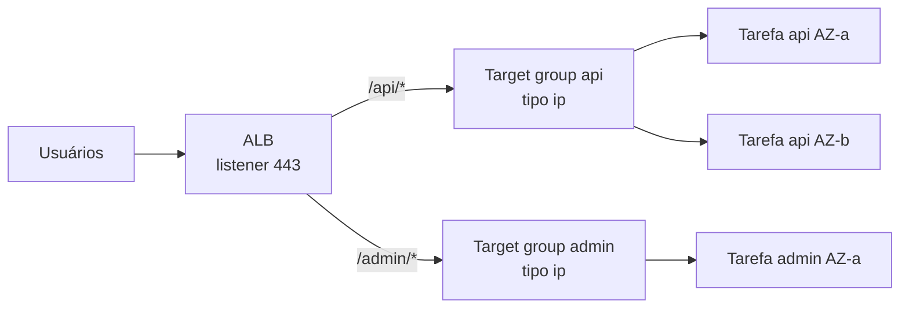

---
aliases:
  - Aula 17.4
modulo: 17
aula: 4
parte: "V Arquiteturas modernas"
dominios:
  - 2
  - 3
  - 4
lida: false
tags:
  - aula
  - saa-c03
  - modulo-17
---

# Aula 17.4: ECS em produção, balanceador, escala e deploys

[[17 - Containers ECS EKS e Fargate|Voltar ao módulo]]

> [!question] Pergunta que esta aula responde
> Como um [[Servico ECS|service ECS]] recebe tráfego de um balanceador, escala o número de tarefas conforme a carga e troca de versão sem derrubar o serviço? Que estratégia de deploy escolher para cada nível de risco, e como os serviços se encontram entre si?

## O problema: um service não é só "N tarefas rodando"

Na [[17.03 - ECS Cluster Task Definition e Service|aula anterior]] o service mantém um número fixo de tarefas. Produção pede mais três coisas: (1) tráfego distribuído e tarefas saudáveis recebendo requisições, (2) o número de tarefas acompanhando a carga, e (3) versões novas entrando sem interrupção e com volta fácil se algo der errado. Cada uma tem um mecanismo próprio.

## 1. Tráfego: o service e o Elastic Load Balancing

Você associa o service a um ou mais **[[Target Group|target groups]]** de um balanceador. O [[ECS]] registra e remove as tarefas dos target groups automaticamente, à medida que sobem e descem. Opções (verificado em novembro de 2026):

| Balanceador | Quando usar com [[ECS]] |
|---|---|
| [[Application Load Balancer]] | [[HTTP]]/HTTPS ([[Modelo OSI\|camada 7]]). **Recomendado pela AWS** na maioria dos casos: roteamento por caminho e host, vários services no mesmo [[Listener\|listener]], vários [[Target Group\|target groups]] por service |
| [[Network Load Balancer]] | [[TCP]] ou [[UDP]] ([[Modelo OSI\|camada 4]]), IP estático, [[Latencia\|latência]] muito baixa, protocolos que não são [[HTTP]] |
| [[Gateway Load Balancer]] | Appliances virtuais (firewall, IPS, inspeção profunda de pacotes) |

Pontos que a prova cobra:

- Em `awsvpc` (sempre no [[Fargate]]), o [[Target Group|target group]] é do tipo **`ip`**.
- O [[Application Load Balancer|ALB]] permite **dynamic host port mapping** em capacidade [[EC2]] com `bridge`, o que deixa várias tarefas do mesmo service rodarem na mesma instância, cada uma em uma porta alta diferente.
- **Um [[Application Load Balancer|ALB]], muitos services:** regras de caminho (`/api/*` para um service, `/admin/*` para outro) evitam um balanceador por [[Microsservicos|microsserviço]] (e a cobrança por balanceador).
- **[[Health Check|Health checks]] em duas camadas:** o do **[[Target Group|target group]]** (o [[Application Load Balancer|ALB]] decide se envia tráfego à tarefa) e o do **[[Container|container]]** na [[Task Definition|task definition]]. Se a aplicação demora a iniciar e o ALB a reprova antes, o service a mata em ciclo. A solução é o **[[Health Check Grace Period|health check grace period]]** do service, que dá um tempo de tolerância na partida.
- O [[ECS]] substitui tarefas reprovadas no [[Health Check|health check]] do balanceador, o que fecha o ciclo de [[Alta Disponibilidade]] iniciado com [[Sub-rede|sub-redes]] em várias [[Zona de Disponibilidade|AZs]] (veja o [[12 - Balanceamento de Carga e Auto Scaling|Módulo 12]]).

## 2. Escala: service auto scaling

O [[ECS]] escala o **número de tarefas do service** usando o **[[Application Auto Scaling]]**, o mesmo serviço que escala [[DynamoDB]] e [[Aurora Replica|réplicas do Aurora]] (diferente do [[EC2 Auto Scaling]], que escala instâncias; veja o Módulo 12). O ECS publica no [[CloudWatch]] as métricas de CPU e memória médias do service, e você escolhe a política (verificado em novembro de 2026):

| Tipo de política | Como funciona | Quando |
|---|---|---|
| **[[Target Tracking\|Target tracking]]** | Você escolhe uma [[Metrica\|métrica]] e um alvo; o serviço cria os alarmes e ajusta o número de tarefas, como um termostato | Padrão recomendado, o mais simples |
| **[[Step Scaling\|Step scaling]]** | Ajustes graduais conforme o tamanho da violação do alarme | Controle fino de degraus |
| **Scheduled** | Muda mínimo e máximo em data e hora | Pico previsível (todo dia às 9h) |
| **Predictive** | Usa padrões históricos para antecipar picos diários e semanais | Cargas com ciclos regulares |
| **Backlog de fila ([[SQS]])** | Escala pelo backlog por tarefa, uma [[Metrica\|métrica]] personalizada | Workers que consomem fila |

Métricas predefinidas de [[Target Tracking|target tracking]]: **CPU média** (`ECSServiceAverageCPUUtilization`), **memória média** (`ECSServiceAverageMemoryUtilization`) e **requisições por alvo no [[Application Load Balancer|ALB]]** (`ALBRequestCountPerTarget`). Qual escolher? CPU ou memória servem quando a carga se reflete neles; **requisições por alvo** é melhor quando o tráfego, e não a CPU, dita o dimensionamento; **backlog por tarefa** é a escolha para workers de fila, e liga com o [[15 - Desacoplamento Filas Eventos e Workflows|Módulo 15]]: o número de mensagens esperando dividido pelo número de tarefas diz se faltam consumidores.

> [!example] Exemplo resolvido: escala por requisições
> Seu service API tem alvo de **1.000 requisições por minuto por tarefa** (`ALBRequestCountPerTarget`). O tráfego sobe para 12.000 requisições por minuto no total. Número de tarefas necessárias: 12.000 / 1.000 = **12**. Se hoje há 5, o [[Target Tracking|target tracking]] escala para perto de 12 (arredondando para cima). Quando o tráfego volta a 3.000, o alvo pede 3 tarefas, mas o scale-in é mais lento e cauteloso que o scale-out.

Regras de comportamento (documentação oficial):

- O **scale-out** é proporcional e rápido; o **scale-in** é gradual, para proteger a [[Disponibilidade|disponibilidade]].
- Com **várias políticas de [[Target Tracking|target tracking]]**, o service escala **se qualquer uma pedir** e só reduz **se todas** pedirem.
- Sem dados de [[Metrica|métrica]] (insufficient data), o [[Target Tracking|target tracking]] **não escala para dentro**.
- Durante um **deploy**, o scale-in é desligado; o scale-out continua.
- Há período de **[[Cooldown|cooldown]]** para esperar o efeito da última ação.
- A [[Metrica|métrica]] `ALBRequestCountPerTarget` não é suportada no tipo de deploy [[Blue-Green Deployment|blue/green]] do [[ECS]] (documentação, verificado em novembro de 2026).

> [!warning] Escalar tarefas não escala servidores
> No **[[Fargate]]**, mais tarefas significa automaticamente mais capacidade. No **[[EC2]]**, mais tarefas só funcionam se houver instâncias com CPU e memória sobrando; é preciso escalar também a capacidade (cluster auto scaling, [[17.05 - Capacidade Fargate EC2 e Managed Instances|Aula 17.5]]). Esquecer essa segunda camada deixa tarefas em `PENDING`.

## 3. Deploys: como trocar de versão

Um deploy no [[ECS]] é: registrar nova revisão da [[Task Definition|task definition]] e atualizar o service. A **estratégia** define como as tarefas novas substituem as antigas. Com o **deployment controller ECS**, as estratégias nativas são (verificado em novembro de 2026):

| Estratégia | Como troca | Rollback | Custo extra | Exige balanceador? |
|---|---|---|---|---|
| **ROLLING** (padrão) | Substitui tarefas aos poucos, respeitando `minimumHealthyPercent` e `maximumPercent` | Minutos (novo deploy) | Quase nenhum | Não |
| **BLUE_GREEN** | Sobe a versão nova (green) ao lado da atual (blue), valida com tráfego de teste e então troca todo o tráfego | Segundos (volta ao blue) | Dobra a capacidade durante o deploy | Sim, para deslocar tráfego ([[Application Load Balancer\|ALB]], [[Network Load Balancer\|NLB]], Service Connect ou [[VPC]] Lattice); um service sem balanceador só substitui as tarefas, sem gerenciar o tráfego |
| **LINEAR** | Desloca o tráfego em **incrementos iguais** a cada intervalo | Rápido | Dobra parcialmente | Sim, para deslocar tráfego |
| **CANARY** | Envia uma **pequena fração** ao novo, espera e desloca o resto de uma vez | Rápido | Parcial | Sim, para deslocar tráfego |

Também existem o controlador **CodeDeploy** ([[Blue-Green Deployment|blue/green]] clássico com *task sets*, a forma antiga que ainda aparece em questões) e o controlador **External** (um sistema de terceiros comanda o deploy).

### Rolling por dentro

Dois parâmetros controlam a troca:

- **`minimumHealthyPercent`:** piso de tarefas saudáveis durante o deploy, em percentual do desired count (arredondado para cima).
- **`maximumPercent`:** teto de tarefas simultâneas (arredondado para baixo).

> [!example] Exemplo resolvido: os parâmetros do rolling
> Desired count = 4. Com `minimumHealthyPercent` = 50, o scheduler pode parar 2 tarefas antes de iniciar 2 novas (piso de 2 saudáveis). Com `maximumPercent` = 200, pode iniciar 4 novas **antes** de parar as 4 antigas (teto de 8). Prioridade de [[Disponibilidade|disponibilidade]]: piso 100 e teto 200 (sobem as novas, só depois caem as antigas, ao custo de capacidade temporária). Prioridade de custo ou de capacidade fixa: piso mais baixo, e a troca acontece com menos tarefas ao mesmo tempo. Cuidado: com desired 2 e piso 75%, o scheduler **não consegue parar nenhuma** tarefa (75% de 2 arredonda para 2), e o deploy trava.

Para detectar um deploy defeituoso e **reverter automaticamente**:

- **Deployment [[Circuit Breaker|circuit breaker]]:** falha o deploy (e pode reverter para a versão anterior) quando as tarefas novas não conseguem ficar saudáveis.
- **Alarmes do [[CloudWatch]]:** o deploy falha se um alarme escolhido (taxa de erro 5xx, [[Latencia|latência]]) disparar durante a troca. Os dois métodos podem ser combinados.

### Blue/green, linear e canary nativos

No [[Blue-Green Deployment|blue/green]] nativo, o **blue** é a revisão atual e o **green** é a nova. O [[ECS]] sobe o green, direciona **tráfego de teste** a ele (via [[Listener|listener]] de teste), roda **[[Lifecycle Hook|lifecycle hooks]]** ([[Lambda|funções Lambda]] que você define para validações, ou pontos de pausa que esperam a sua confirmação) e só então desloca o tráfego de produção. Depois do deslocamento existe o **bake time**: um período em que blue e green coexistem, permitindo voltar instantaneamente. **Linear** desloca em percentuais iguais (`stepPercent`, de 3% a 100%, padrão 10%) esperando um intervalo entre os passos; **canary** desloca uma fração pequena, espera e desloca o resto.

> [!info] Ligando os pontos
> Rolling, [[Blue-Green Deployment|blue/green]], canary e imutabilidade são os padrões de resiliência do [[20 - Alta Disponibilidade e Recuperacao de Desastres|Módulo 20]]. O blue/green do [[ECS]] é a versão por tarefas do que o [[Elastic Beanstalk]] faz por swap de URL (Aula 17.7). Na prova, "zero downtime, validar antes do tráfego real e voltar rápido" aponta para blue/green; "deslocar gradualmente com monitoramento" aponta para canary ou linear.

## 4. Como os services se encontram: Service Connect e alternativas

Em [[Microsservicos|microsserviços]], o service `pedidos` precisa chamar o service `estoque`. Como as tarefas mudam de IP o tempo todo, você precisa de **descoberta de serviços**. Três caminhos:

- **[[Application Load Balancer|ALB]] (ou [[Network Load Balancer|NLB]]) interno** na frente de cada service: simples, com [[Health Check|health checks]] e balanceamento, mas um balanceador a mais por service (custo) e um salto de rede.
- **[[ECS Service Connect]]:** o [[ECS]] gerencia nomes curtos, portas padrão, balanceamento entre tarefas e métricas de tráfego, usando um agente (proxy) em cada tarefa e um **namespace** do AWS Cloud Map por baixo (o Cloud Map está fora do escopo da prova; o Service Connect é o que você configura). Funciona entre services do mesmo cluster, de outros clusters e entre [[VPC|VPCs]] da mesma Região (verificado em novembro de 2026).
- **Service discovery por [[DNS]]** (Cloud Map): registros DNS por tarefa; mais antigo, sujeito a cache de [[TTL]], o problema que o Service Connect resolve ao trocar clientes durante o deploy.

## Como isso cai na prova

Cobertura: **Task 2.1** (escalar e desacoplar componentes), **Task 3.2** (métricas e condições para ações de escala) e **Task 4.2** (escala elástica e custo de computação).

**Palavras-chave em inglês:**
- "Maintain average CPU at 50%" puxa **[[Target Tracking|target tracking]]**.
- "Scale the number of tasks based on [[SQS]] queue depth" puxa **backlog por tarefa** ([[Metrica|métrica]] personalizada).
- "Predictable daily peak" puxa **scheduled** (ou predictive).
- "Zero downtime", "test before shifting traffic", "instant rollback" puxa **[[Blue-Green Deployment|blue/green]]**.
- "Gradually shift traffic", "monitor", "10 percent every N minutes" puxa **linear** ou **canary**.
- "Route by URL path to different services" puxa **[[Application Load Balancer|ALB]]**.
- "AWS CodeDeploy [[Blue-Green Deployment|blue/green]] for [[ECS]]" (AppSpec, task sets, [[Listener|listener]] de teste) é o nome antigo da mesma ideia do blue/green de tráfego: dois [[Target Group|target groups]], listener de teste e rollback rápido. O CodeDeploy também aparece com configurações predefinidas de canary e linear, como `CodeDeployDefault.ECSCanary10Percent5Minutes`.

**Pegadinhas clássicas:**
- Auto scaling de service escala **tarefas**; o [[EC2]] também precisa escalar (ou use [[Fargate]]).
- [[Target Group|Target group]] `ip` em `awsvpc`.
- Piso do rolling inviável trava o deploy.
- [[Health Check Grace Period|Health check grace period]] para aplicações que demoram a iniciar.
- Rolling não exige balanceador; [[Blue-Green Deployment|blue/green]], linear e canary precisam de [[Application Load Balancer|ALB]], [[Network Load Balancer|NLB]], Service Connect ou [[VPC]] Lattice para deslocar o tráfego (sem balanceador, o [[ECS]] só troca as tarefas).

| Requisito no enunciado | Resposta provável | Por quê |
|---|---|---|
| Manter CPU média perto de 50% | [[Target Tracking\|Target tracking]] em CPU | Mantém a [[Metrica\|métrica]] no alvo |
| Escalar workers pela fila | [[Target Tracking\|Target tracking]] com backlog por tarefa | A fila é o sinal de carga real |
| Muitos [[Microsservicos\|microsserviços]], um endpoint HTTPS | [[Application Load Balancer\|ALB]] com regras por caminho | Um balanceador para vários services |
| Deploy sem queda, validação com tráfego real e volta imediata | [[Blue-Green Deployment\|Blue/green]] | Os dois ambientes coexistem |
| Reduzir risco liberando para 10% dos usuários antes | Canary | Fração pequena primeiro |
| Pico todo dia às 9h conhecido | Scheduled (ou predictive) | Antecipa a escala |
| Tarefas ficam em PENDING no [[EC2]] | Escalar a capacidade (cluster auto scaling) | Faltam instâncias |

## Resumo

> [!abstract] A aula em uma frase
> O service integra um balanceador ([[Target Group|target group]] `ip`), escala tarefas com o [[Application Auto Scaling]] ([[Target Tracking|target tracking]] como padrão) e troca versões por rolling, [[Blue-Green Deployment|blue/green]], linear ou canary, com [[Circuit Breaker|circuit breaker]] e alarmes para reverter.

**A lógica, em 5 passos**
1. O service registra as tarefas no [[Target Group|target group]]; o [[Application Load Balancer|ALB]] distribui e o [[Health Check|health check]] decide quem recebe tráfego.
2. O [[Application Auto Scaling]] ajusta o desired count: [[Target Tracking|target tracking]] pela [[Metrica|métrica]] que reflete a carga.
3. Cada deploy troca a revisão da [[Task Definition|task definition]]; a estratégia define o ritmo e o risco.
4. Rolling usa piso e teto de tarefas; [[Blue-Green Deployment|blue/green]], linear e canary deslocam tráfego entre [[Target Group|target groups]].
5. [[Circuit Breaker|Circuit breaker]] e alarmes detectam falha e revertem; o Service Connect conecta os services entre si.

**Números e regras para lembrar**

| O quê | Valor | Por que importa |
|---|---|---|
| Métricas de [[Target Tracking\|target tracking]] | CPU, memória, requisições por alvo no [[Application Load Balancer\|ALB]] | Escolha pelo sinal real de carga |
| Políticas múltiplas | Escala se qualquer; reduz se todas | Prioriza [[Disponibilidade\|disponibilidade]] |
| Rolling | Piso arredonda para cima, teto para baixo | Pode travar com piso alto |
| Linear | Passos de 3% a 100% (padrão 10%) | Deslocamento gradual |
| Scale-in durante deploy | Desligado | Evita perder capacidade na troca |

**Na prática, isso significa**
- Comece com [[Application Load Balancer|ALB]], [[Target Tracking|target tracking]] por CPU ou requisições, e rolling com [[Circuit Breaker|circuit breaker]].
- Eleve para [[Blue-Green Deployment|blue/green]] ou canary quando o custo de uma versão ruim for alto.
- Para workers, escale pelo backlog da fila.
- Em [[EC2]], escale capacidade e tarefas; em [[Fargate]], só tarefas.

> [!tip] Liga com
> Vem da [[17.03 - ECS Cluster Task Definition e Service|Aula 17.3]] e do [[12 - Balanceamento de Carga e Auto Scaling|Módulo 12]]. Leva à [[17.05 - Capacidade Fargate EC2 e Managed Instances|Aula 17.5]] (de onde vem a capacidade) e ao [[20 - Alta Disponibilidade e Recuperacao de Desastres|Módulo 20]] (padrões de resiliência).

## Erros comuns

- Configurar [[Target Group|target group]] `instance` para tarefas `awsvpc`.
- Escalar tarefas em [[EC2]] sem escalar as instâncias.
- Usar `latest` e achar que um deploy "pegou" a imagem nova sem registrar nova revisão.
- Piso de `minimumHealthyPercent` que impede qualquer substituição.
- Não configurar [[Health Check Grace Period|grace period]] e ver a aplicação ser reiniciada em ciclo.
- Escolher [[Blue-Green Deployment|blue/green]] quando o requisito pede só economia e o serviço tolera troca gradual.

## Pratique

**1.** Um [[Servico ECS|service ECS]] de API recebe tráfego variável. A equipe quer manter a CPU média em torno de 50% com o MENOR esforço de configuração. O que usar?

- [ ] a) Step scaling com doze degraus e alarmes criados manualmente.
- [ ] b) Uma política de target tracking com a métrica de CPU média e alvo de 50%.
- [ ] c) Uma ação agendada que dobra o número de tarefas a cada hora.
- [ ] d) Aumentar o desired count manualmente toda semana.

**2.** Tarefas [[Fargate]] consomem mensagens de uma [[SQS|fila SQS]]. Em horários de pico a fila acumula mensagens. Qual critério de escala reflete melhor a necessidade?

- [ ] a) CPU média, porque workers sempre saturam a CPU antes de a fila crescer.
- [ ] b) Memória média, que sobe sempre que a fila cresce.
- [ ] c) Requisições por alvo do ALB, mesmo sem balanceador.
- [ ] d) O backlog da fila por tarefa, como métrica personalizada de target tracking.

**3.** Uma equipe quer fazer deploy sem queda, validar a nova versão com tráfego de teste antes de enviar usuários reais e poder reverter em segundos. Qual estratégia de deploy do [[ECS]] atende?

- [ ] a) Blue/green.
- [ ] b) Rolling com `minimumHealthyPercent` de 0.
- [ ] c) Parar o service, atualizar e iniciar novamente em horário de baixo uso.
- [ ] d) Rolling com `maximumPercent` de 100.

**4.** A empresa deseja liberar uma versão para uma fração crescente de usuários, 10% a cada 5 minutos, observando métricas em cada passo. Qual estratégia?

- [ ] a) Rolling com piso de 100%.
- [ ] b) Blue/green com troca única de todo o tráfego.
- [ ] c) Linear.
- [ ] d) Deploy manual por task avulsa.

**5.** Um service tem desired count de 4, `minimumHealthyPercent` de 50 e `maximumPercent` de 200 em um [[Rolling Update|deploy rolling]]. Qual é o número máximo de tarefas rodando ao mesmo tempo durante o deploy?

- [ ] a) 4.
- [ ] b) 8.
- [ ] c) 6.
- [ ] d) 2.

**6.** Qual é a função do deployment [[Circuit Breaker|circuit breaker]] do [[ECS]] em um [[Rolling Update|deploy rolling]]?

- [ ] a) Limitar o número de requisições por segundo do ALB.
- [ ] b) Desligar o balanceador durante a troca de versão.
- [ ] c) Criptografar o tráfego entre as tarefas novas e antigas.
- [ ] d) Detectar que as tarefas novas não ficam saudáveis e falhar o deploy, com reversão opcional.

**7.** (Escolha DUAS.) Quais benefícios o [[Application Load Balancer]] oferece a services [[ECS]]?

- [ ] a) Roteamento por caminho, com vários services no mesmo listener.
- [ ] b) Obrigatoriedade de um balanceador separado para cada microsserviço.
- [ ] c) Dynamic host port mapping, que permite várias tarefas do mesmo service na mesma instância EC2.
- [ ] d) Suporte nativo e exclusivo a tráfego UDP.
- [ ] e) Substituição do Application Auto Scaling na escala das tarefas.

**8.** Uma aplicação Java leva 90 segundos para iniciar. O [[ECS]] a encerra repetidamente porque o [[Health Check|health check]] do [[Application Load Balancer|ALB]] a reprova antes de ela ficar pronta. O que configurar?

- [ ] a) O health check grace period do service.
- [ ] b) Trocar o ALB por um NLB sem health checks.
- [ ] c) Reduzir a memória da tarefa para acelerar a partida.
- [ ] d) Desativar o auto scaling do service.

**9.** Em uma arquitetura de [[Microsservicos|microsserviços]] no [[ECS]], a equipe quer que os services se chamem por nomes curtos, sem criar um balanceador interno por service e com métricas de tráfego entre eles. Qual recurso usar?

- [ ] a) Um registro estático no arquivo `/etc/hosts` das tarefas.
- [ ] b) Um NAT gateway entre os services.
- [ ] c) ECS Service Connect.
- [ ] d) AWS Direct Connect entre os clusters.

**10.** Todos os dias, às 9h, o tráfego de uma aplicação dobra de forma previsível. Qual política evita a [[Latencia|latência]] de reação do [[Target Tracking|target tracking]] nesse horário?

- [ ] a) Aumentar o cooldown para 24 horas.
- [ ] b) Uma ação agendada que sobe o mínimo antes das 9h (ou escala preditiva).
- [ ] c) Reduzir o desired count a zero durante a noite.
- [ ] d) Desligar o scale-in permanentemente.

**11.** (Escolha DUAS.) Um [[Servico ECS|service ECS]] tem duas políticas de [[Target Tracking|target tracking]], uma por CPU e outra por requisições por alvo. Quais afirmações descrevem o comportamento?

- [ ] a) O service só escala para fora quando as duas políticas pedirem.
- [ ] b) O service reduz o número de tarefas se qualquer uma das políticas pedir.
- [ ] c) O service escala para fora se qualquer uma das políticas pedir.
- [ ] d) O scale-out é totalmente bloqueado durante qualquer deploy.
- [ ] e) O service só reduz o número de tarefas quando todas as políticas pedirem.

**12.** Um serviço de jogos precisa receber tráfego [[UDP]] com [[Latencia|latência]] muito baixa e IP estático por [[Zona de Disponibilidade|AZ]], rodando em [[Fargate]]. Qual balanceador usar com o [[Servico ECS|service ECS]]?

- [ ] a) Application Load Balancer.
- [ ] b) Classic Load Balancer com TLS.
- [ ] c) Gateway Load Balancer.
- [ ] d) Network Load Balancer.

> [!success]- Gabarito
> **1. b)** [[Target Tracking|target tracking]] mantém a [[Metrica|métrica]] no alvo e cria os alarmes sozinho; a exige alarmes manuais; c ignora a carga real; d é manual.
> **2. d)** o backlog por tarefa mede se faltam consumidores; a e b não acompanham a fila; c não se aplica sem balanceador.
> **3. a)** [[Blue-Green Deployment|blue/green]] valida com tráfego de teste e reverte ao blue em segundos; b e d não validam antes e deixam o rollback lento; c causa queda.
> **4. c)** linear desloca o tráfego em passos iguais a intervalos; a e d não deslocam tráfego em percentuais; b troca tudo de uma vez.
> **5. b)** 200% de 4 tarefas é 8; a ignora o teto; c e d não correspondem aos parâmetros dados (2 é o piso de saudáveis).
> **6. d)** o [[Circuit Breaker|circuit breaker]] detecta tarefas que não ficam saudáveis e falha ou reverte o deploy; a, b e c descrevem funções que ele não tem.
> **7. a) e c)** caminho em um [[Listener|listener]] e dynamic port mapping são recursos do [[Application Load Balancer|ALB]]; b inverte o benefício; d é do [[Network Load Balancer|NLB]]; e não substitui o [[Application Auto Scaling]].
> **8. a)** o [[Health Check Grace Period|grace period]] tolera falhas de [[Health Check|health check]] durante a partida; b perde o controle de saúde; c não resolve; d é irrelevante.
> **9. c)** Service Connect entrega nomes curtos, balanceamento e métricas; a e b não descobrem serviços; d é conectividade híbrida, fora do tema.
> **10. b)** a [[Scheduled Scaling|escala agendada]] (ou preditiva) antecipa o pico conhecido; a atrasa a reação; c derruba o serviço; d impede a redução de custo.
> **11. c) e e)** escala para fora se qualquer política pedir e só reduz se todas pedirem, priorizando a [[Disponibilidade|disponibilidade]]; a e b invertem as regras; d erra, porque o scale-out continua durante deploy (só o scale-in é desligado).
> **12. d)** o [[Network Load Balancer|NLB]] trata [[TCP]] e [[UDP]] em [[Modelo OSI|camada 4]] com IP estático por [[Zona de Disponibilidade|AZ]]; a só trata [[HTTP]]; b é legado; c serve a appliances de segurança.

### Laboratório (opcional): target tracking em um service

> [!warning] Use uma conta AWS pessoal separada
> Faça isto em uma **[[Conta AWS|conta AWS]] pessoal separada**, com [[Budgets]] configurado, **nunca na conta de produção da empresa**. Reaproveite o cluster e o service do laboratório da Aula 17.3; o custo adicional é desprezível se você apagar no mesmo dia.

1. Registre o service como alvo escalável: `aws application-autoscaling register-scalable-target --service-namespace ecs --scalable-dimension ecs:service:DesiredCount --resource-id service/saa-lab/web --min-capacity 1 --max-capacity 3`.
2. Crie a política: `aws application-autoscaling put-scaling-policy --service-namespace ecs --scalable-dimension ecs:service:DesiredCount --resource-id service/saa-lab/web --policy-name cpu50 --policy-type TargetTrackingScaling --target-tracking-scaling-policy-configuration '{"TargetValue":50.0,"PredefinedMetricSpecification":{"PredefinedMetricType":"ECSServiceAverageCPUUtilization"}}'`.
3. Veja os alarmes que o serviço criou no [[CloudWatch]] (não os edite).
4. **Limpeza:** `aws application-autoscaling delete-scaling-policy` (mesmos parâmetros e `--policy-name cpu50`), `aws application-autoscaling deregister-scalable-target` e depois apague o service e o cluster como na Aula 17.3.

## Para aprofundar

- [ ] [Automatically scale your Amazon ECS service](https://docs.aws.amazon.com/AmazonECS/latest/developerguide/service-auto-scaling.html) (documentação AWS): tipos de política, [[Cooldown|cooldown]] e comportamento durante deploys.
- [ ] [Use a target metric to scale Amazon ECS services](https://docs.aws.amazon.com/AmazonECS/latest/developerguide/service-autoscaling-targettracking.html) (documentação AWS): regras de [[Target Tracking|target tracking]] e de várias políticas.
- [ ] [Deploy Amazon ECS services by replacing tasks](https://docs.aws.amazon.com/AmazonECS/latest/developerguide/deployment-type-ecs.html) (documentação AWS): `minimumHealthyPercent`, `maximumPercent` e [[Circuit Breaker|circuit breaker]].
- [ ] [Amazon ECS blue/green deployments](https://docs.aws.amazon.com/AmazonECS/latest/developerguide/deployment-type-blue-green.html) (documentação AWS): bake time, [[Lifecycle Hook|lifecycle hooks]] e traffic shift.

Próxima aula: [[17.05 - Capacidade Fargate EC2 e Managed Instances|Aula 17.5: capacidade, Fargate, EC2 e Managed Instances]].
