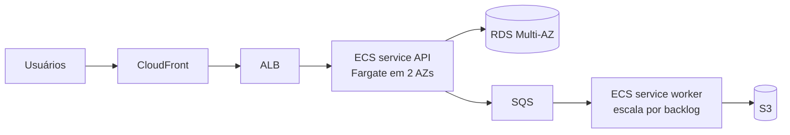

---
aliases:
  - Aula 17.8
modulo: 17
aula: 8
parte: "V Arquiteturas modernas"
dominios:
  - 2
  - 3
  - 4
lida: false
tags:
  - aula
  - saa-c03
  - modulo-17
---

# Aula 17.8: escolhendo a computação, tabela de decisão

[[17 - Containers ECS EKS e Fargate|Voltar ao módulo]]

> [!question] Pergunta que esta aula responde
> Dado um requisito de prova ou de projeto, como escolher entre [[EC2]], [[ECS]] em EC2, ECS com [[Fargate]], [[EKS]], [[Lambda]] e [[Elastic Beanstalk]], pesando controle, [[Overhead Operacional|overhead operacional]], custo, duração e portabilidade? E quando o ambiente é híbrido, qual dos produtos "Anywhere" e "Distro" resolve?

## O problema: seis jeitos de rodar código e um enunciado de prova

A AWS oferece vários modelos de computação, e cada um troca **controle** por **responsabilidade operacional**. A prova raramente pede "defina [[Fargate]]"; ela descreve uma situação e quer a escolha que atende ao requisito com o **[[Qualificador|qualificador]]** certo ("MOST cost-effective", "LEAST [[Overhead Operacional|operational overhead]]", "minimal code changes"). Esta aula organiza a decisão em perguntas curtas e fecha com a tabela comparativa e os contextos híbridos.

## A árvore de decisão

Responda na ordem. A primeira resposta "sim" costuma ser a boa.

1. **O trabalho é curto (até minutos), acionado por evento e de volume imprevisível?** Sim: **Lambda** (e custo por uso, zero servidor). Veja o [[16 - Serverless Lambda e API Gateway|Módulo 16]].
2. **A equipe só quer enviar o código de uma aplicação web tradicional e deixar a plataforma montar tudo?** Sim: **[[Elastic Beanstalk]]**.
3. **Precisa de [[Kubernetes]] (portabilidade, ecossistema, equipe já treinada)?** Sim: **[[EKS]]**, com [[EKS Auto Mode|Auto Mode]], [[Fargate]] ou nós gerenciados.
4. **A aplicação está (ou pode estar) em [[Container|containers]] e roda por muito tempo?** Sim: **[[ECS]]**, e agora a capacidade:
   - Quer **zero servidor** e menor overhead, carga variável? **[[Fargate]]**.
   - Carga **estável e bem ocupada**, ou precisa de GPU, [[Container|container]] privilegiado, [[AMI]] própria ou desconto de compromisso? **[[ECS]] em [[EC2]]** (ou [[ECS Managed Instances|Managed Instances]]).
5. **Precisa de controle total do sistema operacional, licença [[BYOL]], software que não containeriza?** **[[EC2]]** puro (Módulo 9).
6. **É [[Processamento em Lote|processamento em lote]] em grande escala (milhares de jobs, HPC)?** **[[Batch|AWS Batch]]** (que roda jobs em [[EC2]], [[Fargate]] ou [[EKS]]), visto no [[09 - EC2 a Fundo|Módulo 9]].

> [!tip] O qualificador decide
> Dois enunciados com a mesma carga podem ter respostas diferentes. "LEAST [[Overhead Operacional|operational overhead]]" empurra para Lambda, [[Fargate]] ou [[Elastic Beanstalk|Beanstalk]]. "MOST cost-effective" para carga estável e alta empurra para [[EC2]] com [[Savings Plans]] ou [[Reserved Instance|RI]]; para carga intermitente, empurra para Lambda ou Fargate (e [[Spot Instance|Spot]] se tolera interrupção). "Minimal changes to the application" empurra para EC2 ([[Lift and Shift|rehost]]) ou Beanstalk (se for plataforma suportada) antes de reescrever como Lambda.

## A tabela comparativa

| Critério | [[EC2]] puro | [[ECS]] em EC2 | ECS com [[Fargate]] | [[EKS]] | Lambda | [[Elastic Beanstalk\|Beanstalk]] |
|---|---|---|---|---|---|---|
| **Unidade de deploy** | [[AMI]] e instância | [[Imagem de Container\|Imagem de container]] | Imagem de container | Imagem de container ([[Pod\|pod]]) | Função (pacote ou imagem) | Código ou imagem [[Docker]] |
| **Quem gerencia servidores** | Você | Você (ou o [[ECS Managed Instances]]) | AWS | Você, ou AWS ([[EKS Auto Mode\|Auto Mode]], [[Fargate]]) | AWS | AWS provisiona, você pode ajustar |
| **[[Overhead Operacional\|Overhead operacional]]** | Alto | Médio a alto | **Baixo** | Médio a alto (menor em [[EKS Auto Mode\|Auto Mode]] ou [[Fargate]]) | **Mínimo** | Baixo a médio |
| **Controle (SO, kernel, GPU, privileged)** | **Total** | Alto | Limitado | Alto ([[EC2]]) ou limitado ([[Fargate]]) | Mínimo | Médio |
| **Escala de zero a muito** | Via [[Auto Scaling Group\|Auto Scaling]] | Serviço mais capacidade | Service auto scaling | HPA mais nós | **Automática, até zero** | Via Auto Scaling |
| **Duração máxima da execução** | Ilimitada | Ilimitada | Ilimitada | Ilimitada | Limitada ([[Timeout\|timeout]]; veja o Módulo 16) | Ilimitada |
| **Modelo de custo** | Instância por hora ou segundo | Instância (use bem a ocupação) | [[vCPU]] e memória da tarefa | Cluster por hora mais capacidade | Requisição e GB-segundo | Só os recursos criados |
| **Portabilidade** | Média | Baixa ([[ECS]] é da AWS) | Baixa | **Alta** ([[Kubernetes]]) | Baixa | Baixa |
| **Isolamento** | VM | Kernel compartilhado entre tarefas do host | Por tarefa | Por [[Pod\|pod]] no [[Fargate]]; compartilhado em [[EC2]] | Por [[Ambiente de Execucao\|ambiente de execução]] | VM |

## Custo: duas contas para fixar o raciocínio

O melhor modelo muda com o **padrão de uso**. Duas contas com preços de tabela de us-east-1 (verificado em novembro de 2026, página de preços do [[Fargate]]; confira antes de decidir):

> [!example] Exemplo resolvido 1: serviço sempre ligado
> Um service de 2 tarefas de 1 [[vCPU]] e 2 GB, 24 horas por dia, no [[Fargate]] x86:
> 
> - Por tarefa-hora: 1 x 0,0405 + 2 x 0,00445 = **US$ 0,0494**.
> - Mensal: 0,0494 x 2 tarefas x 730 horas = **cerca de US$ 72**.
> - Com Compute [[Savings Plans]] (desconto de até 50%): na ordem de **US$ 36**. Em ARM, mais barato ainda, se a imagem for `arm64`.
> 
> Carga contínua e previsível com compromisso: o preço cai pela metade sem trocar de tecnologia.

> [!example] Exemplo resolvido 2: job noturno intermitente
> Um job de 4 [[vCPU]] e 16 GB que roda 2 horas por dia (60 horas por mês):
> 
> - [[Fargate]]: 0,2332 x 60 = **cerca de US$ 14 por mês** (a tarefa só existe enquanto roda).
> - Uma [[EC2|instância EC2]] dedicada ao job, sempre ligada, a um valor **hipotético** de US$ 0,20 por hora: 0,20 x 730 = **US$ 146 por mês**.
> 
> Para carga intermitente, pagar só pela execução vence por uma ordem de grandeza. Se o job tolera repetição, o [[Fargate Spot]] reduz ainda mais.

Regra: **uso baixo ou irregular** favorece Lambda e [[Fargate]]; **uso alto e constante, bem empacotado** favorece [[EC2]] com compromissos.

## Ambientes híbridos: os "Anywhere" e o "Distro"

Quando parte da carga precisa ficar fora de uma Região (data center próprio, borda, ambiente isolado), há várias peças. A pergunta de prova é **quem opera o [[Plano de Controle|plano de controle]] e onde rodam os nós**:

| Produto | O que é | [[Plano de Controle\|Plano de controle]] | Nós | Suporte |
|---|---|---|---|---|
| **[[ECS Anywhere]]** | Registra servidores ou VMs externos no seu cluster [[ECS]] (launch type `EXTERNAL`) | AWS (ECS na Região) | Seus servidores | AWS |
| **[[EKS]]** (nuvem) | [[Kubernetes]] gerenciado na Região | AWS | AWS ([[EC2]], [[Fargate]], [[EKS Auto Mode\|Auto Mode]]) | AWS |
| **[[EKS Hybrid Nodes]]** | Estende um cluster [[EKS]] da Região a máquinas suas, on-premises ou na borda | AWS (na Região) | Suas máquinas | AWS |
| **[[EKS]] on Outposts** | EKS rodando em [[Outposts]]; clusters estendidos ([[Plano de Controle\|plano de controle]] na Região) ou locais (tudo no Outposts) | Região ou Outposts | [[EC2]] no Outposts | AWS |
| **[[EKS Anywhere]]** | Produto **gerenciado pelo cliente** para criar e operar clusters [[Kubernetes]] no seu data center, inclusive isolados (air-gapped), construído sobre o [[EKS Distro]] | **Seu data center** | Seu data center | Suporte AWS (assinatura) |
| **[[EKS Distro]]** | **Distribuição de código aberto** do mesmo [[Kubernetes]] usado pelo [[EKS]], com o mesmo ciclo de versões | Seu data center | Seu data center | Comunidade open source |

Detalhes do **[[ECS Anywhere]]** que a documentação destaca (verificado em novembro de 2026):

- Usa o launch type `EXTERNAL`; requer um agente do [[ECS]] e o **[[SSM Agent]]** na máquina, e uma [[IAM Role|IAM role]] para falar com as APIs da AWS.
- É otimizado para cargas que **geram tráfego de saída ou processam dados**; **não há suporte a [[Elastic Load Balancing|balanceador de carga]] nem a service discovery**.
- Tarefas usam os modos de rede `bridge`, `host` ou `none`; **`awsvpc` não é suportado**.
- Cobrança de cerca de **US$ 0,01025 por instância registrada por hora** (página de preços do [[ECS]], verificado em novembro de 2026).
- Uma instância externa se registra em **um cluster por vez**.

Outras duas opções híbridas aparecem no [[23 - Migracao e Transferencia de Dados|Módulo 23]]: [[Outposts]] (hardware da AWS no seu data center) e [[Local Zone|Local Zones]] (infraestrutura da AWS perto de uma cidade). O [[EKS]] aceita nós autogerenciados em Local Zones e [[Wavelength]].

> [!warning] Pegadinha: Anywhere não é "na nuvem"
> [[ECS Anywhere]] e [[EKS Anywhere]] servem para carga que **precisa** ficar fora da AWS. Se o enunciado só pede escalar na nuvem, essas opções são [[Distrator|distratores]].

## Padrões de arquitetura com containers

Três padrões que a prova combina:

1. **Web em três camadas:** [[Application Load Balancer|ALB]], [[Servico ECS|service ECS]] em duas ou mais [[Zona de Disponibilidade|AZs]] ([[Fargate]]), [[RDS]] [[Multi-AZ]]. Escala por CPU ou requisições por alvo (Aula 17.4).
2. **Fila e workers:** API enfileira em [[SQS]]; um service separado de workers escala pelo **backlog por tarefa** (Aula 17.4), possivelmente em [[Fargate Spot]], com mensagens idempotentes (Aula 17.5).
3. **Jobs agendados:** [[EventBridge]] Scheduler dispara `RunTask` em [[Fargate]], com [[Spot Instance|Spot]] se tolera interrupção; custo só durante a execução.

## Como isso cai na prova

Cobertura: **Task 2.1** (quando usar [[Container|containers]] e quando usar [[Serverless|serverless]]; recomendar tecnologias de computação), **Task 3.2** (selecionar a computação) e **Task 4.2** (serviços de computação com melhor custo: Lambda, [[EC2]], [[Fargate]]).

**Palavras-chave em inglês (visão final):**
- "Event-driven", "short", "sporadic" puxam **Lambda**.
- "[[Container|Containers]]", "LEAST [[Overhead Operacional|operational overhead]]" puxam **[[ECS]] com [[Fargate]]**.
- "[[Kubernetes]]", "portability", "open source" puxam **[[EKS]]**.
- "Upload code and the platform handles the rest" puxa **[[Elastic Beanstalk]]**.
- "Steady 24/7, high utilization, GPU, privileged, [[BYOL]]" puxam **[[EC2]]** (ou [[ECS]] em EC2).
- "On-premises servers managed from [[ECS]]" puxa **[[ECS Anywhere]]**; "on-premises [[Kubernetes]] with AWS support" puxa **[[EKS Anywhere]]**.
- "Open-source [[Kubernetes]] distribution same as [[EKS]]" puxa **[[EKS Distro]]**.
- "Run for more than the Lambda [[Timeout|timeout]]" tira Lambda da lista.

**Pegadinhas clássicas:**
- [[Fargate]] não é orquestrador; [[ECR]] não executa nada.
- "Menos operação" não é sinônimo de "mais barato": carga estável e alta pode sair mais barata em [[EC2]] com compromisso.
- Lambda é ótimo para intermitente e ruim para contínuo e pesado; [[Container|containers]] não têm [[Timeout|timeout]] curto.
- [[EKS]] cobra por cluster-hora; [[ECS]] não cobra pela [[Orquestracao|orquestração]].
- Anywhere e Distro são para fora da nuvem; não são respostas para escalar dentro da Região.

| Requisito no enunciado | Resposta provável | Por quê |
|---|---|---|
| Função disparada por upload, picos imprevisíveis | Lambda | Evento, cobrança por uso, zero servidor |
| API em [[Container\|containers]], equipe pequena, sem [[Kubernetes]] | [[ECS]] com [[Fargate]] | Menor [[Overhead Operacional\|overhead operacional]] |
| App já em [[Kubernetes]], quer portabilidade | [[EKS]] | API padrão do Kubernetes |
| Carga 24/7 estável e bem ocupada, custo mínimo | [[ECS]] ou [[EC2]] com [[Savings Plans]] ou [[Reserved Instance\|RI]] | Menor preço unitário com boa utilização |
| Job noturno de 2 horas, tolera repetição, custo mínimo | Task agendada em [[Fargate Spot]] | Paga só a execução, com desconto |
| [[Container]] precisa de GPU e privileged | [[ECS]] em [[EC2]] (ou [[ECS Managed Instances\|Managed Instances]]) | [[Fargate]] não oferece |
| Enviar o pacote Java e a AWS monta o ambiente | [[Elastic Beanstalk]] | PaaS |
| Servidores locais gerenciados pelo [[Plano de Controle\|plano de controle]] do [[ECS]] | [[ECS Anywhere]] | Launch type `EXTERNAL` |
| [[Kubernetes]] isolado, sem internet, com suporte AWS | [[EKS Anywhere]] | Produto para o data center |

## Resumo

> [!abstract] A aula em uma frase
> Escolha pelo [[Qualificador|qualificador]]: Lambda para evento curto e intermitente, [[Fargate]] para [[Container|containers]] com menor operação, [[EC2]] (ou [[ECS]] em EC2) para carga estável e bem ocupada ou necessidade de hardware, [[EKS]] para [[Kubernetes]] e portabilidade, [[Elastic Beanstalk|Beanstalk]] para "enviar o código", e os produtos Anywhere e Distro quando a carga precisa ficar fora da Região.

**A lógica, em 5 passos**
1. Cada modelo troca controle por responsabilidade operacional.
2. Primeiro filtre pelo tipo de trabalho: evento curto, aplicação web a enviar, [[Kubernetes]], [[Container|container]] de longa duração, controle de SO.
3. Depois, o [[Qualificador|qualificador]]: overhead, custo, mudança mínima, portabilidade.
4. Custo depende do padrão de uso: intermitente favorece pagar só a execução; estável e alto favorece compromisso em [[EC2]].
5. Fora da Região, decida quem opera o [[Plano de Controle|plano de controle]] e onde ficam os nós.

**Tabela-síntese**

| Se o enunciado diz... | Pense em... |
|---|---|
| Evento, curto, imprevisível | Lambda |
| [[Container\|Containers]], menor operação | [[ECS]] com [[Fargate]] |
| [[Kubernetes]], portabilidade | [[EKS]] |
| Enviar o código da aplicação | [[Elastic Beanstalk]] |
| Estável, 24/7, mais barato | [[EC2]] ou [[ECS]] em EC2 com compromisso |
| GPU, privileged, [[AMI]] própria | [[EC2]] ou [[ECS Managed Instances\|Managed Instances]] |
| Servidor local com [[ECS]] | [[ECS Anywhere]] |
| [[Kubernetes]] local com suporte AWS | [[EKS Anywhere]] |

**Na prática, isso significa**
- Comece pela pergunta de duração e gatilho (Lambda), depois pela de [[Container|containers]] e [[Kubernetes]].
- Meça utilização antes de decidir entre [[Fargate]] e [[EC2]].
- Use [[Spot Instance|Spot]] para carga tolerante e [[Savings Plans]] para a base estável.
- Em enunciados híbridos, ligue "quem opera o [[Plano de Controle|plano de controle]]" ao produto certo.

> [!tip] Liga com
> Fecha o módulo juntando as [[17.01 - Por que Containers e Como Eles Funcionam|Aula 17.1]] a [[17.07 - Migrar para Containers e Elastic Beanstalk|17.7]]. Leva à [[18 - Borda e DNS CloudFront Global Accelerator e Route 53|borda e DNS do Módulo 18]] e aos [[25 - Otimizacao de Custos|custos do Módulo 25]].

## Erros comuns

- Escolher Lambda para processamento contínuo e pesado, ou para jobs além do [[Timeout|timeout]].
- Escolher [[Fargate]] sem considerar GPU, privileged ou alta utilização estável.
- Confundir "menor [[Overhead Operacional|overhead operacional]]" com "menor custo".
- Indicar [[EKS]] quando o enunciado não menciona [[Kubernetes]] nem portabilidade.
- Indicar Anywhere para um requisito puramente de nuvem.
- Ignorar que o [[EKS]] cobra por cluster-hora e o [[ECS]] não cobra pela [[Orquestracao|orquestração]].

## Pratique

**1.** Uma função processa uploads de imagem de forma esporádica, de zero a milhares por hora, cada um em poucos segundos. A equipe quer o MENOR [[Overhead Operacional|overhead operacional]]. Qual opção?

- [ ] a) ECS com tarefas EC2 e capacity provider.
- [ ] b) EKS com managed node groups.
- [ ] c) AWS Lambda acionada por eventos do S3.
- [ ] d) Uma instância EC2 com um laço de varredura do bucket.

**2.** Uma plataforma de [[Container|containers]] roda 24/7 com uso alto e estável, e a equipe aceita gerenciar instâncias para reduzir custo. Qual combinação é a mais econômica?

- [ ] a) ECS em EC2 bem ocupado, com Savings Plans ou Reserved Instances para a base.
- [ ] b) Fargate On-Demand sem compromisso algum.
- [ ] c) Lambda com concorrência provisionada em tudo.
- [ ] d) EKS com um cluster por equipe, cada um com poucas tarefas.

**3.** Uma empresa multicloud padronizou em [[Kubernetes]] e quer rodar as mesmas cargas na AWS com o [[Plano de Controle|plano de controle]] gerenciado. O que escolher?

- [ ] a) Elastic Beanstalk.
- [ ] b) Amazon EKS.
- [ ] c) AWS Lambda.
- [ ] d) Amazon ECS com Fargate, reescrevendo as definições.

**4.** Uma empresa tem servidores no seu data center e quer que eles executem tarefas de [[Container|containers]] orquestradas pelo [[ECS]], com o [[Plano de Controle|plano de controle]] na AWS. Qual recurso?

- [ ] a) Amazon ECR Public.
- [ ] b) AWS Fargate On-Premises.
- [ ] c) AWS Lambda com função URL.
- [ ] d) Amazon ECS Anywhere.

**5.** Um ambiente isolado, sem acesso à internet, precisa de clusters [[Kubernetes]] no data center, com suporte da AWS, usando a mesma base do [[EKS]]. Qual produto?

- [ ] a) Amazon EKS na Região, com acesso público.
- [ ] b) EKS Distro, sem suporte comercial.
- [ ] c) Amazon EKS Anywhere.
- [ ] d) AWS Elastic Beanstalk em modo Standard.

**6.** Uma equipe quer a distribuição de código aberto do mesmo [[Kubernetes]] que o [[EKS]] usa, para rodar em qualquer infraestrutura própria, com suporte da comunidade. O que usar?

- [ ] a) EKS Distro.
- [ ] b) EKS Auto Mode.
- [ ] c) ECS Managed Instances.
- [ ] d) Amazon ECR.

**7.** (Escolha DUAS.) Quais afirmações sobre o [[ECS Anywhere]] estão corretas?

- [ ] a) Não oferece suporte a balanceador de carga para os serviços.
- [ ] b) Exige o modo de rede `awsvpc`.
- [ ] c) Usa o launch type `EXTERNAL` para instâncias registradas.
- [ ] d) Cada instância pode ser registrada em vários clusters ao mesmo tempo.
- [ ] e) Elimina a necessidade de agente na máquina.

**8.** Um job de processamento de 2 horas roda toda noite, tolera repetição e o objetivo é o MENOR custo, sem servidores. Qual desenho?

- [ ] a) Uma instância EC2 reservada ligada o mês inteiro.
- [ ] b) Uma tarefa agendada no EventBridge, em Fargate Spot.
- [ ] c) Um service com 4 tarefas Fargate On-Demand 24 horas por dia.
- [ ] d) Uma função Lambda com o timeout máximo, em loop.

**9.** Uma equipe quer estender um cluster [[EKS]] da Região para máquinas físicas próprias no data center, mantendo o [[Plano de Controle|plano de controle]] gerenciado pela AWS. Qual recurso?

- [ ] a) ECS Anywhere.
- [ ] b) Elastic Beanstalk Cluster.
- [ ] c) AWS Batch.
- [ ] d) EKS Hybrid Nodes.

**10.** Uma aplicação legada em [[Container|container]] precisa de acesso privilegiado ao kernel e de uma [[AMI]] personalizada. Qual capacidade atende?

- [ ] a) Fargate.
- [ ] b) AWS Lambda com imagem de container.
- [ ] c) ECS em instâncias EC2.
- [ ] d) Pods EKS em Fargate profiles.

**11.** (Escolha DUAS.) Quais afirmações sobre escolha de computação estão corretas?

- [ ] a) O Fargate dispensa o gerenciamento de servidores, ao custo de menos controle sobre o host.
- [ ] b) Lambda é sempre a opção mais barata, qualquer que seja o padrão de uso.
- [ ] c) O ECS cobra por cluster-hora pelo plano de controle.
- [ ] d) Ter menos operação implica sempre ter menor custo.
- [ ] e) O EKS cobra por cluster-hora pelo plano de controle, o que penaliza muitos clusters pequenos.

**12.** Uma tarefa de 200 execuções por dia, de 1 segundo cada, sem estado, precisa do menor custo possível. Qual opção?

- [ ] a) Instância EC2 sempre ligada.
- [ ] b) AWS Lambda.
- [ ] c) Service ECS Fargate com 2 tarefas fixas.
- [ ] d) Cluster EKS dedicado ao job.

> [!success]- Gabarito
> **1. c)** evento, intermitente e curto pede Lambda; a e b exigem operar capacidade; d é [[Ponto Unico de Falha|ponto único de falha]] e não escala.
> **2. a)** [[EC2]] bem ocupado mais compromisso dá o menor preço unitário; b não aproveita o desconto; c é caro para carga contínua; d multiplica o custo do [[Plano de Controle|plano de controle]].
> **3. b)** [[EKS]] é [[Kubernetes]] padrão gerenciado; a é PaaS próprio; c é outro modelo; d obriga reescrita.
> **4. d)** [[ECS Anywhere]] registra servidores externos como instâncias do cluster; a é um registry; b não existe; c não orquestra [[Container|containers]] locais.
> **5. c)** [[EKS Anywhere]] é o produto para o data center e ambientes isolados com suporte AWS; a exige conectividade com a Região; b não tem suporte comercial; d é outro serviço.
> **6. a)** [[EKS Distro]] é a distribuição de código aberto do mesmo [[Kubernetes]]; b e c são recursos gerenciados na nuvem; d é registry.
> **7. a) e c)** sem balanceador e com launch type `EXTERNAL`; b erra, porque `awsvpc` não é suportado; d erra, pois é um cluster por vez; e erra, porque o agente e o [[SSM Agent]] são necessários.
> **8. b)** tarefa agendada em [[Fargate Spot]] paga só a execução com desconto; a e c pagam capacidade ociosa; d erra porque 2 horas passam do [[Timeout|timeout]] do Lambda (e laço em loop não se aplica).
> **9. d)** [[EKS Hybrid Nodes|Hybrid Nodes]] estende o cluster [[EKS]] a máquinas próprias; a é do [[ECS]]; b roda na nuvem; c é [[Processamento em Lote|processamento em lote]].
> **10. c)** acesso privilegiado e [[AMI]] própria exigem [[EC2]]; a e d não suportam privileged; b não oferece privilégio de kernel.
> **11. a) e e)** [[Fargate]] troca controle por menos operação, e o [[EKS]] cobra por cluster-hora; b e d são generalizações falsas; c é falsa, pois o [[ECS]] não cobra pela [[Orquestracao|orquestração]].
> **12. b)** Lambda cobra por uso e custa quase nada para esse volume; a, c e d mantêm capacidade ligada o dia todo.

## Para aprofundar

- [ ] [Amazon Elastic Kubernetes Service (whitepaper Overview of Deployment Options on AWS)](https://docs.aws.amazon.com/whitepapers/latest/overview-deployment-options/amazon-elastic-kubernetes-service.html) (whitepaper AWS): tabela oficial de [[EKS]], EKS on Outposts, [[EKS Anywhere]] e [[EKS Distro]].
- [ ] [Deploy Amazon EKS clusters across cloud and on-premises environments](https://docs.aws.amazon.com/eks/latest/userguide/eks-deployment-options.html) (documentação AWS): [[EKS]] em [[Regiao AWS|Regiões]], [[Local Zone|Local Zones]], Outposts, [[EKS Hybrid Nodes|Hybrid Nodes]] e [[EKS Anywhere]].
- [ ] [Amazon ECS clusters for external instances](https://docs.aws.amazon.com/AmazonECS/latest/developerguide/ecs-anywhere.html) (documentação AWS): requisitos e limites do [[ECS Anywhere]].
- [ ] [Amazon ECS pricing](https://aws.amazon.com/ecs/pricing/) (página de preços AWS): modelos de cobrança de [[Fargate]], [[EC2]], [[ECS Managed Instances|Managed Instances]] e [[ECS Anywhere]].

Próximo módulo: [[18 - Borda e DNS CloudFront Global Accelerator e Route 53|Módulo 18: borda e DNS]].
