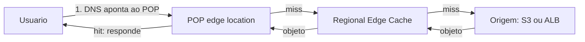

---
aliases:
  - Aula 18.1
modulo: 18
aula: 1
parte: "V Arquiteturas modernas"
dominios:
  - 2
  - 3
  - 4
lida: false
tags:
  - aula
  - saa-c03
  - modulo-18
---

# Aula 18.1: Por que a borda e como o CloudFront entrega conteúdo

[[18 - Borda e DNS CloudFront Global Accelerator e Route 53|Voltar ao módulo]]

> [!question] Pergunta que esta aula responde
> Por que colocar uma camada de servidores perto do usuário (a "borda") muda a [[Latencia|latência]], a carga na origem e a conta de transferência, e o que acontece, passo a passo, quando um usuário pede um arquivo que passa pelo [[CloudFront]]?

## O problema: a física não negocia

Toda aplicação web tem uma **origem** (origin): o lugar onde a versão definitiva do conteúdo vive, como um [[Bucket|bucket]] do [[S3]] ou um [[Application Load Balancer]] em uma [[Regiao AWS|Região]]. Se o usuário está longe da origem, três coisas pioram ao mesmo tempo.

**1. [[Latencia|Latência]].** A luz viaja na fibra a cerca de 200.000 km/s, ou seja, 1 ms de ida a cada 200 km. Isso é um limite físico, não de engenharia.

> [!example] Conta de padaria: um usuário em São Paulo e a origem na Virgínia
> A distância em linha reta entre São Paulo e a Virgínia do Norte é da ordem de 7.700 km (ordem de grandeza, não medida oficial). Ida: pelo menos 38 ms. Ida e volta ([[Latencia|RTT]], round-trip time): pelo menos 77 ms, e na prática mais, porque a fibra não faz linha reta e há roteadores no caminho.
>
> Para baixar uma página por HTTPS, o navegador faz: um [[Latencia|RTT]] para o handshake [[TCP]], um RTT para o handshake [[TLS]] 1.3 (o TLS 1.2 gasta dois) e um RTT para o pedido e a primeira resposta. São pelo menos 3 RTTs, ou cerca de 230 ms só de rede antes do primeiro byte. Nenhum ajuste de código na origem reduz isso. Aproximando o servidor para 1 ms de RTT, o mesmo cálculo cai para uns 3 ms.

A [[Latencia]] aparece de novo, com outros números, na rede entre [[Regiao AWS|Regiões]] (aula 18.6 e [[07 - Conectividade Hibrida e entre VPCs|Módulo 7]]).

**2. Carga na origem.** Se 1 milhão de usuários pedem o mesmo `logo.png`, uma origem sem cache atende 1 milhão de pedidos idênticos. Com cache, ela atende alguns (um por ponto de cache) e o resto é respondido pela borda.

**3. Custo e proteção.** A [[Data Transfer|transferência de dados]] para a internet a partir da origem é cobrada. A borda também absorve tráfego malicioso antes de ele chegar à origem (o [[WAF]] e o [[Shield]] se associam a ela; o [[19 - Seguranca de Aplicacoes e Deteccao de Ameacas|Módulo 19]] aprofunda).

## A solução: uma CDN

Uma **[[CDN]]** (Content Delivery Network, rede de entrega de conteúdo) é uma rede de servidores espalhados pelo mundo que guarda cópias (cache) do conteúdo e responde ao usuário pelo ponto mais próximo. O [[CloudFront]] é a CDN da AWS. A documentação define assim: um serviço que acelera a distribuição de conteúdo estático e dinâmico (.html, .css, .js, imagens) por uma rede de data centers chamados **[[Edge Location|edge locations]]** (ou **POPs**, points of presence), e roteia cada pedido para o que oferece a menor [[Latencia|latência]] (verificado em novembro de 2026).

Termos que a prova usa como sinônimos de "perto do usuário": [[Edge Location]], POP, "edge", "[[CDN]]", "edge caching". Não confunda com [[Local Zone]] nem [[Wavelength]] ([[01 - Nuvem e Infraestrutura Global AWS|Módulo 1]]): essas são infraestrutura de computação em locais específicos; a edge location do [[CloudFront]] serve cache e executa funções leves, não roda sua [[EC2]].

## Anatomia: o que você configura

Você cria uma **distribuição** ([[CloudFront Distribution]]), que diz ao [[CloudFront]] de onde buscar o conteúdo e como entregá-lo. Os blocos:

| Bloco | O que é | Exemplo |
|---|---|---|
| **Origin** | Onde está a versão definitiva do objeto | [[Bucket]] [[S3]], [[Application Load Balancer\|ALB]], servidor [[HTTP]] próprio |
| **Distribution** | A configuração completa, com um nome de domínio gerado | `d111111abcdef8.cloudfront.net` |
| **Alternate domain name ([[CNAME]])** | Seu domínio próprio apontando para a distribuição | `www.exemplo.com.br` |
| **[[Cache Behavior]]** | Regras por padrão de caminho: qual origem, qual [[Cache Policy\|política de cache]], quais métodos | `/api/*` vai ao [[Application Load Balancer\|ALB]] sem cache, `*` vai ao [[S3]] com cache longo |
| **[[Edge Location\|Edge location]] / POP** | Servidor de borda que responde ao usuário | O mais próximo em [[Latencia\|latência]] |

Pela documentação, ao criar a distribuição o [[CloudFront]] envia **a configuração** (não o conteúdo) a todas as [[Edge Location|edge locations]]. O conteúdo só entra no cache de um POP quando alguém o pede lá. Existem dois tipos de distribuição: a **standard** (um site ou aplicação, o caso comum e o foco deste módulo) e a **[[Multi-Tenant|multi-tenant]]** (CloudFront SaaS Manager, para provedores SaaS que gerenciam muitas distribuições parecidas). A prova cobre o primeiro.

> [!info] Ligando os pontos
> Você já usa [[CloudFront]] na empresa. O que muda aqui é enxergar cada campo como uma decisão: a origem responde "de onde vem o dado", o behavior responde "o que acontece com cada caminho", e o resto do módulo detalha cada um. Origens privadas e segurança vêm nas aulas 18.3 e 18.4.

## Como um pedido percorre o CloudFront

O caminho completo, conforme a documentação:

1. O usuário pede um objeto (`https://www.exemplo.com.br/logo.jpg`).
2. O [[DNS]] resolve o nome para o [[Edge Location|POP]] que melhor atende, em geral o mais próximo em [[Latencia|latência]].
3. O [[Edge Location|POP]] consulta o próprio cache. Se o objeto está lá e é válido, é um **cache hit** e a resposta sai dali.
4. Se não está (**cache miss**), o [[Edge Location|POP]] tipicamente consulta o **[[Regional Edge Cache]]** (REC) mais próximo, um cache maior entre os POPs e a origem.
5. Se o REC também não tem, o [[CloudFront]] compara o pedido com a distribuição, escolhe o behavior e busca na origem.
6. Assim que o primeiro byte chega da origem, o [[CloudFront]] já repassa ao usuário e guarda o objeto no REC e no [[Edge Location|POP]] para os próximos.

**Por que existe o REC?** Os [[Edge Location|POPs]] são muitos e pequenos: um objeto pouco popular é descartado deles para dar lugar a outros. O REC é maior e fica numa camada acima, então o objeto "esfriando" ainda mora lá e evita uma viagem até a origem. Conteúdo gerado por usuários, fotos de catálogo e notícias que viram sucesso de repente são os casos que a documentação cita. A FAQ informa que o recurso vem habilitado por padrão, sem custo extra (verificado em novembro de 2026).

**Exceções que a documentação lista** (caem em questão de detalhe):
- Os métodos de proxy (`PUT`, `POST`, `PATCH`, `OPTIONS`, `DELETE`) vão do [[Edge Location|POP]] direto à origem, sem passar pelo REC.
- Requisições dinâmicas, como determinadas em tempo de execução, também vão direto à origem.
- Quando a origem é um [[Bucket|bucket]] [[S3]] e o REC ideal está na mesma Região do bucket, o [[Edge Location|POP]] pula o REC e vai direto ao S3.
- Uma [[Invalidacao de Cache|invalidação]] de cache remove o objeto dos [[Edge Location|POPs]] **e** dos RECs (paridade de recursos).

**Conexões persistentes.** O [[CloudFront]] mantém conexões persistentes com as origens. Isso responde à conta de padaria acima: o usuário faz handshake [[TCP]] e [[TLS]] com a borda (1 ms de [[Latencia|RTT]]), e a borda reaproveita uma conexão já aberta até a origem, sem repetir o handshake longo a cada pedido. Por isso mesmo **conteúdo não cacheável** (uma API que muda a cada chamada) pode ficar mais rápido atrás do CloudFront. A aula 18.6 mostra o outro serviço da AWS que aproveita essa ideia para qualquer protocolo TCP e [[UDP]].

## Cache hit ratio: a métrica que decide tudo

O **[[Cache Hit Ratio]]** é a proporção de pedidos servidos pelo cache. Se ele é de 90%, apenas 10% dos pedidos chegam à origem.

> [!example] 90% de hit ratio em números
> Um site recebe 10 milhões de pedidos por dia. Com [[Cache Hit Ratio|hit ratio]] de 90%, a origem vê 1 milhão de pedidos; com 50%, vê 5 milhões. Com o mesmo tráfego, subir o hit ratio de 90% para 95% reduz a origem de 1 milhão para 500 mil pedidos por dia, sem adicionar nenhuma instância. Se o tráfego dobrar para 20 milhões de pedidos, um hit ratio de 95% mantém a origem em 1 milhão.

O que aumenta o [[Cache Hit Ratio|hit ratio]] é o tema da aula 18.2 ([[Cache Key|cache key]] enxuta, [[TTL]] longo, [[Versionamento|versionamento]] de arquivo).

## Custo: o que a CDN cobra e o que ela economiza

A documentação informa (verificado em novembro de 2026):

- O [[CloudFront]] cobra pela **[[Data Transfer|transferência de dados]] saindo** das [[Edge Location|edge locations]] e pelas **requisições [[HTTP]] e HTTPS**; o preço varia por tipo de uso, região geográfica e recursos habilitados.
- A transferência **da origem para o [[CloudFront]] é gratuita** quando a origem é um recurso da AWS ([[S3]], [[Elastic Load Balancing]], [[API Gateway]]). Você paga só a saída do CloudFront ao usuário.
- A FAQ cita um nível gratuito no modelo pay-as-you-go: 1 TB de transferência e 10 milhões de requisições por mês na conta (verificado em novembro de 2026; números de cota e preço mudam, então confira a página de preços antes de contar com eles).

Isso gera um argumento clássico de custo: servir pelo [[CloudFront]] em vez de direto do [[S3]] ou do [[Application Load Balancer|ALB]] para a internet reduz o número de requisições à origem e troca a [[Data Transfer|transferência de saída]] da origem pela do CloudFront, mais barata na maioria dos casos de alto tráfego. A conta fina de preços e os planos de tarifa fixa estão na aula 18.5.

## Quando a CDN ajuda e quando não

| Situação | Ajuda? | Por quê |
|---|---|---|
| Site estático, imagens, vídeo sob demanda | Muito | Altíssimo [[Cache Hit Ratio\|hit ratio]] |
| API com respostas idênticas por vários segundos | Sim | [[Cache]] de poucos segundos já corta carga |
| API totalmente personalizada por usuário | Pouco no cache, algo na conexão | Conexão persistente e [[Backbone\|backbone da AWS]] |
| Tráfego não [[HTTP]] (jogo em [[UDP]], MQTT, VoIP) | Não | [[CloudFront]] é HTTP/HTTPS e WebSocket; veja o [[Global Accelerator]] |
| Usuários todos na mesma Região da origem | Pouco na [[Latencia\|latência]] | Distância já é pequena; proteção e custo ainda podem valer |

## Como isso cai na prova

Cobre **Task 2.1** ("edge accelerators ([[CDN]])"), **Task 3.4** ([[CloudFront]], [[Global Accelerator]]) e **Task 4.4** ("strategic needs for CDNs and edge caching").

**Padrões de cenário**
- "Usuários no mundo todo, conteúdo estático, baixa [[Latencia|latência]]": [[CloudFront]].
- "Reduzir carga e custo na origem com conteúdo repetido": [[CloudFront]] com [[TTL]] adequado.
- "Conteúdo estático em [[S3]] acessado globalmente": S3 + [[CloudFront]].
- "Aplicação não [[HTTP]] ([[UDP]]/TCP) com IP fixo": [[Global Accelerator]], não [[CloudFront]].

**Palavras-chave em inglês**: "[[Edge Location|edge location]]", "[[CDN]]", "cache", "origin", "reduce [[Latencia|latency]] for global users", "offload the origin", "static and dynamic content".

**Pegadinhas clássicas**
- [[CloudFront]] não é cache só de conteúdo estático: acelera conteúdo dinâmico também (conexão persistente e [[Backbone|backbone]]).
- A [[Edge Location|edge location]] do [[CloudFront]] não é uma [[Local Zone]] nem executa [[EC2]].
- A transferência origem para [[CloudFront]] é grátis para origens AWS; a saída do CloudFront para o usuário não é.
- [[Cache]] invalidado em [[Edge Location|POP]] e REC; métodos de escrita não passam pelo REC.

| Requisito no enunciado | Resposta provável | Por quê |
|---|---|---|
| [[Latencia\|Latência]] baixa para usuários globais em conteúdo web | [[CloudFront]] | [[Cache]] em [[Edge Location\|edge locations]] próximas |
| Reduzir requisições e carga na origem | [[CloudFront]] com cache longo | [[Cache Hit Ratio\|Hit ratio]] alto |
| Reduzir custo de saída da origem em alto tráfego | [[CloudFront]] na frente | Origem AWS para CloudFront sem [[Data Transfer\|custo de transferência]] |
| Tráfego [[UDP]] global, IP estático | [[Global Accelerator]] | [[CDN]] é [[HTTP]]; GA é [[TCP]] e UDP |
| Mais caminho de rede, menos hops | [[Backbone\|Backbone da AWS]] via borda | Menos redes da internet no caminho |

## Resumo

> [!abstract] A aula em uma frase
> A distância impõe uma [[Latencia|latência]] mínima que nenhum código elimina, então o [[CloudFront]] coloca cache e terminação de conexão em [[Edge Location|edge locations]] perto do usuário, reduzindo latência, carga e custo da origem.

**A lógica, em 5 passos**
1. A luz leva 1 ms a cada 200 km na fibra; cada handshake paga um [[Latencia|RTT]] inteiro.
2. Aproximar o ponto de contato do usuário corta o [[Latencia|RTT]] e deixa a origem longe, mas com conexão persistente.
3. O [[Edge Location|POP]] tenta o cache, depois o [[Regional Edge Cache]], depois a origem; o objeto sobe nas duas camadas.
4. O [[Cache Hit Ratio|hit ratio]] mede quanta carga a origem evita.
5. A conta: paga-se a saída do [[CloudFront]] e as requisições; origem AWS para CloudFront é gratuita.

**Números para lembrar** (verificados em novembro de 2026)

| O quê | Valor | Por que importa |
|---|---|---|
| [[TTL]] padrão sem política | 24 horas | Comportamento padrão do cache |
| Origem AWS para [[CloudFront]] | Gratuito | Argumento de custo |
| Mínimo de RTTs até o primeiro byte em HTTPS | 3 ([[TCP]], [[TLS]] 1.3, pedido) | Mostra por que aproximar ajuda |

**Na prática, isso significa**
- Coloque o [[CloudFront]] na frente de [[S3]] e [[Application Load Balancer|ALB]] públicos para conteúdo repetido.
- Não use [[CloudFront]] como solução para [[UDP]] ou [[TCP]] genérico.
- Meça o [[Cache Hit Ratio|hit ratio]] antes de dimensionar a origem.
- Métodos de escrita e conteúdo dinâmico vão direto à origem, sem cache.

> [!tip] Liga com
> Vem do [[01 - Nuvem e Infraestrutura Global AWS|Módulo 1]] ([[Edge Location|edge locations]] e [[Regiao AWS|Regiões]]) e do [[03 - Fundamentos de Redes para a Nuvem|Módulo 3]] ([[Latencia|latência]], [[DNS]], [[TLS]]). Segue para a [[18.02 - Cache Behaviors Cache Key TTL e Invalidacao|aula 18.2]], que ensina a controlar o cache.

## Erros comuns

- **"[[CloudFront]] só serve conteúdo estático."** Serve também conteúdo dinâmico, com cache curto ou sem cache, aproveitando conexões persistentes.
- **"A [[Edge Location|edge location]] é onde posso rodar minhas instâncias."** Ela guarda cache e executa funções leves (aula 18.5); [[EC2]] vive em [[Regiao AWS|Regiões]], [[Local Zone|Local Zones]] ou Outposts.
- **"Distribuição nova já tem meu conteúdo em todos os [[Edge Location|POPs]]."** O conteúdo só entra no cache de cada POP quando alguém o pede lá.
- **"[[Cache Hit Ratio|Cache hit ratio]] de 90% e 50% dão na mesma."** A origem recebe 1 milhão contra 5 milhões de pedidos no exemplo.
- **"A origem na mesma Região do usuário não ganha nada."** A [[Latencia|latência]] ganha pouco, mas carga, custo e proteção ainda valem.

## Pratique

**1.** Uma loja virtual serve imagens de produto estáticas, guardadas em um [[Bucket|bucket]] [[S3]] em us-east-1, a clientes no Brasil, na Europa e no Japão. Qual solução reduz a [[Latencia|latência]] para todos com o MENOR [[Overhead Operacional|esforço operacional]]?

- [ ] a) Replicar o bucket em seis Regiões e configurar o roteamento manualmente
- [ ] b) Colocar um Application Load Balancer na frente do bucket de cada Região
- [ ] c) Criar uma distribuição do CloudFront com o bucket S3 como origem
- [ ] d) Migrar as imagens para volumes EBS anexados a instâncias em cada Região

**2.** Qual é a [[Cache|camada de cache]] que fica entre os [[Edge Location|POPs]] e a origem e guarda objetos que já saíram dos POPs por serem pouco populares?

- [ ] a) O Regional Edge Cache
- [ ] b) O cache do navegador do usuário
- [ ] c) O ElastiCache em cada Região
- [ ] d) O Application Load Balancer da origem

**3.** Uma API REST responde de forma diferente para cada usuário e não pode ser guardada em cache. Um arquiteto propõe colocá-la atrás do [[CloudFront]] mesmo assim. Qual benefício ainda existe?

- [ ] a) As respostas personalizadas passam a ser compartilhadas entre usuários para reduzir a carga da API
- [ ] b) O CloudFront remove a necessidade de TLS na origem
- [ ] c) O CloudFront transforma a API em serverless automaticamente
- [ ] d) Conexões persistentes entre a borda e a origem e menos handshakes longos

**4.** Uma empresa de jogos usa um protocolo [[UDP]] personalizado e precisa de IPs fixos e baixa [[Latencia|latência]] global. O [[CloudFront]] resolve o requisito?

- [ ] a) Sim, porque o CloudFront suporta qualquer protocolo UDP
- [ ] b) Não, o CloudFront atende HTTP e HTTPS; o caso pede o Global Accelerator
- [ ] c) Sim, desde que se habilite o Regional Edge Cache
- [ ] d) Não, o CloudFront só funciona com origens que estejam no S3 ou no EC2 da mesma Região

**5.** Quais DUAS afirmações sobre o cache do [[CloudFront]] estão corretas? (Escolha DUAS.)

- [ ] a) Os métodos PUT, POST e DELETE passam pelo Regional Edge Cache
- [ ] b) Uma invalidação remove o objeto dos POPs e dos Regional Edge Caches
- [ ] c) O conteúdo é enviado a todos os POPs no momento da criação da distribuição
- [ ] d) O objeto é guardado no cache do POP quando o primeiro usuário daquele local o pede
- [ ] e) O Regional Edge Cache só é habilitado mediante cobrança adicional

**6.** Uma empresa serve 20 milhões de pedidos por dia a partir de um [[Application Load Balancer|ALB]] e o [[Cache Hit Ratio|cache hit ratio]] no [[CloudFront]] está em 80%. Quantos pedidos por dia chegam à origem?

- [ ] a) 2 milhões
- [ ] b) 8 milhões
- [ ] c) 16 milhões
- [ ] d) 4 milhões

**7.** Sobre o custo da [[Data Transfer|transferência de dados]] entre a origem e o [[CloudFront]], qual afirmação é correta quando a origem é um [[Bucket|bucket]] [[S3]]?

- [ ] a) A transferência do S3 ao CloudFront é gratuita
- [ ] b) A transferência do S3 ao CloudFront é cobrada por GB como saída para internet
- [ ] c) A transferência é gratuita apenas se o bucket estiver em us-east-1
- [ ] d) A transferência é gratuita somente com um Regional Edge Cache habilitado

**8.** Um usuário em São Paulo acessa uma aplicação cuja origem está na Virgínia, a 7.700 km. Por que a [[Latencia|latência]] não melhora só otimizando o código da aplicação na origem?

- [ ] a) Porque o código da origem não é executado quando há cache
- [ ] b) Porque o TLS impõe sempre um atraso fixo de 500 ms
- [ ] c) Porque o RTT de rede e os handshakes dependem da distância física
- [ ] d) Porque as Regiões da AWS limitam a velocidade das conexões internacionais

**9.** Uma startup tem uma landing page estática e pouco tráfego, e todos os usuários estão na mesma cidade da Região da origem. Qual afirmação descreve melhor o ganho de colocar o [[CloudFront]]?

- [ ] a) A latência melhora de forma significativa, pois o POP é sempre dez vezes mais rápido
- [ ] b) O ganho de latência é pequeno, mas ainda há ganho de proteção, carga e transferência
- [ ] c) Não há nenhum ganho possível, e o CloudFront apenas adiciona custo e latência
- [ ] d) O CloudFront substitui o bucket S3, então a startup pode apagar a origem

**10.** Uma empresa quer que um objeto pouco popular continue perto dos usuários depois de sair do cache do [[Edge Location|POP]], sem voltar à origem a cada pedido. Quais DUAS características do [[CloudFront]] contribuem para isso? (Escolha DUAS.)

- [ ] a) O Regional Edge Cache tem cache maior que o de cada POP
- [ ] b) O POP nunca descarta objetos antes do TTL
- [ ] c) O objeto é guardado também no Regional Edge Cache ao ser buscado na origem
- [ ] d) O CloudFront replica todos os objetos para todos os POPs ao criar a distribuição
- [ ] e) O Origin Shield vem habilitado por padrão e guarda todos os objetos já pedidos

> [!success]- Gabarito
> **1. c)** A [[CloudFront Distribution|distribuição do CloudFront]] com o [[S3]] como origem entrega pelo [[Edge Location|POP]] mais próximo sem operar nada; a e a alternativa d) exigem replicar e rotear manualmente, e a alternativa b) adiciona um [[Application Load Balancer|ALB]] que não aproxima o conteúdo (ALB não é [[CDN]] e não encaminha ao S3 desse jeito).
> **2. a)** O [[Regional Edge Cache]] é a camada maior entre os [[Edge Location|POPs]] e a origem; o cache do navegador é do usuário e fora do [[CloudFront]], o [[ElastiCache]] é cache de dados em uma Região e o [[Application Load Balancer|ALB]] é balanceador, não cache.
> **3. d)** Mesmo sem cache, a borda mantém conexões persistentes com a origem e o usuário faz o handshake curto com o [[Edge Location|POP]]; a alternativa a) contradiz o enunciado (compartilhar respostas personalizadas vaza dados), a alternativa b) é falsa ([[TLS]] pode ser exigido até a origem) e a alternativa c) não existe.
> **4. b)** [[CloudFront]] atende [[HTTP]], HTTPS e WebSocket; [[UDP]] com IP fixo é caso do [[Global Accelerator]]; a e a alternativa c) supõem suporte a UDP que não existe, e a alternativa d) inventa uma restrição a origens [[S3]].
> **5. b) e d)** A [[Invalidacao de Cache|invalidação]] alcança [[Edge Location|POP]] e REC, e o POP guarda o objeto quando o pedido chega lá; a está errada (métodos de escrita vão direto à origem), a alternativa c) está errada (só a configuração é enviada) e a e está errada (o REC vem habilitado sem custo extra).
> **6. d)** 20% de 20 milhões são 4 milhões de pedidos; 2 milhões seria [[Cache Hit Ratio|hit ratio]] de 90%, 8 milhões de 60% e 16 milhões é o próprio número de hits, não de misses.
> **7. a)** Origem AWS para [[CloudFront]] é gratuita; a alternativa b) trata como saída para a internet (que é a saída do CloudFront ao usuário), a alternativa c) e a alternativa d) inventam condições de Região e de REC.
> **8. c)** A distância impõe [[Latencia|RTT]] e vários handshakes; a alternativa a) ignora que a primeira busca (miss) executa a origem, a alternativa b) inventa um atraso fixo do [[TLS]] e a alternativa d) inventa um limite de velocidade das [[Regiao AWS|Regiões]].
> **9. b)** Com todos perto da origem a [[Latencia|latência]] ganha pouco, mas proteção ([[WAF]], Shield), carga e custo ainda se beneficiam; a exagera o ganho, a alternativa c) nega ganhos reais e a alternativa d) confunde [[CDN]] com origem.
> **10. a) e c)** O REC é maior e recebe o objeto na busca à origem, então o objeto frio continua perto; a alternativa b) é falsa ([[Edge Location|POPs]] evictam objetos pouco usados), a alternativa d) é falsa (só a configuração é replicada) e a e é falsa (o [[Origin Shield]] é opcional e tem custo).

## Para aprofundar

- [ ] [What is Amazon CloudFront?](https://docs.aws.amazon.com/AmazonCloudFront/latest/DeveloperGuide/Introduction.html) (AWS Documentation): definição, componentes e modelo de cobrança lidos na pesquisa desta aula.
- [ ] [How CloudFront delivers content](https://docs.aws.amazon.com/AmazonCloudFront/latest/DeveloperGuide/HowCloudFrontWorks.html) (AWS Documentation): o fluxo [[Edge Location|POP]], [[Regional Edge Cache|regional edge cache]] e origem, com as exceções citadas.
- [ ] [Amazon CloudFront FAQs](https://aws.amazon.com/cloudfront/faqs/) (AWS): níveis gratuitos, locais de REC e comparações com outros serviços.

Próxima aula: [[18.02 - Cache Behaviors Cache Key TTL e Invalidacao|Aula 18.2: Cache behaviors, cache key, TTL e invalidação]].
