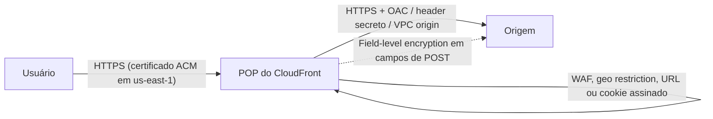

---
aliases:
  - Aula 18.4
modulo: 18
aula: 4
parte: "V Arquiteturas modernas"
dominios:
  - 1
lida: false
tags:
  - aula
  - saa-c03
  - modulo-18
---

# Aula 18.4: Segurança do viewer, HTTPS, assinaturas e WAF

[[18 - Borda e DNS CloudFront Global Accelerator e Route 53|Voltar ao módulo]]

> [!question] Pergunta que esta aula responde
> Como proteger o lado do usuário: cifrar o tráfego com o seu domínio, liberar conteúdo pago só para quem tem direito, bloquear países e filtrar ataques na borda?

## Dois trechos, duas proteções

A aula anterior protegeu o trecho **[[CloudFront]] para origem**. Esta protege o trecho **viewer para CloudFront**, o que o usuário vê. São quatro camadas, e a prova cobra cada uma com um cenário próprio:

1. **Cifrar** a conexão com o seu domínio (HTTPS e certificado).
2. **Autorizar** quem pode ver um conteúdo (URLs e cookies assinados).
3. **Restringir** por país ([[Geo Restriction|geo restriction]]).
4. **Filtrar** ataques e abuso ([[WAF]] e Shield) e **proteger campos sensíveis** de ponta a ponta ([[Field-Level Encryption|field-level encryption]]).

## HTTPS entre o viewer e o CloudFront

Cada distribuição ganha um domínio padrão `d1234abcd.cloudfront.net` com certificado da AWS. Para usar o **seu** domínio (`www.exemplo.com`), você configura um **nome alternativo de domínio** ([[CNAME]] alternativo) na distribuição e anexa um certificado que cubra esse nome.

Regras que caem na prova (verificado em novembro de 2026):

- O certificado do viewer vem do [[ACM]] e **precisa estar na Região us-east-1** (Norte da Virgínia), qualquer que seja a Região da origem. Esta é a pegadinha mais frequente do assunto. Para a conexão com uma origem que seja um [[Elastic Load Balancing|ELB]], o certificado pode estar em qualquer Região.
- Certificados do [[ACM]] **renovam sozinhos**. Um certificado **importado** (de uma [[Autoridade Certificadora|CA]] externa) exige que você o renove ou reimporte pelo menos 24 horas antes do vencimento.
- O [[CloudFront]] atende a conexões HTTPS usando **[[SNI]]** (Server Name Indication): o navegador informa o nome do site no handshake, e o CloudFront escolhe o certificado certo. Isso permite milhares de domínios em um mesmo endereço de borda. SNI é gratuito e é o padrão. A alternativa legada, **IP dedicado**, existe para clientes antigos que não suportam SNI e tem cobrança mensal alta; hoje esse caso é coberto por outras opções (como [[Anycast]] static IPs, consulte a documentação). Na prova, "sem custo extra" aponta para SNI.
- **[[HTTP]]/2** exige [[TLS]] 1.2 e [[SNI]]; **HTTP/3** exige TLS 1.3 e SNI. Você escolhe as versões de HTTP aceitas na distribuição.
- A **política de segurança** (security policy) define a versão mínima de [[TLS]] e os cifradores aceitos; clientes antigos que só falam TLS 1.0 ou 1.1 precisam de uma política compatível, o que reduz a segurança. Prefira a política mais nova que seus clientes aceitam.
- A **viewer protocol policy** de cada behavior escolhe: permitir [[HTTP]] e HTTPS, **redirecionar HTTP para HTTPS** ou aceitar só HTTPS. "Forçar HTTPS" na prova costuma ser "Redirect HTTP to HTTPS".

> [!warning] us-east-1 não é a Região da origem
> "A origem é um [[Application Load Balancer|ALB]] em `sa-east-1`, onde crio o certificado para o [[CloudFront]]?" A resposta é **us-east-1**. O certificado em `sa-east-1` serve para o ALB, não para o CloudFront. O mesmo vale para o **[[WAF]]** de uma distribuição: o [[Web ACL|web ACL]] de escopo `CLOUDFRONT` também se cria em us-east-1.

Para o trecho **origem**, o [[CloudFront]] também pode exigir HTTPS (origin protocol policy): somente HTTPS, ou casar com o protocolo do viewer. Combinado com a viewer protocol policy, você garante criptografia de ponta a ponta.

## Conteúdo privado: URLs e cookies assinados

Para um curso pago, relatórios internos ou vídeo sob demanda, o conteúdo só pode ser visto por quem tem direito. O [[CloudFront]] resolve com **assinatura**: seu sistema decide quem tem direito e entrega uma [[Credencial Temporaria|credencial temporária]].

Como funciona, em quatro passos:

1. No behavior, você marca **restringir acesso do viewer** (requer URL ou cookie assinado).
2. Você cria um **[[Key Group]]** (grupo de chaves) com a chave pública; a privada fica no seu servidor (o [[Secrets Manager]] é um bom lugar).
3. Quando um usuário autorizado pede o conteúdo, sua aplicação gera uma **URL assinada** ou **cookies assinados** com a chave privada.
4. O [[CloudFront]] confere a assinatura e a política (validade, IP) e entrega, ou responde 403.

| Quando usar | URL assinada | Cookie assinado |
|---|---|---|
| Arquivo único (um download, um instalador) | Sim | Possível, mas desnecessário |
| Muitos arquivos (vídeo HLS com centenas de segmentos, área de membros) | Pouco prático | Sim |
| Cliente que não suporta cookies (alguns aplicativos e players) | Sim | Não |
| Você não quer mudar as URLs existentes | Não | Sim |

A documentação (verificado em novembro de 2026) acrescenta: se existir URL assinada e cookie para o mesmo pedido, a **URL assinada tem precedência**; a AWS recomenda **[[Key Group|key groups]]** em vez dos antigos key pairs da conta (que dependiam do [[Usuario Root|usuário root]]); as chaves são RSA 2048 ou ECDSA 256.

**Política enlatada (canned) versus personalizada (custom).** A enlatada define só a data de expiração e vale para uma URL específica. A personalizada permite acrescentar **data de início**, **faixa de IP** do cliente e **curingas** no caminho, de modo que uma única política cobre uma pasta inteira. Cenário de prova: "liberar só para o IP do escritório" ou "válida a partir de segunda" pede política personalizada.

> [!example] Uma plataforma de cursos
> Um aluno compra o curso e a aplicação gera **cookies assinados** válidos por 4 horas para `/curso-42/*`. O player carrega o `.m3u8` e centenas de segmentos `.ts` sem que ninguém assine cada URL. Para o botão "baixar o PDF do certificado", a aplicação gera uma **URL assinada** de 10 minutos. Os dois convivem na mesma distribuição.

> [!info] Ligando os pontos
> A [[CloudFront Signed URL|URL assinada do CloudFront]] **não** é a [[Presigned URL|URL pré-assinada]] do [[S3]] (assunto do [[11 - Amazon S3 a Fundo|Módulo 11]]). A do S3 dá acesso direto ao [[Bucket|bucket]] e passa por fora do cache; a do [[CloudFront]] passa pela borda, usa o cache e permite política por faixa de IP. Se a pergunta fala em "entregar de forma privada, com [[CDN]]", a resposta é CloudFront.

## Restrição geográfica

A **[[Geo Restriction]]** (geo restriction) permite ou bloqueia países. Você escolhe uma **[[Allow List|lista de permissão]]** ou uma **lista de bloqueio** por país para toda a distribuição, e quem está em um país bloqueado recebe **403**. A documentação informa uma acurácia de cerca de 99,8%, endereços de localização desconhecida são servidos, e granularidade mais fina (por cidade, por exemplo) pede um serviço de geolocalização de terceiros. Para restringir só **parte** do conteúdo por país, a pegadinha é que a restrição vale para a distribuição inteira: use distribuições separadas ou uma função de borda com dados de geolocalização.

> [!tip] Geo restriction ou WAF geo match?
> Para bloqueio por país **mais flexível** (só um caminho, combinado com outras condições como IP ou header, ou com ação de contar em vez de bloquear), a resposta é a regra **geo match do [[WAF]]**. A [[Geo Restriction|geo restriction]] do [[CloudFront]] é a opção simples, de lista por país para a distribuição inteira.

Não confunda com a **geolocalização do [[Route 53]]** (aula 18.8), que decide **para onde** o [[DNS]] aponta, e não bloqueia conteúdo.

## WAF e Shield na borda

O [[WAF]] anexado à distribuição filtra os pedidos **na borda**, antes de chegarem à origem: [[Managed Rule Group|regras gerenciadas]] ([[SQL Injection|SQL injection]], [[Cross-Site Scripting|XSS]], reputação de IP), [[Throttling|limitação de taxa]] por IP e bloqueio por país ou por padrão de header. O [[Web ACL|web ACL]] de [[CloudFront]] fica em us-east-1 (escopo `CLOUDFRONT`). O [[Shield]] Standard protege contra ataques volumétricos comuns de [[Modelo OSI|camada 3]] e 4 sem custo extra. O módulo seguinte aprofunda WAF e Shield Advanced; aqui basta saber **onde** eles se conectam: a distribuição é o ponto de proteção ideal, porque descarta o tráfego ruim perto do atacante e longe da sua [[VPC]].

## Criptografia em nível de campo

O HTTPS protege o tráfego **no caminho**, mas o dado sensível (um número de cartão) ainda chega em texto claro a todos os componentes que terminam o [[TLS]] e à aplicação. A **[[Field-Level Encryption]]** cifra campos específicos do corpo de um `POST` **na borda**, com uma chave pública que você cadastra no [[CloudFront]]; só quem tem a chave privada, normalmente um serviço específico lá no fundo da arquitetura, consegue decifrar.

Pela documentação (quotas verificadas em novembro de 2026): até **10 campos** por pedido, **16 KB** por campo, corpo do pedido de até **1 MB**, [[Chave Assimetrica|criptografia assimétrica]], e a origem precisa suportar **chunked encoding**. O benefício é que o servidor web, o [[Application Load Balancer|ALB]] e as camadas intermediárias nunca veem o dado em claro.

## Como as proteções se encaixam

A leitura do diagrama: as verificações do viewer acontecem na borda, antes de qualquer custo de origem; o trecho até a origem tem a sua própria proteção.

## Como isso cai na prova

Cobre **Task 1.2** (proteger acesso a recursos e [[Criptografia em Transito|dados em trânsito]]) e **Task 1.3** (proteção de dados em trânsito).

**Padrões de cenário**
- "Usar HTTPS com o domínio da empresa no [[CloudFront]]": certificado do [[ACM]] em us-east-1 e [[CNAME]] alternativo.
- "Assinatura para vídeo com muitos arquivos": cookies assinados.
- "Link temporário para um arquivo": URL assinada.
- "Bloquear acesso de certos países": [[Geo Restriction|geo restriction]] (lista de bloqueio).
- "Proteger número de cartão mesmo dentro da aplicação": [[Field-Level Encryption|field-level encryption]].
- "Bloquear [[SQL Injection|SQL injection]] e limitar taxa": [[WAF]] no [[CloudFront]].

**Palavras-chave em inglês**: "[[CloudFront Signed URL|signed URLs]]", "[[CloudFront Signed Cookie|signed cookies]]", "trusted [[Key Group|key groups]]", "[[Geo Restriction|geo restriction]]", "geographic restrictions", "[[Field-Level Encryption|field-level encryption]]", "[[SNI]]", "us-east-1", "viewer protocol policy", "redirect [[HTTP]] to HTTPS".

**Pegadinhas clássicas**
- Certificado do [[ACM]] para [[CloudFront]] **sempre em us-east-1**.
- [[Presigned URL|URL pré-assinada]] do [[S3]] não é a [[CloudFront Signed URL|URL assinada do CloudFront]].
- [[Geo Restriction|Geo restriction]] vale para a distribuição toda e devolve 403.
- [[Geo Restriction|Geo restriction]] do [[CloudFront]] não é a geolocalização do [[Route 53]].
- [[Field-Level Encryption|Field-level encryption]] é para campos de formulário `POST`, não para arquivos.

| Requisito | Resposta provável | Por quê |
|---|---|---|
| Domínio próprio com HTTPS | [[ACM]] em us-east-1 + [[CNAME]] alternativo | Exigência do [[CloudFront]] |
| Muitos arquivos privados | Cookies assinados | Uma credencial para o conjunto |
| Um arquivo privado com prazo | URL assinada | Granularidade por arquivo |
| Liberar só um IP | URL assinada com política personalizada | A enlatada não tem IP |
| Bloquear um país | [[Geo Restriction\|Geo restriction]] | Lista de bloqueio por país |
| Dado de cartão invisível aos servidores | [[Field-Level Encryption\|Field-level encryption]] | Cifra na borda |
| Entregar privado com cache e [[WAF]] | [[CloudFront Signed URL\|URL assinada do CloudFront]] e [[Origin Access Control\|OAC]] no [[Bucket\|bucket]] | Passa pela borda e o bucket fica privado |
| Criptografia ponta a ponta | Viewer protocol policy HTTPS e origin protocol policy HTTPS | Cifra os dois trechos |
| Bloqueio por país só em um caminho ou combinado com outras regras | Regra geo match do [[WAF]] | Mais flexível que a [[Geo Restriction\|geo restriction]] |
| HTTPS com domínio próprio sem custo extra | [[SNI]] | IP dedicado é legado e pago |

## Resumo

> [!abstract] A aula em uma frase
> A proteção do lado do usuário combina HTTPS com certificado do [[ACM]] em us-east-1, URLs ou cookies assinados para conteúdo privado, restrição por país, [[WAF]] na borda e criptografia de campos para dados sensíveis.

**A lógica, em 6 passos**
1. Configure o nome alternativo de domínio e o certificado do [[ACM]] em us-east-1.
2. Force HTTPS na viewer protocol policy (redirecionar [[HTTP]] para HTTPS) e escolha a security policy.
3. Para conteúdo privado, exija assinatura no behavior e use um [[Key Group|key group]].
4. Use URL assinada para um arquivo e cookie assinado para muitos; a política personalizada acrescenta IP e início.
5. Bloqueie ou permita países com [[Geo Restriction|geo restriction]] (403), sabendo do limite de granularidade.
6. Anexe o [[WAF]] (us-east-1) e cifre campos sensíveis com [[Field-Level Encryption|field-level encryption]].

**Números para lembrar** (verificados em novembro de 2026)

| O quê | Valor | Por que importa |
|---|---|---|
| Região do certificado do viewer | us-east-1 | Pegadinha constante |
| Campos por [[Field-Level Encryption\|field-level encryption]] | até 10, de 16 KB, corpo de até 1 MB | Limites |
| Chaves de assinatura | RSA 2048 ou ECDSA 256 | Formato aceito |
| Acurácia da [[Geo Restriction\|geo restriction]] | cerca de 99,8% | Limite de precisão |
| Certificado importado | renovar 24 h antes | Responsabilidade sua |
| [[HTTP]]/3 | [[TLS]] 1.3 e [[SNI]] | Requisito |

**Na prática, isso significa**
- Todo projeto com [[CloudFront]] e domínio próprio começa pedindo o certificado em us-east-1.
- Guarde a chave privada de assinatura em um cofre de segredos, nunca no código.
- Se o cenário fala de "cada arquivo", pense em URL; se fala de "área inteira", pense em cookie.

> [!tip] Liga com
> Vem da [[18.03 - Origens OAC Failover e Origin Shield|aula 18.3]]. Segue para a [[18.05 - Edge Compute Custo e Planos do CloudFront|aula 18.5]]. O [[WAF]] e o Shield completos vêm no [[19 - Seguranca de Aplicacoes e Deteccao de Ameacas|Módulo 19]], e o [[ACM]] foi tratado no [[08 - Criptografia e Protecao de Dados|Módulo 8]].

## Erros comuns

- **"Criei o certificado na Região da minha aplicação."** Para o [[CloudFront]], tem de ser us-east-1.
- **"[[CloudFront Signed URL|URL assinada do CloudFront]] é igual à pré-assinada do [[S3]]."** São mecanismos diferentes, com comportamentos diferentes.
- **"[[Geo Restriction|Geo restriction]] bloqueia só uma pasta."** Ela vale para a distribuição inteira.
- **"HTTPS entre o viewer e o [[CloudFront]] já protege tudo."** Dados sensíveis ainda chegam em claro aos componentes que terminam o [[TLS]]; [[Field-Level Encryption|field-level encryption]] cobre isso.
- **"[[Origin Access Identity|OAI]] e [[Origin Access Control|OAC]] são a mesma coisa, ou o OAC dispensa a assinatura."** O OAC protege o trecho [[CloudFront]] para [[S3]]; a URL assinada protege o trecho viewer para CloudFront. Combine os dois.
- **"Importei o certificado, ele renova sozinho."** Só os certificados emitidos pelo [[ACM]] renovam sozinhos.

## Pratique

**1.** Uma empresa tem a aplicação em `sa-east-1` e quer servir `www.exemplo.com.br` por uma [[CloudFront Distribution|distribuição do CloudFront]] com HTTPS. Onde o certificado do [[ACM]] para a distribuição deve ser criado?

- [ ] a) Em `sa-east-1`, a mesma Região da aplicação
- [ ] b) Em us-east-1
- [ ] c) Em qualquer Região, o CloudFront replica
- [ ] d) Em `eu-west-1`, a Região da borda mais próxima

**2.** Uma plataforma de vídeo serve milhares de segmentos HLS a assinantes e não quer gerar uma URL assinada por segmento nem mudar as URLs existentes. Qual abordagem atende?

- [ ] a) Cookies assinados do CloudFront
- [ ] b) URLs pré-assinadas do S3 para cada segmento
- [ ] c) Bucket público com nomes de arquivo aleatórios
- [ ] d) Geo restriction por país

**3.** Quais DUAS afirmações sobre URLs e cookies assinados estão corretas? (Escolha DUAS.)

- [ ] a) A URL assinada tem precedência sobre o cookie assinado para o mesmo pedido
- [ ] b) A política personalizada permite restringir por faixa de IP
- [ ] c) A política enlatada permite restringir por faixa de IP
- [ ] d) Key pairs da conta root são a opção recomendada pela AWS
- [ ] e) Cookies assinados são indicados quando o cliente não suporta cookies

**4.** Uma loja só vende para alguns países e quer bloquear acessos de todos os outros ao site inteiro, servido pelo [[CloudFront]]. Qual recurso resolve com o menor esforço?

- [ ] a) Geolocation routing do Route 53 com registros por país
- [ ] b) Uma regra no security group da origem
- [ ] c) Uma ACL de rede (NACL) na VPC
- [ ] d) Geo restriction do CloudFront com lista de permissão

**5.** Uma empresa de pagamentos quer que o número do cartão enviado em um formulário `POST` nunca apareça em claro no [[Application Load Balancer|ALB]] nem nos servidores web, só em um [[Microsservicos|microsserviço]] de pagamentos. O que usar?

- [ ] a) HTTPS com TLS 1.3 entre o viewer e o CloudFront
- [ ] b) Field-level encryption no CloudFront
- [ ] c) WAF com regra de bloqueio de cartões
- [ ] d) Cookies assinados no behavior de checkout

**6.** Uma empresa de e-commerce recebeu uma auditoria exigindo que nenhum cliente consiga abrir o site por [[HTTP]] simples, sem quebrar links antigos que usam `http://`. Qual configuração do [[CloudFront]] atende com o MENOR esforço?

- [ ] a) Viewer protocol policy do behavior em "Redirect HTTP to HTTPS"
- [ ] b) Origin protocol policy da origem em "HTTPS only"
- [ ] c) Uma regra no security group do ALB bloqueando a porta 80
- [ ] d) Uma bucket policy do S3 que nega pedidos sem `aws:SecureTransport`

**7.** Um link de download deve funcionar apenas para um IP específico de cliente e só a partir de uma data futura. Qual opção atende?

- [ ] a) URL assinada com política enlatada
- [ ] b) URL assinada com política personalizada
- [ ] c) URL pré-assinada do S3 com expiração de 7 dias
- [ ] d) Geo restriction com lista de permissão

**8.** O [[WAF]] de uma [[CloudFront Distribution|distribuição do CloudFront]] precisa ser criado. Em qual Região e escopo ele deve existir?

- [ ] a) Na Região da origem, com escopo regional
- [ ] b) Em qualquer Região, o CloudFront encontra o web ACL
- [ ] c) Em us-east-1, com escopo CLOUDFRONT
- [ ] d) Em us-east-1, com escopo regional

**9.** Quais DUAS afirmações sobre HTTPS no [[CloudFront]] estão corretas? (Escolha DUAS.)

- [ ] a) O CloudFront usa SNI para escolher o certificado pelo nome do site
- [ ] b) Certificados importados renovam automaticamente
- [ ] c) HTTP/3 exige TLS 1.3 e SNI
- [ ] d) Um certificado emitido em `sa-east-1` serve ao CloudFront
- [ ] e) A geo restriction cifra o tráfego entre o viewer e a borda

**10.** Um time usa URLs pré-assinadas do [[S3]] para entregar PDFs privados e quer passar a usar cache de borda, [[WAF]] e restrição de IP. Qual mudança atende?

- [ ] a) Aumentar a expiração das URLs pré-assinadas do S3
- [ ] b) Desligar o Block Public Access para o CDN acessar os objetos diretamente
- [ ] c) Migrar para URLs assinadas do CloudFront com OAC no bucket
- [ ] d) Criar um security group para o bucket S3

> [!success]- Gabarito
> **1. b)** O certificado de uma distribuição deve estar em us-east-1, independentemente da Região da origem; a alternativa a) vale para o [[Application Load Balancer|ALB]], não para o [[CloudFront]], e a alternativa c) e a alternativa d) ignoram a regra.
> **2. a)** Cookies assinados cobrem muitos arquivos sem mudar URLs; as URLs do [[S3]] da b passam por fora do [[CDN]], o [[Bucket|bucket]] público da c abre mão da privacidade e a [[Geo Restriction|geo restriction]] da d não identifica assinantes.
> **3. a) e b)** A URL assinada vence o cookie e a política personalizada aceita IP; a enlatada não aceita IP, [[Key Group|key groups]] (e não key pairs da [[Usuario Root|conta root]]) são o recomendado, e cookies servem quando o cliente os suporta.
> **4. d)** A [[Geo Restriction|geo restriction]] com [[Allow List|lista de permissão]] bloqueia países para a distribuição inteira; o [[Route 53]] da a só direciona [[DNS]], e SG e [[Network ACL|NACL]] da origem não enxergam o país do usuário final.
> **5. b)** A [[Field-Level Encryption|field-level encryption]] cifra o campo na borda, e só o serviço com a chave privada o lê; o [[TLS]] da a protege só o trânsito, o [[WAF]] da c não cifra e os cookies da d não têm relação.
> **6. a)** A viewer protocol policy redireciona [[HTTP]] para HTTPS sem quebrar links antigos; a alternativa b) protege só o trecho até a origem, a alternativa c) bloquearia a porta 80 da origem e não do viewer, e a alternativa d) age só em acessos diretos ao [[Bucket|bucket]] e nem redireciona o viewer.
> **7. b)** A política personalizada aceita IP e data de início; a enlatada da a só tem expiração, a do [[S3]] da c não tem IP e a [[Geo Restriction|geo restriction]] da d trata de países.
> **8. c)** O [[Web ACL|web ACL]] do [[CloudFront]] fica em us-east-1 com escopo CLOUDFRONT; a Região da origem com escopo regional serve a [[Application Load Balancer|ALB]] e [[API Gateway]], não a CloudFront; us-east-1 só com escopo regional também não é anexável a uma distribuição.
> **9. a) e c)** [[SNI]] escolhe o certificado e [[HTTP]]/3 exige [[TLS]] 1.3 e SNI; certificados importados exigem renovação manual, o certificado de `sa-east-1` não serve ao [[CloudFront]] e a [[Geo Restriction|geo restriction]] não cifra nada.
> **10. c)** [[CloudFront Signed URL|URLs assinadas do CloudFront]] passam pela borda (cache, [[WAF]], política com IP) e o [[Origin Access Control|OAC]] mantém o [[Bucket|bucket]] privado; as demais não trazem cache nem WAF, e desligar o [[Block Public Access]] enfraquece a segurança.

## Para aprofundar

- [ ] [Serve private content with signed URLs and signed cookies](https://docs.aws.amazon.com/AmazonCloudFront/latest/DeveloperGuide/PrivateContent.html) (AWS Documentation): [[Key Group|key groups]], políticas e escolha entre URL e cookie.
- [ ] [Use HTTPS with CloudFront](https://docs.aws.amazon.com/AmazonCloudFront/latest/DeveloperGuide/using-https.html) (AWS Documentation): certificados, [[SNI]], protocolos e security policies.
- [ ] [Restrict the geographic distribution of your content](https://docs.aws.amazon.com/AmazonCloudFront/latest/DeveloperGuide/georestrictions.html) (AWS Documentation): listas de permissão e bloqueio, e o comportamento 403.

Próxima aula: [[18.05 - Edge Compute Custo e Planos do CloudFront|Aula 18.5: Edge compute, custo e planos do CloudFront]].
