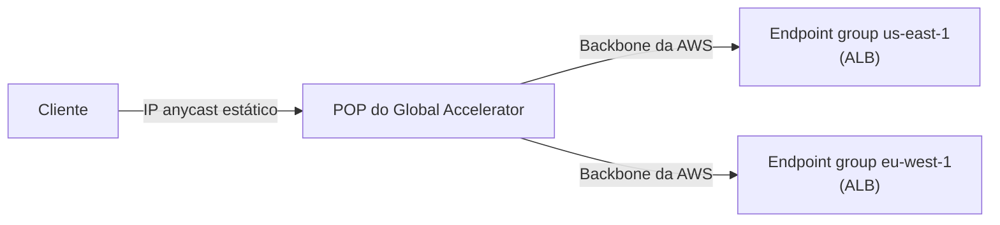

---
aliases:
  - Aula 18.6
modulo: 18
aula: 6
parte: "V Arquiteturas modernas"
dominios:
  - 2
  - 3
  - 4
lida: false
tags:
  - aula
  - saa-c03
  - modulo-18
---

# Aula 18.6: Global Accelerator, anycast e a rede global da AWS

[[18 - Borda e DNS CloudFront Global Accelerator e Route 53|Voltar ao módulo]]

> [!question] Pergunta que esta aula responde
> Quando o conteúdo não é cacheável (um jogo em [[UDP]], uma API [[TCP]], uma aplicação que exige IP fixo), como levar o usuário à melhor Região pela rede da AWS e trocar de endpoint em segundos, sem depender de [[DNS]]?

## O problema que o CloudFront não resolve

O [[CloudFront]] acelera principalmente **[[HTTP]] e HTTPS** e brilha com conteúdo **cacheável**. Mas há cargas que ele não atende bem: jogos em tempo real ([[UDP]]), VoIP, IoT com MQTT, APIs [[TCP]] não HTTP, e aplicações HTTP que não podem ser cacheadas e cujos clientes exigem **IPs fixos**.

Sem ajuda, o pacote do usuário atravessa a **internet pública**, salto a salto, com rotas que mudam, congestionam e variam de [[Latencia|latência]]. O **[[Global Accelerator]]** (GA) resolve levando o tráfego do usuário para a **[[Backbone|rede global da AWS]]** o mais cedo possível, no [[Edge Location|POP]] mais próximo, e daí até o endpoint pela rede privada da AWS.

## O mecanismo: anycast e backbone

**[[Anycast]]** significa que o **mesmo endereço IP** é anunciado em muitos pontos do mundo, e a internet entrega o pacote ao ponto mais próximo (em termos de rede) de quem o enviou. Ao criar um acelerador, o GA entrega **dois IPs anycast estáticos** ([[IPv4]]). Você os usa no [[DNS]] do seu serviço (ou os entrega a clientes que exigem [[Allow List|allow-list]]); eles não mudam durante a vida do acelerador. Cada acelerador também tem um nome DNS (`*.awsglobalaccelerator.com`).

Os passos do tráfego:

1. O cliente resolve o nome e recebe os [[Anycast|IPs anycast]].
2. O pacote entra no **[[Edge Location|POP]] do GA mais próximo** (a internet roteia para lá).
3. O GA **termina a conexão [[TCP]] no [[Edge Location|POP]]** (o cliente fala com um servidor perto dele) e abre a conexão até o endpoint pela **rede de [[Backbone|backbone da AWS]]**, mais estável que a internet pública.
4. O GA escolhe o **endpoint saudável mais adequado** (por proximidade, saúde e pesos) e entrega.

O ganho vem de **encurtar o trecho na internet pública** e de trocar de destino sem esperar caches de [[DNS]].

## Os componentes

| Componente | O que é |
|---|---|
| **Acelerador** (accelerator) | O recurso raiz: dá os 2 [[Anycast\|IPs anycast]] e o nome [[DNS]]. Padrão (standard) ou de roteamento personalizado |
| **[[Listener]]** | Define portas e protocolo aceitos: **[[TCP]], [[UDP]]** ou os dois |
| **[[Endpoint Group]]** | Um grupo **por Região** que recebe tráfego do [[Listener\|listener]] |
| **Endpoint** | O destino concreto: [[Application Load Balancer\|ALB]], [[Network Load Balancer\|NLB]], [[EC2\|instância EC2]] ou [[Elastic IP]] |
| **[[Traffic Dial\|Traffic dial]]** | Percentual de tráfego enviado a cada endpoint group |
| **Pesos** (weights) | Divisão do tráfego entre os endpoints do grupo |

Endpoints de aceleradores padrão: **[[Application Load Balancer]], [[Network Load Balancer]], [[EC2|instâncias EC2]] e [[Elastic IP|Elastic IPs]]**. Não há suporte a [[Local Zone|Local Zones]].

### Traffic dial e pesos

O **[[Traffic Dial]]** (de 0 a 100%) controla quanto do tráfego que **já foi direcionado** ao grupo ele realmente recebe; o restante é redirecionado a outros grupos. Dial zero em um grupo é a forma de **drenar uma Região** para manutenção ou para um deploy ([[Blue-Green Deployment|blue/green]] entre [[Regiao AWS|Regiões]]). Já os **pesos** dividem o tráfego **entre os endpoints dentro** do grupo.

> [!example] Lançar uma versão nova com cautela
> A aplicação roda em `us-east-1` e `eu-west-1`. Você publica a versão 2 só em `eu-west-1` e baixa o dial desse grupo a 10%: só um décimo do tráfego que o GA dirigiria àquela Região chega à versão nova. Se as métricas ficarem boas, sobe o dial aos poucos. Para esvaziar uma Região antes de uma manutenção, dial 0.

### Saúde e failover

O GA verifica a saúde dos endpoints e **desvia o tráfego dos não saudáveis**. A FAQ informa detecção em menos de um minuto e propagação de mudanças em segundos (verificado em novembro de 2026), o que costuma ser bem mais rápido que o [[Failover|failover]] de [[DNS]], limitado por TTLs e caches de resolvers.

- Para [[Application Load Balancer|ALB]] e [[Network Load Balancer|NLB]], o GA usa a **saúde do próprio [[Elastic Load Balancing|ELB]]** (um ALB é considerado saudável se cada [[Target Group|target group]] tiver ao menos um target saudável).
- Para [[EC2]] e [[Elastic IP]], usa as **[[Health Check|health checks]] do GA** (porta, protocolo, intervalo, limiar). Em [[Listener|listeners]] [[UDP]] com EC2 ou EIP, é preciso um servidor [[TCP]] só para a checagem.
- Se **nenhum** endpoint do grupo estiver saudável, o GA envia o tráfego a **todos** (melhor tentar do que descartar).
- Conexões já estabelecidas continuam até o idle [[Timeout|timeout]] ([[TCP]]: 340 s, [[UDP]]: 30 s).

### Preservação do IP do cliente

Em aceleradores padrão, a **[[Client IP Preservation]]** é opcional e só funciona para alguns tipos de endpoint; quando ligada, a aplicação vê o IP real do usuário (útil para logs e regras de segurança). No roteamento personalizado, ela é sempre ativa.

## Roteamento personalizado (custom routing)

Um tipo especial de acelerador, para casos em que **sua aplicação decide** qual instância atende qual usuário, por exemplo, **jogos multiplayer** que alocam jogadores a uma sessão específica, VoIP e apps de mapeamento determinístico. Mapeia combinações de IP e porta do acelerador a **destinos específicos em [[Sub-rede|subnets]] de [[VPC]]**. Pontos da documentação: só [[IPv4]], **sem [[Health Check|health checks]] nem [[Failover|failover]]** (a decisão é da aplicação), e os endpoints são **subnets de VPC**. A palavra-chave de prova: "mapear usuários deterministicamente a uma instância específica".

## Outros recursos úteis

- **[[IPv6]] [[Dual-Stack|dual-stack]]:** além dos 2 IPs [[IPv4]], mais 2 IPv6; o dual-stack suporta [[Application Load Balancer|ALB]], [[Network Load Balancer|NLB]] e [[EC2]] com IPv6 (consulte as restrições na documentação, por exemplo a exigência de preservar o IP do cliente).
- **BYOIP** (Bring Your Own IP): usar um bloco de [[IPv4]] seu para o acelerador.
- **Shield Standard** vem ativo por padrão; Shield Advanced é opcional ([[Shield]], módulo 19).
- **Suporte entre contas:** endpoints de outra conta, configurável.
- **[[Route 53]] alias:** `www.exemplo.com` pode ser um **alias** para o nome do acelerador (aula 18.7).

## Custo

Cobra-se uma **taxa fixa por hora por acelerador** mais um valor por GB na direção dominante do tráfego (a "Premium [[Data Transfer|data transfer]]"), além dos IPs públicos [[IPv4]] envolvidos (verificado em novembro de 2026; tarifas na página oficial). Diferente do [[CloudFront]], **não há camada gratuita** de cache: o GA não guarda conteúdo, só encaminha.

## CloudFront versus Global Accelerator versus Route 53

A comparação mais cobrada do módulo:

| Critério | [[CloudFront]] | [[Global Accelerator]] | [[Route 53]] |
|---|---|---|---|
| Camada | Aplicação ([[HTTP]]/HTTPS) | Transporte ([[TCP]] e [[UDP]]) | [[DNS]] |
| [[Cache]] | Sim | Não | Não |
| IPs de entrada | Muitos, variáveis (a menos de [[Anycast]] static IPs) | **2 IPs estáticos** | Responde com IPs dos endpoints |
| [[Failover]] | Origin group (por pedido) | Rápido, por saúde do endpoint, sem [[TTL]] | Depende do TTL e da [[Health Check\|checagem de saúde]] |
| Melhor para | Conteúdo estático e dinâmico web | Jogos, VoIP, IoT, APIs [[TCP]]/UDP, IP fixo, [[Failover\|failover]] multi-Região rápido | Direcionar nomes, múltiplas [[Routing Policy\|políticas de roteamento]] |
| Mecanismo | [[Cache]] na borda + [[Backbone\|backbone]] | [[Anycast]] + backbone | Respostas [[DNS]] |

> [!info] Ligando os pontos
> O [[12 - Balanceamento de Carga e Auto Scaling|Módulo 12]] ensinou que [[Application Load Balancer|ALB]] é [[HTTP]] e [[Network Load Balancer|NLB]] é [[TCP]] e [[UDP]]; o GA entrega o tráfego **ao** ALB ou NLB certos entre [[Regiao AWS|Regiões]]. E o [[07 - Conectividade Hibrida e entre VPCs|Módulo 7]] mostrou como a rede AWS conecta Regiões; o GA aproveita essa rede.

A FAQ do GA aponta como ajuste ideal para usos **não [[HTTP]]** (jogos com [[UDP]], IoT com MQTT, VoIP) e para HTTP que **precisa de IPs estáticos** ou de **[[Failover|failover]] regional rápido**. Se o conteúdo é cacheável e web, a resposta continua sendo [[CloudFront]].

## Como isso cai na prova

Cobre **Task 2.2** (resiliência e [[Failover|failover]]), **Task 3.4** (redes de alto desempenho) e **Task 4.4** (otimizar custo de rede).

**Padrões de cenário**
- "Jogo com [[UDP]] e usuários globais, menor [[Latencia|latência]]": [[Global Accelerator]] ([[Network Load Balancer|NLB]] como endpoint).
- "Cliente exige IPs fixos para [[Allow List|allow-list]] com aplicação multi-Região": GA.
- "[[Failover]] regional em segundos, sem esperar [[TTL]] de [[DNS]]": GA.
- "Distribuir um deploy gradualmente entre [[Regiao AWS|Regiões]]": [[Traffic Dial|traffic dial]].
- "Mapear jogadores a servidores específicos": custom routing.
- "Conteúdo estático/cacheável global": [[CloudFront]] (não GA).

**Palavras-chave em inglês**: "static [[Anycast|anycast]] IP addresses", "[[UDP]]", "[[TCP]]", "gaming", "VoIP", "MQTT", "AWS global network", "[[Traffic Dial|traffic dial]]", "endpoint group", "custom routing accelerator".

**Pegadinhas clássicas**
- GA **não faz cache** e não comprime; ele só encaminha.
- GA trabalha em [[TCP]] e [[UDP]], não é restrito a [[HTTP]].
- O [[Traffic Dial|traffic dial]] vale por **endpoint group** (Região); pesos valem por **endpoint**.
- O custom routing não tem [[Health Check|health check]] nem [[Failover|failover]].
- Cenário [[HTTP]] com cache e redução de carga na origem aponta para [[CloudFront]], mesmo com usuários globais.

| Requisito | Resposta provável | Por quê |
|---|---|---|
| [[UDP]]/TCP global com [[Latencia\|latência]] baixa | [[Global Accelerator]] | [[Anycast]] + [[Backbone\|backbone]] |
| IPs fixos para [[Allow List\|allow-list]] multi-Região | [[Global Accelerator]] | 2 IPs estáticos |
| [[Failover]] entre [[Regiao AWS\|Regiões]] em segundos | [[Global Accelerator]] | Sem depender de [[TTL]] |
| Esvaziar uma Região para manutenção | [[Traffic Dial\|Traffic dial]] 0 | Redireciona sem mexer em [[DNS]] |
| Mapeamento determinístico usuário a servidor | Custom routing | Porta de entrada define o destino |
| Entregar vídeo e imagens com cache | [[CloudFront]] | GA não faz cache |

## Resumo

> [!abstract] A aula em uma frase
> O [[Global Accelerator]] dá dois [[Anycast|IPs anycast]] estáticos que levam o tráfego [[TCP]] e [[UDP]] à borda mais próxima e dali ao endpoint saudável pela rede da AWS, com [[Failover|failover]] regional rápido e controle fino por [[Traffic Dial|traffic dial]].

**A lógica, em 6 passos**
1. O cliente chega ao [[Anycast|IP anycast]] e entra no [[Edge Location|POP]] mais próximo.
2. O GA termina o [[TCP]] no [[Edge Location|POP]] e usa o [[Backbone|backbone da AWS]] até o endpoint.
3. [[Listener]] define portas e protocolo ([[TCP]], [[UDP]]); [[Endpoint Group|endpoint groups]] são por Região.
4. [[Traffic Dial|Traffic dial]] regula o percentual por Região; pesos dividem entre endpoints.
5. O GA monitora a saúde e tira endpoints ruins do caminho em menos de um minuto.
6. Custom routing mapeia IP e porta a um destino específico quando a aplicação decide.

**Números para lembrar** (verificados em novembro de 2026)

| O quê | Valor | Por que importa |
|---|---|---|
| [[Anycast\|IPs anycast]] estáticos | 2 ([[IPv4]]); 4 em [[Dual-Stack\|dual-stack]] | [[Allow List\|Allow-list]] e [[DNS]] |
| Idle [[Timeout\|timeout]] [[TCP]] / [[UDP]] | 340 s / 30 s | Conexões longas |
| Endpoint group | Um por Região | Estrutura |
| Detecção de falha | menos de 1 minuto | [[Failover]] rápido |
| Protocolos | [[TCP]] e [[UDP]] | Escopo |

**Na prática, isso significa**
- Escolha GA quando a pergunta fala em [[UDP]], IPs fixos ou [[Failover|failover]] rápido entre [[Regiao AWS|Regiões]].
- Um acelerador com [[Network Load Balancer|NLB]] como endpoint é a combinação de manual para jogos e IoT.
- Não esqueça o custo fixo por hora: GA só vale quando resolve um requisito real.

> [!tip] Liga com
> Vem da [[18.05 - Edge Compute Custo e Planos do CloudFront|aula 18.5]]. Segue para a [[18.07 - Route 53 Fundamentos Zonas Registros e Alias|aula 18.7]], que cobre [[DNS]]. O [[Failover|failover]] de DNS é comparado ao do GA na [[18.09 - Health Checks Failover e Application Recovery Controller|aula 18.9]].

## Erros comuns

- **"[[Global Accelerator]] é um [[CDN]]."** Ele não guarda conteúdo; só encaminha pela rede da AWS.
- **"O [[Traffic Dial|traffic dial]] divide o tráfego entre endpoints."** Ele regula grupos ([[Regiao AWS|Regiões]]); pesos dividem endpoints.
- **"Preciso de GA para qualquer site global."** Para conteúdo web cacheável, o [[CloudFront]] é melhor e mais barato.
- **"O GA só serve [[HTTP]]."** Ele serve [[TCP]] e [[UDP]].
- **"Custom routing faz [[Failover|failover]]."** Ele não tem [[Health Check|health checks]] nem failover.

## Pratique

**1.** Uma empresa de jogos roda servidores [[UDP]] em duas [[Regiao AWS|Regiões]] e precisa levar jogadores do mundo inteiro ao servidor saudável mais próximo, com IPs estáveis para os clientes. Qual solução atende?

- [ ] a) CloudFront com origem em um NLB
- [ ] b) Route 53 com política de latência e health checks apenas
- [ ] c) Global Accelerator com NLB como endpoints
- [ ] d) Um ALB em cada Região com Route 53 geolocation

**2.** Um parceiro só libera tráfego de entrada para IPs previamente cadastrados. A aplicação roda em [[Application Load Balancer|ALBs]] em três [[Regiao AWS|Regiões]], e a empresa quer manter os mesmos IPs ao adicionar Regiões. Qual abordagem atende?

- [ ] a) Elastic IP em cada ALB
- [ ] b) Alias do Route 53 para cada ALB
- [ ] c) CloudFront com a lista de IPs de borda publicada pela AWS
- [ ] d) Global Accelerator com os 2 IPs anycast estáticos

**3.** Quais DUAS afirmações sobre o [[Global Accelerator]] estão corretas? (Escolha DUAS.)

- [ ] a) Ele armazena conteúdo em cache nos POPs
- [ ] b) Ele suporta os protocolos TCP e UDP
- [ ] c) Ele fornece dois endereços IP anycast estáticos
- [ ] d) Ele só aceita endpoints HTTP
- [ ] e) Ele depende do TTL de DNS para o failover

**4.** A equipe quer esvaziar a Região `us-east-1` para manutenção planejada, mantendo `eu-west-1` ativa, sem alterar [[DNS]]. O que fazer no [[Global Accelerator]]?

- [ ] a) Remover os IPs anycast do acelerador
- [ ] b) Colocar o peso dos endpoints de `us-east-1` em 255 e os de `eu-west-1` em 1
- [ ] c) Reduzir o traffic dial do endpoint group de `us-east-1` a zero
- [ ] d) Excluir o listener

**5.** Uma aplicação de [[Streaming de Dados|streaming]] de vídeo sob demanda serve arquivos cacheáveis a usuários do mundo todo, e a prioridade é reduzir carga e custo na origem. Qual serviço é a melhor escolha?

- [ ] a) CloudFront
- [ ] b) Global Accelerator
- [ ] c) Route 53 com política geográfica
- [ ] d) Direct Connect

**6.** Um serviço de mapas precisa direcionar cada usuário a uma [[EC2|instância EC2]] específica, decidida pela aplicação, com IP e porta determinando o destino. Qual tipo de acelerador usar?

- [ ] a) Acelerador padrão com pesos iguais e client IP preservation
- [ ] b) Acelerador de roteamento personalizado
- [ ] c) CloudFront com origin group
- [ ] d) Route 53 com política multivalue

**7.** Um acelerador padrão tem endpoints [[EC2]] e um [[Listener|listener]] [[UDP]]. O GA marca todos como não saudáveis. Qual é a causa provável?

- [ ] a) Não há servidor TCP respondendo à checagem de saúde
- [ ] b) O traffic dial está em 100%
- [ ] c) O listener aceita tráfego IPv4 e o acelerador usa IPs anycast estáticos
- [ ] d) Os pesos estão iguais

**8.** Quais DUAS vantagens do GA sobre o [[Failover|failover]] por [[DNS]] são verdadeiras? (Escolha DUAS.)

- [ ] a) Não depende de TTL e de caches de resolvers para trocar o destino
- [ ] b) Usa IPs que nunca mudam durante a vida do acelerador
- [ ] c) Evita custos fixos por hora
- [ ] d) Dispensa health checks
- [ ] e) Armazena a página de erro em cache

**9.** Uma empresa abriu uma nova Região em um acelerador do [[Global Accelerator]] e quer enviar apenas 10% do tráfego a ela durante a validação, sem mexer em [[DNS]]. O que configurar?

- [ ] a) O intervalo da checagem de saúde do endpoint group em 10 segundos
- [ ] b) O traffic dial do endpoint group da nova Região em 10%
- [ ] c) O peso 10 em todos os endpoints do endpoint group da Região antiga
- [ ] d) Um segundo listener na porta 10 apontando para a nova Região

**10.** Uma empresa expõe uma API [[HTTP]] dinâmica (aceita `POST` e `PUT`) por [[Application Load Balancer|ALBs]] em duas [[Regiao AWS|Regiões]]. Um parceiro exige [[Allow List|allow-list]] de IPs fixos, e o [[Failover|failover]] entre Regiões não pode esperar [[TTL]] de [[DNS]] nem ficar limitado a `GET`. Qual opção atende?

- [ ] a) CloudFront com CachingDisabled e um origin group com os dois ALBs
- [ ] b) Route 53 com failover e TTL de 60 segundos
- [ ] c) Origin Shield em cada ALB
- [ ] d) Global Accelerator com os ALBs como endpoints

> [!success]- Gabarito
> **1. c)** Jogos em [[UDP]] com IPs estáveis e [[Failover|failover]] pedem [[Global Accelerator]] com [[Network Load Balancer|NLB]]; o [[CloudFront]] da a é [[HTTP]] e cache, a [[Latency-Based Routing|política de latência]] da b não dá IP estático nem failover rápido, e a alternativa d) usa [[Application Load Balancer|ALB]] (só HTTP) e [[DNS]], sem UDP e sem IPs estáveis.
> **2. d)** Os 2 [[Anycast|IPs anycast]] ficam fixos mesmo ao adicionar [[Regiao AWS|Regiões]]; [[Elastic IP|Elastic IPs]] da a e alias da b não dão IP único, e a lista de IPs de borda da c não é fixa.
> **3. b) e c)** O GA suporta [[TCP]] e [[UDP]] e fornece 2 [[Anycast|IPs anycast]]; ele não faz cache, aceita [[Application Load Balancer|ALB]], [[Network Load Balancer|NLB]], [[EC2]] e [[Elastic IP|EIP]], e o [[Failover|failover]] não depende do [[TTL]].
> **4. c)** O [[Traffic Dial|traffic dial]] em zero no grupo de `us-east-1` drena a Região; remover IPs, mudar pesos ou excluir o [[Listener|listener]] afeta todo o serviço ou não drena.
> **5. a)** Conteúdo cacheável e redução de carga na origem apontam para [[CloudFront]]; o GA da b não faz cache, o [[Route 53]] da c só responde [[DNS]] e [[Direct Connect]] da d é conectividade.
> **6. b)** O roteamento personalizado mapeia IP e porta a destinos específicos; pesos iguais, [[Origin Group|origin group]] e multivalue não mapeiam deterministicamente.
> **7. a)** Em [[Listener|listeners]] [[UDP]] com [[EC2]] ou [[Elastic IP|EIP]], a checagem exige um servidor [[TCP]]; dial, [[IPv4]] e pesos iguais não tornam endpoints não saudáveis.
> **8. a) e b)** O GA troca o destino sem esperar [[TTL]] e usa IPs estáticos; ele tem custo fixo por hora, usa [[Health Check|health checks]] e não faz cache.
> **9. b)** O [[Traffic Dial|traffic dial]] é definido por endpoint group, de 0 a 100%; a alternativa a) mexe só na [[Health Check|checagem de saúde]], a alternativa c) altera pesos dentro de um grupo (não entre [[Regiao AWS|Regiões]]) e a alternativa d) cria um [[Listener|listener]] sem relação com a divisão.
> **10. d)** O GA dá IPs fixos e [[Failover|failover]] sem [[TTL]], para qualquer método [[HTTP]]; a alternativa a) não dá IP fixo e o [[Origin Group|origin group]] não faz failover de POST e PUT, a alternativa b) depende de TTL e de IP não fixo e a alternativa c) só se aplica ao [[CloudFront]].

## Para aprofundar

- [ ] [What is AWS Global Accelerator?](https://docs.aws.amazon.com/global-accelerator/latest/dg/what-is-global-accelerator.html) (AWS Documentation): componentes, aceleradores padrão e personalizados.
- [ ] [AWS Global Accelerator FAQs](https://aws.amazon.com/global-accelerator/faqs/) (AWS): casos de uso, comparação com [[CloudFront]] e tempos de [[Failover|failover]].

Próxima aula: [[18.07 - Route 53 Fundamentos Zonas Registros e Alias|Aula 18.7: Route 53, zonas, registros e alias]].
