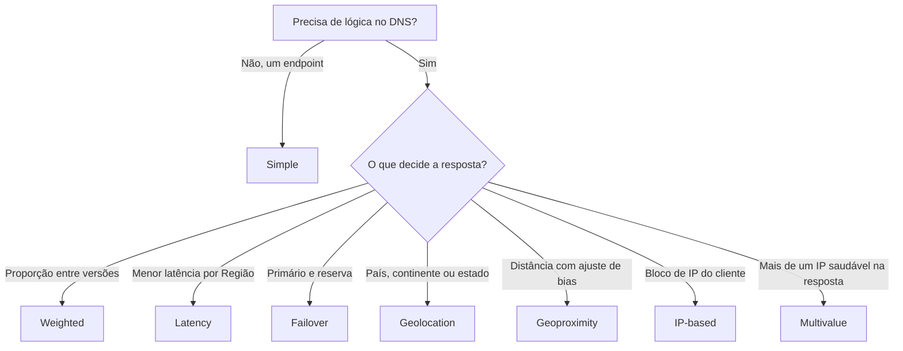

---
aliases:
  - Aula 18.8
modulo: 18
aula: 8
parte: "V Arquiteturas modernas"
dominios:
  - 2
  - 3
lida: false
tags:
  - aula
  - saa-c03
  - modulo-18
---

# Aula 18.8: Route 53, políticas de roteamento

[[18 - Borda e DNS CloudFront Global Accelerator e Route 53|Voltar ao módulo]]

> [!question] Pergunta que esta aula responde
> Como fazer o mesmo nome responder de formas diferentes: dividir tráfego entre versões, mandar cada usuário ao endpoint mais rápido, respeitar leis por país ou manter um site de reserva?

## Uma política decide qual resposta o DNS devolve

Quando você cria um registro, escolhe uma **[[Routing Policy]]** (política de roteamento): a regra que o [[Route 53]] usa para escolher **qual** entre vários registros de mesmo nome e tipo vai na resposta. Importante: o Route 53 **responde [[DNS]]**, não encaminha tráfego. Quem decide para onde o usuário vai é a resposta que ele recebe, e depois disso os pacotes não passam pelo Route 53.

São oito políticas clássicas (mais uma nova, de afinidade de [[Zona de Disponibilidade|AZ]]). Saber **qual usar para qual cenário** é o objetivo da aula.

| Política | Em uma frase | Usa [[Health Check\|health check]]? |
|---|---|---|
| **Simple** | Um registro, uma ou mais respostas, sem lógica | Não |
| **Weighted** | Divide por pesos | Sim |
| **[[Latencia\|Latency]]** | Manda ao menor tempo de resposta | Sim |
| **[[Failover]]** | Primário e secundário | Sim |
| **Geolocation** | Pelo local do usuário | Sim |
| **Geoproximity** | Pela distância física, com bias | Sim |
| **IP-based** | Pelo bloco de IP do cliente ([[CIDR]]) | Sim |
| **[[Multivalue Answer Routing\|Multivalue answer]]** | Até 8 respostas saudáveis | Sim |

## Simple

Um registro (ou um registro com vários valores). O [[Route 53]] devolve todos os valores em ordem aleatória e o cliente escolhe. Sem [[Health Check|health check]] e sem lógica. Serve para um recurso único (um site com um IP).

## Weighted: dividir tráfego por peso

Você cria vários registros de mesmo nome, cada um com um **peso** (0 a 255). A fatia de cada um é **peso do registro dividido pela soma dos pesos**. Dois registros com pesos 1 e 255 recebem 1/256 e 255/256 das respostas. Peso **0** interrompe o tráfego para aquele registro; se **todos** os registros com peso diferente de zero estiverem não saudáveis, o [[Route 53]] passa a usar os de peso zero.

Usos: **[[Canary Deployment|canary]]** (mandar 5% a uma versão nova), **[[Blue-Green Deployment|blue/green]]** gradual, migração entre ambientes, balanceamento simples entre [[Regiao AWS|Regiões]].

> [!example] Canary de 5%
> Dois registros A para `api.exemplo.com`: o da versão atual com peso 95, o da nova com peso 5. Se o [[Health Check|health check]] da nova falhar, o [[Route 53]] deixa de devolvê-la e todo o tráfego vai à atual. Para encerrar o canary, ponha o peso da nova em 0.

Como é [[DNS]], a divisão é **estatística e limitada por cache**: resolvedores e clientes guardam respostas pelo [[TTL]], então a proporção real em curto prazo pode variar.

## Latency: o endpoint mais rápido

A política de **[[Latency-Based Routing|latência]]** responde com o registro cujo **recurso ([[Regiao AWS|Região AWS]]) tem a menor [[Latencia|latência]]** de rede **para o usuário**, com base em dados medidos pela AWS entre as redes dos usuários e as Regiões (e considerando o EDNS0 client [[Sub-rede|subnet]], quando disponível). Você cria um registro por Região, cada um com o campo Região.

Atenção: [[Latencia|latência]] não é distância. O endpoint "mais perto" no mapa pode não ser o mais rápido. E a latência é **entre usuário e [[Regiao AWS|Região AWS]]**, não leva em conta a carga do seu servidor; combine com [[Health Check|health checks]] para evitar mandar usuários a uma Região quebrada.

Usos: aplicação **ativa-ativa em várias [[Regiao AWS|Regiões]]** em que a prioridade é a velocidade.

## Failover: primário e secundário

A política **[[Failover Routing|de failover]]** é **ativo-passivo**: o [[Route 53]] responde com o registro **primário** enquanto ele estiver saudável (pelo **[[Health Check|health check]]** associado, aula 18.9) e passa a responder com o **secundário** quando o primário falha. Pode ser, por exemplo, uma página estática de manutenção em um [[Bucket|bucket]] [[S3]] (website) como "sorry page".

Registros de [[Failover|failover]] pedem [[TTL]] baixo (60 a 120 s, como vimos). Failover **[[Multi-Site Active-Active|ativo-ativo]]** não usa esta política: usa-se qualquer outra (peso, [[Latencia|latência]]) com [[Health Check|health checks]].

## Geolocation: pela localização do usuário

A política **[[Geolocation Routing|de geolocalização]]** escolhe o registro pelo **local do usuário** (continente, país ou estado dos EUA). Vale o registro da **região geográfica mais específica** que casar; por exemplo, o registro "Brasil" vence o registro "América do Sul".

- Crie **um registro padrão (default)**, senão usuários cujo local não casa com nada recebem "sem resposta".
- Usos: **localização de conteúdo** (idioma, moeda), **restrições legais e de licenciamento** (apresentar um site por país), balancear por mercado.

Não confunda com [[Latencia|latência]]: geolocalização **não** mede velocidade, só olha onde o usuário está.

## Geoproximity: distância com bias

A **[[Geoproximity Routing|geoproximidade]]** roteia pela **distância geográfica** entre o usuário e **seus recursos** ([[Regiao AWS|Regiões AWS]], [[Local Zone|Local Zones]] ou latitude e longitude), e permite um **bias** de **-99 a +99** que "encolhe" ou "expande" a área de atendimento de cada recurso. A fórmula da documentação é:

`distância com bias = distância real x [1 - bias/100]`

Um bias positivo atrai mais usuários para o recurso; um bias negativo repele. É a forma de **deslocar tráfego** de uma Região para outra (por exemplo, esvaziar parcialmente uma Região). A visualização em mapa requer o **Traffic Flow**.

## IP-based: pelo IP do cliente

A política **[[IP-Based Routing|baseada em IP]]** usa **coleções de [[CIDR]]** (listas de blocos de endereços) e **locais**; o [[Route 53]] compara o IP de origem da consulta aos blocos para escolher o registro. Aceita blocos [[IPv4]] de /0 a /24 e [[IPv6]] de /0 a /48 (verificado em novembro de 2026). Usos: **ISP específico** (mandar clientes de uma operadora a um endpoint com peering direto), reduzir custo de rede, redes corporativas conhecidas. Não é permitida em zonas privadas.

## Multivalue answer: várias respostas saudáveis

A **[[Multivalue Answer Routing|resposta de múltiplos valores]]** devolve **até 8 registros saudáveis** escolhidos aleatoriamente. Cada registro pode ter um [[Health Check|health check]], e os não saudáveis são omitidos. A documentação é clara: **não substitui um [[Elastic Load Balancing|balanceador de carga]]**; só melhora a [[Disponibilidade|disponibilidade]] em nível de [[DNS]], e o cliente é quem escolhe um valor. Se todos estiverem não saudáveis, devolve até 8 não saudáveis (melhor tentar do que nada).

## AZ-affinity (afinidade de zona de disponibilidade)

A política mais recente roteia o consulente para endpoints **na mesma [[Zona de Disponibilidade|AZ]]** do cliente (usa o [[AZ ID]], com ordem de fallback AZ, grupo de zonas, Região, partição, global). Funciona com consultas vindas do [[VPC]] Resolver; sempre crie um registro **global** para quem não casa. A prova do SAA-C03 dificilmente a cobra, mas ela completa o quadro.

## Quais políticas existem em zona privada

Em uma **[[Private Hosted Zone|zona hospedada privada]]** valem simple, [[Failover|failover]], multivalue, weighted, [[Latencia|latency]], geolocation, geoproximity e AZ-affinity. **IP-based não vale em zona privada.**

## Como escolher

> [!example] Três casos
> Caso 1: "Um site de e-commerce com versões em português e inglês e restrições de venda por país": **geolocation**.
> Caso 2: "API em `us-east-1` e `sa-east-1`, usuários globais, o mais rápido possível, com [[Health Check|health checks]]": **[[Latencia|latency]]** ([[Multi-Site Active-Active|ativo-ativo]]).
> Caso 3: "Site principal na Região A e página estática de manutenção no [[S3]]": **[[Failover|failover]]**.

## Como isso cai na prova

Cobre **Task 2.2** (resiliência e [[Failover|failover]]), **Task 3.4** (redes de alto desempenho).

**Padrões de cenário**
- "Dividir 10% do tráfego para uma nova versão": weighted.
- "Menor [[Latencia|latência]] entre [[Regiao AWS|Regiões]]": latency.
- "Site de reserva em caso de falha": [[Failover|failover]].
- "Conteúdo por país por obrigação legal": geolocation.
- "Deslocar tráfego entre [[Regiao AWS|Regiões]] ajustando alcance": geoproximity com bias.
- "Operadora específica por bloco de IP": IP-based.
- "Devolver vários IPs saudáveis": multivalue.

**Palavras-chave em inglês**: "weighted", "latency-based", "[[Failover|failover]]", "geolocation", "geoproximity", "bias", "[[Multivalue Answer Routing|multivalue answer]]", "IP-based", "[[IP-Based Routing|CIDR collection]]".

**Pegadinhas clássicas**
- [[Latencia|Latência]] mede rede entre usuário e [[Regiao AWS|Região AWS]], não distância.
- Geolocalização precisa de registro **default**; sem ele, alguns usuários não recebem resposta.
- Multivalue **não** substitui um [[Elastic Load Balancing|balanceador de carga]].
- Geoproximity (distância com bias) não é geolocation (local do usuário).
- [[Failover]] é ativo-passivo; [[Multi-Site Active-Active|ativo-ativo]] usa outras políticas.
- IP-based não existe em [[Private Hosted Zone|zona privada]].

| Requisito | Resposta provável | Por quê |
|---|---|---|
| Canary de 5% | Weighted (95/5) | Pesos |
| Velocidade para usuários globais | [[Latencia\|Latency]] | Menor latência por Região |
| Sorry page em [[S3]] | [[Failover]] | Ativo-passivo |
| Conteúdo por país | Geolocation (com default) | Local do usuário |
| Escoar tráfego de uma Região | Geoproximity com bias | Ajuste de alcance |
| ISP específico | IP-based | [[CIDR]] do cliente |
| Várias respostas saudáveis | Multivalue | Até 8 registros |

## Resumo

> [!abstract] A aula em uma frase
> A [[Routing Policy|política de roteamento]] decide qual registro responde ao usuário: peso para dividir, [[Latencia|latência]] para velocidade, [[Failover|failover]] para reserva, geolocalização para país, [[Geoproximity Routing|geoproximidade]] para distância com bias, IP para blocos de rede e multivalor para várias respostas saudáveis.

**A lógica, em 6 passos**
1. O [[Route 53]] responde [[DNS]]; a política só escolhe a resposta.
2. Weighted divide por peso (peso / soma); peso 0 interrompe.
3. [[Latencia|Latency]] usa a latência medida entre usuários e [[Regiao AWS|Regiões AWS]].
4. [[Failover]] liga primário e secundário por [[Health Check|health check]].
5. Geolocation e geoproximity usam localização, mas de formas diferentes (região mais específica versus distância com bias).
6. IP-based usa [[CIDR]]; multivalue devolve até 8 saudáveis; em [[Private Hosted Zone|zona privada]], IP-based não vale.

**Números para lembrar** (verificados em novembro de 2026)

| O quê | Valor | Por que importa |
|---|---|---|
| Peso | 0 a 255 | Intervalo |
| Bias de geoproximity | -99 a +99 | Ajuste de alcance |
| Multivalue | até 8 registros | Limite |
| [[TTL]] de [[Failover\|failover]] | 60 a 120 s | Boa prática |
| IP-based | [[IPv4]] /0 a /24, [[IPv6]] /0 a /48 | Faixas de [[CIDR]] |

**Na prática, isso significa**
- Combine políticas com [[Health Check|health checks]] para nunca devolver um endpoint quebrado.
- Sempre crie o registro default em geolocation.
- Valide a distribuição real de pesos com métricas, não só com o [[DNS]].

> [!tip] Liga com
> Vem da [[18.07 - Route 53 Fundamentos Zonas Registros e Alias|aula 18.7]]. Segue para a [[18.09 - Health Checks Failover e Application Recovery Controller|aula 18.9]], que explica como saber se um endpoint está saudável. O contraste com o [[Failover|failover]] do [[Global Accelerator]] foi mostrado na [[18.06 - Global Accelerator Anycast e Rede Global da AWS|aula 18.6]].

## Erros comuns

- **"Geolocation e [[Latencia|latency]] são parecidas."** Uma olha onde o usuário está; a outra mede a rede.
- **"Esqueci o registro default."** Usuários de locais sem correspondência recebem "sem resposta".
- **"Multivalue balanceia carga."** Só devolve vários IPs; o cliente escolhe.
- **"[[Failover]] serve para [[Multi-Site Active-Active|ativo-ativo]]."** É ativo-passivo.
- **"Peso 0 é igual a remover o registro."** Ele para o tráfego, mas volta a ser usado se todos os demais estiverem não saudáveis.

## Pratique

**1.** Uma equipe quer enviar 10% do tráfego de `api.exemplo.com` a uma nova versão e 90% à atual, ajustando a proporção gradualmente. Qual política usar?

- [ ] a) Failover
- [ ] b) Weighted
- [ ] c) Geolocation
- [ ] d) Multivalue answer

**2.** Uma aplicação roda em `us-east-1` e `ap-southeast-1`, e os usuários do mundo todo devem ser atendidos pela Região de menor [[Latencia|latência]], com [[Failover|failover automático]] se uma Região falhar. Qual combinação atende?

- [ ] a) Simple com dois valores
- [ ] b) Geolocation sem registro default
- [ ] c) Failover com TTL de 24 horas
- [ ] d) Latency com health checks

**3.** Quais DUAS afirmações sobre geolocation estão corretas? (Escolha DUAS.)

- [ ] a) O registro da região mais específica vence
- [ ] b) Deve existir um registro padrão para locais sem correspondência
- [ ] c) Mede a latência entre o usuário e a Região
- [ ] d) Permite bias de -99 a +99
- [ ] e) Não aceita registros por país

**4.** Uma empresa precisa exibir um catálogo diferente para cada país, por obrigação de licenciamento. Qual política atende?

- [ ] a) Latency com health checks
- [ ] b) Weighted com pesos por país
- [ ] c) Geolocation
- [ ] d) Failover com health check

**5.** O time quer escoar progressivamente parte do tráfego de `us-east-1` para `us-west-2`, com ajuste fino do alcance de cada Região. Qual opção atende?

- [ ] a) Geoproximity com bias
- [ ] b) Weighted com peso 255
- [ ] c) Simple com dois valores
- [ ] d) Multivalue answer com 8 registros

**6.** Uma equipe usa [[Multivalue Answer Routing|multivalue answer]] com 6 IPs e acredita ter um [[Elastic Load Balancing|balanceador de carga]]. Qual correção é adequada?

- [ ] a) Aumentar para 8 registros para que o Route 53 distribua a carga
- [ ] b) Multivalue não balanceia carga: use um ELB para isso
- [ ] c) Trocar por geolocation com registro default e health check
- [ ] d) Trocar por simple routing, que faz round robin com health checks

**7.** Um site tem servidor principal em uma Região e uma página estática de manutenção em um [[Bucket|bucket]] [[S3]] website como reserva. Qual política é a adequada?

- [ ] a) Failover com health check no registro primário
- [ ] b) Weighted com 50/50
- [ ] c) Latency com dois registros
- [ ] d) Geoproximity com bias zero e dois registros em Regiões diferentes

**8.** Quais DUAS afirmações sobre [[Routing Policy|políticas de roteamento]] em [[Private Hosted Zone|zona hospedada privada]] estão corretas? (Escolha DUAS.)

- [ ] a) A política IP-based não é permitida em zona privada
- [ ] b) As políticas weighted e latency são permitidas em zona privada
- [ ] c) Apenas a política simple é permitida em zona privada
- [ ] d) Nenhuma política de roteamento é permitida em zona privada
- [ ] e) Todas as políticas, inclusive IP-based, são permitidas em zona privada

**9.** Dois registros weighted têm pesos 1 e 255. Qual fração aproximada das respostas vai ao de peso 1?

- [ ] a) 1/2
- [ ] b) 1/255
- [ ] c) 1/256
- [ ] d) 1/100

**10.** Uma operadora específica de internet tem peering direto com a Região `eu-west-1`, e a empresa quer mandar clientes dessa operadora a esse endpoint pelo bloco de IP. Qual política atende?

- [ ] a) Geolocation por país da operadora
- [ ] b) IP-based com coleção de CIDR
- [ ] c) Latency
- [ ] d) Multivalue answer

> [!success]- Gabarito
> **1. b)** Pesos 90 e 10 dividem o tráfego e se ajustam aos poucos; [[Failover|failover]] é reserva, geolocation é por local e multivalue devolve vários IPs.
> **2. d)** [[Latencia|Latency]] com [[Health Check|health checks]] serve a Região mais rápida e tira a que falha; simple não tem lógica, geolocation sem default deixa usuários sem resposta, e [[Failover|failover]] com [[TTL]] alto é lento e ativo-passivo.
> **3. a) e b)** A região mais específica vence e é preciso um default; a [[Latencia|latência]] é da [[Latency-Based Routing|política de latência]], o bias é de geoproximity e geolocation aceita registros por país.
> **4. c)** Geolocation escolhe o conteúdo pelo país do usuário; [[Latencia|latency]] e weighted não olham para a localização, e [[Failover|failover]] é reserva.
> **5. a)** Geoproximity com bias desloca o alcance de cada Região; weighted com 255, simple e multivalue não fazem ajuste geográfico.
> **6. b)** Multivalue só devolve até 8 respostas saudáveis e o cliente escolhe, então para balancear carga use um [[Elastic Load Balancing|ELB]]; as demais não corrigem a premissa.
> **7. a)** [[Failover]] com [[Health Check|health check]] no primário é o desenho ativo-passivo com sorry page; as demais políticas dividem ou medem tráfego, não mantêm uma reserva.
> **8. a) e b)** IP-based fica de fora, e weighted e [[Latencia|latency]] são permitidas; as demais afirmações (apenas simple, nenhuma, todas) contradizem a lista da documentação.
> **9. c)** A fração é peso dividido pela soma, 1/(1+255) = 1/256; as demais não seguem a fórmula.
> **10. b)** IP-based com coleção de [[CIDR]] compara o bloco de IP do cliente; geolocation, [[Latencia|latency]] e multivalue não usam o IP da operadora.

## Para aprofundar

- [ ] [Choosing a routing policy](https://docs.aws.amazon.com/Route53/latest/DeveloperGuide/routing-policy.html) (AWS Documentation): as políticas lado a lado, com exemplos e limites.
- [ ] [Amazon Route 53 FAQs](https://aws.amazon.com/route53/faqs/) (AWS): visão geral de recursos, [[SLA]] e casos de uso.

Próxima aula: [[18.09 - Health Checks Failover e Application Recovery Controller|Aula 18.9: Health checks, failover e Application Recovery Controller]].
