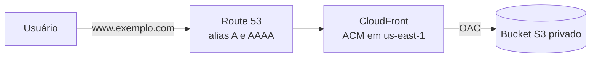

---
aliases:
  - Aula 18.10
modulo: 18
aula: 10
parte: "V Arquiteturas modernas"
dominios:
  - 2
  - 3
  - 4
lida: false
tags:
  - aula
  - saa-c03
  - modulo-18
---

# Aula 18.10: Padrões de arquitetura e decisão de borda e DNS

[[18 - Borda e DNS CloudFront Global Accelerator e Route 53|Voltar ao módulo]]

> [!question] Pergunta que esta aula responde
> Dado um requisito (site estático, API global, jogo, [[Recuperacao de Desastres|recuperação de desastre]]), qual combinação de [[CloudFront]], [[Global Accelerator]] e [[Route 53]] resolve, e por quê?

## Os três serviços resolvem problemas diferentes

Antes das arquiteturas, o mapa mental que a prova exige. Cada serviço atua em uma camada:

- **[[Route 53]]**: [[DNS]]. Decide **qual endereço** o cliente recebe. Não carrega tráfego.
- **[[CloudFront]]**: [[CDN]] [[HTTP]] e HTTPS. **Cacheia** e entrega conteúdo pela borda, e protege a origem.
- **[[Global Accelerator]]**: transporte [[TCP]] e [[UDP]]. **Leva o pacote** pela rede da AWS até o endpoint saudável, com IPs fixos e [[Failover|failover]] rápido.

Eles se **combinam**: [[Route 53]] com alias para [[CloudFront]] ou GA, CloudFront na frente de [[Application Load Balancer|ALB]], GA na frente de [[Network Load Balancer|NLBs]] multi-Região.

## Padrão 1: site estático (S3 + CloudFront + Route 53)

O padrão mais comum da prova.

Peças e razões:

1. [[Bucket]] [[S3]] **privado** ([[Block Public Access]] ligado) com **[[Origin Access Control|OAC]]** (aula 18.3).
2. Distribuição com o **domínio alternativo** e certificado do **[[ACM]] em us-east-1**; viewer protocol policy "redirecionar [[HTTP]] para HTTPS" (aula 18.4).
3. **[[Route 53]] alias** (A e AAAA) do domínio (inclusive o ápice) para a distribuição: sem custo de consulta e sem [[CNAME]] no ápice (aula 18.7).
4. **Default root object** `index.html` na distribuição: sem ele, `https://dominio/` devolve erro com origem [[S3]] REST (e ele só vale para a raiz, não para subpastas; aula 18.3).
5. [[Cache]] longo com nomes de arquivo versionados e `index.html` com [[TTL]] curto (aula 18.2).
6. (Opcional) **[[WAF]]** no [[CloudFront]] e [[Geo Restriction|restrição geográfica]].

> [!example] Uma SPA com roteamento no navegador
> Em uma aplicação de página única, recarregar `/painel/perfil` faz o [[CloudFront]] buscar essa chave no [[S3]], que não existe: o S3 devolve 403 (ou 404). Solução: **resposta de erro personalizada** que converte 403 e 404 em **200 com `/index.html`**, e o roteador do front-end assume. Sem alterar o código da aplicação.

## Padrão 2: aplicação dinâmica (ALB + CloudFront + WAF)

Para uma aplicação web em [[EC2]] ou [[Container|containers]] atrás de um [[Application Load Balancer|ALB]]:

- [[CloudFront]] na frente com **dois behaviors**: `/static/*` ([[S3]], cache longo) e `*` ([[Application Load Balancer|ALB]], CachingDisabled ou cache curto, todos os métodos).
- **[[WAF]]** no [[CloudFront]] filtrando na borda.
- [[Application Load Balancer|ALB]] **fechado**: [[VPC Origin|VPC origin]], ou header secreto com HTTPS entre [[CloudFront]] e ALB (aula 18.3).
- Ganhos: menos carga no [[Application Load Balancer|ALB]], [[TLS]] terminado perto do usuário, conexões persistentes até a origem, e a transferência da origem AWS para o [[CloudFront]] é gratuita.

## Padrão 3: ativo-passivo em duas Regiões (DNS)

Site principal em `us-east-1`, ambiente reduzido (ou página estática) em outra Região:

- **[[Failover Routing|Failover routing]]** do [[Route 53]] com **[[Health Check|health check]]** no primário (aula 18.9).
- [[TTL]] de 60 s nos registros.
- Dados replicados entre as [[Regiao AWS|Regiões]] ([[RDS]] réplica entre Regiões, [[S3]] [[Replicacao do S3|CRR]], [[DynamoDB]] tabelas globais, assuntos dos módulos 11, 13 e 14).
- [[RTO]] aproximado: intervalo x limiar mais [[TTL]], algo em torno de 2 a 3 minutos com os valores padrão.

## Padrão 4: ativo-ativo global (DNS por latência)

Duas ou mais [[Regiao AWS|Regiões]] servindo tráfego ao mesmo tempo:

- **[[Latency-Based Routing|Latency routing]]** com **[[Health Check|health checks]]** (ou weighted, ou geolocation, conforme o requisito).
- Cada Região precisa **aguentar a carga extra** se a outra cair.
- Dados que aceitem escrita ou leitura nas duas [[Regiao AWS|Regiões]] (por exemplo, tabelas globais do [[DynamoDB]], assunto do módulo 14).

## Padrão 5: tráfego não HTTP, IPs fixos e failover rápido (Global Accelerator)

Um jogo [[UDP]] ou uma API [[TCP]] multi-Região, com clientes que cadastram IPs:

- **[[Global Accelerator]]** com **[[Network Load Balancer|NLB]]** (ou [[Application Load Balancer|ALB]], para [[HTTP]]) em cada Região como endpoint.
- **2 [[Anycast|IPs anycast]]** fixos para [[Allow List|allow-list]]; [[Failover|failover]] em menos de um minuto sem esperar [[TTL]].
- **[[Traffic Dial|Traffic dial]]** para drenar uma Região e fazer deploys graduais.

## Padrão 6: leitura resiliente de conteúdo (origin group com S3 e CRR)

Para um site cujo conteúdo é lido de [[S3]]: [[Origin Group|origin group]] com [[Bucket|bucket]] primário e bucket secundário em outra Região ([[Replicacao do S3|replicação entre Regiões]]). O [[CloudFront]] faz o [[Failover|failover]] **por pedido** se o primário responder com erro, sem mexer em [[DNS]] (aula 18.3).

## Padrão 7: API global com usuários espalhados

Uma API [[HTTP]] dinâmica, atendida por [[Application Load Balancer|ALBs]] em duas [[Regiao AWS|Regiões]], com usuários na América, Europa e Ásia. O conteúdo não é cacheável, então a pergunta é qual caminho entrega menor [[Latencia|latência]] e melhor resiliência.

Há três respostas defensáveis, e a prova escolhe uma pelo detalhe do enunciado:

1. **[[Route 53]] com [[Latency-Based Routing|latency routing]] e [[Health Check|health checks]]:** simples e barato; cada usuário recebe o IP da Região mais rápida. O [[Failover|failover]] depende do [[TTL]].
2. **[[CloudFront]] na frente (CachingDisabled):** o usuário abre [[TLS]] com a borda mais próxima e a borda reaproveita conexões persistentes até a origem; ainda dá para ligar [[WAF]]. O CloudFront aceita todos os métodos [[HTTP]], então uma API REST funciona. O [[Failover|failover]] entre [[Regiao AWS|Regiões]] pode ser feito com um [[Origin Group|origin group]], mas só em `GET`, `HEAD` e `OPTIONS`.
3. **[[Global Accelerator]] com os [[Application Load Balancer|ALBs]] como endpoints:** IPs fixos, [[Failover|failover]] em menos de um minuto sem esperar [[TTL]] e [[Traffic Dial|traffic dial]] para deploys graduais; não faz cache nem [[WAF]] próprio (o WAF fica no ALB).

> [!tip] Como decidir entre as três
> Procure a palavra decisiva: "IP fixo" ou "[[Failover|failover]] sem depender de [[DNS]]" aponta para o [[Global Accelerator]]; "[[WAF]] na borda" ou "reduzir carga" aponta para o [[CloudFront]]; "mais simples e barato" aponta para o [[Route 53]] por [[Latencia|latência]].

## Outros aceleradores de borda: S3 Transfer Acceleration e API Gateway edge-optimized

Dois outros serviços usam a rede de borda da AWS e entram na disputa como resposta ou [[Distrator|distrator]]:

- **[[Transfer Acceleration|S3 Transfer Acceleration]]**: acelera **upload e download** de clientes distantes **direto de e para um [[Bucket|bucket]]** de uma Região, usando as [[Edge Location|edge locations]] do [[CloudFront]] e a rede da AWS até o bucket, por um endpoint próprio (`bucket.s3-accelerate.amazonaws.com`). Detalhes no [[11 - Amazon S3 a Fundo|Módulo 11]]. Cenário típico: "usuários do mundo todo enviam arquivos grandes a um bucket em uma Região".
- **[[API Gateway]] edge-optimized**: o endpoint da API fica atrás de uma [[CloudFront Distribution|distribuição do CloudFront]] gerenciada pela AWS, melhorando a [[Latencia|latência]] de clientes globais. Detalhes no [[16 - Serverless Lambda e API Gateway|Módulo 16]].

Para **upload global a um [[Bucket|bucket]] [[S3]]**, as três opções disputam: **[[Transfer Acceleration|S3 Transfer Acceleration]]** (a resposta direta quando o destino é o bucket), [[CloudFront]] com métodos `PUT` e `POST` (quando você já tem uma distribuição e quer cache na entrega) e [[Global Accelerator]] (para [[TCP]] e [[UDP]] genéricos ou IP fixo, não para falar com um bucket).

## Cinco perguntas para qualquer questão de borda e DNS

Antes de olhar as alternativas, responda mentalmente:

1. **O protocolo é [[HTTP]] ou HTTPS?** Se for [[TCP]] ou [[UDP]] genérico, o [[CloudFront]] sai da disputa e o [[Global Accelerator]] entra.
2. **O conteúdo é cacheável?** Se sim, o [[CloudFront]] quase sempre vence, porque corta carga e custo.
3. **O requisito fala em IP fixo ou em [[Failover|failover]] em segundos?** [[Global Accelerator]]. Se aceita minutos, [[Route 53]] com [[Health Check|health check]] basta.
4. **O requisito é sobre nomes ([[Zone Apex|domínio raiz]], [[Private Hosted Zone|zona privada]], divisão por país, canary)?** [[Route 53]], com a política certa (aula 18.8).
5. **Há exigência de segurança no viewer ou na origem?** HTTPS com certificado em us-east-1, URL ou cookie assinado, [[Geo Restriction|geo restriction]], [[WAF]], [[Origin Access Control|OAC]] ou [[VPC Origin|VPC origin]] (aulas 18.3 e 18.4).

Se uma alternativa propõe um serviço que **não resolve a camada** do requisito (por exemplo, [[Direct Connect]] para [[Latencia|latência]] de usuários finais, ou um [[Security Group|security group]] para bloquear países), descarte-a de imediato. Muitos [[Distrator|distratores]] da prova são serviços reais, mas de outra camada.

## RTO e RPO nos padrões

O [[DNS]] e a borda tratam do **[[RTO]]**, o tempo até o tráfego chegar a um ambiente saudável. O **[[RPO]]**, quanto dado se perde, depende da replicação dos dados ([[S3]] com [[Replicacao do S3|replicação entre Regiões]], réplicas de banco, tabelas globais). Um [[Failover|failover]] de [[Route 53]] em dois minutos de nada adianta se o banco da outra Região está horas atrás: a arquitetura precisa responder às duas perguntas. O módulo de [[Alta Disponibilidade|alta disponibilidade]] e [[Recuperacao de Desastres|recuperação de desastres]] ([[20 - Alta Disponibilidade e Recuperacao de Desastres|Módulo 20]]) aprofunda as estratégias de [[Backup and Restore|backup e restauração]], [[Pilot Light|pilot light]], [[Warm Standby|warm standby]] e multi-site, em que as peças desta aula são o mecanismo de desvio de tráfego.

## Como decidir: a matriz

| Requisito principal | Solução |
|---|---|
| Conteúdo web cacheável, global | [[CloudFront]] |
| Upload global de arquivos grandes direto para um [[Bucket\|bucket]] [[S3]] | [[Transfer Acceleration\|S3 Transfer Acceleration]] |
| Reduzir carga e custo da origem | [[CloudFront]] com bom [[Cache Hit Ratio\|hit ratio]] |
| Proteger [[S3]] privado | [[CloudFront]] + [[Origin Access Control\|OAC]] |
| [[Zone Apex\|Domínio raiz]] para recurso AWS | [[Route 53]] alias |
| Resolver nomes só na [[VPC]] | [[Private Hosted Zone\|Zona hospedada privada]] |
| Canary por proporção | [[Route 53]] weighted |
| Menor [[Latencia\|latência]] entre [[Regiao AWS\|Regiões]] ([[DNS]]) | [[Route 53]] latency |
| Reserva passiva | [[Route 53]] [[Failover\|failover]] |
| Conteúdo por país | [[Route 53]] geolocation (roteamento) ou [[CloudFront]] [[Geo Restriction\|geo restriction]] (bloqueio) |
| [[TCP]]/UDP, IPs fixos, [[Failover\|failover]] rápido | [[Global Accelerator]] |
| Lógica simples na borda, baixo custo | [[CloudFront Functions]] |
| Lógica na borda com rede ou corpo | [[Lambda@Edge]] |
| Controle manual seguro de desvio | [[Application Recovery Controller\|ARC]] [[Routing Control\|routing controls]] |

## A confusão que mais derruba: CloudFront ou Global Accelerator

| Se o cenário diz... | Escolha |
|---|---|
| "Conteúdo estático", "cache", "imagens", "vídeo sob demanda", "[[HTTP]]" | [[CloudFront]] |
| "[[UDP]]", "jogos", "VoIP", "MQTT", "IP estático", "[[Failover\|failover]] regional rápido" | [[Global Accelerator]] |
| "API dinâmica [[HTTP]], [[Latencia\|latência]] global" | Os dois funcionam: [[CloudFront]] acelera por conexões persistentes e borda; GA entrega IP fixo e [[Failover\|failover]]. Se o enunciado exige IP fixo ou [[UDP]], GA |

| "Upload global de arquivos grandes para um [[Bucket\|bucket]] em uma Região" | [[Transfer Acceleration\|S3 Transfer Acceleration]] (endpoint `bucket.s3-accelerate.amazonaws.com`); entrega com cache é [[CloudFront]]; [[TCP]]/UDP genérico ou IP fixo é [[Global Accelerator]] |

Não há um "melhor serviço"; há o que casa com a palavra-chave do requisito.

## Visão de custo

- **[[CloudFront]]:** transferência e requisições; cresce com o tráfego, mas **reduz** a conta de transferência e computação da origem quando o [[Cache Hit Ratio|hit ratio]] é bom. Menos [[Edge Location|POPs]] ([[Price Class|price class]] menor) reduz o preço.
- **[[Route 53]]:** zonas (mensal), consultas (por milhão), [[Health Check|health checks]] (mensal, com opcionais). **Alias para AWS não cobra consulta.**
- **[[Global Accelerator]]:** taxa fixa por hora por acelerador mais transferência na direção dominante. Só se justifica quando resolve um requisito (IP fixo, [[UDP]], [[Failover|failover]] rápido).
- **Dica de exame:** "a solução mais econômica" costuma ser a que **evita tráfego e computação** (cache), e a que usa alias.

## Como isso cai na prova

Cobre **Task 2.2**, **Task 3.4** e **Task 4.4**: a maioria das questões do módulo é um destes padrões com um detalhe que muda a resposta.

**Padrões de cenário**
- "Site estático global, seguro e barato": [[S3]] privado + [[Origin Access Control|OAC]] + [[CloudFront]] + alias.
- "Aplicação dinâmica com proteção contra ataques": [[CloudFront]] + [[WAF]] + [[Application Load Balancer|ALB]] fechado.
- "Falha de Região com reserva passiva": [[Route 53]] [[Failover|failover]].
- "Falha de Região em segundos com IPs fixos": [[Global Accelerator]].
- "Páginas de SPA retornam erro ao recarregar": custom error response.
- "Mesmo conteúdo, resposta por país": geolocation ou [[Geo Restriction|geo restriction]] (depende de rotear ou bloquear).

**Palavras-chave em inglês**: "static website hosting", "[[Origin Access Control|origin access control]]", "[[Alias Record|alias record]]", "[[Failover|failover]]", "[[Multi-Site Active-Active|active-active]]", "[[Latency-Based Routing|latency routing]]", "static [[Anycast|anycast]] IP", "[[UDP]]".

**Pegadinhas clássicas**
- Escolher GA para conteúdo cacheável ([[CloudFront]] é a resposta).
- Esquecer o certificado do [[CloudFront]] em us-east-1.
- Usar [[CNAME]] no ápice (use alias).
- Confundir bloquear país ([[Geo Restriction|geo restriction]]) com rotear por país (geolocation).
- Assumir que [[Failover|failover]] de [[DNS]] é instantâneo ([[TTL]]).

## Resumo

> [!abstract] A aula em uma frase
> [[Route 53]] decide para onde apontar, [[CloudFront]] entrega e protege conteúdo [[HTTP]] pela borda, [[Global Accelerator]] leva [[TCP]] e [[UDP]] à Região saudável pela rede da AWS, e as arquiteturas reais combinam os três.

**A lógica, em 6 passos**
1. Identifique a camada do requisito: [[DNS]], conteúdo [[HTTP]] ou transporte [[TCP]]/UDP.
2. Site estático: [[S3]] privado, [[Origin Access Control|OAC]], [[CloudFront]], [[ACM]] em us-east-1, alias.
3. Aplicação dinâmica: [[CloudFront]] com [[WAF]] na frente de um [[Application Load Balancer|ALB]] fechado.
4. Multi-Região por [[DNS]]: [[Failover|failover]] (passivo) ou [[Latencia|latência]] ([[Multi-Site Active-Active|ativo-ativo]]), sempre com [[Health Check|health checks]].
5. Multi-Região sem [[TTL]], com IPs fixos ou [[UDP]]: [[Global Accelerator]].
6. Reduza custo com [[Cache Hit Ratio|hit ratio]] alto, alias e a [[Price Class|price class]] certa.

**Números para lembrar** (verificados em novembro de 2026)

| O quê | Valor | Por que importa |
|---|---|---|
| Região do certificado do [[CloudFront]] | us-east-1 | Sempre |
| [[Anycast\|IPs anycast]] do GA | 2 | IP fixo |
| [[TTL]] de [[Failover\|failover]] | 60 a 120 s | [[RTO]] do [[DNS]] |
| [[Failover]] do [[Origin Group\|origin group]] | até 30 s por padrão | Detecção |
| [[Invalidacao de Cache\|Invalidação]] gratuita | 1.000 caminhos por mês | Custo |

**Na prática, isso significa**
- Documente a escolha entre [[CloudFront]] e GA pela palavra-chave do requisito.
- Estime [[RTO]] com detecção mais [[TTL]]; se não aceita, mude de mecanismo.
- Revise a conta pelo [[Cache Hit Ratio|hit ratio]] antes de revisar tarifas.

> [!tip] Liga com
> Vem da [[18.09 - Health Checks Failover e Application Recovery Controller|aula 18.9]]. Encerra o módulo; o próximo, [[19 - Seguranca de Aplicacoes e Deteccao de Ameacas|Módulo 19]], aprofunda [[WAF]], Shield e detecção de ameaças. As estratégias formais de [[Recuperacao de Desastres|recuperação de desastre]] estão no [[20 - Alta Disponibilidade e Recuperacao de Desastres|Módulo 20]].

## Erros comuns

- **"[[Global Accelerator]] serve para qualquer site global."** Para conteúdo cacheável, o [[CloudFront]] é melhor e mais barato.
- **"[[Failover]] de [[DNS]] é instantâneo."** Soma detecção e [[TTL]].
- **"[[CloudFront]] protege o [[Application Load Balancer|ALB]] automaticamente."** Só se o ALB for fechado ao acesso direto.
- **"[[Geo Restriction|Geo restriction]] e geolocation fazem o mesmo."** Uma bloqueia, a outra roteia.
- **"[[Multi-Site Active-Active|Ativo-ativo]] só exige [[DNS]]."** Também exige capacidade em cada Região e dados replicados.

## Pratique

**1.** Uma empresa quer hospedar um site estático com HTTPS no próprio domínio, [[Bucket|bucket]] privado e menor custo possível. Qual arquitetura atende?

- [ ] a) Bucket S3 público com website endpoint e CNAME no registrador
- [ ] b) EC2 com Nginx e Elastic IP
- [ ] c) S3 privado com OAC, CloudFront com ACM em us-east-1 e alias
- [ ] d) ALB com instâncias que leem os arquivos do S3

**2.** Uma SPA servida do [[S3]] por [[CloudFront]] mostra erro ao recarregar rotas internas. Como corrigir sem alterar o código?

- [ ] a) Resposta de erro personalizada: 403 e 404 viram 200 com `/index.html`
- [ ] b) Habilitar o Origin Shield
- [ ] c) Aumentar o TTL padrão para um ano e invalidar todos os caminhos a cada deploy
- [ ] d) Trocar o bucket para outra Região

**3.** Quais DUAS necessidades pedem [[Global Accelerator]] em vez de [[CloudFront]]? (Escolha DUAS.)

- [ ] a) Servir imagens com cache a usuários globais
- [ ] b) Tráfego UDP de um jogo multiplayer
- [ ] c) Clientes que precisam cadastrar IPs fixos para allow-list de uma aplicação multi-Região
- [ ] d) Reduzir a carga da origem com cache
- [ ] e) Comprimir arquivos de texto na borda

**4.** Uma empresa quer reserva passiva em outra Região para a aplicação web, aceitando alguns minutos de recuperação. Qual solução é suficiente?

- [ ] a) Route 53 failover com health check e TTL baixo
- [ ] b) Global Accelerator com traffic dial 50/50 entre as Regiões
- [ ] c) CloudFront com origin group
- [ ] d) Route 53 simple com dois IPs

**5.** Uma empresa precisa de [[Failover|failover]] regional em menos de um minuto, sem depender de [[TTL]] de [[DNS]], para uma API [[TCP]], com IPs fixos para clientes corporativos. Qual solução atende?

- [ ] a) Route 53 failover com TTL de 60 s
- [ ] b) CloudFront com Lambda@Edge
- [ ] c) Route 53 multivalue com 8 registros e health checks
- [ ] d) Global Accelerator com endpoints em duas Regiões

**6.** Uma aplicação dinâmica atrás de um [[Application Load Balancer|ALB]] sofre ataques de [[SQL Injection|SQL injection]] e o ALB deve aceitar tráfego somente via [[CloudFront]]. Quais DUAS medidas atendem? (Escolha DUAS.)

- [ ] a) Anexar um web ACL do WAF à distribuição do CloudFront
- [ ] b) Usar VPC origin ou header secreto com HTTPS entre CloudFront e ALB
- [ ] c) Trocar o ALB por um endpoint de website do S3
- [ ] d) Aumentar o TTL padrão da distribuição
- [ ] e) Habilitar geo restriction apenas

**7.** Uma plataforma quer bloquear completamente o acesso de um país específico a todo o conteúdo servido pelo [[CloudFront]]. Qual recurso usar?

- [ ] a) Route 53 geolocation routing
- [ ] b) Geo restriction do CloudFront
- [ ] c) Route 53 latency routing
- [ ] d) Route 53 geoproximity com bias de -99 para o país

**8.** Qual é a principal razão para escolher alias em vez de [[CNAME]] para o [[Zone Apex|domínio raiz]] apontando para um [[Application Load Balancer|ALB]], em termos de custo e função?

- [ ] a) O alias é exigido no ápice e as consultas para recursos AWS são gratuitas
- [ ] b) O alias permite apontar para qualquer site da internet, inclusive fora da AWS
- [ ] c) O CNAME é mais barato que o alias
- [ ] d) O alias permite definir o TTL livremente

**9.** Uma empresa de [[Streaming de Dados|streaming]] de vídeo sob demanda, com arquivos cacheáveis, tem usuários globais e quer o menor custo e a menor [[Latencia|latência]]. Qual solução é a melhor?

- [ ] a) Route 53 latency com dois ALBs em Regiões diferentes
- [ ] b) Global Accelerator com NLB
- [ ] c) CloudFront com S3 privado e OAC
- [ ] d) Direct Connect

**10.** Uma equipe monta uma arquitetura [[Multi-Site Active-Active|ativo-ativo]] em duas [[Regiao AWS|Regiões]] com [[Latency-Based Routing|latency routing]] e [[Health Check|health checks]]. Qual condição extra é indispensável para que o [[Failover|failover]] funcione sem sobrecarga?

- [ ] a) Aumentar o TTL para 24 horas
- [ ] b) Manter só o banco replicado e o ambiente da outra Região desligado
- [ ] c) Trocar latency por simple routing, que remove sozinho o endpoint com falha
- [ ] d) Cada Região ter capacidade para absorver a carga da outra

**11.** Uma empresa de mídia recebe vídeos grandes enviados por criadores no mundo todo para um único [[Bucket|bucket]] [[S3]] em `us-east-1`. Os uploads de [[Regiao AWS|regiões]] distantes são lentos. A empresa não precisa de cache e quer a mudança com o MENOR esforço. O que usar?

- [ ] a) Global Accelerator com o bucket como endpoint
- [ ] b) Habilitar o S3 Transfer Acceleration no bucket e usar o endpoint de aceleração
- [ ] c) Criar uma distribuição do CloudFront com Price Class All só para os uploads
- [ ] d) Replicar o bucket em todas as Regiões e rotear com Route 53 por latência

> [!success]- Gabarito
> **1. c)** [[S3]] privado com [[Origin Access Control|OAC]], [[CloudFront]] com [[ACM]] em us-east-1 e alias entrega HTTPS no domínio, [[Bucket|bucket]] privado e custo baixo; website público da a expõe o bucket, [[EC2]] da b custa mais e o [[Application Load Balancer|ALB]] da d é desnecessário.
> **2. a)** A resposta de erro personalizada devolve `/index.html` e o roteador do front-end trata a rota; [[Origin Shield]], [[TTL]] de um ano e outra Região não tratam o erro de rota.
> **3. b) e c)** [[UDP]] e IPs fixos multi-Região são casos do GA; cache de imagens, redução de carga e compressão são do [[CloudFront]].
> **4. a)** [[Route 53]] [[Failover|failover]] com [[Health Check|health check]] atende à reserva passiva com [[RTO]] de minutos; o GA 50/50 da b é [[Multi-Site Active-Active|ativo-ativo]], o [[Origin Group|origin group]] da c troca só a origem e o simple da d não tem lógica.
> **5. d)** O GA troca o endpoint em menos de um minuto, sem [[TTL]], com IPs fixos; as demais dependem de [[DNS]] ou não servem [[TCP]] genérico.
> **6. a) e b)** [[WAF]] na distribuição filtra [[SQL Injection|SQL injection]] e a origem fechada impede o acesso direto; endpoint de website do [[S3]] não substitui o [[Application Load Balancer|ALB]], [[TTL]] não resolve e [[Geo Restriction|geo restriction]] sozinha não filtra SQL injection.
> **7. b)** [[Geo Restriction|Geo restriction]] do [[CloudFront]] bloqueia países para a distribuição; geolocation roteia, [[Latencia|latency]] mede rede, e a alternativa d) só desloca o roteamento [[DNS]], sem bloquear o acesso.
> **8. a)** [[CNAME]] não existe no ápice e consultas de alias para recursos AWS são gratuitas; alias não aponta para sites externos, CNAME não é mais barato e o [[TTL]] do alias é do alvo.
> **9. c)** Conteúdo cacheável global pede [[CloudFront]] com [[S3]] e [[Origin Access Control|OAC]]; GA não faz cache, [[Latencia|latency]] com [[Application Load Balancer|ALBs]] não cacheia e [[Direct Connect]] é conectividade.
> **10. d)** Cada Região precisa absorver a carga da outra; [[TTL]] alto atrapalha, a alternativa b) descreve [[Pilot Light|pilot light]] (não [[Multi-Site Active-Active|ativo-ativo]], sem capacidade pronta) e a alternativa c) erra porque o simple não tem [[Health Check|health check]].
> **11. b)** O [[Transfer Acceleration]] acelera upload e download direto ao [[Bucket|bucket]] usando a borda, com um endpoint próprio; a alternativa a) erra porque o GA não aceita bucket [[S3]] como endpoint, a alternativa c) funcionaria com mais configuração e sem o benefício do cache, e a alternativa d) exige replicação e [[Orquestracao|orquestração]] de escrita.

## Para aprofundar

- [ ] [Routing traffic to an Amazon CloudFront distribution by using your domain name](https://docs.aws.amazon.com/Route53/latest/DeveloperGuide/routing-to-cloudfront-distribution.html) (AWS Documentation): alias A e AAAA para a distribuição.
- [ ] [Configuring DNS failover](https://docs.aws.amazon.com/Route53/latest/DeveloperGuide/dns-failover-configuring.html) (AWS Documentation): arquiteturas ativo-passivo e [[Multi-Site Active-Active|ativo-ativo]] no [[Route 53]].
- [ ] [AWS Global Accelerator FAQs](https://aws.amazon.com/global-accelerator/faqs/) (AWS): quando preferir o GA ao [[CloudFront]].

Próximo módulo: [[19 - Seguranca de Aplicacoes e Deteccao de Ameacas|Módulo 19: Segurança de aplicações e detecção de ameaças]].
