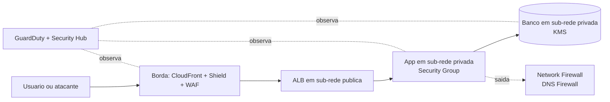

---
aliases:
  - Aula 19.1
modulo: 19
aula: 1
parte: "V Arquiteturas modernas"
dominios:
  - 1
lida: false
tags:
  - aula
  - saa-c03
  - modulo-19
---

# Aula 19.1: Ameaças externas e defesa em profundidade

[[19 - Seguranca de Aplicacoes e Deteccao de Ameacas|Voltar ao módulo]]

> [!question] Pergunta que esta aula responde
> Que tipos de ataque uma aplicação exposta à internet sofre de verdade, em que camada cada um acontece e por que nenhum serviço sozinho (nem [[WAF]], nem [[Shield]], nem [[Security Group]]) basta? Como montar camadas que se cobrem umas às outras?

## O problema: tudo que tem endereço público é testado

No momento em que um [[Application Load Balancer]] ganha um nome [[DNS]] público, robôs começam a varrê-lo. Não é paranoia: é automatização barata. Quem ataca não escolhe você, escolhe "qualquer IP que responda". A pergunta do arquiteto deixa de ser "vão me atacar?" e passa a ser "quando atacarem, quais camadas seguram, e quanto custa cada uma?".

O [[Modelo de Responsabilidade Compartilhada]] ([[01 - Nuvem e Infraestrutura Global AWS|Módulo 1]]) dá a fronteira: a AWS protege a infraestrutura física e a rede global (segurança **DA** nuvem); a proteção da aplicação, da configuração de rede, das identidades e dos dados é sua (segurança **NA** nuvem). A prova chama isso de "threat vectors external to AWS" e cita dois exemplos: **[[DDoS]]** e **[[SQL Injection|SQL injection]]**. Esta aula monta o catálogo de ameaças e o mapa de camadas; as aulas seguintes entram em cada serviço.

> [!info] Ligando os pontos
> Você já usa [[WAF]] e [[CloudFront]] no dia a dia. Aqui o objetivo é o porquê de cada peça existir e a pergunta que a prova faz: "qual serviço bloqueia ESTE ataque?". Para firewall de rede dentro da [[VPC]], veja [[06 - VPC a Fundo|Módulo 6]]; para identidade, [[04 - IAM Identidade e Acesso|Módulo 4]].

## O catálogo de ameaças

### Ataques de negação de serviço (DDoS)

Um **[[DDoS]]** (Distributed Denial of Service) usa muitas máquinas comprometidas (uma botnet) para esgotar algum recurso do alvo até usuários legítimos não conseguirem usá-lo. O que muda entre ataques é o recurso esgotado, e isso decide a camada (modelo de rede da [[03 - Fundamentos de Redes para a Nuvem|Módulo 3]]):

| Camada | Tipo | O que esgota | Exemplo |
|---|---|---|---|
| 3 (rede) | Volumétrico | A banda do alvo | Reflexão/amplificação [[UDP]] que inunda o link |
| 4 (transporte) | Protocolo | Estado de conexão de servidores, balanceadores ou firewalls | **SYN flood**: milhares de handshakes [[TCP]] iniciados e nunca concluídos |
| 7 (aplicação) | Flood de requisições válidas | CPU, banco, conexões da aplicação | Milhões de `GET /search?q=...` que parecem tráfego normal |

A documentação da AWS (verificado em novembro de 2026) descreve exatamente essas três classes: volumétrico ([[Modelo OSI|L3]]), protocolo (L4, com o SYN flood como exemplo clássico) e aplicação (L7, "web request floods"). A diferença que a prova explora: **L3 e L4 são de graça e automáticos** (Shield Standard); **L7 exige que você inspecione o conteúdo da requisição**, o que é trabalho do [[WAF]], porque cada requisição é "válida" isoladamente.

> [!example] Mesmo ataque, três respostas
> Uma loja recebe 200 mil requisições por segundo na página de busca, todas bem formadas, vindas de 40 mil IPs. Não há SYN flood nem saturação de link: é [[Modelo OSI|L7]]. O [[Shield]] Standard não resolve sozinho (ele cuida de L3 e L4). A resposta está em [[19.03 - WAF Web ACLs Regras e Onde Associar|regras do WAF]], como uma regra de [[Rate-Based Rule|limite de taxa]] (rate-based) por IP, mais cache no [[CloudFront]] para a requisição nem chegar na origem.

### Ataques contra a aplicação

- **[[SQL Injection]]:** o atacante coloca SQL dentro de um campo (login, busca, parâmetro de URL) para que a aplicação o execute como parte da consulta. Exemplo: um campo de usuário recebendo `' OR '1'='1` pode fazer uma consulta mal construída devolver todas as linhas. A causa é código que concatena texto em vez de usar parâmetros. O [[WAF]] reduz o risco, mas **a correção de verdade é a consulta parametrizada no código**.
- **[[Cross-Site Scripting]] (XSS):** o atacante injeta JavaScript que a aplicação devolve ao navegador de outra pessoa, que o executa como se fosse legítimo (roubo de sessão, ações em nome da vítima).
- **Exploração de vulnerabilidades conhecidas:** bibliotecas com **CVE** publicado (CVE é a lista pública de vulnerabilidades conhecidas, cada uma com um identificador, como CVE-2021-44228; por exemplo, a falha do Log4j em 2021) atacadas por padrões de requisição conhecidos. Defesa: corrigir a biblioteca (veja [[Inspector]]) e bloquear o padrão no [[WAF]] enquanto não corrige.
- **Bots:** tráfego automatizado, parte inofensivo (buscadores) e parte hostil (scraping, estoque sendo esvaziado, reserva de ingressos).
- **[[Credential Stuffing]] e tomada de conta:** o atacante testa pares usuário e senha vazados de outros sites contra o seu login. Cada tentativa é uma requisição válida; o sinal é o volume e o padrão.
- **Reconhecimento:** varredura de portas e de caminhos (`/admin`, `/.env`) para descobrir o que está exposto.

### Ameaças que passam por dentro

Nem tudo é externo: credenciais de acesso vazadas ([[Access Key|chave de acesso]] no GitHub), instância comprometida enviando dados para fora, mineração de criptomoeda, comunicação com servidores de comando e controle. Nenhum firewall de borda vê isso, porque o tráfego é **de saída** ou usa **credenciais válidas**. É para esse campo que existem os serviços de detecção ([[GuardDuty]], [[Inspector]], [[Detective]], [[Security Hub]]) das Aulas 19.5 e 19.6.

## O princípio: defesa em profundidade

**[[Defesa em Profundidade]]** é montar várias camadas independentes de modo que a falha ou o contorno de uma não entregue o sistema inteiro. Cada camada assume que a anterior pode falhar. Na AWS, as camadas e os serviços que as implementam:

| Camada | Pergunta que responde | Serviços principais |
|---|---|---|
| **Borda** | O tráfego hostil chega a entrar na minha rede? | [[CloudFront]], [[Route 53]], [[Global Accelerator]], [[Shield]], [[WAF]] |
| **Rede** | Quem pode falar com quem dentro e fora da VPC? | [[VPC]], [[Sub-rede Privada\|sub-redes privadas]], [[Security Group]], [[Network ACL]], [[Network Firewall]], [[Route 53 Resolver DNS Firewall|DNS Firewall]] |
| **Aplicação** | A requisição é legítima? O usuário é quem diz ser? | [[WAF]], [[Cognito]], código seguro, [[Inspector]] |
| **Identidade** | A chamada de API tem permissão mínima? | [[IAM]], [[IAM Role]], [[STS]], [[MFA]] |
| **Dados** | Se chegarem ao dado, conseguem ler? | [[KMS]], [[Macie]], [[Criptografia em Repouso]], [[Criptografia em Transito]] |
| **Detecção e resposta** | Eu saberia se algo passasse? | [[CloudTrail]], [[GuardDuty]], [[Detective]], [[Security Hub]], [[Config]] |

> [!example] Uma camada falhando, outra segurando
> O [[WAF]] deixa passar uma requisição com [[SQL Injection|SQL injection]] escondida em um campo que a regra não inspeciona. A camada de **rede** ainda ajuda: o banco está em [[Sub-rede Privada|sub-rede privada]] e só aceita conexão do [[Security Group|security group]] da aplicação. A camada de **identidade** limita o que a role da aplicação faz. A camada de **dados** mantém o conteúdo cifrado se um [[Snapshot|snapshot]] vazar. E o [[GuardDuty]] pode alertar sobre o comportamento anômalo depois. Nenhuma camada foi perfeita, o conjunto foi suficiente.

### Reduzir a superfície antes de adicionar ferramentas

A medida mais barata é expor menos. Antes de qualquer serviço pago:

- Só o balanceador (ou o [[CloudFront]]) tem endereço público; instâncias, [[Container|containers]] e bancos ficam em [[Sub-rede Privada|sub-redes privadas]].
- [[Security Group|Security groups]] abertos só para o que é necessário (443 do mundo para o [[Application Load Balancer|ALB]]; porta da aplicação só do security group do ALB).
- Origens restritas: o [[Application Load Balancer|ALB]] aceitar tráfego só do [[CloudFront]] (veja [[Origin Access Control]] para [[S3]] e a [[Managed Prefix List|lista de prefixos]] gerenciada do CloudFront para ALB).
- Nenhuma porta de administração (22, 3389) aberta para `0.0.0.0/0`; use [[Systems Manager]] [[Session Manager]].

> [!tip] Pense no "raio de explosão"
> A pergunta de projeto não é só "como impeço?", é "se falhar, o que o atacante alcança?". [[Sub-rede Privada|Sub-redes privadas]], roles estreitas e contas separadas ([[05 - Multiconta Governanca e Federacao|Módulo 5]]) diminuem a resposta.

## Mapa: do ataque ao serviço

Este é o mapa mental que a prova cobra. Decore o verbo do problema:

| O que o enunciado descreve | Serviço |
|---|---|
| Inundação de pacotes ou conexões ([[Modelo OSI\|L3]]/L4), "[[DDoS]]" | [[Shield]] (Standard automático; Advanced para resposta e proteção de custo) |
| Inundação de requisições [[HTTP]], [[SQL Injection\|SQL injection]], [[Cross-Site Scripting\|XSS]], bots, limite por IP, bloqueio por país | [[WAF]] |
| Filtrar tráfego **na [[VPC]]** por domínio, inspeção profunda, IPS | [[Network Firewall]] |
| Bloquear **consulta [[DNS]]** para domínios maliciosos saindo da [[VPC]] | [[Route 53 Resolver DNS Firewall]] |
| Aplicar [[WAF]], Shield e [[Security Group\|security groups]] em **todas as contas** da organização | [[Firewall Manager]] |
| Detectar comportamento malicioso, credencial comprometida, malware | [[GuardDuty]] |
| Achar vulnerabilidade de software em [[EC2]], imagens e Lambda | [[Inspector]] |
| Investigar a causa raiz de um achado | [[Detective]] |
| Consolidar achados e checar conformidade | [[Security Hub]] |
| Descobrir dado sensível ([[PII]]) no [[S3]] | [[Macie]] |
| Autenticar usuários da aplicação | [[Cognito]] |

> [!info] Macie e Config em uma frase
> O [[Macie]] ([[08 - Criptografia e Protecao de Dados|Módulo 8]]) usa aprendizado de máquina para achar dados sensíveis em buckets [[S3]]; o [[Config]] ([[05 - Multiconta Governanca e Federacao|Módulo 5]]) registra como cada recurso está configurado e avalia regras de conformidade. Eles alimentam o [[Security Hub]] (Aula 19.6).

## Como isso cai na prova

Cobertura: **Task 1.2** ("threat vectors external to AWS ([[DDoS]], [[SQL Injection|SQL injection]])"; "integrating AWS services to secure applications (Shield, [[WAF]], [[IAM Identity Center]], [[Secrets Manager]])").

**Palavras-chave em inglês:**
- "[[DDoS]]", "volumetric", "SYN flood", "protect against infrastructure layer attacks" puxam **Shield**.
- "[[SQL Injection|SQL injection]]", "[[Cross-Site Scripting|cross-site scripting]]", "block requests from specific countries/IP ranges", "rate limit" puxam **[[WAF]]**.
- "inspect traffic leaving the [[VPC]]", "block traffic to specific domains", "intrusion prevention" puxam **[[Network Firewall]]**.
- "across all accounts in the organization" puxa **[[Firewall Manager]]**.
- "detect compromised instances", "unusual API calls", "cryptocurrency mining" puxam **[[GuardDuty]]**.

**Pegadinhas clássicas:**
- **[[Security Group|Security group]] e [[Network ACL|network ACL]] não detectam [[SQL Injection|SQL injection]]**: eles filtram por IP, porta e protocolo, não por conteúdo [[HTTP]].
- **Shield Standard não cobre flood [[Modelo OSI|L7]] sozinho**: para requisições [[HTTP]] abusivas é preciso [[WAF]].
- **[[WAF]] não protege [[EC2|instâncias EC2]] diretamente nem um [[Network Load Balancer|NLB]]**: ele se associa a [[CloudFront]], [[Application Load Balancer|ALB]], [[API Gateway]] e outros (Aula 19.3).
- **[[GuardDuty]] detecta, não bloqueia**: ele gera um achado; a ação vem de [[EventBridge]], Lambda ou de uma regra sua.

| Requisito no enunciado | Resposta provável | Por quê |
|---|---|---|
| Proteger site contra [[SQL Injection\|SQL injection]] e [[Cross-Site Scripting\|XSS]] com o menor overhead | [[WAF]] com [[Managed Rule Group\|managed rule groups]] | Regras gerenciadas inspecionam o conteúdo [[Modelo OSI\|L7]] |
| Mitigar [[DDoS]] [[Modelo OSI\|L3]]/L4 sem custo extra | Shield Standard (já ativo) | Automático e gratuito em todos os clientes |
| Reduzir ataques [[Modelo OSI\|L7]] e carga na origem | [[CloudFront]] + [[WAF]] | A borda absorve e filtra antes da origem |
| Alertar sobre credencial [[IAM]] usada de local incomum | [[GuardDuty]] | Analisa [[CloudTrail]] com threat intelligence e ML |
| Impedir que instâncias privadas acessem domínios maliciosos | [[Network Firewall]] ou [[Route 53 Resolver DNS Firewall\|DNS Firewall]] | Filtram a saída por domínio |
| Aplicar a mesma regra de [[WAF]] em 50 contas | [[Firewall Manager]] | Política central com auto-aplicação a novas contas |

## Resumo

> [!abstract] A aula em uma frase
> Ataques acontecem em camadas diferentes (rede, transporte, aplicação, identidade), então a defesa precisa ser em camadas independentes, cada uma com o serviço certo, e reduzir a superfície exposta vem antes de comprar proteção.

**A lógica, em 5 passos**
1. Todo endereço público é varrido; a segurança da aplicação e da rede é do cliente ([[Modelo de Responsabilidade Compartilhada|responsabilidade compartilhada]]).
2. [[DDoS]] exaure um recurso: banda ([[Modelo OSI|L3]]), estado de conexão (L4) ou a própria aplicação (L7).
3. Ataques de aplicação ([[SQL Injection|SQL injection]], [[Cross-Site Scripting|XSS]], bots, [[Credential Stuffing|credential stuffing]]) vivem na [[Modelo OSI|camada 7]] e exigem inspeção de conteúdo.
4. Ameaças por dentro (credencial vazada, instância comprometida) só aparecem em serviços de detecção.
5. Camadas independentes (borda, rede, aplicação, identidade, dados, detecção) fazem a falha de uma não derrubar tudo.

**Tabela-síntese**

| Ameaça | Camada | Serviço |
|---|---|---|
| Volumétrico, SYN flood | [[Modelo OSI\|L3]]/L4 | Shield |
| [[HTTP]] flood, [[SQL Injection\|SQLi]], [[Cross-Site Scripting\|XSS]], bots | [[Modelo OSI\|L7]] | [[WAF]] |
| Saída para domínios ruins | Rede | [[Network Firewall]], [[Route 53 Resolver DNS Firewall\|DNS Firewall]] |
| Credencial vazada, malware | Detecção | [[GuardDuty]] |

**Na prática, isso significa**
- Exponha só [[Application Load Balancer|ALB]] ou [[CloudFront]]; o resto em [[Sub-rede Privada|sub-redes privadas]].
- Coloque [[WAF]] na frente de tudo que fala [[HTTP]] público.
- Use o verbo do enunciado para escolher o serviço: bloquear ([[WAF]], Shield, firewalls), detectar ([[GuardDuty]]), investigar (Detective), consolidar ([[Security Hub]]).

> [!tip] Liga com
> Vem do [[01 - Nuvem e Infraestrutura Global AWS|Módulo 1]] ([[Modelo de Responsabilidade Compartilhada|responsabilidade compartilhada]]) e do [[06 - VPC a Fundo|Módulo 6]] ([[Security Group|security groups]] e [[Network ACL|NACLs]]). Leva à [[19.02 - Shield DDoS Standard e Advanced|Aula 19.2]], que aprofunda [[DDoS]].

## Erros comuns

- Achar que [[Security Group|security group]] ou [[Network ACL|network ACL]] bloqueia [[SQL Injection|SQL injection]] (eles não leem o conteúdo [[HTTP]]).
- Esperar que o [[WAF]] resolva um bug de concatenação de SQL em vez de corrigir o código.
- Tratar Shield Standard como proteção suficiente contra flood de requisições [[HTTP]].
- Esquecer que ameaças de dentro (chave vazada) não passam por nenhum firewall de borda.
- Deixar o [[Application Load Balancer|ALB]] aberto para o mundo enquanto o [[CloudFront]] com [[WAF]] fica "de enfeite" (o atacante acessa a origem direto).
- Confundir serviço que **detecta** ([[GuardDuty]]) com serviço que **bloqueia** ([[WAF]], [[Network Firewall]]).

## Pratique

**1.** Uma empresa hospeda uma API pública atrás de um [[Application Load Balancer]]. Os logs mostram milhões de requisições [[HTTP]] bem formadas por minuto para um endpoint caro, vindas de milhares de IPs. Não há saturação de banda nem de conexões. Qual camada do ataque e qual serviço mitiga com o menor overhead?

- [ ] a) Camada 3, Shield Standard, que absorve o volume na rede da AWS.
- [ ] b) Camada 4, Network ACL com regras deny para os IPs de origem, atualizadas manualmente.
- [ ] c) Camada 7, WAF com regra de limite de taxa associada ao balanceador.
- [ ] d) Camada 7, security group do ALB restringindo a porta 443.

**2.** Um time de segurança precisa impedir que consultas SQL maliciosas em parâmetros de URL cheguem à aplicação, sem alterar o código no curto prazo. Qual solução se encaixa?

- [ ] a) WAF com o managed rule group de SQL database na frente do ALB.
- [ ] b) Network ACL bloqueando caracteres especiais nas requisições.
- [ ] c) Security group que permite só tráfego da porta 3306.
- [ ] d) Shield Advanced com a Shield Response Team em modo proativo, para bloquear as requisições SQL.

**3.** Qual afirmação descreve corretamente o papel dos [[Security Group|security groups]] na defesa contra ataques de aplicação?

- [ ] a) Inspecionam o corpo das requisições HTTP em busca de padrões de ataque.
- [ ] b) Detectam credenciais comprometidas usando threat intelligence e bloqueiam o acesso na hora.
- [ ] c) Bloqueiam bots por reputação de IP mantida pela AWS.
- [ ] d) Filtram por origem, porta e protocolo, sem ler o conteúdo da requisição.

**4.** Uma equipe quer aplicar [[Defesa em Profundidade|defesa em profundidade]] a uma aplicação web de três camadas. Quais DUAS medidas contribuem para camadas diferentes e independentes? (Escolha DUAS.)

- [ ] a) Expor o banco por um endpoint público protegido apenas por uma senha forte.
- [ ] b) Associar um WAF ao CloudFront e manter o banco em sub-rede privada.
- [ ] c) Usar a mesma role administrativa em todas as instâncias.
- [ ] d) Cifrar os dados com KMS e restringir a role da aplicação ao mínimo necessário.
- [ ] e) Usar apenas um security group em todas as camadas, sem outros controles.

**5.** Um atacante usa uma [[Access Key|chave de acesso]] [[IAM]] vazada para listar buckets [[S3]] a partir de um país incomum. Nenhum firewall de borda registrou algo suspeito. Qual serviço teria a melhor chance de alertar?

- [ ] a) AWS WAF, com uma regra de geo match.
- [ ] b) Amazon GuardDuty, analisando eventos do CloudTrail.
- [ ] c) AWS Shield Advanced, com detecção de eventos de camada 7.
- [ ] d) Network Firewall, com regras stateful de domínio.

**6.** Uma startup quer o menor custo para ter alguma proteção contra ataques [[DDoS]] de rede em todos os seus recursos AWS, sem assinar nada. O que já está disponível?

- [ ] a) Nada: toda proteção DDoS exige assinatura do Shield Advanced, cobrada por conta.
- [ ] b) Apenas se a conta tiver o plano de suporte Enterprise.
- [ ] c) AWS Shield Standard, ativo automaticamente e sem custo adicional.
- [ ] d) Somente recursos associados a uma regra de rate-based do WAF.

**7.** Qual é a causa raiz correta de uma vulnerabilidade de [[SQL Injection|SQL injection]] e a correção definitiva?

- [ ] a) Código que concatena entrada do usuário na consulta; a correção é usar consultas parametrizadas, e o WAF só reduz o risco.
- [ ] b) Falta de criptografia no banco; a correção é habilitar KMS no volume.
- [ ] c) Porta do banco aberta na internet; a correção é fechar o security group.
- [ ] d) Ausência de Shield; a correção é assinar o Shield Advanced.

**8.** Quais DUAS ameaças são tratadas principalmente pela camada de detecção (e não por um firewall na borda)? (Escolha DUAS.)

- [ ] a) Uma instância EC2 comprometida se comunicando com um servidor de comando e controle.
- [ ] b) Um flood de SYN contra o endereço público do ALB.
- [ ] c) Uma requisição HTTP com XSS em um parâmetro de URL.
- [ ] d) Inundação UDP volumétrica contra uma Elastic IP.
- [ ] e) Uso de credenciais IAM válidas, mas de um local e padrão anômalos.

**9.** Uma empresa precisa impedir que instâncias em [[Sub-rede Privada|sub-redes privadas]] consultem domínios de malware, e quer fazer isso no nível de [[DNS]], com o menor esforço. Qual serviço?

- [ ] a) AWS WAF associado ao Application Load Balancer.
- [ ] b) AWS Shield Advanced com proteção de Elastic IP.
- [ ] c) Network ACL com deny para os endereços IP dos domínios, atualizada por script a cada hora.
- [ ] d) Route 53 Resolver DNS Firewall com listas de domínios gerenciadas.

**10.** Uma aplicação web servida pelo [[CloudFront]], com origem em um [[Application Load Balancer|ALB]], sofre scraping agressivo por bots que não se identificam. Qual combinação reduz o problema com o menor [[Overhead Operacional|overhead operacional]]?

- [ ] a) Aumentar o tamanho das instâncias de origem e manter tudo como está.
- [ ] b) WAF associado ao CloudFront com regras gerenciadas de bots e limite de taxa.
- [ ] c) Trocar o CloudFront por um Network Load Balancer público, sem cache e sem inspeção de camada 7.
- [ ] d) Abrir o security group da origem para o mundo para distribuir a carga.

**11.** Quais DUAS afirmações sobre responsabilidade e ameaças externas estão corretas? (Escolha DUAS.)

- [ ] a) A AWS corrige o código da sua aplicação contra SQL injection por padrão.
- [ ] b) Detectar e mitigar flood L7 contra sua aplicação depende de configuração sua, como regras de WAF.
- [ ] c) Shield Standard está ativo por padrão e cobre ataques comuns de camadas 3 e 4.
- [ ] d) O security group substitui a necessidade de um WAF para ataques HTTP.
- [ ] e) A proteção de camada 7 é automática e idêntica em todos os recursos AWS sem configuração.

**12.** Qual prática reduz a superfície de ataque de uma arquitetura web de três camadas ANTES de qualquer serviço de segurança pago?

- [ ] a) Dar IP público a todas as instâncias para facilitar o acesso administrativo.
- [ ] b) Abrir as portas 22 e 3389 apenas para os IPs da equipe, sem outras camadas.
- [ ] c) Manter instâncias e banco em sub-redes privadas, com só o balanceador exposto.
- [ ] d) Compartilhar uma única conta AWS entre produção e desenvolvimento.

> [!success]- Gabarito
> **1. c)** o padrão é flood [[Modelo OSI|L7]] de requisições válidas, e o [[WAF]] com [[Rate-Based Rule|rate-based rule]] (e cache) trata isso; a erra porque Shield Standard cobre L3/L4; b erra porque [[Network ACL|NACL]] não distingue requisição legítima e há milhares de IPs; d erra porque o [[Security Group|security group]] não vê a taxa nem o conteúdo.
> **2. a)** o rule group de SQL database inspeciona padrões de injeção sem mudar código; b erra porque [[Network ACL|NACL]] não lê conteúdo; c erra porque filtra porta, não conteúdo [[HTTP]]; d erra porque Shield é [[DDoS]], não [[SQL Injection|SQL injection]].
> **3. d)** [[Security Group|security group]] filtra por origem, porta e protocolo e é stateful; a é papel do [[WAF]]; b é papel do [[GuardDuty]]; c é papel do WAF ([[Bot Control]] e IP reputation).
> **4. b) e d)** borda mais rede privada e dados cifrados mais identidade mínima são camadas distintas; a expõe o banco e depende de uma única barreira; c concentra risco numa role só; e usa uma única camada de controle.
> **5. b)** o [[GuardDuty]] analisa [[Management Event|eventos de gerenciamento]] do [[CloudTrail]] e acusa uso anômalo de credencial; a, c e d só veem tráfego que passa por eles, e a chamada de API usou credenciais válidas.
> **6. c)** o Shield Standard é automático e gratuito para todos; a erra porque só o Advanced exige assinatura; b erra porque não depende de suporte; d erra porque [[WAF]] não é pré-requisito do Standard.
> **7. a)** a causa é a concatenação de entrada em SQL e a correção é parametrizar; b e c tratam outras ameaças (vazamento do disco e exposição de rede); d erra porque Shield trata [[DDoS]].
> **8. a) e e)** comportamento de instância comprometida e uso anômalo de credencial válida são detectados por serviços como [[GuardDuty]]; b e d são [[DDoS]] [[Modelo OSI|L4]] e L3 (Shield); c é L7 ([[WAF]]).
> **9. d)** o [[Route 53 Resolver DNS Firewall|DNS Firewall]] filtra consultas [[DNS]] por domínio com listas gerenciadas; a atua em [[HTTP]] na entrada; b é [[DDoS]] em recursos públicos; c exige conhecer IPs e não acompanha domínios que mudam.
> **10. b)** o [[WAF]] com [[Bot Control]] e [[Rate-Based Rule|rate-based rule]] reduz scraping na borda; a não resolve e custa mais; c remove o cache e a borda; d abre a origem e piora o problema.
> **11. b) e c)** [[Modelo OSI|L7]] exige regra sua ([[WAF]]) e o Standard cobre L3/L4 por padrão; a erra porque o código é do cliente; d erra porque o [[Security Group|security group]] não lê [[HTTP]]; e erra porque L7 não é automática.
> **12. c)** só o balanceador exposto e o resto privado diminui a superfície sem custo; a e b ampliam a exposição; d mistura ambientes e aumenta o [[Raio de Impacto|raio de impacto]].

## Para aprofundar

- [ ] [How AWS Shield and Shield Advanced work](https://docs.aws.amazon.com/waf/latest/developerguide/ddos-overview.html) (documentação AWS): as classes de ataque [[Modelo OSI|L3]], L4 e L7 que o Shield detecta.
- [ ] [AWS Best Practices for DDoS Resiliency](https://docs.aws.amazon.com/whitepapers/latest/aws-best-practices-ddos-resiliency/aws-best-practices-ddos-resiliency.html) (whitepaper AWS): tipos de ataque e uma [[Arquitetura de Referencia|arquitetura de referência]] resiliente a [[DDoS]] (publicação de agosto de 2026, aberta em novembro de 2026).

Próxima aula: [[19.02 - Shield DDoS Standard e Advanced|Aula 19.2: Shield, DDoS Standard e Advanced]].
