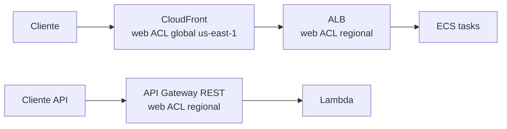

---
aliases:
  - Aula 19.3
modulo: 19
aula: 3
parte: "V Arquiteturas modernas"
dominios:
  - 1
lida: false
tags:
  - aula
  - saa-c03
  - modulo-19
---

# Aula 19.3: WAF, web ACLs, regras e onde associar

[[19 - Seguranca de Aplicacoes e Deteccao de Ameacas|Voltar ao módulo]]

> [!question] Pergunta que esta aula responde
> Como o [[WAF]] decide o que fazer com cada [[HTTP|requisição HTTP]], que peças compõem a configuração ([[Web ACL|web ACL]], regras, rule groups, [[WCU]]), qual regra resolve cada ataque ([[SQL Injection|SQL injection]], flood, bots, país, IP) e em quais serviços ele pode ser ligado?
> Por que o [[WAF]] do [[CloudFront]] é criado em us-east-1?

## O problema: firewall de rede não entende HTTP

Um [[Security Group]] ou um [[Network ACL]] decide por IP, porta e protocolo. A requisição `GET /produtos?id=1 OR 1=1` e a requisição `GET /produtos?id=7` têm o mesmo IP, a mesma porta 443 e o mesmo protocolo. A diferença está no conteúdo ([[Modelo OSI|camada 7]]). O **[[WAF|AWS WAF]]** é um web application firewall: ele inspeciona requisições [[HTTP]](S) que chegam a um recurso protegido e decide o que fazer com cada uma, com base em critérios como IP de origem, país, cabeçalhos, query string, corpo e taxa de requisições.

O [[WAF]] não fica "no caminho" como uma máquina sua: o recurso protegido (um [[Application Load Balancer]], por exemplo) encaminha cada requisição ao WAF para inspeção antes de entregá-la à aplicação. Por isso não há servidor para dimensionar nem patch para aplicar.

## As peças do WAF

A documentação atual (verificado em novembro de 2026) usa o termo **[[Web ACL|protection pack]] (web ACL)** no novo console: o *protection pack* é a nova porta de entrada de configuração, mas por baixo continua sendo um **web ACL**. Na API e na prova o nome é web ACL.

| Peça | O que é |
|---|---|
| **[[Web ACL]]** | O [[Container\|contêiner]] de proteção. Você o associa a recursos e define uma **ação padrão** (Allow ou Block) para o que nenhuma regra decidiu. |
| **Regra (rule)** | Um critério de inspeção mais uma ação. Existe só dentro de um [[Web ACL\|web ACL]] ou rule group. |
| **[[Managed Rule Group]]** | Conjunto de regras pronto, mantido pela AWS ou por vendedores do Marketplace. |
| **Rule group próprio** | Conjunto reutilizável de regras que você escreve. |
| **[[WCU]]** (web ACL capacity unit) | "Moeda" que mede o custo de processamento de regras. Limita o tamanho do [[Web ACL\|web ACL]]. |
| **[[IP Set]]** | Lista de IPs ou CIDRs reutilizável em regras (bloquear ou permitir). |

### Ações de uma regra

Ao casar com uma requisição, a regra aplica uma ação:

- **Allow:** deixa passar (terminal).
- **Block:** bloqueia; o recurso responde **[[HTTP]] 403** por padrão, com resposta customizável (terminal).
- **Count:** só conta, não bloqueia (não terminal). É a ação de **teste**: ative regras novas em Count com tráfego real antes de bloquear.
- **[[CAPTCHA]]** e **Challenge:** exigem prova de que há um humano ou um navegador real antes de continuar. Se o cliente não tem token válido, a requisição é bloqueada (o CAPTCHA responde com o desafio, [[HTTP]] 405) e a avaliação para; se tem token válido, a avaliação continua para as próximas regras (verificado em novembro de 2026).
- **Rule action override:** em um rule group gerenciado, você pode sobrescrever a ação das regras internas (**rule action override**) ou a do grupo inteiro (**override** para Count) para testar sem bloquear.

As regras são avaliadas **na ordem de prioridade**; a primeira ação terminal encerra a avaliação. Se nenhuma regra decidir, vale a **ação padrão** do [[Web ACL|web ACL]]: Allow (bloqueie o que for ruim) ou Block (deixe passar só o que for explicitamente permitido). A maioria dos sites usa **Allow como padrão** e regras de bloqueio específicas.

> [!example] A ordem importa
> Um [[Web ACL|web ACL]] com duas regras: prioridade 1 "Allow para o IP do escritório" e prioridade 2 "Block de países X e Y". Se o escritório estiver em X, a regra 1 casa primeiro e libera. Invertidas, o escritório seria bloqueado. Regras de allow específicas vêm antes de blocos amplos.

### Tipos de condição

O que uma regra pode inspecionar:

- **[[IP Set|IP set]] match:** origem em uma lista.
- **Geo match:** país de origem (bloquear ou permitir países). Atrás de [[CloudFront]], [[Application Load Balancer|ALB]] ou proxy, configure o **forwarded IP** (`X-Forwarded-For`) para o geo match usar o IP do cliente, e não o do proxy. Existe também a **[[Geo Restriction|restrição geográfica]] nativa do CloudFront** (grátis, só lista de países permitidos ou negados na distribuição); veja a tabela de prova.
- **Strings, regex e tamanho:** em URI, query string, cabeçalhos, cookies, corpo.
- **[[SQL Injection|SQL injection]] e [[Cross-Site Scripting|XSS]] match:** detecção de padrões de ataque no componente escolhido.
- **[[Rate-Based Rule|Rate-based rule]]:** limite de requisições por janela de tempo.
- **Rule group reference:** executa um rule group inteiro.
- **Label match:** reage a rótulos que regras anteriores colocaram na requisição.

## Rate-based rules: a resposta ao flood L7 e ao credential stuffing

A **[[Rate-Based Rule]]** conta requisições que casam com o seu critério e limita as que chegam rápido demais. Parâmetros confirmados na documentação (novembro de 2026):

- **Janela de avaliação:** 60, 120, 300 ou 600 segundos (padrão 300). Ela define o quanto olhar para trás, não a frequência da checagem.
- **Limite:** o menor valor permitido é **10** requisições na janela.
- **Agregação:** por padrão agrega por **IP de origem**, mas pode agregar por chaves personalizadas (por exemplo, o primeiro IP de um cabeçalho como `X-Forwarded-For`, ou combinações de chaves). O limite vale para cada instância de agregação.
- **Ação:** qualquer uma exceto Allow (Block, Count, [[CAPTCHA]], Challenge).
- **Atrás de proxy ou [[CloudFront]]:** sem agregar por IP encaminhado (forwarded IP, `X-Forwarded-For`), a regra conta o IP do próprio CloudFront ou [[Application Load Balancer|ALB]] e passa a limitar todos os clientes juntos.
- **Escopo restrito:** um **scope-down statement** limita as requisições contadas (por exemplo, só `POST /login`).
- Custo de capacidade: 2 WCUs de base, mais 30 WCUs por chave de agregação personalizada.

> [!example] Proteger o login sem atrapalhar o resto
> Uma regra rate-based com limite de 100 requisições em 5 minutos por IP, escopo `URI path contém /login`, ação Block. Um usuário que erra a senha três vezes passa; um atacante que testa 5 mil senhas do mesmo IP é cortado. Para agressores com milhares de IPs, a regra por IP é insuficiente: aí entram [[Bot Control]] ou o [[AWS WAF Fraud Control|ATP]] (adiante).

## Managed rule groups: proteção pronta

Escrever regra de [[SQL Injection|SQL injection]] à mão é trabalho de especialista. Os **AWS Managed Rules** entregam conjuntos prontos, atualizados pela AWS (você paga as tarifas normais do [[WAF]] por regra e por requisição; alguns grupos, como [[Bot Control]], [[AWS WAF Fraud Control|ATP]] e ACFP, têm tarifa própria). Os principais (verificado em novembro de 2026):

| Rule group | Para que serve |
|---|---|
| **Core rule set (CRS)** | Proteção geral contra vulnerabilidades comuns, incluindo parte do [[OWASP Top 10]]. Use em quase todo caso (700 WCUs). |
| **Admin protection** | Bloqueia acesso a páginas administrativas expostas. |
| **Known bad inputs** | Bloqueia padrões de requisição ligados a exploração de vulnerabilidades conhecidas. |
| **SQL database** | Padrões de [[SQL Injection\|SQL injection]] e acesso indevido a bancos. |
| **Linux, POSIX, Windows OS** | Bloqueiam exploração específica do sistema operacional. |
| **PHP application, WordPress application** | Específicos de cada plataforma. |
| **Amazon IP reputation list** | Bloqueia IPs que a AWS identifica como bots ou fontes de ataque. |
| **Anonymous IP list** | Bloqueia origens que escondem identidade (VPN, proxies, Tor, hospedagem). |
| **[[Bot Control]]** | Gerencia bots (50 WCUs), com níveis **Common** (bots que se identificam) e **Targeted** (bots sofisticados, com [[CAPTCHA]] e desafios). Cobrado à parte. |
| **[[AWS WAF Fraud Control|ATP]]** (Account Takeover Prevention) | Detecta tentativas de roubo de conta no login ([[Credential Stuffing\|credential stuffing]]). Cobrado à parte. |
| **[[AWS WAF Fraud Control\|ACFP]]** (Account Creation Fraud Prevention) | Detecta criação fraudulenta de contas. Cobrado à parte. |

> [!tip] Padrão de adoção segura
> Adicione o rule group em **modo Count** (ou com ação override para Count), observe os logs por alguns dias com tráfego real, ajuste falsos positivos com exceções e só então mude para Block. A documentação orienta a testar em ambiente de staging e depois em Count com produção antes de habilitar.

[[Bot Control]] e [[AWS WAF Fraud Control|ATP]]/ACFP custam à parte, e quando você protege um recurso com o [[Shield|Shield Advanced]], a assinatura cobre as tarifas padrão do [[WAF]] mas **não** esses extras (Aula 19.2).

## Onde associar um web ACL

Recursos que podem ser protegidos (verificado em novembro de 2026):

- **[[CloudFront|Amazon CloudFront]]** (distribuição)
- **[[API Gateway|Amazon API Gateway]]** (**REST API**, não [[HTTP]] API na lista)
- **[[Application Load Balancer]]**
- **[[AppSync|AWS AppSync]]** (API GraphQL)
- **[[Cognito|Amazon Cognito]] [[User Pool|user pool]]**
- AWS App Runner, AWS Verified Access, [[Amplify|AWS Amplify]], Amazon Bedrock AgentCore Gateway (menos prováveis na prova)

Regras de associação:

- Um recurso só pode ter **um** [[Web ACL|web ACL]]. Um web ACL pode ser usado em **vários** recursos (um para muitos).
- [[Web ACL]] **regional** ([[Application Load Balancer|ALB]], [[API Gateway]], [[AppSync]], [[Cognito]]): precisa estar na **mesma Região** do recurso.
- [[Web ACL]] **global** para **[[CloudFront]]**: tem Região fixa em **US East (N. Virginia)**. Na CLI e no [[CloudFormation]] isso aparece como escopo `CLOUDFRONT` (com `--region us-east-1`) contra `REGIONAL`. É a mesma lógica do certificado do CloudFront no [[ACM]] ([[08 - Criptografia e Protecao de Dados|Módulo 8]]): serviço global, configuração em us-east-1.
- Um [[Web ACL|web ACL]] associado a [[CloudFront]] não pode ser associado a outro tipo de recurso.
- [[Application Load Balancer|ALB]] só **dentro de [[Regiao AWS|Regiões]]** (não em Outposts).
- [[User Pool|User pool]] do [[Cognito]] não pode usar [[AWS WAF Fraud Control|ATP]] ou ACFP.

**Não aparecem na lista:** [[Network Load Balancer|NLB]], [[EC2|instâncias EC2]] diretas e [[S3]] (o S3 é protegido via [[CloudFront]]). Aplicações em **[[ECS]]** são protegidas pelo [[WAF]] **no [[Application Load Balancer|ALB]]** que faz o roteamento para as tasks.



> [!info] Ligando os pontos
> Aplicações atrás de [[18 - Borda e DNS CloudFront Global Accelerator e Route 53|CloudFront (Módulo 18)]], do [[12 - Balanceamento de Carga e Auto Scaling|ALB (Módulo 12)]] e do [[16 - Serverless Lambda e API Gateway|API Gateway (Módulo 16)]] ganham [[WAF]] só associando um [[Web ACL|web ACL]]. Se você precisa proteger um [[Network Load Balancer|NLB]] ou [[TCP]]/UDP, o WAF não serve: veja [[Shield]] e [[Network Firewall]].

## Limites e custo

- **Capacidade:** o máximo de um [[Web ACL|web ACL]] ou rule group é de **5.000 WCUs**. Para fins de preço, a referência de **1.500 WCUs** aparece na documentação do Shield Advanced como limite coberto por assinatura.
- **Tamanho de inspeção:** para **[[Application Load Balancer|ALB]] e [[AppSync]]**, o [[WAF]] inspeciona só os primeiros **8 KB** do corpo; para **[[CloudFront]], [[API Gateway]], [[Cognito]]** e outros, **16 KB** por padrão (configurável até 64 KB). Cabeçalhos: até 8 KB e 200 cabeçalhos; cookies, idem. O restante da requisição passa para a aplicação sem inspeção, e a regra define como tratar "oversize" (Continue, Match, No match). É uma pegadinha de segurança real: um atacante pode empurrar o payload malicioso para além do limite inspecionado.
- **Cobrança (modelo geral):** por [[Web ACL|web ACL]], por regra e por milhão de requisições inspecionadas, mais tarifas dos grupos pagos ([[Bot Control]], [[AWS WAF Fraud Control|ATP]], ACFP), [[CAPTCHA]], logs e corpo maior que o padrão. Confira valores na página oficial de preços: não os repito aqui porque mudam.

## Logs e visibilidade

O destino precisa ter nome com prefixo **`aws-waf-logs-`** (stream do Firehose, [[Bucket|bucket]] S3 ou [[Log Group|log group]]). O [[WAF]] pode registrar o tráfego analisado em um grupo do [[CloudWatch Logs]], um bucket [[S3]] ou um stream do [[Data Firehose]]. Os logs trazem a requisição e a regra que casou, essenciais para afinar falsos positivos. Também há métricas por regra no [[CloudWatch]] e [[Sampling|amostragem]] de requisições. Há opção de redigir campos sensíveis (por exemplo, o cabeçalho de autorização) dos logs.

## Laboratório (opcional): medir capacidade de uma regra rate-based

> [!warning] Use uma conta AWS pessoal separada
> Use uma **[[Conta AWS|conta AWS]] pessoal separada**, com [[Budgets]] configurado, **nunca a conta de produção da empresa**. Custo estimado: zero com `check-capacity` (não cria recurso). Se você optar por criar o [[Web ACL|web ACL]], ele tem cobrança mensal proporcional enquanto existir (confirme preços na página oficial): apague no mesmo dia.

1. Crie o arquivo `rules.json` com uma regra rate-based em modo Count (substitua os nomes como quiser):
   ```json
   [{
     "Name": "limite-por-ip",
     "Priority": 1,
     "Statement": { "RateBasedStatement": { "Limit": 100, "EvaluationWindowSec": 300, "AggregateKeyType": "IP" } },
     "Action": { "Count": {} },
     "VisibilityConfig": { "SampledRequestsEnabled": true, "CloudWatchMetricsEnabled": true, "MetricName": "limiteporip" }
   }]
   ```
2. Meça a capacidade sem criar nada: `aws wafv2 check-capacity --scope REGIONAL --region us-east-1 --rules file://rules.json`. A resposta traz as WCUs (a documentação indica 2 de base para uma regra rate-based sem scope-down).
3. (Opcional) Crie o [[Web ACL|web ACL]]: `aws wafv2 create-web-acl --name saa-lab-acl --scope REGIONAL --region us-east-1 --default-action Allow={} --visibility-config SampledRequestsEnabled=true,CloudWatchMetricsEnabled=true,MetricName=saaLabAcl --rules file://rules.json`.
4. Liste e anote o `Id` e o `LockToken`: `aws wafv2 list-web-acls --scope REGIONAL --region us-east-1`.
5. **Limpeza:** `aws wafv2 delete-web-acl --name saa-lab-acl --scope REGIONAL --region us-east-1 --id <ID> --lock-token <TOKEN>`.

## Como isso cai na prova

Cobertura: **Task 1.2** ("integrating AWS services to secure applications (Shield, [[WAF]], ...)"; "threat vectors external to AWS ([[SQL Injection|SQL injection]])"); relaciona-se com **Task 3.4** (borda).

**Palavras-chave em inglês:**
- "[[SQL Injection|SQL injection]]", "[[Cross-Site Scripting|cross-site scripting]]", "block requests containing malicious patterns" puxam **[[WAF]] + [[Managed Rule Group|managed rule groups]]** (CRS, SQL database).
- "block traffic from specific countries" puxa **geo match**.
- "limit the number of requests from a single IP", "rate limit login attempts" puxam **[[Rate-Based Rule|rate-based rule]]**.
- "bots", "scraping" puxam **[[Bot Control]]**.
- "account takeover", "[[Credential Stuffing|credential stuffing]]" puxam **[[AWS WAF Fraud Control|ATP]] (Fraud Control)**.
- "least [[Overhead Operacional|operational overhead]]" puxa **[[Managed Rule Group|managed rule groups]]**, não regras escritas à mão.
- "apply the same rules across accounts" puxa **[[Firewall Manager]]** (Aula 19.4).

**Pegadinhas clássicas:**
- **[[WAF]] não protege [[Network Load Balancer|NLB]] nem [[EC2]] direto**: associe a [[Application Load Balancer|ALB]], [[CloudFront]], [[API Gateway]] REST etc.
- **[[WAF]] para [[CloudFront]] é global e fica em us-east-1**; para [[Application Load Balancer|ALB]] e [[API Gateway]] é regional e na mesma Região do recurso.
- **Um recurso, um [[Web ACL|web ACL]].**
- **[[Security Group|Security group]] e [[Network ACL|NACL]] não substituem [[WAF]]** para ataques de conteúdo.
- **Geo match bloqueia por país do IP**, não por usuário (VPN contorna).
- **Count antes de Block**: testar regra nova em produção sem derrubar tráfego legítimo.
- **Rate-based por IP não segura botnet de milhares de IPs**: combine com [[Bot Control]] e IP reputation.

| Requisito no enunciado | Resposta provável | Por quê |
|---|---|---|
| Proteger contra [[SQL Injection\|SQL injection]] e [[Cross-Site Scripting\|XSS]] sem escrever regras | [[WAF]] com [[Managed Rule Group\|managed rule groups]] (CRS, SQL database) | Mantidas pela AWS, menor overhead |
| Limitar requisições por IP em endpoint de login | [[Rate-Based Rule\|Rate-based rule]] com scope-down | Conta por janela e IP |
| Bloquear tráfego de países específicos, lógica combinada ou por rota | Geo match no [[WAF]] | Condição nativa, combinável e com resposta customizável |
| Bloquear países na distribuição [[CloudFront]] sem custo extra | [[Geo Restriction\|Geo restriction]] do CloudFront | Nativa e gratuita (lista allow ou deny por país); fonte: [georestrictions](https://docs.aws.amazon.com/AmazonCloudFront/latest/DeveloperGuide/georestrictions.html) |
| Bloquear IPs conhecidos como maliciosos | Amazon IP reputation list ou [[IP Set\|IP set]] | Lista gerenciada ou própria |
| Detectar roubo de conta no login | [[AWS WAF Fraud Control]] ATP | Rule group específico |
| Proteger API REST pública | [[WAF]] regional associado ao [[API Gateway]] | API Gateway REST é suportado |
| Proteger site em [[CloudFront]] | [[Web ACL]] global (us-east-1) | Região fixa para CloudFront |

## Resumo

> [!abstract] A aula em uma frase
> O [[WAF]] é um firewall de [[Modelo OSI|camada 7]] que avalia requisições [[HTTP]] por um [[Web ACL|web ACL]] de regras em ordem de prioridade, com [[Managed Rule Group|managed rule groups]] para proteção pronta, [[Rate-Based Rule|rate-based rules]] para flood e abuso de login, associado a [[CloudFront]], [[Application Load Balancer|ALB]], [[API Gateway]] REST, [[AppSync]] e [[Cognito]].

**A lógica, em 5 passos**
1. SG e [[Network ACL|NACL]] não leem [[HTTP]]; o recurso protegido encaminha cada requisição ao [[WAF]].
2. O [[Web ACL|web ACL]] aplica regras por prioridade; a primeira ação terminal decide; senão vale a ação padrão.
3. Regras novas entram em Count, são ajustadas pelos logs e só então viram Block.
4. [[Managed Rule Group|Managed rule groups]] (CRS, SQL database, IP reputation, [[Bot Control]], [[AWS WAF Fraud Control|ATP]]) dão proteção pronta; [[Rate-Based Rule|rate-based rules]] limitam abuso por IP ou chave.
5. A associação é um recurso para um [[Web ACL|web ACL]]; [[CloudFront]] usa web ACL global em us-east-1, os demais usam web ACL regional na mesma Região.

**Números para lembrar**

| O quê | Valor | Por que importa |
|---|---|---|
| Janelas de rate-based | 60, 120, 300 (padrão), 600 s | Define a memória da regra |
| Limite mínimo de rate-based | 10 | Piso configurável |
| WCUs máximas por [[Web ACL\|web ACL]] | 5.000 | Teto de complexidade |
| Inspeção do corpo ([[Application Load Balancer\|ALB]], [[AppSync]]) | 8 KB | Resto passa sem inspeção |
| Inspeção do corpo ([[CloudFront]], [[API Gateway]]) | 16 KB (até 64 KB) | Configurável |
| Bloqueio padrão | [[HTTP]] 403 | Pode ser customizado |

**Na prática, isso significa**
- Comece com CRS, SQL database, Known bad inputs e IP reputation, em Count, e promova a Block depois da análise.
- Use rate-based com escopo no login e [[AWS WAF Fraud Control|ATP]] se houver risco de [[Credential Stuffing|credential stuffing]].
- Habilite logs ([[CloudWatch Logs]], [[S3]] ou [[Data Firehose|Firehose]]) antes do primeiro ataque, não depois.
- Para [[Network Load Balancer|NLB]], [[EC2]] ou [[TCP]]/UDP, o [[WAF]] não serve.

> [!tip] Liga com
> Vem da [[19.02 - Shield DDoS Standard e Advanced|Aula 19.2]] ([[Modelo OSI|L7]] é do [[WAF]]). Leva à [[19.04 - Network Firewall DNS Firewall e Firewall Manager|Aula 19.4]] (firewalls de rede e gestão multiconta).

## Erros comuns

- Tentar associar o [[WAF]] a um [[Network Load Balancer|NLB]] ou a uma [[EC2|instância EC2]].
- Criar o [[Web ACL|web ACL]] do [[CloudFront]] fora de us-east-1.
- Ativar uma regra nova direto em Block, derrubando clientes legítimos.
- Associar dois [[Web ACL|web ACLs]] ao mesmo [[Application Load Balancer|ALB]] (só um é permitido).
- Esperar que [[Bot Control]] ou [[AWS WAF Fraud Control|ATP]] estejam incluídos no preço padrão do [[WAF]].
- Assumir que o [[WAF]] inspeciona o corpo inteiro ([[Application Load Balancer|ALB]] inspeciona só 8 KB).
- Usar só rate-based por IP contra uma botnet de milhares de IPs.

## Pratique

**1.** Uma empresa serve um site por [[CloudFront]] e quer associar um [[WAF]]. Em qual Região deve criar o [[Web ACL|web ACL]]?

- [ ] a) Na Região em que está a origem (ALB).
- [ ] b) Em qualquer Região, desde que seja a mesma do bucket de logs do web ACL.
- [ ] c) Na Região mais próxima dos usuários.
- [ ] d) Em us-east-1, a Região fixa para web ACLs globais de CloudFront.

**2.** Qual solução bloqueia [[SQL Injection|SQL injection]] e [[Cross-Site Scripting|XSS]] em uma API REST pública do [[API Gateway]] com o menor [[Overhead Operacional|overhead operacional]]?

- [ ] a) Criar uma regra de AWS Config que detecta as requisições maliciosas e as corrige.
- [ ] b) Associar um web ACL regional com managed rule groups ao API Gateway.
- [ ] c) Habilitar o Shield Standard e aguardar o bloqueio automático.
- [ ] d) Criar um network ACL na sub-rede da Lambda.

**3.** Uma equipe quer limitar a 200 requisições em 5 minutos por IP apenas no caminho /login. Qual configuração?

- [ ] a) Geo match com ação Count.
- [ ] b) Um IP set com todos os endereços possíveis de origem do ataque, atualizado a cada hora.
- [ ] c) Rate-based rule com scope-down no caminho /login.
- [ ] d) Um security group com a porta 443 restrita.

**4.** Uma loja quer proteger o login contra [[Credential Stuffing|credential stuffing]] feito por botnet com milhares de IPs. Quais DUAS medidas fazem mais sentido? (Escolha DUAS.)

- [ ] a) Aplicar apenas uma rate-based rule por IP com limite alto.
- [ ] b) Adicionar o rule group Fraud Control ATP no web ACL.
- [ ] c) Aumentar o tamanho das instâncias da aplicação.
- [ ] d) Desabilitar o log do WAF para reduzir custo.
- [ ] e) Adicionar Bot Control no nível Targeted com CAPTCHA ou challenge.

**5.** Um [[Web ACL|web ACL]] tem duas regras: (prioridade 1) Block para o país X; (prioridade 2) Allow para o IP do escritório, que está no país X. O que acontece com o tráfego do escritório?

- [ ] a) É bloqueado: a regra de prioridade 1 casa primeiro e é terminal.
- [ ] b) É liberado, pois Allow sempre prevalece.
- [ ] c) É contado, mas não bloqueado.
- [ ] d) A requisição recebe CAPTCHA automaticamente e só depois é avaliada pelas outras regras.

**6.** Uma empresa precisa proteger um [[Network Load Balancer]] contra ataques [[HTTP]] de [[SQL Injection|SQL injection]] usando [[WAF]]. Qual é o problema?

- [ ] a) O WAF só protege recursos de armazenamento.
- [ ] b) É necessário primeiro habilitar o Shield Advanced e registrar o NLB como recurso protegido.
- [ ] c) O WAF só funciona em sub-redes públicas.
- [ ] d) O WAF não se associa a NLB; é preciso ALB, CloudFront ou API Gateway na frente.

**7.** Ao implantar um [[Managed Rule Group|managed rule group]] novo em produção, qual prática é recomendada?

- [ ] a) Ativar em Block imediatamente para máxima segurança.
- [ ] b) Executar apenas em ambiente de desenvolvimento e depois esquecer o assunto em produção.
- [ ] c) Habilitar em Count com tráfego real, analisar os logs e então mudar para Block.
- [ ] d) Duplicar o web ACL em outra Região para comparar.

**8.** Quais DUAS afirmações sobre associação de [[Web ACL|web ACL]] estão corretas? (Escolha DUAS.)

- [ ] a) Cada recurso pode ser associado a apenas um web ACL.
- [ ] b) Um web ACL regional pode ser associado a recursos em qualquer Região.
- [ ] c) Um web ACL pode proteger instâncias EC2 diretamente.
- [ ] d) Um mesmo web ACL pode ser associado a vários recursos.
- [ ] e) O web ACL do CloudFront deve estar na Região da origem.

**9.** Uma API em [[ECS]] [[Fargate]] precisa de [[WAF]]. Como o WAF é aplicado?

- [ ] a) Instalando o agente do WAF dentro de cada task.
- [ ] b) Habilitando o WAF no ALB que roteia o tráfego para as tasks.
- [ ] c) Associando o web ACL diretamente ao cluster ECS.
- [ ] d) Associando o web ACL ao security group das tasks.

**10.** Qual rule group do [[WAF]] tem como objetivo bloquear IPs de origens que a própria AWS identifica como fontes de bots ou ataque?

- [ ] a) Amazon IP reputation list.
- [ ] b) Core rule set.
- [ ] c) WordPress application.
- [ ] d) Linux operating system.

**11.** Um atacante envia um payload malicioso depois dos primeiros 8 KB do corpo de uma requisição para um [[Application Load Balancer|ALB]] com [[WAF]]. Por que isso é um risco?

- [ ] a) O WAF inspeciona todo o corpo, então o risco é nulo.
- [ ] b) O ALB descarta automaticamente corpos maiores que 8 KB antes de chegarem ao WAF e não registra nada.
- [ ] c) O WAF inspeciona só os primeiros 8 KB; o excedente passa, a menos que a regra trate oversize.
- [ ] d) O WAF só inspeciona cabeçalhos, nunca o corpo.

**12.** Uma empresa quer bloquear o acesso a uma API a partir de uma lista fixa de CIDRs maliciosos e reutilizar a lista em vários [[Web ACL|web ACLs]]. O que usar?

- [ ] a) Regex pattern set com os IPs em formato de texto, uma regra por endereço.
- [ ] b) Um security group para cada Região.
- [ ] c) Um IP set referenciado por regras em cada web ACL.
- [ ] d) Um network ACL na sub-rede do ALB.

> [!success]- Gabarito
> **1. d)** o [[Web ACL|web ACL]] de [[CloudFront]] é global e tem Região fixa em us-east-1; a, b e c confundem com os web ACLs regionais ou inventam critérios.
> **2. b)** [[Managed Rule Group|managed rule groups]] em [[Web ACL|web ACL]] regional protegem a API REST sem manutenção; a erra porque o Config avalia configuração de recursos, não bloqueia requisições [[HTTP]]; c cobre só [[DDoS]] [[Modelo OSI|L3]] e L4; d não lê HTTP.
> **3. c)** rate-based com scope-down restringe a contagem ao /login; a só conta países; b é inviável; d filtra porta, não taxa.
> **4. b) e e)** [[AWS WAF Fraud Control|ATP]] e [[Bot Control]] Targeted tratam [[Credential Stuffing|credential stuffing]] e bots distribuídos; a falha com milhares de IPs; c não resolve; d reduz visibilidade.
> **5. a)** as regras são avaliadas por prioridade e Block é terminal, então o escritório é bloqueado; b ignora a ordem; c e d não correspondem à ação definida.
> **6. d)** o [[WAF]] não se associa a [[Network Load Balancer|NLB]]; use um [[Application Load Balancer|ALB]], [[CloudFront]] ou [[API Gateway]]; a, b e c são afirmações falsas.
> **7. c)** Count com tráfego real permite ajustar falsos positivos antes de bloquear; a derruba clientes; b não testa com tráfego real; d não ajuda a validar.
> **8. a) e d)** um recurso tem um [[Web ACL|web ACL]] e um web ACL serve a vários recursos; b erra porque regional exige a mesma Região; c erra porque [[EC2]] não é suportado; e erra porque [[CloudFront]] usa us-east-1.
> **9. b)** [[WAF]] protege [[ECS]] pelo [[Application Load Balancer|ALB]]; a, c e d não existem.
> **10. a)** a lista de reputação da Amazon cobre IPs de bots e ataques; b é geral; c e d são específicos de plataforma e SO.
> **11. c)** o [[Application Load Balancer|ALB]] e o [[AppSync]] inspecionam só 8 KB do corpo; a, b e d afirmam o contrário do comportamento documentado.
> **12. c)** um [[IP Set|IP set]] é reutilizável entre [[Web ACL|web ACLs]]; a é para regex; b não atua em [[HTTP]]; d não é reutilizável entre [[Regiao AWS|Regiões]] e não é [[WAF]].

## Para aprofundar

- [ ] [AWS WAF: how it works](https://docs.aws.amazon.com/waf/latest/developerguide/how-aws-waf-works.html) (documentação AWS): [[Web ACL|web ACLs]], regras, rule groups, WCUs e ações.
- [ ] [Rate-based rule statements](https://docs.aws.amazon.com/waf/latest/developerguide/waf-rule-statement-type-rate-based.html) (documentação AWS): janelas, limites, agregação e scope-down.
- [ ] [AWS Managed Rules rule groups list](https://docs.aws.amazon.com/waf/latest/developerguide/aws-managed-rule-groups-list.html) (documentação AWS): todos os grupos gerenciados, incluindo [[Bot Control]], [[AWS WAF Fraud Control|ATP]] e ACFP.
- [ ] [Associating protection with an AWS resource](https://docs.aws.amazon.com/waf/latest/developerguide/web-acl-associating-aws-resource.html) (documentação AWS): recursos suportados e restrições de associação.

Próxima aula: [[19.04 - Network Firewall DNS Firewall e Firewall Manager|Aula 19.4: Network Firewall, DNS Firewall e Firewall Manager]].
