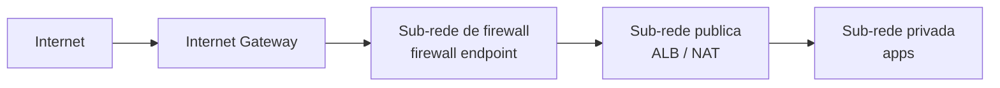

---
aliases:
  - Aula 19.4
modulo: 19
aula: 4
parte: "V Arquiteturas modernas"
dominios:
  - 1
lida: false
tags:
  - aula
  - saa-c03
  - modulo-19
---

# Aula 19.4: Network Firewall, DNS Firewall e Firewall Manager

[[19 - Seguranca de Aplicacoes e Deteccao de Ameacas|Voltar ao módulo]]

> [!question] Pergunta que esta aula responde
> Quando [[Security Group]] e [[Network ACL]] não bastam e preciso de inspeção profunda de pacotes, filtro por domínio ou IPS dentro da [[VPC]]? Como o [[Network Firewall]] se encaixa na rede, o que o [[Route 53 Resolver DNS Firewall]] filtra e como o [[Firewall Manager]] impõe tudo isso em dezenas de contas?

## O problema: filtros de rede simples têm pontos cegos

Você já domina a segurança de rede da [[VPC]] ([[06 - VPC a Fundo|Módulo 6]]): o [[Security Group|security group]] é stateful e só permite; o [[Network ACL|network ACL]] é [[Stateless|stateless]] e permite ou nega por regra numerada. Os dois decidem por **IP, porta e protocolo**. Isso deixa três lacunas que aparecem em exigências reais:

1. **Filtrar por domínio:** "instâncias privadas só podem sair para `api.parceiro.com` e `*.amazonaws.com`". Um SG não sabe domínios, só IPs, e IPs de domínios mudam.
2. **Olhar dentro do pacote:** bloquear tráfego com assinatura de exploração ou malware, mesmo em porta permitida (443, por exemplo). Isso é **inspeção profunda de pacotes** (deep packet inspection, DPI) e **prevenção de intrusão** (IPS).
3. **Impor a mesma política em muitas contas:** equipes diferentes criam [[VPC|VPCs]] diferentes e esquecem de aplicar o padrão.

Três serviços, três lacunas: [[Network Firewall]] (1 e 2, na rede), **[[Route 53 Resolver DNS Firewall|DNS Firewall]]** (1, na [[DNS|resolução de nomes]]) e [[Firewall Manager]] (3).

## AWS Network Firewall

O **[[Network Firewall]]** é um serviço gerenciado de [[Stateful e Stateless (Firewall)|firewall stateful]] e de detecção e prevenção de intrusão para a [[VPC]] (verificado em novembro de 2026). Ele usa o IPS open source **[[Suricata]]** para inspeção stateful e aceita regras compatíveis com Suricata. Não há servidor para dimensionar: ele escala com o tráfego.

### Como entra na rede

O firewall coloca um **firewall endpoint** (uma interface gerenciada) em uma **[[Sub-rede|sub-rede]] dedicada de firewall em cada [[Zona de Disponibilidade|AZ]]**. A proteção funciona porque **você altera as [[Route Table|route tables]]** para que o tráfego passe pelo endpoint antes de seguir. Ele pode filtrar tráfego que entra ou sai da [[VPC]] por [[Internet Gateway]], [[NAT Gateway]], [[Transit Gateway]], [[Virtual Private Gateway]], VPN ou [[Direct Connect]], desde que seja roteado ao endpoint, e também tráfego entre sub-redes.

A mesma regra de projeto que vale para qualquer recurso zonal: **um endpoint por [[Zona de Disponibilidade|AZ]]**. Se o endpoint de uma AZ filtra o tráfego de outra, há cobrança de tráfego entre AZs e um acoplamento de falha (a documentação cita as tarifas [[Cross-Zone Load Balancing|cross-zone]] como custo extra).

> [!example] Roteando pelo firewall
> A [[Sub-rede Privada|sub-rede privada]] tem a [[Rota Padrao|rota padrão]] `0.0.0.0/0` para o endpoint do firewall (na [[Sub-rede|sub-rede]] de firewall da mesma [[Zona de Disponibilidade|AZ]]), e a sub-rede de firewall tem a rota padrão para o [[NAT Gateway|NAT gateway]]. A saída da aplicação passa pelo firewall antes de chegar ao [[NAT]]. O retorno também passa pelo firewall, por isso as rotas de retorno precisam existir.

### Regras: stateless, stateful e domínio

Em uma política **clássica** (a que a maior parte dos exemplos de prova usa), o tráfego passa por dois mecanismos:

- **[[Stateless]]:** avalia cada pacote isoladamente (origem, destino, portas, protocolo), muito rápido; a ação é *pass*, *drop* ou *forward to stateful* (encaminha ao mecanismo stateful).
- **Stateful:** acompanha a conexão e permite regras mais ricas. Há três formas de escrever:
  - **5-tuple:** origem, destino, portas e protocolo, [[Stateful e Stateless (Firewall)|com estado]];
  - **Domain list:** **lista de domínios permitida (allowlist) ou negada (denylist)**, com alerta opcional, filtrando [[HTTP]] pelo cabeçalho Host e HTTPS pelo **[[SNI]]** (nome do site enviado em texto claro no início do handshake [[TLS]]). As ações *Pass*, *Drop*, *Reject* e *Alert* pertencem às regras 5-tuple e [[Suricata]], não à domain list;
  - **[[Suricata]] compatible:** regras avançadas com inspeção de conteúdo (IPS). Suricata é o formato.

> [!warning] Sem TLS inspection, o firewall só vê o SNI
> Em HTTPS, sem **[[TLS]] inspection** o [[Network Firewall]] enxerga apenas [[SNI]] e Host, não o conteúdo cifrado. Para inspecionar o **payload** de tráfego HTTPS (IPS lendo o conteúdo), habilite TLS inspection, que usa um certificado no [[ACM]] para decifrar, inspecionar e recifrar o tráfego. Sem isso, "inspeção profunda" não alcança o corpo cifrado. Fonte: [TLS inspection](https://docs.aws.amazon.com/network-firewall/latest/developerguide/tls-inspection.html).

Há também **[[Managed Rule Group|managed rule groups]]** da AWS para ameaças conhecidas e **logs** de alertas e de fluxo (para [[S3]], [[CloudWatch Logs]] ou [[Data Firehose]]).

A documentação atual (novembro de 2026) acrescenta **políticas Next Generation**, recomendadas para firewalls novos, com dois mecanismos em sequência: o **firewall engine** (controle de acesso, *drop by default*) e o **IPS engine** (detecção e prevenção, *pass by default*), sem regras [[Stateless|stateless]]. Políticas clássicas continuam totalmente suportadas. Para a prova, conheça o vocabulário clássico (stateless e stateful) e guarde: "[[Stateful e Stateless (Firewall)|firewall stateful]] gerenciado com IPS compatível com [[Suricata]]".

### Os dois modelos de capacidade

Ao criar o firewall escolhe-se uma capacidade:

- **Routed firewall:** o tráfego chega ao endpoint por [[Route Table|route tables]], é filtrado e volta; IPs de origem e destino preservados; suporta [[TCP]], [[UDP]] e ICMP.
- **[[NAT]]/Proxy firewall:** a AWS cria um [[NAT Gateway|NAT gateway]] e um endpoint por [[Zona de Disponibilidade|AZ]] e atua também como **proxy explícito** ([[HTTP]] CONNECT) para HTTP e HTTPS, sem mudar [[Route Table|route tables]] dos clientes. O proxy explícito só existe no modo em que o IP de origem do cliente é substituído (sem preservação de IP de origem), ao contrário do modo roteado. É recurso novo e fora do foco da prova (verificado em novembro de 2026). A documentação atual também cita **Cloud WAN** entre os pontos de passagem e a "automated internet firewall", possíveis [[Distrator|distratores]].

### Padrões de uso

| Necessidade | Uso do [[Network Firewall]] |
|---|---|
| Saída só para domínios aprovados | Domain list Allow (com ação padrão de bloquear) |
| Bloquear destinos maliciosos conhecidos | Domain list Deny ou managed rules |
| Inspecionar o conteúdo do tráfego (IPS) | [[Suricata\|Regras Suricata]] |
| Inspeção centralizada de várias [[VPC\|VPCs]] | Firewall em uma **VPC de inspeção** ligada por [[Transit Gateway]] ([[07 - Conectividade Hibrida e entre VPCs|Módulo 7]]) |
| Filtrar entre [[Sub-rede\|sub-redes]] | Endpoint no caminho entre elas |

> [!info] Alternativa: Gateway Load Balancer
> Para inserir **appliances de terceiros** (firewalls de fornecedores) em linha, o serviço é o [[Gateway Load Balancer]] ([[12 - Balanceamento de Carga e Auto Scaling|Módulo 12]]). [[Network Firewall]] é o firewall **gerenciado pela AWS**; GWLB é para quando a exigência é um appliance de terceiros específico.

## Route 53 Resolver DNS Firewall

Antes de qualquer conexão de saída, a instância faz uma **consulta [[DNS]]**. O **[[Route 53 Resolver DNS Firewall]]** filtra essas consultas que saem da [[VPC]] pelo resolvedor do [[Route 53]] (a documentação atual o chama de "VPC Resolver"). Você define **regras de filtragem por nome de domínio** em **rule groups** que associa às VPCs.

- **Domain lists:** listas de domínios para permitir, bloquear ou alertar. Podem ser suas ou **gerenciadas pela AWS** (domínios maliciosos conhecidos).
- **Ações:** Allow (só em regras com lista de domínios), Block e Alert. Para bloqueio é possível definir respostas customizadas (NODATA, NXDOMAIN ou redirecionar). **NXDOMAIN** é a resposta [[DNS]] de que o nome não existe; **NODATA** diz que o nome existe, mas sem registro do tipo pedido.
- **Regras avançadas ([[Route 53 Resolver DNS Firewall|DNS Firewall]] Advanced):** proteção contra **[[DNS]] tunneling** (exfiltração de dados escondida em consultas DNS) e **DGA** (domínios gerados por algoritmo, usados por malware).
- **Falha aberta ou fechada (fail-open/fail-closed):** na associação do rule group à [[VPC]] é possível escolher o que acontece se o [[Route 53 Resolver DNS Firewall|DNS Firewall]] não conseguir avaliar uma consulta: fail-open deixa a consulta passar (prioriza [[Disponibilidade|disponibilidade]]) e fail-closed a bloqueia (prioriza segurança). Confirme o padrão atual na documentação ([overview](https://docs.aws.amazon.com/Route53/latest/DeveloperGuide/resolver-dns-firewall-overview.html)).
- **Prioridade:** regras e rule groups processados do menor número para o maior.
- **Limite importante:** filtra **apenas o nome de domínio** da consulta. Não resolve o nome para bloquear um IP e **não filtra** HTTPS, SSH, FTP etc. Um atacante que conecta direto a um IP não consulta [[DNS]]: o [[Route 53 Resolver DNS Firewall|DNS Firewall]] não vê. Também só vale para consultas que passam pelo resolvedor da [[VPC]]: uma instância que usa DNS externo ou DNS sobre HTTPS (DoH) direto contorna o filtro.

> [!example] Malware que consulta o domínio errado
> Uma instância comprometida tenta resolver `c2-servidor-malicioso.exemplo`. O [[Route 53 Resolver DNS Firewall|DNS Firewall]], com a lista gerenciada de domínios maliciosos em Block, devolve NXDOMAIN. O malware não descobre o IP e não conecta. É barato, é [[DNS]] e não exige roteamento especial. Para conexões direto por IP, use o [[Network Firewall]].

### Network Firewall x DNS Firewall x NACL x SG

| | [[Security Group]] | [[Network ACL]] | [[Route 53 Resolver DNS Firewall\|DNS Firewall]] | [[Network Firewall]] |
|---|---|---|---|---|
| Camada | Instância/ENI | [[Sub-rede]] | Consulta [[DNS]] | Pacote e fluxo na [[VPC]] |
| Estado | Stateful | [[Stateless]] | Não se aplica | Stateful (e stateless clássico) |
| Decide por | IP, porta, protocolo | IP, porta, protocolo | Nome de domínio | Domínio, conteúdo, assinaturas, 5-tuple |
| Nega explicitamente | Não | Sim | Sim (Block) | Sim |
| IPS | Não | Não | Não | Sim |

## AWS Firewall Manager

O **[[Firewall Manager]]** simplifica a administração de proteções em várias contas e recursos. Você define a política uma vez e ele aplica em todas as contas da organização, inclusive nas novas, e em recursos novos criados depois (verificado em novembro de 2026).

### Tipos de política

| Política | O que impõe |
|---|---|
| **[[WAF]]** | Rule groups executados primeiro e por último no [[Web ACL\|web ACL]]; o dono da conta pode adicionar regras no meio |
| **Shield Advanced** | Inscreve contas e protege tipos de recurso (Aula 19.2) |
| **[[Security Group\|Security group]]** | Regras-base de SG em todas as contas; auditar e remediar |
| **[[Network ACL]]** | Conjunto-base de NACLs |
| **[[Network Firewall]]** | Implanta Network Firewall nas [[VPC\|VPCs]] da organização |
| **[[Route 53 Resolver DNS Firewall\|DNS Firewall]]** | Associa rule groups do [[DNS]] Firewall às [[VPC\|VPCs]] |
| **Terceiros** | Palo Alto Networks Cloud NGFW, Fortigate CNF |

Pontos importantes:

- Escopo por tipo de recurso, por tag, por conta ou [[Organizational Unit]].
- **Auto-aplicação a contas e recursos novos** é o diferencial: sem script nem lembrar.
- Pode apenas **relatar não conformidade** sem corrigir, ou **remediar automaticamente**.
- Os custos vêm dos serviços subjacentes ([[WAF]], [[Config]] etc.), não do [[Firewall Manager]] em si: confira a página de preços.

### Pré-requisitos (verificado em novembro de 2026)

1. A conta faz parte de uma organização do [[Organizations]].
2. Existe uma **conta administradora do [[Firewall Manager]]** (o administrador padrão da organização, designado pela [[Management Account|conta de gerenciamento]] do Organizations; uma conta cuida das políticas de toda a organização).
3. O **[[Config]]** está habilitado nas contas, porque o [[Firewall Manager]] usa a configuração dos recursos para avaliar conformidade.
4. Para políticas de [[Network Firewall]] e [[Route 53 Resolver DNS Firewall|DNS Firewall]], é preciso habilitar o [[Resource Share|compartilhamento de recursos]] com o [[RAM]].
5. Em [[Regiao AWS|Regiões]] desabilitadas por padrão, é necessário habilitar o uso.
6. **Políticas para [[CloudFront]]** ([[WAF]] e Shield Advanced) são criadas em **us-east-1**; as demais políticas são criadas por Região.

> [!info] Ligando os pontos
> É o mesmo padrão de governança do [[05 - Multiconta Governanca e Federacao|Módulo 5]]: Organizations dá a estrutura e as [[SCP|SCPs]] limitam; o [[Firewall Manager]] **aplica proteções de rede e de aplicação**. SCP **nega ações de API**; Firewall Manager **implanta e audita proteções** ([[WAF]], SGs, firewalls). São mecanismos diferentes.

## Como isso cai na prova

Cobertura: **Task 1.2** ("designing [[VPC]] architectures with security components"; "control ports, protocols, and network traffic"; "integrating services to secure applications"). A prova cita [[Network Firewall]] e [[Firewall Manager]] entre os serviços in-scope.

**Palavras-chave em inglês:**
- "filter outbound traffic by domain name", "allow only specific domains", "intrusion prevention system", "deep packet inspection" puxam **[[Network Firewall]]**.
- "block [[DNS]] queries to malicious domains", "DNS tunneling" puxam **[[Route 53 Resolver DNS Firewall]]**.
- "centrally manage firewall rules across multiple accounts", "automatically apply to new accounts", "enforce [[Security Group|security groups]] in all accounts" puxam **[[Firewall Manager]]**.
- "third-party firewall appliance" puxa **[[Gateway Load Balancer]]**.
- "stateful inspection with [[Suricata]] rules" puxa **[[Network Firewall]]**.

**Pegadinhas clássicas:**
- **[[Security Group|Security group]] não filtra por domínio.** Se o enunciado exige domínio, é [[Network Firewall]] ou [[Route 53 Resolver DNS Firewall|DNS Firewall]].
- **[[Network Firewall]] exige mudança de [[Route Table|route tables]]**; sem rotear o tráfego ao endpoint, nada é filtrado.
- **[[Route 53 Resolver DNS Firewall|DNS Firewall]] não bloqueia conexão direta por IP**, só consultas de nome.
- **[[Firewall Manager]] exige Organizations e Config**, e políticas para [[CloudFront]] nascem em us-east-1.
- **Para inspecionar o payload de HTTPS**, o [[Network Firewall]] precisa de [[TLS]] inspection (certificado no [[ACM]]); sem ela, só [[SNI]] e Host.
- **[[Route 53 Resolver DNS Firewall|DNS Firewall]] só enxerga o resolvedor da [[VPC]]:** [[DNS]] externo ou DoH contorna.
- **[[WAF]] filtra [[HTTP]]; [[Network Firewall]] filtra pacotes e fluxos de rede**: para [[Modelo OSI|L7]] web, WAF; para domínios, IPS e saída, Network Firewall.

| Requisito no enunciado | Resposta provável | Por quê |
|---|---|---|
| Instâncias privadas só acessam domínios aprovados | [[Network Firewall]] (domain list Allow) | Filtro por [[SNI]] e Host |
| Bloquear resolução de domínios de malware | [[Route 53 Resolver DNS Firewall\|DNS Firewall]] com lista gerenciada | Atua na consulta [[DNS]] |
| IPS e inspeção profunda dentro da [[VPC]] | [[Network Firewall]] | [[Suricata\|Regras Suricata]] |
| Mesma política de [[WAF]] em toda a organização | [[Firewall Manager]] (política de WAF) | Auto-aplicação e conformidade |
| Impor security groups-base em todas as contas | [[Firewall Manager]] (política de SG) | Auditoria e [[Remediacao Automatica\|remediação]] |
| Appliance de firewall de terceiros em linha | [[Gateway Load Balancer]] | Insere appliances |

## Resumo

> [!abstract] A aula em uma frase
> Quando IP e porta não bastam, o [[Network Firewall]] inspeciona pacotes e domínios dentro da [[VPC]] (com IPS compatível com [[Suricata]]), o [[Route 53 Resolver DNS Firewall|DNS Firewall]] bloqueia consultas a domínios maliciosos, e o [[Firewall Manager]] aplica essas e outras proteções em toda a organização.

**A lógica, em 5 passos**
1. SG e [[Network ACL|NACL]] decidem por IP, porta e protocolo, sem domínio nem conteúdo.
2. O [[Network Firewall]] põe um endpoint por [[Zona de Disponibilidade|AZ]] em [[Sub-rede|sub-redes]] dedicadas e você roteia o tráfego por ele.
3. Suas regras são [[Stateless|stateless]], stateful (5-tuple, domain list, [[Suricata]]) ou, em políticas novas, firewall engine mais IPS engine.
4. O [[Route 53 Resolver DNS Firewall|DNS Firewall]] filtra só a consulta [[DNS]] por domínio (listas próprias ou gerenciadas, regras avançadas para tunneling e DGA).
5. O [[Firewall Manager]] impõe políticas ([[WAF]], Shield Advanced, SG, [[Network ACL|NACL]], [[Network Firewall]], [[Route 53 Resolver DNS Firewall|DNS Firewall]]) via Organizations, com Config e auto-aplicação.

**Tabela-síntese**

| Serviço | Atua em | Decide por |
|---|---|---|
| [[Network Firewall]] | Tráfego da [[VPC]] | Domínio, conteúdo, 5-tuple |
| [[Route 53 Resolver DNS Firewall\|DNS Firewall]] | Consulta [[DNS]] | Nome de domínio |
| [[Firewall Manager]] | Gestão multiconta | Políticas centrais |

**Na prática, isso significa**
- Para saída restrita por domínio, use [[Network Firewall]] (domain list) e roteie a saída por ele.
- Adicione [[Route 53 Resolver DNS Firewall|DNS Firewall]] para cortar a resolução de domínios maliciosos a baixo custo.
- Em organizações, use o [[Firewall Manager]] em vez de configurar conta a conta.
- Não use [[WAF]] nem [[Security Group|security group]] para o que é papel de firewall de rede.

> [!tip] Liga com
> Vem do [[06 - VPC a Fundo|Módulo 6]] (SG e [[Network ACL|NACL]]) e da [[19.03 - WAF Web ACLs Regras e Onde Associar|Aula 19.3]] ([[WAF]]). Leva à [[19.05 - GuardDuty e Deteccao de Ameacas|Aula 19.5]], que trata a detecção.

## Erros comuns

- Tentar filtrar por domínio com [[Security Group|security group]] ou [[Network ACL|network ACL]].
- Criar o firewall e esquecer as [[Route Table|route tables]] (nenhum tráfego passa pelo endpoint).
- Esperar que o [[Route 53 Resolver DNS Firewall|DNS Firewall]] bloqueie conexão direta por IP ou outros protocolos.
- Habilitar o [[Firewall Manager]] sem Organizations ou sem o Config.
- Usar [[Network Firewall]] para um problema que é de [[Modelo OSI|L7]] web ([[SQL Injection|SQL injection]]), que é do [[WAF]].
- Confundir [[Firewall Manager]] (aplica proteções) com [[SCP]] (nega ações de API).

## Pratique

**1.** Uma empresa quer que instâncias em [[Sub-rede Privada|sub-redes privadas]] acessem somente domínios de parceiros aprovados, com tráfego de saída inspecionado dentro da [[VPC]]. Qual serviço atende com menor overhead?

- [ ] a) Network ACL com os IPs atuais dos parceiros.
- [ ] b) AWS Network Firewall com uma domain list de permissão.
- [ ] c) AWS WAF associado ao NAT gateway.
- [ ] d) Security group com a porta 443 liberada para a internet.

**2.** Uma equipe quer bloquear a [[DNS|resolução de nomes]] de domínios de comando e controle de malware, sem alterar rotas. Qual solução?

- [ ] a) Network Firewall com regra de 5-tuple.
- [ ] b) Gateway Load Balancer com appliance de terceiros para filtrar consultas DNS na VPC.
- [ ] c) Route 53 Resolver query logging, que registra as consultas e bloqueia as de domínios maliciosos.
- [ ] d) Route 53 Resolver DNS Firewall com lista de domínios gerenciada em Block.

**3.** Qual afirmação sobre o [[Network Firewall]] é correta?

- [ ] a) Protege automaticamente toda a VPC sem alterar nenhuma route table, security group ou NACL existente.
- [ ] b) Só filtra tráfego HTTP, igual ao WAF.
- [ ] c) Usa endpoints em sub-redes dedicadas, e as route tables precisam encaminhar o tráfego a eles.
- [ ] d) Substitui o security group e o network ACL em nível de instância.

**4.** Uma organização com 60 contas quer garantir que todas as [[Application Load Balancer|ALBs]] tenham o mesmo conjunto base de regras do [[WAF]] e que contas novas sejam cobertas automaticamente. Quais DUAS opções são necessárias? (Escolha DUAS.)

- [ ] a) Criar uma política de WAF no AWS Firewall Manager.
- [ ] b) Executar um script manual em cada conta nova.
- [ ] c) Usar uma SCP que permita o WAF.
- [ ] d) Habilitar o AWS Config e ter uma conta administradora do Firewall Manager em uma organização.
- [ ] e) Associar manualmente o Shield Standard.

**5.** Qual limitação do [[Route 53 Resolver DNS Firewall|DNS Firewall]] deve ser considerada?

- [ ] a) Filtra apenas consultas DNS por nome de domínio, não conexões por IP.
- [ ] b) Inspeciona o corpo de requisições HTTPS que passam pela VPC, como um WAF.
- [ ] c) Só funciona com listas de domínios gerenciadas pela AWS, nunca com listas próprias.
- [ ] d) Exige que o firewall endpoint esteja em cada AZ.

**6.** Uma empresa exige IPS com assinaturas [[Suricata]] dentro da [[VPC]] e inspeção de tráfego entre [[Sub-rede|sub-redes]]. O que usar?

- [ ] a) AWS WAF com Bot Control e um grupo de regras de reputação de IP.
- [ ] b) AWS Network Firewall com regras stateful Suricata.
- [ ] c) Amazon GuardDuty com plano de proteção de rede ativado na conta.
- [ ] d) Security group com regras de entrada restritas.

**7.** Qual diferença entre [[SCP]] e [[Firewall Manager]] está correta?

- [ ] a) SCP implanta e audita regras de WAF; o Firewall Manager nega ações de API nas contas.
- [ ] b) Ambos fazem a mesma coisa, com nomes diferentes.
- [ ] c) SCP é um serviço de rede e Firewall Manager é de identidade.
- [ ] d) SCP limita ações de API; Firewall Manager implanta e audita WAF e security groups.

**8.** Uma empresa precisa inserir em linha um appliance de firewall específico de um fornecedor terceiro. Qual combinação? (Escolha DUAS.)

- [ ] a) AWS WAF associado ao ALB.
- [ ] b) Gateway Load Balancer.
- [ ] c) Appliance de terceiros nos targets do GWLB.
- [ ] d) Route 53 Resolver DNS Firewall.
- [ ] e) Network ACL com deny para os pacotes suspeitos.

**9.** Qual é um pré-requisito do [[Firewall Manager|AWS Firewall Manager]]?

- [ ] a) Ter o Shield Advanced assinado em todas as contas da organização antes de criar as políticas.
- [ ] b) Usar exclusivamente regras de WAF Classic, sem nenhum managed rule group da AWS.
- [ ] c) Organização no Organizations, conta administradora do Firewall Manager e Config habilitado.
- [ ] d) Habilitar o GuardDuty antes de criar a primeira política.

**10.** Uma aplicação em [[Sub-rede Privada|sub-rede privada]] precisa de saída para a internet com inspeção profunda de pacotes antes do [[NAT Gateway|NAT gateway]]. Qual configuração?

- [ ] a) Rota padrão da sub-rede privada para o firewall endpoint, e dele para o NAT gateway.
- [ ] b) Rota padrão da sub-rede privada direto para o Internet Gateway da VPC.
- [ ] c) Associar um web ACL do WAF ao NAT gateway da sub-rede pública.
- [ ] d) Habilitar o VPC Flow Logs na sub-rede privada para filtrar e bloquear o tráfego de saída.

**11.** Quais DUAS afirmações sobre o [[Network Firewall]] estão corretas? (Escolha DUAS.)

- [ ] a) É um serviço de firewall de camada 7 exclusivo para HTTP.
- [ ] b) Usa o appliance de um fornecedor que você precisa licenciar separadamente.
- [ ] c) Suporta listas de domínios permitidos ou negados, filtrando por SNI em HTTPS.
- [ ] d) Dispensa o uso de sub-redes dedicadas.
- [ ] e) Aceita regras compatíveis com Suricata.

**12.** Uma equipe quer que contas novas da organização recebam automaticamente regras base de [[Security Group|security group]]. O que usar?

- [ ] a) Um stack set do CloudFormation executado manualmente a cada conta nova.
- [ ] b) Network ACL padrão da VPC.
- [ ] c) Política de security group do AWS Firewall Manager.
- [ ] d) Política de backup do Organizations.

> [!success]- Gabarito
> **1. b)** a domain list de permissão do [[Network Firewall]] filtra por domínio; a falha porque IPs de parceiros mudam; c erra porque [[WAF]] não se associa ao [[NAT]]; d não restringe destino.
> **2. d)** o [[Route 53 Resolver DNS Firewall|DNS Firewall]] bloqueia a consulta [[DNS]] sem mudar rotas; a trabalha com IPs e portas; b exige um appliance; c só registra consultas (logging não bloqueia).
> **3. c)** endpoints dedicados e [[Route Table|route tables]] encaminhando o tráfego; a ignora as rotas; b erra porque filtra pacotes e fluxos; d não substitui SG e [[Network ACL|NACL]].
> **4. a) e d)** a política de [[WAF]] aplica as regras e contas novas, e exige Organizations, administrador e Config; b é manual; c não implanta WAF; e não faz parte.
> **5. a)** o [[Route 53 Resolver DNS Firewall|DNS Firewall]] só enxerga o nome na consulta; b atribui papel do [[WAF]]; c é falso porque aceita listas próprias; d descreve o [[Network Firewall]].
> **6. b)** o [[Network Firewall]] é stateful, com IPS compatível com [[Suricata]]; a trata bots [[HTTP]]; c só detecta; d não inspeciona pacotes.
> **7. d)** [[SCP]] limita ações de API e o [[Firewall Manager]] implanta e audita proteções; a inverte; b e c estão errados.
> **8. b) e c)** o [[Gateway Load Balancer|GWLB]] com o appliance nos targets insere o firewall em linha; a, d e e não inserem appliances de terceiros.
> **9. c)** exige Organizations, administrador do [[Firewall Manager]] e Config; a e d não são pré-requisitos; b é falso.
> **10. a)** a [[Rota Padrao|rota padrão]] passa pelo endpoint do firewall e depois pelo [[NAT]]; b pula o firewall; c não existe; d só registra.
> **11. c) e e)** domain lists com [[SNI]] e [[Suricata|regras Suricata]]; a erra porque não é só [[HTTP]]; b erra porque é um serviço gerenciado; d erra porque usa [[Sub-rede|sub-redes]] dedicadas.
> **12. c)** a política de [[Security Group|security group]] do [[Firewall Manager]] auto-aplica a contas novas; a é manual; b não impõe regras entre contas; d é de backup.

## Para aprofundar

- [ ] [What is AWS Network Firewall?](https://docs.aws.amazon.com/network-firewall/latest/developerguide/what-is-aws-network-firewall.html) (documentação AWS): recursos, conceitos e capacidades roteada e [[NAT]]/proxy.
- [ ] [How Resolver DNS Firewall works](https://docs.aws.amazon.com/Route53/latest/DeveloperGuide/resolver-dns-firewall-overview.html) (documentação AWS): rule groups, domain lists e limites.
- [ ] [AWS Firewall Manager](https://docs.aws.amazon.com/waf/latest/developerguide/fms-chapter.html) (documentação AWS): benefícios e pré-requisitos.
- [ ] [Using AWS Firewall Manager policies](https://docs.aws.amazon.com/waf/latest/developerguide/working-with-policies.html) (documentação AWS): todos os tipos de política.

Próxima aula: [[19.05 - GuardDuty e Deteccao de Ameacas|Aula 19.5: GuardDuty e detecção de ameaças]].
