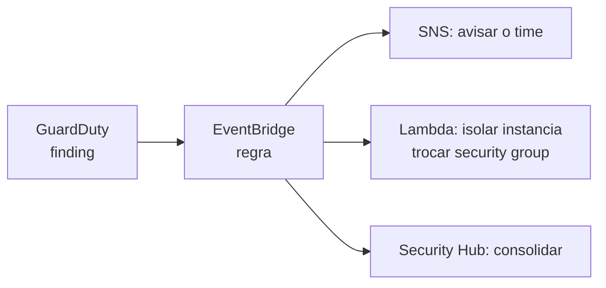

---
aliases:
  - Aula 19.5
modulo: 19
aula: 5
parte: "V Arquiteturas modernas"
dominios:
  - 1
lida: false
tags:
  - aula
  - saa-c03
  - modulo-19
---

# Aula 19.5: GuardDuty e detecção de ameaças

[[19 - Seguranca de Aplicacoes e Deteccao de Ameacas|Voltar ao módulo]]

> [!question] Pergunta que esta aula responde
> Como detectar uma [[Access Key|chave de acesso]] vazada, uma instância comprometida ou mineração de criptomoeda quando nenhum firewall viu nada? O que o [[GuardDuty]] analisa, o que ele entrega (um achado, não um bloqueio) e como transformar o achado em ação automática?

## O problema: o atacante usa o caminho legítimo

As aulas anteriores trataram de **impedir**: [[WAF]], Shield, firewalls. Mas e se o atacante já está dentro? Três situações em que nenhum firewall de borda ajuda:

- Uma [[Access Key|chave de acesso]] vazada no GitHub é usada, de outro país, para listar buckets. A chamada de API é **autenticada e válida**.
- Uma instância com uma biblioteca vulnerável é comprometida e passa a minerar criptomoeda, consultando um domínio de mineração. O tráfego é **de saída**.
- Um funcionário malicioso copia dados do [[S3]] para uma conta externa com permissões que ele realmente tem.

Defender isso exige **detecção**: olhar o comportamento (quem chamou o quê, de onde, com que padrão) e compará-lo com o normal e com listas de ameaças conhecidas. Fazer isso na mão significa coletar logs, armazenar, correlacionar e manter inteligência de ameaças atualizada. O **[[GuardDuty|Amazon GuardDuty]]** faz isso como serviço gerenciado.

## O que é o GuardDuty

O [[GuardDuty]] é um serviço de **detecção de ameaças** que monitora continuamente as fontes de dados e logs do seu ambiente AWS e usa **inteligência de ameaças** (listas de IPs e domínios maliciosos, hashes de arquivo) e **modelos de aprendizado de máquina** para identificar atividade suspeita (verificado em novembro de 2026). Cenários que a documentação lista:

- credenciais da AWS comprometidas ou exfiltradas;
- exfiltração e destruição de dados que podem levar a ransomware;
- mineração de criptomoeda não autorizada em [[EC2|instâncias EC2]] e [[Container|containers]];
- malware em instâncias, [[Container|containers]] e em arquivos novos no [[S3]];
- eventos de sistema operacional, rede e arquivos que indicam comportamento não autorizado em [[EKS]], [[ECS]] com [[Fargate]] e [[EC2]].

A frase que a prova adora: o [[GuardDuty]] **detecta e gera achados ([[Finding|findings]])**, **não bloqueia** nada sozinho. A resposta vem de você (ou de automação).

### Fontes de dados fundamentais: nada para ligar

Ao habilitar o [[GuardDuty]] em uma conta, ele começa a ler **sem que você ative mais nada** (e sem custo adicional pelo acesso aos logs):

| Fonte | O que mostra | Exemplo de achado |
|---|---|---|
| **[[Management Event\|Eventos de gerenciamento]] do [[CloudTrail]]** | Chamadas de API do [[Plano de Controle\|plano de controle]] ([[IAM]], [[EC2]], criação de trail) | Uso de credencial de um local incomum |
| **[[VPC Flow Logs]]** (de [[EC2\|instâncias EC2]]) | Quem falou com quem na rede | Varredura de portas, brute force SSH |
| **Logs de consulta [[DNS]] do [[Route 53 Resolver]]** | Domínios consultados pelas instâncias | Consulta a domínio de mineração ou malware |

O ponto de arquitetura mais cobrado: **você não precisa habilitar o [[CloudTrail]], o [[VPC Flow Logs|Flow Logs]] nem logs de [[DNS]] para o [[GuardDuty]] funcionar.** Ele consome fluxos **independentes e duplicados** desses dados e não interfere nas suas configurações; as fontes que você já tem (ou não tem) não mudam o que o GuardDuty vê. Os logs usados são processados e descartados (você não os recebe).

> [!info] Ligando os pontos
> O [[CloudTrail]] ([[05 - Multiconta Governanca e Federacao|Módulo 5]]) registra **quem fez o quê** na API; o [[GuardDuty]] **interpreta** esse tipo de dado em busca de anomalia. Eles se complementam: CloudTrail é o registro, GuardDuty é o analista.

### Planos de proteção (protection plans)

Além das fontes fundamentais, o [[GuardDuty]] oferece planos opcionais, focados em casos de uso (a documentação os chama de "protection plans" ou "features"):

| Plano | O que acrescenta |
|---|---|
| **[[S3]] Protection** | [[Data Event\|Eventos de dados]] do S3 no [[CloudTrail]], para achados de exfiltração e acesso suspeito a objetos |
| **[[EKS]] Protection** | Logs de auditoria do [[Kubernetes]] |
| **[[RDS]] Protection** | Atividade de login em bancos [[Aurora]] e RDS compatíveis, para achar logins anômalos |
| **Lambda Protection** | Logs de atividade de rede das funções |
| **Malware Protection for [[EC2]]** | Varredura **sem agente** de [[EBS\|volumes EBS]] quando há comportamento suspeito |
| **Malware Protection for [[S3]]** | Varredura de arquivos novos enviados a buckets |
| **Runtime Monitoring** | Agente de segurança para [[EKS]], [[ECS]] [[Fargate]] e [[EC2]]: eventos de sistema operacional, rede e arquivos |
| **Extended Threat Detection** | Correlaciona sinais em uma **sequência de ataque** (multi-estágio); automático ao habilitar o [[GuardDuty]]; sem custo extra segundo a visão geral dos planos, mas confirme na página de preços |

Ao habilitar o [[GuardDuty]], as fontes fundamentais e os planos habilitados por padrão entram em **teste gratuito de 30 dias por Região**; planos habilitados depois ganham o seu próprio teste de 30 dias. Nem todo plano vem ligado (por exemplo, Malware Protection for [[S3]] e Runtime Monitoring exigem ação sua): confira no console quais estão ativos. Depois, a cobrança depende do volume de dados analisados (consulte a página de preços: não confirmei valores aqui).

> [!example] O mesmo bucket, duas profundidades
> Sem [[S3]] Protection, o [[GuardDuty]] vê só chamadas de API de **gerenciamento** (criar [[Bucket|bucket]], mudar política). Com S3 Protection, vê também **leituras e gravações de objetos** (`GetObject`, `PutObject`), e consegue acusar "um usuário baixou 40 GB de um bucket nunca acessado por ele". Para proteger dados sensíveis em S3, o plano é parte do desenho.

## Achados (findings)

Um **[[Finding|finding]]** é a notificação de um possível problema de segurança, com o que aconteceu, quais recursos e quando. Cada tipo tem um nome no formato:

`ThreatPurpose:ResourceTypeAffected/ThreatFamilyName.DetectionMechanism!Artifact`

Exemplos reais da documentação, que dão a intuição do que a prova cita:

| [[Finding]] | Significado |
|---|---|
| `Recon:EC2/PortProbeUnprotectedPort` | Alguém está sondando uma porta desprotegida de uma instância |
| `UnauthorizedAccess:EC2/SSHBruteForce` | Instância envolvida em ataques de força bruta SSH |
| `CryptoCurrency:EC2/BitcoinTool.B!DNS` | Instância consultando domínio ligado a mineração |
| `Backdoor:EC2/DenialOfService.Tcp` | Instância participando de DoS via [[TCP]] |
| `UnauthorizedAccess:IAMUser/InstanceCredentialExfiltration.OutsideAWS` | Credenciais de role de instância usadas **de fora da AWS** |

Cada achado tem **severidade** de 1,0 a 10,0, agrupada em: **Crítica** (9,0 a 10,0, sequência de ataque possível), **Alta** (7,0 a 8,9, recurso comprometido e em uso não autorizado), **Média** (4,0 a 6,9, atividade suspeita fora do padrão) e **Baixa**. A severidade ajuda a priorizar: crítico e alto primeiro.

Achados repetidos do mesmo tipo são **agregados** em um só (com contagem), para não inundar a fila.

## Do achado à ação: a automação

O [[GuardDuty]] publica cada achado no **[[EventBridge]]**, onde regras reagem por padrão de evento (`source: aws.guardduty`, `detail-type: GuardDuty Finding`) e acionam alvos como [[Lambda]], [[SNS]], [[SQS]], [[Step Functions]]. Os padrões típicos:

> [!example] Isolar uma instância comprometida automaticamente
> Regra do [[EventBridge]]: quando chegar um [[Finding|finding]] de severidade Alta do tipo `CryptoCurrency:EC2/*`, invocar uma Lambda que (1) troca o [[Security Group|security group]] da instância por um "quarentena" sem nenhuma regra de saída, (2) tira um [[Snapshot|snapshot]] do volume para perícia e (3) publica no [[SNS]]. O ataque é contido em segundos, e a evidência é preservada. Detecção sem automação é só um alerta que alguém precisa ler.

Os achados também podem ir ao [[Security Hub]] (Aula 19.6) para consolidação e ao [[Detective]] para investigação.

## Listas personalizadas e supressão

- **Trusted IP list:** IPs que você confia (por exemplo, o IP do escritório de pentest). O [[GuardDuty]] **não** gera achados para atividade vinda deles. A lista confiável **tem precedência** sobre a lista de ameaças na mesma entrada.
- **Threat list (custom):** IPs que você sabe que são maliciosos e quer que gerem achados (achados "custom").
- **Suppression rules:** regras que arquivam automaticamente achados que você considera ruído (um scanner autorizado, por exemplo).

## Multiconta e Regiões

- É regional: habilite em **todas as [[Regiao AWS|Regiões]]** em uso (a documentação recomenda, porque o atacante pode usar Região que você nunca olhou). Para eventos de serviços globais ([[IAM]], [[STS]], [[S3]], [[CloudFront]], [[Route 53]]), o [[GuardDuty]] replica eventos de relevância de segurança em cada Região onde está habilitado.
- Em uma organização do [[Organizations]], designe uma **conta administradora delegada** do [[GuardDuty]]: ela gerencia achados e configurações dos membros e pode **habilitar automaticamente** o GuardDuty em contas novas (auto-enable). Os membros veem seus achados, mas não os dos outros.

> [!info] Ligando os pontos
> O padrão "conta de segurança separada com [[Delegated Administrator|administração delegada]]" é o mesmo que [[05 - Multiconta Governanca e Federacao|Módulo 5]] usa para [[CloudTrail]] de organização e Config: a conta de segurança enxerga tudo, as contas de carga de trabalho ficam isoladas.

## Laboratório (opcional): gerar achados de exemplo

> [!warning] Use uma conta AWS pessoal separada
> Use uma **[[Conta AWS|conta AWS]] pessoal separada**, com [[Budgets]] configurado, **nunca a conta de produção da empresa**. A documentação indica **30 dias de teste gratuito por Região** na primeira habilitação; confirme na página de preços antes. Ao final, **desabilite** o serviço.

1. Habilite o [[GuardDuty]] na Região de teste: `aws guardduty create-detector --enable --region us-east-1` (anote o `DetectorId`).
2. Gere achados de exemplo (fictícios, marcados com `[SAMPLE]`): `aws guardduty create-sample-findings --detector-id <ID> --region us-east-1 --finding-types Recon:EC2/PortProbeUnprotectedPort CryptoCurrency:EC2/BitcoinTool.B!DNS`.
3. Liste os achados: `aws guardduty list-findings --detector-id <ID> --region us-east-1` e depois `aws guardduty get-findings --detector-id <ID> --region us-east-1 --finding-ids <ID-DO-ACHADO>`. Observe tipo, severidade e recurso afetado.
4. (Opcional) Crie uma regra do [[EventBridge]] com o padrão `{"source":["aws.guardduty"],"detail-type":["GuardDuty Finding"]}` apontando para um tópico [[SNS]] seu e gere novos achados de exemplo para ver o alerta chegar.
5. **Limpeza:** `aws guardduty delete-detector --detector-id <ID> --region us-east-1`; apague a regra do [[EventBridge]] e o tópico [[SNS]].

## Como isso cai na prova

Cobertura: **Task 1.2** ("security services with use cases ([[Cognito]], [[GuardDuty]], [[Macie]])").

**Palavras-chave em inglês:**
- "detect compromised [[EC2]] instance / unusual API activity / cryptocurrency mining" puxam **[[GuardDuty]]**.
- "analyze [[CloudTrail]], [[VPC Flow Logs]] and [[DNS]] logs with machine learning" puxa **[[GuardDuty]]** (sem habilitar os logs).
- "continuously monitor for malicious activity and unauthorized behavior" puxa **[[GuardDuty]]**.
- "automatically respond to a [[Finding|finding]]" puxa **[[EventBridge]] + Lambda**.
- "centrally manage across accounts" puxa **[[Delegated Administrator|delegated administrator]]**.
- "discover sensitive data in [[S3]] ([[PII]])" **não é [[GuardDuty]]**: é **[[Macie]]**.

**Pegadinhas clássicas:**
- **[[GuardDuty]] detecta, não bloqueia nem corrige.**
- **Não exige habilitar [[CloudTrail]], [[VPC Flow Logs|Flow Logs]] ou [[DNS]] logs**: lê fluxos independentes.
- **[[GuardDuty]] não acha vulnerabilidade de software** (CVE em pacote): é o **Inspector**.
- **[[GuardDuty]] não acha dado sensível em [[S3]]**: é o **[[Macie]]**.
- Planos como **[[S3]] Protection** e **Malware Protection** ampliam a cobertura; sem eles, a visão de dados do S3 é menor.

| Requisito no enunciado | Resposta provável | Por quê |
|---|---|---|
| Alertar sobre credencial [[IAM]] usada de local anômalo | [[GuardDuty]] | Analisa [[CloudTrail]] com ML e inteligência de ameaças |
| Detectar instância minerando criptomoeda | [[GuardDuty]] | [[DNS]] e fluxo de rede mostram o padrão |
| Isolar instância comprometida automaticamente | [[GuardDuty]] + [[EventBridge]] + Lambda | [[Finding]] como gatilho da automação |
| Ver acesso suspeito a objetos de [[S3]] | [[GuardDuty]] com S3 Protection | [[Data Event\|Eventos de dados]] do S3 |
| Escanear [[EBS\|volume EBS]] por malware sem agente | [[GuardDuty]] Malware Protection for [[EC2]] | Varredura sem agente |
| Gerenciar [[GuardDuty]] em 100 contas | [[Delegated Administrator\|Administrador delegado]] + auto-enable | Organizations |

## Resumo

> [!abstract] A aula em uma frase
> O [[GuardDuty]] analisa continuamente [[CloudTrail]], [[VPC Flow Logs]] e logs de [[DNS]] (e, opcionalmente, [[S3]], [[EKS]], [[RDS]], Lambda e malware) com inteligência de ameaças e ML, produz achados com severidade, e a resposta automática é montada com [[EventBridge]] e Lambda.

**A lógica, em 5 passos**
1. Ataques com credencial válida ou tráfego de saída não passam por firewall; é preciso detectar comportamento.
2. Ao habilitar, o [[GuardDuty]] lê [[CloudTrail]] (gerenciamento), [[VPC Flow Logs]] e [[DNS]] por fluxos independentes, sem você ativar nada.
3. Planos opcionais ampliam a visão: [[S3]], [[EKS]], [[RDS]], Lambda, malware, Runtime Monitoring.
4. Cada [[Finding|finding]] tem tipo e severidade de 1 a 10 (crítica, alta, média, baixa).
5. [[EventBridge]] transforma o [[Finding|finding]] em notificação ou [[Remediacao Automatica|remediação]].

**Números para lembrar**

| O quê | Valor | Por que importa |
|---|---|---|
| Teste gratuito | 30 dias por Região | Habilitar sem custo para avaliar |
| Severidade crítica | 9,0 a 10,0 | Prioridade máxima |
| Severidade alta | 7,0 a 8,9 | Recurso comprometido |
| Fontes fundamentais | 3 ([[CloudTrail]] mgmt, [[VPC Flow Logs\|Flow Logs]], [[DNS]]) | Sem ativação extra |

**Na prática, isso significa**
- Habilite o [[GuardDuty]] em todas as [[Regiao AWS|Regiões]] e contas, com conta de segurança delegada.
- Ligue [[S3]] Protection e Malware Protection quando houver dados sensíveis ou risco de malware.
- Conecte o [[EventBridge]] para alertar e remediar; sem isso o achado fica parado.
- Não confunda: bloquear é [[WAF]]/firewall; detectar é [[GuardDuty]]; vulnerabilidade é Inspector; [[PII]] em [[S3]] é [[Macie]].

> [!tip] Liga com
> Vem da [[19.04 - Network Firewall DNS Firewall e Firewall Manager|Aula 19.4]] (prevenir) e leva à [[19.06 - Inspector Detective e Security Hub|Aula 19.6]] (vulnerabilidades, investigação e consolidação).

## Erros comuns

- Esperar que o [[GuardDuty]] bloqueie o ataque (ele só gera o achado).
- Achar que é preciso habilitar o [[CloudTrail]] e o [[VPC Flow Logs|Flow Logs]] antes de ligar o [[GuardDuty]].
- Usar [[GuardDuty]] para achar vulnerabilidades de software (função do Inspector).
- Habilitar em uma Região só e ignorar as demais.
- Deixar achados críticos sem nenhuma regra de [[EventBridge]] para alertar.
- Confundir lista confiável (suprime achados) com lista de ameaças (gera achados).

## Pratique

**1.** Uma empresa quer detectar uso anômalo de credenciais [[IAM]] e instâncias comunicando-se com domínios de mineração, sem operar infraestrutura de análise de logs. O que usar?

- [ ] a) Amazon Inspector com varredura de EC2.
- [ ] b) Amazon Macie nos buckets de logs.
- [ ] c) Amazon GuardDuty habilitado na conta.
- [ ] d) AWS WAF com regras de geo match.

**2.** O time de segurança precisa que uma instância comprometida seja isolada automaticamente quando o [[GuardDuty]] gerar um achado de severidade alta. Qual arquitetura?

- [ ] a) Regra do EventBridge para o finding, acionando uma Lambda que isola a instância.
- [ ] b) Alarme do CloudWatch na métrica de CPU da instância, notificando o time por e-mail.
- [ ] c) Política de SCP que nega o tráfego de saída da conta inteira, automaticamente.
- [ ] d) Aguardar o GuardDuty bloquear o tráfego malicioso sozinho, sem nenhuma automação.

**3.** Uma empresa quer usar o [[GuardDuty]], mas não tem o [[CloudTrail]], o [[VPC Flow Logs]] nem logs de [[DNS]] habilitados. O que acontece?

- [ ] a) O GuardDuty não funciona até os três logs serem habilitados e entregues no S3.
- [ ] b) O GuardDuty só analisa a rede e o DNS da VPC, nunca as chamadas de API.
- [ ] c) Precisa assinar um plano adicional pago para poder ler esses três logs.
- [ ] d) Funciona: lê fluxos independentes dessas fontes, sem exigir configuração.

**4.** Uma empresa guarda dados sensíveis em [[S3]] e quer detectar acessos suspeitos a objetos e arquivos maliciosos enviados aos buckets. Quais DUAS capacidades do [[GuardDuty]] ajudam? (Escolha DUAS.)

- [ ] a) S3 Protection para eventos de dados do S3.
- [ ] b) Runtime Monitoring em instâncias EC2.
- [ ] c) Malware Protection for S3 para arquivos novos nos buckets.
- [ ] d) EKS Protection com logs de auditoria.
- [ ] e) RDS Protection para logins de banco.

**5.** O [[GuardDuty]] gerou um grande volume de achados de baixo valor vindos de um scanner de vulnerabilidades autorizado. Qual ação reduz o ruído sem perder o resto?

- [ ] a) Desabilitar o GuardDuty na conta durante os testes do time de segurança.
- [ ] b) Regra de supressão ou lista de IPs confiáveis com o IP do scanner.
- [ ] c) Habilitar o Runtime Monitoring nas instâncias do time de segurança.
- [ ] d) Excluir a service-linked role do GuardDuty da conta de produção.

**6.** Uma organização com 80 contas quer gerenciar o [[GuardDuty]] de forma central e habilitá-lo automaticamente em contas novas. O que fazer?

- [ ] a) Habilitar manualmente em cada conta nova.
- [ ] b) Criar um service control policy que liga o GuardDuty em todas as contas da organização.
- [ ] c) Designar um administrador delegado do GuardDuty no Organizations com auto-enable.
- [ ] d) Compartilhar o detector via AWS RAM.

**7.** Qual das opções NÃO é uma fonte de dados fundamental do [[GuardDuty]]?

- [ ] a) Eventos de gerenciamento do CloudTrail, incluindo as chamadas de API da conta.
- [ ] b) Resultados de varredura de vulnerabilidades do Inspector.
- [ ] c) Logs de consulta DNS do Route 53 Resolver.
- [ ] d) VPC Flow Logs de instâncias EC2.

**8.** Quais DUAS afirmações sobre o [[GuardDuty]] estão corretas? (Escolha DUAS.)

- [ ] a) Bloqueia automaticamente o tráfego malicioso nas instâncias.
- [ ] b) Identifica vulnerabilidades de pacotes de software em instâncias.
- [ ] c) Descobre dados pessoais armazenados em S3.
- [ ] d) Gera achados com severidade de 1,0 a 10,0.
- [ ] e) Publica achados no EventBridge para automação.

**9.** Um achado `UnauthorizedAccess:IAMUser/InstanceCredentialExfiltration.OutsideAWS` aparece. O que indica?

- [ ] a) Credenciais de role de EC2 foram usadas de um IP fora da AWS.
- [ ] b) Uma instância está sendo alvo de um flood SYN vindo de vários endereços.
- [ ] c) Um bucket S3 da conta foi tornado público por uma nova bucket policy.
- [ ] d) O root user teve o MFA desativado e uma nova chave de acesso criada.

**10.** Uma equipe quer cobrir a atividade de login em bancos de dados [[Aurora]] e [[RDS]] com o [[GuardDuty]]. O que habilitar?

- [ ] a) O Macie nos snapshots.
- [ ] b) O Inspector para RDS.
- [ ] c) O AWS Config com regra de criptografia.
- [ ] d) O plano de proteção RDS Protection do GuardDuty.

**11.** Quais DUAS opções descrevem corretamente o tratamento de achados repetidos e ruído? (Escolha DUAS.)

- [ ] a) O GuardDuty cria um achado separado para cada ocorrência do mesmo evento.
- [ ] b) Achados do mesmo tipo são agregados em um único finding com atualização de detalhes.
- [ ] c) Uma lista confiável não impede achados de IPs listados.
- [ ] d) Regras de supressão arquivam automaticamente achados que você define como ruído.
- [ ] e) A severidade só pode ser Baixa ou Alta.

**12.** Uma empresa deseja saber, depois de um incidente, quem criou uma nova trilha do [[CloudTrail]] e de onde. Qual é a relação correta entre CloudTrail e [[GuardDuty]] nesse caso?

- [ ] a) O GuardDuty substitui o CloudTrail como registro de API e dispensa a trilha de auditoria.
- [ ] b) O CloudTrail registra a chamada; o GuardDuty pode sinalizá-la como anômala.
- [ ] c) O CloudTrail detecta ameaças usando machine learning.
- [ ] d) O GuardDuty só analisa chamadas feitas pelo root.

> [!success]- Gabarito
> **1. c)** o [[GuardDuty]] analisa [[CloudTrail]], [[VPC Flow Logs|Flow Logs]] e [[DNS]] com ML e inteligência de ameaças; a procura vulnerabilidades de software; b descobre dado sensível em [[S3]]; d só filtra [[HTTP]].
> **2. a)** o [[Finding|finding]] vai ao [[EventBridge]] e aciona uma Lambda de contenção; b não está ligado a ameaça; c não isola uma instância específica; d erra porque o [[GuardDuty]] não bloqueia.
> **3. d)** o [[GuardDuty]] consome fluxos independentes e duplicados; a, b e c afirmam exigências que a documentação nega.
> **4. a) e c)** [[S3]] Protection cobre [[Data Event|eventos de dados]] e Malware Protection for S3 varre arquivos novos; b, d e e cobrem [[EC2]], [[EKS]] e [[RDS]].
> **5. b)** supressão e lista confiável cortam o ruído do scanner; a perde toda a detecção; c e d não resolvem.
> **6. c)** [[Delegated Administrator|administrador delegado]] com auto-enable gerencia a organização; a é manual; b não liga serviços; d não compartilha detectores.
> **7. b)** achados do Inspector são outra fonte e não são fundamentais; a, c e d são as três fundamentais.
> **8. d) e e)** severidade de 1,0 a 10,0 e publicação no [[EventBridge]]; a erra porque não bloqueia; b é Inspector; c é [[Macie]].
> **9. a)** o achado indica credenciais de role de instância usadas fora da AWS; b é [[DDoS]]; c e d são outros tipos de problema.
> **10. d)** o [[RDS]] Protection monitora logins anômalos em [[Aurora]] e RDS compatíveis; a, b e c cobrem outros problemas.
> **11. b) e d)** agregação e supressão reduzem ruído; a contradiz a agregação; c erra porque a lista confiável suprime achados; e erra porque há quatro faixas.
> **12. b)** [[CloudTrail]] registra, [[GuardDuty]] interpreta e pode sinalizar; a inverte; c atribui ML ao CloudTrail; d restringe o GuardDuty sem base.

## Para aprofundar

- [ ] [What is Amazon GuardDuty?](https://docs.aws.amazon.com/guardduty/latest/ug/what-is-guardduty.html) (documentação AWS): cenários de ameaça, fontes de dados e planos de proteção.
- [ ] [GuardDuty foundational data sources](https://docs.aws.amazon.com/guardduty/latest/ug/guardduty_data-sources.html) (documentação AWS): [[CloudTrail]], [[VPC Flow Logs|Flow Logs]] e [[DNS]], e o fato de não exigirem ativação.
- [ ] [GuardDuty pricing](https://docs.aws.amazon.com/guardduty/latest/ug/guardduty-pricing.html) (documentação AWS): teste de 30 dias por Região e por plano; confira aqui o custo do Extended Threat Detection.
- [ ] [Severity levels of GuardDuty findings](https://docs.aws.amazon.com/guardduty/latest/ug/guardduty_findings-severity.html) (documentação AWS): faixas crítica, alta, média e baixa.
- [ ] [GuardDuty finding format](https://docs.aws.amazon.com/guardduty/latest/ug/guardduty_finding-format.html) (documentação AWS): como ler o nome de um achado.

Próxima aula: [[19.06 - Inspector Detective e Security Hub|Aula 19.6: Inspector, Detective e Security Hub]].
