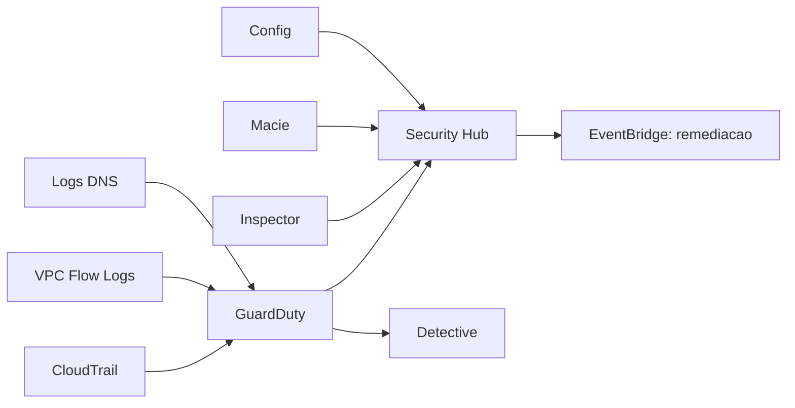

---
aliases:
  - Aula 19.6
modulo: 19
aula: 6
parte: "V Arquiteturas modernas"
dominios:
  - 1
lida: false
tags:
  - aula
  - saa-c03
  - modulo-19
---

# Aula 19.6: Inspector, Detective e Security Hub

[[19 - Seguranca de Aplicacoes e Deteccao de Ameacas|Voltar ao módulo]]

> [!question] Pergunta que esta aula responde
> O [[GuardDuty]] detecta ameaças, mas quem acha a biblioteca vulnerável antes do ataque? Quem investiga a causa raiz de um achado? Quem junta tudo em um painel e diz se a conta cumpre um padrão de segurança? Como separar [[Inspector]], [[Detective]], [[Security Hub]], [[Macie]] e [[Config]] sem se confundir?
> Cada um responde a uma pergunta diferente.

## O problema: achado sem contexto, vulnerabilidade sem lista

Depois do [[GuardDuty]], ainda faltam três coisas:

1. **Prevenir antes do ataque.** O [[GuardDuty]] avisa que algo suspeito aconteceu; ele não diz que a instância roda uma versão do OpenSSL com falha conhecida. É preciso **varrer o software** em busca de vulnerabilidades (CVEs) antes que alguém as explore.
2. **Investigar depois do achado.** "Credencial usada de um IP estranho": e agora? O que mais essa credencial fez nos últimos 30 dias? Quais instâncias ela tocou? Reconstruir isso de logs brutos leva horas.
3. **Ver tudo em um lugar.** Em 50 contas e 6 [[Regiao AWS|Regiões]], cinco serviços geram achados em cinco consoles. Alguém precisa consolidar, priorizar e medir conformidade com padrões como o CIS.

Os serviços desta aula resolvem cada um desses pontos. A regra para a prova: **o verbo do enunciado escolhe o serviço**.

## Amazon Inspector: gestão de vulnerabilidades

O **Inspector** é um serviço de **gestão de vulnerabilidades** que descobre cargas de trabalho automaticamente e as varre continuamente em busca de **vulnerabilidades de software** (CVEs) e **exposição de rede não intencional** (verificado em novembro de 2026).

### O que ele varre

| Tipo de varredura | O que examina |
|---|---|
| **[[EC2]]** | Instâncias: CVEs em pacotes do sistema operacional e de linguagens; problemas de alcance de rede |
| **[[ECR]]** | [[Imagem de Container\|Imagens de container]] nos repositórios (varredura *enhanced*) |
| **Lambda (padrão)** | Dependências das funções e camadas (layers) |
| **Lambda code scanning** | Opcional: vulnerabilidades no próprio código da função |
| **Imagens de máquina ([[AMI]])** | Opcional: AMIs da sua conta |
| **Code Security** | Opcional: código-fonte, dependências e [[Infraestrutura como Codigo\|infraestrutura como código]] |

Ao ativar o Inspector pela primeira vez, a conta é inscrita automaticamente em [[EC2]], [[ECR]] e Lambda padrão; as demais são opcionais.

### Como ele varre o EC2

- **Baseada em agente:** usa o **[[SSM Agent]]** ([[Systems Manager]]) na instância. É o caminho padrão quando a instância é gerenciada.
- **Sem agente (agentless):** cria **[[Snapshot|snapshots]]** dos [[EBS|volumes EBS]], lê o inventário de software pelas EBS direct APIs e apaga os snapshots. O **modo híbrido** (agente quando possível, sem agente nos demais) é habilitado automaticamente ao ativar a varredura de [[EC2]].
- Há requisitos para o modo sem agente (sistema operacional suportado, [[EBS|volumes EBS]], sistemas de arquivos ext3/ext4/xfs, menos de 8 volumes e até 1.200 GB somados).

### Continuidade e priorização

- **Varredura contínua e automática:** o Inspector reescaneia quando algo muda (novo pacote instalado, patch aplicado, **novo CVE publicado**). Você não agenda varredura.
- **Inspector risk score:** ajusta a pontuação base do CVE (NVD, formato CVSS) ao seu ambiente. Uma falha explorável pela rede, mas sem caminho aberto da internet até a instância, recebe nota menor.
- **Achado se fecha sozinho:** se você corrige, o Inspector detecta e encerra o [[Finding|finding]].
- **Integrações:** publica achados no **[[EventBridge]]** e, se houver, no **[[Security Hub]]**; [[Delegated Administrator|administração delegada]] em organizações com ativação central.

> [!example] Quando o Inspector paga o aluguel
> Um novo CVE crítico sai numa biblioteca de logging, às 18h de sexta. Sem varredura contínua, você descobriria quando alguém explorasse. O Inspector, ao ver o CVE publicado, reescaneia as instâncias, imagens de [[ECR]] e [[Lambda|funções Lambda]] e abre [[Finding|findings]] listando exatamente quais recursos usam a versão afetada. O time corrige na segunda com a lista pronta.

> [!info] Inspector e Systems Manager
> O [[Patch Manager]] do [[Systems Manager]] ([[21 - Observabilidade Automacao e Operacoes|Módulo 21]]) **aplica** patches. O Inspector **descobre** o que precisa de patch. Um acha, o outro corrige.

## Amazon Detective: investigação

O **Detective** ajuda a analisar, investigar e identificar rapidamente a **causa raiz** de achados de segurança ou atividades suspeitas. Ele coleta automaticamente dados de log dos seus recursos e usa aprendizado de máquina, análise estatística e **teoria de grafos** para gerar visualizações (verificado em novembro de 2026).

- **[[Detective|Behavior graph]]:** o conjunto de dados ligados (achados, entidades como usuários, roles, IPs, instâncias, e as relações entre eles) construído a partir das fontes.
- **Fontes do pacote core:** logs do **[[CloudTrail]]**, **[[VPC Flow Logs]]** (de [[EC2|instâncias EC2]]) e, em contas inscritas no [[GuardDuty]], os **achados do GuardDuty**. Pacotes opcionais, que você liga ou desliga a qualquer momento: logs de auditoria do [[EKS]] e **AWS security [[Finding|findings]]**, que ingere o [[Security Hub|Security Hub CSPM]] (e, por ele, achados agregados de outros serviços, como o Inspector). Sem o pacote opcional, achados do Inspector não são fonte do Detective.
- **Pré-requisito do [[GuardDuty]]:** materiais antigos citam que o GuardDuty precisa estar ativo há cerca de 48 horas antes do Detective; a página atual de pré-requisitos não cita essa espera (verificado em novembro de 2026), então trate como não confirmado, mas lembre que o GuardDuty é a fonte dos achados que o Detective liga ao grafo.
- **Até um ano de histórico** disponível, com visualizações de mudança de volume e tipo de atividade, ligadas aos achados do [[GuardDuty]].
- **[[Finding]] groups:** agrupam achados relacionados para mostrar a sequência de um ataque.
- Teste gratuito de 30 dias por Região para os pacotes de fonte.

> [!example] "O que essa chave fez?"
> O [[GuardDuty]] acusa uso de credencial por um IP incomum. No Detective você abre o perfil da role e vê, em uma linha do tempo: de onde ela costuma chamar, quais APIs chamou nos últimos 30 dias, quais instâncias e buckets tocou, que outros IPs apareceram. Em minutos você sabe o [[Raio de Impacto|raio de impacto]]. Sem Detective, seriam consultas de [[CloudTrail]] e Athena durante horas.

**[[GuardDuty]] detecta; Detective investiga.** O Detective não substitui o GuardDuty, ele **consome** os achados dele.

## Security Hub: consolidar e medir conformidade

O nome **[[Security Hub]]** hoje cobre duas coisas, e vale conhecer as duas (verificado em novembro de 2026):

### AWS Security Hub CSPM (o conceito clássico da prova)

O **[[Security Hub|Security Hub CSPM]]** ([[CSPM|Cloud Security Posture Management]]) dá uma **visão consolidada da sua postura de segurança** e a avalia contra padrões do setor e melhores práticas:

- **Padrões (standards):** AWS Foundational Security Best Practices (FSBP), CIS AWS Foundations Benchmark, PCI DSS e NIST. Cada padrão tem **controles**; o serviço roda **verificações contínuas** e gera achados de controle e um **score de segurança**.
- **Agregação de achados:** recebe achados de outros serviços ([[GuardDuty]], Inspector, [[Macie]] e produtos de terceiros) em um formato padrão, o **ASFF** (AWS Security [[Finding]] Format), eliminando a gestão de formatos diferentes.
- **Multiconta e multi-Região:** conta administradora, central configuration e **agregação entre [[Regiao AWS|Regiões]]**.
- **Automação:** **automation rules** para atualizar ou suprimir achados; integração com **[[EventBridge]]** para ações automáticas.
- **Pré-requisito importante:** o **[[Config]]** precisa estar habilitado com gravação de recursos, porque os controles avaliam a configuração gravada pelo Config.

### AWS Security Hub (a solução unificada nova)

A documentação atual descreve o **[[Security Hub|AWS Security Hub]]** como uma **solução unificada de segurança na nuvem** que prioriza os problemas críticos: correlaciona e enriquece sinais de postura ([[CSPM]]), vulnerabilidades (**Inspector**), dados sensíveis (**[[Macie]]**) e detecção de ameaças (**[[GuardDuty]]**). Traz **exposure [[Finding|findings]]** (exposições formadas por correlação), um gráfico de **caminho de ataque** (attack path graph), análise de **acesso não usado** do [[IAM]] (janela de 90 dias) e fluxos de resposta automatizados. Os achados passam a usar o formato aberto **OCSF**.

Para a prova: [[Security Hub]] é "o painel único que **agrega** achados de [[GuardDuty]], Inspector, [[Macie]] e outros e **checa conformidade** (CIS, PCI DSS)". Se a questão antiga falar em ASFF e padrões, é o [[CSPM]]; o conceito é o mesmo.

> [!tip] Como o Security Hub se ancora no resto
> [[Security Hub]] **não detecta nada por si só** na maioria dos cenários de prova: ele **recebe** de [[GuardDuty]], Inspector e [[Macie]], **avalia** controles (via Config) e **centraliza**. Se o enunciado diz "quero um painel único com achados de vários serviços e verificação de conformidade CIS", é ele.

## Macie e Config em revisão

Os dois já foram vistos com profundidade ([[08 - Criptografia e Protecao de Dados|Módulo 8]] para o [[Macie]] e [[05 - Multiconta Governanca e Federacao|Módulo 5]] para o Config); aqui vai o mínimo que a prova cobra, para você não confundi-los com o [[GuardDuty]].

**[[Macie]]:** descobre **dados sensíveis somente em [[S3]]**. Usa **managed data identifiers** ([[PII]], credenciais e dados financeiros reconhecidos pela AWS) e **custom data identifiers** (seus padrões, por regex). Gera dois tipos de achado: de **dados sensíveis** (achou CPF ou chave em um objeto) e de **política** ([[Bucket|bucket]] público, sem criptografia, compartilhado fora da organização). Tem **descoberta automatizada de dados sensíveis** ([[Sampling|amostragem]] contínua) e integra com [[Security Hub]] e [[EventBridge]]. Fonte: [What is Amazon Macie?](https://docs.aws.amazon.com/macie/latest/user/what-is-macie.html).

**[[Config]]:** registra a configuração dos recursos e a avalia com **[[Managed Rule Group|regras gerenciadas]]** (ou customizadas). Pode **remediar** com automação do [[Systems Manager]] ([[Automation|SSM Automation]]) e consolida várias contas e [[Regiao AWS|Regiões]] em um **agregador** ([[Aggregator|aggregator]]). Fonte: [What is AWS Config?](https://docs.aws.amazon.com/config/latest/developerguide/WhatIsConfig.html).

> [!warning] Macie versus GuardDuty S3 Protection
> **[[Macie]] responde "que dado sensível existe no [[Bucket|bucket]]?"; [[GuardDuty]] [[S3]] Protection responde "alguém está acessando ou exfiltrando o bucket de forma suspeita?"** Um acha o conteúdo, o outro acha o comportamento.

## A pergunta que cada serviço responde

| Serviço | Pergunta | Natureza |
|---|---|---|
| [[CloudTrail]] | Quem chamou qual API, quando e de onde? | Registro de auditoria |
| [[Config]] | Como o recurso estava configurado e mudou? | Estado e conformidade de configuração |
| [[GuardDuty]] | Há comportamento malicioso agora? | Detecção de ameaças |
| [[Inspector]] | Há software vulnerável ou exposição de rede? | Vulnerabilidades |
| [[Macie]] | Há dados sensíveis ([[PII]]) nos meus buckets [[S3]]? | Descoberta de dados sensíveis |
| [[Detective]] | Qual a causa raiz e o [[Raio de Impacto\|raio de impacto]] deste achado? | Investigação |
| [[Security Hub]] | Qual o quadro geral e estou em conformidade? | Agregação e postura |

> [!example] Um incidente atravessando os serviços
> 1. O **Inspector** já tinha marcado a instância com um CVE crítico (sem correção aplicada).
> 2. O **[[GuardDuty]]** acusa `CryptoCurrency:EC2/BitcoinTool.B!DNS`: a instância foi explorada.
> 3. O **[[Security Hub]]** mostra os dois achados juntos no mesmo recurso, com severidade combinada.
> 4. O **Detective** mostra a linha do tempo: o IP de origem do ataque, as APIs chamadas pela role da instância.
> 5. Uma regra do **[[EventBridge]]** isolou a instância automaticamente.
> 6. O **Config** e o **[[CloudTrail]]** serviram de registro de auditoria depois.

## Como isso cai na prova

Cobertura: **Task 1.2** ("security services with use cases ([[Cognito]], [[GuardDuty]], [[Macie]])"; "integrating AWS services to secure applications"); Detective, Inspector e [[Security Hub]] constam entre os serviços in-scope.

**Palavras-chave em inglês:**
- "scan [[EC2]] instances / [[Container|container]] images / Lambda for software vulnerabilities (CVE)" puxa **Inspector**.
- "investigate", "root cause", "analyze and visualize security [[Finding|findings]]", "[[Detective|behavior graph]]" puxam **Detective**.
- "aggregate [[Finding|findings]] from multiple services", "single pane of glass", "compliance with CIS / PCI DSS", "security score" puxam **[[Security Hub]]**.
- "discover sensitive data / [[PII]] in [[S3]]" puxa **[[Macie]]**.
- "track configuration changes and compliance of resources" puxa **Config**.
- "who made this API call" puxa **[[CloudTrail]]**.

**Pegadinhas clássicas:**
- **Inspector acha vulnerabilidade; [[GuardDuty]] acha comportamento malicioso.** São complementares.
- **Detective investiga; não detecta** (consome [[GuardDuty]]).
- **[[Macie]] é para dados sensíveis em [[S3]]**, não para vulnerabilidade nem para ameaça.
- **[[Security Hub]] agrega e mede conformidade; os serviços que detectam são outros.** Os controles dependem do Config.
- **Config avalia configuração; Inspector avalia software; os dois não se substituem.**
- Para **corrigir** patches, o serviço é o [[Systems Manager]] ([[Patch Manager]]); o Inspector só descobre.

| Requisito no enunciado | Resposta provável | Por quê |
|---|---|---|
| Varrer instâncias e imagens [[ECR]] por CVEs continuamente | Inspector | Descoberta e reescaneamento automáticos |
| Entender a causa raiz de um achado do [[GuardDuty]] | Detective | [[Detective\|Behavior graph]] e histórico de 1 ano |
| Painel único e conformidade com CIS/PCI | [[Security Hub]] | Agrega e roda padrões |
| Achar [[PII]] nos buckets | [[Macie]] | Descoberta de dados sensíveis |
| Agregar achados de várias contas em uma conta | [[Security Hub]] com [[Delegated Administrator\|administrador delegado]] | Organização e agregação |
| Aplicar patches nas instâncias | [[Systems Manager]] [[Patch Manager]] | O Inspector só detecta |

## Resumo

> [!abstract] A aula em uma frase
> Inspector acha o que está vulnerável, [[GuardDuty]] acha o que está sendo atacado, [[Macie]] acha dado sensível, Detective investiga a causa raiz, Config registra a configuração e [[Security Hub]] junta tudo e mede conformidade.

**A lógica, em 5 passos**
1. Prevenir: o Inspector varre [[EC2]], [[ECR]] e Lambda continuamente e reescaneia a cada CVE novo.
2. Detectar: o [[GuardDuty]] vigia o comportamento (Aula 19.5).
3. Investigar: o Detective monta o [[Detective|behavior graph]] com [[CloudTrail]], [[VPC Flow Logs|Flow Logs]] e achados do [[GuardDuty]], com até 1 ano de histórico.
4. Consolidar: o [[Security Hub]] recebe achados de vários serviços e avalia padrões (FSBP, CIS, PCI DSS, NIST), apoiado no Config.
5. Agir: [[EventBridge]] liga qualquer achado a uma [[Remediacao Automatica|remediação automática]].

**Tabela-síntese**

| Serviço | Em uma palavra |
|---|---|
| Inspector | Vulnerabilidades |
| [[GuardDuty]] | Ameaças |
| [[Macie]] | Dados sensíveis |
| Detective | Investigação |
| [[Security Hub]] | Consolidação e conformidade |
| Config | Configuração |
| [[CloudTrail]] | Auditoria de API |

**Na prática, isso significa**
- Ative Inspector, [[GuardDuty]] e [[Security Hub]] com [[Delegated Administrator|administração delegada]] na conta de segurança.
- Garanta o Config habilitado antes de esperar conformidade no [[Security Hub]].
- Mantenha o [[EventBridge]] ligado para remediar os achados de maior severidade.

> [!tip] Liga com
> Vem da [[19.05 - GuardDuty e Deteccao de Ameacas|Aula 19.5]] e do [[08 - Criptografia e Protecao de Dados|Módulo 8]] ([[Macie]]). Leva à [[19.07 - Cognito User Pools e Identity Pools|Aula 19.7]], onde a identidade do usuário da aplicação entra na segurança.

## Erros comuns

- Usar o [[GuardDuty]] para procurar vulnerabilidades de software (é o Inspector).
- Esperar que o Detective detecte ameaças (ele investiga o que o [[GuardDuty]] achou).
- Usar o [[Macie]] para varrer [[EC2|instâncias EC2]] (ele é para [[S3]]).
- Habilitar o [[Security Hub]] sem o Config e estranhar controles sem resultado.
- Achar que o Inspector aplica o patch (ele só descobre; o [[Patch Manager]] aplica).
- Confundir o Config (configuração) com o [[CloudTrail]] (chamadas de API).

## Pratique

**1.** Uma empresa precisa varrer continuamente [[EC2|instâncias EC2]], [[Imagem de Container|imagens de container]] no [[ECR]] e [[Lambda|funções Lambda]] em busca de CVEs, com reescaneamento automático quando um novo CVE é publicado. Qual serviço?

- [ ] a) Amazon GuardDuty.
- [ ] b) Amazon Inspector.
- [ ] c) Amazon Macie.
- [ ] d) AWS Config.

**2.** Depois de um achado de credencial usada de IP incomum, o time precisa ver o histórico de atividade da role, os recursos tocados e a linha do tempo, com até um ano de dados. O que usar?

- [ ] a) Security Hub CSPM.
- [ ] b) AWS Shield Advanced.
- [ ] c) Amazon Inspector.
- [ ] d) Amazon Detective.

**3.** Uma empresa quer um painel único que agregue achados de [[GuardDuty]], Inspector e [[Macie]] de várias contas e avalie a conformidade com o CIS AWS Foundations Benchmark. Qual serviço?

- [ ] a) AWS Security Hub.
- [ ] b) AWS CloudTrail.
- [ ] c) Amazon Detective.
- [ ] d) AWS Firewall Manager.

**4.** Uma empresa de logística está montando seu programa de segurança em várias contas e quer cobrir prevenção e investigação em conjunto. Quais DUAS combinações fazem sentido? (Escolha DUAS.)

- [ ] a) Inspector para investigar a causa raiz de um ataque em andamento.
- [ ] b) Inspector para achar CVEs antes da exploração.
- [ ] c) Detective para varrer imagens ECR em busca de vulnerabilidades.
- [ ] d) Macie para detectar mineração de criptomoeda em instâncias.
- [ ] e) Detective para investigar achados do GuardDuty.

**5.** Uma empresa habilitou o [[Security Hub|Security Hub CSPM]], mas muitos controles aparecem sem resultado confiável. Qual é a causa mais provável?

- [ ] a) O Inspector não está habilitado nas contas.
- [ ] b) A agregação entre Regiões está desativada.
- [ ] c) O AWS Config não está habilitado com gravação.
- [ ] d) O Detective não foi ativado.

**6.** Uma equipe de plataforma precisa de um serviço que reescaneie automaticamente suas cargas de trabalho quando um novo CVE é publicado, sem agendar varreduras. Qual afirmação descreve o serviço certo, o [[Inspector|Amazon Inspector]]?

- [ ] a) Detecta comportamento malicioso em tempo real por análise de DNS e fluxos da VPC.
- [ ] b) Reescaneia recursos automaticamente quando um novo CVE é publicado.
- [ ] c) Descobre dados pessoais em buckets S3.
- [ ] d) Aplica patches de segurança nas instâncias.

**7.** Uma [[EC2|instância EC2]] não tem o [[SSM Agent]] instalado. Como o Inspector ainda pode avaliá-la?

- [ ] a) Não pode: o agente é obrigatório em todos os casos.
- [ ] b) Apenas se a instância estiver em uma sub-rede pública e com IP elástico associado.
- [ ] c) Apenas com Shield Advanced na instância.
- [ ] d) Pela varredura sem agente com snapshots EBS, quando a instância é elegível.

**8.** Quais DUAS destas são fontes do pacote CORE do Detective, sem pacotes opcionais? (Escolha DUAS.)

- [ ] a) CloudTrail.
- [ ] b) Resultados do Macie.
- [ ] c) Logs do WAF.
- [ ] d) Achados do Inspector.
- [ ] e) Achados do GuardDuty.

**9.** Uma empresa de saúde precisa localizar CPFs e dados de pacientes espalhados em centenas de buckets [[S3]] e repetir a busca periodicamente, com o menor esforço. Qual serviço?

- [ ] a) Amazon GuardDuty com S3 Protection.
- [ ] b) AWS Config com regra de criptografia.
- [ ] c) Amazon Macie.
- [ ] d) Amazon Inspector.

**10.** Em um incidente, o time precisa saber como um [[Bucket|bucket]] estava configurado ontem e o que mudou. Qual serviço fornece esse histórico de configuração?

- [ ] a) AWS Config.
- [ ] b) Amazon GuardDuty.
- [ ] c) Amazon Detective.
- [ ] d) AWS WAF.

**11.** Quais DUAS afirmações sobre o [[Security Hub]] estão corretas? (Escolha DUAS.)

- [ ] a) Bloqueia diretamente o tráfego malicioso nas instâncias.
- [ ] b) Substitui o GuardDuty na detecção de ameaças.
- [ ] c) Agrega achados de GuardDuty, Inspector e Macie em um só lugar.
- [ ] d) Dispensa a configuração de qualquer outro serviço de segurança.
- [ ] e) Avalia padrões como FSBP, CIS e PCI DSS por meio de controles.

**12.** Uma empresa quer corrigir automaticamente as instâncias que o Inspector marcou com patches pendentes. Qual serviço aplica os patches?

- [ ] a) Amazon Detective.
- [ ] b) Amazon GuardDuty.
- [ ] c) AWS Security Hub.
- [ ] d) AWS Systems Manager Patch Manager.

**13.** Uma empresa precisa responder a duas perguntas distintas sobre seus buckets [[S3]]: (1) quais buckets guardam [[PII]] e (2) se alguém está exfiltrando dados de forma suspeita. Qual combinação atende?

- [ ] a) Amazon Inspector para (1) e AWS Config para (2).
- [ ] b) Amazon Macie para (1) e GuardDuty com S3 Protection para (2).
- [ ] c) GuardDuty com S3 Protection para (1) e Amazon Macie para (2).
- [ ] d) Amazon Detective para (1) e Security Hub para (2).

> [!success]- Gabarito
> **1. b)** o Inspector varre [[EC2]], [[ECR]] e Lambda e reescaneia a cada CVE novo; a detecta comportamento; c descobre dados sensíveis; d avalia configuração.
> **2. d)** o Detective monta linha do tempo e perfil de entidades com até 1 ano de dados; a agrega; b é [[DDoS]]; c acha vulnerabilidades.
> **3. a)** o [[Security Hub]] agrega achados e avalia padrões como o CIS; b é registro de API; c investiga; d aplica políticas de firewall.
> **4. b) e e)** Inspector previne achando CVEs e Detective investiga achados do [[GuardDuty]]; a e c trocam os papéis; d atribui ao [[Macie]] uma detecção que é do GuardDuty.
> **5. c)** os controles do [[Security Hub|Security Hub CSPM]] dependem do Config com gravação de recursos; a, b e d não têm relação.
> **6. b)** o reescaneamento automático a cada CVE publicado é característica do Inspector; a é [[GuardDuty]]; c é [[Macie]]; d é [[Systems Manager]].
> **7. d)** em modo híbrido o Inspector usa [[Snapshot|snapshots]] [[EBS]] para instâncias elegíveis sem agente; a, b e c são falsas.
> **8. a) e e)** o core inclui [[CloudTrail]], [[VPC Flow Logs]] e achados do [[GuardDuty]]; b e c não são fontes do Detective; d só entra pelo pacote opcional AWS security [[Finding|findings]] ([[Security Hub|Security Hub CSPM]]).
> **9. c)** o [[Macie]] descobre dados sensíveis em [[S3]]; a detecta acesso suspeito; b avalia configuração; d varre software.
> **10. a)** o Config guarda o histórico de configuração dos recursos; b detecta ameaças; c investiga; d filtra [[HTTP]].
> **11. c) e e)** o [[Security Hub]] agrega achados e avalia padrões por controles; a e b atribuem papéis de bloqueio e detecção; d é falso.
> **12. d)** o [[Patch Manager]] aplica patches; a investiga; b detecta; c consolida.
> **13. b)** o [[Macie]] descobre [[PII]] em [[S3]] e o [[GuardDuty]] S3 Protection detecta acesso e exfiltração suspeitos; a erra porque o Inspector avalia software e o Config avalia configuração; c inverte os papéis; d erra porque o Detective investiga e o [[Security Hub]] agrega.

## Para aprofundar

- [ ] [What is Amazon Inspector?](https://docs.aws.amazon.com/inspector/latest/user/what-is-inspector.html) (documentação AWS): varredura contínua, risk score e integrações.
- [ ] [Automated scan types in Amazon Inspector](https://docs.aws.amazon.com/inspector/latest/user/scanning-resources.html) (documentação AWS): [[EC2]], [[ECR]], Lambda e tipos opcionais.
- [ ] [What is Amazon Detective?](https://docs.aws.amazon.com/detective/latest/userguide/what-is-detective.html) (documentação AWS): investigação, [[Finding|finding]] groups e histórico de um ano.
- [ ] [Introduction to AWS Security Hub CSPM](https://docs.aws.amazon.com/securityhub/latest/userguide/what-is-securityhub.html) (documentação AWS): padrões, controles e agregação.
- [ ] [Introduction to AWS Security Hub](https://docs.aws.amazon.com/securityhub/latest/userguide/what-is-securityhub-v2.html) (documentação AWS): a solução unificada nova, com exposure [[Finding|findings]] e OCSF.

Próxima aula: [[19.07 - Cognito User Pools e Identity Pools|Aula 19.7: Cognito, user pools e identity pools]].
