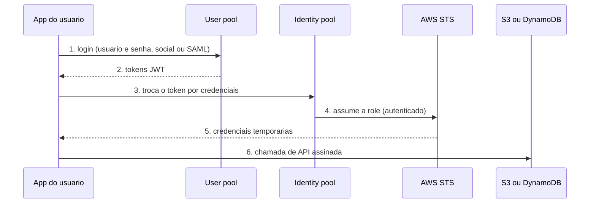

---
aliases:
  - Aula 19.7
modulo: 19
aula: 7
parte: "V Arquiteturas modernas"
dominios:
  - 1
lida: false
tags:
  - aula
  - saa-c03
  - modulo-19
---

# Aula 19.7: Cognito, user pools e identity pools

[[19 - Seguranca de Aplicacoes e Deteccao de Ameacas|Voltar ao módulo]]

> [!question] Pergunta que esta aula responde
> Como autenticar os usuários finais de uma aplicação sem construir um sistema de login do zero, e como dar a esses usuários acesso controlado a recursos AWS (um [[Bucket|bucket]], uma tabela)? Qual a diferença entre [[User Pool]] e [[Identity Pool]], que a prova mistura de propósito, e como cada um se integra a [[Application Load Balancer|ALB]] e [[API Gateway]]?

## O problema: login é a parte mais cara de errar

Todo produto com usuários precisa de cadastro, login, recuperação de senha, verificação de e-mail, [[MFA]], bloqueio contra força bruta, login social. Construir isso em casa significa guardar senhas ([[Hash|hash]] com sal, rotação de algoritmo), tratar tokens, expirar sessões e acompanhar vulnerabilidades. É código sensível, fácil de errar e que não é o diferencial do seu negócio.

Há ainda um segundo problema, diferente: um aplicativo móvel que precisa gravar uma foto direto no [[S3]] do usuário logado. Dar uma [[Access Key|chave de acesso]] fixa no aplicativo seria um vazamento anunciado. O aplicativo precisa de **[[Credencial Temporaria|credenciais temporárias]]** da AWS, restritas àquele usuário.

O **[[Cognito|Amazon Cognito]]** resolve os dois problemas com duas peças independentes (verificado em novembro de 2026): a documentação resume em duas perguntas.

| Pergunta | Peça | O que entrega |
|---|---|---|
| **Quem é este usuário?** (autenticação) | **[[User Pool\|User pool]]** | Diretório de usuários e tokens [[JWT]] |
| **O que este usuário pode acessar na AWS?** (autorização) | **Identity pool** | Credenciais AWS temporárias |

Nenhuma exige a outra. Elas funcionam sozinhas ou juntas.

## User pools: o diretório e a autenticação

Um **[[User Pool|user pool]]** é um diretório de usuários com cadastro autônomo (self-service) e criação por administrador, que autentica usuários e atua como [[Identity Provider|provedor de identidade]] **[[OIDC|OpenID Connect]] (OIDC)**. Ele emite **tokens [[JWT]]** (JSON Web Token, um token assinado e legível) para o seu aplicativo ou API.

### Como o usuário entra

- **Diretamente:** com e-mail ou usuário e senha armazenados no próprio [[User Pool|user pool]].
- **Por provedores sociais:** Google, Apple, Facebook, Amazon.
- **Por provedores corporativos:** [[SAML]] 2.0 e [[OIDC]] (a ideia de [[Federacao|federação]] do [[05 - Multiconta Governanca e Federacao|Módulo 5]], só que para os usuários do seu produto, não para sua força de trabalho).
- **Por M2M:** aplicações ou dispositivos sem usuário humano usam o fluxo `client_credentials` para obter um [[JWT|access token]].

Quem autentica por terceiros também ganha um perfil no diretório: o [[User Pool|user pool]] normaliza tudo em um conjunto padrão de tokens.

### Os três tokens

| Token | Para que serve | Observação |
|---|---|---|
| **[[JWT\|ID token]]** | Afirma **quem** é o usuário (nome, e-mail, atributos) | ID e access token carregam a claim `cognito:groups` |
| **[[JWT\|Access token]]** | Afirma **o que** o usuário pode fazer (escopos) | Apresentado a APIs e recursos |
| **[[JWT\|Refresh token]]** | Obtém novos ID e access tokens quando expiram | Criptografado e opaco; pode ser revogado |

Os tokens são JWTs em base64url: o ID e o [[JWT|access token]] podem ser decodificados para JSON legível (e por isso não carregam segredos). A validade é configurável por app client; a documentação do [[CloudFormation]] indica que o access token pode ir de 5 minutos a 1 dia e o refresh token de 60 minutos a 10 anos (a unidade padrão é horas para ID e access, dias para refresh).

> [!example] Lendo um JWT
> Um [[JWT|ID token]] decodificado traz algo como `sub` (identificador único e estável do usuário), `email`, `cognito:groups: ["admin"]`, `iss` (o emissor, a URL do [[User Pool|user pool]]) e `exp` (quando expira). O seu backend nunca confia no texto: ele **valida a assinatura** contra as chaves públicas do user pool e confere `iss`, audiência e `exp`.

### Recursos de segurança

- **[[MFA]]** (por aplicativo autenticador, SMS ou e-mail conforme o plano).
- **Grupos** de usuários, que viram claim nos tokens e podem ser mapeados a roles do [[IAM]].
- **Gatilhos Lambda** (pré e pós-cadastro, pré-geração de token etc.) para personalizar o fluxo e as claims.
- **Hosted UI / managed login:** ao configurar um domínio, o [[Cognito]] fornece telas prontas de cadastro e login.
- **Planos de recursos (feature plans):** **Lite** (barato, autenticação básica), **Essentials** (padrão para novos user pools; recursos modernos como login por escolha, [[MFA]] por e-mail e passkeys) e **Plus** (acrescenta proteção avançada: detecta login de local inesperado e **senhas que já vazaram em brechas públicas**, e registra logs de risco). A cobrança depende do plano e dos usuários ativos mensais (MAU); confira preços na página oficial.

## Identity pools: credenciais AWS temporárias

O **identity pool** (federated identities) troca um token confiável (de um [[User Pool|user pool]], de um provedor social, de um [[Identity Provider|IdP]] [[SAML]]/OIDC) por **credenciais AWS temporárias de privilégio limitado**, para que o aplicativo chame serviços como [[S3]] e [[DynamoDB]] em nome do usuário. Por baixo ele usa [[STS]] (a documentação cita `AssumeRoleWithWebIdentity`) e uma [[IAM Role]].

- **Roles por estado:** uma role para **usuários autenticados** e outra para **convidados** (guests, sem login). Pode-se escolher a role por claim do token.
- **Acesso de convidado:** credenciais de escopo estreito para quem ainda não logou (ler assets públicos, por exemplo); o login eleva o acesso.
- **Controle fino por usuário:** o identity pool transforma claims em **tags de sessão do [[IAM]]** (controle por atributo, [[ABAC]]), e as policies podem usar o identificador do usuário para restringir cada um à sua parte de um recurso (por exemplo, o próprio prefixo no [[S3]]).
- **Identity pools não exigem [[User Pool|user pool]]:** aceitam provedores externos direto.

> [!example] Foto de perfil direto no S3
> O usuário faz login pelo [[User Pool|user pool]] (recebe tokens), o aplicativo troca o token com o identity pool por [[Credencial Temporaria|credenciais temporárias]] de uma role cuja policy só permite `s3:PutObject` e `s3:GetObject` em `s3://fotos/${identidade-do-usuario}/*`. O aplicativo envia o arquivo direto ao [[S3]], sem passar pelo seu servidor e sem chave fixa. Se a credencial vazar, expira sozinha e só alcança aquele prefixo.

### Juntos: o fluxo clássico

## Integrações: onde o Cognito aparece na arquitetura

### Application Load Balancer

O [[Application Load Balancer|ALB]] pode **autenticar usuários** antes de encaminhar ao [[Target Group|target group]], com ação de [[Listener|listener]] `authenticate-cognito` (ou `authenticate-oidc` para um [[Identity Provider|IdP]] [[OIDC]] genérico). Pontos que a documentação enfatiza (verificado em novembro de 2026):

- Só funciona com **[[Listener|listeners]] HTTPS**.
- O app client do [[User Pool|user pool]] precisa gerar **client secret** e usar o **fluxo authorization code**.
- Há um **cookie de sessão**; o `SessionTimeout` padrão é **7 dias**.
- `OnUnauthenticatedRequest`: `authenticate` (redireciona ao login), `allow` (encaminha sem claims, para páginas mistas) ou `deny` (401, útil para AJAX).
- O [[Application Load Balancer|ALB]] precisa alcançar o endpoint de token e de userinfo do [[Identity Provider|IdP]] (use [[NAT Gateway|NAT gateway]] se o ALB for interno).

> [!tip] Autenticação "grátis" na borda da aplicação
> A aplicação por trás do [[Application Load Balancer|ALB]] não implementa login: recebe a requisição já autenticada, com as claims do usuário em cabeçalhos. É a resposta de "menor overhead" para colocar login em uma aplicação web existente.

### API Gateway

Para APIs, o [[API Gateway]] valida o token antes de acionar a Lambda ou o backend ([[16 - Serverless Lambda e API Gateway|Módulo 16]]):

| Autorizador | Quando usar |
|---|---|
| **[[Cognito]] [[User Pool\|user pool]] authorizer** | Usuários em user pools do Cognito; aceita tokens de qualquer app client do pool |
| **[[JWT]] authorizer** | Tokens de um ou mais [[Identity Provider\|IdPs]] [[OIDC]] ou [[OAuth 2.0]], incluindo user pools |
| **[[Lambda Authorizer\|Lambda authorizer]]** | Lógica de autorização customizada ou credenciais que não são [[JWT]] |

No **[[JWT]] authorizer** de uma API REST, a validação rejeita token ausente, malformado, expirado ou de emissor não confiável com **401 Unauthorized**, e token válido sem o escopo exigido com **403 Forbidden**. No **[[Cognito]] [[User Pool|user pool]] authorizer** (`COGNITO_USER_POOLS`) o comportamento é outro: a documentação diz que a chamada só tem sucesso se o token exigido for fornecido e válido, e um access token sem o escopo correspondente falha com **401**, não 403.

Outra regra do Cognito [[User Pool|user pool]] authorizer: sem escopos configurados no método, ele espera o **[[JWT|ID token]]**; com escopos configurados, espera o **access token** (escopos só existem no access token). (Verificado em novembro de 2026: [[Cognito]] com [[API Gateway]], ver Para aprofundar.)

### Outros

- **[[AppSync]]** (GraphQL) aceita autorização por [[User Pool|user pool]].
- O **[[WAF]]** pode ser associado ao próprio [[User Pool|user pool]] (Aula 19.3), para filtrar abuso nos endpoints de login.
- **[[Cognito]] vs [[IAM]] Identity Center:** o Cognito é para os **usuários do seu aplicativo** (clientes, milhões); o [[IAM Identity Center]] ([[05 - Multiconta Governanca e Federacao|Módulo 5]]) é para a **força de trabalho** acessar [[Conta AWS|contas AWS]] e aplicações corporativas.

## Como decidir

| Situação | Peça |
|---|---|
| Cadastro e login de clientes, token para a minha API | **[[User Pool\|User pool]]** |
| Login social ou corporativo ([[SAML]]/OIDC) em um app | **[[User Pool\|User pool]]** (como intermediário) |
| App móvel precisa gravar direto no [[S3]] ou [[DynamoDB]] | **Identity pool** (geralmente com [[User Pool\|user pool]]) |
| Acesso de convidado a recursos limitados | **Identity pool** (role de guest) |
| Login em aplicação web existente com mínimo de código | **[[Application Load Balancer\|ALB]] com authenticate-cognito** |
| API REST com login | **[[API Gateway]] com [[Cognito]] authorizer ou [[JWT]] authorizer** |
| Funcionários acessando o console da AWS | **[[IAM Identity Center]]** (não [[Cognito]]) |

## Como isso cai na prova

Cobertura: **Task 1.2** ("security services with use cases ([[Cognito]], [[GuardDuty]], [[Macie]])"; "secure application access") e **Task 1.1** ([[Federacao|federação]]).

**Palavras-chave em inglês:**
- "sign-up and sign-in for mobile/web app users", "user directory", "[[JWT]]" puxam **[[Cognito]] [[User Pool|user pool]]**.
- "temporary AWS credentials for app users to access [[S3]]/DynamoDB directly", "guest access" puxam **[[Cognito|Cognito identity pool]]**.
- "social identity providers (Google, Facebook)" ou "[[SAML]] federation for application users" puxam **[[User Pool|user pool]]**.
- "authenticate users at the [[Elastic Load Balancing|load balancer]]", "offload authentication" puxam **[[Application Load Balancer|ALB]] authenticate-cognito**.
- "authorize API requests with tokens", "[[Cognito]] authorizer" puxam **[[API Gateway]]**.
- "workforce access to [[Conta AWS|AWS accounts]]" puxa **[[IAM Identity Center]]**, não [[Cognito]].

**Pegadinhas clássicas:**
- **[[User Pool|User pool]] autentica (tokens [[JWT]]); identity pool autoriza (credenciais AWS).** Confundir os dois é o erro mais comum.
- **Os tokens do [[User Pool|user pool]] não são credenciais AWS**: para chamar [[S3]] direto é preciso trocá-los pelo identity pool.
- **[[Application Load Balancer|ALB]] authenticate-cognito exige HTTPS** e client secret.
- **401 versus 403 depende do autorizador:** [[JWT]] authorizer devolve 403 para escopo ausente; [[Cognito]] [[User Pool|user pool]] authorizer devolve 401.
- **[[JWT|ID token]] versus access token no [[Cognito]] authorizer:** sem escopos no método, ID token; com escopos, access token.
- **[[Cognito]] é para clientes do app; [[IAM Identity Center|Identity Center]] é para funcionários.**
- **Não coloque [[Access Key|chaves de acesso]] no aplicativo móvel**: use identity pool.
- A prova pode citar "federated identities": é o identity pool.

| Requisito no enunciado | Resposta provável | Por quê |
|---|---|---|
| Milhões de usuários com login, [[MFA]] e login social | [[Cognito]] [[User Pool\|user pool]] | Diretório gerenciado |
| App móvel grava fotos no [[S3]] do usuário | Identity pool com role restrita ao prefixo | [[Credencial Temporaria\|Credencial temporária]] por usuário |
| API REST só para usuários autenticados | [[API Gateway]] + [[Cognito]] authorizer | Valida o [[JWT]] na borda da API |
| Login numa aplicação web atrás de [[Application Load Balancer\|ALB]] sem alterar o código | ALB authenticate-cognito | Offload de autenticação |
| Visitantes anônimos leem assets limitados | Identity pool com acesso de convidado | Role de guest |
| Funcionários em várias [[Conta AWS\|contas AWS]] | [[IAM Identity Center]] | Força de trabalho, não clientes |

## Laboratório (opcional): criar um user pool e obter tokens

> [!warning] Use uma conta AWS pessoal separada
> Use uma **[[Conta AWS|conta AWS]] pessoal separada**, com [[Budgets]] configurado, **nunca a conta de produção da empresa**. O custo depende dos usuários ativos do mês (uma conta de teste tem 1 usuário); confirme a faixa gratuita na página de preços. **Não cole tokens reais em sites de terceiros.**

1. Crie o [[User Pool|user pool]]: `aws cognito-idp create-user-pool --pool-name saa-lab-pool --region us-east-1` (anote o `Id`).
2. Crie um app client sem segredo: `aws cognito-idp create-user-pool-client --user-pool-id <ID> --client-name saa-lab-client --explicit-auth-flows ALLOW_USER_PASSWORD_AUTH ALLOW_REFRESH_TOKEN_AUTH --region us-east-1` (anote o `ClientId`).
3. Crie um usuário de teste sem enviar e-mail: `aws cognito-idp admin-create-user --user-pool-id <ID> --username teste --message-action SUPPRESS --region us-east-1`.
4. Defina uma senha permanente (use uma senha forte descartável): `aws cognito-idp admin-set-user-password --user-pool-id <ID> --username teste --password '<SENHA>' --permanent --region us-east-1`.
5. Autentique: `aws cognito-idp initiate-auth --client-id <CLIENT_ID> --auth-flow USER_PASSWORD_AUTH --auth-parameters USERNAME=teste,PASSWORD='<SENHA>' --region us-east-1`. A resposta traz `IdToken`, `AccessToken` e `RefreshToken`. Decodifique localmente o payload (o trecho do meio do [[JWT]], em base64url) e observe `iss`, `exp` e `sub`.
6. **Limpeza:** `aws cognito-idp delete-user-pool --user-pool-id <ID> --region us-east-1`.

## Resumo

> [!abstract] A aula em uma frase
> O [[Cognito]] [[User Pool|user pool]] autentica os usuários do seu aplicativo e emite tokens [[JWT]]; o identity pool troca um token confiável por credenciais AWS temporárias de privilégio limitado; [[Application Load Balancer|ALB]] e [[API Gateway]] validam esses tokens para você não escrever login.

**A lógica, em 5 passos**
1. Login próprio é caro e arriscado; o [[User Pool|user pool]] entrega diretório, [[MFA]], social, [[SAML]] e tokens como serviço.
2. O [[User Pool|user pool]] emite [[JWT|ID token]] (quem), access token (o quê) e refresh token (renovar).
3. Tokens do [[User Pool|user pool]] não são credenciais AWS; para acessar [[S3]] ou [[DynamoDB]] direto, troca-se o token no identity pool.
4. O identity pool assume uma role via [[STS]] e devolve [[Credencial Temporaria|credenciais temporárias]], com roles para autenticado e convidado.
5. [[Application Load Balancer|ALB]] (authenticate-cognito, HTTPS) e [[API Gateway]] ([[Cognito]] ou [[JWT]] authorizer) validam o token na frente da aplicação.

**Tabela-síntese**

| | [[User Pool\|User pool]] | Identity pool |
|---|---|---|
| Pergunta | Quem é? | O que pode acessar na AWS? |
| Entrega | Tokens [[JWT]] | [[Credencial Temporaria\|Credenciais temporárias]] |
| Diretório | Sim | Não (federa) |
| Convidado | Não | Sim |

**Na prática, isso significa**
- Para login de clientes, [[User Pool|user pool]]; para acesso direto a [[S3]] ou [[DynamoDB]], adicione identity pool.
- Para login em app web atrás de [[Application Load Balancer|ALB]], use authenticate-cognito em [[Listener|listener]] HTTPS.
- Para API, use [[Cognito]] ou [[JWT]] authorizer no [[API Gateway]] e confira 401 versus 403.
- Para funcionários, use [[IAM Identity Center|Identity Center]].

> [!tip] Liga com
> Vem do [[04 - IAM Identidade e Acesso|Módulo 4]] (roles e [[STS]]) e do [[05 - Multiconta Governanca e Federacao|Módulo 5]] ([[Federacao|federação]]). Leva à [[19.08 - Credenciais da Aplicacao e Decisao Final|Aula 19.8]], que fecha com credenciais da aplicação e a decisão do módulo.

## Erros comuns

- Confundir [[User Pool|user pool]] (autentica) com identity pool (autoriza com credenciais AWS).
- Tentar chamar [[S3]] direto com o [[JWT|access token]] do [[User Pool|user pool]].
- Colocar [[Access Key|chaves de acesso]] fixas dentro do aplicativo móvel.
- Configurar authenticate-cognito em um [[Listener|listener]] [[HTTP]].
- Usar [[Cognito]] para os funcionários acessarem [[Conta AWS|contas AWS]] (é o [[IAM Identity Center|Identity Center]]).
- Confiar no conteúdo do [[JWT]] sem validar assinatura, emissor e expiração.

## Pratique

**1.** Uma startup precisa de cadastro, login com Google, [[MFA]] e recuperação de senha para milhões de usuários de um aplicativo, sem operar um servidor de identidade. Qual solução?

- [ ] a) IAM users, um para cada cliente.
- [ ] b) AWS Directory Service com Simple AD.
- [ ] c) IAM Identity Center com permission sets para cada cliente final do aplicativo.
- [ ] d) Amazon Cognito user pool com provedor social.

**2.** Um aplicativo móvel precisa que cada usuário logado envie arquivos direto ao [[S3]], apenas na própria pasta, sem expor chaves fixas. O que fazer?

- [ ] a) Identity pool com role que restringe o prefixo do usuário, e um user pool para o login.
- [ ] b) Embutir uma chave de acesso de longo prazo no aplicativo e rotacioná-la manualmente a cada release.
- [ ] c) Tornar o bucket público para escrita.
- [ ] d) Criar um IAM user por cliente.

**3.** Qual afirmação descreve corretamente a diferença entre [[User Pool|user pool]] e identity pool?

- [ ] a) Ambos emitem credenciais AWS temporárias.
- [ ] b) O identity pool autentica por senha e emite tokens JWT; o user pool troca esses tokens por credenciais AWS temporárias.
- [ ] c) O user pool autentica e emite JWT; o identity pool troca um token confiável por credenciais AWS temporárias.
- [ ] d) O user pool só funciona com um identity pool.

**4.** Uma aplicação web atrás de um [[Application Load Balancer|ALB]] precisa exigir login com [[Cognito]] sem mudar o código da aplicação. Quais DUAS condições se aplicam? (Escolha DUAS.)

- [ ] a) O listener do ALB precisa ser HTTPS.
- [ ] b) O ALB precisa estar em uma sub-rede privada obrigatoriamente.
- [ ] c) O app client precisa usar o fluxo implícito, porque o ALB não exige client secret.
- [ ] d) O ALB precisa de um WAF associado para autenticar.
- [ ] e) O app client do user pool precisa de client secret e fluxo authorization code.

**5.** Uma API REST usa um [[JWT]] authorizer do [[API Gateway]] e recebe um JWT válido, mas sem o escopo exigido pelo método. Qual resposta o API Gateway devolve?

- [ ] a) 401 Unauthorized.
- [ ] b) 403 Forbidden.
- [ ] c) 200 OK com corpo vazio.
- [ ] d) 502 Bad Gateway.

**6.** Uma empresa quer que os funcionários acessem várias [[Conta AWS|contas AWS]] com o login corporativo. Qual serviço é o apropriado?

- [ ] a) Cognito identity pool com convidado.
- [ ] b) Cognito user pool com MFA.
- [ ] c) AWS Directory Service Simple AD.
- [ ] d) IAM Identity Center.

**7.** Um site permite que visitantes anônimos leiam imagens de um [[Bucket|bucket]] e que usuários logados enviem arquivos. Qual configuração do [[Cognito]] atende?

- [ ] a) Identity pool com role de convidado (leitura limitada) e role de autenticado (escrita).
- [ ] b) User pool sem gerenciamento de grupos.
- [ ] c) Identity pool com apenas uma role de administrador.
- [ ] d) Dois user pools, um para cada situação.

**8.** Quais DUAS afirmações sobre os tokens do [[User Pool|user pool]] estão corretas? (Escolha DUAS.)

- [ ] a) O refresh token pode ser decodificado como JSON legível, como o ID token.
- [ ] b) O access token contém as credenciais AWS do usuário.
- [ ] c) O ID token traz informações de identidade, como atributos do usuário.
- [ ] d) O refresh token permite obter novos ID e access tokens.
- [ ] e) Os tokens substituem a assinatura SigV4 em qualquer chamada de API da AWS.

**9.** Uma API em Lambda atrás do [[API Gateway]] precisa aceitar tokens de qualquer app client de um [[User Pool|user pool]] do [[Cognito]], sem listar cada client ID. Qual autorizador?

- [ ] a) Lambda authorizer com chaves fixas.
- [ ] b) IAM authorization com chave de acesso por cliente.
- [ ] c) Cognito user pool authorizer.
- [ ] d) Nenhum, o API Gateway não valida tokens.

**10.** Uma fintech quer bloquear senhas já vazadas em brechas públicas e detectar logins de locais inesperados nos usuários do seu aplicativo. Qual plano do [[User Pool|user pool]] inclui essa proteção?

- [ ] a) Lite.
- [ ] b) Plus.
- [ ] c) Identity pool padrão.
- [ ] d) Não existe essa proteção no Cognito.

**11.** Quais DUAS opções descrevem corretamente o uso do [[Cognito]] com o [[WAF]] e o [[API Gateway]]? (Escolha DUAS.)

- [ ] a) O WAF pode ser associado a um user pool para proteger os endpoints de login.
- [ ] b) O WAF só protege identity pools.
- [ ] c) O API Gateway pode validar tokens do user pool antes de acionar o backend.
- [ ] d) O API Gateway exige que o usuário seja um IAM user para usar tokens JWT.
- [ ] e) O Cognito substitui a necessidade de HTTPS na API.

**12.** Um aplicativo web já existente atrás de um [[Application Load Balancer|ALB]] precisa de login com o menor esforço de desenvolvimento. O que usar?

- [ ] a) Regra de listener authenticate-cognito no ALB com HTTPS.
- [ ] b) Reescrever o login na aplicação com bibliotecas próprias.
- [ ] c) Security group que restringe por e-mail.
- [ ] d) AWS Shield Advanced.

> [!success]- Gabarito
> **1. d)** [[User Pool|user pool]] dá cadastro, login social, [[MFA]] e tokens gerenciados; a não escala para clientes; b é diretório para Windows e [[Active Directory|AD]]; c é para força de trabalho.
> **2. a)** o identity pool entrega [[Credencial Temporaria|credenciais temporárias]] com policy limitada ao prefixo do usuário; b e d expõem credenciais fixas; c abre o [[Bucket|bucket]].
> **3. c)** [[User Pool|user pool]] autentica e emite [[JWT]], e o identity pool troca token por credenciais AWS; a e b misturam os papéis; d erra porque são independentes.
> **4. a) e e)** exigem [[Listener|listener]] HTTPS e client secret com authorization code; b não é exigido; c contradiz o requisito (o [[Application Load Balancer|ALB]] exige client secret e authorization code); d não faz parte.
> **5. b)** no [[JWT]] authorizer, token válido sem escopo recebe 403 e token ausente ou inválido recebe 401 (no [[Cognito]] [[User Pool|user pool]] authorizer, escopo ausente resultaria em 401); a descreve o token inválido; c e d não correspondem ao comportamento.
> **6. d)** o [[IAM Identity Center]] dá acesso da força de trabalho a [[Conta AWS|contas AWS]]; a e b são para usuários do aplicativo; c é diretório, não acesso multiconta.
> **7. a)** o identity pool tem role de convidado e de autenticado; b não concede credenciais AWS; c é excessivo; d não resolve acesso a recursos.
> **8. c) e d)** o [[JWT|ID token]] traz identidade e o refresh token renova; a erra porque o refresh token é criptografado e opaco; b e e confundem tokens com credenciais AWS.
> **9. c)** o [[Cognito]] [[User Pool|user pool]] authorizer aceita tokens de qualquer app client do pool; a e b são trabalhosos; d é falso.
> **10. b)** o plano Plus detecta senhas que já apareceram em brechas públicas; a não inclui; c não é plano de [[User Pool|user pool]]; d é falso.
> **11. a) e c)** o [[WAF]] pode proteger o [[User Pool|user pool]] e o [[API Gateway]] valida tokens; b erra; d e e são afirmações falsas.
> **12. a)** o authenticate-cognito no [[Application Load Balancer|ALB]] tira o login da aplicação; b dá trabalho e risco; c não autentica; d é [[DDoS]].

## Para aprofundar

- [ ] [What is Amazon Cognito?](https://docs.aws.amazon.com/cognito/latest/developerguide/what-is-amazon-cognito.html) (documentação AWS): user pools, [[Identity Pool|identity pools]] e quando usar cada um.
- [ ] [Amazon Cognito identity pools](https://docs.aws.amazon.com/cognito/latest/developerguide/cognito-identity.html) (documentação AWS): [[Credencial Temporaria|credenciais temporárias]], convidados e mapeamento de roles.
- [ ] [Authenticate users using an Application Load Balancer](https://docs.aws.amazon.com/elasticloadbalancing/latest/application/listener-authenticate-users.html) (documentação AWS): authenticate-cognito, cookie e [[Timeout|timeout]].
- [ ] [Control access to REST APIs using Amazon Cognito user pools as an authorizer](https://docs.aws.amazon.com/apigateway/latest/developerguide/apigateway-integrate-with-cognito.html) (documentação AWS): COGNITO_USER_POOLS, [[JWT|ID token]] versus access token.
- [ ] [Control access to REST APIs using JWT authorizers](https://docs.aws.amazon.com/apigateway/latest/developerguide/rest-api-jwt-authorizer.html) (documentação AWS): validação de [[JWT]] e escolha do autorizador.

Próxima aula: [[19.08 - Credenciais da Aplicacao e Decisao Final|Aula 19.8: credenciais da aplicação e decisão final]].
