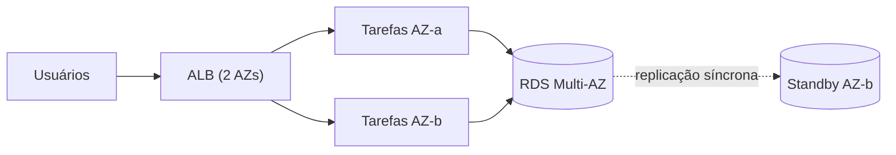

---
aliases:
  - Aula 20.1
modulo: 20
aula: 1
parte: "VI Resiliência e operações"
dominios:
  - 2
lida: false
tags:
  - aula
  - saa-c03
  - modulo-20
---

# Aula 20.1: Disponibilidade em noves e o ponto único de falha

[[20 - Alta Disponibilidade e Recuperacao de Desastres|Voltar ao módulo]]

> [!question] Pergunta que esta aula responde
> O que significa "99,99% de [[Disponibilidade|disponibilidade]]" em minutos de queda por ano, como calcular a disponibilidade de uma arquitetura com vários componentes em série e em paralelo, e por que a diferença entre [[Alta Disponibilidade|alta disponibilidade]] e [[Tolerancia a Falhas|tolerância a falhas]] decide a arquitetura?

## O problema: "sempre no ar" não é um requisito, é um desejo

Todo mundo pede um sistema que nunca cai. Nenhum sistema entrega isso, e quanto mais perto de "nunca" você chega, mais cada nove adicional custa. Por isso a engenharia de confiabilidade troca o desejo por um **número**: a [[Disponibilidade|disponibilidade]]. Com o número, dá para calcular quanta queda o negócio tolera, comparar com o que a arquitetura atual entrega e decidir quanto vale pagar para melhorar.

Esta aula dá a matemática. As aulas seguintes do módulo usam esse número para escolher entre [[Multi-AZ]] e multi-Região, estratégias de [[Recuperacao de Desastres|recuperação de desastres]] e padrões de resiliência. Você já opera [[ECS]], [[Application Load Balancer|ALB]] e [[RDS]] em produção; aqui você aprende a **provar**, com contas, quanto o desenho realmente aguenta.

## Disponibilidade: a definição e a tabela dos noves

A [[Disponibilidade]] é a porcentagem do tempo em que a carga de trabalho cumpre a função combinada quando é solicitada. A fórmula do pilar de confiabilidade do [[Well-Architected Framework]] é direta:

`Disponibilidade = tempo disponível para uso / tempo total`

O período pode ser mensal, anual ou os últimos três anos. Na interpretação mais estrita, qualquer momento em que a aplicação não opera normalmente reduz a [[Disponibilidade|disponibilidade]], inclusive a **manutenção planejada**. Excluir a [[Maintenance Window|janela de manutenção]] do cálculo é permitido, mas a AWS desaconselha, porque o usuário quer usar o serviço também nessa hora. Quando é mais fácil contar requisições do que tempo, a conta vira `requisições bem-sucedidas / requisições válidas`, medida em janelas de um ou cinco minutos.

A tabela abaixo vem da documentação do pilar de confiabilidade (verificado em novembro de 2026) e é a mais cobrada em conversa de arquitetura:

| [[Disponibilidade]] | Queda máxima por ano | Queda máxima por mês (30 dias) | Tipo de aplicação citado pela AWS |
|---|---|---|---|
| 99% | 3 dias e 15 horas | cerca de 7 h 12 min | [[Processamento em Lote\|Processamento em lote]], cargas de extração e transferência |
| 99,9% | 8 h 45 min | cerca de 43 min | Ferramentas internas, gestão de conhecimento |
| 99,95% | 4 h 22 min | cerca de 22 min | Comércio online, ponto de venda |
| 99,99% | 52 min | cerca de 4 min 20 s | Distribuição de vídeo, transmissão |
| 99,999% | 5 min | cerca de 26 s | Transações de caixa eletrônico, telecomunicações |

A coluna mensal é conta nossa: `43.200 minutos por mês x (1 - disponibilidade)`. Memorize a ordem de grandeza, não a tabela: **cada nove a mais divide a queda permitida por dez**. De 99,9% para 99,99% você sai de quase 9 horas para menos de 1 hora por ano.

> [!example] O orçamento de queda como moeda
> O **[[SLO]]** (*service level objective*, a meta interna de [[Disponibilidade|disponibilidade]]; a [[20.10 - Metricas de Negocio SLO e Teste de Recuperacao|aula 20.10]] detalha) é 99,99% por ano, e a diferença até 100% é o **[[Error Budget|orçamento de erro]]**: a queda que a equipe pode gastar. A equipe promete 99,99% por ano. Um deploy ruim derruba o serviço por 40 minutos em março. O orçamento anual era de cerca de 52 minutos, então sobram cerca de 12 minutos para o resto do ano, incluindo qualquer [[Failover|failover]] de banco (que sozinho pode levar de 1 a 2 minutos). Quem não faz essa conta descobre em dezembro que prometeu o impossível.

> [!warning] O custo sobe junto com os noves
> A própria AWS lembra que metas mais altas exigem testes sob cenários de falha exaustivos, automação de recuperação para todo tipo de falha e operações (adicionar capacidade, fazer deploy, migrar dados) construídas no mesmo padrão. Em metas muito altas, até a escolha de dependências encolhe: sobram menos serviços de uso geral (como um banco relacional) e mais **serviços de propósito específico**, que são mais fáceis de avaliar, testar e automatizar. Esse é o motivo de a prova preferir o serviço de propósito específico.

## Componentes em série: a corrente é tão forte quanto o elo mais fraco, ou pior

Quando um componente tem **dependência rígida** (*hard dependency*) de outro, ou seja, a queda do segundo derruba o primeiro, as disponibilidades se **multiplicam**:

`Disp_total = Disp_1 x Disp_2 x Disp_3`

Exemplo da documentação: um sistema projetado para 99,99% com dependência rígida de dois outros sistemas independentes, também de 99,99%, entrega teoricamente `99,99% x 99,99% x 99,99% = 99,97%`. Cada dependência rígida que você adiciona **reduz** o teto.

> [!example] Conta resolvida: três camadas em série (números ilustrativos, não são SLAs da AWS)
> Um [[Application Load Balancer|ALB]] com 99,99%, as tarefas [[ECS]] com 99,9% e um [[RDS]] com 99,95%, todos em série:
>
> `0,9999 x 0,999 x 0,9995 = 0,99840`
>
> São 99,84%, ou cerca de 14 horas de queda por ano, mesmo com todas as peças parecendo "boas". A cadeia inteira é pior que o pior elo individual.

A saída é transformar dependências rígidas em **dependências brandas** (*soft dependencies*): a aplicação continua cumprindo o essencial quando a dependência falha, por exemplo servindo dado em cache. A [[20.08 - Padroes de Resiliencia Imutabilidade Retry e Degradacao|aula 20.8]] mostra como.

## Componentes em paralelo: a redundância que multiplica os noves

Quando existem **componentes redundantes e independentes**, o sistema só cai se todos caírem ao mesmo tempo. A [[Disponibilidade|disponibilidade]] efetiva é `100% menos o produto das taxas de falha`:

`Disp_efetiva = 100% - (falha_1 x falha_2)`

Exemplo da documentação: dois componentes independentes de 99,9% (taxa de falha de 0,1% cada) dão `100% - (0,1% x 0,1%) = 99,9999%`. Existe um atalho: se todas as disponibilidades são feitas só de noves, **some a quantidade de noves**. Dois componentes de três noves dão seis noves; três réplicas de dois noves (99%) também dão seis noves.

Cada camada acima tem redundância em paralelo; as camadas continuam em série entre si. O cálculo completo é sempre: paralelo dentro de cada camada, série entre as camadas.

> [!example] Conta resolvida: onde está o elo fraco
> Camada web com duas [[Zona de Disponibilidade|AZs]] de 99,9% cada: `1 - 0,001 x 0,001 = 99,9999%`. Camada de aplicação igual: 99,9999%. Banco **Single-AZ** com 99,95%:
>
> `0,999999 x 0,999999 x 0,9995 = 0,999498`, ou 99,95%.
>
> As duas camadas redundantes praticamente não aparecem no resultado: o banco sem redundância dita a [[Disponibilidade|disponibilidade]] inteira. Colocar o banco em [[Multi-AZ]] (standby de 99,95% em paralelo) leva a camada de dados a `1 - 0,0005 x 0,0005 = 99,99997%`, e o sistema passa a ser limitado por outro componente. A regra de bolso: **atacar sempre o elo mais fraco da série**.

> [!info] Ligando os pontos
> No [[01 - Nuvem e Infraestrutura Global AWS|Módulo 1]] você viu que a [[Zona de Disponibilidade|AZ]] é a unidade de falha física. Duas AZs independentes são exatamente o "componente em paralelo" desta conta. No [[13 - Bancos Relacionais RDS e Aurora|Módulo 13]] você viu o [[Multi-AZ]] do [[RDS]]; aqui ele aparece como a operação aritmética que tira o banco do papel de elo fraco.

### Os dois limites da conta paralela

A fórmula é um **teto teórico**, por dois motivos que a prova explora indiretamente:

1. **Independência é uma hipótese.** Se as duas réplicas dependem do mesmo deploy, do mesmo pacote com bug, da mesma fila ou do mesmo serviço regional, uma única causa derruba as duas. Falhas **correlacionadas** anulam o ganho. Uma [[Zona de Disponibilidade|AZ]] é independente de outra em infraestrutura física, mas o seu código não é.
2. **A troca não é instantânea.** A fórmula supõe que a réplica assume na hora. Na prática há detecção e [[Failover|failover]]: o [[Multi-AZ DB Instance|Multi-AZ DB instance]] do [[RDS]] leva tipicamente de 60 a 120 segundos (documentação do RDS, verificado em novembro de 2026). Esse intervalo é queda real que entra no orçamento.

## Os três botões da disponibilidade: MTBF, detecção e MTTR

Para componentes sem número publicado, estima-se com `MTBF / (MTBF + MTTR)`, onde o [[MTBF]] é o tempo médio entre falhas e o [[MTTR]] é o tempo médio para recuperar. Exemplo da AWS: MTBF de 150 dias e MTTR de 1 hora dão `3.600 h / 3.601 h = 99,97%`.

Aplique a mesma conta cortando o [[MTTR]] para 10 minutos, sem mudar a frequência das falhas: `3.600 h / (3.600 h + 0,167 h) = 99,995%`. A queda caiu de 0,03% para 0,005% (seis vezes menos), o que sobe a [[Disponibilidade|disponibilidade]] de 99,97% para 99,995%. Por isso a AWS descreve três alavancas: **aumentar o [[MTBF]]** (falhar menos), **reduzir o tempo de detecção** e **reduzir o MTTR** (recuperar rápido). Na nuvem as duas últimas costumam ser mais baratas que a primeira: alarme bom e [[Failover|failover automático]] valem mais que tentar evitar toda falha.

## Ponto único de falha e raio de impacto

Um [[Ponto Unico de Falha]] (*single point of failure*, SPOF) é qualquer componente cuja queda derruba o sistema inteiro. Caçar SPOFs é o exercício central da Task 2.2 do exam guide ("mitigating single points of failure"). Os suspeitos de sempre:

| Candidato a [[Ponto Unico de Falha\|SPOF]] | Por que é SPOF | Como remover |
|---|---|---|
| Uma [[EC2\|instância EC2]] única | Falha de hardware ou da [[Zona de Disponibilidade\|AZ]] derruba tudo | [[Auto Scaling Group]] em mais de uma AZ atrás de um balanceador |
| Banco [[RDS]] Single-AZ | Estado só existe em uma [[Zona de Disponibilidade\|AZ]] | [[Multi-AZ]] ou [[Aurora]] com réplicas em outra AZ |
| Um único [[NAT Gateway]] zonal atendendo várias [[Zona de Disponibilidade\|AZs]] | Se a AZ do [[NAT]] cair, as [[Sub-rede Privada\|sub-redes privadas]] das outras AZs perdem a saída | Um NAT zonal por AZ, ou um NAT Gateway regional, que expande sozinho entre as AZs (custo e detalhes: [[06 - VPC a Fundo|Módulo 6]]; verificado em novembro de 2026) |
| Uma única conexão [[Direct Connect]] ou VPN com o data center | O enlace único é a única porta entre on-premises e a [[VPC]] | Dois Direct Connect em locais distintos (máxima resiliência) ou Direct Connect com [[Site-to-Site VPN\|VPN site-to-site]] de backup ([[07 - Conectividade Hibrida e entre VPCs|Módulo 7]]) |
| Volume [[EBS]] único com dado crítico | O volume vive em uma [[Zona de Disponibilidade\|AZ]] | [[Snapshot\|Snapshots]], ou armazenamento regional como [[EFS]] ou [[S3]] |
| Uma única [[Regiao AWS|Região]] | Evento regional é raro, mas existe | Estratégia de DR da [[20.04 - As Quatro Estrategias de Recuperacao de Desastres|aula 20.4]] |
| Uma pessoa que sabe o procedimento | Recuperação manual vira gargalo | Automação e [[Runbook\|runbooks]] testados |

O **[[Raio de Impacto|raio de impacto]]** (*blast radius*) é a outra face: dado que algo vai falhar, quantos clientes ou funções a falha atinge? Partições (por cliente, por serviço ou por [[Zona de Disponibilidade|AZ]]) e a regra de não compartilhar um recurso entre tudo limitam o raio. O [[Well-Architected Framework|Well-Architected]] chama isso de arquitetura com anteparas (*[[Bulkhead|bulkhead]]*).

## Alta disponibilidade e tolerância a falhas: quase a mesma coisa, com um preço diferente

Os dois termos são usados de forma consistente na documentação e na prova, embora não sejam definições normativas:

- **Alta disponibilidade** ([[Alta Disponibilidade]]): o sistema se recupera rápido e automaticamente de uma falha, com uma **interrupção breve** aceitável. O [[RDS]] [[Multi-AZ]] é o exemplo: 60 a 120 segundos de queda no [[Failover|failover]].
- **Tolerância a falhas** ([[Tolerancia a Falhas]]): o sistema continua operando **sem interrupção perceptível** quando um componente falha. Exige capacidade ociosa já ligada e sem etapa de troca, como uma frota ativa em três [[Zona de Disponibilidade|AZs]] dimensionada para sobreviver à perda de uma, ou uma [[Replicacao Sincrona|replicação síncrona]] sem [[Failover|failover]].

A [[Tolerancia a Falhas|tolerância a falhas]] custa mais, porque você paga pela capacidade que só usa quando algo quebra. Muitas vezes a resposta certa é a [[Alta Disponibilidade|alta disponibilidade]], e o enunciado entrega a pista: "minimal downtime" e "recovers automatically" pedem HA; "no interruption" e "continues to operate during failure" pedem tolerância a falhas.

> [!tip] Dimensionar para a perda de uma AZ
> Com três [[Zona de Disponibilidade|AZs]] e capacidade igual em cada uma, perder uma AZ remove um terço da capacidade. Para a frota absorver a carga sem depender de subir máquinas novas, cada AZ precisa ter capacidade para metade da carga total (as duas AZs restantes juntas atendem 100%), ou seja, 150% de capacidade somada. Em regime normal cada AZ atende 33% da carga total sobre uma capacidade de 50%, então roda a cerca de 67% da sua capacidade; ao perder uma AZ, as duas restantes passam a 100%. Com 2 AZs, cada uma com capacidade para 100% da carga, o uso normal seria 50%. A AWS chama isso de pré-provisionamento e volta ao assunto na [[20.02 - Multi-AZ e Multi-Region Servico por Servico|aula 20.2]].

## Como isso cai na prova

> [!info] Task statement 2.2
> "Projetar arquiteturas altamente disponíveis e/ou tolerantes a falhas": identificar e mitigar [[Ponto Unico de Falha|pontos únicos de falha]], usar serviços de [[Alta Disponibilidade|HA]] entre [[Zona de Disponibilidade|AZs]] e [[Regiao AWS|Regiões]], derivar métricas de negócio para HA.

**Palavras-chave em inglês:** *[[Ponto Unico de Falha|single point of failure]]*, *[[Alta Disponibilidade|highly available]]*, *[[Tolerancia a Falhas|fault tolerant]]*, *no interruption*, *minimal downtime*, *[[Multi-AZ]]*, *automatic [[Failover|failover]]*, *eliminate*, *99.99% [[Disponibilidade|availability]]*.

**Armadilhas frequentes:**

- Duas instâncias na **mesma [[Zona de Disponibilidade|AZ]]** não eliminam o [[Ponto Unico de Falha|SPOF]] de AZ: a prova diz "different Availability Zones".
- Confundir [[Alta Disponibilidade|HA]] (recupera rápido) com [[Tolerancia a Falhas|tolerância a falhas]] (nem percebe).
- Esquecer que a camada de dados, o [[NAT]] e os componentes zonais continuam [[Ponto Unico de Falha|SPOF]] depois de a camada web ficar [[Multi-AZ|multi-AZ]].
- Achar que [[Auto Scaling Group|Auto Scaling]] sozinho resolve: ele precisa de [[Sub-rede|sub-redes]] em mais de uma [[Zona de Disponibilidade|AZ]].

| Requisito no enunciado | Resposta provável | Por quê |
|---|---|---|
| Eliminar o [[Ponto Unico de Falha\|SPOF]] de uma instância web | [[Auto Scaling Group\|ASG]] em 2 ou mais [[Zona de Disponibilidade\|AZs]] com [[Application Load Balancer\|ALB]] | Redundância em paralelo em AZs independentes |
| Banco sobrevive à perda de uma [[Zona de Disponibilidade\|AZ]] sem intervenção | [[RDS]] [[Multi-AZ]] ou [[Aurora]] com réplica em outra AZ | Estado replicado antes da falha |
| "Sem nenhuma interrupção" durante falha de [[Zona de Disponibilidade\|AZ]] | [[Multi-Site Active-Active\|Ativo-ativo]] em 3 AZs com capacidade para perder uma | Sem etapa de troca |
| [[Sub-rede Privada\|Sub-redes privadas]] perdem a internet quando uma [[Zona de Disponibilidade\|AZ]] cai | Um [[NAT Gateway]] zonal por AZ ou um [[NAT]] Gateway regional | O NAT zonal vive em uma AZ; o regional expande entre AZs |
| Conexão on-premises única é [[Ponto Unico de Falha\|SPOF]] | Dois [[Direct Connect]] em locais distintos, ou Direct Connect + VPN de backup | Dois caminhos independentes até a AWS |
| Meta de 99,99% com várias dependências | Dependências redundantes e brandas | Série multiplica; paralelo soma noves |

## Resumo

> [!abstract] A aula em uma frase
> [[Disponibilidade]] é um número, a conta é série (multiplica) dentro da cadeia e paralelo (soma noves) dentro da camada, e a arquitetura vale o que o seu elo mais fraco vale.

**A lógica, em 5 passos**

1. Transforme "nunca cair" em porcentagem e converta em minutos de queda por ano ou por mês.
2. Dependências rígidas em série multiplicam as disponibilidades e baixam o teto.
3. Componentes independentes em paralelo multiplicam as taxas de falha e somam noves, até o limite das falhas correlacionadas.
4. Reduzir o tempo de detecção e o [[MTTR]] rende tanto quanto falhar menos e costuma custar menos.
5. Cace os [[Ponto Unico de Falha|pontos únicos de falha]] camada por camada e decida entre [[Alta Disponibilidade|HA]] (queda breve) e [[Tolerancia a Falhas|tolerância a falhas]] (sem queda).

**Números para lembrar**

| O quê | Valor | Por que importa |
|---|---|---|
| 99,9% | 8 h 45 min por ano | Ferramentas internas |
| 99,95% | 4 h 22 min por ano | Comércio online |
| 99,99% | 52 min por ano | Cada nove divide a queda por dez |
| 99,999% | 5 min por ano | Custo e automação muito altos |
| Três dependências de 99,99% em série | 99,97% | Série reduz o teto |
| Dois componentes de 99,9% em paralelo | 99,9999% | Soma de noves |
| [[Failover]] do [[RDS]] [[Multi-AZ]] instance | 60 a 120 s | Queda real dentro da fórmula |

**Na prática, isso significa**

- Antes de escolher o serviço, converta o requisito em minutos de queda aceitáveis.
- Redundância em [[Zona de Disponibilidade|AZs]] diferentes, nunca na mesma AZ.
- Depois de duplicar uma camada, procure o próximo elo único: banco, [[NAT]], volume, processo manual.
- "Sem interrupção" pede capacidade ociosa já ligada, o que custa mais que "recupera rápido".

> [!tip] Liga com
> Vem do [[01 - Nuvem e Infraestrutura Global AWS|Módulo 1]] ([[Zona de Disponibilidade|AZ]] como unidade de falha) e do [[02 - Well-Architected e o Formato da Prova|Módulo 2]] (pilar de confiabilidade). Segue para a [[20.02 - Multi-AZ e Multi-Region Servico por Servico|aula 20.2]], que mostra o que cada serviço faz sozinho entre AZs.

## Erros comuns

- **"Duas instâncias significam [[Alta Disponibilidade|alta disponibilidade]]."** Na mesma [[Zona de Disponibilidade|AZ]], uma falha física derruba as duas.
- **"Mais noves de cada componente basta."** A cadeia em série multiplica; um banco Single-AZ ainda dita o resultado.
- **"Redundância dá sempre seis noves."** A fórmula supõe falhas independentes e troca instantânea, e nenhuma das duas vale por inteiro.
- **"Manutenção planejada não conta."** Na definição estrita conta, porque o usuário quer usar o serviço também nessa hora.
- **"[[Alta Disponibilidade|Alta disponibilidade]] e [[Tolerancia a Falhas|tolerância a falhas]] são sinônimos."** A segunda não aceita nem a interrupção breve do [[Failover|failover]].

## Pratique

**1.** Uma API depende de forma rígida de dois serviços independentes internos. Cada um dos três (a API e os dois serviços) foi projetado para 99,99% de [[Disponibilidade|disponibilidade]]. Qual é a disponibilidade teórica da API?

- [ ] a) 99,99%, porque a API é a camada exposta ao cliente e as dependências não contam
- [ ] b) Cerca de 99,97%, o produto das três disponibilidades
- [ ] c) Cerca de 99,9999%, porque três componentes independentes somam noves
- [ ] d) Cerca de 99,96%, a média das três subtraída da latência de rede entre elas

**2.** Uma equipe coloca duas réplicas independentes de um componente, cada uma com 99,9% de [[Disponibilidade|disponibilidade]], em [[Zona de Disponibilidade|AZs]] diferentes, com troca imediata e sem falha correlacionada. Qual é a disponibilidade efetiva desse par?

- [ ] a) 99,95%, a média das duas réplicas
- [ ] b) 99,8%, porque duas réplicas aumentam a superfície de falha
- [ ] c) 99,99%, o ganho de um nove por réplica adicional
- [ ] d) 99,9999%, cem por cento menos o produto das taxas de falha

**3.** O [[SLO]] anual de um serviço é 99,99%. Um incidente já consumiu 40 minutos neste ano. Quanto do orçamento de queda anual ainda resta, aproximadamente?

- [ ] a) Cerca de 12 minutos
- [ ] b) Cerca de 52 minutos, porque o orçamento recomeça a cada incidente
- [ ] c) Cerca de 4 horas, usando a linha de 99,95% da tabela
- [ ] d) Nenhum, pois 40 minutos já ultrapassam qualquer meta de 99,99%

**4.** Uma loja online tem camada web e camada de aplicação em duas [[Zona de Disponibilidade|AZs]], cada uma com redundância. O banco é um [[RDS]] Single-AZ com 99,95%. A diretoria quer subir a [[Disponibilidade|disponibilidade]] geral com a menor mudança. O que aumenta mais o resultado?

- [ ] a) Adicionar uma terceira AZ à camada web
- [ ] b) Trocar as instâncias da aplicação por uma família maior
- [ ] c) Habilitar o Multi-AZ no banco de dados
- [ ] d) Colocar um CloudFront na frente do ALB

**5.** (Escolha DUAS.) Uma equipe quer elevar a [[Disponibilidade|disponibilidade]] de um serviço sem conseguir reduzir a frequência das falhas. Quais ações melhoram a disponibilidade segundo a lógica de [[MTBF]] e [[MTTR]]?

- [ ] a) Automatizar a detecção da falha com alarmes
- [ ] b) Aumentar o intervalo de coleta das métricas para reduzir ruído
- [ ] c) Exigir aprovação manual de um engenheiro antes de cada failover
- [ ] d) Automatizar o failover para reduzir o tempo de recuperação
- [ ] e) Excluir a manutenção planejada do cálculo e divulgar o novo número

**6.** Uma arquitetura tem [[Application Load Balancer|ALB]] em duas [[Zona de Disponibilidade|AZs]], tarefas [[ECS]] [[Fargate]] em duas AZs e [[RDS]] [[Multi-AZ]]. As [[Sub-rede Privada|sub-redes privadas]] das duas AZs saem para a internet por um único [[NAT Gateway]] zonal na AZ-a. Qual é o [[Ponto Unico de Falha|ponto único de falha]] restante?

- [ ] a) O ALB, porque balanceadores são sempre zonais
- [ ] b) O banco, porque o Multi-AZ não cobre falha de AZ
- [ ] c) As tarefas Fargate, porque o serviço não tem alta disponibilidade
- [ ] d) O NAT Gateway da AZ-a, cuja queda isola a saída das duas AZs

**7.** Um enunciado pede uma arquitetura que continue respondendo a todas as requisições, sem interrupção perceptível, durante a perda de uma [[Zona de Disponibilidade|AZ]] inteira. Qual abordagem atende?

- [ ] a) Frota ativa em três AZs atrás de um ALB, dimensionada para absorver a perda de uma AZ
- [ ] b) Instância única com recuperação automática de hardware configurada
- [ ] c) Backups diários copiados para outra Região e restaurados quando a AZ voltar ao ar
- [ ] d) Uma instância standby desligada em outra AZ, ligada manualmente por um engenheiro quando necessário

**8.** O time afirma: "como temos duas réplicas em [[Zona de Disponibilidade|AZs]] diferentes, a [[Disponibilidade|disponibilidade]] é exatamente 100% menos o produto das taxas de falha". Qual limitação desse raciocínio é a mais importante?

- [ ] a) A AWS não publica taxas de falha de nenhum componente, então a conta é impossível
- [ ] b) A fórmula só vale para componentes em série, nunca em paralelo
- [ ] c) A conta ignora o custo das réplicas, que não afeta a disponibilidade
- [ ] d) As réplicas podem falhar juntas pela mesma causa, como um deploy ruim, e a troca não é instantânea

**9.** Um time de produto pede 99,999% de [[Disponibilidade|disponibilidade]] para uma ferramenta interna de gestão de projetos usada em horário comercial. Qual a melhor resposta do arquiteto?

- [ ] a) Aceitar e implantar ativo-ativo em duas Regiões imediatamente, já que o pedido veio do negócio e cabe à engenharia executar
- [ ] b) Recusar qualquer meta formal de disponibilidade para essa ferramenta, pois o número escolhido seria sempre arbitrário
- [ ] c) Validar a necessidade real: cada nove custa mais, e 99,9% costuma atender ferramentas internas
- [ ] d) Reduzir a meta para 99% sem consultar o negócio, porque ferramentas internas toleram qualquer queda de serviço

**10.** (Escolha DUAS.) Quais dos itens abaixo são [[Ponto Unico de Falha|pontos únicos de falha]] em uma arquitetura que se diz [[Alta Disponibilidade|altamente disponível]]?

- [ ] a) Um ALB distribuído em três AZs
- [ ] b) Um servidor de licenças em uma única instância EC2
- [ ] c) Uma tabela do DynamoDB
- [ ] d) Um banco RDS Multi-AZ
- [ ] e) Um volume EBS único com os dados críticos de uma aplicação sem réplica

**11.** Uma empresa conecta o data center à [[VPC]] por um único circuito [[Direct Connect]] de 1 Gbps e exige que a conectividade híbrida sobreviva à falha do circuito e do local de conexão. Qual abordagem atende com a maior resiliência?

- [ ] a) Aumentar o circuito para 10 Gbps no mesmo local de conexão
- [ ] b) Dois circuitos Direct Connect em locais de conexão distintos
- [ ] c) Manter o circuito único e adicionar alarmes do CloudWatch para detectar a queda
- [ ] d) Anexar a conexão a um Transit Gateway em vez de uma virtual private gateway

> [!success]- Gabarito
> **1. b)** Dependências rígidas em série multiplicam: 99,99% x 99,99% x 99,99% é cerca de 99,97%. A opção (a) ignora as dependências; (c) aplica a regra de paralelo a uma cadeia em série; (d) inventa uma média com [[Latencia|latência]].
> **2. d)** Componentes independentes em paralelo: 100% menos (0,1% x 0,1%) dá 99,9999%, ou seis noves pelo atalho de somar noves. A média (a) e a soma de uma "superfície de falha" (b) estão erradas, e (c) subestima o ganho.
> **3. a)** 99,99% ao ano permite cerca de 52 minutos; 52 menos 40 deixam cerca de 12 minutos. O orçamento não recomeça por incidente (b), a linha de 99,95% é de outra meta (c), e 40 minutos cabem dentro de 52 (d).
> **4. c)** O banco Single-AZ é o elo mais fraco da série; o [[Multi-AZ]] o coloca em paralelo. Uma terceira [[Zona de Disponibilidade|AZ]] na web (a), instâncias maiores (b) e [[CloudFront]] (d) melhoram camadas que já têm redundância, sem tocar o elo fraco.
> **5. a), d)** Detecção e recuperação automáticas reduzem o tempo de detecção e o [[MTTR]]. Coletar menos (b) piora a detecção, aprovação manual (c) aumenta o MTTR, e excluir manutenção (e) maquia o número sem melhorar nada.
> **6. d)** O [[NAT Gateway]] zonal vive em uma única [[Zona de Disponibilidade|AZ]]: se a AZ-a cair, as tarefas da AZ-b perdem a saída. O [[Application Load Balancer|ALB]] é [[Multi-AZ|multi-AZ]] (a), o Multi-AZ cobre falha de AZ (b), e o [[Fargate]] roda nas duas [[Sub-rede|sub-redes]] (c).
> **7. a)** Frota ativa em três [[Zona de Disponibilidade|AZs]] dimensionada para perder uma não tem etapa de troca, que é a ideia da [[Tolerancia a Falhas|tolerância a falhas]]. A instância única (b) interrompe na recuperação, os backups (c) são recuperação lenta e o standby manual (d) exige intervenção.
> **8. d)** A fórmula supõe independência e troca instantânea; falhas correlacionadas e o tempo de [[Failover|failover]] (60 a 120 s no [[RDS]] [[Multi-AZ]]) fazem a realidade ficar abaixo do teto. A AWS publica metas (a), a regra de paralelo é justamente essa (b), e o custo não é uma limitação da conta (c).
> **9. c)** O arquiteto valida a necessidade real: a AWS associa 99,9% a ferramentas internas, e cada nove adicional custa mais testes, automação e infraestrutura. Aceitar sem questionar (a), recusar (b) ou reduzir sem consultar (d) fogem da conversa baseada em número.
> **10. b), e)** Um servidor único e um [[EBS|volume EBS]] único sem réplica caem com a instância ou com a [[Zona de Disponibilidade|AZ]]. O [[Application Load Balancer|ALB]] em três AZs (a), o [[DynamoDB]] (c) e o [[RDS]] [[Multi-AZ]] (d) são serviços com redundância gerenciada.
> **11. b)** Dois [[Direct Connect]] em locais distintos removem o [[Ponto Unico de Falha|SPOF]] do circuito e do local de conexão. A (a) só aumenta a banda do mesmo circuito, a (c) detecta a queda sem evitá-la, e a (d) troca o gateway de destino sem criar um segundo caminho físico até a AWS.

## Para aprofundar

- [ ] [Availability, do pilar de confiabilidade do Well-Architected](https://docs.aws.amazon.com/wellarchitected/latest/reliability-pillar/availability.html) (documentação AWS): definição, tabela dos noves, contas de série, paralelo e [[MTBF]]/MTTR.
- [ ] [AWS Fault Isolation Boundaries](https://docs.aws.amazon.com/whitepapers/latest/aws-fault-isolation-boundaries/abstract-and-introduction.html) (whitepaper AWS): como [[Zona de Disponibilidade|AZ]], Região, [[Plano de Controle|plano de controle]] e [[Plano de Dados|plano de dados]] limitam o alcance de uma falha.

Próxima aula: [[20.02 - Multi-AZ e Multi-Region Servico por Servico|Aula 20.2: Multi-AZ e multi-Region, serviço por serviço]].
