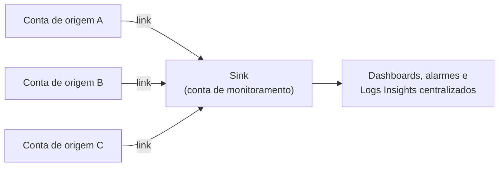

---
aliases:
  - Aula 21.1
modulo: 21
aula: 1
parte: "VI Resiliência e operações"
dominios:
  - 2
  - 3
lida: false
tags:
  - aula
  - saa-c03
  - modulo-21
---

# Aula 21.1: Observabilidade e métricas do CloudWatch

[[21 - Observabilidade Automacao e Operacoes|Voltar ao módulo]]

> [!question] Pergunta que esta aula responde
> Por que uma arquitetura resiliente precisa enxergar a si mesma, o que são métricas, logs e traces, e como funciona por dentro o modelo de métricas do [[CloudWatch]] (namespace, dimensão, resolução, retenção) que alimenta alarmes, [[Auto Scaling Group|Auto Scaling]] e dashboards?

## O problema: você não corrige o que não vê

O [[20 - Alta Disponibilidade e Recuperacao de Desastres|Módulo 20]] terminou com uma frase importante: a meta de [[Alta Disponibilidade]] só vale se existir **visibilidade** para saber quando ela está sendo violada. Um sistema distribuído falha de formas parciais: uma [[Zona de Disponibilidade|AZ]] lenta, uma fila que cresce, um deploy que dobrou a [[Latencia|latência]] do p99. Sem dados, a primeira notícia vem do cliente.

**[[Observabilidade]]** é a capacidade de entender o estado interno de um sistema a partir do que ele emite para fora. Ela se apoia em três tipos de sinal:

| Sinal | O que responde | Exemplo | Serviço AWS principal |
|---|---|---|---|
| **Métricas** | "Quanto? Com que frequência?" (números ao longo do tempo) | CPU em 87%, 1.200 requisições por minuto | [[CloudWatch]] (métricas) |
| **Logs** | "O que aconteceu exatamente?" (eventos textuais) | `ERROR timeout ao chamar pagamento` | [[CloudWatch Logs]] |
| **Traces** | "Por onde a requisição passou e onde demorou?" | API > Lambda > [[DynamoDB]], 40 ms no total | [[X-Ray]] |

Monitorar é olhar painéis que você já previu; observar é conseguir responder perguntas que você não previu. A ordem prática de uso: a **[[Metrica|métrica]]** avisa que algo está errado (alarme), o **[[Trace|trace]]** localiza em qual componente, o **log** mostra a causa. Esta aula cobre métricas; logs ficam na [[21.03 - CloudWatch Logs e o Agente|aula 21.3]] e traces na [[21.04 - X-Ray Prometheus Grafana e Monitoramento de Aplicacao|aula 21.4]].

> [!info] Ligando os pontos
> Você já usa [[CloudWatch]] em produção, mas provavelmente como "o lugar onde caem os logs do [[ECS]]". Aqui o foco é o modelo de métricas, porque é ele que o [[EC2 Auto Scaling]] consome (Módulo 12), que o [[RDS Proxy]] e o [[Aurora]] expõem (Módulo 13) e que decide com que rapidez você percebe uma falha, e portanto quanto tempo o seu plano de DR leva para começar.

## O modelo de métricas por dentro

Uma **[[Metrica|métrica]]** é um conjunto de pontos de dados ordenados no tempo, publicados no [[CloudWatch]]. Cada ponto tem timestamp, valor e (opcionalmente) unidade. Cinco conceitos compõem o modelo.

### Namespace

O **namespace** é o [[Container|contêiner]] da [[Metrica|métrica]]. Métricas de [[Namespaces e Cgroups|namespaces]] diferentes ficam isoladas, para que estatísticas de aplicações diferentes não se misturem. Não existe namespace padrão: você informa um a cada ponto publicado. Os serviços AWS usam `AWS/serviço` (por exemplo, `AWS/EC2`, `AWS/ApplicationELB`). Os seus ficam em nomes livres (até 255 caracteres), como `MeuApp/Pagamentos`.

### Dimensão

Uma **dimensão** é um par nome/valor que faz parte da identidade da [[Metrica|métrica]]. A métrica `CPUUtilization` do namespace `AWS/EC2` com a dimensão `InstanceId=i-0abc` é **outra métrica** em relação à mesma com `InstanceId=i-0def`. Uma métrica pode ter até 30 dimensões.

Duas regras que a prova e a prática exploram:

1. Cada combinação única de dimensões é uma [[Metrica|métrica]] separada, e você só consegue consultar combinações que foram publicadas. Se publicou `Server=Prod,Domain=Rio`, não consulta só `Server=Prod`.
2. Para métricas **da AWS** (como [[EC2]]), o [[CloudWatch]] agrega entre dimensões quando você não especifica nenhuma (é assim que se vê a CPU média de todas as instâncias de um [[Auto Scaling Group]] com a dimensão `AutoScalingGroupName`). Para **métricas customizadas**, o CloudWatch **não** agrega entre dimensões: se você quer o total e o detalhe, publique as duas combinações.

> [!example] Dimensão e custo
> Uma API publica a [[Metrica|métrica]] `Latencia` com as dimensões `Rota` e `UserId`. Com 50 mil usuários, cada valor novo de `UserId` cria uma métrica nova (50 mil séries, cada uma cobrada como métrica customizada). O erro é usar um identificador de alta cardinalidade como dimensão. Dimensão serve para categorias (rota, ambiente, versão), não para IDs de usuário; para isso existem logs e traces.

### Resolução e período

- **Resolução padrão** (standard): um ponto por minuto. As métricas publicadas pelos serviços AWS são padrão.
- **[[High-Resolution Metric|Alta resolução]]** (high resolution): um ponto por **segundo**, só para métricas customizadas que você publica com resolução de armazenamento de 1 segundo. Podem ser lidas com períodos de 1, 5, 10, 30 segundos ou múltiplos de 60.

O **período** é a janela de agregação de uma estatística, em segundos: 1, 5, 10, 30 ou qualquer múltiplo de 60. O padrão é 60. Só métricas de [[High-Resolution Metric|alta resolução]] suportam períodos menores que 60 s. Cada chamada `PutMetricData` de [[Metrica|métrica]] customizada é cobrada, então publicar com mais frequência custa mais.

### Estatísticas, percentis e unidades

Uma **estatística** é uma agregação dos pontos dentro do período: `Sum`, `Average`, `Minimum`, `Maximum`, `SampleCount` e **percentis** (p50, p90, p99...). Pontos com unidades diferentes são agregados separadamente (se duas métricas idênticas diferem só na unidade, vêm dois fluxos). O [[CloudWatch]] não dá significado à unidade; ela existe para humanos e ferramentas. Percentis só funcionam se nenhum valor da [[Metrica|métrica]] for negativo.

> [!example] Por que p99 e não média
> 100 requisições em um minuto: 95 levam 0,1 s e 5 levam 4 s. A **média** é (95 x 0,1 + 5 x 4) / 100 = 0,295 s: parece saudável. O **p99** é 4 s: 5% dos clientes esperam 4 segundos. Alarme de [[Latencia|latência]] quase sempre deve usar percentil alto (p95 ou p99) ou `Maximum`, nunca só a média.

### Retenção e agregação ao longo do tempo (verificado em novembro de 2026)

O [[CloudWatch]] guarda métricas com resolução decrescente, e os pontos publicados com período curto são agregados para o armazenamento longo:

| Período do ponto | Disponível por | Observação |
|---|---|---|
| Menos de 60 s ([[High-Resolution Metric\|alta resolução]]) | 3 horas | depois é agregado |
| 60 s (1 minuto) | 15 dias | depois só em 5 min |
| 300 s (5 minutos) | 63 dias | depois só em 1 hora |
| 3.600 s (1 hora) | 455 dias (15 meses) | limite final |

Métricas **não podem ser apagadas**: expiram sozinhas 15 meses depois do último ponto. Métricas sem dados nas últimas duas semanas somem do console e do `list-metrics`, mas `get-metric-data` ainda as recupera. Métricas **existem só na Região** onde foram criadas (o [[CloudWatch]] é regional; dashboards é que podem juntar [[Regiao AWS|Regiões]]).

O timestamp de um ponto pode estar até **2 semanas no passado** e **2 horas no futuro**. Alarmes avaliam pelo horário UTC atual, então pontos customizados com timestamp fora do "agora" podem deixar o alarme em `INSUFFICIENT_DATA` ou atrasado.

## O que a AWS publica sozinha e o que ela não vê

A maioria dos serviços publica métricas **gratuitas** por padrão (monitoramento básico), sem você fazer nada. O **[[Detailed Monitoring|monitoramento detalhado]]** (detailed monitoring) é opcional, pago e existe só em alguns serviços, com nomes diferentes:

| Serviço | Básico | Detalhado (nome no serviço) |
|---|---|---|
| [[EC2]] | a cada 5 minutos | **[[Detailed Monitoring\|detailed monitoring]]**: a cada 1 minuto |
| [[S3]] | métricas diárias de armazenamento | **request metrics**: a cada 1 minuto (por [[Bucket\|bucket]] ou prefixo) |
| [[Elastic Beanstalk]] | métricas básicas | **enhanced health reporting** |
| [[API Gateway]], [[CloudFront]], [[AppSync]], [[MSK]] | métricas padrão | métricas adicionais ou por estágio/broker |

Regra de ouro para a prova: **[[EC2]] publica CPU, rede e disco (I/O de bloco), mas não enxerga dentro do sistema operacional.** Memória usada, espaço em disco usado e contagem de processos **não** são métricas padrão do EC2, porque o [[Hypervisor|hipervisor]] (o [[Nitro]]) não enxerga o que o sistema operacional guarda na [[RAM]]. Para ter essas métricas, instale o **[[CloudWatch Agent|agente do CloudWatch]]** (aula 21.3), que as publica no namespace `CWAgent` como métricas customizadas.

### Detailed monitoring em Auto Scaling

Pegadinha clássica: um [[Auto Scaling Group]] que escala por CPU só reage tão rápido quanto a [[Metrica|métrica]] chega. Com monitoramento básico, o `CPUUtilization` das instâncias chega a cada 5 minutos, e a [[Scaling Policy|política de escala]] enxerga a carga com atraso. A configuração vive no **launch template** (ou na [[Launch Configuration|launch configuration]], o modelo antigo): no console e na AWS CLI, o padrão do launch template é monitoramento **básico**, e a AWS recomenda o detalhado (1 minuto) sempre que houver scaling policy. Além das métricas das instâncias (`AWS/EC2`), o grupo publica métricas próprias no namespace `AWS/AutoScaling` (como `GroupDesiredCapacity`), que só existem se você habilitar as métricas de grupo (`GroupMetrics`), com granularidade de 1 minuto (verificado em novembro de 2026).

> [!tip] Macete de prova
> "A empresa quer alarme de uso de **memória** em [[EC2|instâncias EC2]]." Resposta: [[CloudWatch Agent|agente do CloudWatch]] publicando `mem_used_percent` + alarme sobre essa [[Metrica|métrica]]. Se uma alternativa diz "habilitar [[Detailed Monitoring|detailed monitoring]]", ela erra: detailed monitoring só encurta o intervalo das métricas que já existem (de 5 para 1 minuto).

### Métricas customizadas

Quando a AWS não tem a [[Metrica|métrica]], você publica a sua com a API `PutMetricData` (SDK, CLI) ou com o **[[Embedded Metric Format]] (EMF)**: você escreve um log em formato JSON especial e o [[CloudWatch]] extrai métricas dele automaticamente, sem chamar `PutMetricData`. Alarmes de [[High-Resolution Metric|alta resolução]] usam períodos de 10, 20 ou 30 segundos e são avaliados a cada 10 segundos (a prova costuma citar 10 ou 30). Exemplos: pedidos concluídos por minuto, tamanho da fila de um sistema próprio, tempo de checkout.

> [!example] Métrica de negócio
> O time de checkout publica `PedidosConcluidos` (unidade `Count`, dimensão `Ambiente=prod`) a cada pedido. Um alarme "menos de 10 pedidos em 5 minutos, em horário comercial" detecta uma falha que nenhuma [[Metrica|métrica]] de CPU mostraria: o servidor está saudável e a venda parou. Isso é "identificar métricas com base em requisitos de negócio para [[Alta Disponibilidade|HA]]", o ponto de Task 2.2 que fecha o Módulo 20.

## Metric math, anomaly detection e consultas

- **[[Metric Math|Metric math]]**: expressões sobre métricas, como `m1 / m2 * 100` (taxa de erro = erros / requisições), somas e percentuais. Pode alimentar gráficos e alarmes. A função `SERVICE_QUOTA` compara o uso com a [[Service Quotas|quota]] do serviço (útil para alarmar antes de bater no limite), e `ANOMALY_DETECTION_BAND` devolve a faixa esperada de uma [[Metrica|métrica]].
- **[[CloudWatch Metric Streams|Metric Streams]]**: o [[CloudWatch]] Metric Streams entrega as métricas quase em tempo real ao [[Data Firehose]], e dali para [[S3]], [[Redshift]] ou parceiros como Datadog. É o contraponto, para métricas, do [[Subscription Filter|subscription filter]] dos logs (aula 21.3): o gatilho de questão é "enviar [[Metrica|métricas do CloudWatch]] a um [[Data Lake|data lake]] ou ferramenta externa quase em tempo real".
- **[[Anomaly Detection|Anomaly detection]]**: o [[CloudWatch]] treina um modelo estatístico e de machine learning que aprende a faixa normal da [[Metrica|métrica]], considerando sazonalidade horária, diária e semanal. O alarme dispara quando o valor sai da faixa (acima, abaixo ou ambos), sem threshold fixo. Serve para métricas cujo "normal" muda com a hora do dia (tráfego de e-commerce).
- **Metrics Insights**: linguagem de consulta parecida com SQL para consultar e agrupar métricas em grande escala (inclusive por tags de recurso, quando habilitado no console).

## Dashboards e observabilidade entre contas e Regiões

Um **dashboard** do [[CloudWatch]] reúne gráficos, números e alarmes em uma tela e pode misturar recursos de **várias [[Regiao AWS|Regiões]]** (a prova diz "single pane of glass"). Também serve como "playbook operacional": o dashboard de incidente com os gráficos certos poupa tempo às 3 da manhã.

Para várias **contas** (o cenário do [[05 - Multiconta Governanca e Federacao|Módulo 5]], com [[Organizations]]), o recurso é a **[[Cross-Account Observability|observabilidade entre contas]]** (cross-account observability):

- **Conta de monitoramento** (monitoring account): enxerga os dados.
- **Contas de origem** (source accounts): geram os dados e os compartilham (métricas, log groups, traces do [[X-Ray]], entre outros).
- O ponto de ligação é um **sink** na conta de monitoramento (um por Região por conta); cada **link** é criado pela conta de origem. Dá para ligar por Organizations (OU inteira) ou conta a conta.
- Com isso, um gráfico mostra métricas de contas diferentes, um alarme na conta central vigia métricas das contas de origem, e uma consulta do [[CloudWatch Logs Insights|Logs Insights]] varre log groups de várias contas.

> [!info] Ligando os pontos
> Criar a conta de monitoramento separada segue o princípio de multiconta do Módulo 5: se a conta de produção for comprometida, o histórico de monitoramento continua fora do alcance. É o mesmo raciocínio de enviar o [[CloudTrail]] para uma conta de log.

## Métricas que alimentam outros serviços

| Consumidor | Métrica típica | Para quê |
|---|---|---|
| [[Scaling Policy|Scaling policy]] de [[Target Tracking\|target tracking]] (Módulo 12) | `CPUUtilization`, `RequestCountPerTarget` | manter o alvo ajustando a capacidade |
| [[Step Scaling\|Step scaling]] / alarme | `ApproximateNumberOfMessagesVisible` do [[SQS]] | escalar consumidores pelo backlog da fila |
| [[Health Check\|Health check]] do [[Route 53]] baseado em alarme (Módulo 18) | qualquer alarme | [[Failover\|failover]] guiado por [[Metrica\|métrica]] |
| Rollback do [[CloudFormation]] (aula 21.6) | alarme de erro | desfazer deploy ruim |

## Como isso cai na prova

> [!info] Task statement 2.2
> Task 2.2 (arquiteturas altamente disponíveis e/ou tolerantes a falhas): "identificar métricas com base em requisitos de negócio para [[Alta Disponibilidade|alta disponibilidade]]" e "visibilidade da carga de trabalho". A parte de escalar por [[Metrica|métrica]] ([[Detailed Monitoring|detailed monitoring]] no [[Auto Scaling Group|ASG]]) toca Task 3.2 (computação elástica), e as métricas de custo e uso alimentam Tasks 4.1 e 4.2 só de forma indireta.

**Palavras-chave em inglês:** *monitor memory utilization*, *custom metric*, *[[Detailed Monitoring|detailed monitoring]]*, *one-minute granularity*, *high-resolution*, *publish application metrics*, *single dashboard across [[Regiao AWS|Regions]]*, *multiple accounts*, *95th percentile*, *anomaly*.

**Pegadinhas clássicas:**

- **Memória e disco do [[EC2]] não vêm por padrão.** A resposta é o [[CloudWatch Agent|agente do CloudWatch]], não "[[Detailed Monitoring|detailed monitoring]]".
- **[[Detailed Monitoring|Detailed monitoring]]** encurta o intervalo (5 min para 1 min); não adiciona métricas novas.
- **Métricas são regionais.** "Ver tudo numa tela" é dashboard (várias [[Regiao AWS|Regiões]]) ou [[Cross-Account Observability|observabilidade entre contas]].
- **Média esconde cauda.** [[Latencia|Latência]] pede percentil.
- **Métrica customizada com alta cardinalidade** explode o custo.

| Requisito no enunciado | Resposta provável | Por quê |
|---|---|---|
| Alarme de uso de memória em [[EC2]] | Agente do [[CloudWatch]] + [[Metrica\|métrica]] customizada `mem_used_percent` | O [[Hypervisor\|hipervisor]] não vê a [[RAM]] do sistema operacional |
| Granularidade de 1 minuto nas métricas padrão do [[EC2]] | Habilitar [[Detailed Monitoring\|detailed monitoring]] | O padrão é 5 minutos |
| [[Auto Scaling Group\|ASG]] escalando por CPU e precisando reagir rápido | [[Detailed Monitoring\|Detailed monitoring]] no launch template ([[EC2]] em 1 min) e, se preciso, métricas de grupo em 1 min | O padrão do launch template é 5 minutos |
| Enviar [[Metrica\|métricas do CloudWatch]] quase em tempo real a [[S3]], [[Redshift]] ou ferramenta externa | [[CloudWatch Metric Streams]] com [[Data Firehose]] | O equivalente em métricas do [[Subscription Filter\|subscription filter]] |
| Resolução sub-minuto de [[Metrica\|métrica]] da aplicação | Métrica customizada de [[High-Resolution Metric\|alta resolução]] | Só custom metrics chegam a 1 segundo |
| Visão única de várias [[Conta AWS\|contas AWS]] com o mínimo de esforço | [[Cross-Account Observability\|Observabilidade entre contas]] do [[CloudWatch]] (sink e links) | Centraliza métricas, logs e traces sem copiar dados |
| Detectar comportamento anormal sem definir limite fixo | [[Anomaly Detection\|Anomaly detection]] | Modelo aprende sazonalidade |
| Taxa de erro como porcentagem | [[Metric Math\|Metric math]] (`erros / requisições x 100`) | Cálculo entre duas métricas, sem código |

## Resumo

> [!abstract] A aula em uma frase
> [[Observabilidade]] se constrói com métricas, logs e traces; no [[CloudWatch]], uma [[Metrica|métrica]] é identificada por namespace + nome + dimensões, tem resolução e retenção decrescentes, e o [[EC2]] só publica o que o [[Hypervisor|hipervisor]] enxerga, então memória e disco exigem o agente.

**A lógica, em 5 passos**

1. Sistemas distribuídos falham parcialmente, então é preciso medir continuamente ([[Metrica|métrica]]), localizar ([[Trace|trace]]) e explicar (log).
2. O [[CloudWatch]] identifica cada [[Metrica|métrica]] por namespace, nome e conjunto exato de dimensões; combinações diferentes são métricas diferentes.
3. Os serviços AWS publicam métricas básicas de graça; [[Detailed Monitoring|detailed monitoring]] só aumenta a frequência, e o [[EC2]] não vê a memória do sistema operacional.
4. O que a AWS não mede você publica (`PutMetricData` ou [[Embedded Metric Format|EMF]]), inclusive métricas de negócio.
5. Métricas alimentam alarmes, [[Auto Scaling Group|Auto Scaling]], [[Health Check|health checks]] e dashboards (inclusive entre contas e [[Regiao AWS|Regiões]]).

**Números para lembrar** (verificado em novembro de 2026)

| O quê | Valor | Por que importa |
|---|---|---|
| [[EC2]] básico / detalhado | 5 min / 1 min | Frequência padrão e paga |
| Retenção 1 min / 5 min / 1 h | 15 dias / 63 dias / 455 dias | Resolução cai com o tempo |
| [[High-Resolution Metric\|Alta resolução]] | 1 segundo, guardada 3 horas | Só custom metrics |
| Dimensões por [[Metrica\|métrica]] | até 30 | Cada combinação é uma métrica |
| Timestamp aceito | até 2 semanas atrás, 2 h à frente | Alarme depende de "agora" em UTC |

**Na prática, isso significa**

- Instale o [[CloudWatch Agent|agente do CloudWatch]] em toda frota [[EC2]] em que memória ou disco importem.
- Use percentis (p95, p99) para [[Latencia|latência]], não a média.
- Evite IDs de alta cardinalidade como dimensão.
- Centralize em uma conta de monitoramento quando houver várias contas.

> [!tip] Liga com
> Vem do [[20 - Alta Disponibilidade e Recuperacao de Desastres|Módulo 20]] (métricas de negócio para [[Alta Disponibilidade|HA]]). Prepara a [[21.02 - Alarmes do CloudWatch e Acoes Automaticas|aula 21.2]], em que métricas viram alarmes e ações.

## Erros comuns

- **"[[Detailed Monitoring|Detailed monitoring]] me dá memória."** Não dá: encurta o intervalo das métricas existentes. Memória exige o agente.
- **"Métricas ficam para sempre."** Elas expiram 15 meses depois do último ponto e perdem resolução (1 min só por 15 dias).
- **"Uma [[Metrica|métrica]] customizada agrega sozinha por dimensão."** Para custom metrics não há agregação entre dimensões; publique cada combinação que quiser consultar.
- **"Dashboard é por Região."** Um dashboard pode misturar [[Regiao AWS|Regiões]]; as métricas é que são regionais.
- **"Média de [[Latencia|latência]] basta."** A média esconde a cauda; use p99.

## Pratique

**1.** Uma empresa executa uma aplicação Java em [[EC2]] e quer ser alertada quando o uso de memória passar de 85%. A equipe verificou o console e não encontrou [[Metrica|métrica]] de memória para as instâncias. O que resolve com o MENOR esforço?

- [ ] a) Habilitar detailed monitoring nas instâncias, que passa a publicar a memória a cada minuto
- [ ] b) Instalar o agente do CloudWatch publicando `mem_used_percent` e alarmar sobre essa métrica
- [ ] c) Criar um metric filter no CloudWatch Logs sobre o log do sistema para extrair a memória usada
- [ ] d) Registrar a memória como item de configuração no AWS Config e alarmar pela regra de conformidade

**2.** Um [[Auto Scaling Group]] escala quando a CPU média passa de 70%. Os picos duram cerca de 2 minutos e só são percebidos depois de 5 a 10 minutos, porque a [[Metrica|métrica]] de CPU chega a cada 5 minutos. A equipe quer que a política reaja em menos de 2 minutos. O que deve fazer?

- [ ] a) Reduzir o cooldown da scaling policy para zero e manter o monitoramento básico das instâncias
- [ ] b) Trocar a métrica por `NetworkIn`, que o EC2 já publica em 1 minuto no monitoramento básico
- [ ] c) Habilitar o detailed monitoring no launch template para o EC2 publicar a cada 1 minuto
- [ ] d) Criar um alarme de alta resolução sobre `CPUUtilization` com período de 10 segundos

**3.** Uma aplicação precisa publicar uma [[Metrica|métrica]] customizada a cada segundo e disparar um alarme em até 30 segundos quando o valor ultrapassar um limite. Qual configuração atende?

- [ ] a) Métrica de resolução padrão publicada a cada segundo, com alarme de período de 1 minuto
- [ ] b) Detailed monitoring do EC2, que habilita períodos de 10 segundos para métricas da aplicação
- [ ] c) Métrica padrão com `PutMetricData` a cada segundo, que o CloudWatch converte em alta resolução
- [ ] d) Métrica de alta resolução (armazenamento de 1 segundo) com alarme de alta resolução de 10 ou 30 segundos

**4.** Um time publica a [[Metrica|métrica]] `Latencia` com as dimensões `Rota=/pedido` e `Ambiente=prod`. Depois tenta consultar a métrica filtrando apenas por `Rota=/pedido` e não encontra dados. Qual a explicação?

- [ ] a) Cada combinação de dimensões é uma métrica distinta, e só a combinação exata publicada pode ser consultada
- [ ] b) A dimensão `Rota` só pode ser consultada isoladamente se a métrica estiver no namespace `AWS/ApplicationELB`
- [ ] c) O CloudWatch agrega métricas customizadas por dimensão somente depois de 15 dias de retenção
- [ ] d) Métricas customizadas aceitam uma única dimensão, e a segunda foi descartada na publicação

**5.** (Escolha DUAS.) Quais afirmações sobre [[Metrica|métricas do CloudWatch]] estão corretas?

- [ ] a) Métricas existem apenas na Região em que foram criadas
- [ ] b) Métricas podem ser apagadas manualmente a qualquer momento pelo console
- [ ] c) Pontos de 1 minuto ficam disponíveis com essa resolução por 15 dias
- [ ] d) Pontos de alta resolução ficam disponíveis por 15 meses
- [ ] e) Métricas dos serviços AWS são sempre publicadas com resolução de 1 segundo

**6.** Uma API tem média de [[Latencia|latência]] de 300 ms, mas clientes reclamam de lentidão ocasional. 5% das requisições levam cerca de 4 segundos. Qual estatística melhor revela o problema para um alarme?

- [ ] a) `Average` da latência com período de 1 hora, para suavizar a variação
- [ ] b) `Minimum` da latência com período de 1 minuto, para achar o melhor caso
- [ ] c) Percentil p99 da latência com período de 1 minuto
- [ ] d) `SampleCount` da latência com período de 5 minutos, para medir o volume

**7.** Uma empresa com 40 contas em uma organização quer um único lugar onde a equipe de operações veja métricas, logs e traces de todas as contas, sem copiar dados para um repositório próprio. Qual solução tem o MENOR [[Overhead Operacional|overhead operacional]]?

- [ ] a) Habilitar a observabilidade entre contas do CloudWatch, com uma conta de monitoramento (sink) e links por Organizations
- [ ] b) Criar um dashboard em cada conta e compartilhar as URLs com a equipe de operações
- [ ] c) Configurar assinaturas de log em cada conta enviando para um stream central do Kinesis Data Streams
- [ ] d) Exportar as métricas de cada conta para um bucket S3 central e consultar com o Athena

**8.** Um alarme precisa avisar quando o uso de uma quota de serviço passar de 80%, antes de haver falha de provisionamento. Qual recurso do [[CloudWatch]] ajuda diretamente?

- [ ] a) Anomaly detection sobre a métrica `CPUUtilization` do serviço que consome a quota
- [ ] b) O Embedded Metric Format em um log do Lambda, trazendo o valor da quota junto do uso
- [ ] c) O monitoramento detalhado do serviço consumidor, publicando o limite a cada minuto
- [ ] d) A função de metric math `SERVICE_QUOTA`, que compara o uso com a quota no cálculo do alarme

**9.** Uma loja online tem tráfego que varia muito por hora e por dia da semana, e limites fixos geram falsos alarmes. Qual abordagem reduz o ajuste manual?

- [ ] a) Alarme estático com limite igual ao pico da semana anterior, revisado todo mês
- [ ] b) Anomaly detection, que aprende a faixa esperada considerando a sazonalidade
- [ ] c) Alarme com período de 24 horas para absorver as variações do dia a dia
- [ ] d) Função Lambda que desabilita o alarme fora do horário comercial e o religa de manhã

**10.** (Escolha DUAS.) Quais práticas ajudam a controlar o custo e a qualidade de métricas customizadas?

- [ ] a) Usar o ID de cada usuário como dimensão para ter detalhe máximo
- [ ] b) Usar dimensões de baixa cardinalidade, como rota, ambiente e versão
- [ ] c) Publicar métricas de alta resolução apenas onde o requisito de tempo justifica
- [ ] d) Publicar todas as métricas a cada segundo por padrão
- [ ] e) Criar uma nova métrica com nome diferente a cada deploy

> [!success]- Gabarito
> **1. b)** O [[Hypervisor|hipervisor]] não enxerga a [[RAM]] do sistema operacional, então só o agente publica `mem_used_percent`. (a) [[Detailed Monitoring|detailed monitoring]] só encurta o intervalo das métricas existentes; (c) o log do sistema não traz o uso de memória para o filtro extrair; (d) o Config registra configuração, não uso.
> **2. c)** O padrão do launch template é monitoramento básico (5 minutos); o [[Detailed Monitoring|detailed monitoring]] leva o [[EC2]] a 1 minuto e é o recomendado quando há [[Scaling Policy|scaling policy]]. (a) o [[Cooldown|cooldown]] não acelera a chegada da [[Metrica|métrica]]; (b) `NetworkIn` não é o requisito e muda a lógica da política; (d) métricas do EC2 são de resolução padrão, não existe período de 10 s para elas.
> **3. d)** Só [[High-Resolution Metric|métrica de alta resolução]] chega a 1 segundo, e só nela se cria alarme de 10 ou 30 segundos. (a) usa período de 1 minuto; (b) [[Detailed Monitoring|detailed monitoring]] é do [[EC2]] e não vale para a [[Metrica|métrica]] da aplicação; (c) a resolução é escolhida na publicação, não convertida depois.
> **4. a)** `Rota=/pedido` sozinha é outra combinação, não publicada, e métricas customizadas não agregam entre dimensões. (b) dimensão não é restrita a um namespace; (c) não existe agregação automática após 15 dias; (d) o limite é 30 dimensões por [[Metrica|métrica]].
> **5. a), c)** Métricas são regionais e pontos de 1 minuto ficam 15 dias nessa resolução. (b) métricas não podem ser apagadas (expiram em 15 meses); (d) [[High-Resolution Metric|alta resolução]] fica 3 horas; (e) serviços AWS publicam em resolução padrão.
> **6. c)** O p99 captura os 5% lentos (cerca de 4 s). (a) a média de 1 hora dilui a cauda; (b) o mínimo mostra o melhor caso; (d) SampleCount só conta pontos.
> **7. a)** A [[Cross-Account Observability|observabilidade entre contas]] centraliza métricas, logs e traces com sink e links por Organizations, sem copiar dados. (b) dashboards por conta não centralizam; (c) e (d) exigem pipelines próprios e cobrem só um tipo de dado.
> **8. d)** `SERVICE_QUOTA` em [[Metric Math|metric math]] traz a quota para o cálculo do alarme. (a) [[Anomaly Detection|anomaly detection]] de CPU não conhece quotas; (b) [[Embedded Metric Format|EMF]] publica métricas a partir de logs, não conhece quotas; (c) [[Detailed Monitoring|detailed monitoring]] não relaciona uso e quota.
> **9. b)** [[Anomaly Detection|Anomaly detection]] aprende sazonalidade horária, diária e semanal e dispensa limite fixo. (a) um limite no pico nunca alarma fora do pico e exige revisão manual; (c) período de 24 h atrasa a detecção; (d) a Lambda de desligamento é manutenção manual e perde incidentes.
> **10. b), c)** Baixa cardinalidade evita explosão de séries e [[High-Resolution Metric|alta resolução]] só quando necessária economiza. (a) ID de usuário cria milhares de métricas cobradas; (d) publicar tudo por segundo aumenta o custo sem benefício; (e) renomear a cada deploy quebra o histórico e multiplica métricas.

### Laboratório (opcional)

> [!warning] Use uma conta AWS pessoal
> Faça este laboratório em uma **[[Conta AWS|conta AWS]] pessoal separada**, com [[Budgets|AWS Budgets]] configurado, **nunca na conta de produção da empresa**. Métricas customizadas são cobradas por série; o custo deste laboratório tende a centavos (não confirmado: consulte a página de preço do [[CloudWatch]]).

Objetivo: publicar uma [[Metrica|métrica]] customizada, ver as dimensões e criar um dashboard.

1. Publique um ponto: `aws cloudwatch put-metric-data --namespace "Lab/Pedidos" --metric-name PedidosConcluidos --dimensions Ambiente=lab --value 5 --unit Count`.
2. Repita com valores diferentes algumas vezes, com intervalo de um minuto.
3. Liste: `aws cloudwatch list-metrics --namespace "Lab/Pedidos"` (a [[Metrica|métrica]] pode levar alguns minutos para aparecer).
4. Consulte a soma: `aws cloudwatch get-metric-statistics --namespace "Lab/Pedidos" --metric-name PedidosConcluidos --dimensions Name=Ambiente,Value=lab --start-time <ISO8601 de 1 hora atrás> --end-time <ISO8601 agora> --period 60 --statistics Sum`.
5. Tente consultar sem a dimensão e observe que não há dados (não há agregação entre dimensões em métricas customizadas).
6. No console do [[CloudWatch]], crie um dashboard com um gráfico dessa [[Metrica|métrica]] (o caminho exato dos menus pode mudar; procure por Dashboards).

Limpeza: apague o dashboard com `aws cloudwatch delete-dashboards --dashboard-names <nome>`. A [[Metrica|métrica]] expira sozinha e não gera cobrança sem novos pontos.

## Para aprofundar

- [ ] [Metrics concepts (CloudWatch)](https://docs.aws.amazon.com/AmazonCloudWatch/latest/monitoring/cloudwatch_concepts.html) (AWS Docs): [[Namespaces e Cgroups|namespaces]], dimensões, resolução, retenção e timestamps, a fonte dos números desta aula.
- [ ] [Basic monitoring and detailed monitoring in CloudWatch](https://docs.aws.amazon.com/AmazonCloudWatch/latest/monitoring/cloudwatch-metrics-basic-detailed.html) (AWS Docs): quais serviços oferecem [[Detailed Monitoring|monitoramento detalhado]] e como cada um o chama.
- [ ] [CloudWatch cross-account observability](https://docs.aws.amazon.com/AmazonCloudWatch/latest/monitoring/CloudWatch-Unified-Cross-Account.html) (AWS Docs): conta de monitoramento, contas de origem, sink e link.

Próxima aula: [[21.02 - Alarmes do CloudWatch e Acoes Automaticas|Aula 21.2: Alarmes do CloudWatch e ações automáticas]].
