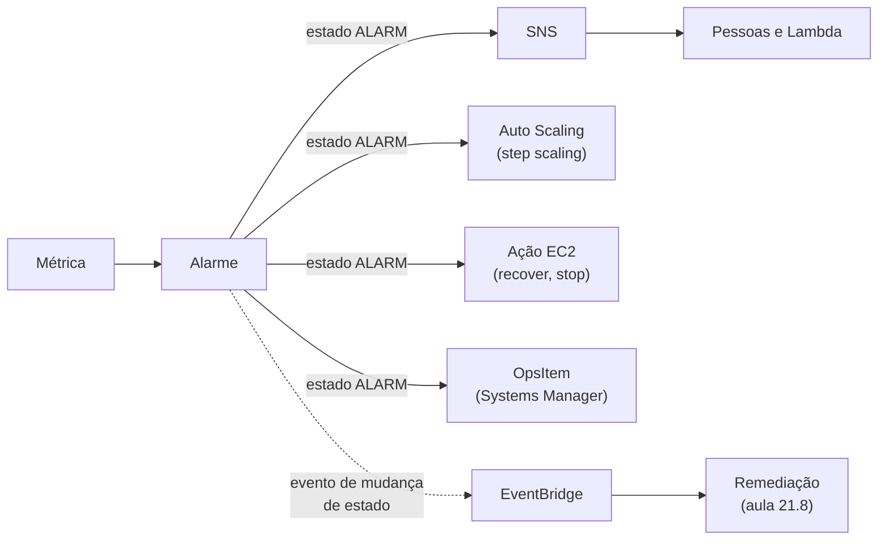

---
aliases:
  - Aula 21.2
modulo: 21
aula: 2
parte: "VI Resiliência e operações"
dominios:
  - 2
  - 3
lida: false
tags:
  - aula
  - saa-c03
  - modulo-21
---

# Aula 21.2: Alarmes do CloudWatch e ações automáticas

[[21 - Observabilidade Automacao e Operacoes|Voltar ao módulo]]

> [!question] Pergunta que esta aula responde
> Como um [[CloudWatch Alarm|alarme do CloudWatch]] decide mudar de estado (período, períodos de avaliação, datapoints), o que ele pode fazer sozinho ([[SNS]], [[EC2]], [[Auto Scaling Group|Auto Scaling]], [[Systems Manager]]), como tratar dado ausente e como o [[Composite Alarm|alarme composto]] reduz ruído?

## O problema: métrica sem ação não protege ninguém

A [[21.01 - Observabilidade e Metricas do CloudWatch|aula 21.1]] mostrou como medir. Uma [[Metrica|métrica]] sozinha exige alguém olhando o gráfico. O **alarme** transforma a métrica em decisão: "se isto acontecer por tanto tempo, faça aquilo". Esse "aquilo" pode ser acordar uma pessoa (notificação) ou corrigir sem humano (reiniciar, escalar, criar um item de trabalho). É o ponto em que [[Observabilidade|observabilidade]] vira [[Alta Disponibilidade]] automática.

## Como o alarme avalia: três números

Um alarme de [[Metrica|métrica]] observa uma métrica (ou o resultado de uma expressão de [[Metric Math|metric math]]) e compara com um limite (threshold). Três configurações controlam quando ele muda de estado:

- **Period**: tamanho, em segundos, de cada ponto avaliado (cada ponto é a estatística do período).
- **Evaluation Periods (N)**: quantos dos últimos pontos são olhados.
- **Datapoints to Alarm (M)**: quantos desses N pontos precisam violar o limite para o alarme ir a `ALARM`. Não precisam ser consecutivos, mas precisam estar dentro dos N mais recentes.

Quando M é diferente de N, o alarme é do tipo **"M de N"**. Isso evita alarmar por um pico isolado sem esperar uma janela longa demais.

> [!example] Três exemplos de M de N
> - **1 de 1**, período de 1 minuto: alarma no primeiro ponto ruim. Rápido e barulhento (picos viram página).
> - **3 de 3**, período de 5 minutos: só alarma se os últimos 15 minutos forem todos ruins. Silencioso e lento.
> - **3 de 5**, período de 1 minuto: alarma se 3 dos últimos 5 minutos forem ruins, mesmo intercalados. Bom equilíbrio para tráfego oscilante.
>
> A janela de avaliação é N x período: 3 de 5 com período de 1 minuto avalia 5 minutos.

Detalhes de avaliação (verificado em novembro de 2026):

- Para período de 1 minuto ou mais, o alarme é **avaliado a cada minuto**, sobre uma janela deslizante.
- Para alarmes de [[High-Resolution Metric|alta resolução]] (períodos de 10, 20 ou 30 segundos; a prova costuma citar 10 ou 30), a avaliação ocorre a cada 10 segundos e o preço é maior.
- Se N x período passa de **1 dia**, o alarme é avaliado **uma vez por hora** (alarme "multidia").

### Os estados

| Estado | Significado |
|---|---|
| `OK` | A [[Metrica\|métrica]] está dentro do limite |
| `ALARM` | A [[Metrica\|métrica]] violou o limite |
| `INSUFFICIENT_DATA` | O alarme acabou de começar, ou a [[Metrica\|métrica]] não existe, ou faltam dados para decidir |

Além do estado, há o **estado de avaliação** (por exemplo `PARTIAL_DATA`, `IN_WARM_UP`, `EVALUATION_ERROR`), que explica problemas do processo de avaliação, não do seu sistema.

### Dado ausente (missing data)

Nem todo ponto esperado chega: uma conexão cai, um servidor para, uma [[Metrica|métrica]] só é emitida quando há erro. Você escolhe como tratar pontos ausentes:

| Opção | Efeito |
|---|---|
| `missing` (padrão) | Se **todos** os pontos da janela faltam, o alarme vai a `INSUFFICIENT_DATA` |
| `notBreaching` | Ausente conta como "bom" (dentro do limite) |
| `breaching` | Ausente conta como "ruim" (violando o limite) |
| `ignore` | Mantém o estado atual |

A escolha depende da [[Metrica|métrica]]:

- Métrica que **sempre** reporta (batimentos de um serviço): ausência é sintoma. Use `breaching`.
- Métrica que **só aparece quando há problema** (por exemplo, requisições limitadas do [[DynamoDB]]): ausência é boa notícia. Use `notBreaching`. Os alarmes do namespace `AWS/DynamoDB` já usam `ignore` por padrão.
- Alarmes com ações de **stop, terminate, reboot ou recover do [[EC2]]**: a documentação recomenda `missing` e disparar a ação só em `ALARM`, porque a [[Metrica|métrica]] do EC2 pode faltar por instantes mesmo com a instância saudável.

Se existem pontos reais suficientes (pelo menos N) na faixa de avaliação, o [[CloudWatch]] usa os reais e ignora a política de dado ausente.

## O que o alarme pode fazer (ações)

Um alarme de [[Metrica|métrica]] executa ações quando muda de estado. As ações possíveis:

| Ação | Para quê | Observação |
|---|---|---|
| Notificar um tópico do [[SNS]] | Avisar pessoas e sistemas (e-mail, SMS, Lambda, [[SQS]], [[HTTP]]) | Assinatura de e-mail precisa ser **confirmada** pelo destinatário |
| Ação de **[[EC2]]** | Stop, terminate, reboot ou recover da instância | Exige a [[Service-Linked Role\|service-linked role]] `AWSServiceRoleForCloudWatchEvents` |
| Ação de **[[Auto Scaling Group\|Auto Scaling]]** | Acionar uma [[Scaling Policy|scaling policy]] de step ou simples | Única ação repetida (veja abaixo) |
| Invocar uma **[[Lambda\|função Lambda]]** | Executar código de [[Remediacao Automatica\|remediação]] direto do alarme ([[Invocacao Assincrona\|invocação assíncrona]]) | Ação nativa; dá permissão ao serviço [[CloudWatch]] na [[Resource-Based Policy\|resource policy]] da função |
| Criar **[[OpsItem]]** ou **incidente** | Abrir trabalho no Systems Manager ([[OpsCenter]]) ou no Incident Manager | Integração com [[Systems Manager]]; Incident Manager está fechado para novos clientes desde 7 de novembro de 2025 |
| Iniciar uma **investigação** | Investigação do [[CloudWatch]] | Opcional, para diagnóstico |

Um **[[OpsItem]]** é um item de trabalho do [[Systems Manager]] [[OpsCenter]] (aula 21.7), o equivalente a um ticket operacional com o contexto do recurso afetado.

> [!warning] Quando a ação roda
> O alarme invoca ações **só na mudança de estado**. A exceção são as ações de **[[Auto Scaling Group|Auto Scaling]]**, que continuam sendo invocadas uma vez por minuto enquanto o alarme permanece no novo estado. O [[CloudWatch]] **não valida** se a ação existe: se o tópico [[SNS]] foi apagado, o alarme não avisa de erro.

### Ações de EC2: stop, terminate, reboot e recover

- **Stop**: para a instância ao ver ociosidade. Exemplo da documentação: CPU média abaixo de 10% por 24 horas. Só instâncias com volume raiz **[[EBS]]** podem ser paradas; instâncias com raiz em [[Instance Store|instance store]] só podem ser terminadas.
- **Terminate**: encerra de vez (trabalhos em [[Processamento em Lote|lote]] que terminam e deixam a instância parada cobrando).
- **Reboot**: reinicia a instância quando a aplicação travou.
- **Recover**: move a instância para outro hardware quando há falha do sistema (por exemplo, `StatusCheckFailed_System`). Mantém ID, [[RFC 1918|IP privado]] e volumes; vale para qualquer [[Metrica|métrica]] por instância **exceto** `StatusCheckFailed_Instance`.
- **Terminate** não funciona em instância com **[[Termination Protection|termination protection]]** ligada: a ação falha e a instância continua rodando.

> [!info] Recuperação automática: dois mecanismos
> O [[EC2]] tem a **[[Simplified Automatic Recovery|simplified automatic recovery]]**, ligada por padrão no lançamento de instâncias suportadas: ao detectar falha do sistema (`StatusCheckFailed_System`), ele move a instância para outro host sozinho, sem alarme. A **recuperação por ação de alarme** (recover) é a forma configurável, por exemplo para reagir a outras métricas por instância. Nos dois casos a instância mantém ID, [[RFC 1918|IP privado]], IP público e [[EBS|volumes EBS]]; a [[RAM]] e (na ação de alarme) os dados do [[Instance Store|instance store]] se perdem, e para o SO parece um reboot não planejado. Nenhum dos dois resolve falha de **instância** (SO ou aplicação travada): isso é reboot ou reposição por [[Auto Scaling Group|Auto Scaling]] (verificado em novembro de 2026).

> [!example] Recuperação automática sem humano
> Uma [[EC2|instância EC2]] com um servidor de licenças (que não cabe em [[Auto Scaling Group]]) tem o alarme `StatusCheckFailed_System >= 1 por 2 de 2 períodos de 1 minuto` com ação **recover**. Se o host físico falhar, o [[CloudWatch]] recria a instância em outro host sem plantão. Para a prova: falha do **sistema** (hardware) pede recover; falha da **instância** (SO ou aplicação travada) pede reboot ou reposição por Auto Scaling.

## Alarmes compostos: menos ruído

Um **[[Composite Alarm|alarme composto]]** (composite alarm) não avalia métricas: avalia o **estado de outros alarmes**, por uma expressão de regra com `ALARM("nome")`, `OK("nome")`, `INSUFFICIENT_DATA("nome")` e operadores `AND`, `OR`, `NOT`, com parênteses.

```
(ALARM("CPUAlta") OR ALARM("LatenciaAlta")) AND OK("DeployEmAndamento")
```

Uso típico: você cria vários alarmes de [[Metrica|métrica]] (CPU, [[Latencia|latência]], taxa de erro, fila), todos **sem** notificação, e cria **um** composto que notifica só quando a combinação indica incidente real. Em vez de cinco e-mails para a mesma causa, uma notificação.

Limites que a prova adora:

- Um composto pode notificar via [[SNS]], invocar Lambda, criar [[OpsItem]], incidente ou investigação.
- Um composto **não** executa ações de **[[EC2]]** nem de **[[Auto Scaling Group|Auto Scaling]]**.
- Os alarmes referenciados podem ser de [[Metrica|métrica]] ou outros compostos.
- Alarmes entre contas existem, mas **compostos entre contas não**.

## Outros tipos de alarme

- **[[Metric Math|Metric math]]**: o alarme observa uma expressão (taxa de erro = erros / requisições x 100).
- **[[Anomaly Detection|Anomaly detection]]**: compara com a faixa esperada aprendida (aula 21.1), sem limite fixo.
- **Alarme de logs** (log alarm): avalia o resultado de uma consulta agendada do [[CloudWatch Logs Insights|Logs Insights]] (tipo novo na documentação atual); a alternativa clássica é o [[Metric Filter|filtro de métrica]] (aula 21.3).
- **Alarme [[Prometheus|PromQL]]**: avalia consulta PromQL sobre métricas ingeridas pelo endpoint OTLP do [[CloudWatch]] (recurso recente; fora do foco da prova).
- **Alarme entre contas**: o alarme de uma conta pode vigiar métricas de outra, com a [[Cross-Account Observability|observabilidade entre contas]] habilitada.

Dá para **testar** qualquer alarme com `SetAlarmState` (o estado volta na próxima avaliação), e criar o alarme **antes** da [[Metrica|métrica]] customizada existir, desde que informe todas as dimensões.

## Alarmes e o resto do mundo



- **[[EventBridge]]** recebe um evento a cada mudança de estado de alarme, o que permite regras mais ricas que as ações nativas (por exemplo, invocar uma automação do [[Systems Manager]]). Veremos na [[21.08 - Health Trusted Advisor License Manager e Remediacao Automatica|aula 21.8]].
- **[[Auto Scaling Group|Auto Scaling]]**: nas políticas de **[[Target Tracking|target tracking]]** (Módulo 12) o próprio serviço cria e gerencia os alarmes; em **[[Step Scaling|step scaling]]** você cria o alarme e liga à política.
- **[[Route 53]]**: um [[Health Check|health check]] pode ser baseado no estado de um [[CloudWatch Alarm|alarme do CloudWatch]] (Módulo 18), útil para [[Failover|failover]] guiado por [[Metrica|métrica]] de aplicação.
- **[[CloudFormation]]** (aula 21.6): **[[Rollback Trigger|rollback triggers]]** monitoram alarmes durante e depois de um deploy (monitoramento de 0 a 180 minutos) e desfazem a operação se algum for a `ALARM`.

## Como isso cai na prova

> [!info] Task statements 2.2 e 3.2
> Task 2.2: automação para recuperar e "identificar métricas para [[Alta Disponibilidade|HA]]". Task 3.2: escala elástica guiada por [[Metrica|métrica]].

**Palavras-chave em inglês:** *automatically recover*, *notify the operations team*, *reduce alarm noise*, *[[Composite Alarm|composite alarm]]*, *[[Missing Data|treat missing data]]*, *stop idle instances*, *StatusCheckFailed_System*, *scale based on a custom metric*.

**Pegadinhas clássicas:**

- **Recover vs reboot**: falha de hardware ([[Status Check|system status check]]) é `recover`; travamento do SO é `reboot`.
- **[[Composite Alarm|Composite alarm]] não escala nem para instância**: ele só notifica, cria [[OpsItem]] ou incidente.
- **Dado ausente**: [[Metrica|métrica]] que só existe quando há erro precisa de `notBreaching`; senão o alarme fica em `INSUFFICIENT_DATA`.
- **[[SNS]] por e-mail**: sem confirmar a assinatura, ninguém recebe.
- **Alarme sem ação** só muda de cor no console.
- **Terminate com [[Termination Protection|termination protection]]** falha: a proteção vence a ação do alarme.

| Requisito no enunciado | Resposta provável | Por quê |
|---|---|---|
| Recuperar instância sozinha após falha de hardware do host | Alarme em `StatusCheckFailed_System` com ação recover | Move a instância para outro hardware |
| Parar instâncias de desenvolvimento ociosas | Alarme de CPU baixa por longo período com ação stop | Economia sem automação extra |
| Uma notificação só quando CPU alta e [[Latencia\|latência]] alta ocorrem juntas | [[Composite Alarm\|Alarme composto]] | Combina estados de alarmes |
| Alarmar quando um erro aparece no log do app | [[Metric Filter\|Filtro de métrica]] + alarme | Transforma log em [[Metrica\|métrica]] |
| Reverter um deploy se a taxa de erro subir | [[Rollback Trigger\|Rollback trigger]] do [[CloudFormation]] com alarme | Monitora durante e após o deploy |
| Escalar pelo tamanho da [[SQS\|fila SQS]] | Alarme/policy sobre `ApproximateNumberOfMessagesVisible` (ou [[Backlog por Instancia\|backlog por instância]]) | Métrica de negócio guia a capacidade |

## Resumo

> [!abstract] A aula em uma frase
> O alarme compara a [[Metrica|métrica]] com um limite usando período, períodos de avaliação e datapoints (M de N), trata dado ausente conforme a natureza da métrica e executa ações ([[SNS]], [[EC2]], [[Auto Scaling Group|Auto Scaling]], [[Systems Manager]]) na mudança de estado; o composto combina alarmes para reduzir ruído, mas só notifica ou abre trabalho.

**A lógica, em 5 passos**

1. A [[Metrica|métrica]] por período vira um ponto; o alarme olha os N últimos pontos e exige M violações para ir a `ALARM`.
2. Pontos ausentes são tratados por `missing` (padrão), `notBreaching`, `breaching` ou `ignore`, conforme o significado da ausência.
3. Na mudança de estado, o alarme dispara [[SNS]], ação de [[EC2]], ação de [[Auto Scaling Group|Auto Scaling]], [[OpsItem]] ou incidente (Auto Scaling repete a cada minuto).
4. Vários alarmes simples somados em um [[Composite Alarm|alarme composto]] geram uma notificação por incidente, não uma por sintoma.
5. [[EventBridge]] recebe as mudanças de estado e abre caminho para [[Remediacao Automatica|remediação]] mais elaborada.

**Números para lembrar**

| O quê | Valor | Por que importa |
|---|---|---|
| Avaliação | a cada 1 minuto (período de 1 min ou mais) | [[Latencia\|Latência]] de detecção |
| [[High-Resolution Metric\|Alta resolução]] | períodos de 10 ou 30 s, avaliação a cada 10 s | Custo maior |
| Alarme multidia | N x período maior que 1 dia: avaliado de hora em hora | Detecção lenta |
| [[Rollback Trigger\|Rollback trigger]] | monitoramento de 0 a 180 minutos | Pós-deploy no [[CloudFormation]] |
| Stop/terminate | só raiz [[EBS]] pode parar; terminate falha com [[Termination Protection\|termination protection]] | Raiz em [[Instance Store\|instance store]] só termina |

**Na prática, isso significa**

- Prefira 3 de 5 a 1 de 1 para métricas que oscilam.
- Defina o tratamento de dado ausente para cada alarme, não deixe o padrão sem pensar.
- Concentre as notificações em alarmes compostos.
- Use `recover` para falha de hardware e [[Auto Scaling Group|Auto Scaling]] para falha de instância descartável.

> [!tip] Liga com
> Vem da [[21.01 - Observabilidade e Metricas do CloudWatch|aula 21.1]] (métricas) e do [[12 - Balanceamento de Carga e Auto Scaling|Módulo 12]] (políticas de scaling). Prepara a [[21.03 - CloudWatch Logs e o Agente|aula 21.3]], em que logs viram métricas e, então, alarmes.

## Erros comuns

- **"O alarme vai a ALARM no primeiro ponto ruim."** Só se for 1 de 1. Com M de N ele espera M violações dentro dos N pontos.
- **"[[Composite Alarm|Alarme composto]] pode parar uma instância."** Não: ações de [[EC2]] e [[Auto Scaling Group|Auto Scaling]] ficam nos alarmes de [[Metrica|métrica]].
- **"Alarmes repetem a ação enquanto estão em ALARM."** Só as ações de [[Auto Scaling Group|Auto Scaling]]; as demais ocorrem na mudança de estado.
- **"INSUFFICIENT_DATA significa que está tudo bem."** Significa que o alarme não consegue decidir; avalie o tratamento de dado ausente.
- **"[[SNS]] por e-mail funciona assim que o alarme é criado."** O destinatário precisa confirmar a assinatura.

## Pratique

**1.** Uma equipe de desenvolvimento esquece [[EC2|instâncias EC2]] ligadas depois do expediente, com CPU média abaixo de 10% por dias. A empresa quer parar essas instâncias automaticamente e avisar a equipe por e-mail, com o MENOR esforço. O que fazer?

- [ ] a) Agendar uma função Lambda diária que para todas as instâncias com a tag `dev` às 20:00, sem olhar a CPU
- [ ] b) Configurar uma budget action para desligar as instâncias quando o gasto mensal passar do limite definido
- [ ] c) Criar um alarme de CPU média baixa (por exemplo, 24 horas) com ação de stop do EC2 e notificação por SNS para a equipe
- [ ] d) Criar uma regra do EventBridge que consulta o Cost Explorer toda manhã e publica um relatório de ociosidade

**2.** Um alarme está configurado com período de 1 minuto, 5 períodos de avaliação e 3 datapoints para alarmar. Quando ele entra em `ALARM`?

- [ ] a) Quando pelo menos 3 dos últimos 5 pontos violarem o limite, mesmo que não sejam consecutivos
- [ ] b) Somente quando 3 pontos consecutivos dentro dos últimos 5 violarem o limite, sem aceitar pontos intercalados
- [ ] c) Quando a média dos 3 últimos pontos violar o limite durante 5 minutos seguidos
- [ ] d) Assim que o primeiro ponto violar o limite, e os 5 períodos servem só para voltar a `OK`

**3.** Uma [[EC2|instância EC2]] que hospeda um servidor de licenças legado não pode ficar em um [[Auto Scaling Group]]. A empresa quer recuperação automática, no mesmo ID de instância, se o host físico falhar. O que atende?

- [ ] a) Alarme em `StatusCheckFailed_Instance` com ação recover, para mover a instância de host
- [ ] b) Alarme em `StatusCheckFailed_System` com ação recover, mantendo ID, IP privado e volumes EBS
- [ ] c) Alarme em `StatusCheckFailed_System` com ação reboot, que reinicia a instância no mesmo host
- [ ] d) Alarme em `CPUUtilization` com ação terminate e um script que recria a instância com novo ID

**4.** Uma [[Metrica|métrica]] customizada só publica pontos quando ocorre um erro. Um alarme sobre ela fica quase sempre em `INSUFFICIENT_DATA`, e a equipe quer que ele fique em `OK` quando não há erros. Qual a configuração?

- [ ] a) Tratar dado ausente como `breaching`, para que a falta de pontos conte como violação do limite
- [ ] b) Publicar um ponto de valor 0 a cada segundo para a métrica nunca ficar sem dados
- [ ] c) Trocar o alarme por um alarme composto que ignore o estado `INSUFFICIENT_DATA` do filho
- [ ] d) Tratar dado ausente como `notBreaching`, para que a ausência conte como dentro do limite

**5.** (Escolha DUAS.) Quais afirmações sobre alarmes compostos estão corretas?

- [ ] a) A regra combina estados de outros alarmes com AND, OR e NOT
- [ ] b) Podem executar a ação de stop do EC2
- [ ] c) Avaliam diretamente os pontos de métrica, dispensando alarmes filhos
- [ ] d) Podem enviar notificações SNS quando mudam de estado
- [ ] e) Podem acionar políticas de Auto Scaling

**6.** Uma empresa faz deploys com [[CloudFormation]] e quer desfazer automaticamente a atualização se a taxa de erro ultrapassar o limite durante os 30 minutos seguintes ao fim do deploy. Qual abordagem?

- [ ] a) Um alarme comum com ação SNS e um runbook manual de rollback executado pelo plantão
- [ ] b) Uma função Lambda agendada que chama a API de rollback do CloudFormation quando a taxa sobe
- [ ] c) Rollback triggers apontando para o alarme de erro, com tempo de monitoramento de 30 minutos
- [ ] d) Um alarme composto com ação de Auto Scaling associado à stack para reverter a atualização

**7.** A equipe de plantão recebe cinco e-mails diferentes (CPU, [[Latencia|latência]], erros 5xx, fila, conexões) a cada incidente, todos pela mesma causa. A empresa quer receber uma única notificação. O que fazer?

- [ ] a) Criar um alarme composto, tirar as notificações dos alarmes filhos e notificar só o composto
- [ ] b) Aumentar o período de todos os alarmes para 1 hora, para só alarmar em incidentes longos
- [ ] c) Desativar os alarmes de CPU e latência, que costumam ser sintomas e não causas, e manter só o de erros
- [ ] d) Criar uma regra na caixa de entrada que agrupa os cinco e-mails em uma única conversa

**8.** Um alarme em estado `ALARM` há duas horas com ação [[SNS]] enviou apenas uma notificação. Um colega pergunta por que o e-mail não se repete. Qual a explicação?

- [ ] a) O SNS limita o envio a um e-mail por dia por tópico, para evitar excesso de mensagens à equipe
- [ ] b) Alarmes repetem a ação a cada 5 minutos, mas o e-mail foi parar na caixa de spam
- [ ] c) Alarmes só notificam quando a métrica volta ao normal, e esse ainda não voltou
- [ ] d) Alarmes invocam ações na mudança de estado; só as de Auto Scaling se repetem a cada minuto

**9.** (Escolha DUAS.) Quais itens estão corretos sobre o tratamento de dado ausente em alarmes?

- [ ] a) O padrão é `missing`: se todos os pontos da janela faltam, o alarme vai a `INSUFFICIENT_DATA`
- [ ] b) A opção `ignore` mantém o estado atual do alarme
- [ ] c) A opção `breaching` trata o ponto ausente como dentro do limite
- [ ] d) A opção `notBreaching` força o estado `ALARM`
- [ ] e) O padrão é `breaching` em todos os namespaces

**10.** Uma empresa quer que o alarme de profundidade de fila acione o [[Auto Scaling Group|Auto Scaling]] continuamente, minuto a minuto, até a capacidade chegar ao nível necessário. Como o [[CloudWatch]] trata as ações de Auto Scaling em relação às demais?

- [ ] a) Todas as ações de alarme se repetem a cada minuto enquanto ele permanece em `ALARM`
- [ ] b) As de Auto Scaling seguem sendo invocadas a cada minuto no estado, as demais só na mudança
- [ ] c) As de EC2 se repetem a cada minuto, e as de Auto Scaling só rodam na mudança de estado
- [ ] d) Target tracking repete a ação pela política, mas o step scaling dispara uma única vez por alarme

**11.** Um alarme de CPU baixa com ação terminate foi configurado para instâncias de [[Processamento em Lote|processamento em lote]] que já terminaram o trabalho. Uma das instâncias, com [[Termination Protection|termination protection]] ligada, continua rodando depois de o alarme entrar em `ALARM`. Qual a explicação?

- [ ] a) A ação terminate só vale para instâncias cujo volume raiz está em instance store
- [ ] b) Ações de terminate exigem alarme de alta resolução, e este usa período de 5 minutos
- [ ] c) A ação terminate não é executada com termination protection; desligue a proteção ou use stop
- [ ] d) Alarmes de EC2 só terminam instâncias que pertencem a um Auto Scaling Group, e esta está fora de um grupo

> [!success]- Gabarito
> **1. c)** Um alarme de CPU baixa com ação stop e [[SNS]] cobre o caso sem código. (a) para até instâncias em uso, pois não olha a ociosidade; (b) o gasto mensal não reflete ociosidade e atua por limite de custo; (d) só gera relatório, não para nada.
> **2. a)** M de N: 3 violações dentro dos 5 pontos mais recentes, consecutivas ou não. (b) a regra não exige consecutivos; (c) o alarme compara cada ponto, não a média dos pontos; (d) inverte o significado de M e N.
> **3. b)** Falha do sistema (hardware do host) pede `recover`, que mantém ID, [[RFC 1918|IP privado]] e [[EBS|volumes EBS]]. Instâncias suportadas já têm a [[Simplified Automatic Recovery|simplified automatic recovery]] ligada por padrão no lançamento (reage a `StatusCheckFailed_System` sem alarme); o alarme com recover é a forma configurável. (a) o recover não vale para `StatusCheckFailed_Instance`; (c) reboot não sai do host defeituoso; (d) terminate perde o ID.
> **4. d)** `notBreaching` trata ausência como bom, então o alarme fica em `OK`. (a) `breaching` colocaria o alarme em `ALARM` sem erro; (b) funciona, mas publica dados artificiais, custa mais e mascara a [[Metrica|métrica]]; (c) composto não altera o tratamento de dado ausente do filho.
> **5. a), d)** A regra é lógica sobre estados de alarmes e o composto pode notificar via [[SNS]]. (b) e (e) ações de [[EC2]] e [[Auto Scaling Group|Auto Scaling]] não são permitidas em compostos; (c) o composto só enxerga estados de alarmes filhos.
> **6. c)** [[Rollback Trigger|Rollback triggers]] monitoram o alarme durante o deploy e por 0 a 180 minutos depois. (a) exige ação humana; (b) cria código a manter e não se integra ao deploy; (d) compostos não executam [[Auto Scaling Group|Auto Scaling]] e não se ligam ao deploy.
> **7. a)** O composto concentra a notificação; removê-la dos filhos evita e-mails duplicados. (b) piorar a detecção não reduz ruído de causa comum; (c) perde sinais úteis; (d) esconde o ruído em vez de resolvê-lo.
> **8. d)** Ações rodam na mudança de estado, e só [[Auto Scaling Group|Auto Scaling]] repete por minuto. (a) não existe esse limite; (b) não há repetição a cada 5 minutos; (c) o alarme notifica ao entrar em `ALARM` se a ação estiver configurada para esse estado.
> **9. a), b)** Padrão `missing` leva a `INSUFFICIENT_DATA` quando tudo falta, e `ignore` mantém o estado. (c) `breaching` trata a ausência como violação; (d) `notBreaching` trata como bom; (e) o padrão é `missing`.
> **10. b)** Só [[Auto Scaling Group|Auto Scaling]] continua sendo invocado uma vez por minuto no estado atual. (a) generaliza para todas as ações; (c) inverte os dois grupos; (d) a repetição vale para as ações de Auto Scaling do alarme, e o [[Target Tracking|target tracking]] nem expõe o alarme para você.
> **11. c)** A documentação diz que o alarme termina a instância "desde que a [[Termination Protection|termination protection]] não esteja ligada"; desligue a proteção ou troque por stop. (a) raiz em [[Instance Store|instance store]] só pode ser terminada, não parada; (b) o período não influi na ação; (d) a ação vale para qualquer [[EC2|instância EC2]] válida e em execução.

### Laboratório (opcional)

> [!warning] Use uma conta AWS pessoal
> Faça em uma **[[Conta AWS|conta AWS]] pessoal separada**, com [[Budgets|AWS Budgets]] configurado, **nunca na conta de produção da empresa**. O custo é praticamente nulo (alguns alarmes padrão por poucos minutos; confira a [página de preços do CloudWatch](https://aws.amazon.com/cloudwatch/pricing/)). Não há recursos cobrados por hora.

1. Crie um tópico: `aws sns create-topic --name lab-alarmes`.
2. Assine seu e-mail: `aws sns subscribe --topic-arn <ARN> --protocol email --notification-endpoint voce@exemplo.com` e **confirme** o e-mail recebido.
3. Crie o alarme sobre a [[Metrica|métrica]] da aula 21.1 (com `--treat-missing-data breaching` de propósito: sem novos pontos ele vai a `ALARM` pouco depois de criado, o que ajuda a ver a notificação): `aws cloudwatch put-metric-alarm --alarm-name lab-pedidos-baixos --namespace Lab/Pedidos --metric-name PedidosConcluidos --dimensions Name=Ambiente,Value=lab --statistic Sum --period 60 --evaluation-periods 3 --datapoints-to-alarm 2 --threshold 10 --comparison-operator LessThanThreshold --treat-missing-data breaching --alarm-actions <ARN>`.
4. Teste sem esperar: `aws cloudwatch set-alarm-state --alarm-name lab-pedidos-baixos --state-value ALARM --state-reason "teste"`; confira o e-mail.
5. Veja o histórico: `aws cloudwatch describe-alarm-history --alarm-name lab-pedidos-baixos`.

Limpeza: `aws cloudwatch delete-alarms --alarm-names lab-pedidos-baixos` e `aws sns delete-topic --topic-arn <ARN>`.

## Para aprofundar

- [ ] [Alarm evaluation](https://docs.aws.amazon.com/AmazonCloudWatch/latest/monitoring/alarm-evaluation.html) (AWS Docs): estados, períodos, datapoints e alarmes de [[High-Resolution Metric|alta resolução]].
- [ ] [Configuring how CloudWatch alarms treat missing data](https://docs.aws.amazon.com/AmazonCloudWatch/latest/monitoring/alarms-and-missing-data.html) (AWS Docs): as quatro opções e como a avaliação usa pontos reais.
- [ ] [Stop, terminate, reboot, or recover an EC2 instance](https://docs.aws.amazon.com/AmazonCloudWatch/latest/monitoring/UsingAlarmActions.html) (AWS Docs): ações de [[EC2]], [[Service-Linked Role|service-linked role]] e restrições.

Próxima aula: [[21.03 - CloudWatch Logs e o Agente|Aula 21.3: CloudWatch Logs e o agente]].
