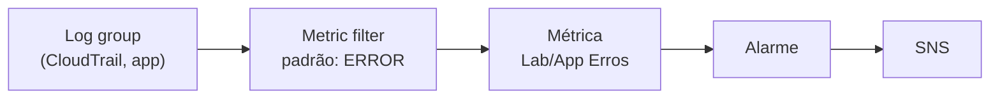
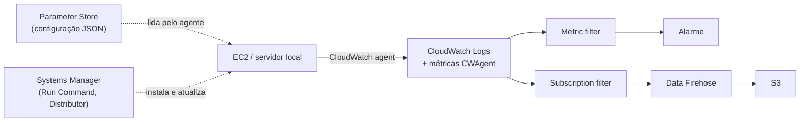

---
aliases:
  - Aula 21.3
modulo: 21
aula: 3
parte: "VI Resiliência e operações"
dominios:
  - 2
  - 1
lida: false
tags:
  - aula
  - saa-c03
  - modulo-21
---

# Aula 21.3: CloudWatch Logs e o agente

[[21 - Observabilidade Automacao e Operacoes|Voltar ao módulo]]

> [!question] Pergunta que esta aula responde
> Como os logs chegam ao [[CloudWatch Logs]], como se organizam (grupo, stream, retenção, classe), como transformá-los em métricas e alarmes ([[Metric Filter|metric filter]]), consultá-los ([[CloudWatch Logs Insights|Logs Insights]]), enviá-los em tempo real para outros destinos ([[Subscription Filter|subscription filter]]) e como o [[CloudWatch Agent|agente do CloudWatch]] coleta o que a AWS não vê sozinha?

## O problema: logs espalhados somem com a máquina

Em uma frota descartável ([[Auto Scaling Group|Auto Scaling]], [[Container|containers]], Lambda), a instância que gerou o log pode deixar de existir minutos depois. Logs em disco local somem junto, e procurar `ERROR` conectando por SSH em 40 servidores não escala. O [[CloudWatch Logs]] resolve com um repositório **centralizado, durável e pesquisável**, para o qual cada fonte envia seus eventos.

> [!info] Ligando os pontos
> Você já vê isso no [[ECS]]: o driver `awslogs` leva o stdout do [[Container|contêiner]] para um [[Log Group|log group]], e o Lambda grava no [[CloudWatch Logs]] sozinho, desde que a execution role tenha permissão de escrita em logs ([[16 - Serverless Lambda e API Gateway|Módulo 16]] e [[17 - Containers ECS EKS e Fargate|Módulo 17]]). Aqui está a estrutura por trás disso.

## O modelo: evento, stream, grupo

- **Log event**: um registro com **timestamp** e **mensagem** (texto UTF-8).
- **[[Log Stream|Log stream]]**: sequência de eventos da mesma fonte (um arquivo em uma instância, um [[Container|contêiner]]).
- **Log group**: conjunto de streams que compartilham **retenção, monitoramento e controle de acesso**. Retenção, filtros e permissões se configuram no grupo, não no stream.

Detalhes que valem lembrar (verificado em novembro de 2026): não há limite de streams por grupo; um grupo **não pode ser renomeado**; a API `PutLogEvents` rejeita eventos com timestamp mais de **14 dias** no passado ou mais de **2 horas** no futuro; existe **proteção contra exclusão** (deletion protection) opcional no grupo.

Fontes comuns de log: o [[CloudWatch Agent|agente do CloudWatch]] ([[EC2]] e servidores locais), Lambda, [[ECS]]/EKS, [[VPC Flow Logs]], [[Route 53 Resolver]] query logs, [[API Gateway]], e o [[CloudTrail]] (que entrega trilhas para o [[CloudWatch Logs]] além do [[S3]]).

## Retenção: o padrão é nunca expirar

Por padrão, os logs ficam **indefinidamente**, e cada GB armazenado é cobrado enquanto existir. Configure retenção por grupo, ou por **política de retenção de conta** (account-level):

- Valores do nível de conta: 30, 60, 90, 120, 150, 180, 365, 400, 545, 731, 1.096, 1.827, 2.192, 2.557, 2.922, 3.288 e 3.653 dias, ou `NEVER_EXPIRE`; o mínimo é **30 dias**.
- Até **20 políticas** de conta por Região, escopo por **prefixo** do nome do grupo ou conta inteira; a política de conta **substitui** a retenção do grupo, **mesmo quando a do grupo é maior**.
- A política só entra em vigor **24 horas** depois de criada ou atualizada.
- Com várias políticas sobrepostas, vale a de **maior retenção** (`NEVER_EXPIRE` conta como a maior).
- Como ela pode apagar logs antigos (um grupo de 10 anos com política de 90 dias perde tudo que passa de 90 dias), use `--dry-run` antes: ele mostra quantos grupos teriam retenção menor, igual ou maior, sem criar a política.
- Modo de aplicação: `RETROACTIVE` (vale também para grupos que já existem) ou `NEW_ONLY` (só os criados depois).
- Os eventos expirados não somem na hora: costuma levar **até 72 horas** para a exclusão efetiva (e deixam de ser cobrados ao serem marcados).

> [!example] Governança de custo
> Uma empresa descobre que 300 log groups de desenvolvimento acumularam 3 anos de logs. Uma política de conta com prefixo `/dev/`, retenção de 30 dias e modo `RETROACTIVE` resolve em um comando (depois de um `--dry-run` para conferir que nenhum grupo de auditoria cai no prefixo). A mesma política em modo `NEW_ONLY` não tocaria nos grupos antigos.

Para guardar por anos a baixo custo, o padrão é **exportar para o [[S3]]** (e aplicar [[Lifecycle Policy|lifecycle]] para Glacier, Módulo 11) em vez de manter tudo no [[CloudWatch]].

## Proteger e inspecionar logs

- **Criptografia**: todo [[Log Group|log group]] é criptografado em repouso por padrão. Para controlar a chave, associe uma **[[KMS]] key do cliente simétrica** ao grupo (`associate-kms-key`, na criação ou depois); a [[Key Policy|key policy]] precisa permitir o serviço `logs.<região>.amazonaws.com`. Só vale para dados ingeridos depois da associação.
- **[[Data Protection Policy|Data protection policy]]**: detecta e **mascara** dados sensíveis (CPF, cartão, credenciais) com **managed data identifiers**, na ingestão e em todos os pontos de saída (Insights, metric filters, subscription filters); só quem tem `logs:Unmask` vê o original. Eventos ingeridos antes da política não são mascarados. É o gatilho de questão "mascarar dados sensíveis em logs".
- **[[Live Tail]]**: acompanha os eventos chegando em tempo real, útil durante um deploy ou incidente.
- **[[Contributor Insights]]**: regras que mostram os maiores contribuintes (top-N, como os IPs que mais geram erro) a partir de logs estruturados.

(verificado em novembro de 2026)

## Classes de log (log classes)

| Classe | Para quê | Limitações |
|---|---|---|
| **Standard** | Logs que precisam de monitoramento em tempo real ou acesso frequente; todos os recursos | Nenhuma |
| **Essentials** (antes chamada **Infrequent Access**) | Logs consultados raramente (forense, consulta ad hoc), com preço de ingestão menor | Subconjunto de recursos: **sem subscription filters e sem metric filters**; [[CloudWatch Logs Insights\|Logs Insights]] suporta quase todos os comandos (exceto `pattern`, `diff`, `unmask`) |
| **Delivery** | Somente para entregar logs do Lambda ao [[S3]] ou ao [[Data Firehose]] | Retenção fixa de 2 dias; sem [[CloudWatch Logs Insights\|Logs Insights]] |

A classe **não pode ser alterada** depois que o grupo é criado. Armadilha: criar o grupo como Essentials para economizar e descobrir depois que não dá para criar [[Metric Filter|metric filter]] nem [[Subscription Filter|subscription filter]]. A API ainda aceita `INFREQUENT_ACCESS` como valor de entrada; o nome antigo aparece em simulados.

## Metric filters: de log para métrica para alarme

Um **[[Metric Filter|metric filter]]** procura um padrão nos eventos que chegam ao grupo e transforma cada correspondência em um ponto de uma **[[Metrica|métrica]] do [[CloudWatch]]**. Daí sai um gráfico e, principalmente, um alarme (aula 21.2).



Propriedades que importam:

- **Não é retroativo**: só gera pontos para eventos posteriores à criação do filtro.
- O **valor padrão** (default value) permite emitir 0 nos períodos em que há logs mas nenhuma correspondência, evitando [[Metrica|métrica]] "esburacada"; não se pode definir valor padrão se o filtro usa dimensões.
- Funciona só em grupos da classe **Standard**.
- O padrão de filtro pode ser um termo simples, uma expressão sobre JSON ou campos delimitados por espaço.

> [!example] O exemplo clássico de segurança
> Requisito: "ser avisado quando o usuário **root** fizer login". Arquitetura: a trilha do [[CloudTrail]] entrega eventos ao [[CloudWatch Logs]]; um [[Metric Filter|metric filter]] detecta o evento de login do root (`userIdentity.type = "Root"` e `eventName = "ConsoleLogin"`); um alarme em `Sum >= 1` por 1 minuto notifica um tópico [[SNS]]. Essa receita (CloudTrail > CloudWatch Logs > metric filter > alarme > SNS) aparece em muitas questões e em guias de conformidade.

## Logs Insights: consultar em escala

O **[[CloudWatch Logs Insights|Logs Insights]]** é uma linguagem de consulta interativa sobre um ou vários log groups. Os comandos são encadeados com `|` e há campos descobertos automaticamente que começam com `@` (`@timestamp`, `@message`, `@logStream`). Comandos frequentes: `fields`, `filter`, `stats`, `sort`, `limit`, `parse`, `display`, além de `anomaly`, `pattern` e `diff`.

```
fields @timestamp, @message
| filter @message like /ERROR/
| stats count(*) as erros by bin(5m)
| sort erros desc
| limit 20
```

Boas práticas da documentação para não pagar demais: selecione só os log groups necessários, use o menor intervalo de tempo possível, cancele consultas pendentes ao fechar a página e cuide de widgets de dashboard com atualização muito frequente (cada atualização roda uma consulta nova). O custo cresce com o volume consultado.

Com a [[Cross-Account Observability|observabilidade entre contas]] (aula 21.1), uma consulta numa conta de monitoramento varre grupos de várias contas.

> [!tip] Insights vs metric filter
> **[[Metric Filter|Metric filter]]**: contagem contínua, barata, alimenta alarme, mas só para o que você previu antes. **[[CloudWatch Logs Insights|Logs Insights]]**: investigação sob demanda, retroativa, para perguntas novas. Um serve para vigiar; o outro, para descobrir.

## Subscription filters: logs em tempo (quase) real para outro lugar

Um **[[Subscription Filter|subscription filter]]** entrega o feed de eventos de um [[Log Group|log group]], **quase em tempo real** (em geral em menos de 3 minutos), para:

- **[[Kinesis Data Streams]]**,
- **[[Data Firehose|Amazon Data Firehose]]** (antigo Kinesis Data Firehose; e dali para [[S3]], [[OpenSearch Service|OpenSearch]], [[Redshift]], Splunk),
- **Lambda** (processamento customizado, inclusive para chegar ao [[OpenSearch Service|OpenSearch]]).

Fatos importantes (verificado em novembro de 2026):

- Até **5 subscription filters** por [[Log Group|log group]] e **1 filtro em nível de conta por Região**.
- Os eventos chegam **compactados em gzip** (no Lambda, em base64 no campo `awslogs.data`).
- Entrega **pelo menos uma vez**: duplicatas podem ocorrer.
- Se o destino devolve erro **retentável** (limitação, 5xx), o [[CloudWatch Logs]] tenta por até **24 horas**; erro **não retentável** (por exemplo, `AccessDenied`) desativa o filtro por até 10 minutos, e os logs desse intervalo são **perdidos**.
- Só log groups **Standard**.
- Também há replicação centralizada entre contas e [[Regiao AWS|Regiões]] (log centralization).

### Subscription filter vs exportação para o S3

| Característica | [[Subscription Filter\|Subscription filter]] | Export task (`CreateExportTask`) |
|---|---|---|
| [[Latencia\|Latência]] | Quase em tempo real | Lote, assíncrono |
| Destino | [[Kinesis Data Streams]], [[Data Firehose]], Lambda | Somente [[S3]] |
| Uso típico | Análise em stream, SIEM, [[Data Lake\|data lake]] contínuo | Arquivo histórico pontual |
| Restrição | Classe Standard | O [[Bucket\|bucket]] precisa estar na **mesma Região** do [[Log Group\|log group]] |

O [[S3]] com [[SSE-KMS]] é aceito na exportação; [[DSSE-KMS]] não. Para "enviar logs continuamente ao S3", o caminho gerenciado é **[[Subscription Filter|subscription filter]] > [[Data Firehose]] > S3**, sem código.

## O agente do CloudWatch

O [[CloudWatch]] não enxerga dentro do sistema operacional (aula 21.1) e não lê arquivos de log do disco. O **agente unificado do CloudWatch** (open source, licença MIT) resolve as duas coisas em [[EC2]], servidores locais e [[Container|contêineres]]:

- coleta **métricas do SO** (memória, uso de disco, swap, processos) e as publica como métricas customizadas, por padrão no namespace **`CWAgent`**;
- lê **arquivos de log** e os envia ao [[CloudWatch Logs]];
- recebe métricas e traces de aplicação, porque é construído sobre o [[OpenTelemetry]] Collector.

Modelos de configuração atuais: **Classic** (métricas no namespace `CWAgent`, cobradas como customizadas; é o que a maioria dos materiais antigos descreve), **Curated [[OpenTelemetry]]** (métricas via endpoint OTLP, consultadas com [[Prometheus|PromQL]] e cobradas por GB ingerido; detalhes em Install-CloudWatch-Agent, não confirmado se é o modelo preferido hoje) e **Native OpenTelemetry (YAML)**.

### Como colocar o agente em 500 instâncias

O **[[Systems Manager]]** (aula [[21.07 - Systems Manager Gerencia Remota e Parametros|21.7]]) é o serviço que executa comandos em uma frota ([[Run Command]], [[State Manager]], [[Distributor]]) e guarda configuração central ([[Parameter Store]]); aqui você o usa como ferramenta de distribuição, e a aula 21.7 explica cada peça por dentro. Cada instância precisa de uma **[[Instance Profile|instance profile]]**, a ligação entre uma [[IAM Role|IAM role]] e a [[EC2|instância EC2]] (Módulo 4 e [[04 - IAM Identidade e Acesso|IAM]]).

1. **Permissão**: anexe à [[Instance Profile|instance profile]] a política gerenciada **`CloudWatchAgentServerPolicy`** (para o agente publicar métricas e logs). Para instalar e configurar via [[Systems Manager]], a instância também precisa de **`AmazonSSMManagedInstanceCore`**.
2. **Configuração central**: grave o arquivo JSON de configuração no **[[Parameter Store]]** do [[Systems Manager]] (o gerador interativo do agente ajuda). Escrever o parâmetro exige um papel de administração do agente (`CloudWatchAgentAdminRole`, em instância usada para criar a configuração).
3. **Instalação**: pelo **[[Run Command]]** ou **[[State Manager]]** com o pacote `AmazonCloudWatchAgent` (via **[[Distributor]]**), ou pré-instalado na [[AMI]]. A AMI do Amazon Linux e outras trazem o [[SSM Agent]]; o [[CloudWatch Agent|agente do CloudWatch]] é outro software.
4. **Início**: o agente lê a configuração do [[Parameter Store]] e começa a enviar.

O agente não coleta de **pipes FIFO**. Em servidores locais, ele precisa de credenciais próprias (a [[Instance Profile|instance profile]] só existe no [[EC2]]).



## Como isso cai na prova

> [!info] Task statements 2.2 e 1.2
> Task 2.2: "visibilidade da carga de trabalho" e logs como insumo de monitoramento. Task 1.2: logs e alarmes como [[Controle Detectivo|controle detectivo]] (login do root, mudanças de configuração), além de [[KMS]] e [[Data Protection Policy|data protection policy]] para proteger logs.

**Palavras-chave em inglês:** *centralize logs*, *retain for X days*, *alert when a log line contains*, *near real-time delivery to Kinesis/Firehose*, *query logs across accounts*, *[[CloudWatch Agent|CloudWatch agent]]*, *memory*, *custom log files*, *Infrequent Access*.

**Pegadinhas clássicas:**

- **Padrão é "nunca expira"**: custo cresce sem política de retenção.
- **[[Metric Filter|Metric filter]] não é retroativo**; [[CloudWatch Logs Insights|Logs Insights]] consulta o passado.
- **[[Subscription Filter|Subscription filter]] só entrega a [[Kinesis Data Streams]], [[Data Firehose]] ou Lambda**, não direto a [[SQS]] nem [[SNS]].
- **Export task é assíncrono e só para [[S3]] na mesma Região**; não é "tempo real".
- **Essentials/Infrequent Access** não tem metric nem [[Subscription Filter|subscription filter]].
- **Agente do [[CloudWatch]]** (métricas e logs) não é o **[[SSM Agent]]** (gerência remota).

| Requisito no enunciado | Resposta provável | Por quê |
|---|---|---|
| Alarme quando o texto `ERROR` aparecer no log | [[Metric Filter\|Metric filter]] + alarme + [[SNS]] | Converte log em [[Metrica\|métrica]] |
| Logs para um [[Data Lake\|data lake]] [[S3]], contínuo, sem código | [[Subscription Filter\|Subscription filter]] > [[Data Firehose]] > S3 | Gerenciado e quase em tempo real |
| Reter logs por 400 dias em todos os grupos `/prod/` | Política de retenção de conta, `RETROACTIVE` | Aplica a existentes e novos |
| Memória e arquivos de log de 300 instâncias | Agente do [[CloudWatch]] com configuração no [[Parameter Store]] | Coleta o que o [[EC2]] não vê |
| Consultar logs de várias contas ad hoc | [[CloudWatch Logs Insights\|Logs Insights]] com [[Cross-Account Observability\|observabilidade entre contas]] | Uma consulta, vários grupos |
| Alerta de login do root | [[CloudTrail]] > [[CloudWatch Logs]] > [[Metric Filter\|metric filter]] > alarme | Receita clássica |
| Mascarar CPF e cartão nos logs sem mexer na aplicação | [[Data Protection Policy\|Data protection policy]] no [[Log Group\|log group]] | Detecta e mascara na ingestão |

## Resumo

> [!abstract] A aula em uma frase
> O [[CloudWatch Logs]] centraliza eventos em grupos e streams com retenção configurável (padrão infinita), transforma padrões em métricas ([[Metric Filter|metric filter]]), permite consultas ad hoc ([[CloudWatch Logs Insights|Logs Insights]]) e envia o feed em tempo quase real a Kinesis, [[Data Firehose|Firehose]] ou Lambda, enquanto o [[CloudWatch Agent|agente do CloudWatch]] coleta métricas do SO e arquivos de log.

**A lógica, em 5 passos**

1. A fonte (agente, Lambda, [[ECS]], [[CloudTrail]], [[VPC Flow Logs|Flow Logs]]) envia eventos a um [[Log Group|log group]], onde valem retenção, classe e permissões.
2. A retenção padrão é ilimitada; defina por grupo ou por política de conta (mínimo de 30 dias, em modo `RETROACTIVE` ou `NEW_ONLY`).
3. [[Metric Filter|Metric filter]] vigia o futuro (contagem contínua, alarmes); [[CloudWatch Logs Insights|Logs Insights]] investiga o passado sob demanda.
4. [[Subscription Filter|Subscription filter]] encaminha eventos em tempo quase real a [[Kinesis Data Streams]], [[Data Firehose]] ou Lambda; export task é [[Processamento em Lote|lote]] para [[S3]].
5. O [[CloudWatch Agent|agente do CloudWatch]] (config no [[Parameter Store]], instalado via SSM) fornece memória, disco e logs de arquivo.

**Números para lembrar** (verificado em novembro de 2026)

| O quê | Valor | Por que importa |
|---|---|---|
| Retenção padrão | nunca expira | Custo contínuo |
| Mínimo da política de conta | 30 dias | Piso do escopo de conta |
| Subscription filters | 5 por grupo, 1 por conta e Região | Limite de [[Fan-out\|fan-out]] |
| [[Latencia\|Latência]] de assinatura | normalmente menos de 3 min | "Quase tempo real" |
| `PutLogEvents` | rejeita mais de 14 dias atrás ou 2 h à frente | Logs atrasados são perdidos |
| Exclusão pós-retenção | até 72 h | Não é imediata |

**Na prática, isso significa**

- Defina retenção em todo [[Log Group|log group]] (ou por política de conta) desde o primeiro dia.
- Crie metric filters para eventos de segurança e erros de aplicação, com alarme e [[SNS]].
- Para analytics contínuo, use [[Subscription Filter|subscription filter]] com [[Data Firehose|Firehose]] em vez de código próprio.
- Escolha a classe Standard se pretende usar metric ou subscription filters.

> [!tip] Liga com
> Vem da [[21.02 - Alarmes do CloudWatch e Acoes Automaticas|aula 21.2]] (alarmes). Prepara a [[21.04 - X-Ray Prometheus Grafana e Monitoramento de Aplicacao|aula 21.4]] (traces e dashboards) e a [[21.07 - Systems Manager Gerencia Remota e Parametros|aula 21.7]] ([[Parameter Store]] e [[Run Command]] usados para distribuir o agente).

## Erros comuns

- **"Os logs expiram sozinhos."** O padrão é nunca expirar; sem retenção você paga para sempre.
- **"O [[Metric Filter|metric filter]] vê o que já está no grupo."** Ele só conta eventos posteriores à sua criação.
- **"[[Subscription Filter|Subscription filter]] manda direto para [[SQS]] ou [[SNS]]."** Os destinos são [[Kinesis Data Streams]], [[Data Firehose]] e Lambda.
- **"Posso mudar a classe do [[Log Group|log group]] depois."** A classe é definida na criação.
- **"O [[CloudWatch Agent|agente do CloudWatch]] é o mesmo que o [[SSM Agent]]."** São dois agentes: um coleta métricas e logs; o outro executa a gerência remota do [[Systems Manager]].

## Pratique

**1.** Uma empresa quer entregar continuamente os logs de aplicação de vários log groups a um [[Data Lake|data lake]] no [[S3]], em tempo quase real, com o MENOR esforço de manutenção e sem escrever código. O que usar?

- [ ] a) Uma export task agendada a cada hora com `CreateExportTask`, que copia os eventos para o bucket
- [ ] b) Uma função Lambda que chama `GetLogEvents` a cada minuto e grava os eventos no S3
- [ ] c) Um subscription filter entregando a um stream do Data Firehose configurado com destino S3
- [ ] d) Uma consulta do Logs Insights executada a cada hora, com os resultados copiados para o S3

**2.** A equipe quer ser notificada sempre que 10 ou mais linhas contendo `ERROR` aparecerem no log da aplicação em 5 minutos. Qual a solução mais simples e gerenciada?

- [ ] a) Criar um metric filter com o padrão `ERROR` e um alarme na métrica resultante, com ação SNS
- [ ] b) Criar um subscription filter com destino direto a um tópico SNS e contar as mensagens recebidas
- [ ] c) Executar uma consulta do Logs Insights a cada 5 minutos e comparar o total com 10 manualmente
- [ ] d) Habilitar o X-Ray para contar os erros nas requisições e alarmar sobre a contagem de falhas

**3.** Uma auditoria exige alerta imediato sempre que o [[Usuario Root|usuário root]] fizer login no console. O [[CloudTrail]] já está ativo. Qual arquitetura atende?

- [ ] a) Criar uma regra do AWS Config sobre o usuário root, com notificação semanal por e-mail para a equipe de segurança
- [ ] b) Habilitar VPC Flow Logs e filtrar o tráfego de entrada que vem do console da AWS
- [ ] c) Consultar o painel do Trusted Advisor todos os dias e registrar o resultado em planilha
- [ ] d) Entregar a trilha do CloudTrail ao CloudWatch Logs, com metric filter do login do root e alarme SNS

**4.** Uma equipe precisa instalar o [[CloudWatch Agent|agente do CloudWatch]] em 500 [[EC2|instâncias EC2]] com a mesma configuração, alterando a configuração em um único lugar. Qual abordagem?

- [ ] a) Conectar por SSH em cada instância e editar o arquivo de configuração local do agente
- [ ] b) Guardar a configuração JSON no Parameter Store e instalar o agente via Run Command ou State Manager
- [ ] c) Embutir a configuração em cada AMI e recriar toda a frota a cada mudança, via instance refresh
- [ ] d) Usar um metric filter para coletar a memória das instâncias sem instalar nenhum agente

**5.** (Escolha DUAS.) Quais afirmações sobre a retenção do [[CloudWatch Logs]] estão corretas?

- [ ] a) O padrão é que os eventos nunca expiram
- [ ] b) Uma política de retenção de conta passa a valer na hora em que é criada
- [ ] c) Uma política de conta substitui a retenção do grupo, mesmo quando a do grupo é maior
- [ ] d) Reduzir a retenção apaga os eventos antigos imediatamente
- [ ] e) A retenção padrão de um log group é de 30 dias

**6.** Desenvolvedores precisam investigar um incidente consultando, com linguagem de consulta, os logs de uma API que envolve três [[Conta AWS|contas AWS]], sem montar infraestrutura nova. O que usar?

- [ ] a) Exportar os logs de cada conta para o S3 e consultar tudo com o Athena
- [ ] b) Um stream central do Kinesis Data Streams com um consumidor customizado que indexa os logs
- [ ] c) Um subscription filter para um domínio do OpenSearch em cada uma das três contas
- [ ] d) Logs Insights em uma conta de monitoramento com observabilidade entre contas habilitada

**7.** Uma equipe criou um [[Log Group|log group]] com a classe de baixo custo (Essentials, antes Infrequent Access) para economizar, e agora não consegue criar um [[Subscription Filter|subscription filter]] nem um [[Metric Filter|metric filter]]. Qual a explicação e a saída?

- [ ] a) Falta permissão IAM, e basta conceder `logs:PutSubscriptionFilter` à role da equipe
- [ ] b) Esses recursos só existem na classe Standard, e a classe não muda: crie um novo log group Standard
- [ ] c) O limite de 5 filtros por grupo foi atingido, então é preciso apagar um filtro existente
- [ ] d) Os filtros só funcionam depois de 24 horas de ingestão no grupo, então basta esperar a janela passar

**8.** Uma [[Lambda|função Lambda]] recém-criada executa com sucesso, mas nenhum log aparece no [[CloudWatch Logs]]. Qual a causa mais provável?

- [ ] a) A execution role da função não tem permissão para criar log groups e streams e gravar eventos
- [ ] b) O Lambda só envia logs ao CloudWatch quando o X-Ray ativo está habilitado na função
- [ ] c) O log group precisa ser criado manualmente com retenção definida antes da primeira execução
- [ ] d) O Lambda grava logs em um bucket S3 por padrão, e o CloudWatch Logs exige um subscription filter

**9.** (Escolha DUAS.) Quais destinos um [[Subscription Filter|subscription filter]] do [[CloudWatch Logs]] pode usar diretamente?

- [ ] a) Kinesis Data Streams
- [ ] b) Amazon SQS standard
- [ ] c) AWS Lambda
- [ ] d) Amazon SNS
- [ ] e) Amazon S3, sem passar pelo Data Firehose

**10.** Uma empresa quer que todos os log groups com o prefixo `/prod/`, incluindo os que já existem, tenham retenção de 400 dias. Alguns grupos antigos guardam hoje 10 anos de logs de auditoria. Qual a abordagem de menor esforço que evita perda de dados inesperada?

- [ ] a) Alterar manualmente a retenção de cada log group existente, com um script de AWS CLI
- [ ] b) Criar uma política de conta com prefixo `/prod/` e modo `NEW_ONLY`, que aplica 400 dias aos grupos novos e aos antigos
- [ ] c) Criar uma política de conta com prefixo `/prod/` e modo `RETROACTIVE`, simulando antes com dry run
- [ ] d) Configurar uma lifecycle rule no bucket S3 para os logs

**11.** Uma aplicação grava CPF e números de cartão nos logs, e a empresa quer que esses dados apareçam mascarados nas consultas, sem alterar o código da aplicação. O que atende?

- [ ] a) Um metric filter que substitui os números nos eventos já gravados pelo texto mascarado
- [ ] b) Uma data protection policy no log group, com identificadores de dados gerenciados para mascarar
- [ ] c) Um subscription filter para uma Lambda que apaga os eventos sensíveis depois que chegam ao grupo
- [ ] d) O Macie habilitado sobre o log group, que mascara os dados sensíveis dos eventos gravados

> [!success]- Gabarito
> **1. c)** [[Subscription Filter|Subscription filter]] para [[Data Firehose]] com destino [[S3]] é gerenciado e quase em tempo real. (a) a export task é [[Processamento em Lote|lote]] assíncrono; (b) exige código e polling; (d) [[CloudWatch Logs Insights|Logs Insights]] é consulta, não entrega contínua.
> **2. a)** O [[Metric Filter|metric filter]] transforma ocorrências em [[Metrica|métrica]] e o alarme notifica via [[SNS]]. (b) SNS não é destino direto de [[Subscription Filter|subscription filter]]; (c) é manual; (d) [[X-Ray]] rastreia requisições, não conta linhas de log.
> **3. d)** [[CloudTrail]] no [[CloudWatch Logs]] + [[Metric Filter|metric filter]] + alarme é a receita clássica e imediata. (a) a regra semanal não é imediata; (b) [[VPC Flow Logs|Flow Logs]] registram tráfego de rede, não login de console; (c) o [[Trusted Advisor]] não gera alerta de login.
> **4. b)** Configuração central no [[Parameter Store]] e instalação por [[Run Command]] ou [[State Manager]] atualizam a frota num ponto só. (a) não escala; (c) refazer a frota a cada mudança é pesado; (d) o [[Metric Filter|metric filter]] lê logs, não coleta memória.
> **5. a), c)** O padrão é nunca expirar, e a política de conta substitui a retenção do grupo, inclusive quando esta é maior (por isso existe o dry run). (b) a política só entra em vigor 24 horas depois de criada ou atualizada; (d) a exclusão leva até 72 horas; (e) o padrão não é 30 dias, 30 é o mínimo da política de conta.
> **6. d)** O [[CloudWatch Logs Insights|Logs Insights]] com [[Cross-Account Observability|observabilidade entre contas]] consulta vários grupos de várias contas sem infraestrutura nova. (a) e (b) montam pipelines; (c) um filtro por conta e um domínio [[OpenSearch Service|OpenSearch]] é mais trabalhoso.
> **7. b)** Metric e subscription filters só funcionam na classe Standard, e a classe é imutável. (a) não é falta de permissão; (c) o limite de 5 não foi atingido; (d) não existe espera de 24 h.
> **8. a)** O Lambda grava logs usando a execution role; sem permissão de logs, nada aparece. (b) [[X-Ray]] é independente; (c) o Lambda cria o grupo sozinho se a role permitir; (d) o destino padrão dos logs do Lambda é o [[CloudWatch Logs]].
> **9. a), c)** [[Kinesis Data Streams]] e Lambda são destinos diretos (assim como [[Data Firehose]]). (b) e (d) [[SQS]] e [[SNS]] não são destinos diretos; (e) o [[S3]] só é alcançado via Firehose.
> **10. c)** A política de conta em modo `RETROACTIVE` alcança os grupos existentes em um passo, e o dry run mostra quais teriam retenção reduzida: a política substitui a retenção do grupo e apagaria os logs de 10 anos. (a) é trabalhoso e manual; (b) `NEW_ONLY` não alcança os grupos antigos; (d) lifecycle do [[S3]] não afeta a retenção do [[CloudWatch Logs]].
> **11. b)** A [[Data Protection Policy|data protection policy]] detecta e mascara dados sensíveis na ingestão, e só quem tem `logs:Unmask` vê o original. (a) [[Metric Filter|metric filter]] não reescreve eventos; (c) apagar eventos perde o log todo e é código a manter; (d) o [[Macie]] analisa dados no [[S3]], não grupos de log.

### Laboratório (opcional)

> [!warning] Use uma conta AWS pessoal
> Faça em uma **[[Conta AWS|conta AWS]] pessoal separada**, com [[Budgets|AWS Budgets]] configurado, **nunca na conta de produção da empresa**. O custo é desprezível com poucos eventos (não confirmado: veja o preço de ingestão na página do [[CloudWatch]]). Não há recursos cobrados por hora.

1. Crie o grupo: `aws logs create-log-group --log-group-name /lab/app` e defina retenção: `aws logs put-retention-policy --log-group-name /lab/app --retention-in-days 7`.
2. Crie um stream: `aws logs create-log-stream --log-group-name /lab/app --log-stream-name teste`.
3. Crie um [[Metric Filter|metric filter]]: `aws logs put-metric-filter --log-group-name /lab/app --filter-name erros --filter-pattern ERROR --metric-transformations metricName=Erros,metricNamespace=Lab/App,metricValue=1,defaultValue=0`.
4. Envie eventos (timestamp em milissegundos): `aws logs put-log-events --log-group-name /lab/app --log-stream-name teste --log-events timestamp=<ms agora>,message="ERROR falha no pagamento"`.
5. Consulte com [[CloudWatch Logs Insights|Logs Insights]]: `aws logs start-query --log-group-name /lab/app --start-time <epoch s> --end-time <epoch s> --query-string 'fields @timestamp, @message | filter @message like /ERROR/'` e depois `aws logs get-query-results --query-id <id>`.
6. Observe a [[Metrica|métrica]] `Lab/App Erros` surgir depois de alguns minutos.

Limpeza: `aws logs delete-log-group --log-group-name /lab/app` (remove também o [[Metric Filter|metric filter]]).

## Para aprofundar

- [ ] [CloudWatch Logs concepts](https://docs.aws.amazon.com/AmazonCloudWatch/latest/logs/CloudWatchLogsConcepts.html) (AWS Docs): grupos, streams, metric filters, retenção e proteção contra exclusão.
- [ ] [Real-time processing of log data with subscriptions](https://docs.aws.amazon.com/AmazonCloudWatch/latest/logs/Subscriptions.html) (AWS Docs): destinos, limites, política de retentativa e classe Standard.
- [ ] [Log classes](https://docs.aws.amazon.com/AmazonCloudWatch/latest/logs/CloudWatch_Logs_Log_Classes.html) (AWS Docs): Standard, Essentials (antes Infrequent Access) e Delivery.
- [ ] [Collect metrics, logs, and traces using the CloudWatch agent](https://docs.aws.amazon.com/AmazonCloudWatch/latest/monitoring/Install-CloudWatch-Agent.html) (AWS Docs): modelos de configuração do agente.

Próxima aula: [[21.04 - X-Ray Prometheus Grafana e Monitoramento de Aplicacao|Aula 21.4: X-Ray, Prometheus, Grafana e monitoramento de aplicação]].
