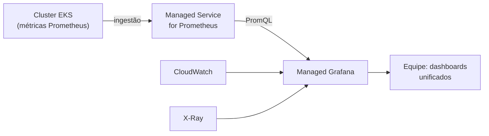

---
aliases:
  - Aula 21.4
modulo: 21
aula: 4
parte: "VI Resiliência e operações"
dominios:
  - 2
  - 3
lida: false
tags:
  - aula
  - saa-c03
  - modulo-21
---

# Aula 21.4: X-Ray, Prometheus, Grafana e monitoramento de aplicação

[[21 - Observabilidade Automacao e Operacoes|Voltar ao módulo]]

> [!question] Pergunta que esta aula responde
> Como descobrir, em uma arquitetura de muitos serviços, qual componente deixou uma requisição lenta ([[X-Ray]]), quando escolher [[Managed Service for Prometheus]] com [[Managed Grafana]] em vez de dashboards do [[CloudWatch]], e que ferramentas ([[CloudWatch Synthetics|Synthetics]], [[CloudWatch RUM|RUM]], [[Container Insights]]) cobrem o que métricas e logs sozinhos não cobrem?

## O problema: uma requisição, dez serviços

Na [[21.01 - Observabilidade e Metricas do CloudWatch|aula 21.1]], vimos que a [[Metrica|métrica]] avisa e o log explica. Falta o meio do caminho em arquiteturas desacopladas (Módulos 15 e 16): uma chamada ao [[API Gateway]] passa por uma Lambda, que consulta o [[DynamoDB]], publica no [[SNS]], que aciona outra Lambda. A API ficou lenta: é o primeiro salto, a consulta ao banco ou a segunda função? As métricas de cada serviço, olhadas isoladamente, podem estar todas "normais". Só uma visão **por requisição**, costurando os saltos, responde. Isso é **tracing distribuído**.

## X-Ray: o rastro de uma requisição

O [[X-Ray]] recebe dados de rastreamento da sua aplicação e dos serviços AWS integrados e monta uma visão fim a fim. Conceitos, do menor para o maior:

- **Segmento** (segment): o trabalho feito por um recurso para uma requisição: nome, host, requisição, resposta, tempo de início e fim, erros e exceções. Cada documento de segmento tem até 64 KB.
- **Subsegmento** (subsegment): detalha o segmento, com temporização mais fina e as **chamadas a jusante** (outro serviço AWS, uma API [[HTTP]] externa, um banco SQL). Você também define subsegmentos em trechos de código.
- **[[Trace]] ID**: identificador que acompanha a requisição por todos os serviços. O primeiro serviço integrado que a recebe adiciona o cabeçalho de rastreamento e ele é propagado adiante. Um **trace** é o conjunto de todos os segmentos gerados por uma requisição.
- **Service graph** ([[Service Map|service map]]): grafo com um nó por serviço e arestas entre os que trabalham juntos, com [[Latencia|latência]] e taxa de erro por nó. É a ferramenta para apontar "o gargalo está aqui".
- **Anotações** (annotations): pares chave-valor **indexados**, usados em expressões de filtro (por exemplo, `cliente=acme`). Até 50 anotações indexadas por [[Trace|trace]].
- **Metadata**: pares de qualquer tipo (objetos, listas), **não indexados**; guardam contexto, mas não se pesquisa por eles.

> [!example] O DynamoDB que "apareceu sozinho"
> O [[DynamoDB]] não envia segmentos próprios. Ainda assim ele aparece no mapa. O [[X-Ray]] gera um **segmento inferido** a partir do **subsegmento** que o cliente instrumentado (sua Lambda) registrou ao chamar o AWS SDK. O nó mostra o tempo do ponto de vista de quem chamou, incluindo a viagem de rede. Se o serviço a jusante também é instrumentado, o segmento dele substitui o inferido.

### Como os dados chegam

Cada SDK cliente envia documentos JSON de segmento para um **daemon** local via **[[UDP]]**; o daemon agrupa em [[Processamento em Lote|lote]] e envia ao [[X-Ray]]. O daemon já vem no [[Elastic Beanstalk]] e no Lambda. Em serviços integrados, basta uma configuração: por exemplo, o Lambda com **active tracing** habilitado envia dados sem código extra, e serviços como [[API Gateway]] e balanceadores podem iniciar o [[Trace|trace]] e propagar o cabeçalho.

### Amostragem (sampling)

Rastrear 100% das requisições custa (cobrança por [[Trace|trace]]) e gera volume. A **[[Sampling|amostragem]]** escolhe quais requisições rastrear. **Padrão**: a regra de amostragem padrão do serviço tem **reservoir = 1 por segundo** (a primeira requisição de cada segundo é sempre rastreada) e **fixed rate = 5%** das demais (verificado em novembro de 2026). Você ajusta com **sampling rules**: por exemplo, 100% para chamadas que alteram estado ou lidam com pagamento, e taxa baixa para [[Health Check|health checks]] e polling de alto volume.

### Retenção

Os dados de [[Trace|trace]] e o service graph ficam **30 dias**.

### Recado atual: SDK em modo de manutenção

Desde **25 de fevereiro de 2026** os **[[X-Ray]] SDKs e o daemon estão em modo de manutenção**: recebem apenas correções de segurança, sem novos recursos, e a AWS recomenda instrumentar com **[[OpenTelemetry]]** e enviar os traces ao X-Ray (o [[CloudWatch Agent|agente do CloudWatch]] ou um OpenTelemetry Collector substituem o daemon). O serviço X-Ray **continua** funcionando; o que muda é a forma de instrumentar. O AWS Distro for OpenTelemetry aparece na lista de itens **fora do escopo** do exam guide, então a prova pergunta o conceito de tracing e o X-Ray, não o ADOT.

> [!info] Ligando os pontos
> Os traces também aparecem no console do [[CloudWatch]] (a experiência de [[X-Ray]] vive lá) e, com a [[Cross-Account Observability|observabilidade entre contas]] (aula 21.1), um mapa pode mostrar nós de várias contas. O [[Application Signals]], do CloudWatch, usa traces e métricas para exibir a saúde dos serviços e o cumprimento de **SLOs** (objetivos de nível de serviço, como "99,9% das requisições abaixo de 500 ms"); fica fora do foco da prova.

### X-Ray e as tasks da prova

Task 2.2 cita **[[X-Ray]]** como exemplo de "visibilidade da carga de trabalho". A resposta típica é: "o time precisa identificar qual serviço contribui mais para a [[Latencia|latência]] de uma arquitetura com vários componentes" > **X-Ray** ([[Service Map|service map]] e traces). Não confunda com: **[[CloudWatch Logs]]** (texto de eventos), **[[CloudTrail]]** (quem chamou qual API da AWS) e **Config** (histórico de configuração).

## Prometheus e Grafana gerenciados

Muitas equipes com [[Kubernetes]] já usam o ecossistema aberto: **[[Prometheus]]** (coleta e armazena métricas, linguagem **PromQL**) e **[[Grafana]]** (dashboards). Operar isso em produção (armazenamento, [[Alta Disponibilidade|alta disponibilidade]], escala) dá trabalho. Os dois serviços gerenciados da AWS entregam o ecossistema aberto sem operar servidores.

### Managed Service for Prometheus

- Serviço **[[Serverless|serverless]]**, compatível com [[Prometheus]] (mesmo modelo de dados e PromQL), para métricas de [[Container|contêineres]] no **[[EKS]]** e em [[Kubernetes]] autogerenciado.
- Escala sozinho na ingestão, armazenamento e consulta; os dados de um **workspace** são replicados em **3 [[Zona de Disponibilidade|AZs]]** da mesma Região.
- Retenção padrão de **150 dias**, ajustável até **1.095 dias** (3 anos).
- Cobrança por ingestão e por armazenamento (tamanho comprimido). Sem número de preço aqui: confira na página oficial.

### Managed Grafana

- Servidores [[Grafana]] gerenciados, isolados em **workspaces**; a AWS cuida de provisionamento, escala e manutenção.
- Fontes de dados integradas: [[CloudWatch]], [[OpenSearch Service]], [[X-Ray]], [[Managed Service for Prometheus]], entre outras (inclusive de terceiros).
- Autenticação por **[[Identity Provider|IdP]] [[SAML|SAML 2.0]]** ou **[[IAM Identity Center]]** (Módulo 5).
- Cobrança **por usuário ativo** no workspace.

### CloudWatch dashboards vs Prometheus + Grafana

| Critério | [[CloudWatch]] (dashboards e alarmes) | Managed [[Prometheus]] + [[Managed Grafana]] |
|---|---|---|
| Fonte natural | Métricas de serviços AWS, logs, traces | Métricas de aplicações e [[Container\|contêineres]] no padrão [[Prometheus]] |
| Linguagem | [[Metric Math\|Metric math]], Metrics Insights | **[[Prometheus\|PromQL]]** |
| Quem escolhe | Quem quer menos peças e integração nativa | Quem já usa [[Prometheus]] e [[Grafana]] (portabilidade, dashboards existentes, multinuvem) |
| Operação | Nenhuma | Nenhuma (ambos gerenciados) |

O gatilho de prova é a **palavra-chave**: "o time já usa **[[Prometheus]]** e **[[Grafana]]** para o cluster [[Kubernetes]] e quer um serviço gerenciado" > [[Managed Service for Prometheus]] + [[Managed Grafana]]. Se o enunciado só pede métricas e alarmes de [[Container|contêineres]] na AWS, **[[Container Insights]]** é a resposta simples.

## Container Insights, Synthetics e RUM

Três recursos do [[CloudWatch]] cobrem lacunas específicas.

**[[Container Insights]]**: coleta, agrega e resume **métricas e logs** de aplicações em [[Container|contêineres]], para **[[ECS]]** (inclusive [[Fargate]]) e **[[EKS]]** (e [[Kubernetes]] em [[EC2]], ROSA). No EKS, o caminho padrão é o **add-on** `amazon-cloudwatch-observability` (ou o Helm chart), que instala o [[CloudWatch Agent|agente do CloudWatch]] em cada nó e um agente de cluster. Mostra CPU, memória, rede e disco por cluster, serviço, tarefa e [[Pod|pod]]. Há duas variantes no EKS: **Enhanced (Classic)**, com métricas pelo [[Embedded Metric Format]], e **[[OpenTelemetry|OTel]]**, com OpenTelemetry e [[Prometheus|PromQL]] (a documentação muda rápido; não confirmado qual é a preferida hoje).

**[[CloudWatch Synthetics|Synthetics]] (canaries)**: **scripts configuráveis que rodam em agenda** e fazem o mesmo caminho que um cliente (abrir a página, chamar a API, fazer login), verificando **[[Disponibilidade|disponibilidade]] e [[Latencia|latência]]** mesmo quando não há tráfego. São escritos em runtimes como Node.js e Python (a lista de runtimes suportados muda; confira a documentação) e executam como [[Lambda|funções Lambda]]; podem guardar tempos de carregamento e capturas de tela, e detectar alterações indevidas no conteúdo. Descobrem o problema **antes dos clientes**, inclusive de madrugada.

**[[CloudWatch RUM|RUM]] (Real User Monitoring)**: coleta dados **do lado do cliente** de sessões reais de usuários em aplicações web e mobile: tempos de carregamento de página, erros de JavaScript, quedas de app, com recortes por navegador, dispositivo e geolocalização. Você cria um **app monitor**, cola o trecho de código gerado e define a **porcentagem de sessões** amostradas. Os dados ficam **30 dias**, a menos que você os copie para o [[CloudWatch Logs]].

| Pergunta | Ferramenta |
|---|---|
| A URL e a API estão no ar e rápidas agora, mesmo sem usuários? | **[[CloudWatch Synthetics\|Synthetics]]** (sintético, ativo) |
| Como os usuários reais experimentam o site? Que erros JS ocorrem? | **[[CloudWatch RUM\|RUM]]** (real, passivo) |
| Onde, entre os serviços, a requisição ficou lenta? | **[[X-Ray]]** (traces) |
| Quanto de CPU e memória cada serviço [[ECS]] ou [[Pod\|pod]] usa? | **[[Container Insights]]** |
| O time quer [[Prometheus\|PromQL]] e dashboards [[Grafana]] gerenciados? | **[[Managed Service for Prometheus]] + [[Managed Grafana]]** |
| O que está acontecendo dentro da instância (memória, disco)? | **Agente do [[CloudWatch]]** (aula 21.3) |

> [!example] Um incidente, quatro ferramentas
> Às 2h, o canary do [[CloudWatch Synthetics|Synthetics]] falha no passo "finalizar compra" (detecção). O dashboard do [[Container Insights]] mostra o serviço de pagamento com memória no teto (sintoma). O mapa do [[X-Ray]] mostra o nó do serviço de antifraude com 90% das requisições lentas (localização). O [[CloudWatch Logs Insights|Logs Insights]], filtrando o [[Trace|trace]] ID, mostra a exceção de [[Timeout|timeout]] (causa). Nenhuma ferramenta sozinha contaria a história.

## Como isso cai na prova

> [!info] Task statement 2.2
> Task 2.2 lista "visibilidade da carga de trabalho (por exemplo, [[X-Ray]])". Os serviços [[Managed Grafana]] e [[Managed Service for Prometheus]] estão na lista de serviços in-scope de Management and Governance do exam guide.

**Palavras-chave em inglês:** *distributed tracing*, *identify which service adds [[Latencia|latency]]*, *[[Service Map|service map]]*, *[[Trace|trace]] requests across [[Microsservicos|microservices]]*, *Prometheus-compatible*, *[[Grafana]]*, *synthetic monitoring*, *canary*, *real user monitoring*, *[[Container Insights]]*.

**Pegadinhas clássicas:**

- **[[X-Ray]] não é [[CloudTrail]]**: o primeiro rastreia requisições da aplicação; o segundo audita chamadas de API da conta.
- **Anotação é indexada; metadata não.**
- **[[CloudWatch Synthetics|Synthetics]] (sintético, em agenda) vs [[CloudWatch RUM|RUM]] (usuário real)**.
- **[[Prometheus]] + [[Grafana]]** quando o enunciado cita PromQL ou dashboards Grafana; **[[Container Insights]]** quando só pede métricas de [[Container|contêineres]].
- **[[Sampling|Amostragem]]**: o padrão não rastreia tudo; para rastrear 100%, crie regra.
- O SDK do [[X-Ray]] está em modo de manutenção, mas o serviço X-Ray segue ativo.

| Requisito no enunciado | Resposta provável | Por quê |
|---|---|---|
| Descobrir qual [[Microsservicos\|microsserviço]] causa a [[Latencia\|latência]] | [[X-Ray]] ([[Service Map\|service map]] e traces) | Visão por requisição |
| Verificar a cada 5 minutos se o fluxo de login funciona, sem tráfego real | [[CloudWatch Synthetics]] (canary) | Script agendado que imita o usuário |
| Medir tempo de carregamento e erros de JS no navegador do cliente | [[CloudWatch RUM]] | Telemetria do lado do cliente |
| Equipe [[EKS]] que usa [[Prometheus]] e [[Grafana]] e não quer operar servidores | [[Managed Service for Prometheus]] + [[Managed Grafana]] | Ecossistema aberto gerenciado |
| CPU e memória por [[Tarefa ECS\|tarefa ECS]] ou [[Pod\|pod]], com o mínimo de configuração | [[Container Insights]] | Métricas e logs de [[Container\|contêineres]] |
| Pesquisar traces por um campo de negócio (cliente, [[Tenant\|tenant]]) | Anotações do [[X-Ray]] | Anotações são indexadas |

## Resumo

> [!abstract] A aula em uma frase
> O [[X-Ray]] rastreia uma requisição por todos os serviços ([[Trace|trace]], segmentos, [[Service Map|service map]], anotações, [[Sampling|amostragem]]), enquanto [[Prometheus]] e [[Grafana]] gerenciados atendem quem usa o ecossistema aberto e [[Container Insights]], [[CloudWatch Synthetics|Synthetics]] e [[CloudWatch RUM|RUM]] cobrem [[Container|contêineres]], [[Disponibilidade|disponibilidade]] ativa e experiência do usuário real.

**A lógica, em 5 passos**

1. Em arquiteturas distribuídas, métricas por serviço não localizam a lentidão; é preciso rastrear a requisição de ponta a ponta.
2. O [[X-Ray]] junta segmentos e subsegmentos sob um [[Trace|trace]] ID e desenha o [[Service Map|service map]] com [[Latencia|latência]] e erros por nó.
3. A [[Sampling|amostragem]] (padrão: 1 por segundo + 5%) controla o volume e o custo; regras de amostragem ajustam por tipo de requisição.
4. Quem já adota [[Prometheus]] e [[Grafana]] usa os equivalentes gerenciados (PromQL, workspaces, 150 dias de retenção padrão); quem só quer métricas de [[Container|contêineres]] usa [[Container Insights]].
5. [[CloudWatch Synthetics|Synthetics]] detecta falhas de forma ativa (script agendado); [[CloudWatch RUM|RUM]] mede a experiência real (sessões de usuários).

**Números para lembrar** (verificado em novembro de 2026)

| O quê | Valor | Por que importa |
|---|---|---|
| [[Sampling\|Amostragem]] padrão do [[X-Ray]] | 1ª requisição por segundo + 5% | Não rastreia tudo |
| Retenção de traces e do service graph | 30 dias | Investigação histórica limitada |
| Anotações indexadas por [[Trace\|trace]] | até 50 | Limite de busca |
| Retenção do Managed [[Prometheus]] | 150 dias (até 1.095) | Histórico de métricas |
| Retenção de dados do [[CloudWatch RUM\|RUM]] | 30 dias | Copie para Logs se precisar de mais |
| SDK e daemon do [[X-Ray]] | modo de manutenção desde 25/02/2026 | Migrar para [[OpenTelemetry]] |

**Na prática, isso significa**

- Habilite active tracing nas Lambdas e no [[API Gateway]] para ver o mapa sem código.
- Use anotações para campos de negócio que você pretende filtrar.
- Para fluxos críticos, tenha um canary além do alarme de [[Metrica|métrica]].
- Escolha [[Prometheus]] e [[Grafana]] gerenciados só quando houver motivo (PromQL, dashboards existentes).

> [!tip] Liga com
> Vem da [[21.03 - CloudWatch Logs e o Agente|aula 21.3]] (logs) e dos [[16 - Serverless Lambda e API Gateway|Módulo 16]] e [[17 - Containers ECS EKS e Fargate|Módulo 17]] (o que se observa). Prepara a [[21.05 - CloudFormation Stacks Templates e Change Sets|aula 21.5]], em que a infraestrutura de [[Observabilidade|observabilidade]] passa a ser código.

## Erros comuns

- **"O [[X-Ray]] rastreia 100% das requisições."** Só a amostra definida pela regra (padrão: primeira por segundo e 5% das demais).
- **"O [[X-Ray]] foi descontinuado."** Apenas os SDKs e o daemon entraram em manutenção; o serviço e a recomendação de [[OpenTelemetry]] seguem.
- **"Metadata serve para filtrar traces."** Só anotações são indexadas.
- **"[[CloudWatch Synthetics|Synthetics]] e [[CloudWatch RUM|RUM]] são a mesma coisa."** Um é script agendado; o outro mede sessões reais.
- **"Preciso de [[Prometheus]] para ver métricas de [[Container|contêiner]] na AWS."** O [[Container Insights]] já coleta métricas e logs de [[ECS]] e [[EKS]].

## Pratique

**1.** Uma aplicação usa [[API Gateway]], três [[Lambda|funções Lambda]] e [[DynamoDB]]. Os usuários relatam lentidão, mas as métricas de cada serviço parecem normais. A equipe precisa identificar qual componente adiciona mais [[Latencia|latência]] por requisição, com o MENOR esforço de código. O que usar?

- [ ] a) Executar consultas do Logs Insights sobre os logs de cada uma das três funções e do API Gateway
- [ ] b) Criar um canary do CloudWatch Synthetics que chama a API a cada minuto e mede a latência total
- [ ] c) Habilitar active tracing no Lambda e no API Gateway e analisar o service map e os traces
- [ ] d) Habilitar detailed monitoring em todos os serviços para ter métricas de 1 minuto por componente

**2.** Uma empresa opera um cluster [[EKS]], já usa dashboards [[Grafana]] e consultas [[Prometheus|PromQL]] em um ambiente local e quer migrar sem operar servidores de monitoramento. Qual solução?

- [ ] a) Managed Service for Prometheus para as métricas e Managed Grafana para os dashboards
- [ ] b) Container Insights, que importa os dashboards Grafana e as consultas PromQL do ambiente local
- [ ] c) Prometheus e Grafana instalados em instâncias EC2 dentro de um Auto Scaling Group
- [ ] d) Somente dashboards do CloudWatch com metric math, recriando as consultas PromQL

**3.** Uma equipe precisa ser alertada de madrugada, sem tráfego de clientes, se o fluxo de login do site parar de funcionar. Qual recurso atende?

- [ ] a) CloudWatch RUM instalado no navegador dos clientes, que mede apenas as sessões reais de usuários
- [ ] b) Um alarme de CPU nos servidores web, com notificação por SNS para a equipe de plantão
- [ ] c) Um metric filter sobre o log de acesso do servidor, contando as respostas com erro de login
- [ ] d) Um canary do CloudWatch Synthetics agendado que executa o fluxo e dispara um alarme na falha

**4.** O time de front-end quer medir o tempo de carregamento das páginas e os erros de JavaScript nos navegadores de usuários reais, com recortes por navegador e país. O que usar?

- [ ] a) CloudWatch Synthetics com canaries agendados que repetem o fluxo de navegação do site
- [ ] b) CloudWatch RUM com um app monitor no código das páginas e amostragem de sessões
- [ ] c) X-Ray com amostragem de 100% das requisições do back-end e anotações por navegador
- [ ] d) VPC Flow Logs filtrados por país de origem para estimar o tempo de carregamento

**5.** (Escolha DUAS.) Quais afirmações sobre o [[X-Ray]] estão corretas?

- [ ] a) Anotações são indexadas e podem ser usadas em expressões de filtro
- [ ] b) Metadata é indexada e é a forma recomendada de buscar traces
- [ ] c) A regra de amostragem padrão registra a primeira requisição de cada segundo e 5% das demais
- [ ] d) Os traces são mantidos por tempo indefinido
- [ ] e) O X-Ray só funciona para aplicações em instâncias EC2

**6.** Durante uma investigação, o [[Service Map|service map]] do [[X-Ray]] mostra um nó do [[DynamoDB]], embora a equipe saiba que o DynamoDB não envia segmentos próprios. Qual a explicação?

- [ ] a) O DynamoDB envia segmentos por padrão a todo cliente da conta que habilitou o X-Ray no SDK
- [ ] b) O CloudTrail alimenta o mapa com as chamadas de API feitas à tabela do DynamoDB na conta
- [ ] c) O X-Ray infere um segmento a partir do subsegmento registrado pelo cliente instrumentado
- [ ] d) O agente do CloudWatch coleta métricas do DynamoDB e as converte em nós do mapa

**7.** Um engenheiro lê que os SDKs do [[X-Ray]] entraram em modo de manutenção em 25 de fevereiro de 2026 e pergunta se deve abandonar o X-Ray. Qual a orientação correta?

- [ ] a) O X-Ray continua; os SDKs só recebem correções de segurança e a recomendação é usar OpenTelemetry
- [ ] b) O X-Ray foi descontinuado, e os traces deixam de ser aceitos quando o SDK sair do modo de manutenção
- [ ] c) Os SDKs foram removidos, e as aplicações existentes pararam de enviar dados ao serviço de rastreamento
- [ ] d) É obrigatório migrar os traces para o CloudWatch Logs, porque o X-Ray não aceita mais dados novos

**8.** Uma empresa executa serviços [[ECS]] no [[Fargate]] e quer ver CPU e memória por tarefa e serviço, além de logs agregados, com o MENOR esforço. O que habilitar?

- [ ] a) Detailed monitoring do EC2 nas tarefas, que publica CPU e memória por tarefa a cada minuto
- [ ] b) AWS Config com regras gerenciadas que registram CPU e memória como itens de configuração
- [ ] c) Active tracing com o X-Ray nas tarefas para medir CPU e memória de cada serviço do ECS
- [ ] d) CloudWatch Container Insights habilitado no cluster ECS, com métricas e logs das tarefas

**9.** (Escolha DUAS.) Quais afirmações sobre o [[Managed Grafana|Amazon Managed Grafana]] estão corretas?

- [ ] a) A AWS cuida do provisionamento, da escala e da manutenção dos servidores Grafana
- [ ] b) Integra fontes como CloudWatch, X-Ray, OpenSearch Service e Managed Service for Prometheus
- [ ] c) Armazena as métricas por 150 dias por padrão
- [ ] d) Só aceita fontes de dados que estejam na AWS
- [ ] e) Só autentica usuários com IAM users locais

**10.** Uma auditoria exige 2 anos de histórico das métricas de um cluster [[EKS]] enviadas ao [[Managed Service for Prometheus]], e a retenção padrão do workspace não cobre isso. O que a equipe deve fazer?

- [ ] a) Exportar as métricas para o CloudWatch a cada 15 dias, que guarda o histórico em alta resolução
- [ ] b) Ajustar a retenção do workspace para 730 dias, pois o limite configurável chega a 1.095 dias
- [ ] c) Criar um novo workspace a cada ano, porque a retenção do serviço é fixa em 150 dias
- [ ] d) Nada, porque a retenção padrão do workspace já é de 455 dias, como nas métricas do CloudWatch

> [!success]- Gabarito
> **1. c)** Active tracing no Lambda e no [[API Gateway]] gera traces e o [[Service Map|service map]] sem alterar código, mostrando o salto lento. (a) [[CloudWatch Logs Insights|Logs Insights]] lê logs por função, sem visão por requisição; (b) o canary mede [[Disponibilidade|disponibilidade]], não localiza o componente; (d) [[Detailed Monitoring|detailed monitoring]] só encurta o intervalo das métricas.
> **2. a)** [[Managed Service for Prometheus]] ([[Prometheus|PromQL]]) + [[Managed Grafana]] preservam as ferramentas sem operar servidores. (b) o [[Container Insights]] não importa dashboards [[Grafana]] nem PromQL; (c) é autogerenciado; (d) perde o PromQL e os dashboards existentes.
> **3. d)** O canary executa o fluxo em agenda, mesmo sem tráfego, e o alarme avisa. (a) [[CloudWatch RUM|RUM]] só mede sessões reais, e não há tráfego de madrugada; (b) CPU não indica que o login falhou; (c) sem acessos, o log não tem eventos.
> **4. b)** [[CloudWatch RUM|RUM]] coleta dados do lado do cliente de sessões reais, com recortes por navegador e geografia. (a) [[CloudWatch Synthetics|Synthetics]] é sintético, não é usuário real; (c) [[X-Ray]] rastreia o backend; (d) [[VPC Flow Logs|Flow Logs]] registram tráfego de rede, não tempo de página.
> **5. a), c)** Anotações são indexadas para filtro, e a regra de [[Sampling|amostragem]] padrão reserva 1 requisição por segundo (reservoir) mais 5% das demais (fixed rate). (b) metadata não é indexada; (d) a retenção é de 30 dias; (e) o [[X-Ray]] atende Lambda, [[Container|contêineres]], [[Elastic Beanstalk|Beanstalk]] e outros.
> **6. c)** O subsegmento do cliente permite ao [[X-Ray]] inferir um segmento para o serviço que não envia o seu. (a) o [[DynamoDB]] não envia segmentos; (b) o [[CloudTrail]] não alimenta o mapa; (d) o [[CloudWatch Agent|agente do CloudWatch]] não gera nós de mapa.
> **7. a)** O serviço continua e os SDKs só recebem correções de segurança, com recomendação de [[OpenTelemetry]]. (b), (c) e (d) afirmam descontinuação, remoção ou migração obrigatória, que a documentação não indica.
> **8. d)** O [[Container Insights]] coleta métricas e logs de [[ECS]] (inclusive [[Fargate]]) com configuração mínima. (a) [[Detailed Monitoring|detailed monitoring]] é do [[EC2]] e o Fargate não usa instâncias suas; (b) o Config registra configuração; (c) o [[X-Ray]] rastreia requisições, não mede CPU de tarefa.
> **9. a), b)** O serviço é gerenciado e integra essas fontes. (c) os 150 dias são do [[Prometheus]] gerenciado, não do [[Grafana]]; (d) o Grafana aceita fontes de terceiros; (e) usa [[SAML|SAML 2.0]] ou [[IAM Identity Center]].
> **10. b)** A retenção é configurável (padrão de 150 dias, até 1.095 dias), então 730 dias cabem no mesmo workspace. (a) o [[CloudWatch]] não recebe as métricas automaticamente e a [[High-Resolution Metric|alta resolução]] dura só 3 horas; (c) a retenção não é fixa; (d) 455 dias é o limite das [[Metrica|métricas do CloudWatch]], não do [[Prometheus]] gerenciado.

### Laboratório (opcional)

> [!warning] Use uma conta AWS pessoal
> Faça em uma **[[Conta AWS|conta AWS]] pessoal separada**, com [[Budgets|AWS Budgets]] configurado, **nunca na conta de produção da empresa**. Este laboratório pressupõe uma [[Lambda|função Lambda]] de teste já existente; o [[X-Ray]] cobra por traces gravados e lidos (não confirmado: veja a página de preços e a camada gratuita).

1. Habilite o rastreamento ativo: `aws lambda update-function-configuration --function-name <fn> --tracing-config Mode=Active` (a execution role precisa de permissão de gravação no [[X-Ray]], como a política gerenciada `AWSXRayDaemonWriteAccess`).
2. Invoque a função algumas vezes: `aws lambda invoke --function-name <fn> saida.json`.
3. Após alguns minutos, liste os traces: `aws xray get-trace-summaries --start-time <ISO8601> --end-time <ISO8601>`.
4. Veja o grafo: `aws xray get-service-graph --start-time <ISO8601> --end-time <ISO8601>`.
5. Veja a regra de [[Sampling|amostragem]] padrão: `aws xray get-sampling-rules`.

Limpeza: `aws lambda update-function-configuration --function-name <fn> --tracing-config Mode=PassThrough`.

## Para aprofundar

- [ ] [What is AWS X-Ray?](https://docs.aws.amazon.com/xray/latest/devguide/aws-xray.html) (AWS Docs): visão geral, SDKs, daemon e mapa de rastreamento.
- [ ] [X-Ray concepts](https://docs.aws.amazon.com/xray/latest/devguide/xray-concepts.html) (AWS Docs): segmentos, subsegmentos, service graph, anotações, metadata e [[Sampling|amostragem]].
- [ ] [X-Ray SDK and Daemon support timeline](https://docs.aws.amazon.com/xray/latest/devguide/xray-sdk-daemon-timeline.html) (AWS Docs): o modo de manutenção desde 25 de fevereiro de 2026.
- [ ] [What is Amazon Managed Service for Prometheus?](https://docs.aws.amazon.com/prometheus/latest/userguide/what-is-Amazon-Managed-Service-Prometheus.html) (AWS Docs): replicação em 3 [[Zona de Disponibilidade|AZs]] e retenção.

Próxima aula: [[21.05 - CloudFormation Stacks Templates e Change Sets|Aula 21.5: CloudFormation, stacks, templates e change sets]].
