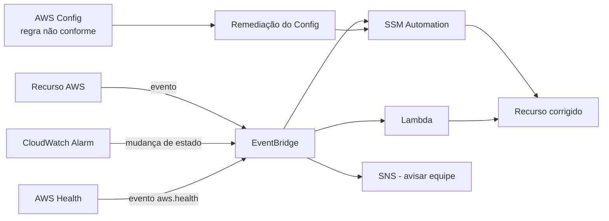

---
aliases:
  - Aula 21.8
modulo: 21
aula: 8
parte: "VI Resiliência e operações"
dominios:
  - 1
  - 2
  - 3
  - 4
lida: false
tags:
  - aula
  - saa-c03
  - modulo-21
---

# Aula 21.8: Health, Trusted Advisor, License Manager e remediação automática

[[21 - Observabilidade Automacao e Operacoes|Voltar ao módulo]]

> [!question] Pergunta que esta aula responde
> Como saber que um problema da AWS afeta **a sua conta**, como receber recomendações de custo, segurança e resiliência sem auditar à mão, como controlar licenças de software, e como transformar um sinal (alarme, evento, não conformidade) em uma **correção automática**?

## Fechando o ciclo: observar, avisar, agir

Nas aulas anteriores você aprendeu a **medir** ([[CloudWatch]], [[X-Ray]]), a **alertar** (alarmes), a **definir** a infraestrutura ([[CloudFormation]]) e a **administrar** frotas ([[Systems Manager]]). Falta fechar o ciclo com três perguntas operacionais:

1. **A AWS tem algum problema que afeta meus recursos?** ([[Health Dashboard|AWS Health]])
2. **Minha conta segue boas práticas?** ([[Trusted Advisor]] e [[Well-Architected Tool]])
3. **Quando algo sai do esperado, quem corrige?** ([[Remediacao Automatica|remediação automática]])

E há uma pergunta paralela de governança: **estou cumprindo as regras das licenças de software?** ([[License Manager]]).

## AWS Health: eventos que afetam a sua conta

O **[[Health Dashboard|AWS Health]]** informa sobre eventos de serviço e mudanças programadas que podem afetar **seus recursos**. Há duas visões:

| Visão | O que mostra | Para quem |
|---|---|---|
| **Service health** (eventos públicos) | Estado geral dos serviços por Região (interrupções que afetam muita gente) | Qualquer pessoa |
| **Your account health** (eventos da conta) | Eventos que afetam **recursos específicos da sua conta**: manutenção programada, instância com hardware degradado, certificado prestes a vencer, mudança de API descontinuada | Contas com acesso ao Health |

O **[[Health Dashboard]]** do console exibe as duas. O valor real está em **reagir por automação**: os eventos do Health são publicados no **[[EventBridge|Amazon EventBridge]]** (origem `aws.health`), e uma regra pode acionar [[SNS]] (aviso à equipe), [[Lambda]] ou [[Automation|SSM Automation]] ([[Systems Manager]]).

Pontos de prova:

- Um evento como "**AWS_EC2_INSTANCE_RETIREMENT_SCHEDULED**" (instância será aposentada) pode disparar uma regra que faz stop e start da instância EBS-backed (o que a move para um novo host); com [[Instance Store|instance store]], a instância precisa ser recriada a partir de uma [[AMI]].
- Com **[[Organizations|AWS Organizations]]**, a **visão organizacional** (organizational view) agrega os eventos de todas as contas em um painel central.
- A **[[Health Dashboard|AWS Health]] API** (consulta programática) exige o plano **Business Support+, Enterprise ou Unified Operations** (chamar sem o plano devolve `SubscriptionRequiredException`); o **Health Dashboard** e as regras do **[[EventBridge]]** para eventos da conta estão disponíveis em **todas as contas**, inclusive no plano Basic. Os planos Developer e Business antigos têm fim programado em **1º de janeiro de 2027** (verificado em novembro de 2026; veja a página oficial de fim de suporte em Para aprofundar).

> [!example] A instância que ia morrer na sexta
> O Health publica "instância `i-0abc` será aposentada em 5 dias". Uma regra do [[EventBridge]] casa o evento, chama um **[[Runbook|runbook]] do [[Automation|SSM Automation]]** que cria uma [[AMI]], faz stop e start da instância (reiniciar não troca de host; parar e iniciar, sim, para instância EBS-backed) e envia um aviso por [[SNS]]. Ninguém abriu um chamado, ninguém perdeu a janela.

## Trusted Advisor: recomendações contínuas

O **[[Trusted Advisor|AWS Trusted Advisor]]** inspeciona a conta e recomenda melhorias em categorias alinhadas aos pilares do [[Well-Architected Framework|Well-Architected]]:

| Categoria | Exemplo de verificação |
|---|---|
| **Cost optimization** (otimização de custos) | Instâncias ociosas, [[EBS\|volumes EBS]] sem uso, [[Elastic IP\|Elastic IPs]] não associados, reservas subutilizadas |
| **Performance** | Instâncias com alto uso, regras excessivas em [[Security Group\|Security Groups]] |
| **Security** | [[Bucket]] [[S3]] público, [[Security Group]] com portas abertas, [[MFA]] ausente na conta raiz, [[Access Key\|chaves de acesso]] expostas |
| **[[Tolerancia a Falhas\|Fault tolerance]]** | Sem backup de [[EBS]], sem [[Multi-AZ]], sem [[Versionamento\|versionamento]] no [[S3]] |
| **Service limits** ([[Service Quotas\|service quotas]]) | Uso próximo do limite de serviço |
| **Operational excellence** | Boas práticas operacionais |

Pontos de prova:

- O conjunto **completo** de verificações depende do **plano de suporte** (os planos mais baixos só têm um subconjunto, centrado em segurança e [[Service Quotas|limites de serviço]]). Com a reorganização dos planos, o acesso completo está nos planos Business Support+, Enterprise e Unified Operations (verificado em novembro de 2026).
- Dá para **receber avisos** com [[EventBridge]] (mudança de status de uma verificação) e **notificações** semanais por e-mail.
- A visão **organizacional** agrega as verificações de todas as contas.
- O [[Trusted Advisor]] **recomenda**; **não corrige** nem aplica nada sozinho.

Quando a pergunta é "**que recurso está ocioso** e quanto eu economizaria?", a resposta é o [[Trusted Advisor]] (ou o [[Cost Explorer]] e o [[Compute Optimizer]], do módulo de custos). Quando é "**o que estava errado na minha arquitetura**, pilar por pilar?", é o [[Well-Architected Tool]].

## License Manager: controle de licenças de software

O **[[License Manager|AWS License Manager]]** ajuda a **gerenciar licenças** de software de fornecedores (como Microsoft, Oracle, SAP, IBM) em instâncias AWS e on-premises, principalmente em cenários de **[[BYOL]]** (bring your own license).

- **Configurações de licença** (license configurations) definem as regras do contrato: **tipo de contagem** ([[vCPU]], núcleos, soquetes ou instâncias), **limite** e se ele é **rígido** (hard limit: bloqueia novos lançamentos acima do limite) ou **flexível** (soft limit: apenas alerta).
- **Associa** configurações a [[AMI|AMIs]] ou instâncias; ao lançar, o [[License Manager]] **contabiliza** o uso.
- **Compartilhamento entre contas** com [[Organizations|AWS Organizations]], para controlar o limite da empresa inteira em um só lugar.
- Integra-se com **[[Dedicated Host|Dedicated Hosts]]** (licenças por soquete ou núcleo físico) e com **AWS Marketplace**.
- **Descobre** software instalado (com o [[Systems Manager]] Inventory) e emite relatórios de uso.

Resposta de prova: "**impedir** que a empresa exceda o número de licenças compradas" é **[[License Manager]] com limite rígido**.

## Well-Architected Tool: revisar a arquitetura

O **[[Well-Architected Tool|AWS Well-Architected Tool]]** é um serviço gratuito para **revisar cargas de trabalho** com base nos **seis pilares** do [[Well-Architected Framework]] (excelência operacional, segurança, confiabilidade, eficiência de desempenho, otimização de custos e sustentabilidade). Você responde a perguntas, o serviço identifica **riscos** (alto e médio) e gera um **plano de melhoria**, com **marcos** (milestones) para comparar a evolução. **[[Well-Architected Lens|Lenses]]** estendem a revisão para domínios específicos (por exemplo, [[Serverless|serverless]] ou SaaS).

Detalhes finos do serviço (número de [[Well-Architected Lens|lenses]], integrações recentes) mudam e não foram reconferidos para esta aula (não confirmado). Para a prova, basta saber: **revisão guiada por pilares, gratuita, gera plano de melhoria**. Não é uma ferramenta automática de varredura de recursos (esse é o [[Trusted Advisor]]).

## Remediação automática: transformar sinais em correções

Os mesmos blocos das aulas anteriores se combinam em padrões de **[[Remediacao Automatica|remediação automática]]**: um **sinal** dispara uma **ação** sem intervenção humana.

| Sinal (gatilho) | Ação (motor) | Exemplo |
|---|---|---|
| **Evento do [[Health Dashboard\|AWS Health]]** (via [[EventBridge]]) | Lambda, [[Automation\|SSM Automation]], [[SNS]] | Aposentadoria de instância: recriar em hardware saudável |
| **Alarme do [[CloudWatch]]** (aulas 21.1 e 21.2) | Ações de [[Auto Scaling Group\|Auto Scaling]], [[EC2]] (parar, reiniciar, recuperar), [[SNS]], ou [[EventBridge]] | Erro alto: recuperar a instância |
| **Não conformidade do [[Config\|AWS Config]]** | **[[Remediacao Automatica\|Remediação do Config]]** com documento do **[[Automation\|SSM Automation]]** | [[Bucket]] sem criptografia: ligar a criptografia |
| **Achado do [[GuardDuty]] ou do [[Security Hub]]** | [[EventBridge]], Lambda, Automation | Credencial comprometida: desativar a chave e isolar a instância |
| **Mudança de estado de recurso** (qualquer evento AWS) | [[EventBridge]] para qualquer alvo | Instância parou: avisar e tentar reiniciar |

Dois detalhes que a prova gosta de explorar:

- **[[Config]] [[Remediacao Automatica|remediation]]** usa **documentos do [[Automation|SSM Automation]]** (por exemplo, `AWS-DisablePublicAccessForSecurityGroup` para fechar um [[Security Group]] aberto ao mundo). Pode ser **manual** (alguém aprova) ou **automática**, com número de tentativas.
- A [[Remediacao Automatica|remediação]] precisa de um **papel [[IAM]]** (a automation assume role) com permissão **mínima** para executar a correção, caso contrário a própria automação vira um risco.

> [!info] Ligando os pontos
> Este é o ponto onde tudo converge: o **[[CloudWatch]]** ([[Observabilidade|observabilidade]]) e o **Config** (conformidade) detectam, o **[[EventBridge]]** roteia, o **[[Automation|Systems Manager Automation]]** age, e o **[[CloudFormation]]** garante que o estado correto também esteja no código. A frase de prova é "**com o mínimo de [[Overhead Operacional|esforço operacional]]**", e a resposta quase sempre é um serviço gerenciado conectado por EventBridge, em vez de um script próprio em uma instância.

> [!warning] Automação sem freio é risco
> [[Remediacao Automatica|Remediação automática]] que apaga ou reinicia recursos de produção precisa de limites: escopo por tags, papel [[IAM]] mínimo, teste em homologação e notificação por [[SNS]]. Para ações destrutivas, prefira **aprovação manual** (o Automation suporta etapa de aprovação).

## Como isso cai na prova

> [!info] Task statements 2.2, 1.2, 4.1 e 4.2
> A aula cobre automação e resposta operacional (2.2), governança e conformidade (1.2) e, de forma indireta, as recomendações de custo do [[Trusted Advisor]] (volumes ociosos em 4.1, instâncias ociosas e licenças [[BYOL]] em 4.2).

**Palavras-chave em inglês:** *scheduled maintenance event*, *notify the team when AWS resource is affected*, *recommendations for cost and security*, *idle resources*, *track software licenses*, *prevent exceeding licensed count*, *automatically remediate non-compliant*, *with the least [[Overhead Operacional|operational overhead]]*.

**Pegadinhas clássicas:**

- **Health** avisa de eventos que afetam **sua conta**; **[[Trusted Advisor]]** recomenda boas práticas; nenhum dos dois corrige sozinho.
- **[[Trusted Advisor]]** completo depende do plano de suporte.
- **[[License Manager]]** com **limite rígido** impede ultrapassar as licenças.
- **Config** avalia conformidade; a **correção** vem da **[[Remediacao Automatica|remediação]] ([[Automation|SSM Automation]])**.
- **[[EventBridge]]** é o roteador; **[[SNS]]** só notifica; quem executa a correção é **Lambda** ou **Automation**.

| Requisito no enunciado | Resposta provável | Por quê |
|---|---|---|
| Ser avisado de manutenção ou aposentadoria que afeta a conta | [[Health Dashboard\|AWS Health]] com regra do [[EventBridge]] | Eventos da conta publicados em `aws.health` |
| Achar recursos ociosos e riscos de segurança básicos | [[Trusted Advisor]] | Verificações por categoria |
| Revisar a arquitetura segundo os seis pilares | [[Well-Architected Tool]] | Revisão guiada com plano de melhoria |
| Impedir que a empresa use mais licenças do que comprou | [[License Manager]] (limite rígido) | Bloqueia lançamentos acima do limite |
| Corrigir automaticamente um [[Bucket\|bucket]] sem criptografia | [[Config\|AWS Config]] com [[Remediacao Automatica\|remediação]] ([[Automation\|SSM Automation]]) | Detecta e corrige |
| Reagir a um alarme com ação [[Serverless\|sem servidor]] para manter | [[CloudWatch Alarm]] ou [[EventBridge]] com [[Automation\|SSM Automation]] ou Lambda | Gerenciado e sem infraestrutura |
| Visão de eventos de todas as contas da organização | Visão organizacional do Health | Agregação com Organizations |

## Resumo

> [!abstract] A aula em uma frase
> O Health avisa o que afeta a sua conta, o [[Trusted Advisor]] e o [[Well-Architected Tool]] recomendam melhorias, o [[License Manager]] controla licenças, e a [[Remediacao Automatica|remediação automática]] liga um sinal (Health, alarme, Config, [[GuardDuty]]) via [[EventBridge]] a uma ação (Lambda ou [[Automation|SSM Automation]]) com o mínimo de [[Overhead Operacional|esforço operacional]].

**A lógica, em 5 passos**

1. O Health publica eventos da conta no [[EventBridge]], que aciona [[SNS]], Lambda ou Automation.
2. O [[Trusted Advisor]] varre a conta por categorias; a profundidade depende do plano de suporte.
3. O [[Well-Architected Tool]] conduz a revisão por pilares e gera um plano de melhoria.
4. O [[License Manager]] aplica regras de licença e pode bloquear o excesso com limite rígido.
5. A [[Remediacao Automatica|remediação]] combina sinal, roteamento ([[EventBridge]] ou Config) e motor (Automation ou Lambda), com papel [[IAM]] mínimo.

**Números para lembrar** (verificado em novembro de 2026)

| O quê | Valor | Por que importa |
|---|---|---|
| Categorias do [[Trusted Advisor]] | Custo, desempenho, segurança, [[Tolerancia a Falhas\|tolerância a falhas]], limites e excelência operacional | Mapeiam os pilares |
| Pilares do [[Well-Architected Framework\|Well-Architected]] | 6 | Base da revisão |
| Fim dos planos Developer e Business antigos | 1º de janeiro de 2027 | Muda o acesso ao [[Trusted Advisor]] e à API do Health |

**Na prática, isso significa**

- Crie uma regra do [[EventBridge]] para [[Health Dashboard|eventos do Health]] que afetam produção.
- Revise as recomendações do [[Trusted Advisor]] com frequência fixa.
- Use limite rígido no [[License Manager]] para licenças caras.
- Automatize correções de baixo risco; exija aprovação para ações destrutivas.

> [!tip] Liga com
> Fecha o módulo juntando alarmes ([[21.02 - Alarmes do CloudWatch e Acoes Automaticas|aula 21.2]]), [[Systems Manager]] ([[21.07 - Systems Manager Gerencia Remota e Parametros|aula 21.7]]) e [[CloudFormation]] ([[21.06 - CloudFormation Operacao StackSets Service Catalog e Governanca|aula 21.6]]). O próximo módulo é [[22 - Dados Analytics e Ingestao|Dados, Analytics e Ingestão]].

## Erros comuns

- **"O [[Trusted Advisor]] corrige os problemas que encontra."** Ele só recomenda.
- **"O Health e o [[Trusted Advisor]] são a mesma coisa."** O primeiro avisa de eventos da AWS que afetam a conta; o segundo avalia boas práticas.
- **"O Config corrige sozinho a não conformidade."** Só se você configurar a [[Remediacao Automatica|remediação]] ([[Automation|SSM Automation]]).
- **"[[Remediacao Automatica|Remediação automática]] dispensa papel [[IAM]]."** A automation assume um papel, que deve ter permissão mínima.
- **"O [[License Manager]] só funciona em [[EC2]] da AWS."** Também cobre servidores on-premises, com o [[Systems Manager]].

## Pratique

**1.** Uma empresa quer ser avisada, por e-mail, sempre que a AWS agendar a aposentadoria de uma [[EC2|instância EC2]] de produção. Qual a solução com menos [[Overhead Operacional|esforço operacional]]?

- [ ] a) Um script na instância que consulta o hardware a cada minuto e envia um e-mail quando detecta falha
- [ ] b) Verificar o Health Dashboard manualmente todos os dias e avisar a equipe por mensagem
- [ ] c) Um alarme do CloudWatch sobre a CPU da instância, com notificação por e-mail via SNS
- [ ] d) Uma regra do EventBridge para eventos do AWS Health publicando em um tópico SNS com e-mail

**2.** A equipe financeira quer identificar [[EBS|volumes EBS]] sem uso, [[Elastic IP|Elastic IPs]] não associados e instâncias ociosas, com uma lista de economia estimada. O que usar?

- [ ] a) O AWS Config com uma regra de tags que lista os recursos sem proprietário definido
- [ ] b) O AWS Trusted Advisor, na categoria de otimização de custos, com a estimativa de economia
- [ ] c) O Amazon GuardDuty, que aponta recursos sem uso a partir da análise dos logs da conta
- [ ] d) O AWS License Manager, que identifica recursos ociosos pelo contador de licenças da conta

**3.** Uma empresa comprou 200 licenças de um software cobrado por [[vCPU]] e quer **impedir** que lançamentos de instâncias ultrapassem esse limite em todas as contas da organização. O que usar?

- [ ] a) O Trusted Advisor com alerta por e-mail quando o uso passar de 200 vCPUs licenciadas
- [ ] b) Uma planilha atualizada pela equipe a cada lançamento de instância nas contas da organização
- [ ] c) O AWS License Manager, com configuração de licença de limite rígido compartilhada na organização
- [ ] d) O CloudWatch com um alarme de custos que avisa quando o gasto com o software passar do orçamento

**4.** Uma regra do [[Config|AWS Config]] marca como não conformes os buckets [[S3]] sem criptografia. A equipe quer que a criptografia seja ligada automaticamente. Qual a solução?

- [ ] a) Configurar a remediação automática da regra do Config com um documento do SSM Automation
- [ ] b) Aguardar que o Trusted Advisor corrija o bucket quando a verificação de segurança rodar
- [ ] c) Habilitar o CloudTrail em todas as Regiões para que o evento de criação ligue a criptografia
- [ ] d) Criar um alarme do CloudWatch para a métrica do bucket que executa a criptografia ao disparar

**5.** (Escolha DUAS.) Quais afirmações sobre o [[Health Dashboard|AWS Health]] e o [[Trusted Advisor]] estão corretas?

- [ ] a) O Health publica eventos da conta no EventBridge
- [ ] b) O Trusted Advisor corrige automaticamente os problemas que encontra
- [ ] c) O Trusted Advisor agrupa verificações em categorias como custo, segurança e tolerância a falhas
- [ ] d) O Health só mostra o estado geral dos serviços, sem eventos da conta
- [ ] e) O Trusted Advisor só funciona em contas sem AWS Organizations

**6.** Uma empresa quer revisar uma carga de trabalho com base nos seis pilares do [[Well-Architected Framework]], receber uma lista de riscos e um plano de melhoria, sem custo adicional. O que usar?

- [ ] a) O Trusted Advisor, que varre os recursos da conta e classifica os riscos por categoria
- [ ] b) O Amazon Inspector, que avalia vulnerabilidades e gera um plano de melhoria por pilar
- [ ] c) O AWS Config, que avalia a conformidade das regras e gera o plano de melhoria da carga
- [ ] d) O AWS Well-Architected Tool, com revisão guiada por pilares e plano de melhoria da carga

**7.** Um [[CloudWatch Alarm|alarme do CloudWatch]] indica uma instância com falha. A equipe quer que um fluxo com várias etapas (criar [[AMI]], parar e iniciar a instância e registrar um [[OpsItem]]) seja executado automaticamente, sem manter servidores. Qual combinação serve?

- [ ] a) Uma instância EC2 com um cron que consulta o alarme e executa os passos com a AWS CLI
- [ ] b) Alarme ou regra do EventBridge acionando um runbook do SSM Automation com os três passos
- [ ] c) Um tópico SNS que envia e-mail ao plantão e aguarda que o operador execute os passos
- [ ] d) Um StackSet que reimplanta a instância em todas as contas quando o alarme entra em ALARM

**8.** (Escolha DUAS.) Quais boas práticas valem para a [[Remediacao Automatica|remediação automática]]?

- [ ] a) Usar um papel IAM com permissões mínimas para a automação
- [ ] b) Dar `AdministratorAccess` ao papel para evitar erros de permissão
- [ ] c) Exigir aprovação manual para ações destrutivas em produção
- [ ] d) Aplicar a automação a todos os recursos da conta, sem escopo por tag
- [ ] e) Evitar qualquer notificação para não gerar ruído

**9.** Uma organização com várias contas quer ver, em um único painel, os eventos do [[Health Dashboard|AWS Health]] de todas as contas. O que usar?

- [ ] a) Abrir o Health Dashboard de cada conta, uma por uma, e juntar os eventos à mão
- [ ] b) Um script agendado que consulta a API do Health de cada conta e grava o resultado em uma planilha
- [ ] c) A visão organizacional do AWS Health, habilitada com o AWS Organizations, em um painel central
- [ ] d) O Amazon Macie, que agrega os eventos de todas as contas em um painel único

**10.** Por que o acesso completo ao [[Trusted Advisor]] (e à API do Health) pode não estar disponível em uma conta, e o que verificar?

- [ ] a) O acesso completo depende do plano de suporte da conta; verificar o plano atual
- [ ] b) O serviço é cobrado por verificação e precisa ser ativado em cada Região antes do uso
- [ ] c) Ele exige o Systems Manager Inventory ativo em todas as instâncias da conta
- [ ] d) Ele foi descontinuado, e as recomendações agora vêm do License Manager

**11.** Uma conta com plano de suporte Basic quer ser notificada por e-mail quando um evento do [[Health Dashboard|AWS Health]] afetar seus recursos. Isso é possível?

- [ ] a) Não é possível: tanto o EventBridge quanto o Health Dashboard exigem um plano Business ou superior
- [ ] b) É possível: regra do EventBridge com SNS vale em qualquer plano; só a Health API exige plano pago
- [ ] c) É possível apenas chamando a AWS Health API, que está liberada para todos os planos de suporte
- [ ] d) É possível somente depois de ativar o Trusted Advisor completo, que libera os eventos do Health

> [!success]- Gabarito
> **1. d)** O Health publica eventos no [[EventBridge]], que aciona o [[SNS]] (e-mail), sem servidores. (a) é frágil e não enxerga o agendamento da AWS; (b) é manual; (c) CPU não indica aposentadoria.
> **2. b)** O [[Trusted Advisor]] de otimização de custos lista ociosos e economia estimada. (a) Config avalia configuração; (c) [[GuardDuty]] detecta ameaças; (d) [[License Manager]] trata licenças.
> **3. c)** [[License Manager]] com limite rígido bloqueia lançamentos acima do número de licenças. (a) só avisa; (b) é manual; (d) alarme de custo não controla licenças.
> **4. a)** A [[Remediacao Automatica|remediação do Config]] com [[Automation|SSM Automation]] liga a criptografia. (b) o [[Trusted Advisor]] não corrige; (c) [[CloudTrail]] só registra; (d) alarme não aplica correção.
> **5. a), c)** O Health publica no [[EventBridge]] e o [[Trusted Advisor]] agrupa por categorias. (b) ele só recomenda; (d) o Health mostra também eventos da conta; (e) há visão organizacional.
> **6. d)** O [[Well-Architected Tool]] revisa por pilares e gera plano de melhoria, sem custo. (a) varre recursos; (b) Inspector procura vulnerabilidades; (c) Config avalia configuração.
> **7. b)** [[EventBridge]] ou alarme acionando um [[Runbook|runbook]] do Automation executa as etapas sem servidores (para uma instância EBS-backed, stop e start a move para um novo host). (a) exige manter uma instância; (c) depende de operador; (d) [[StackSets]] distribuem templates, não reagem a alarme.
> **8. a), c)** Papel mínimo e aprovação manual para ações destrutivas. (b) viola o [[Menor Privilegio|menor privilégio]]; (d) falta escopo; (e) notificação é boa prática.
> **9. c)** A visão organizacional agrega os eventos de todas as contas. (a) e (b) são manuais; (d) [[Macie]] trata dados sensíveis.
> **10. a)** O acesso completo depende do plano de suporte, que mudou (Developer e Business antigos têm fim em 1º de janeiro de 2027, conforme a página oficial de fim de suporte). (b) não há ativação por Região nem cobrança por verificação; (c) não usa agente nem Inventory; (d) o serviço existe e não foi substituído.
> **11. b)** As regras do [[EventBridge]] para eventos da conta e o [[Health Dashboard]] funcionam em qualquer plano; só a AWS Health API (consulta programática) exige Business Support+, Enterprise ou Unified Operations. (a) o EventBridge e o painel não exigem plano pago; (c) a API é justamente a parte restrita; (d) o [[Trusted Advisor]] é independente dos eventos do Health.

### Laboratório (opcional)

> [!warning] Use uma conta AWS pessoal
> Faça em uma **[[Conta AWS|conta AWS]] pessoal separada**, com [[Budgets|AWS Budgets]] configurado, **nunca na conta de produção da empresa**. A regra do [[EventBridge]] e o tópico [[SNS]] têm custo desprezível. Apague tudo ao final.

1. Crie um tópico e assine seu e-mail: `aws sns create-topic --name lab-health` e `aws sns subscribe --topic-arn <arn> --protocol email --notification-endpoint voce@exemplo.com` (confirme o e-mail).
2. Crie uma regra para [[Health Dashboard|eventos do Health]]: `aws events put-rule --name lab-health-regra --event-pattern '{"source":["aws.health"]}'`.
3. Aponte a regra para o tópico: `aws events put-targets --rule lab-health-regra --targets Id=1,Arn=<arn-do-topico>` (o tópico precisa de uma política que permita a publicação pelo `events.amazonaws.com`).
4. Abra o [[Trusted Advisor]] no console e observe as categorias disponíveis no seu plano.

Limpeza: `aws events remove-targets --rule lab-health-regra --ids 1`, `aws events delete-rule --name lab-health-regra` e `aws sns delete-topic --topic-arn <arn>`.

## Para aprofundar

- [ ] [Developer, Business, and Enterprise On-Ramp end of support](https://docs.aws.amazon.com/awssupport/latest/user/support-plans-eos.html) (AWS Docs): fim dos planos antigos em 1º de janeiro de 2027.
- [ ] [AWS Health API](https://docs.aws.amazon.com/health/latest/ug/health-api.html) (AWS Docs): a API exige plano Business Support+, Enterprise ou Unified Operations.
- [ ] [What is AWS Health](https://docs.aws.amazon.com/health/latest/ug/what-is-aws-health.html) (AWS Docs): eventos, painel e integração com o [[EventBridge]].
- [ ] [AWS Trusted Advisor](https://docs.aws.amazon.com/awssupport/latest/user/trusted-advisor.html) (AWS Docs): categorias de verificação e uso.
- [ ] [What is AWS License Manager](https://docs.aws.amazon.com/license-manager/latest/userguide/license-manager.html) (AWS Docs): configurações de licença e limites rígidos.
- [ ] [Remediating noncompliant resources with AWS Config rules](https://docs.aws.amazon.com/config/latest/developerguide/remediation.html) (AWS Docs): [[Remediacao Automatica|remediação]] com [[Automation|SSM Automation]].

Próximo módulo: [[22 - Dados Analytics e Ingestao|Módulo 22: Dados, Analytics e Ingestão]].
