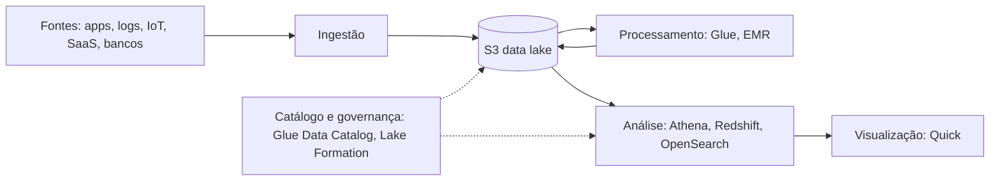

---
aliases:
  - Aula 22.1
modulo: 22
aula: 1
parte: "VII Dados, migração e IA"
dominios:
  - 3
  - 4
lida: false
tags:
  - aula
  - saa-c03
  - modulo-22
---

# Aula 22.1: Por que um pipeline de dados e o mapa de serviços

[[22 - Dados Analytics e Ingestao|Voltar ao módulo]]

> [!question] Pergunta que esta aula responde
> Por que não basta consultar o banco da aplicação para responder perguntas de negócio, quais são as etapas de um pipeline de dados e como a velocidade, o tamanho e a frequência dos dados decidem entre [[Processamento em Lote]] e [[Streaming de Dados]]?

## O problema: o banco da aplicação não foi feito para isso

Você opera um [[RDS]] PostgreSQL que atende a sua API. Esse banco é otimizado para **muitas transações pequenas**: inserir um pedido, ler um cliente pelo id, atualizar um status. Esse perfil se chama [[OLTP]] (online transaction processing).

Agora o time de produto pergunta: "qual foi a receita por categoria de produto e por semana nos últimos dois anos, separada por país?". Essa consulta lê **milhões de linhas, mas poucas colunas**, e agrega. É uma carga [[OLAP]] (online analytical processing). Rodar isso no banco transacional causa três problemas:

1. **Contenção:** a consulta pesada compete por CPU, memória e I/O com os pedidos dos clientes e derruba a [[Latencia|latência]] da API.
2. **Forma do dado errada:** o banco guarda linhas inteiras; para somar uma coluna ele lê todas as outras junto.
3. **Dados dispersos:** a resposta precisa de pedidos (PostgreSQL), cliques do site (logs), estoque (outro sistema) e dados de parceiros. Nenhum banco tem tudo.

A solução é **copiar os dados para um lugar projetado para análise**, em uma esteira automatizada. Essa esteira é o **pipeline de dados**, e o módulo inteiro é sobre como montar cada trecho dela na AWS.

> [!info] Ligando os pontos
> No [[13 - Bancos Relacionais RDS e Aurora|Módulo 13]] você viu que uma [[Read Replica|réplica de leitura]] pode absorver relatórios. Serve para relatório simples, mas continua sendo um banco por linhas e continua só com dados de uma origem. O pipeline de dados resolve o caso em que a análise é grande, mistura origens ou precisa de histórico longo. A comparação de bancos operacionais por padrão de acesso está no [[14 - DynamoDB Cache e Bancos de Proposito Especifico|Módulo 14]].

## As etapas de um pipeline

Todo pipeline faz, em alguma forma, cinco trabalhos. A AWS tem serviços para cada um, e a prova pergunta "qual serviço faz esta etapa".

| Etapa | Pergunta que responde | Serviços deste módulo |
|---|---|---|
| **Ingestão** | Como o dado sai da origem e chega à AWS? | [[Kinesis Data Streams]], [[Data Firehose]], [[MSK]], [[Kinesis Video Streams]]; [[AppFlow]] (Módulo 15) e [[DataSync\|AWS DataSync]] (Módulo 23) para arquivos e SaaS |
| **Armazenamento** | Onde o dado fica, barato e durável? | [[S3]] como [[Data Lake]]; [[Redshift]] como [[Data Warehouse]] |
| **Processamento** | Como limpar, converter e enriquecer? | [[Glue]], [[EMR]], [[Managed Service for Apache Flink]], [[Lambda]] |
| **Análise** | Como fazer perguntas ao dado? | [[Athena]], [[Redshift]], [[OpenSearch Service]] |
| **Visualização** | Como mostrar a resposta a quem decide? | [[Amazon Quick]] |

> [!note] Termos que vêm antes da definição
> Neste mapa aparecem *[[Shard|shards]]*, *partições* e *consumidor*. Eles serão definidos na [[22.02 - Kinesis Data Streams|22.2]] (shard e consumidor do Kinesis) e na [[22.04 - MSK e a Escolha do Servico de Streaming|22.4]] ([[Particao do Kafka|partição do Kafka]]); por enquanto, leia-os como "pedaços do fluxo" e "quem lê o fluxo".

### Como o dado chega: cinco caminhos de ingestão (Task 3.5)

| Origem do dado | Caminho | Onde estudar |
|---|---|---|
| **Eventos contínuos** (cliques, sensores, logs) | [[Kinesis Data Streams]], [[Data Firehose]], [[MSK]] | Aulas 22.2 a 22.4 |
| **Arquivos** (de servidores, NAS, SFTP) | [[DataSync]], [[Transfer Family]], [[Storage Gateway]] | [[23 - Migracao e Transferencia de Dados|Módulo 23]] |
| **Banco de dados** (replicar para o lago) | [[DMS]] ([[Full Load\|carga completa]] e [[Change Data Capture\|CDC]]) | [[23 - Migracao e Transferencia de Dados|Módulo 23]] |
| **SaaS** (Salesforce, Zendesk etc.) | [[AppFlow]] | [[15 - Desacoplamento Filas Eventos e Workflows|Módulo 15]] |
| **Offline** (volume enorme, rede lenta) | [[Snow Family\|Família Snow]] | [[23 - Migracao e Transferencia de Dados|Módulo 23]] |

Regra: o formato da **origem** escolhe o caminho; só depois escolhemos o destino. "Arquivos do data center para o [[S3]] em [[Processamento em Lote|lote]]" não é problema de [[Streaming de Dados|streaming]].

Duas funções atravessam todas as etapas: o **catálogo** (saber que dados existem e qual o formato, trabalho do [[Glue Data Catalog]]) e a **governança** (quem pode ver o quê, trabalho do [[Lake Formation]] e do [[IAM]]). O módulo trata os dois como serviços de primeira classe, porque sem eles um [[Data Lake|data lake]] vira um "pântano de dados": arquivos que ninguém sabe ler nem tem permissão para ler.

## Batch ou streaming: o eixo da velocidade

A pergunta mais importante para escolher serviço é **quão rápido o dado precisa virar resposta**. Há três faixas:

| Modo | [[Latencia\|Latência]] típica do dado até a resposta | Como funciona | Exemplo | Serviços típicos |
|---|---|---|---|---|
| **Lote (batch)** | horas a dias | acumula dados e processa tudo de uma vez, em horário marcado | fechamento diário de vendas | [[Glue]] agendado, [[EMR]], [[Athena]] sobre [[S3]] |
| **Quase em tempo real (near real time)** | segundos a poucos minutos | agrupa em pequenos blocos (buffer) e entrega | logs de aplicação indo para [[S3]] ou [[OpenSearch Service\|OpenSearch]] | [[Data Firehose]] |
| **Tempo real (real time)** | milissegundos a segundos | processa cada registro assim que chega | detecção de fraude no pagamento | [[Kinesis Data Streams]] + consumidor, [[MSK]], [[Managed Service for Apache Flink\|Flink]] |

> [!tip] Palavras-chave da prova
> "real-time" e "milliseconds" apontam para [[Kinesis Data Streams]] ou [[MSK]] com um consumidor próprio. "Near real-time" e "load into [[S3]] / [[Redshift]] / [[OpenSearch Service|OpenSearch]] with no code" apontam para [[Data Firehose]]. "Nightly", "daily" e "scheduled" apontam para batch com Glue ou [[EMR]].

O custo e a complexidade crescem com a velocidade. Um stream sempre ligado cobra por hora mesmo sem tráfego, e o consumidor precisa tratar duplicatas e falhas. Um job noturno cobra só enquanto roda. **Não escolha [[Streaming de Dados|streaming]] quando o requisito é "relatório de manhã".** A AWS pune esse exagero nas questões de custo.

## Os três eixos que decidem o desenho: velocidade, volume e variedade

A literatura de dados descreve os "3 Vs". Na prova, eles viram parâmetros de configuração.

- **Velocidade** (frequência de chegada): decide batch vs [[Streaming de Dados|streaming]] e quantos [[Shard|shards]] ou partições você precisa.
- **Volume** (tamanho): decide o armazenamento ([[S3]] escala sem limite prático, um banco relacional não) e o motor de processamento (um Lambda de no máximo 30 minutos não processa 5 TB; um cluster [[Apache Spark|Spark]] processa).
- **Variedade** (formato): CSV, JSON, logs de texto, [[Parquet]], imagens, vídeo. Dado sem esquema fixo pede [[Schema-on-Read]]; dado com esquema rígido e muitos joins pede [[Data Warehouse]].

O exam guide cita isso literalmente: "data ingestion patterns (frequency)" e "sizes and speeds needed" na Task 3.5.

> [!example] Exemplo concreto: loja online
> Uma loja gera três fluxos. (1) **Pedidos:** 50 por segundo, vêm do [[RDS]]; basta uma cópia a cada hora para análise, então é batch. (2) **Cliques do site:** 8.000 por segundo, 2 KB cada (cerca de 16 MB/s); o time de marketing quer ver o funil em menos de um minuto, então é [[Streaming de Dados|streaming]] ([[Kinesis Data Streams]] ou [[Data Firehose|Firehose]]). (3) **Fotos de produto:** 2 milhões de arquivos de 3 MB; vão para o [[S3]] e são analisadas depois com serviços de IA. Um único pipeline não serve aos três: cada um tem velocidade, volume e variedade diferentes.

## Data lake, data warehouse e a escolha do esquema

Os dois destinos clássicos de análise:

| | [[Data Lake]] | [[Data Warehouse]] |
|---|---|---|
| Armazena | dado bruto e processado, qualquer formato | dado estruturado, já modelado em tabelas |
| Esquema | aplicado na leitura ([[Schema-on-Read]]) | definido na escrita |
| Serviço AWS | [[S3]] + [[Glue Data Catalog]] + [[Athena]] | [[Redshift]] |
| Custo de armazenar | muito baixo (preço do [[S3]]) | maior por GB, mas com desempenho mais previsível em consultas complexas |
| Quem usa | cientistas de dados, engenheiros, consultas ad hoc | analistas de negócio, relatórios recorrentes |

Na prática, as empresas usam **os dois**: o lake guarda tudo barato, e o warehouse recebe só o que precisa de desempenho. O [[Redshift]] consegue consultar o lake diretamente ([[Redshift Spectrum]], aula 22.9), o que dissolve a fronteira.

**ETL ou ELT?** [[ETL]] (extract, transform, load) transforma o dado **antes** de gravar no destino: o Glue converte CSV em [[Parquet]] e só então grava no lake. ELT (extract, load, transform) grava o dado cru primeiro e transforma **dentro** do destino com SQL, comum no [[Redshift]]. Para a prova, basta saber que o Glue é a ferramenta de ETL [[Serverless|serverless]] e que o formato final do lake deve ser [[Armazenamento Colunar|colunar]] (aula 22.5).

## Escolhendo o ponto de partida: quatro perguntas

Diante de um enunciado de dados, responda nesta ordem:

1. **Qual a [[Latencia|latência]] exigida?** Segundos vs horas separa [[Streaming de Dados|streaming]] de batch.
2. **De onde vêm os dados e em que forma?** Eventos contínuos (Kinesis, [[MSK]]), arquivos ([[S3]], [[DataSync]]), banco ([[DMS]], módulo 23), SaaS ([[AppFlow]]).
3. **Quem consome e como?** SQL ad hoc (Athena), relatórios pesados com joins ([[Redshift]]), busca e logs ([[OpenSearch Service|OpenSearch]]), dashboard (Quick), código [[Apache Spark|Spark]] (Glue, [[EMR]]).
4. **Quanto de operação o enunciado aceita?** "Least [[Overhead Operacional|operational overhead]]" empurra para [[Serverless|serverless]]: [[Data Firehose|Firehose]], Athena, Glue, [[Redshift Serverless]], [[EMR]] Serverless.

## Como isso cai na prova

Cobre a **Task 3.5** (soluções de ingestão e transformação de dados de alta performance) e prepara a **Task 4.3** (formatos colunares e séries temporais como tipos de dado de custo menor).

**Palavras-chave em inglês e o que apontam:**

- "ingest", "[[Streaming de Dados|streaming]] data", "clickstream", "IoT telemetry": [[Kinesis Data Streams]], [[Data Firehose]] ou [[MSK]].
- "ad hoc SQL on [[S3]]", "[[Serverless|serverless]]", "no infrastructure": Athena.
- "[[Data Warehouse|data warehouse]]", "complex joins", "petabyte-scale analytics": [[Redshift]].
- "[[ETL]]", "catalog", "convert to [[Parquet]]": Glue.
- "business intelligence", "dashboards": [[Amazon Quick]].
- "[[Overhead Operacional|operational overhead]]", "fully managed": serviços [[Serverless|serverless]] da lista acima.

**Pegadinhas clássicas:**

- Propor [[Streaming de Dados|streaming]] para um relatório diário: mais caro e mais complexo sem ganho.
- Consultar o banco de produção para análise pesada em vez de separar a [[OLAP|carga analítica]].
- Confundir [[Data Lake|data lake]] ([[S3]] + Athena) com [[Data Warehouse|data warehouse]] ([[Redshift]]): o enunciado costuma dizer "structured, repeatable, complex queries" para warehouse e "raw, varied, ad hoc" para lake.
- Esquecer que o processamento tem destino: o resultado de um job Glue volta para o [[S3]] em outro prefixo.

| Requisito no enunciado | Resposta provável | Por quê |
|---|---|---|
| Relatório pesado sem afetar o banco de produção | Copiar dados para [[S3]] + Athena, ou para [[Redshift]] | Separa [[OLAP\|carga analítica]] da transacional |
| Dados chegam continuamente e a análise tolera 1 a 2 minutos | [[Data Firehose]] para [[S3]] | Near real time sem código |
| Resposta em milissegundos a cada evento | [[Kinesis Data Streams]] (ou [[MSK]]) com consumidor | Tempo real exige leitura direta do stream |
| Consulta ocasional em SQL sobre arquivos | Athena | [[Serverless]], paga por consulta |
| Menor [[Overhead Operacional\|overhead operacional]] | Opção [[Serverless\|serverless]] gerenciada | Sem cluster para operar |

## Resumo

> [!abstract] A aula em uma frase
> O banco transacional não serve para análise pesada, então um pipeline de dados copia, transforma e organiza os dados em cinco etapas (ingestão, armazenamento, processamento, análise, visualização), e a velocidade exigida decide entre [[Processamento em Lote|lote]], quase em tempo real e tempo real.

**A lógica, em 5 passos**

1. [[OLAP|Carga analítica]] (muitas linhas, poucas colunas, várias origens) conflita com [[OLTP|carga transacional]], então se separa.
2. O pipeline tem cinco etapas, com catálogo e governança atravessando todas.
3. A [[Latencia|latência]] exigida escolhe o modo: [[Processamento em Lote|lote]] (horas), near real time (segundos a minutos), tempo real (milissegundos).
4. Volume, velocidade e variedade viram parâmetros: [[Shard|shards]], formato, motor de processamento.
5. Lake (barato, [[Schema-on-Read|esquema na leitura]]) e warehouse (modelado, rápido em joins) convivem.

**Tabela-síntese**

| Preciso de... | Serviço |
|---|---|
| Entrada contínua em tempo real | [[Kinesis Data Streams]], [[MSK]] |
| Entrega gerenciada para [[S3]], [[Redshift]], [[OpenSearch Service\|OpenSearch]] | [[Data Firehose]] |
| Armazenar tudo barato | [[S3]] ([[Data Lake\|data lake]]) |
| Converter e catalogar | Glue |
| SQL sob demanda sobre [[S3]] | Athena |
| Joins pesados e histórico estruturado | [[Redshift]] |
| Dashboard | [[Amazon Quick]] |

**Na prática, isso significa**

- Ao ler um enunciado, marque a [[Latencia|latência]] exigida antes de olhar as alternativas.
- Dado novo quase sempre entra no [[S3]]; o que muda é como chega e quem consulta.
- "Menor overhead" quase nunca é um cluster que você administra.
- [[Streaming de Dados|Streaming]] só quando o negócio exige resposta em segundos.

> [!tip] Liga com
> Vem do [[11 - Amazon S3 a Fundo|Módulo 11]] (o [[S3]] é o alicerce do lake) e do [[15 - Desacoplamento Filas Eventos e Workflows|Módulo 15]] (filas e eventos). Segue para [[22.02 - Kinesis Data Streams|a aula 22.2]], que abre a etapa de ingestão.

## Erros comuns

- **"Basta uma [[Read Replica|réplica de leitura]] para qualquer relatório."** Para análise grande com várias origens, ela continua sendo um banco por linhas com um só conjunto de dados.
- **"[[Streaming de Dados|Streaming]] é sempre melhor porque é mais moderno."** Cobra por hora, exige tratar duplicatas e só se justifica com requisito de segundos.
- **"[[Data Lake|Data lake]] e [[Data Warehouse|data warehouse]] são sinônimos."** O lake guarda dado bruto com [[Schema-on-Read|esquema na leitura]]; o warehouse guarda dado modelado com esquema na escrita.
- **"[[ETL]] e ELT são serviços."** São padrões: o Glue é uma ferramenta de ETL, e o ELT roda SQL dentro do destino.
- **"Real time e near real time são a mesma coisa na prova."** O [[Data Firehose|Firehose]] é near real time (buffer); só stream com consumidor próprio é tempo real.

## Pratique

**1.** Uma varejista roda relatórios de vendas de dois anos, que cruzam pedidos do [[RDS]], logs de cliques do site e arquivos de parceiros, no mesmo RDS que atende o e-commerce, e o site fica lento durante os relatórios. Qual mudança resolve a causa com menos [[Overhead Operacional|esforço operacional]]?

- [ ] a) Aumentar a classe de instância do RDS para a maior disponível, mantendo tudo no mesmo banco
- [ ] b) Mover a carga analítica para uma cópia dos dados em S3 consultada pelo Athena
- [ ] c) Ativar o Multi-AZ no RDS para dividir a carga das consultas entre o primário e o standby
- [ ] d) Reescrever o site em containers no ECS para reduzir a latência

**2.** Uma empresa de logística recebe leituras de sensores continuamente e quer um painel que reaja em menos de um segundo a anomalias. Qual combinação atende?

- [ ] a) Um job do Glue agendado a cada hora, gravando os resultados no S3 para consulta posterior
- [ ] b) Um upload diário de arquivos CSV para o S3, com consultas feitas depois no Athena
- [ ] c) Kinesis Data Streams com um consumidor que processa cada registro assim que chega
- [ ] d) Um export noturno do banco transacional para o Redshift, com carga completa de madrugada

**3.** Uma equipe precisa gravar logs de aplicação no [[S3]] a cada poucos minutos, sem escrever código de consumidor e com o mínimo de operação. Qual serviço escolher?

- [ ] a) Amazon Data Firehose com destino S3 e buffer curto
- [ ] b) Um cluster EMR sempre ligado lendo do stream
- [ ] c) Instâncias EC2 com um script que envia os logs ao S3
- [ ] d) Amazon MSK com um conector escrito sob medida

**4.** Qual característica melhor distingue um [[Data Lake|data lake]] de um [[Data Warehouse|data warehouse]]?

- [ ] a) O lake exige o esquema definido antes de gravar, enquanto o warehouse o aplica na leitura
- [ ] b) O warehouse não pode ser consultado com SQL por ferramentas de BI comuns
- [ ] c) O lake aplica o esquema na leitura e guarda dado bruto barato; o warehouse exige dado modelado na escrita
- [ ] d) O lake é sempre mais rápido em joins complexos entre tabelas muito grandes

**5.** (Escolha DUAS.) Quais dos requisitos abaixo justificam um desenho em [[Streaming de Dados|streaming]] em vez de [[Processamento em Lote|lote]]?

- [ ] a) Fechamento contábil mensal
- [ ] b) Relatório de vendas entregue todo dia às 7h
- [ ] c) Bloqueio de transações suspeitas enquanto o pagamento acontece
- [ ] d) Migração única de um arquivo histórico de 2 TB
- [ ] e) Painel de monitoramento de uma frota de veículos atualizado a cada poucos segundos

**6.** O time de dados diz que o relatório semanal de uso do produto pode ficar pronto na segunda-feira de manhã, e o custo é prioridade. Qual abordagem é a mais adequada?

- [ ] a) Um Data Firehose com buffer curto, gravando no S3 durante o dia inteiro
- [ ] b) Um cluster Redshift provisionado ligado o mês inteiro
- [ ] c) Um job em lote agendado semanalmente que lê do S3
- [ ] d) Um Athena federado consultando o banco de produção a cada hora

**7.** Qual etapa do pipeline é responsável por saber quais tabelas existem e qual o formato dos arquivos do lake?

- [ ] a) Ingestão, que traz o dado das origens até a AWS
- [ ] b) Catálogo, mantido pelo Glue Data Catalog e seus esquemas
- [ ] c) Visualização, que apresenta os resultados em painéis de BI
- [ ] d) Replicação do S3, que copia objetos entre buckets

**8.** Uma startup quer dashboards de BI para a diretoria sobre dados do lake, sem administrar servidores. Qual serviço entrega a camada de visualização?

- [ ] a) Amazon Quick
- [ ] b) AWS Glue
- [ ] c) Amazon Kinesis Video Streams
- [ ] d) Amazon EMR

**9.** (Escolha DUAS.) Quais afirmações sobre [[ETL]] e ELT estão corretas?

- [ ] a) ELT significa transformar o dado antes de qualquer cópia
- [ ] b) No ETL, o dado é transformado antes de ser gravado no destino
- [ ] c) ETL só funciona com bancos relacionais como destino
- [ ] d) O Glue é o serviço de ETL serverless da AWS
- [ ] e) O Redshift não consegue executar transformações em SQL sobre dados que já carregou

**10.** Um enunciado diz: "dados em formatos variados, consultas ad hoc ocasionais, orçamento baixo e nenhuma infraestrutura para gerenciar". Qual arquitetura é a mais provável?

- [ ] a) Redshift com nós provisionados e carga diária dos arquivos
- [ ] b) Cluster EMR permanente com HDFS para armazenar tudo
- [ ] c) OpenSearch com nós dedicados para consultas em SQL
- [ ] d) S3 com Glue Data Catalog e consultas SQL no Athena

**11.** Uma empresa precisa levar, toda madrugada, arquivos de um servidor de arquivos do próprio data center para o [[S3]] e, ao mesmo tempo, receber eventos de cliques do site em quase tempo real para o mesmo lago. Qual combinação atende, com o MENOR [[Overhead Operacional|overhead operacional]]?

- [ ] a) DataSync agendado para os arquivos e Data Firehose para os cliques
- [ ] b) Kinesis Data Streams para os arquivos e DataSync para os cliques
- [ ] c) Data Firehose para os arquivos e Transfer Family para os cliques
- [ ] d) Um cluster MSK para os dois fluxos, com conectores escritos sob medida

> [!success]- Gabarito
> **1. b)** copiar os dados para o [[S3]] e consultar com Athena tira a [[OLAP|carga analítica]] do banco transacional [[Serverless|sem servidor]] para operar; a) instância maior só adia o conflito de recursos; c) o standby do [[Multi-AZ]] de instância não atende leituras e serve a [[Disponibilidade|disponibilidade]]; d) [[Container|containers]] não mudam o fato de a consulta pesada rodar no mesmo banco.
> **2. c)** só um stream com consumidor processa cada registro em milissegundos a segundos; a) e d) são [[Processamento em Lote|lote]] com horas de atraso; b) é lote diário.
> **3. a)** o [[Data Firehose]] entrega para o [[S3]] em buffer, sem consumidor próprio; b) [[EMR]] sempre ligado é operação e custo desnecessários; c) scripts em [[EC2]] recriam o que o Firehose já faz; d) [[MSK]] com conector sob medida é mais complexo.
> **4. c)** o lake guarda dado bruto com [[Schema-on-Read|esquema na leitura]] e o warehouse exige modelagem; a) é o contrário: o lake aplica o esquema na leitura; b) o warehouse usa SQL; d) o warehouse costuma ser melhor em joins complexos.
> **5. c), e)** ambos exigem reação em segundos; a), b) e d) são fechamentos, relatórios agendados ou carga única, típicos de [[Processamento em Lote|lote]].
> **6. c)** o requisito é semanal, então [[Processamento em Lote|lote]] agendado paga só enquanto roda; a) entrega contínua é desnecessária para um relatório semanal; b) o [[Redshift]] ligado o mês todo paga capacidade ociosa; d) consultar o banco de produção a cada hora gera carga e custo sem necessidade.
> **7. b)** o [[Glue Data Catalog]] guarda tabelas, esquemas e localizações; a) ingestão só traz o dado; c) visualização apresenta resultados; d) [[Replicacao do S3|replicação do S3]] copia objetos entre buckets.
> **8. a)** o [[Amazon Quick]] (Quick Sight) cria dashboards de BI gerenciados; b) Glue faz [[ETL]] e catálogo; c) [[Kinesis Video Streams]] ingere vídeo; d) [[EMR]] processa dados em clusters.
> **9. b), d)** [[ETL]] transforma antes de gravar e o Glue é a ferramenta [[Serverless|serverless]] de ETL; a) inverte o ELT, que carrega primeiro e transforma depois; c) o ETL grava em vários destinos, como o [[S3]]; e) o [[Redshift]] executa transformações em SQL sobre o que carregou, justamente o padrão ELT.
> **10. d)** [[S3]] com [[Glue Data Catalog]] e Athena é [[Serverless|serverless]], barato e aceita formatos variados; a) [[Redshift]] provisionado tem custo fixo e pede dado modelado; b) [[EMR]] permanente exige operação; c) [[OpenSearch Service|OpenSearch]] é para busca e logs, não para SQL ad hoc geral.
> **11. a)** o [[DataSync]] move arquivos em [[Processamento em Lote|lote]] agendado e o [[Data Firehose|Firehose]] entrega eventos em quase tempo real, ambos gerenciados; b) inverte as ferramentas; c) o Firehose não lê arquivos do data center e o [[Transfer Family]] é SFTP, não eventos; d) o [[MSK]] com conectores próprios é o caminho de maior operação.

## Para aprofundar

- [ ] [Choosing an AWS analytics service](https://docs.aws.amazon.com/decision-guides/latest/analytics-on-aws-how-to-choose/analytics-on-aws-how-to-choose.html) (guia de decisão da AWS): organiza os serviços por tarefa (ingerir, processar, consultar, visualizar, governar) e mostra onde eles se sobrepõem.
- [ ] [When should I use Athena?](https://docs.aws.amazon.com/athena/latest/ug/when-should-i-use-ate.html) (documentação do Athena): compara Athena, [[EMR]] e [[Redshift]] em linguagem oficial.

Próxima aula: [[22.02 - Kinesis Data Streams|22.2 Kinesis Data Streams]].
