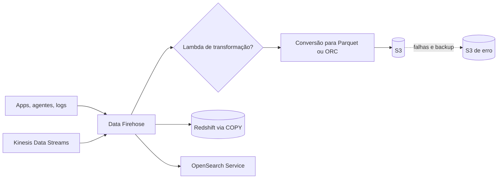

---
aliases:
  - Aula 22.3
modulo: 22
aula: 3
parte: "VII Dados, migração e IA"
dominios:
  - 3
lida: false
tags:
  - aula
  - saa-c03
  - modulo-22
---

# Aula 22.3: Data Firehose, Kinesis Video Streams e Flink

[[22 - Dados Analytics e Ingestao|Voltar ao módulo]]

> [!question] Pergunta que esta aula responde
> Como entregar dados de [[Streaming de Dados|streaming]] ao [[S3]], [[Redshift]] ou [[OpenSearch Service|OpenSearch]] sem escrever e operar um consumidor, o que o [[Data Firehose]] faz com buffer, transformação e conversão para [[Parquet]], e onde entram o [[Kinesis Video Streams]] e o [[Managed Service for Apache Flink]]?

## O problema: todo mundo escreve o mesmo consumidor

Na aula 22.2 você viu que o [[Kinesis Data Streams]] guarda o dado, mas **alguém precisa escrever o consumidor**: ler dos [[Shard|shards]], juntar registros em arquivos de tamanho razoável, tentar de novo quando o destino falha, converter o formato e gravar no [[S3]]. Quase toda equipe escreve esse mesmo código. O **[[Data Firehose]]** (antes chamado Kinesis Data Firehose, nome ainda usado em questões antigas de simulado) é esse consumidor pronto e gerenciado: você aponta uma origem e um destino, e ele entrega.

> [!info] Ligando os pontos
> No [[15 - Desacoplamento Filas Eventos e Workflows|Módulo 15]] você viu que o [[Data Firehose|Firehose]] aparece ao lado do [[SQS]] e do [[SNS]] como alternativa de entrega. A diferença: SQS e SNS entregam mensagens a aplicações; o Firehose entrega **dados em [[Processamento em Lote|lote]]** a **armazéns de dados e ferramentas de análise**.

## Como o Data Firehose funciona

Você cria um **[[Data Firehose|Firehose]] stream** com três escolhas: a origem, as transformações opcionais e o destino.

**Origens**

- **Direct PUT:** a aplicação, o Kinesis Agent ou outro serviço AWS (por exemplo o [[CloudWatch Logs]] por *[[Subscription Filter|subscription filter]]*) chama a API do [[Data Firehose|Firehose]] diretamente.
- **[[Kinesis Data Streams]]:** o [[Data Firehose|Firehose]] lê de um stream existente.
- **Amazon MSK:** o [[Data Firehose|Firehose]] lê de tópicos do [[MSK]].

**Destinos** (verificado em novembro de 2026): [[S3]], [[Redshift]], [[OpenSearch Service]] e OpenSearch [[Serverless]], Splunk, tabelas [[Apache Iceberg]], Snowflake e qualquer endpoint [[HTTP]], inclusive de parceiros como Datadog e New Relic. Para o Redshift, o [[Data Firehose|Firehose]] entrega primeiro em um [[Bucket|bucket]] S3 e depois executa um comando `COPY`.

O [[Data Firehose|Firehose]] **não tem [[Shard|shards]] nem capacidade para planejar**: escala sozinho. Também **não guarda os dados para releitura**; se você precisa de replay, o histórico fica no Kinesis stream de origem ou nos arquivos já entregues ao [[S3]].

## Buffer: por que a entrega é "quase" em tempo real

O [[Data Firehose|Firehose]] **acumula** os registros em memória e só entrega quando o buffer atinge um **tamanho** ou um **intervalo**, o que ocorrer primeiro. Isso é o que torna a entrega **near real time**, e não tempo real. Para o [[S3]] (verificado em novembro de 2026):

| Parâmetro | Faixa | Padrão |
|---|---|---|
| Buffer size | 1 a 128 MB | 5 MB |
| Buffer interval | 0 a 900 segundos | 300 segundos |

Um intervalo de zero entrega em poucos segundos, mas, quando o intervalo é menor que 60 s, o [[Data Firehose|Firehose]] usa [[Multipart Upload|multipart upload]] e o custo de requisições PUT no [[S3]] sobe. Registros de até 1.000 KB são aceitos.

> [!example] Conta resolvida: por que o buffer importa para o Athena
> Um stream recebe **2 MB/s** de logs. Com o padrão de 5 MB, o tamanho enche a cada **2,5 segundos**, e o [[Data Firehose|Firehose]] cria um arquivo de 5 MB a cada 2,5 s: cerca de **34 mil arquivos por dia**. Consultar muitos arquivos pequenos é lento e caro no Athena (aula 22.7). Com buffer de **128 MB**, o arquivo enche em 64 s, e como o intervalo máximo é 900 s, o buffer de tamanho sempre ganha: cerca de **1.350 arquivos por dia**, de 128 MB cada. Regra: **em fluxos grandes, aumente o buffer para gerar arquivos maiores; em fluxos pequenos, o intervalo manda e os arquivos saem pequenos.**

## Transformar e converter antes de gravar

**Transformação com Lambda.** O [[Data Firehose|Firehose]] pode chamar uma função [[Lambda]] com cada [[Processamento em Lote|lote]] buffered para limpar, enriquecer ou filtrar os registros. O lote da transformação tem de 0,2 a 3 MB (padrão 1 MB), o payload síncrono do Lambda tem limite de 6 MB e a função pode durar até 5 minutos (verificado em novembro de 2026). Registros que falham vão para um prefixo de erro no [[S3]].

**Conversão de formato.** O [[Data Firehose|Firehose]] converte **JSON** para **[[Parquet]]** ou **ORC**, formatos colunares que economizam espaço e aceleram consultas (aula 22.5). Para converter outro formato de entrada, como CSV, use a transformação Lambda para gerar JSON primeiro. A conversão usa o esquema de uma tabela do [[Glue Data Catalog]]. Dica: como Parquet e ORC pedem arquivos maiores, aumente o buffer para gerar poucos arquivos grandes (a doc oficial de conversão e a de buffer não citam um buffer mínimo específico com a conversão ligada).

**[[Particao de Dados|Particionamento]] dinâmico (dynamic partitioning).** O [[Data Firehose|Firehose]] pode gravar no [[S3]] já em prefixos particionados por um valor do próprio registro (por exemplo `customer_id=123/ano=2026/mes=11/`), o que reduz o dado lido pelo Athena depois. O padrão é de até **500 partições ativas** por stream. O intervalo zero de buffer não está disponível junto com particionamento dinâmico.

**Compressão e criptografia.** Compressão GZIP, Snappy, Zip ou Snappy compatível com Hadoop (o [[Redshift]] não aceita Snappy e Zip), e criptografia no [[S3]] com [[SSE-KMS]] ([[Criptografia em Repouso]]).

**Backup.** Com transformação ligada ou com destinos como [[OpenSearch Service|OpenSearch]], é possível guardar no [[S3]] a cópia dos registros originais ou só dos que falharam.

## Data Firehose ou Kinesis Data Streams?

Esta é uma das comparações mais frequentes da prova.

| | **[[Kinesis Data Streams]]** | **[[Data Firehose]]** |
|---|---|---|
| [[Latencia\|Latência]] | tempo real | quase em tempo real (buffer) |
| Consumidor | você escreve e opera | nenhum: entrega gerenciada |
| Capacidade | [[Shard\|shards]] ou on-demand | automática |
| Retenção e replay | 24 h a 365 dias, replay | nenhuma |
| Vários consumidores | sim ([[Enhanced Fan-out\|enhanced fan-out]]) | um destino por stream |
| Destinos | qualquer coisa que o consumidor escrever | [[S3]], [[Redshift]], [[OpenSearch Service\|OpenSearch]], Splunk, [[Apache Iceberg\|Iceberg]], [[HTTP]] |
| Transformação | no seu código | Lambda embutida, conversão para [[Parquet]] |

Os dois combinam: o dado entra no [[Kinesis Data Streams]], um consumidor faz a análise em tempo real, e **um [[Data Firehose|Firehose]] lê do mesmo stream** para arquivar tudo no [[S3]]. O padrão de arquitetura mais citado é `aplicação > Kinesis Data Streams > Firehose > S3 (Parquet) > Athena`.

## Kinesis Video Streams: vídeo e mídia contínuos

Câmeras de segurança, campainhas inteligentes, drones e celulares produzem **vídeo contínuo**, que não cabe no modelo de registro pequeno do Data Streams. O **[[Kinesis Video Streams]]** (KVS) ingere vídeo e outros dados de mídia ordenados no tempo (áudio, imagem térmica, radar) de milhões de dispositivos (verificado em novembro de 2026).

- **Retenção:** guarda a mídia por um período que você define, criptografada em repouso e indexada pelo tempo (pelo carimbo do produtor e o de ingestão).
- **Reprodução:** HLS e DASH para [[Streaming de Dados|streaming]] ao vivo e gravado, e `GetClip` para baixar um trecho em MP4. O WebRTC serve a comunicação de baixa [[Latencia|latência]] em duas vias, como uma campainha com vídeo.
- **Análise:** os consumidores são aplicações suas em [[EC2]] ou o **[[Rekognition|Amazon Rekognition]] Video**, que pode processar um video stream para reconhecer rostos em tempo real (aula 24).

Regra para a prova: **o verbo é "vídeo".** "Stream video from cameras to AWS for analysis" aponta para o [[Kinesis Video Streams]], e não para o Data Streams nem para o [[Data Firehose|Firehose]].

## Managed Service for Apache Flink: processar o stream enquanto ele passa

Entregar dados é uma coisa; **calcular sobre eles em movimento** é outra: média móvel dos últimos 5 minutos, contagem de erros por janela, junção de dois streams, detecção de padrão. O **[[Managed Service for Apache Flink|Amazon Managed Service for Apache Flink]]** (nome atual do antigo Kinesis Data Analytics) roda aplicações Apache Flink escritas em Java, Scala, Python ou SQL, sobre fontes como [[Kinesis Data Streams]] e [[MSK]], e grava em destinos como [[S3]], Kinesis, [[OpenSearch Service|OpenSearch]] ou bancos.

O serviço cuida de provisionar computação, escalar, resistir à falha de uma [[Zona de Disponibilidade|AZ]] e fazer *checkpoints* e *[[Snapshot|snapshots]]* (verificado em novembro de 2026). Há também o **Studio**, um notebook interativo para consultar streams em SQL, Python ou Scala. 

**Janelas de tempo.** Para calcular sobre o stream infinito, o [[Managed Service for Apache Flink|Flink]] o divide em janelas. Em uma janela **tumbling** (em lotes), os intervalos não se sobrepõem: "contagem de pedidos a cada 5 minutos" gera um resultado por bloco de 5 minutos. Em uma janela **sliding** (deslizante), os intervalos se sobrepõem: "média dos últimos 5 minutos, atualizada a cada minuto" gera um resultado por minuto, cada um olhando 5 minutos para trás.

> [!warning] Kinesis Data Analytics for SQL Applications: descontinuado
> As aplicações antigas **[[Managed Service for Apache Flink|Kinesis Data Analytics for SQL]]** foram descontinuadas: a doc informa que elas passaram a ser excluídas a partir de 27 de janeiro de 2026 (verificado em novembro de 2026). A trilha atual é migrar para o Managed Service for Apache Flink, usando o Studio com Flink SQL. Questões antigas de simulado ainda citam "Kinesis Data Analytics" com SQL; o nome atual da resposta é Managed Service for Apache Flink.

A prova trata o serviço em uma linha: **"agregações em janelas de tempo sobre dados de [[Streaming de Dados|streaming]]"** aponta para o [[Managed Service for Apache Flink|Flink]].

## Como isso cai na prova

Cobre a **Task 3.5** (arquiteturas de [[Streaming de Dados|streaming]], seleção de configurações de ingestão e transformação de formatos).

**Palavras-chave em inglês e o que apontam:**

- "load [[Streaming de Dados|streaming]] data into [[S3]] / [[Redshift]] / [[OpenSearch Service|OpenSearch]]", "without writing consumers", "fully managed delivery": [[Data Firehose]].
- "near real-time": [[Data Firehose]] (buffer).
- "convert JSON to [[Parquet]] or ORC while delivering": [[Data Firehose|Firehose]] com conversão de formato.
- "transform records in flight": [[Data Firehose|Firehose]] com Lambda.
- "stream video", "camera", "RTSP", "HLS": [[Kinesis Video Streams]].
- "sliding window", "time-series analytics on [[Streaming de Dados|streaming]] data", "real-time dashboards": [[Managed Service for Apache Flink]].
- "[[Managed Service for Apache Flink|Kinesis Data Analytics]]": nome antigo do Managed Service for Apache Flink.

**Pegadinhas clássicas:**

- Escolher [[Kinesis Data Streams]] mais um consumidor próprio quando o enunciado só quer o dado no [[S3]] com baixo overhead: o [[Data Firehose|Firehose]] basta.
- Escolher [[Data Firehose|Firehose]] quando o requisito é **tempo real** ou **replay**: ele tem buffer e não guarda histórico.
- Esperar que o [[Data Firehose|Firehose]] converta CSV direto para [[Parquet]]: a conversão nativa parte de JSON.
- Confundir [[Kinesis Video Streams]] com Data Streams: vídeo e mídia vão para o KVS.

| Requisito no enunciado | Resposta provável | Por quê |
|---|---|---|
| Logs de aplicação para o [[S3]] com o mínimo de operação | [[Data Firehose]] | Entrega gerenciada com buffer |
| Eventos JSON no [[S3]] já em [[Parquet]] | [[Data Firehose\|Firehose]] com conversão de formato | Esquema vem do [[Glue Data Catalog]] |
| Média por janela de 5 minutos sobre o stream | [[Managed Service for Apache Flink]] | Processamento contínuo com janelas |
| Vídeo de milhares de câmeras para análise | [[Kinesis Video Streams]] | Ingestão de mídia contínua |
| Arquivar um stream no [[S3]] e analisar em tempo real ao mesmo tempo | Data Streams com [[Data Firehose\|Firehose]] e consumidor | Dois leitores do mesmo stream |
| [[CloudWatch Logs\|Logs do CloudWatch]] no [[OpenSearch Service\|OpenSearch]] | [[Subscription Filter\|Subscription filter]] para o [[Data Firehose\|Firehose]] | Entrega gerenciada ao OpenSearch |

## Resumo

> [!abstract] A aula em uma frase
> O [[Data Firehose]] é o consumidor gerenciado que entrega dados de [[Streaming de Dados|streaming]] a [[S3]], [[Redshift]] e [[OpenSearch Service|OpenSearch]] com buffer, transformação e conversão para [[Parquet]], ao custo de não ser tempo real nem guardar histórico; o [[Kinesis Video Streams]] cuida de vídeo, e o [[Managed Service for Apache Flink|Flink]] processa o stream em movimento.

**A lógica, em 5 passos**

1. Mover dados do stream para o destino é trabalho repetitivo, então o [[Data Firehose|Firehose]] o faz sem código.
2. O buffer (tamanho ou intervalo) deixa a entrega em quase tempo real e controla o tamanho dos arquivos.
3. Arquivos pequenos prejudicam a análise; buffer maior e [[Particao de Dados|particionamento]] melhoram o Athena.
4. Lambda transforma e a conversão nativa leva JSON a [[Parquet]] ou ORC com esquema do Glue.
5. Vídeo vai para o [[Kinesis Video Streams|KVS]]; cálculo contínuo sobre o stream vai para o [[Managed Service for Apache Flink|Flink]].

**Números para lembrar** (verificado em novembro de 2026)

| O quê | Valor | Por que importa |
|---|---|---|
| Buffer para o [[S3]] | 1 a 128 MB (padrão 5) e 0 a 900 s (padrão 300) | Define a [[Latencia\|latência]] e o tamanho dos arquivos |
| Registro do [[Data Firehose\|Firehose]] | até 1.000 KB | Limite de entrada |
| Lambda de transformação | [[Processamento em Lote\|lote]] de 0,2 a 3 MB e até 5 minutos | Limite da transformação |
| Partições ativas (dynamic partitioning) | 500 por stream | Limite padrão |

**Tabela-síntese**

| Quero... | Serviço |
|---|---|
| Entregar no [[S3]], [[Redshift]] ou [[OpenSearch Service\|OpenSearch]] sem consumidor | [[Data Firehose]] |
| Tempo real e replay | [[Kinesis Data Streams]] |
| Vídeo | [[Kinesis Video Streams]] |
| Janelas de tempo sobre o stream | [[Managed Service for Apache Flink]] |

**Na prática, isso significa**

- "Sem código" e "mínimo de overhead" com destino [[S3]] ou [[OpenSearch Service|OpenSearch]]: [[Data Firehose|Firehose]].
- "Tempo real" ou "reprocessar": Data Streams.
- Para [[Parquet]], entrada JSON no [[Data Firehose|Firehose]] ou um job do Glue.

> [!tip] Liga com
> Vem de [[22.02 - Kinesis Data Streams|22.2]] e entrega no [[S3]] que a aula [[22.05 - Data Lake no S3 Formatos e Particionamento|22.5]] organiza. A alternativa para [[Apache Kafka|Kafka]] é a [[22.04 - MSK e a Escolha do Servico de Streaming|22.4]]; os serviços de IA que leem vídeo estão no [[24 - Servicos de IA Gerenciados|Módulo 24]].

## Erros comuns

- **"O [[Data Firehose|Firehose]] é tempo real."** Ele entrega em lotes por buffer; é quase em tempo real.
- **"O [[Data Firehose|Firehose]] guarda os dados para eu reler."** Não guarda; o histórico fica no stream de origem ou no [[S3]].
- **"Buffer padrão está bom para qualquer volume."** Em fluxo grande gera milhares de arquivos pequenos; aumente o tamanho.
- **"O [[Data Firehose|Firehose]] converte CSV em [[Parquet]] sozinho."** A conversão nativa parte de JSON; para CSV, use Lambda ou Glue.
- **"[[Kinesis Video Streams]] serve para qualquer dado de sensor."** Serve para mídia; dados curtos de telemetria vão para o Data Streams.

## Pratique

**1.** Uma empresa precisa gravar logs de aplicação no [[S3]] em [[Parquet]], quase em tempo real, com o menor [[Overhead Operacional|overhead operacional]]. Os logs chegam em JSON. Qual solução atende?

- [ ] a) Instâncias EC2 lendo do stream com um script que grava Parquet
- [ ] b) Data Firehose com conversão para Parquet e esquema no Glue
- [ ] c) Um cluster EMR permanente rodando Spark Streaming sobre os logs
- [ ] d) Uma função Lambda gravando um arquivo por evento no S3

**2.** Uma plataforma de detecção de fraudes precisa decidir em milissegundos e também arquivar todos os eventos no [[S3]] para auditoria. Qual combinação é a mais adequada?

- [ ] a) Somente Data Firehose entregando no S3
- [ ] b) Somente uma fila SQS padrão com um único consumidor ligado ao S3
- [ ] c) Kinesis Video Streams com retenção de 365 dias para guardar os eventos
- [ ] d) Kinesis Data Streams com um consumidor de tempo real e um Firehose para o S3

**3.** Milhares de câmeras de segurança enviam vídeo ao vivo, e a empresa quer analisar os quadros com visão computacional. Qual serviço faz a ingestão?

- [ ] a) Kinesis Video Streams para ingerir o vídeo
- [ ] b) Kinesis Data Streams com registros de 1 MB
- [ ] c) Amazon Data Firehose para o S3
- [ ] d) Amazon MSK com tópicos de vídeo

**4.** O [[Data Firehose|Firehose]] entrega logs de 2 MB/s no [[S3]] com o buffer padrão e o Athena está lento por causa de dezenas de milhares de arquivos pequenos por dia. Qual ajuste resolve melhor a causa?

- [ ] a) Reduzir o intervalo de buffer para 60 segundos
- [ ] b) Trocar o destino para o Redshift sem alterar a configuração de buffer
- [ ] c) Aumentar o buffer size para gerar menos arquivos e maiores
- [ ] d) Habilitar o enhanced fan-out no Firehose para acelerar a entrega

**5.** (Escolha DUAS.) Quais destinos o [[Data Firehose]] consegue alimentar diretamente?

- [ ] a) Amazon RDS for PostgreSQL
- [ ] b) Amazon S3
- [ ] c) Amazon OpenSearch Service
- [ ] d) Amazon Aurora
- [ ] e) Amazon ElastiCache

**6.** Um time precisa calcular a média de temperatura por janela deslizante de cinco minutos sobre um stream e enviar o resultado a um painel. Qual serviço é a melhor escolha?

- [ ] a) Amazon Data Firehose com buffer de 60 segundos
- [ ] b) Amazon Managed Service for Apache Flink
- [ ] c) AWS Glue com job agendado de hora em hora
- [ ] d) Amazon Athena com consultas manuais

**7.** Os dados que chegam ao [[Data Firehose|Firehose]] estão em CSV, e a empresa quer [[Parquet]] no [[S3]]. O que fazer?

- [ ] a) Ligar a conversão de formato, que aceita CSV nativamente
- [ ] b) Entregar em CSV e depender do Athena para converter os arquivos sozinho
- [ ] c) Usar o Kinesis Video Streams para reformatar os registros em Parquet
- [ ] d) Usar uma Lambda de transformação para gerar JSON e ligar a conversão

**8.** Qual afirmação sobre o [[Data Firehose]] está correta?

- [ ] a) Ele escala sozinho, entrega em buffer e não guarda dados para releitura
- [ ] b) Ele exige que você provisione shards e permite replay por até 365 dias
- [ ] c) Ele entrega em tempo real, em menos de 10 milissegundos por registro recebido
- [ ] d) Ele só aceita o Kinesis Data Streams como origem

**9.** (Escolha DUAS.) Quais cenários apontam para o [[Kinesis Data Streams]] em vez do [[Data Firehose]]?

- [ ] a) Vários consumidores independentes lendo o mesmo fluxo
- [ ] b) Entregar logs no S3 sem escrever código
- [ ] c) Carregar dados no Redshift em quase tempo real
- [ ] d) Enviar logs a um endpoint HTTP de parceiro como Datadog
- [ ] e) Reprocessar eventos das últimas 48 horas depois de um bug

**10.** Um enunciado cita "[[Managed Service for Apache Flink|Kinesis Data Analytics]]" processando um stream com SQL. Qual é o nome atual do serviço?

- [ ] a) Amazon Athena, que consulta arquivos no S3 com SQL
- [ ] b) AWS Glue Studio, o editor visual de jobs ETL
- [ ] c) Amazon Managed Service for Apache Flink
- [ ] d) Amazon Kinesis Video Streams, o serviço para vídeo

> [!success]- Gabarito
> **1. b)** o [[Data Firehose|Firehose]] converte JSON em [[Parquet]] usando o esquema do [[Glue Data Catalog]] e entrega no [[S3]] [[Serverless|sem servidor]]; a) exige código e servidores; c) [[EMR]] permanente é operação desnecessária; d) um arquivo por evento gera arquivos minúsculos e custo alto.
> **2. d)** o stream atende o consumidor de milissegundos e o [[Data Firehose|Firehose]] lê do mesmo stream para arquivar; a) o Firehose tem buffer e não decide em milissegundos; b) uma fila não permite os dois leitores sobre o mesmo dado; c) o [[Kinesis Video Streams|KVS]] é para vídeo.
> **3. a)** o [[Kinesis Video Streams|KVS]] ingere vídeo contínuo e se integra a serviços de visão como o [[Rekognition]] Video; b) registros de 1 MB não são o modelo de mídia; c) o [[Data Firehose|Firehose]] entregaria blocos sem semântica de vídeo; d) o [[MSK]] não é serviço de mídia.
> **4. c)** buffer maior gera arquivos maiores e menos numerosos; a) intervalo menor aumenta a quantidade de arquivos; b) mudar o destino não corrige o buffer; d) [[Enhanced Fan-out|enhanced fan-out]] é do Data Streams.
> **5. b), c)** o [[Data Firehose|Firehose]] entrega no [[S3]] e no [[OpenSearch Service]]; a), d) e e) são bancos e cache que o Firehose não alimenta direto.
> **6. b)** o [[Managed Service for Apache Flink|Flink]] calcula agregações em janelas sobre streams; a) o [[Data Firehose|Firehose]] só entrega; c) job de hora em hora é [[Processamento em Lote|lote]]; d) o Athena roda consultas sobre arquivos, não sobre janelas contínuas.
> **7. d)** a conversão nativa parte de JSON, então a Lambda gera JSON antes; a) a conversão não aceita CSV direto; b) o Athena não converte arquivos sozinho; c) o [[Kinesis Video Streams|KVS]] não reformata registros.
> **8. a)** o [[Data Firehose|Firehose]] escala sozinho, usa buffer e não guarda histórico; b) descreve o Data Streams; c) tem buffer, logo não é tempo real; d) aceita também Direct PUT e [[MSK]].
> **9. a), e)** vários consumidores e replay são do Data Streams; b), c) e d) são entregas gerenciadas, que o [[Data Firehose|Firehose]] faz.
> **10. c)** o [[Managed Service for Apache Flink|Kinesis Data Analytics]] virou Managed Service for Apache Flink; a) Athena consulta o [[S3]]; b) Glue Studio é editor de jobs [[ETL]]; d) o [[Kinesis Video Streams|KVS]] é para vídeo.

## Para aprofundar

- [ ] [What is Amazon Data Firehose?](https://docs.aws.amazon.com/firehose/latest/dev/what-is-this-service.html) (documentação do [[Data Firehose|Firehose]]): origens, destinos e fluxo de dados.
- [ ] [Configure backup settings and buffering hints](https://docs.aws.amazon.com/firehose/latest/dev/create-configure-backup.html) (documentação do [[Data Firehose|Firehose]]): faixas de buffer por destino e zero buffering.
- [ ] [Convert input data format in Amazon Data Firehose](https://docs.aws.amazon.com/firehose/latest/dev/record-format-conversion.html) (documentação do [[Data Firehose|Firehose]]): conversão de JSON para [[Parquet]] ou ORC.
- [ ] [What is Amazon Kinesis Video Streams?](https://docs.aws.amazon.com/kinesisvideostreams/latest/dg/what-is-kinesis-video.html) (documentação do [[Kinesis Video Streams|KVS]]): ingestão, retenção e análise de vídeo.

Próxima aula: [[22.04 - MSK e a Escolha do Servico de Streaming|22.4 MSK e a escolha do serviço de streaming]].
