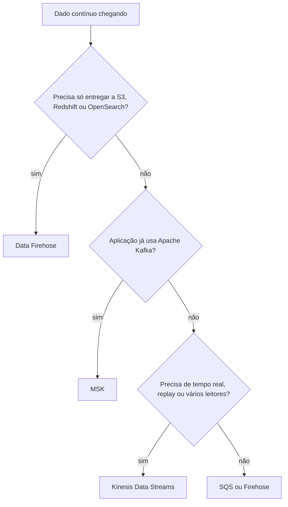

---
aliases:
  - Aula 22.4
modulo: 22
aula: 4
parte: "VII Dados, migração e IA"
dominios:
  - 2
  - 3
lida: false
tags:
  - aula
  - saa-c03
  - modulo-22
---

# Aula 22.4: MSK e a escolha do serviço de streaming

[[22 - Dados Analytics e Ingestao|Voltar ao módulo]]

> [!question] Pergunta que esta aula responde
> Quando uma empresa já usa [[Apache Kafka]], por que o [[MSK]] evita reescrever a aplicação, como ele se organiza em brokers, tópicos e partições, e como decidir entre [[Kinesis Data Streams]], MSK, [[Data Firehose]] e [[SQS]] diante de um enunciado?

## O problema: a aplicação já fala Kafka

Uma empresa tem um cluster **[[Apache Kafka]]** no data center, com dezenas de aplicações que publicam e consomem eventos usando as bibliotecas e os conectores do Kafka. Migrar para a nuvem trocando o Kafka por [[Kinesis Data Streams]] obrigaria a reescrever produtores, consumidores e conectores, porque as APIs são diferentes. O **[[MSK|Amazon MSK]]** (Managed [[Streaming de Dados|Streaming]] for Apache Kafka) resolve esse caso: roda o Kafka de código aberto como serviço gerenciado, então as aplicações existentes, as ferramentas e os plugins do ecossistema continuam funcionando sem mudança de código (verificado em novembro de 2026).

Esse é o mesmo raciocínio do [[15 - Desacoplamento Filas Eventos e Workflows|Módulo 15]] com o [[Amazon MQ]]: serviço gerenciado compatível com o protocolo que você já usa, para **migrar sem reescrever**.

## Kafka em quatro conceitos

Para a prova, basta entender o vocabulário:

- **Broker:** servidor [[Apache Kafka|Kafka]] que guarda dados e atende produtores e consumidores. Um cluster tem vários brokers.
- **Tópico (topic):** canal nomeado de eventos, como `pedidos` ou `cliques`.
- **Partição (partition):** cada tópico se divide em partições, e cada partição é um log ordenado e replicado entre brokers. É o equivalente do shard no Kinesis: a ordem só existe dentro de uma partição, e o paralelismo vem do número de partições.
- **Consumer group:** conjunto de consumidores que dividem as [[Particao do Kafka|partições de um tópico]] entre si; cada grupo mantém a sua própria posição (offset) de leitura, então vários grupos leem o mesmo tópico de forma independente e podem reler.

Em outras palavras, o [[Apache Kafka|Kafka]] entrega as mesmas garantias de log durável do Kinesis (replay, vários leitores, ordem por partição), com uma API e um ecossistema diferentes.

## O que o MSK gerencia

O [[MSK]] cuida do que dá trabalho em um cluster [[Apache Kafka|Kafka]]: provisionar brokers, substituir os que falham, aplicar patches e, nos clusters provisionados, manter o coordenador de metadados (ZooKeeper ou os controladores KRaft, sem custo adicional, verificado em novembro de 2026). Você continua usando as operações de dados do Kafka (criar tópicos, publicar, consumir) com os clientes de sempre.

Há três formas de usar o [[MSK]]:

| Tipo | Como funciona | Quando escolher |
|---|---|---|
| **[[MSK]] Provisioned (Standard brokers)** | Você escolhe número de brokers por [[Zona de Disponibilidade\|AZ]], tamanho e armazenamento | Carga previsível, controle fino de configuração |
| **[[MSK]] Provisioned (Express brokers)** | Tipo de broker de capacidade elástica dentro do provisionado | Quando o fluxo cresce e encolhe e você ainda quer o modelo de cluster |
| **[[MSK]] [[Serverless]]** | A AWS provisiona e escala capacidade e gerencia as partições; cobrança por [[Throughput\|vazão]] | [[Streaming de Dados\|Streaming]] sob demanda sem dimensionar cluster |

Pontos que a documentação confirma (novembro de 2026):

- Ao criar um cluster provisionado você define quantos brokers por **[[Zona de Disponibilidade|zona de disponibilidade]]**, com mínimo de um por AZ, e cada AZ usa sua própria [[Sub-rede|sub-rede]] da [[VPC]].
- Boa prática de [[Alta Disponibilidade|alta disponibilidade]]: **três [[Zona de Disponibilidade|AZs]]**, **fator de replicação (replication factor) de pelo menos 3** e `min.insync.replicas` igual ao fator menos um, para que o cluster continue aceitando escrita durante atualizações e substituições de brokers. Em cluster de duas AZs, o mínimo recomendado é replicação 2.
- O **[[MSK]] [[Serverless]]** exige controle de acesso por **[[IAM]]** em todos os clusters (as ACLs do [[Apache Kafka|Kafka]] não são suportadas), oferece conectividade privada por [[PrivateLink]] e se integra com o Glue Schema Registry, o [[Managed Service for Apache Flink]] e o Lambda.
- **Tiered storage:** permite guardar dados antigos em um armazenamento remoto mais barato, o que torna viável reter muito mais histórico do que o disco dos brokers permitiria.
- **[[MSK]] Connect** roda conectores do [[Apache Kafka|Kafka]] Connect (por exemplo, para mover dados entre o tópico e o [[S3]]) sem você gerenciar os workers, e o **MSK Replicator** replica tópicos entre clusters provisionados, na mesma Região ou em outra.

> [!info] Ligando os pontos
> A replicação em três [[Zona de Disponibilidade|AZs]] do [[MSK]] é a mesma ideia de [[Alta Disponibilidade]] do [[Aurora]] e do Kinesis: o dado existe em mais de uma zona antes de a escrita ser confirmada. A diferença é que no [[Apache Kafka|Kafka]] **você** configura o fator de replicação, enquanto no Kinesis a replicação em três AZs já vem pronta e invisível.

## Ligando o MSK ao resto do pipeline

O [[MSK]] é só a etapa de ingestão e transporte. Quem faz o resto:

- **[[Data Firehose]]** lê de tópicos do [[MSK]] e entrega em [[S3]], [[Redshift]] ou [[OpenSearch Service|OpenSearch]] (aula 22.3). Com o MSK como origem, o limite padrão é de 10 MB/s de leitura por partição e 10 MB por registro (6 MB se a transformação Lambda estiver ligada).
- **[[Managed Service for Apache Flink]]** processa o tópico em tempo real com janelas e junções.
- **[[Lambda]]** consome tópicos com um [[Event Source Mapping|event source mapping]], para processamento simples por [[Processamento em Lote|lote]].
- **[[Redshift]]** carrega tópicos do [[MSK]] direto em [[Visao Materializada|views materializadas]] ([[Streaming de Dados|streaming]] ingestion), sem passar pelo [[S3]].
- **[[Glue]]** [[ETL]] de [[Streaming de Dados|streaming]] lê de [[Apache Kafka|Kafka]], e o Glue Schema Registry guarda os esquemas das mensagens.

## Escolhendo: Kinesis, MSK, Firehose ou SQS

Esta é a tabela mais útil do módulo para as questões de "qual serviço de ingestão".

| | **[[Kinesis Data Streams]]** | **[[MSK]]** | **[[Data Firehose]]** | **[[SQS]]** |
|---|---|---|---|---|
| Modelo | log em [[Shard\|shards]] | log em tópicos e partições ([[Apache Kafka\|Kafka]]) | entrega gerenciada em buffer | fila de mensagens |
| API | API própria da AWS | API do [[Apache Kafka]] | API própria da AWS | API própria da AWS |
| Operação | quase zero (on-demand) | brokers para dimensionar ([[Serverless]] reduz) | zero | zero |
| Replay | sim (até 365 dias) | sim | não | não |
| Vários leitores independentes | sim | sim (consumer groups) | um destino por stream | não (competem pelas mensagens) |
| Quando escolher | [[Streaming de Dados\|streaming]] novo na AWS, menor overhead | **já usa [[Apache Kafka\|Kafka]]**, precisa do ecossistema Kafka, mensagens maiores e controle de configuração | só entregar ao [[S3]], [[Redshift]], [[OpenSearch Service\|OpenSearch]] | desacoplar tarefas, picos |
| Palavra-chave | "real-time", "[[Shard\|shards]]" | "[[Apache Kafka]]", "existing Kafka applications" | "load into [[S3]]", "near real-time", "no code" | "decouple", "queue" |

Regras práticas:

1. Enunciado cita **[[Apache Kafka|Kafka]]**, tópicos Kafka, conectores Kafka ou "sem alterar o código da aplicação": **[[MSK]]**.
2. [[Streaming de Dados|Streaming]] **novo**, sem [[Apache Kafka|Kafka]] legado, com foco em simplicidade: **[[Kinesis Data Streams]]**.
3. O único objetivo é **entregar e arquivar** sem consumidor próprio: **[[Data Firehose]]**.
4. **Tarefas independentes** com buffer e sem releitura: **[[SQS]]** ([[15 - Desacoplamento Filas Eventos e Workflows|Módulo 15]]).

> [!example] Exemplo concreto: três empresas, três respostas
> A **empresa A** tem 40 [[Microsservicos|microsserviços]] publicando em [[Apache Kafka|Kafka]] no data center e quer migrar em dois meses: **[[MSK]]**, porque os clientes Kafka continuam iguais e só o endereço do broker muda. A **startup B** vai construir um painel de telemetria do zero e quer o menor [[Overhead Operacional|esforço operacional]]: **[[Kinesis Data Streams]] em modo on-demand** com Lambda ou [[Managed Service for Apache Flink|Flink]]. A **empresa C** só precisa guardar logs de acesso no [[S3]] para auditoria: **[[Data Firehose]]** direto para o S3, sem stream nem consumidor.

## Árvore de decisão de ingestão

## Como isso cai na prova

Cobre a **Task 3.5** (arquiteturas de [[Streaming de Dados|streaming de dados]]) e, indiretamente, a **Task 2.1** ([[Desacoplamento|desacoplamento]]) do exam guide.

**Palavras-chave em inglês e o que apontam:**

- "[[Apache Kafka]]", "existing Kafka producers and consumers", "without changing application code", "Kafka Connect": [[MSK]].
- "[[Serverless|serverless]] [[Apache Kafka|Kafka]]", "no capacity planning for Kafka": [[MSK]] Serverless.
- "real-time", "AWS-native [[Streaming de Dados|streaming]] with minimal management": [[Kinesis Data Streams]].
- "replicate [[Apache Kafka|Kafka]] topics to another [[Regiao AWS|Region]]": [[MSK]] Replicator.
- "[[Alta Disponibilidade|highly available]] [[Apache Kafka|Kafka]]": três [[Zona de Disponibilidade|AZs]] e replication factor 3.

**Pegadinhas clássicas:**

- Propor [[Kinesis Data Streams]] para uma empresa que usa [[Apache Kafka|Kafka]] e não quer mexer no código: exigiria reescrita.
- Propor [[MSK]] para um [[Streaming de Dados|streaming]] novo e simples: mais conceitos e configuração que o Kinesis on-demand.
- Achar que o [[MSK]] dispensa dimensionamento em qualquer tipo: só o [[Serverless]] e, em parte, os brokers Express reduzem isso.
- Esquecer que o [[MSK]] [[Serverless]] usa [[IAM]], não ACLs.
- Trocar a replicação por "distribuição em várias [[Zona de Disponibilidade|AZs]]" sem configurar o fator de replicação: no [[Apache Kafka|Kafka]], a [[Durabilidade|durabilidade]] entre AZs depende dele.

| Requisito no enunciado | Resposta provável | Por quê |
|---|---|---|
| Migrar [[Apache Kafka\|Kafka]] local sem alterar as aplicações | [[MSK]] | Compatível com a API do Kafka |
| [[Streaming de Dados\|Streaming]] [[Apache Kafka\|Kafka]] sem dimensionar cluster | [[MSK]] [[Serverless]] | Capacidade automática, cobrança por [[Throughput\|vazão]] |
| [[Streaming de Dados\|Streaming]] novo na AWS com menor operação | [[Kinesis Data Streams]] on-demand | Sem brokers nem [[Shard\|shards]] para gerenciar |
| Arquivar o tópico [[Apache Kafka\|Kafka]] no [[S3]] sem código | [[Data Firehose]] lendo do [[MSK]] | Entrega gerenciada |
| Cluster [[Apache Kafka\|Kafka]] tolerante à perda de uma [[Zona de Disponibilidade\|AZ]] | Três AZs, replication factor 3 | Dado em mais de uma zona |
| Replicar tópicos para outra Região | [[MSK]] Replicator | Replicação gerenciada entre clusters |

## Resumo

> [!abstract] A aula em uma frase
> O [[MSK]] é o [[Apache Kafka]] gerenciado, escolhido quando a aplicação já fala Kafka, e a escolha entre Kinesis, MSK, [[Data Firehose|Firehose]] e [[SQS]] segue o contrato de que o enunciado precisa: Kafka legado, [[Streaming de Dados|streaming]] novo, entrega pronta ou fila.

**A lógica, em 5 passos**

1. Migrar sem reescrever pede um serviço compatível com a API que a aplicação usa.
2. O [[Apache Kafka|Kafka]] organiza eventos em tópicos e partições, com consumer groups e replay.
3. O [[MSK]] gerencia os brokers; o [[Serverless]] gerencia também a capacidade.
4. [[Alta Disponibilidade|Alta disponibilidade]] no [[MSK]] é configuração sua: três [[Zona de Disponibilidade|AZs]] e replication factor 3.
5. O resto do pipeline ([[Data Firehose|Firehose]], [[Managed Service for Apache Flink|Flink]], Lambda, [[Redshift]]) lê do [[MSK]] como de qualquer stream.

**Tabela-síntese**

| Situação | Serviço |
|---|---|
| [[Apache Kafka\|Kafka]] legado | [[MSK]] |
| [[Streaming de Dados\|Streaming]] novo, menor operação | [[Kinesis Data Streams]] on-demand |
| Só entregar ao [[S3]], [[Redshift]] ou [[OpenSearch Service\|OpenSearch]] | [[Data Firehose]] |
| Fila de tarefas independentes | [[SQS]] |

**Na prática, isso significa**

- Leia o enunciado procurando a palavra "[[Apache Kafka|Kafka]]" antes de qualquer outra.
- Sem [[Apache Kafka|Kafka]] e sem requisito especial, o Kinesis on-demand costuma ser a resposta de menor overhead.
- O [[MSK]] [[Serverless]] troca dimensionamento por cobrança por [[Throughput|vazão]] e exige [[IAM]].

> [!tip] Liga com
> Vem de [[22.02 - Kinesis Data Streams|22.2]] e [[22.03 - Data Firehose Kinesis Video Streams e Flink|22.3]]. A partir daqui o dado já chegou ao [[S3]]: [[22.05 - Data Lake no S3 Formatos e Particionamento|22.5]] organiza o lake.

## Erros comuns

- **"[[MSK]] e Kinesis são intercambiáveis sem custo."** Mudar de um para o outro exige reescrever clientes e conectores, porque as APIs são diferentes.
- **"Com [[MSK]] a AWS cuida de tudo, inclusive da replicação entre [[Zona de Disponibilidade|AZs]]."** A AWS cria os brokers por AZ, mas a [[Durabilidade|durabilidade]] depende do fator de replicação que você configura.
- **"O [[MSK]] [[Serverless]] aceita ACLs do [[Apache Kafka|Kafka]]."** Exige [[IAM]].
- **"O [[Data Firehose|Firehose]] não lê de [[Apache Kafka|Kafka]]."** Lê de tópicos do [[MSK]].
- **"A [[SQS|fila SQS]] substitui um log [[Apache Kafka|Kafka]]."** A fila apaga a mensagem ao processar e não permite releitura.

## Pratique

**1.** Uma empresa opera um cluster [[Apache Kafka]] local com dezenas de aplicações e quer migrar para a AWS sem alterar o código dos produtores e consumidores. Qual serviço atende com o menor esforço de migração?

- [ ] a) Amazon Kinesis Data Streams, reescrevendo os produtores com a biblioteca KPL e os consumidores com a KCL
- [ ] b) Amazon SQS com filas padrão, mapeando cada tópico para uma fila e adaptando os consumidores
- [ ] c) Amazon Data Firehose recebendo diretamente os eventos de todas as aplicações e entregando no S3
- [ ] d) Amazon MSK, com os clientes Kafka sem mudar o código

**2.** Uma startup precisa de [[Streaming de Dados|streaming]] em tempo real para telemetria de um produto novo, não usa [[Apache Kafka|Kafka]] e quer o menor [[Overhead Operacional|overhead operacional]]. Qual escolha é mais adequada?

- [ ] a) Kinesis Data Streams em modo on-demand, sem shards nem capacidade para dimensionar
- [ ] b) Um cluster MSK provisionado em três AZs, com brokers de grande porte e armazenamento dimensionado para o pico
- [ ] c) Servidores EC2 rodando Kafka instalado e mantido pela própria equipe, com ZooKeeper
- [ ] d) Uma fila SQS FIFO com um consumidor Lambda por mensagem, para preservar a ordem global

**3.** Uma equipe quer executar [[Apache Kafka]] sem escolher tipo nem quantidade de brokers, pagando conforme a [[Throughput|vazão]]. O que usar?

- [ ] a) MSK Provisioned com brokers Standard em duas AZs e capacidade fixa para todo o mês
- [ ] b) Kinesis Data Streams em modo provisionado com o número de shards definido manualmente
- [ ] c) MSK Serverless, que escala a capacidade sozinho e cobra pela vazão utilizada
- [ ] d) Amazon MQ com um broker RabbitMQ de instância única

**4.** Um arquiteto precisa que um cluster [[MSK]] provisionado continue aceitando escritas mesmo durante a atualização de um broker ou a perda de uma [[Zona de Disponibilidade|AZ]]. Qual configuração segue as boas práticas da documentação?

- [ ] a) Três AZs, fator de replicação 2 e min.insync.replicas igual a 2
- [ ] b) Três AZs, fator de replicação de pelo menos 3 e min.insync.replicas igual ao fator menos um
- [ ] c) Duas AZs com fator de replicação 1, porque a AWS replica os dados automaticamente em segundo plano
- [ ] d) Qualquer número de AZs, desde que o armazenamento use tiered storage

**5.** (Escolha DUAS.) Quais serviços conseguem consumir diretamente de tópicos do [[MSK]]?

- [ ] a) Amazon Kinesis Data Streams, lendo os tópicos como se fossem shards
- [ ] b) Amazon SQS, puxando as mensagens dos tópicos por polling
- [ ] c) Amazon Data Firehose, entregando em S3, Redshift ou OpenSearch
- [ ] d) AWS Lambda, por meio de um event source mapping
- [ ] e) Amazon DynamoDB Streams, replicando os tópicos para uma tabela

**6.** Uma empresa precisa arquivar no [[S3]] os eventos de um tópico [[Apache Kafka|Kafka]] já hospedado no [[MSK]], sem escrever nem operar nenhum consumidor. Qual abordagem é a mais simples?

- [ ] a) Uma aplicação Kafka Streams em EC2 gravando arquivos no S3 a cada minuto
- [ ] b) Uma função Lambda por mensagem, gravando um objeto no S3 por evento, sem lote
- [ ] c) Um job do Glue agendado a cada hora, lendo o tópico e gravando uma partição por vez
- [ ] d) Um Data Firehose com o MSK como origem e o S3 como destino, sem escrever consumidor

**7.** Qual das afirmações sobre o [[MSK]] [[Serverless]] é verdadeira (verificado em novembro de 2026)?

- [ ] a) Ele aceita ACLs nativas do Kafka como único mecanismo de autorização
- [ ] b) Ele exige controle de acesso por IAM e escala a capacidade automaticamente
- [ ] c) Ele não oferece conectividade privada por PrivateLink
- [ ] d) Ele só funciona se você escolher o número de brokers por AZ

**8.** O enunciado diz: "uma aplicação precisa publicar eventos que vários times leiam de forma independente e possam reler, e o pipeline é novo, sem [[Apache Kafka|Kafka]]". Qual é a resposta mais provável?

- [ ] a) Kinesis Data Streams, com vários leitores independentes e releitura dos registros
- [ ] b) SQS padrão, com uma fila para cada time e mensagens copiadas manualmente pela aplicação
- [ ] c) SNS com assinaturas HTTP para cada time, confiando que cada um guarde o histórico
- [ ] d) Step Functions Express coordenando a entrega para cada time

**9.** (Escolha DUAS.) Quais cenários apontam para o [[MSK]] em vez do [[Kinesis Data Streams]]?

- [ ] a) Streaming novo cujo único requisito é o menor esforço operacional
- [ ] b) Aplicações existentes que usam clientes e conectores do Apache Kafka e não podem ser reescritas
- [ ] c) Entregar logs no S3 sem escrever consumidor
- [ ] d) Buffer simples de tarefas independentes entre dois componentes
- [ ] e) Necessidade de replicar tópicos entre Regiões com um serviço gerenciado para clusters Kafka

**10.** Qual combinação descreve corretamente a diferença de modelo entre [[Kinesis Data Streams]] e [[SQS]]?

- [ ] a) Ambos apagam a mensagem ao primeiro consumo, e a diferença entre eles é só o preço por requisição
- [ ] b) O SQS permite replay por 365 dias, e o Kinesis só mantém a mensagem até ela ser lida
- [ ] c) O Kinesis retém os registros e vários consumidores podem relê-los; o SQS remove a mensagem da fila depois de processada, e consumidores diferentes competem pelas mensagens
- [ ] d) O Kinesis entrega cada registro a um único consumidor, e o SQS deixa vários consumidores lerem a mesma mensagem

> [!success]- Gabarito
> **1. d)** o [[MSK]] roda o [[Apache Kafka|Kafka]] de código aberto e mantém a API, então só o endereço dos brokers muda; a) obriga a reescrever produtores e consumidores; b) mapear tópicos em filas perde partições, consumer groups e replay; c) o [[Data Firehose|Firehose]] entrega, mas não substitui a camada de mensageria que as aplicações usam.
> **2. a)** o on-demand não tem brokers nem [[Shard|shards]] para dimensionar; b) um cluster provisionado exige dimensionamento e operação sem necessidade; c) manter [[Apache Kafka|Kafka]] em [[EC2]] é o maior overhead possível; d) a [[Fila FIFO|fila FIFO]] não é [[Streaming de Dados|streaming]] com replay, e ordem global limita a [[Throughput|vazão]].
> **3. c)** o [[MSK]] [[Serverless]] provisiona e escala capacidade e cobra por [[Throughput|vazão]]; a) o provisionado exige escolher brokers e capacidade; b) é outro serviço e exige definir [[Shard|shards]]; d) o [[Amazon MQ]] é para ActiveMQ e RabbitMQ, não [[Apache Kafka|Kafka]].
> **4. b)** três [[Zona de Disponibilidade|AZs]], replicação 3 e min.insync.replicas igual a RF-1 mantêm a escrita durante atualizações e falhas; a) com fator 2 e min.insync.replicas 2, a perda de um broker deixa menos réplicas sincronizadas que o mínimo e bloqueia as escritas; c) a AWS não replica por você, o fator é configuração do tópico; d) o tiered storage move dados antigos e não substitui a replicação.
> **5. c), d)** o [[Data Firehose|Firehose]] lê do [[MSK]] como origem e o Lambda consome tópicos por [[Event Source Mapping|event source mapping]]; a), b) e e) não leem tópicos do MSK diretamente (cada um tem as próprias origens). Atenção: o [[Redshift]] ([[Streaming de Dados|streaming]] ingestion), o Glue e o [[Managed Service for Apache Flink]] também leem do MSK, mas não estão entre as alternativas.
> **6. d)** o [[Data Firehose|Firehose]] com origem [[MSK]] e destino [[S3]] não exige consumidor; a) é código e operação próprios; b) um objeto por evento gera arquivos minúsculos e custo alto; c) o Glue em [[Processamento em Lote|lote]] não é entrega contínua e exige job.
> **7. b)** o [[Serverless]] exige [[IAM]] e escala sozinho; a) as ACLs não são suportadas; c) oferece conectividade privada por [[PrivateLink]]; d) escolher brokers é do modo provisionado.
> **8. a)** o [[Kinesis Data Streams]] permite vários leitores independentes e releitura sem operar brokers; b) cópias manuais por fila não dão replay; c) o [[SNS]] entrega e não retém; d) o [[Step Functions]] orquestra passos, não é log de eventos.
> **9. b), e)** compatibilidade com [[Apache Kafka|Kafka]] e o [[MSK]] Replicator são pontos do MSK; a), c) e d) são, respectivamente, Kinesis on-demand, [[Data Firehose|Firehose]] e [[SQS]].
> **10. c)** o stream retém e permite releitura por vários consumidores, e a fila entrega cada mensagem a um consumidor; a) apagar ao consumir é só da fila; b) inverte os dois; d) inverte os modelos: no Kinesis vários consumidores leem o mesmo registro, e no [[SQS]] cada mensagem vai a um consumidor.

## Para aprofundar

- [ ] [What is Amazon MSK?](https://docs.aws.amazon.com/msk/latest/developerguide/what-is-msk.html) (documentação do [[MSK]]): arquitetura, tipos de broker, MSK Connect e MSK Replicator.
- [ ] [What is MSK Serverless?](https://docs.aws.amazon.com/msk/latest/developerguide/serverless.html) (documentação do [[MSK]]): quando usar o modo [[Serverless|serverless]] e as integrações.
- [ ] [Best practices for MSK](https://docs.aws.amazon.com/msk/latest/developerguide/bestpractices.html) (documentação do [[MSK]]): três [[Zona de Disponibilidade|AZs]], replication factor e min.insync.replicas.

Próxima aula: [[22.05 - Data Lake no S3 Formatos e Particionamento|22.5 Data lake no S3: formatos e particionamento]].
