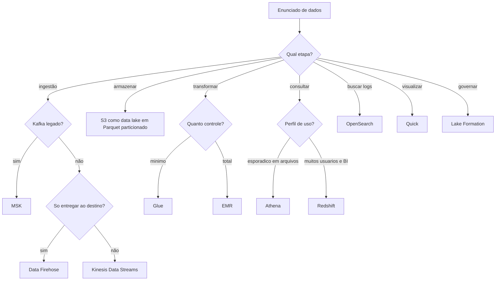

---
aliases:
  - Aula 22.12
modulo: 22
aula: 12
parte: "VII Dados, migração e IA"
dominios:
  - 1
  - 3
lida: false
tags:
  - aula
  - saa-c03
  - modulo-22
---

# Aula 22.12: Segurança da ingestão e decisão final

[[22 - Dados Analytics e Ingestao|Voltar ao módulo]]

> [!question] Pergunta que esta aula responde
> Como garantir que os dados do pipeline nunca trafeguem sem proteção nem sejam lidos por quem não deve, e como juntar todos os serviços do módulo em uma decisão rápida diante de um enunciado?

## Segurança em cada etapa do pipeline

Um pipeline de dados tem muitas portas: quem publica, o canal de transporte, o armazenamento, quem processa e quem consulta. A segurança precisa cobrir cada uma. O mapa abaixo reaproveita ferramentas que você já conhece de outros módulos.

| Pergunta de segurança | Ferramenta | Onde você viu |
|---|---|---|
| **Quem** pode publicar e ler? | [[IAM]] (roles e políticas) | [[04 - IAM Identidade e Acesso|Módulo 4]] |
| **O dado em repouso** está protegido? | [[Criptografia em Repouso]] com [[KMS]] | [[08 - Criptografia e Protecao de Dados|Módulo 8]] |
| **O dado em trânsito** está protegido? | [[TLS]] | Módulo 8 |
| **O caminho de rede** evita a internet pública? | [[VPC Endpoint]] e [[PrivateLink]] | [[06 - VPC a Fundo|Módulo 6]] |
| **Quem vê qual coluna e linha** do lago? | [[Lake Formation]] | Aula 22.8 |
| **Quem acessa qual pedaço** do [[Bucket\|bucket]]? | Políticas de bucket e [[S3]] [[Access Point\|Access Points]] | [[11 - Amazon S3 a Fundo|Módulo 11]] |

### Identidade: roles, não chaves

Cada serviço do pipeline assume uma **[[IAM Role|role do IAM]]** com permissões mínimas: o [[Data Firehose|Firehose]] precisa de uma role que grave no [[Bucket|bucket]] e use a chave do [[KMS]]; o job do Glue, de uma role que leia a origem e escreva o destino; o [[EMR]], de funções de serviço e de [[Instance Profile|perfil de instância]]. Evite [[Access Key|chaves de acesso]] de longo prazo em aplicações; produtores em [[EC2]], [[ECS]] ou Lambda usam a role do próprio serviço.

### Criptografia em repouso

- **[[Kinesis Data Streams]]:** suporta criptografia no lado do servidor com chaves do [[KMS]] (aula 22.2).
- **[[Data Firehose]]:** entrega objetos ao [[S3]] com [[SSE-KMS]] (aula 22.3); a role do Firehose precisa de permissão sobre a chave. A criptografia do stream de entrega depende da origem: com **Direct PUT** (ou IoT, [[CloudWatch Logs]], [[CloudWatch]] Events) você liga a criptografia no próprio Firehose (`StartDeliveryStreamEncryption`); quando a **origem é um [[Kinesis Data Streams|Kinesis Data Stream]]**, quem criptografa em repouso é o stream de origem, e o Firehose lê os dados já decifrados e os bufferiza em memória (verificado em novembro de 2026; [doc](https://docs.aws.amazon.com/firehose/latest/dev/encryption.html)).
- **[[MSK]]:** os [[Criptografia em Repouso|dados em repouso]] usam o [[KMS]], e o tráfego entre brokers e clientes usa [[TLS]].
- **[[S3]], [[Redshift]], [[EMR]], [[OpenSearch Service|OpenSearch]], Athena:** todos oferecem [[Criptografia em Repouso|criptografia em repouso]] com [[KMS]]. No Athena, um **workgroup** pode impor a criptografia dos resultados (aula 22.7).

A regra da prova: se o enunciado pede **controle sobre a chave, rotação, auditoria de uso**, a resposta envolve **chaves do [[KMS]] gerenciadas pelo cliente** em vez da [[AWS Managed Key|chave gerenciada pela AWS]].

### Rede: manter o tráfego fora da internet

Os produtores de dados muitas vezes estão em [[Sub-rede Privada|sub-redes privadas]]. Para chegar ao serviço de ingestão sem passar pela internet:

- **Endpoint de interface ([[PrivateLink]]):** cria uma [[ENI|interface de rede]] na sua [[VPC]] para falar com o serviço de forma privada. O [[Kinesis Data Streams]] oferece endpoints de interface que roteiam o tráfego pela rede da Amazon sem mudar a configuração do stream, dos produtores ou dos consumidores (verificado em novembro de 2026). O [[Kinesis Video Streams]], o [[Data Firehose|Firehose]] e o [[MSK]] [[Serverless]] seguem a mesma lógica.
- **Endpoint de gateway do [[S3]]:** para o tráfego da [[VPC]] ao S3 (por exemplo, de um cluster [[EMR]] ou de um job do Glue), sem custo de processamento do endpoint e sem [[NAT]].
- **[[Redshift]] com enhanced [[VPC]] routing:** força o tráfego de COPY e UNLOAD entre o cluster e o [[S3]] a passar pela VPC (aula 22.9).
- **[[Endpoint Policy|Políticas de endpoint]]:** um endpoint também aceita uma política que limita quais recursos podem ser acessados por ele. Isso vale para os endpoints de interface do [[Data Firehose|Firehose]], do Glue e do Athena, além do Kinesis.

> [!example] Exemplo concreto: produtor privado sem NAT
> Um serviço em [[Sub-rede Privada|sub-rede privada]] envia eventos ao [[Kinesis Data Streams]]. Sem endpoint, o tráfego sairia pelo [[NAT Gateway|NAT gateway]] para a internet pública, com custo e superfície de ataque. Com um **endpoint de interface** para o Kinesis, a chamada permanece na rede da AWS. A política do endpoint ainda restringe o acesso a esse stream específico, e a role do serviço só tem permissão de `PutRecord` nele.

### Travar o bucket do lago: origem de rede e TLS

A política do [[Bucket|bucket]] do lago pode exigir **de onde** vem o acesso e **como**:

- `aws:SourceVpce` (ou `aws:SourceVpc`) com `Deny` quando a requisição **não** vem do endpoint de gateway do [[S3]] (ou da [[VPC]]) informado: só o tráfego que passa pelo endpoint chega aos dados.
- `aws:SecureTransport` igual a `false` com `Deny`: recusa qualquer requisição que não use [[TLS]]. É a resposta para "force [[Criptografia em Transito|encryption in transit]] to the [[Data Lake|data lake]]".
- **[[CloudTrail]] [[Data Event|data events]]** no [[Bucket|bucket]] registram quem leu e gravou objetos (por padrão o CloudTrail registra só [[Management Event|eventos de gerenciamento]]), o que dá a auditoria de acesso ao lago.

> [!warning] Cuidado com o Deny por endpoint
> Um `Deny` por `aws:SourceVpce` também bloqueia o console e os acessos administrativos que não passam pelo endpoint. Teste antes, ou inclua uma exceção para a role de administração.

### Autenticação no MSK

O [[MSK]] oferece mais de uma forma de autenticar clientes (por exemplo, [[IAM]], SASL/SCRAM e [[mTLS|TLS mútuo]]), e o **MSK [[Serverless]] usa exclusivamente controle de acesso por IAM** (verificado em novembro de 2026). Para a prova, o caminho de menor esforço em clusters novos costuma ser IAM.

## S3 Access Points: vários times, um bucket

Quando muitos times e aplicações compartilham o mesmo [[Bucket|bucket]] de lago, uma única [[Bucket Policy|política de bucket]] vai crescendo e fica difícil de manter. Os **[[S3]] [[Access Point|Access Points]]** resolvem isso: são endpoints de rede **nomeados** ligados ao bucket, cada um com **sua própria política** e controles de rede. Um access point pode ser configurado para aceitar requisições **somente de uma [[VPC]]**, e pode ter suas próprias configurações de [[Block Public Access|bloqueio de acesso público]] (verificado em novembro de 2026). Se o access point está ligado a um bucket, sua política trabalha em conjunto com a política do bucket.

Exemplo: o time de analytics acessa o lago por um [[Access Point|access point]] somente-leitura restrito a `curated/`, o time de ingestão por outro com permissão de escrita em `raw/`. Cada política fica pequena e dedicada.

## A árvore de decisão do módulo

Reúna tudo em uma sequência de perguntas. Leia o enunciado procurando a **palavra decisiva**.

### Tabela de decisão rápida

| Se o enunciado diz... | Pense em... |
|---|---|
| "real-time", "[[Shard\|shards]]", "replay" | [[Kinesis Data Streams]] |
| "load into [[S3]], [[Redshift]], [[OpenSearch Service\|OpenSearch]]", "near real-time", "no code" | [[Data Firehose]] |
| "[[Apache Kafka]]", "no code change" | [[MSK]] |
| "[[Serverless\|serverless]] [[ETL]]", "catalog", "[[Glue Crawler\|crawler]]" | Glue |
| "query [[S3]] with SQL", "pay per query" | Athena |
| "reduce data scanned" | [[Parquet]], partições, colunas |
| "[[Data Warehouse\|data warehouse]]", "BI", "complex joins" | [[Redshift]] |
| "query [[S3]] from [[Redshift]] without loading" | [[Redshift Spectrum]] |
| "[[Apache Spark\|Spark]]", "Hadoop", "HBase", "[[Spot Instance\|Spot]] on task nodes" | [[EMR]] |
| "log analytics", "full-text search" | [[OpenSearch Service\|OpenSearch]] |
| "dashboards", "BI visualizations" | Quick |
| "column or row-level access in a [[Data Lake\|data lake]]" | [[Lake Formation]] |
| "subscribe to third-party data" | [[Data Exchange]] |
| "SaaS to [[S3]] with no code" | [[AppFlow]] |

## Como isso cai na prova

Cobre a **Task 3.5** (ingestão, transformação e consulta de dados), a **Task 4.3** (custo de dados) e, para segurança, a **Task 1.3** (proteção de dados).

**Palavras-chave em inglês e o que apontam:**

- "encrypt data in the stream", "customer-managed key": [[KMS]] com SSE.
- "without traversing the internet", "private connectivity": endpoint de interface ([[PrivateLink]]) ou endpoint de gateway do [[S3]].
- "different teams with different permissions on the same [[Bucket|bucket]]": [[S3]] [[Access Point|Access Points]].
- "restrict access by column or row": [[Lake Formation]].
- "only [[IAM]] authentication for [[Apache Kafka|Kafka]]": [[MSK]] [[Serverless]].

**Pegadinhas clássicas:**

- Mandar tráfego do pipeline pelo [[NAT]] e pela internet quando um endpoint resolveria.
- Esquecer a permissão da role sobre a chave [[KMS]]: a criptografia falha mesmo com o [[IAM]] correto para o [[S3]].
- Resolver separação de times com uma única [[Bucket Policy|política de bucket]] gigante em vez de [[Access Point|Access Points]].
- Usar [[Access Key|chaves de acesso]] de longo prazo em vez de roles.
- Achar que o [[Lake Formation]] cuida de criptografia: ele governa acesso; criptografia é [[KMS]].

| Requisito no enunciado | Resposta provável | Por quê |
|---|---|---|
| Produtores em [[Sub-rede Privada\|sub-rede privada]] enviando ao Kinesis sem internet | Endpoint de interface do Kinesis | Tráfego privado |
| [[EMR]] ou Glue lendo [[S3]] sem [[NAT]] | Endpoint de gateway do S3 | Rota privada ao S3 |
| Controle e auditoria da chave de criptografia | [[KMS]] com chave do cliente | Rotação e logs de uso |
| Vários times no mesmo [[Bucket\|bucket]] com regras próprias | [[S3]] [[Access Point\|Access Points]] | Política por ponto de acesso |
| Ocultar colunas e linhas no lago | [[Lake Formation]] | Permissão fina |
| [[Data Firehose\|Firehose]] entregando ao [[S3]] com [[SSE-KMS]] | Role com permissão na chave | Firehose assume a role |

## Resumo

> [!abstract] A aula em uma frase
> Proteja cada etapa do pipeline com roles do [[IAM]], criptografia com [[KMS]], caminhos de rede privados (endpoints), [[Access Point|Access Points]] por time e [[Lake Formation]] para colunas e linhas, e use a árvore de decisão para escolher o serviço certo de cada etapa.

**A lógica, em 5 passos**

1. Identidade primeiro: cada serviço assume uma role de [[Menor Privilegio|menor privilégio]].
2. Criptografe em repouso ([[KMS]]) e em trânsito ([[TLS]]).
3. Mantenha o tráfego fora da internet com endpoints de interface e de gateway.
4. Separe o acesso dos times com [[Access Point|Access Points]] e políticas pequenas.
5. Governe colunas e linhas com o [[Lake Formation]] e escolha os serviços pela palavra-chave decisiva.

**Fatos que valem decorar**

| Item | Valor |
|---|---|
| Kinesis em rede privada | endpoint de interface ([[PrivateLink]]) |
| [[S3]] a partir da [[VPC]] | endpoint de gateway |
| [[MSK]] [[Serverless]] | só [[IAM]] |
| [[Access Point]] | política e controle de rede próprios |

**Tabela-síntese**

| Camada | Proteção |
|---|---|
| Identidade | [[IAM Role\|IAM roles]] |
| Repouso | [[KMS]] |
| Trânsito | [[TLS]] |
| Rede | Endpoints, [[VPC]] |
| Acesso ao dado | [[Lake Formation]], [[Access Point\|Access Points]] |

**Na prática, isso significa**

- Nenhum dado trafega sem criptografia, e nenhuma ingestão privada precisa da internet.
- Role com permissão na chave [[KMS]] é requisito, não detalhe.
- Antes de escolher o serviço, ache a palavra decisiva do enunciado.

> [!tip] Liga com
> Fecha o módulo ligando [[22.08 - Lake Formation Governanca do Data Lake|22.8]] (governança) e [[22.09 - Amazon Redshift Data Warehouse na AWS|22.9]] (enhanced [[VPC]] routing). O [[23 - Migracao e Transferencia de Dados|Módulo 23]] trata de levar dados do mundo local para a AWS.

## Erros comuns

- **"Se o [[Bucket|bucket]] é privado, o tráfego já é privado."** O bucket privado controla quem acessa; o caminho de rede privado exige endpoint.
- **"A role tem permissão no [[S3]], então a escrita funciona."** Com [[SSE-KMS]], também é preciso permissão na chave.
- **"O [[Lake Formation]] criptografa os dados."** Ele governa acesso; a criptografia é do [[KMS]].
- **"Um único [[Bucket|bucket]] exige uma única política."** [[Access Point|Access Points]] dividem o acesso em políticas menores.
- **"[[Access Key|Chaves de acesso]] fixas no código são aceitáveis para o pipeline."** Use roles.

## Pratique

**1.** Produtores em [[Sub-rede Privada|sub-rede privada]], sem acesso à internet, precisam enviar eventos ao [[Kinesis Data Streams]]. O que atende com tráfego privado?

- [ ] a) Um NAT gateway em sub-rede pública, para o tráfego sair pela internet até o endpoint do Kinesis
- [ ] b) Um endpoint de interface (PrivateLink) para o Kinesis, criado na VPC dos produtores
- [ ] c) Um Elastic IP em cada produtor, com a liberação do IP do Kinesis no firewall
- [ ] d) Uma conexão VPN site a site apenas para o tráfego dos produtores

**2.** Um cluster [[EMR]] em [[Sub-rede Privada|sub-rede privada]] precisa ler dados do [[S3]] sem passar pela internet pública e sem custo adicional por hora ou por GB do endpoint. O que usar?

- [ ] a) Um NAT gateway em cada Zona de Disponibilidade, com todo o tráfego saindo por ele
- [ ] b) Um endpoint de interface do S3, com tráfego privado dentro da VPC
- [ ] c) Uma conexão Direct Connect dedicada exclusivamente ao tráfego do cluster
- [ ] d) Um endpoint de gateway do S3 na VPC, com rota privada e sem custo de NAT

**3.** O [[Data Firehose|Firehose]] precisa entregar objetos ao [[S3]] com [[SSE-KMS]] usando uma chave do cliente, mas a entrega falha. Qual é a causa mais provável?

- [ ] a) A role do Firehose não tem permissão de uso da chave KMS escolhida
- [ ] b) O S3 não aceita objetos criptografados com chaves do KMS
- [ ] c) O Firehose só entrega objetos para buckets sem nenhuma criptografia
- [ ] d) A chave do KMS precisa estar em outra Região para funcionar

**4.** Vários times usam o mesmo [[Bucket|bucket]] de [[Data Lake|data lake]] com permissões diferentes, e a [[Bucket Policy|política de bucket]] virou um arquivo enorme e frágil. O que simplifica?

- [ ] a) Criar um bucket para cada usuário individual da empresa
- [ ] b) Aumentar o limite de tamanho da política de bucket com o suporte
- [ ] c) S3 Access Points, cada um com política e rede próprias
- [ ] d) Tornar o bucket público e confiar na rede para limitar o acesso

**5.** (Escolha DUAS.) Quais ações fortalecem a segurança da ingestão de dados?

- [ ] a) Embutir chaves de acesso de longo prazo no código dos produtores
- [ ] b) Usar roles do IAM com menor privilégio para cada serviço do pipeline
- [ ] c) Usar endpoints de interface ou de gateway para manter o tráfego fora da internet
- [ ] d) Desativar a criptografia em trânsito para reduzir a latência
- [ ] e) Conceder permissão de administrador à role do pipeline para evitar erros

**6.** Um cluster [[MSK]] [[Serverless]] será usado por aplicações novas. Qual método de controle de acesso ele suporta?

- [ ] a) ACLs nativas do Kafka como único mecanismo
- [ ] b) Controle de acesso por IAM em todos os clusters
- [ ] c) Usuário e senha locais criados em cada broker
- [ ] d) Nenhum, pois todo acesso é anônimo por padrão

**7.** Uma empresa quer que os analistas vejam a tabela de clientes sem a coluna de CPF e que o acesso seja auditável. Qual é a combinação mais adequada?

- [ ] a) Uma política de bucket do S3 que bloqueie leituras de uma coluna específica
- [ ] b) Uma cópia da tabela sem a coluna, mantida manualmente por um script semanal
- [ ] c) Uma regra de security group que bloqueie o tráfego da coluna de CPF
- [ ] d) Permissões de coluna no Lake Formation, também auditáveis pelo CloudTrail

**8.** O Athena precisa gravar resultados criptografados em um [[Bucket|bucket]] definido, e a empresa não quer depender de cada analista. O que impõe isso?

- [ ] a) Um workgroup com a configuração de resultados e criptografia imposta
- [ ] b) Um alarme do CloudWatch que avisa quando alguém grava sem criptografia
- [ ] c) Um endpoint de VPC que bloqueie todas as consultas dos analistas
- [ ] d) Um guia interno que peça aos analistas para escolherem a criptografia

**9.** (Escolha DUAS.) Quais itens o [[Lake Formation]] e o [[KMS]] tratam, respectivamente?

- [ ] a) Lake Formation: permissões de tabela, coluna e linha no lago
- [ ] b) Lake Formation: rotação das chaves de criptografia do S3
- [ ] c) KMS: filtros de linha para cada gerente
- [ ] d) Lake Formation: tráfego de rede entre sub-redes
- [ ] e) KMS: chaves de criptografia em repouso, com rotação e auditoria

**10.** Qual combinação de serviços forma a arquitetura clássica para: eventos em tempo real, entrega ao [[S3]] em [[Parquet]], consulta SQL e painéis?

- [ ] a) SQS, Lambda, DynamoDB e CloudFront para expor o resultado
- [ ] b) SNS, EC2, RDS e Route 53 para registrar os eventos e servir consultas
- [ ] c) Kinesis Data Streams ou Firehose, S3, Athena e Quick para os painéis
- [ ] d) Snowball, Glacier, EMR e OpenSearch para tratar os dados em lote

**11.** Um enunciado exige: "[[ETL]] [[Serverless|serverless]] que cataloga os dados e converte CSV em [[Parquet]] com o mínimo de gestão". Qual serviço?

- [ ] a) Amazon EMR com cluster persistente e Hive instalado
- [ ] b) Amazon Redshift com carga por COPY e conversão manual
- [ ] c) Amazon OpenSearch Service, usando o Dashboards para a conversão
- [ ] d) AWS Glue, ETL serverless que cataloga e converte arquivos

**12.** Qual é a ordem mais lógica para decidir a arquitetura de um pipeline a partir de um enunciado?

- [ ] a) Escolher o painel primeiro, depois a origem, e só no fim a ingestão e a segurança
- [ ] b) Identificar a etapa do pipeline e a palavra decisiva do enunciado antes de decidir
- [ ] c) Começar pelo serviço que a equipe já conhece e adaptar o requisito a ele
- [ ] d) Escolher a solução com mais componentes, por ser a mais completa

**13.** Uma empresa quer que o [[Bucket|bucket]] do [[Data Lake|data lake]] aceite leituras e gravações somente de recursos da [[VPC]] de análise, que acessam o [[S3]] por um endpoint de gateway, e rejeite qualquer conexão sem [[TLS]]. O que configurar?

- [ ] a) Um security group no bucket, liberando apenas a faixa de IPs da VPC de análise
- [ ] b) Uma política de bucket com Deny para requisições fora do endpoint (aws:SourceVpce) e sem TLS (aws:SecureTransport)
- [ ] c) Uma network ACL na sub-rede do bucket, bloqueando a porta 80 e liberando a 443
- [ ] d) Uma regra do AWS WAF no bucket, filtrando as requisições por país de origem

> [!success]- Gabarito
> **1. b)** o endpoint de interface mantém o tráfego na rede da AWS; a) o [[NAT]] envia o tráfego pela internet; c) IPs elásticos expõem os produtores; d) a VPN site a site liga redes, não o serviço Kinesis.
> **2. d)** o endpoint de gateway do [[S3]] é o caminho privado sem custo de [[NAT]]; a) o NAT custa e sai para a internet; b) o endpoint de interface do S3 também é privado, mas cobra por hora e por GB, e o enunciado pede sem custo adicional; c) [[Direct Connect]] liga o data center, não é necessário.
> **3. a)** com [[SSE-KMS]] a role precisa de permissão na chave; b) o [[S3]] aceita SSE-KMS; c) o [[Data Firehose|Firehose]] entrega objetos criptografados; d) a chave deve estar na mesma Região.
> **4. c)** os [[Access Point|access points]] dividem o acesso em políticas dedicadas; a) um [[Bucket|bucket]] por pessoa é inviável; b) o limite de política não é a solução e a política continuaria frágil; d) bucket público é um risco grave.
> **5. b), c)** [[Menor Privilegio|menor privilégio]] e tráfego privado; a) chaves fixas são insegurança; d) desativar [[TLS]] enfraquece a proteção; e) administrador irrestrito viola o menor privilégio.
> **6. b)** o [[MSK]] [[Serverless]] usa [[IAM]]; a) ACLs do [[Apache Kafka|Kafka]] não são suportadas; c) não há usuários locais nos brokers do Serverless; d) o acesso não é anônimo.
> **7. d)** o [[Lake Formation]] concede por coluna e é auditável; a) o [[S3]] não entende colunas; b) a cópia manual é frágil; c) [[Security Group|security groups]] não distinguem colunas.
> **8. a)** o workgroup pode impor local e criptografia dos resultados; b) o alarme só avisa; c) o endpoint bloquearia o uso e não define o local dos resultados; d) um guia depende de cada pessoa.
> **9. a), e)** o [[Lake Formation]] governa tabela, coluna e linha, e o [[KMS]] cuida das chaves; b) a rotação de chaves é do KMS; c) filtros de linha são do Lake Formation; d) rede é de [[Security Group|security groups]] e [[Network ACL|NACLs]].
> **10. c)** [[Streaming de Dados|streaming]], [[S3]], Athena e Quick cobrem ingestão, armazenamento, consulta e visualização; a) e b) misturam serviços sem relação com o fluxo; d) [[Snowball Edge|Snowball]] e Glacier não são tempo real.
> **11. d)** o Glue é [[ETL]] [[Serverless|serverless]] e cataloga; a) o [[EMR]] persistente exige gestão; b) o [[Redshift]] não é a ferramenta de conversão; c) o [[OpenSearch Service|OpenSearch]] é busca, não ETL.
> **12. b)** identificar a etapa e a palavra decisiva é o método mais confiável; a) começar pelo painel ignora a origem; c) adaptar o requisito ao serviço inverte a lógica; d) mais componentes aumentam custo e overhead sem atender melhor.
> **13. b)** a [[Bucket Policy|política de bucket]] com `aws:SourceVpce` e `aws:SecureTransport` restringe a origem e exige [[TLS]]; a) o [[S3]] não tem [[Security Group|security group]]; c) o [[Bucket|bucket]] não fica em [[Sub-rede|sub-rede]], então a [[Network ACL|NACL]] não se aplica; d) o [[WAF]] não se associa a buckets do S3 nem resolve a origem de rede.

## Para aprofundar

- [ ] [Use interface VPC endpoints for Kinesis Data Streams](https://docs.aws.amazon.com/streams/latest/dev/vpc.html) (documentação do [[Kinesis Data Streams]]): tráfego privado sem mudar a configuração do stream.
- [ ] [Managing access to shared datasets with access points](https://docs.aws.amazon.com/AmazonS3/latest/userguide/access-points.html) (documentação do [[S3]]): políticas e controles de rede por [[Access Point|access point]].

Próximo módulo: [[23 - Migracao e Transferencia de Dados|Módulo 23: Migração e Transferência de Dados]].
