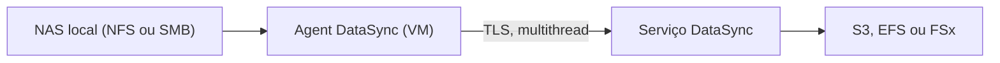

---
aliases:
  - Aula 23.5
modulo: 23
aula: 5
parte: "VII Dados, migração e IA"
dominios:
  - 3
  - 4
lida: false
tags:
  - aula
  - saa-c03
  - modulo-23
---

# Aula 23.5: DataSync e a transferência online de arquivos

[[23 - Migracao e Transferencia de Dados|Voltar ao módulo]]

> [!question] Como copiar milhões de arquivos de um NAS ou de um servidor de arquivos para a AWS de forma rápida, verificada e repetível, e quando o DataSync é a resposta em vez de uma ferramenta mais simples?

## O problema: copiar arquivos em escala é mais difícil do que `cp`

Você já usou `aws s3 sync` ou `rsync`. Funcionam bem para um diretório de poucos gigabytes. Em escala (dezenas de terabytes, centenas de milhões de arquivos, NAS corporativo com permissões e metadados) esses comandos falham de várias maneiras:

- **Desempenho.** Uma cópia simples usa uma conexão por vez e não aproveita um enlace de 10 Gbps.
- **Inventário.** Varrer 100 milhões de arquivos para descobrir o que mudou, toda vez, é lento.
- **Falhas.** Um erro de rede no meio de 20 terabytes obriga a recomeçar, e você não sabe o que chegou íntegro.
- **Metadados.** Donos, permissões POSIX, ACLs do Windows e timestamps se perdem se a ferramenta não os entende.
- **Repetição.** Migrar dados ativos exige várias passadas incrementais até o corte final, e agendar isso à mão vira um projeto.

O [[DataSync|AWS DataSync]] existe para tirar esse trabalho de você. É um serviço gerenciado de transferência de arquivos e objetos que acelera, verifica e agenda a cópia entre sistemas de armazenamento locais, outras nuvens e os serviços de armazenamento da AWS.

## O que o DataSync faz (verificado em novembro de 2026)

O [[DataSync]] move dados entre:

| Lado | Sistemas suportados |
|---|---|
| Local (on-premises) | [[NFS]], [[SMB]], [[HDFS]] e [[Armazenamento de Objetos\|armazenamento de objetos]] compatível com a API do [[S3]] |
| AWS | [[S3]], [[EFS]], [[FSx]] para Windows File Server, [[FSx for Lustre]], [[FSx for OpenZFS]] e [[FSx for NetApp ONTAP]] |
| Outras nuvens | Google Cloud Storage, Azure Blob Storage, Azure Files e diversos serviços de objeto compatíveis |

Ele traz quatro benefícios que você deve reconhecer em enunciados: **automação** do gerenciamento da transferência, **segurança de ponta a ponta** ([[Criptografia em Transito|criptografia em trânsito]] com [[TLS]], [[Log File Validation|validação de integridade]], acesso a serviços AWS por [[IAM Role|roles do IAM]] e suporte a [[VPC Endpoint|VPC endpoints]] para não passar pela internet pública), **velocidade** (protocolo próprio da AWS, [[Desacoplamento|desacoplado]] do protocolo de armazenamento, com arquitetura paralela e multithread) e **modelo de pagamento por uso**, sem licença nem manutenção. Um único task consegue usar totalmente um enlace de **10 Gbps**, segundo a documentação.

As otimizações de rede incluem transferência incremental (só o que mudou), compressão em linha, detecção de arquivos esparsos e validação e criptografia em linha.

## Como funciona por dentro

### Os quatro conceitos

1. **Agent.** Uma máquina virtual (VM) que você implanta junto ao seu armazenamento, em VMware ESXi, Linux KVM, Nutanix AHV ou Microsoft Hyper-V, ou como uma instância [[EC2]] quando o armazenamento está na AWS. O agente lê (e escreve) no armazenamento durante a transferência.
2. **Location.** Descreve de onde ou para onde copiar: um compartilhamento [[NFS]], um [[Bucket|bucket]] do [[S3]], um [[EFS|sistema de arquivos EFS]].
3. **Task.** Uma transferência: location de origem, location de destino e opções (que metadados copiar, filtros, limite de banda, como tratar arquivos apagados).
4. **Task execution.** Uma execução individual de um task. Cada execução passa por fases: **prepare** (inventário e comparação entre origem e destino), **transfer** (cópia) e **verify** (verificação de integridade).

### Preparação, transferência e verificação

Por padrão, na fase de preparação o [[DataSync]] **escaneia o conteúdo e os metadados** das duas pontas para achar diferenças e decidir o que transferir. Se o task estiver configurado para transferir tudo, ele não compara, mas ainda varre a origem. Na transferência, ele copia dados e metadados conforme as opções. Na verificação, ele **sempre** faz checagens de integridade durante a transferência e, no final, pode fazer checagens adicionais só sobre o que foi transferido ou sobre o conjunto inteiro, comparando checksums e metadados. Falhas aparecem como `Checksum failure` ou `Metadata failure`.

### Basic mode e Enhanced mode

O [[DataSync]] tem dois **modos de task** e cada um exige um tipo de agente próprio:

| Aspecto | Basic mode | Enhanced mode |
|---|---|---|
| Fases | Preparar, transferir e verificar **em sequência** | Em **paralelo** (cada objeto é transferido assim que preparado) |
| Quantidade de itens | Os itens inventariados contam para as cotas do task | Pode preparar um número virtualmente ilimitado de objetos por execução |
| Verificação | No final, pode levar muito tempo em conjuntos grandes | Verifica cada objeto à medida que é transferido (só os transferidos) |

Para a prova, basta saber que o Enhanced mode existe para conjuntos de dados com muitíssimos objetos e que a diferença é transferir em paralelo em vez de em sequência.

### Quando é preciso um agente

O agente é necessário quando o armazenamento é gerenciado por você ou por outra nuvem: transferir entre armazenamento local e AWS; entre [[EFS]] ou [[FSx]] e outras nuvens. **Não** é preciso quando se transfere entre serviços de armazenamento da AWS na mesma conta (mesmo entre [[Regiao AWS|Regiões]]), entre [[S3]] e [[Armazenamento de Objetos|armazenamento de objetos]] de outras nuvens, ou entre S3 e outro serviço AWS entre contas. Quando é preciso, a documentação indica:

- um local pode ter **até quatro agentes** de cada modo;
- vários agentes aceleram datasets enormes, mas **não** dão [[Alta Disponibilidade|alta disponibilidade]]: se um estiver offline, o task não roda;
- se usar um [[VPC Endpoint|VPC endpoint]], todos os agentes devem usar o mesmo endpoint e [[Sub-rede|sub-rede]].

Vale ainda saber que transferir **entre [[Regiao AWS|Regiões]]** tem custo: é cobrado como saída de dados da Região de origem para a de destino. Entrada de dados da internet para a AWS segue a regra geral de transferência (veja o [[07 - Conectividade Hibrida e entre VPCs|Módulo 7]]).

## Transferência recorrente

Além de cópias únicas, o [[DataSync]] repete:

- **Agendamento** com expressão cron ou rate, com intervalo **mínimo de 1 hora** (verificado em novembro de 2026).
- **Somente o que mudou** desde a última execução.
- **Apagar no destino** o que não existe mais na origem, se você ligar essa opção.

Esse conjunto torna o [[DataSync]] a ferramenta natural para migração em fases: uma carga inicial grande, várias passadas incrementais enquanto o sistema segue em uso e um **[[Cutover|cutover]]** curto no final, parando as escritas e rodando a última passada.

## Quanto tempo leva? A conta da migração

A documentação dá uma fórmula para o tempo teórico mínimo:

`dias = (tamanho em bytes x 8) / (banda em bits/s x utilização x 3600 x horas disponíveis por dia)`

> [!example] 100 TB em um link de 1 Gbps
> `(100.000.000.000.000 x 8) / (1.000.000.000 x 0,80 x 3.600 x 24) = 11,57 dias`. Quase 12 dias antes das condições do mundo real (oscilação da rede, variação do disco, paradas entre as ondas). Com 10 Gbps a conta cai para cerca de 1,2 dia; com 100 Mbps sobe para cerca de 116 dias. Esse último número é o que empurra a decisão para a transferência física (aula [[23.07 - Transferencia Offline e a Conta da Rede|23.7]]).

A mesma documentação alerta que o **[[Cutover|cutover]]** pode consumir até **30%** do tempo total de uma migração grande, e que se o [[Throughput|throughput]] medido fica abaixo da banda disponível (por exemplo 300 MiB/s em um link de 10 Gbps) vale **particionar** o conjunto de dados em vários tasks, cada um com seu agente. Para superar limites de banda, a página de [disponibilidade do Snowball Edge](https://docs.aws.amazon.com/snowball/latest/developer-guide/snowball-edge-availability-change.html) sugere combinar o [[DataSync]] com uma **conexão hospedada do Direct Connect** contratada por um parceiro pelo tempo do projeto (veja [[Direct Connect]]). Essa recomendação vem dessa página, não do guia de linhas do tempo do DataSync.

## DataSync em contexto: quando NÃO usar

| Necessidade | Melhor ferramenta | Por quê |
|---|---|---|
| Copiar um diretório pequeno uma vez | `aws s3 sync` ou `rsync` | Simples, sem serviço extra |
| Migrar e sincronizar NAS grande, com agendamento e verificação | [[DataSync]] | Paralelo, incremental, verificado |
| Usuários distribuídos enviando arquivos ao [[S3]] pela internet | [[Transfer Acceleration]] | Entrada pela borda mais próxima (aula 23.6) |
| Aplicações locais lendo e gravando no [[S3]] como se fosse um compartilhamento, de forma contínua | [[Storage Gateway]] ([[S3 File Gateway\|File Gateway]]) | Acesso híbrido permanente com cache local (aula 23.8) |
| Rede insuficiente para o volume | Transferência física (aula 23.7) | O tempo de rede estoura o prazo |
| Parceiros externos enviando por SFTP | [[Transfer Family]] | Protocolo que o parceiro já usa (aula 23.6) |
| Bancos de dados | [[DMS]] | Replicação transacional (aulas 23.3 e 23.4) |

> [!tip] Regra de bolso
> **[[DataSync]] move dados que você quer ter na AWS.** **[[Storage Gateway]] deixa o dado acessível como arquivo ou volume local enquanto ele mora na AWS.** Se o enunciado fala em "migrar" ou "copiar", pense DataSync; se fala em "continuar usando como se fosse local", pense Storage Gateway.

## Arquivar dados frios e replicar

O [[DataSync]] também serve para **arquivar** dados frios direto em classes baratas, como [[S3]] Glacier Flexible Retrieval ou [[S3 Glacier Deep Archive]] (liberando armazenamento local e permitindo desligar sistemas legados), e para **replicar** em várias classes do S3, em [[EFS]] ou em [[FSx]] para ter um sistema de arquivos de reserva. A escolha da classe do S3 é assunto do [[11 - Amazon S3 a Fundo|Módulo 11]]. Há um cuidado: o DataSync **não lê** objetos em classes de arquivamento que não foram restaurados; precisa restaurar antes.

## Laboratório (opcional)

> [!warning] Use uma conta AWS pessoal separada
> Faça este laboratório em uma **[[Conta AWS|conta AWS]] pessoal**, com o [[Budgets|AWS Budgets]] configurado, **nunca na conta de produção da empresa**. O [[DataSync]] cobra por GB transferido; use arquivos minúsculos.

Objetivo: copiar um [[Bucket|bucket]] do [[S3]] para outro, na mesma conta, sem agente.

1. Crie dois buckets (origem e destino) na mesma Região e coloque 5 arquivos pequenos na origem.
2. Crie uma role do [[IAM]] que o [[DataSync]] possa assumir, com permissão de leitura e escrita nos dois buckets (veja a documentação do DataSync sobre permissões de location do [[S3]]).
3. Com a AWS CLI, crie uma location para cada [[Bucket|bucket]] (`aws datasync create-location-s3`) apontando para o [[ARN]] do bucket e a role.
4. Crie o task com as duas locations (`aws datasync create-task`) e inicie uma execução (`aws datasync start-task-execution`).
5. Consulte o estado da execução (`aws datasync describe-task-execution`) e confira os arquivos no destino. Observe as fases prepare, transfer e verify.
6. Altere um arquivo na origem e rode de novo: só o que mudou é copiado.

Custo estimado: centavos de dólar. **Limpeza**: apague o task, as duas locations, os dois buckets e a role.

## Como isso cai na prova

Esta aula cobre as tasks 3.5 (serviços de [[Data Transfer|transferência de dados]] e tamanhos e velocidades) e 4.1 (método de menor custo para mover dados para o armazenamento).

**Padrões de cenário:**

- "Migrar **terabytes de arquivos** de [[NFS]] ou [[SMB]] locais para [[S3]], [[EFS]] ou [[FSx]], com **verificação** e **agendamento**": [[DataSync]].
- "Sincronização **recorrente** de arquivos de um NAS para a AWS": [[DataSync]] com agendamento.
- "Menor **[[Overhead Operacional|overhead operacional]]** para transferir dados": [[DataSync]] no lugar de scripts.
- "Mover dados entre [[S3]] e [[EFS]] ou entre [[Regiao AWS|Regiões]]": [[DataSync]] (sem agente se for dentro da AWS na mesma conta).
- "Arquivar dados frios locais no Glacier": [[DataSync]] para a classe de arquivamento.

**Palavras-chave:** *[[NFS]]*, *[[SMB]]*, *[[HDFS]]*, *incremental*, *scheduled*, *data integrity*, *agent*, *online transfer*.

**Pegadinhas:**

- **[[DataSync]] versus [[Storage Gateway]]**: copiar e migrar versus acesso híbrido contínuo.
- **[[DataSync]] versus [[Transfer Acceleration]]**: DataSync tem agente e serve a sistemas de arquivos; Transfer Acceleration acelera uploads de clientes ao [[S3]] pela borda.
- **[[DataSync]] versus [[Snowball Edge]]**: se a conta do tempo de rede estoura, é transferência física.
- Entre serviços AWS na mesma conta **não** se precisa de agente.
- Vários agentes **não** dão [[Alta Disponibilidade|alta disponibilidade]].

| Requisito no enunciado | Resposta provável | Por quê |
|---|---|---|
| Copiar NAS [[NFS]] para [[EFS]] com verificação e agenda | [[DataSync]] | Verifica integridade e agenda execuções |
| Migrar dados ativos em várias passadas até o [[Cutover\|cutover]] | [[DataSync]] com task agendado | Transferência incremental |
| Transferir entre dois buckets [[S3]] em [[Regiao AWS\|Regiões]] diferentes, mesma conta | [[DataSync]] sem agente | Entre serviços AWS na mesma conta não há agente |
| Mais de uma passada com mínimo de custo | [[DataSync]] (pague por GB) | Sem licenças nem infraestrutura própria |
| Rede lenta e 500 TB a mover | Transferência física | Conta de tempo da rede estoura |

## Resumo

> [!abstract] A aula em uma frase
> O [[DataSync]] copia arquivos e objetos entre armazenamento local, outras nuvens e AWS de forma paralela, incremental, verificada e agendável, e é a resposta de menor overhead para migrar dados online.

**A lógica, em 5 passos**

1. Cópias simples falham em escala por desempenho, inventário, falhas e metadados.
2. Um agente (VM) lê o armazenamento local e fala com o serviço por [[TLS]].
3. Cada execução de um task prepara, transfere e verifica.
4. Execuções recorrentes copiam só o que mudou, no mínimo de hora em hora.
5. Se a conta de tempo estoura a janela, a resposta passa a ser a transferência física.

**Números para lembrar**

| O quê | Valor | Por que importa |
|---|---|---|
| Um task | Aproveita até 10 Gbps | Dimensionar o enlace |
| Agendamento | Intervalo mínimo de 1 hora | Limite para cópias recorrentes |
| Agentes por location | Até 4 de cada modo | Acelera, não dá [[Alta Disponibilidade\|alta disponibilidade]] |
| 100 TB em 1 Gbps (80% de uso) | 11,57 dias | Exemplo oficial de conta |
| [[Cutover]] | Até 30% do tempo do projeto | Planejar a janela |

**Tabela-síntese**

| Tipo | Agente? |
|---|---|
| Local para AWS | Sim |
| Entre serviços AWS, mesma conta | Não |
| [[S3]] para objeto de outra nuvem | Não |
| [[EFS]] ou [[FSx]] para outra nuvem | Sim |

**Na prática, isso significa**

- Escolher [[DataSync]] quando o verbo é "migrar" ou "copiar".
- Particionar o dataset quando o [[Throughput|throughput]] fica abaixo da banda.
- Planejar o [[Cutover|cutover]] como uma janela real, não como um detalhe.

> [!tip] Liga com
> Vem de [[23.04 - Conversao de Esquemas e Escolha do Caminho para Bancos|a aula 23.4]] e do [[10 - Armazenamento em Bloco e Arquivos EBS EFS FSx|Módulo 10]] (destinos [[EFS]] e [[FSx]]). Vai para [[23.06 - Transfer Family Transfer Acceleration e Direct Connect na Migracao|a aula 23.6]].

## Erros comuns

- **Usar [[DataSync]] para acesso contínuo como compartilhamento local.** Isso é [[Storage Gateway]].
- **Instalar agente para copiar entre dois buckets da mesma conta.** Não é necessário.
- **Esperar [[Alta Disponibilidade|alta disponibilidade]] ao colocar vários agentes.** Todos precisam estar ativos.
- **Esquecer que objetos arquivados precisam ser restaurados.** O [[DataSync]] pula o que não leu.
- **Subestimar o [[Cutover|cutover]].** A última passada com a origem parada é o que define a janela.

## Pratique

**1.** Uma empresa precisa migrar 80 TB de um NAS com [[NFS]] para o [[S3|Amazon S3]], com verificação de integridade e várias passadas incrementais até o corte. Qual serviço atende com o menor [[Overhead Operacional|overhead operacional]]?

- [ ] a) AWS DataSync
- [ ] b) Scripts rsync em um servidor EC2
- [ ] c) AWS Storage Gateway Volume Gateway
- [ ] d) AWS Transfer Family

**2.** Uma empresa quer sincronizar a cada 6 horas um conjunto de arquivos de um servidor [[SMB]] com o [[FSx|Amazon FSx]] for Windows File Server. Qual solução atende?

- [ ] a) Transfer Acceleration com upload manual
- [ ] b) Snowball Edge a cada 6 horas
- [ ] c) AWS DMS com CDC
- [ ] d) DataSync com um task agendado

**3.** Uma equipe precisa copiar dados entre dois buckets do [[S3]] de [[Regiao AWS|Regiões]] diferentes na mesma conta. Qual afirmação é correta sobre o [[DataSync]]?

- [ ] a) É necessário instalar um agente no EC2
- [ ] b) Não é necessário agente
- [ ] c) Só funciona entre buckets da mesma Região
- [ ] d) Exige um Snowball Edge

**4.** Em uma prova de conceito, o [[DataSync]] entrega 300 MiB/s em um link de 10 Gbps que está quase livre. Qual ação aumenta a utilização da banda?

- [ ] a) Mover o agente para uma VM menor, para reduzir a contenção
- [ ] b) Desligar a verificação de integridade para ganhar velocidade
- [ ] c) Particionar o conjunto de dados em vários tasks, cada um com seu agente
- [ ] d) Migrar tudo em um único task, para evitar sobrecarga

**5.** (Escolha DUAS.) Quais são características do [[DataSync|AWS DataSync]]?

- [ ] a) Copia apenas o que mudou entre as execuções
- [ ] b) Exige que todos os dados sejam acessados como volume iSCSI
- [ ] c) Funciona com NFS, SMB e HDFS
- [ ] d) Só aceita destinos em Amazon S3 Glacier
- [ ] e) Elimina a necessidade de verificar a integridade

**6.** Uma empresa quer que aplicações locais continuem lendo e gravando arquivos em um compartilhamento com baixa [[Latencia|latência]], enquanto os dados ficam no [[S3]]. Qual serviço é o mais adequado?

- [ ] a) AWS DataSync agendado a cada hora, com cópias incrementais
- [ ] b) AWS Database Migration Service
- [ ] c) AWS Storage Gateway com File Gateway
- [ ] d) AWS Snowball Edge

**7.** Objetos em [[S3]] Glacier Flexible Retrieval ainda não restaurados são a origem de um task do [[DataSync]]. O que acontece com esses objetos?

- [ ] a) São lidos normalmente pelo DataSync
- [ ] b) São ignorados até que sejam restaurados
- [ ] c) São movidos automaticamente para o S3 Standard
- [ ] d) São excluídos da origem pelo task

**8.** Uma empresa transfere dados de [[EFS]] para [[S3]] em outra Região da mesma conta e se pergunta sobre custos. Qual cobrança se aplica a essa transferência entre [[Regiao AWS|Regiões]]?

- [ ] a) Nenhuma, pois ocorre dentro da AWS
- [ ] b) Apenas uma taxa fixa mensal do DataSync, sem outros custos
- [ ] c) Cobrança como saída de dados da Região de origem
- [ ] d) Cobrança de entrada na Região de destino

**9.** (Escolha DUAS.) Quais afirmações sobre agentes do [[DataSync]] estão corretas?

- [ ] a) O agente pode rodar em VMware ESXi, KVM, Hyper-V ou Nutanix AHV
- [ ] b) Vários agentes em um location garantem alta disponibilidade
- [ ] c) Um location pode ter até quatro agentes de cada modo
- [ ] d) O agente é obrigatório entre dois buckets do S3 na mesma conta
- [ ] e) O agente só funciona se instalado dentro de uma função Lambda

**10.** Uma empresa precisa mover 500 TB para a AWS em duas semanas, mas só tem um link de 100 Mbps. Qual conclusão a conta de tempo sugere?

- [ ] a) DataSync cumpre o prazo sem problema
- [ ] b) Aumentar a verificação de integridade acelera o processo de cópia sem custo
- [ ] c) Usar Transfer Acceleration resolve a limitação do link
- [ ] d) A rede é insuficiente e a transferência física deve ser considerada

> [!success]- Gabarito
> **1. a)** [[DataSync]] é paralelo, incremental e verifica integridade, sem manter infraestrutura. b) exige gerenciar scripts e servidor; c) expõe volumes [[iSCSI]] e não migra; d) recebe arquivos por SFTP.
> **2. d)** Um task agendado repete a cópia incremental. a) acelera uploads ao [[S3]], não [[FSx]]; b) é lento e impraticável; c) é para bancos.
> **3. b)** Entre serviços AWS na mesma conta, mesmo entre [[Regiao AWS|Regiões]], não se usa agente. a) desnecessário; c) funciona entre Regiões; d) é transporte físico.
> **4. c)** 300 MiB/s equivalem a cerca de 2,4 Gbps, bem abaixo dos 10 Gbps, e particionar em vários tasks paralelos usa mais da banda. a) uma VM menor reduz ainda mais a capacidade do agente; b) comprometeria a integridade e não é o gargalo; d) um único task é justamente o gargalo.
> **5. a) e c)** O [[DataSync]] é incremental e fala [[NFS]], [[SMB]] e [[HDFS]]. b) [[iSCSI]] é do [[Volume Gateway]]; d) há vários destinos; e) a verificação é parte do serviço.
> **6. c)** O [[S3 File Gateway|File Gateway]] dá acesso híbrido contínuo com cache local. a) copia, não é compartilhamento; b) é para bancos; d) é transferência física.
> **7. b)** O [[DataSync]] ignora objetos arquivados não restaurados até que sejam restaurados. a) não consegue lê-los sem restauração; c) o DataSync não troca a classe do objeto; d) o DataSync não apaga a origem.
> **8. c)** A transferência entre [[Regiao AWS|Regiões]] é cobrada como saída da Região de origem. a) há custo; b) a cobrança é por dados, não taxa fixa; d) a entrada não é cobrada.
> **9. a) e c)** O agente roda nesses [[Hypervisor|hypervisors]] e há até quatro por modo. b) vários agentes não dão [[Alta Disponibilidade|HA]]; d) entre buckets na mesma conta não há agente; e) não roda em Lambda.
> **10. d)** 500 TB em 100 Mbps leva centenas de dias (cerca de 460 dias com 100% do link, mais de 570 com 80%), então a rede é insuficiente e a opção física entra. a) estoura o prazo; b) não altera a banda; c) não aumenta a capacidade do link.

## Para aprofundar

- [ ] [What is AWS DataSync?](https://docs.aws.amazon.com/datasync/latest/userguide/what-is-datasync.html) (AWS): sistemas suportados, casos de uso e benefícios.
- [ ] [How AWS DataSync works](https://docs.aws.amazon.com/datasync/latest/userguide/how-datasync-transfer-works.html) (AWS): agent, location, task, fases e modos Basic e Enhanced.
- [ ] [Estimating migration timelines](https://docs.aws.amazon.com/datasync/latest/userguide/datasync-large-migration-timelines.html) (AWS): a fórmula do tempo e o exemplo de 100 TB.
- [ ] [Do I need an AWS DataSync agent?](https://docs.aws.amazon.com/datasync/latest/userguide/do-i-need-datasync-agent.html) (AWS): quando o agente é necessário.

Próxima aula: [[23.06 - Transfer Family Transfer Acceleration e Direct Connect na Migracao|Aula 23.6: Transfer Family, Transfer Acceleration e Direct Connect na migração]]
