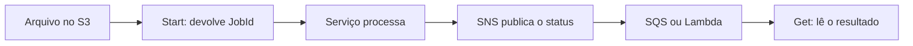

---
aliases:
  - Aula 24.1
modulo: 24
aula: 1
parte: "VII Dados, migração e IA"
dominios:
  - 2
  - 3
lida: false
tags:
  - aula
  - saa-c03
  - modulo-24
---

# Aula 24.1: Por que serviços de IA prontos e como escolher pelo verbo

[[24 - Servicos de IA Gerenciados|Voltar ao módulo]]

> [!question] Pergunta que esta aula responde
> Por que chamar uma API pronta em vez de treinar um modelo, quais são as três camadas de IA da AWS, como o verbo do requisito ("transcrever", "traduzir", "extrair texto de um formulário") aponta para o serviço certo, e que modos de invocação (síncrono, assíncrono, [[Streaming de Dados|streaming]]) e cuidados de segurança são comuns a todos eles?

## O problema: IA sem um time de ciência de dados

Treinar um modelo de aprendizado de máquina (**machine learning**, ML) do zero exige juntar milhares ou milhões de exemplos rotulados, escolher um algoritmo, treinar em hardware caro, medir a qualidade, hospedar o resultado atrás de um endpoint, monitorar a degradação com o tempo e retreinar. É um projeto de meses e uma equipe especializada.

Só que a maior parte das tarefas de IA que uma empresa precisa é **comum**: ler o texto de um PDF escaneado, transcrever uma ligação, traduzir uma página, descobrir se uma imagem tem conteúdo impróprio, saber se um comentário é elogio ou reclamação. Para essas tarefas, a AWS já treinou os modelos, com dados em escala que nenhuma empresa média teria, e os expõe como **API**. Você manda a entrada, recebe a saída em JSON ou em um arquivo, e paga por uso. Isso é o que o curso chama de **serviço de IA gerenciado** (ou serviço de IA "de prateleira").

Você já usa essa lógica em outros serviços. Ao chamar o [[Cognito]] você não implementa criptografia de senha nem fluxo de tokens: usa o serviço de propósito específico. A mesma ideia vale aqui. Na linguagem da prova, é a diferença entre **construir** (treinar e operar um modelo) e **consumir** (chamar uma API), e o enunciado quase sempre pede o menor [[Overhead Operacional|overhead operacional]], o que empurra para consumir.

> [!info] Ligando os pontos
> No [[01 - Nuvem e Infraestrutura Global AWS|Módulo 1]] você viu que tudo na AWS é uma API assinada ([[SigV4]]) e controlada pelo [[IAM]]. Os serviços de IA seguem a regra: a chamada é autenticada, autorizada por uma [[IAM Role|role]] e registrada pelo [[CloudTrail]]. Não há "caminho especial" para IA.

## As três camadas de IA

Pense em três degraus, do mais simples ao mais trabalhoso. A regra de arquitetura é subir de degrau **só quando o de baixo não atende**.

| Camada | O que você fornece | Exemplos | Overhead |
|---|---|---|---|
| 1. Modelo pré-treinado | Só a entrada (texto, áudio, imagem, documento) | [[Comprehend]] (sentimento), [[Translate]], [[Textract]], [[Rekognition]] (rótulos), [[Polly]] | Mínimo: uma chamada de API |
| 2. Personalização sem programar ML | Seus exemplos e termos; o serviço treina por [[AutoML]] ou aplica uma lista | [[Comprehend]] Custom, [[Rekognition Custom Labels]], Translate [[Custom Terminology]], [[Transcribe]] [[Custom Vocabulary]], lexicons do Polly, [[Textract]] Custom Queries | Baixo: você prepara dados, a AWS treina |
| 3. Modelo próprio | Seus dados, seu algoritmo ou framework, seu código de treino e de inferência | [[SageMaker AI]] | Alto: você projeta, treina, implanta e monitora |

O **[[AutoML]]** (aprendizado de máquina automatizado) da camada 2 é o ponto de equilíbrio: você entrega exemplos rotulados e o serviço escolhe e treina o modelo. A documentação do [[Comprehend]] descreve isso como criar modelos personalizados "sem o conhecimento necessário para construir soluções de [[NLP]] baseadas em aprendizado de máquina" (verificado em novembro de 2026).

> [!example] Os três degraus em um caso só
> Uma seguradora quer classificar e-mails de clientes. Degrau 1: o [[Comprehend]] já devolve sentimento e entidades (nomes, datas, valores) sem treino. Degrau 2: ela quer categorias próprias ("sinistro de carro", "segunda via", "cancelamento"), então treina um classificador personalizado do Comprehend com e-mails já etiquetados, sem escrever código de ML. Degrau 3: ela quer prever a probabilidade de o cliente cancelar a partir de dezenas de colunas de uso do contrato. Isso não é um problema de linguagem pronto, é um modelo tabular próprio, e vai para o [[SageMaker AI]].

## O mapa: do verbo ao serviço

A forma mais rápida de escolher é olhar o **verbo** do requisito e as **entradas e saídas**. Memorize a tabela, porque o resto do módulo é o detalhe de cada linha.

| Verbo no requisito | Entrada | Saída | Serviço |
|---|---|---|---|
| Entender, analisar texto (sentimento, entidades, frases-chave, idioma, [[PII\|dados pessoais]]) | Texto | Rótulos, entidades, pontuações | [[Comprehend]] |
| Traduzir | Texto ou documento | Texto em outro idioma | [[Translate]] |
| Transcrever, "speech to text" (**ouvir**) | Áudio | Texto com tempos | [[Transcribe]] |
| Falar, narrar, "text to speech" (**falar**) | Texto | Áudio | [[Polly]] |
| Conversar, chatbot de voz ou texto | Fala ou texto do usuário | Resposta e ação ([[Intent\|intent]] e slots) | [[Lex]] |
| Ver, analisar imagem ou vídeo (objetos, rostos, moderação) | Imagem ou vídeo | Rótulos, caixas, rostos, moderação | [[Rekognition]] |
| Extrair texto e estrutura de documentos ([[OCR]], formulários, tabelas, faturas) | Imagem ou PDF | Texto, pares chave-valor, tabelas | [[Textract]] |
| Treinar e implantar modelo próprio | Seus dados | Modelo e endpoint | [[SageMaker AI]] |

Dois truques de memória que ajudam na prova. O **Polly** é o papagaio (Polly, "Polly wants a cracker"): ele **fala**, repete o texto em voz. O **[[Transcribe]]** faz o caminho inverso: **escuta** e escreve. E o **[[Textract]]** é para **documentos**, enquanto o **[[Rekognition]]** é para **fotos e vídeos**: ler o texto de uma placa em uma foto é Rekognition (detecção de texto em cena), ler os campos de um formulário ou uma fatura é Textract.

> [!warning] Pegadinha de fronteira
> Existem duas "coisas parecidas" que confundem: **extrair texto de documento** ([[Textract]]) contra **detectar texto em imagem** ([[Rekognition]] `DetectText`), e **descobrir dados sensíveis em arquivos do [[S3]]** ([[Macie]]) contra **detectar [[PII|dados pessoais]] em um texto que você envia** ([[Comprehend]], e [[Transcribe]] para áudio). A pergunta de prova quase sempre revela qual é pela palavra "formulário", "tabela" ou "[[Bucket|bucket]]".

## Modos de invocação: síncrono, assíncrono, streaming

O mesmo serviço costuma oferecer mais de um modo, e escolher o certo é metade da pergunta de prova. A razão é física: uma [[HTTP|requisição HTTP]] não pode ficar aberta por minutos, então tarefas longas viram **jobs**.

- **Síncrono (tempo real):** você envia a entrada e a resposta volta na mesma chamada. Para itens pequenos e interativos (um comentário, uma foto de recibo). Tem limites de tamanho.
- **Assíncrono (job ou [[Processamento em Lote|lote]]):** você aponta para os dados no [[S3]], chama uma operação `Start...` e recebe um **identificador de job**. Quando termina, você chama a operação `Get...` correspondente (ou lê a saída gravada no S3). A conclusão pode ser avisada por [[SNS]], que aciona uma fila [[SQS]] ou uma função [[Lambda]]. Serve para volume e documentos grandes.
- **[[Streaming de Dados|Streaming]]:** o áudio ou o vídeo flui continuamente, e os resultados voltam em tempo quase real. Exemplos: transcrição ao vivo, conversa com um bot (a análise de vídeo ao vivo do [[Rekognition]] existe, mas virou legado, como a [[24.04 - Visao e Documentos com Rekognition e Textract|aula 24.4]] explica).

> [!example] Streaming na prática
> Em um congresso, o áudio do palco é enviado em fluxo contínuo ao [[Transcribe]] (por [[HTTP]]/2 ou WebSockets). A cada fração de segundo voltam trechos parciais de texto que o app projeta como legenda ao vivo. Não há `JobId` nem `Get`: o resultado chega na mesma conexão aberta.

O padrão assíncrono, documentado para [[Textract]] e para [[Rekognition]] Video, é sempre o mesmo (verificado em novembro de 2026):

Os limites do modo síncrono que a documentação confirma (todos verificados em novembro de 2026):

| Serviço e operação | Limite síncrono | Alternativa para volume |
|---|---|---|
| [[Comprehend]]: entidades, frases-chave, idioma | 100 KB por documento | Jobs assíncronos; até 1 MB por documento e 5 GB por requisição |
| [[Comprehend]]: sentimento, sentimento direcionado, sintaxe | 5 KB por documento; [[Processamento em Lote\|lote]] de até 25 documentos | Job assíncrono para volume; o documento continua limitado a 5 KB (divida o texto) |
| Translate: tradução em tempo real | 10.000 bytes de texto de entrada | Tradução em [[Processamento em Lote\|lote]]: até 1.000.000 de caracteres por documento e 5 GB no total |
| Polly: `SynthesizeSpeech` | 3.000 caracteres cobrados (6.000 no total) e 10 minutos de áudio | `StartSpeechSynthesisTask`: até 100.000 caracteres cobrados |
| [[Textract]] Core: operações síncronas | 1 página e 10 MB | Assíncrono: PDF e TIFF até 500 MB e 3.000 páginas |

> [!example] Escolhendo o modo
> Um app de despesas deixa o usuário fotografar um recibo e mostra os campos na tela em poucos segundos: chamada **síncrona** (uma página, menos de 10 MB). Já um escritório de advocacia quer extrair o texto de 40 mil páginas de processos em PDF que ficam no [[S3]], sem ninguém esperando: **assíncrono**, com `Start`, [[SNS]] e `Get`, em [[Processamento em Lote|lote]]. O serviço é o mesmo ([[Textract]]), o modo muda com o tamanho e a urgência.

Uma nota de nomes: a prova e a documentação usam "synchronous" e "asynchronous", "real-time" e "batch". Para o [[Transcribe]], as palavras são **batch** (arquivo no [[S3]]) e **[[Streaming de Dados|streaming]]** (fluxo em tempo real).

## Comuns a todos: segurança, privacidade e resiliência

**Identidade.** Quem chama (uma [[Lambda|função Lambda]], uma tarefa do [[ECS]], uma instância do [[EC2]]) precisa de uma role com permissão nas ações do serviço, como `comprehend:DetectSentiment`, `textract:AnalyzeDocument`, `rekognition:DetectLabels`, `translate:TranslateText` ou `polly:SynthesizeSpeech`. Segue o [[Menor Privilegio]] do [[04 - IAM Identidade e Acesso|Módulo 4]]. Vários jobs assíncronos também exigem passar uma role de serviço (por exemplo, o [[Textract]] publica no [[SNS]] usando uma role que você informa, e o [[Comprehend]] usa uma role de acesso aos dados no [[S3]]).

**Rede.** Os serviços de IA são endpoints regionais públicos. Para uma função em [[Sub-rede Privada]] sem saída para a internet, use um [[Interface Endpoint]] ([[PrivateLink]]): a documentação do [[Comprehend]] confirma que o tráfego entre a [[VPC]] e o serviço não sai da rede da Amazon, e que todas as ações da API podem ser chamadas pelo endpoint. Um [[Gateway Endpoint]] **não** serve, porque só existe para [[S3]] e [[DynamoDB]] ([[06 - VPC a Fundo|Módulo 6]]). A documentação de cada serviço confirma o mesmo: **Comprehend, [[Textract]], Translate, [[Transcribe]] (inclusive o Medical), [[Rekognition]], Polly e [[Lex|Lex V2]] oferecem interface endpoint (PrivateLink)**, e o [[SageMaker AI]] também (API e Runtime). Ou seja, em prova a resposta é sempre interface endpoint, nunca gateway endpoint (verificado em novembro de 2026).

> [!example] Função em sub-rede privada chamando o Textract
> Uma [[Lambda|função Lambda]] roda em uma [[Sub-rede Privada]] sem [[NAT Gateway|NAT gateway]]. Cria-se um [[Interface Endpoint|interface endpoint]] do [[Textract]] nessa [[Sub-rede|sub-rede]]: ele vira uma [[ENI]] com [[RFC 1918|IP privado]], e com o [[DNS]] privado ligado o nome público do serviço passa a resolver para esse IP. A função continua chamando o mesmo endereço no SDK, mas o tráfego nunca sai da rede da Amazon. Com um [[Gateway Endpoint|gateway endpoint]] (que é só uma rota na [[Route Table|route table]]) isso seria impossível: ele só existe para [[S3]] e [[DynamoDB]].

**Criptografia.** Os arquivos de entrada e de saída vivem no [[S3]], então valem as regras de [[Criptografia em Repouso]] do [[Bucket|bucket]] com [[KMS]] ([[08 - Criptografia e Protecao de Dados|Módulo 8]]). O [[Textract]], por exemplo, guarda por padrão o resultado de operações assíncronas por 7 dias em um bucket do próprio serviço, a menos que você informe o seu bucket em `OutputConfig` (verificado em novembro de 2026).

**Privacidade do conteúdo.** A documentação do [[Comprehend]] e a do Translate avisam que o serviço pode armazenar o conteúdo para melhorar seus modelos. Para impedir isso de forma central, a AWS oferece uma **política de opt-out de serviços de IA** no [[Organizations]], aplicada à organização inteira em vez de conta a conta, e que os contas-membro não conseguem alterar.

Há uma pegadinha de **[[Residencia de Dados|residência de dados]]**: a documentação do Organizations diz que, sem o opt-out, o serviço pode armazenar o conteúdo para melhoria **em uma Região diferente** da que você usa. Ao optar por sair, o serviço **apaga o conteúdo histórico** guardado para melhoria (não o que é necessário para prestar o serviço) e a preferência vale em **todas as [[Regiao AWS|Regiões]]** onde o serviço opera, inclusive as desativadas por padrão. A lista de serviços suportados (verificada em novembro de 2026) inclui [[Comprehend]], [[Lex|Lex V2]], Polly, [[Rekognition]], [[Textract]], [[Transcribe]] e Translate, entre outros. O [[SageMaker AI]] não consta dessa lista. Fontes: [AI services opt-out policies](https://docs.aws.amazon.com/organizations/latest/userguide/orgs_manage_policies_ai-opt-out.html) e [Opt out from all supported AWS AI services](https://docs.aws.amazon.com/organizations/latest/userguide/orgs_manage_policies_ai-opt-out_all.html).

**Resiliência e quotas.** Todos são **regionais**: não há replicação automática entre [[Regiao AWS|Regiões]]. Para [[Alta Disponibilidade]] entre Regiões, você replica a arquitetura ao redor ([[S3]] com replicação, Lambda e filas na outra Região); há uma exceção documentada, o recurso de replicação multi-Região do [[Lex|Lex V2]] (visto na [[24.03 - Transcribe Polly e Lex Voz Texto e Conversa|aula 24.3]]). As [[Service Quotas]] e o [[Throttling|throttling]] você já viu no [[01 - Nuvem e Infraestrutura Global AWS|Módulo 1]]; aqui eles limitam as chamadas por segundo. O Polly mostra bem: a quota padrão de `SynthesizeSpeech` com voz standard é de 80 transações por segundo por Região e por conta (voz neural: 8 tps; tabela completa na [[24.03 - Transcribe Polly e Lex Voz Texto e Conversa|aula 24.3]]), e acima disso as chamadas voltam com `ThrottlingException` (verificado em novembro de 2026). A resposta de arquitetura é a de sempre ([[20 - Alta Disponibilidade e Recuperacao de Desastres|Módulo 20]]): **retentativa com [[Backoff Exponencial|backoff exponencial]] e [[Jitter|jitter]]**, fila na frente para suavizar picos e pedido de aumento de quota.

## Como isso cai na prova

Cobre a **Task 2.2** (serviços gerenciados com casos de uso: o exam guide cita [[Comprehend]] e Polly; serviço de propósito específico em vez de construir) e toca a **Task 3.5** (pipelines de ingestão e transformação em que um estágio enriquece dados com IA). Os demais serviços do módulo estão na lista de serviços in-scope de Machine Learning do exam guide.

**Palavras-chave em inglês e o que apontam:**

- "least [[Overhead Operacional|operational overhead]]", "no machine learning expertise", "pre-trained": serviço de IA gerenciado (camada 1), nunca treinar modelo.
- "custom model", "own training data", "own algorithm", "build, train, deploy": [[SageMaker AI]].
- "extract text from scanned documents/forms/tables/invoices": [[Textract]].
- "sentiment", "key phrases", "entities", "[[PII]] in text": [[Comprehend]].
- "transcribe", "speech to text", "call recordings": [[Transcribe]]. "Text to speech", "voice": Polly.
- "chatbot", "conversational interface", "intents": Lex.
- "detect objects/faces/inappropriate content in images or video": [[Rekognition]].
- "translate": Translate.

**Pegadinhas clássicas:**

- Responder [[SageMaker AI]] para uma tarefa comum, o que cria overhead sem necessidade.
- Confundir [[Textract]] (documentos) com [[Rekognition]] (imagens), e [[Transcribe]] (áudio para texto) com Polly (texto para áudio).
- Escolher modo síncrono para um documento acima do limite, ou um PDF de centenas de páginas.
- Propor [[Gateway Endpoint|gateway endpoint]] para chamar um serviço de IA de dentro de uma [[VPC]].
- Achar que os serviços replicam entre [[Regiao AWS|Regiões]] sozinhos.

| Requisito no enunciado | Resposta provável | Por quê |
|---|---|---|
| Analisar sentimento de avaliações sem equipe de ML | [[Comprehend]] (DetectSentiment) | Modelo pré-treinado, pago por uso |
| Modelo preditivo próprio com dados tabulares da empresa | [[SageMaker AI]] | Nenhuma API pronta cobre o problema |
| Funções em [[Sub-rede Privada\|sub-rede privada]] chamando um serviço de IA sem internet | Interface [[VPC Endpoint\|VPC endpoint]] ([[PrivateLink]]) | O tráfego fica na rede da Amazon |
| Documento de 800 páginas no [[S3]], sem usuário esperando | Operação assíncrona `Start...` e `Get...` | O modo síncrono tem limite de tamanho e de páginas |
| Impedir em toda a organização o uso do conteúdo para melhoria | Política de opt-out de serviços de IA em Organizations | Controle central, não conta a conta |

## Resumo

> [!abstract] A aula em uma frase
> Para tarefas comuns de IA você consome uma API pronta (menor overhead), personaliza com [[AutoML]] quando precisa de categorias ou termos seus, e só treina um modelo próprio no [[SageMaker AI]] quando nenhuma API cobre o problema; o verbo do requisito aponta o serviço.

**A lógica, em 5 passos**

1. Treinar e operar um modelo é caro e lento; para tarefas comuns a AWS já tem modelos prontos expostos como API.
2. Suba de degrau só se necessário: pré-treinado, depois personalizado por [[AutoML]] ou lista de termos, depois [[SageMaker AI]].
3. Identifique o verbo e a entrada: texto ([[Comprehend]], Translate), áudio ([[Transcribe]], Polly), conversa (Lex), imagem e vídeo ([[Rekognition]]), documento ([[Textract]]).
4. Escolha o modo pelo tamanho e pela urgência: síncrono para itens pequenos, assíncrono com `Start`, [[SNS]] e `Get` para volume, [[Streaming de Dados|streaming]] para fluxo contínuo.
5. Proteja com role de [[Menor Privilegio|menor privilégio]], endpoint de interface na [[VPC]] privada, criptografia no [[S3]] e retentativa com backoff.

**Números para lembrar** (verificado em novembro de 2026)

| O quê | Valor | Por que importa |
|---|---|---|
| [[Comprehend]] síncrono | 100 KB (entidades) ou 5 KB (sentimento) | Acima disso, jobs assíncronos |
| [[Textract]] síncrono | 1 página e 10 MB | Multipágina é assíncrono |
| Translate em tempo real | 10.000 bytes | Documentos grandes vão em [[Processamento em Lote\|lote]] |
| Polly `SynthesizeSpeech` | 3.000 caracteres cobrados | Texto longo usa a tarefa assíncrona |

**Na prática, isso significa**

- "Menor overhead" com tarefa comum de IA é API pronta, não [[SageMaker AI]].
- Verbo e entrada decidem o serviço; modo e tamanho decidem a operação.
- Rede privada chama serviço de IA por [[Interface Endpoint|interface endpoint]], nunca por [[Gateway Endpoint|gateway endpoint]].
- Todo serviço é regional: resiliência entre [[Regiao AWS|Regiões]] é você quem desenha.

> [!tip] Liga com
> Vem do [[01 - Nuvem e Infraestrutura Global AWS|Módulo 1]] (tudo é API) e do [[15 - Desacoplamento Filas Eventos e Workflows|Módulo 15]] ([[SNS]] e [[SQS]] para avisar a conclusão). Segue para [[24.02 - Texto com Comprehend e Translate|a aula 24.2]], que abre o primeiro grupo de serviços.

## Erros comuns

- **"Preciso treinar um modelo para ler PDFs."** Não: o [[Textract]] já lê, e não exige ML.
- **"[[SageMaker AI]] é o serviço de IA da AWS."** É a plataforma para modelo **próprio**; as tarefas comuns são serviços prontos.
- **"[[Textract]] e [[Rekognition]] fazem a mesma coisa porque ambos leem texto."** O Textract foi feito para documentos e estrutura (formulários, tabelas); o Rekognition detecta texto em cenas.
- **"Um [[Gateway Endpoint|gateway endpoint]] resolve o acesso privado."** Só [[S3]] e [[DynamoDB]] têm gateway endpoint.
- **"O serviço replica meus dados em outra Região."** Os serviços de IA são regionais; a replicação é desenho seu.

## Pratique

**1.** Uma startup recebe milhares de avaliações de clientes por dia e quer saber se cada uma é positiva, negativa ou neutra. Não há time de machine learning. Qual solução atende com o MENOR [[Overhead Operacional|overhead operacional]]?

- [ ] a) Treinar um classificador de sentimento no SageMaker AI com avaliações rotuladas pela equipe
- [ ] b) Executar uma biblioteca de NLP de código aberto em instâncias EC2 com Auto Scaling
- [ ] c) Chamar a operação DetectSentiment do Comprehend a partir de uma função Lambda
- [ ] d) Treinar um classificador personalizado do Comprehend com avaliações rotuladas pela equipe

**2.** Um aplicativo de despesas permite que o usuário fotografe um recibo (uma página, menos de 10 MB) e precisa exibir os campos extraídos na tela em poucos segundos. Qual abordagem usar?

- [ ] a) Uma chamada síncrona do Textract (AnalyzeExpense) com a imagem
- [ ] b) StartDocumentAnalysis, tópico SNS, fila SQS e polling até concluir o job
- [ ] c) Uma tarefa do Glue que lê a imagem do S3 em lote toda noite
- [ ] d) Um job de classificação personalizada do Comprehend sobre a imagem

**3.** Um escritório de advocacia guarda no [[S3]] um PDF de 800 páginas por processo e precisa extrair o texto de todos, sem ninguém esperando o resultado. Qual é a solução correta?

- [ ] a) Chamar DetectDocumentText de forma síncrona uma vez por PDF, com o arquivo inteiro
- [ ] b) Usar a operação DetectText do Rekognition em cada página convertida em imagem
- [ ] c) Enviar o PDF ao Comprehend DetectEntities para obter o texto e as entidades
- [ ] d) StartDocumentTextDetection, aviso por SNS e depois o GetDocumentTextDetection

**4.** Uma varejista quer prever quais clientes vão cancelar a assinatura usando dezenas de colunas de uso do contrato, que só ela possui, e expor a previsão em um endpoint. Qual serviço é o mais adequado?

- [ ] a) Comprehend Custom Classification, treinado com as colunas em formato de texto livre
- [ ] b) SageMaker AI, para treinar, implantar e hospedar um modelo próprio
- [ ] c) Rekognition Custom Labels, treinado com as colunas convertidas em imagens
- [ ] d) Textract Queries, com uma pergunta para cada coluna do contrato

**5.** Uma [[Lambda|função Lambda]] roda em [[Sub-rede Privada|sub-rede privada]], sem [[NAT Gateway|NAT gateway]], e precisa chamar o [[Comprehend]] sem enviar tráfego pela internet pública. O que criar?

- [ ] a) Um gateway endpoint para o Comprehend associado à route table da sub-rede
- [ ] b) Um internet gateway e um Elastic IP para a função
- [ ] c) Um interface VPC endpoint (PrivateLink) para o Comprehend
- [ ] d) Um VPC peering com a conta da AWS que opera o serviço

**6.** Uma organização com 40 contas quer que nenhuma conta permita o uso do conteúdo processado pelos serviços de IA para melhoria dos serviços da AWS, com controle central. O que usar?

- [ ] a) Uma política de opt-out de serviços de IA aplicada pelo AWS Organizations
- [ ] b) Uma SCP que nega todas as ações do Comprehend, do Translate e do Rekognition
- [ ] c) Uma key policy do KMS negando acesso ao serviço de IA
- [ ] d) Um Macie job em cada bucket de entrada

**7.** Um app usa o Polly com voz standard e, em picos de 120 requisições por segundo, algumas chamadas voltam com [[Throttling|ThrottlingException]]. Qual é a resposta mais adequada de arquitetura?

- [ ] a) Mover o app para outra Zona de Disponibilidade, que teria uma quota própria de chamadas
- [ ] b) Solicitar aumento de quota e repetir cada chamada rejeitada imediatamente, sem espera
- [ ] c) Trocar para voz neural, que tem uma quota padrão maior que a da voz standard
- [ ] d) Retentativa com backoff exponencial e jitter, mais pedido de aumento de quota

**8.** Um aplicativo de acessibilidade precisa converter artigos de texto em arquivos de áudio MP3 para pessoas com deficiência visual. Qual serviço atende com o MENOR esforço?

- [ ] a) Amazon Connect, com um fluxo de contato que lê cada artigo ao ouvinte por telefone
- [ ] b) Polly, convertendo texto em fala com voz neural
- [ ] c) Lex, criando um bot de voz que lê cada artigo
- [ ] d) Translate, convertendo o artigo para o formato de áudio

**9.** (Escolha DUAS.) Quais itens são exemplos de personalização de IA sem programar machine learning (camada 2)?

- [ ] a) Treinar um modelo de linguagem do zero em um cluster de GPUs no SageMaker AI
- [ ] b) Criar um classificador personalizado do Comprehend com documentos rotulados
- [ ] c) Escrever um contêiner com PyTorch e um script de treino próprio
- [ ] d) Treinar um modelo do Rekognition Custom Labels para detectar o logotipo da empresa
- [ ] e) Hospedar um modelo de NLP de código aberto em um endpoint do SageMaker AI e mantê-lo

**10.** (Escolha DUAS.) Quais afirmações sobre o modo assíncrono de serviços como [[Textract]] e [[Rekognition]] Video estão corretas?

- [ ] a) A operação Start devolve o resultado completo na própria resposta
- [ ] b) O arquivo precisa ser enviado no corpo da requisição de Start
- [ ] c) A operação Start devolve um identificador de job e a operação Get lê o resultado depois
- [ ] d) O resultado só pode ser lido enquanto a conexão da chamada original estiver aberta
- [ ] e) A conclusão pode ser avisada por um tópico SNS, que aciona uma fila SQS ou uma função Lambda

> [!success]- Gabarito
> **1. c)** o [[Comprehend]] DetectSentiment é um modelo pré-treinado, chamado por API, com overhead mínimo; a) treinar no [[SageMaker AI]] cria um projeto de ML sem necessidade; b) uma biblioteca em [[EC2]] exige operar servidores e modelos; d) funciona, mas obriga a rotular exemplos e treinar um modelo para algo que o DetectSentiment já entrega pronto, com mais trabalho.
> **2. a)** uma página pequena e resposta em segundos pedem a chamada síncrona, e o AnalyzeExpense é a operação para recibos; b) o fluxo assíncrono acrescenta [[SNS]], [[SQS]] e polling sem necessidade para uma página; c) o Glue em [[Processamento em Lote|lote]] noturno não atende segundos; d) o [[Comprehend]] classifica texto e não extrai campos de uma imagem.
> **3. d)** 800 páginas excedem o limite síncrono de 1 página, então o job assíncrono (Start, [[SNS]], Get) é o caminho; a) a operação síncrona aceita uma página; b) o [[Rekognition]] DetectText é para texto em cena e escalaria mal para páginas de documento; c) o [[Comprehend]] recebe texto, não extrai texto de PDFs de imagem.
> **4. b)** um modelo tabular próprio, com treino e endpoint, é exatamente o caso do [[SageMaker AI]]; a) o classificador do [[Comprehend]] é para texto; c) o [[Rekognition Custom Labels|Custom Labels]] é para imagens; d) o [[Textract]] Queries extrai respostas de documentos, não faz previsão sobre dados tabulares.
> **5. c)** o [[Interface Endpoint|interface endpoint]] ([[PrivateLink]]) mantém o tráfego na rede da Amazon, e o [[Comprehend]] o suporta; a) o [[Gateway Endpoint|gateway endpoint]] só existe para [[S3]] e [[DynamoDB]]; b) o [[Internet Gateway|internet gateway]] enviaria o tráfego pela internet; d) não há peering com a conta do serviço.
> **6. a)** a política de opt-out de serviços de IA do Organizations é o controle central para isso; b) uma [[SCP]] que nega as ações bloquearia o uso do serviço em vez de impedir o uso do conteúdo; c) a [[Key Policy|key policy]] do [[KMS]] não controla a política de uso de conteúdo; d) o [[Macie]] descobre dados sensíveis no [[S3]] e não afeta o uso pelos serviços de IA.
> **7. d)** retentativa com backoff e [[Jitter|jitter]] mais aumento de quota é a resposta padrão ao [[Throttling|throttling]]; a) as quotas são por Região e conta, não por [[Zona de Disponibilidade|AZ]]; b) o aumento de quota ajuda, mas repetir sem espera amplifica a carga e prolonga o throttling; c) falso: a voz neural tem 8 tps, bem menos que os 80 da standard.
> **8. b)** o Polly converte texto em fala (texto para áudio); a) o Connect é uma central de atendimento por telefone e não entrega arquivos MP3 para um app de acessibilidade; c) o Lex é um construtor de chatbots, não um narrador; d) o Translate converte idioma, não formato de mídia.
> **9. b) e d)** o classificador do [[Comprehend]] e o [[Rekognition Custom Labels]] são [[AutoML]]: você fornece exemplos e a AWS treina; a) treinar um modelo de linguagem do zero e c) escrever [[Container|contêiner]] próprio de treino são [[Modelo OSI|camada 3]]; e) hospedar e manter um modelo próprio é camada 3.
> **10. c) e e)** o Start devolve o JobId e o Get lê o resultado, e a conclusão pode ser publicada no [[SNS]]; a) o Start não devolve o resultado; b) o arquivo fica no [[S3]], referenciado na requisição; d) o resultado é lido depois, com o JobId, sem manter a conexão.

## Para aprofundar

- [ ] [What is Amazon Comprehend?](https://docs.aws.amazon.com/comprehend/latest/dg/what-is.html) (documentação do [[Comprehend]]): insights pré-treinados, modelos personalizados por [[AutoML]] e modos de processamento.
- [ ] [Working with stored video analysis operations](https://docs.aws.amazon.com/rekognition/latest/dg/video.html) (documentação do [[Rekognition]]): o padrão Start, [[SNS]] e Get, descrito para vídeo e idêntico ao dos demais serviços assíncronos.
- [ ] [Calling Amazon Textract Core asynchronous operations](https://docs.aws.amazon.com/textract/latest/dg/api-async.html) (documentação do [[Textract]]): como o job assíncrono, o [[SNS]] e o armazenamento de 7 dias funcionam.
- [ ] [AI services opt-out policies](https://docs.aws.amazon.com/organizations/latest/userguide/orgs_manage_policies_ai-opt-out.html) (documentação do Organizations): o controle central de uso de conteúdo, o efeito em todas as [[Regiao AWS|Regiões]] e a lista de serviços suportados.
- [ ] [Amazon Textract and interface VPC endpoints](https://docs.aws.amazon.com/textract/latest/dg/vpc-interface-endpoints.html) (documentação do [[Textract]]): como criar o [[Interface Endpoint|interface endpoint]]; Translate, [[Rekognition]] e os demais têm página equivalente.

Próxima aula: [[24.02 - Texto com Comprehend e Translate|Aula 24.2: Texto com Comprehend e Translate]].
