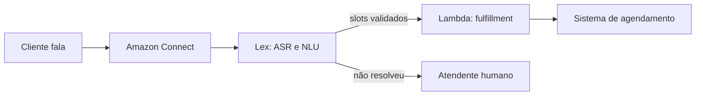

---
aliases:
  - Aula 24.3
modulo: 24
aula: 3
parte: "VII Dados, migração e IA"
dominios:
  - 2
  - 3
lida: false
tags:
  - aula
  - saa-c03
  - modulo-24
---

# Aula 24.3: Transcribe, Polly e Lex: voz, texto e conversa

[[24 - Servicos de IA Gerenciados|Voltar ao módulo]]

> [!question] Pergunta que esta aula responde
> Como converter fala em texto ([[Transcribe]]), texto em fala ([[Polly]]) e montar uma conversa que entende o que a pessoa quer ([[Lex]]), quais recursos de cada um aparecem em cenários de prova ([[Call Analytics]], redação de [[PII]], [[Custom Vocabulary|custom vocabulary]], lexicons, intents e slots) e como eles se combinam em um contact center?

## O problema: voz é dado sem estrutura

Uma gravação de ligação é um arquivo de áudio: não dá para buscar nela, contar quantas vezes o cliente citou "cancelar" nem rodar análise de sentimento. Do outro lado, um aplicativo que precisa **falar** (ler um artigo, avisar um passageiro, responder em uma URA) exigiria gravar vozes humanas para cada frase possível. Reconhecimento automático de fala, síntese de fala e compreensão de conversa são três problemas de aprendizado de máquina difíceis, e a AWS os entrega como serviços da camada 1 ([[24.01 - Por Que Servicos de IA Prontos e Como Escolher pelo Verbo|aula 24.1]]):

| Direção | Serviço | Em uma frase |
|---|---|---|
| Fala para texto (**ouvir**) | [[Transcribe]] | Reconhecimento automático de fala (**ASR**, *automatic speech recognition*) |
| Texto para fala (**falar**) | Polly | Síntese de fala (**TTS**, *text to speech*) |
| Conversa (**entender e responder**) | Lex | Compreensão de linguagem natural (NLU) mais ASR para bots de voz e texto |

## Transcribe: de áudio para texto

O [[Transcribe]] é, segundo a documentação, "um serviço de reconhecimento automático de fala que usa modelos de aprendizado de máquina para converter áudio em texto" (verificado em novembro de 2026). Há **dois métodos**:

- **Batch:** arquivos de mídia que você já enviou ao [[S3]]. Você inicia um job (`StartTranscriptionJob`), consulta o estado e lê o JSON de saída. Para gravações.
- **[[Streaming de Dados|Streaming]]:** o áudio flui em tempo real e a transcrição volta em tempo real, por **[[HTTP]]/2** ou **WebSockets** (`StartStreamTranscription`). Para legendas ao vivo e para assistir uma ligação enquanto ela acontece.

A saída traz o texto e, para cada palavra ou pontuação, **pontuação de confiança** e **marcas de tempo**. A cobrança é por **segundo** de áudio transcrito, em incrementos precisos de 1 segundo sem duração mínima, e recursos como redação de [[PII]] e modelos de linguagem personalizados têm cobrança adicional (verificado em novembro de 2026; preços não confirmados aqui).

Os recursos que aparecem em cenários (todos citados na documentação):

| Recurso | Para que serve |
|---|---|
| **[[Custom Vocabulary\|Custom vocabulary]]** | Lista de termos (siglas, nomes de produtos, jargão) para melhorar o reconhecimento de palavras que o modelo erraria |
| Modelos de linguagem personalizados | Melhoram a precisão em um domínio com texto de treinamento (cobrança adicional) |
| **Identificação de canais** | Transcreve cada canal de um áudio multicanal separadamente (atendente em um canal, cliente em outro) |
| **Partição de locutores** (diarização) | Separa a fala de cada pessoa quando todos estão no mesmo canal (por exemplo `ShowSpeakerLabels` e `MaxSpeakerLabels` no job em [[Processamento em Lote\|lote]]) |
| **Identificação de idioma** | Descobre o idioma do áudio (batch e [[Streaming de Dados\|streaming]]) |
| **Redação de [[PII]]** | Mascara dados pessoais no texto transcrito |
| Filtros de conteúdo e de vocabulário | Mascaram ou removem palavras inadequadas |
| **Geração de legendas** | Em jobs em [[Processamento em Lote\|lote]], gera arquivos de legenda (WebVTT e SubRip) a partir do áudio de um vídeo |
| **[[Transcribe]] Medical** | Variante para ditados e conversas médicas, **somente inglês dos EUA** |

> [!example] Termos que o modelo não conhece
> Uma fintech grava reuniões em que se fala de "Pix", "CDB" e do produto "ZapPay". O modelo geral tende a escrever "pics", "cedê bê" e "zap pay". A equipe cria um **[[Custom Vocabulary|custom vocabulary]]** com essas grafias e o informa no job. A correção vem de uma lista, sem treinar nada.

### PII e redação

A documentação explica que a redação **mascara ou remove** [[PII|dados pessoais]] do transcrito, e que, ao ativá-la, você pode gerar só o transcrito redigido **ou** o redigido e o original. Se gerar só o redigido, **a mídia original passa a ser o único lugar com a conversa completa**: apagar o áudio apaga o último registro dos dados. A própria AWS avisa que, por ser um modelo preditivo, a redação pode **não identificar todas as ocorrências** e **não atende** à desidentificação exigida por leis de privacidade médica como a HIPAA. Na prova, a resposta é "use a redação do [[Transcribe]]", e na vida real, revise a saída (verificado em novembro de 2026). No [[Streaming de Dados|streaming]] há também a opção de **apenas identificar** a PII, sem redigir.

### Call Analytics: contact center sem montar o pipeline

O **[[Call Analytics]]** é a variante do [[Transcribe]] para ligações de atendimento. Na análise **pós-chamada** (arquivo no [[S3]]), a documentação lista estes resultados (verificado em novembro de 2026):

- **Características da chamada:** tempo de fala, tempo sem fala, volume de voz, interrupções, velocidade de fala, problemas, desfechos e itens de ação.
- **Resumo generativo da chamada:** texto curto com motivo da ligação, passos de resolução e próximos passos (preço separado; disponível em `us-east-1` e `us-west-2`, em dialetos de inglês).
- **Categorização personalizada:** regras com palavras-chave, frases, sentimento, interrupções e tempo sem fala (por exemplo, "cliente com sentimento negativo e muitas interrupções" para triagem de escalonamentos).
- **Redação de [[PII]]** do texto **e do arquivo de áudio**.
- **Sentimento por locutor** em vários pontos da chamada.

Também existe análise em tempo real, para dar orientação ao atendente durante a ligação.

> [!info] O que é o Amazon Connect, e Call Analytics contra Contact Lens
> O **[[Amazon Connect]]** é uma central de atendimento em nuvem: recebe chamadas e chats, roteia para filas e atendentes e chama bots Lex. A documentação atual chama o produto de **Amazon Connect Customer** ("o nome atual do produto antes chamado Amazon Connect"; verificado em novembro de 2026), e questões antigas usam só "Amazon Connect". Dentro dele existe o **[[Contact Lens]]**, a análise de conversas nativa do Connect (sentimento, tempo de fala, interrupções, categorias). A regra de prova: se a central **já roda no Amazon Connect** e o requisito é analisar as conversas dentro do Connect, a resposta é **Contact Lens**. Para gravações soltas no [[S3]] ou de uma central **fora do Connect**, a resposta é **[[Call Analytics|Transcribe Call Analytics]]**. O **[[Kendra]]** é uma busca corporativa em linguagem natural sobre repositórios de documentos; está fora do escopo e aparece só como [[Distrator|distrator]].

> [!example] Triagem de ligações
> Uma operadora grava 10 mil ligações por dia no [[S3]]. Com o [[Call Analytics]] em modo pós-chamada, cada gravação gera o transcrito com canais separados, o sentimento do cliente e do atendente, as interrupções e um resumo. Uma categoria "cliente irritado" (sentimento negativo em mais de metade dos turnos, com interrupções) marca as chamadas que o supervisor deve ouvir. Sem Call Analytics, o time teria de montar [[Transcribe]], [[Comprehend]] e lógica de métricas manualmente.

## Polly: de texto para áudio

O Polly "converte texto em fala natural" e permite criar aplicativos falantes. A documentação cita voz **generativa**, **long-form**, **neural** e **standard**, em vários idiomas, e o estilo de locutor de notícias (**Newscaster**) para vozes neurais. Usos típicos: leitores de notícias, jogos, e-learning, acessibilidade para pessoas com deficiência visual e dispositivos conectados. O Polly é elegível para cargas regulamentadas HIPAA e PCI DSS (verificado em novembro de 2026).

**Controle da fala:**

- **[[SSML]]** (*Speech Synthesis Markup Language*): marcação XML para controlar pausas, ênfase, velocidade (`prosody`), pronúncia (`phoneme`) e substituição (`sub`).
- **Lexicons de pronúncia:** arquivos que definem como termos específicos são lidos (siglas, nomes). Até **5 lexicons** por requisição.
- **Speech marks:** metadados de tempo e posição devolvidos junto com o áudio: onde começa cada palavra, frase ou **viseme** (a forma da boca em cada som). Servem para destacar o texto enquanto o áudio toca ou para animar um personagem.

**Limites** (verificado em novembro de 2026):

| Operação | Limite |
|---|---|
| `SynthesizeSpeech` (síncrona) | 3.000 caracteres cobrados (6.000 no total; tags [[SSML]] não contam como cobrados) e 10 minutos de áudio |
| `StartSpeechSynthesisTask` (assíncrona, para áudios longos) | 100.000 caracteres cobrados (200.000 no total) |
| Taxa de `SynthesizeSpeech` | Voz standard: 80 transações por segundo (burst 100); voz neural: 8 tps (burst 10) |

A tarefa assíncrona entrega o áudio no [[S3]] (como nas demais operações em [[Processamento em Lote|lote]]). E um ponto de custo importante: a documentação diz que **você paga pelo texto sintetizado** e pode **armazenar em cache e reproduzir** o áudio gerado **sem custo adicional**. A arquitetura econômica gera o áudio uma vez, guarda no S3 e entrega pelo [[CloudFront]] ([[18 - Borda e DNS CloudFront Global Accelerator e Route 53|Módulo 18]]), em vez de sintetizar a cada acesso.

> [!example] Narração de artigos
> Um portal de notícias quer um botão "ouvir" em cada matéria. Ao publicar, uma função [[Lambda]] chama `StartSpeechSynthesisTask` para o texto (que passa de 3.000 caracteres) e grava o MP3 no [[S3]]. O front-end toca o arquivo pelo [[CloudFront]]. Cada matéria é sintetizada **uma vez**, não uma por leitor.

## Lex: conversa com intenção

O **[[Lex|Lex V2]]** constrói interfaces conversacionais por voz e texto. Ele combina **ASR** e **NLU**: converte a fala em texto, entende a **intenção** por trás dela e executa a função de negócio apropriada. Você não precisa de conhecimento de aprendizado profundo: descreve o fluxo da conversa e dá algumas frases de exemplo (verificado em novembro de 2026).

Os conceitos que a prova e o dia a dia usam:

- **[[Intent]] (intenção):** o objetivo que o usuário quer cumprir ("agendar consulta", "consultar saldo"). A documentação a descreve como composta por resposta inicial, **slots**, confirmação, atendimento (**fulfillment**) e resposta de encerramento.
- **Utterances (frases de exemplo):** as formas como a pessoa pode pedir ("quero marcar um médico", "preciso de uma consulta"). Poucas frases bastam para o Lex generalizar.
- **Slots:** os dados que o bot precisa coletar (especialidade, data, horário). Cada slot tem um tipo, e o Lex pergunta o que falta.
- **Code hooks com [[Lambda]]:** função opcional para **validar** a entrada durante o diálogo (a data existe? há horário livre?) e para o **fulfillment** (gravar a consulta em um sistema). Para bots criados depois de 17 de agosto de 2022, a **ramificação condicional** permite fluxos complexos **sem escrever código Lambda**.
- **Canais:** o mesmo bot atende apps móveis, web e plataformas de chat, e integra com Lambda, [[CloudWatch]], [[Comprehend]], [[Kendra]] e o **[[Amazon Connect]]**.

Recursos recentes citados na documentação: **Assisted NLU** (usa modelos de linguagem grandes para melhorar a classificação de intents e a resolução de slots dentro dos intents que você configurou), vocabulários personalizados em mais 17 idiomas e a **Multi-Region Replication**, que implanta o bot em várias [[Regiao AWS|Regiões]] para [[Disponibilidade|disponibilidade]] e [[Recuperacao de Desastres|recuperação de desastres]]. A cobrança é por requisição de texto ou de voz, sem custo mínimo.

> [!example] Agendamento por voz
> Uma clínica quer que o paciente ligue e agende sem esperar. O bot do Lex tem o [[Intent|intent]] "AgendarConsulta" com os slots `especialidade`, `data` e `horario`. Uma [[Lambda|função Lambda]] valida se o horário existe e, no fim, grava no sistema. O bot é colocado em um fluxo do [[Amazon Connect]] (a ação `ConnectParticipantWithLexBot` conecta a pessoa ao bot e devolve o intent e os slots ao fluxo). Se o bot não entende, o fluxo transfere para um atendente.

> [!info] Ligando os pontos
> O Lex não é o "cérebro" de perguntas e respostas livres sobre documentos: ele gerencia diálogos de tarefas. Respostas livres sobre uma base de conhecimento usam o [[Kendra]] por meio do fulfillment, e a geração de texto por modelos de fundação está fora do escopo deste curso (nota na [[24.05 - SageMaker AI e Modelo Proprio|aula 24.5]]).

### Laboratório (opcional): fala para texto e texto para fala pela CLI

> [!warning] Use uma conta AWS pessoal
> Faça este laboratório em uma **[[Conta AWS|conta AWS]] pessoal separada, com [[Budgets|AWS Budgets]] configurado**, nunca na conta de produção da empresa. Use áudios curtos (menos de 1 minuto), **nunca gravações com [[PII|dados pessoais]] reais**, e apague tudo (inclusive o [[Bucket|bucket]]) no final do mesmo dia.

Custo estimado: centavos de dólar (preço por segundo de áudio e por caractere; confirme nas páginas oficiais).

1. Liste as vozes em português do Brasil: `aws polly describe-voices --language-code pt-BR` e escolha um `Id` que apareça.
2. Sintetize: `aws polly synthesize-speech --output-format mp3 --voice-id <Id> --text "Bem-vindo ao curso" saida.mp3` e ouça o arquivo. Para voz neural, consulte `aws polly synthesize-speech help` e use apenas as opções que aparecerem na sua versão da CLI.
3. Crie um [[Bucket|bucket]] **seu** no [[S3]] e envie o áudio: `aws s3 cp saida.mp3 s3://<seu-bucket>/entrada/saida.mp3`.
4. Inicie o job em [[Processamento em Lote|lote]]: `aws transcribe start-transcription-job --transcription-job-name lab-transcribe-01 --media MediaFileUri=s3://<seu-bucket>/entrada/saida.mp3 --output-bucket-name <seu-bucket> --language-code pt-BR`.
5. Acompanhe: `aws transcribe get-transcription-job --transcription-job-name lab-transcribe-01` até `TranscriptionJobStatus` ser `COMPLETED`, e baixe o JSON de saída do [[Bucket|bucket]].
6. Opcional: repita com `--settings ShowSpeakerLabels=true,MaxSpeakerLabels=2` e veja a seção `speaker_labels` na saída.
7. **Limpeza:** `aws transcribe delete-transcription-job --transcription-job-name lab-transcribe-01`, apague os objetos e o [[Bucket|bucket]] do laboratório (`aws s3 rb s3://<seu-bucket> --force`).

## Como isso cai na prova

Cobre a **Task 2.2** (o exam guide cita o Polly como serviço gerenciado com caso de uso) e as perguntas de serviço de propósito específico dos Domínios 2 e 3.

**Palavras-chave em inglês e o que apontam:**

- "transcribe audio", "call recordings", "speech to text", "live captions": [[Transcribe]] (batch para gravações, [[Streaming de Dados|streaming]] para ao vivo).
- "separate agent and customer", "sentiment per speaker", "call summary", "categorize calls": [[Call Analytics|Transcribe Call Analytics]] (se o enunciado diz que a central já usa [[Amazon Connect]] e quer a análise dentro dele: [[Contact Lens]]).
- "subtitles", "captions for video": [[Transcribe]] com geração de legendas (WebVTT ou SubRip), e Translate para outros idiomas.
- "redact [[PII]] from transcripts and audio": redação de PII do [[Call Analytics]] (e do [[Transcribe]]).
- "domain-specific terms recognized": [[Custom Vocabulary|custom vocabulary]].
- "text to speech", "narrate", "read articles aloud", "lifelike voice": Polly.
- "pronounce acronyms consistently": lexicon ou [[SSML]]; "highlight words while audio plays": speech marks.
- "chatbot", "conversational", "intents and slots", "IVR": Lex, com Lambda para fulfillment e [[Amazon Connect]] para voz de contact center.

**Pegadinhas clássicas:**

- Inverter [[Transcribe]] e Polly (ouvir contra falar).
- Propor [[Transcribe]] mais [[Comprehend]] montados à mão quando a pergunta descreve exatamente os recursos do [[Call Analytics]].
- Responder [[Call Analytics|Transcribe Call Analytics]] quando a central já está no [[Amazon Connect]] ([[Contact Lens]] é a análise nativa), ou o inverso para gravações fora do Connect.
- Dizer que o Lex "gera respostas" de uma base de conhecimento por conta própria; ele conduz diálogos de tarefa.
- Esperar que a redação de [[PII]] seja perfeita ou equivalente à desidentificação de leis de saúde.
- Sintetizar o mesmo texto a cada acesso em vez de guardar o áudio.

| Requisito no enunciado | Resposta provável | Por quê |
|---|---|---|
| Transcrever 10 mil gravações com canais, sentimento e resumo | [[Call Analytics\|Transcribe Call Analytics]] (pós-chamada) | Entrega os insights prontos |
| Legendas ao vivo em um evento | [[Transcribe]] [[Streaming de Dados\|streaming]] ([[HTTP]]/2 ou WebSockets) | Resultado em tempo real |
| Arquivos de legenda para vídeos gravados | [[Transcribe]] em [[Processamento em Lote\|lote]] com geração de legendas | Gera WebVTT ou SubRip |
| Central já no [[Amazon Connect]], analisar conversas dentro dele | [[Contact Lens]] | Análise nativa do Connect, sem montar pipeline |
| Siglas e nomes de produto reconhecidos errado | [[Custom Vocabulary\|Custom vocabulary]] | Lista de termos, sem treino |
| Remover [[PII\|dados pessoais]] do texto e do áudio de ligações | Redação de PII do [[Call Analytics]] | Redige texto e arquivo de áudio |
| Narrar milhares de artigos longos | Polly com `StartSpeechSynthesisTask` e áudio em cache no [[S3]] | Limite síncrono de 3.000 caracteres; sintetiza uma vez |
| Bot de voz que agenda consultas | Lex com Lambda e [[Amazon Connect]] | Intents, slots, validação e fulfillment |

## Resumo

> [!abstract] A aula em uma frase
> O [[Transcribe]] converte fala em texto (batch ou [[Streaming de Dados|streaming]], com [[Call Analytics]] para contact center), o Polly converte texto em fala (com [[SSML]], lexicons e speech marks) e o Lex conduz conversas por intents e slots, com Lambda para validar e cumprir o pedido.

**A lógica, em 5 passos**

1. Áudio é dado opaco; ASR ([[Transcribe]]) o transforma em texto com marcas de tempo e confiança.
2. Gravação vai por batch ([[S3]]); conversa ao vivo vai por [[Streaming de Dados|streaming]] ([[HTTP]]/2 ou WebSockets).
3. Termos do domínio melhoram com [[Custom Vocabulary|custom vocabulary]]; canais e locutores separam quem falou; [[PII]] se redige.
4. O Polly faz o caminho inverso; texto longo usa a tarefa assíncrona e o áudio gerado deve ser guardado e reaproveitado.
5. O Lex entende a intenção, coleta slots, valida e cumpre via Lambda; no contact center ele roda dentro do [[Amazon Connect]].

**Números para lembrar** (verificado em novembro de 2026)

| O quê | Valor | Por que importa |
|---|---|---|
| Polly síncrono | 3.000 caracteres cobrados e 10 minutos | Acima, tarefa assíncrona |
| Polly assíncrono | 100.000 caracteres cobrados | Textos longos |
| Polly, taxa padrão | 80 tps (standard), 8 tps (neural) | [[Throttling]] e backoff |
| Lexicons por requisição do Polly | Até 5 | Pronúncia customizada |
| [[Transcribe]] Medical | Somente inglês dos EUA | Restrição de idioma |

**Tabela-síntese**

| Necessidade | Serviço e recurso |
|---|---|
| Gravações de ligações com insights | [[Call Analytics\|Transcribe Call Analytics]] |
| Legenda ao vivo | [[Transcribe]] [[Streaming de Dados\|streaming]] |
| Pronúncia e destaque de palavras | Polly (lexicon, [[SSML]], speech marks) |
| Diálogo para agendar ou consultar | Lex ([[Intent\|intent]], slots, Lambda) |

**Na prática, isso significa**

- "Ouvir" é [[Transcribe]], "falar" é Polly, "conversar" é Lex.
- Pergunta que descreve sentimento por locutor, resumo e categorias de ligação quer [[Call Analytics]].
- Redação de [[PII]] ajuda, mas não substitui revisão nem a desidentificação formal.
- Gere o áudio do Polly uma vez e sirva do [[S3]] e do [[CloudFront]].

> [!tip] Liga com
> Vem da [[24.02 - Texto com Comprehend e Translate|aula 24.2]] (texto) e do [[15 - Desacoplamento Filas Eventos e Workflows|Módulo 15]] (filas e eventos para jobs). Segue para [[24.04 - Visao e Documentos com Rekognition e Textract|a aula 24.4]], que trata de imagens e documentos.

## Erros comuns

- **"O Polly transcreve áudio."** Ele faz o contrário: texto para fala. Quem transcreve é o [[Transcribe]].
- **"A redação de [[PII]] remove tudo com certeza."** A AWS avisa que pode não identificar todas as ocorrências e que não atende à desidentificação da HIPAA.
- **"Se redigir só o transcrito, ainda tenho o original."** Se você gerar só o redigido, a mídia original é o único registro completo.
- **"O Lex responde qualquer pergunta livre sozinho."** Ele conduz diálogos de tarefa com intents e slots; respostas livres vêm de integrações.
- **"[[Transcribe]] Medical serve para qualquer idioma."** Somente inglês dos EUA.
- **"Sintetizo o texto toda vez que o usuário pedir."** O áudio gerado pode ser guardado e reproduzido sem custo extra de síntese.

## Pratique

**1.** Uma operadora grava 10 mil ligações por dia no [[S3]] e quer, para cada uma, a transcrição com atendente e cliente separados, o sentimento de cada um e um resumo, com o MENOR esforço. Qual solução atende?

- [ ] a) Transcribe em lote e uma função Lambda que chama o Comprehend para cada trecho de fala
- [ ] b) Um bot do Lex que ouve as gravações e classifica cada ligação por intent
- [ ] c) O Polly, que lê as gravações e devolve um relatório em texto por ligação
- [ ] d) O Transcribe Call Analytics em modo pós-chamada, sobre os arquivos de áudio do S3

**2.** Um evento ao vivo precisa exibir legendas em tempo real a partir do áudio do palco, com atraso de poucos segundos. Qual solução usar?

- [ ] a) Um job em lote do Transcribe iniciado a cada cinco minutos com o trecho gravado
- [ ] b) O Polly, enviando o áudio do palco para gerar o texto das legendas
- [ ] c) O Transcribe em modo streaming, por HTTP/2 ou WebSockets
- [ ] d) Um bot do Lex que repete as falas em texto na tela

**3.** Reuniões de uma fintech citam "Pix", "CDB" e o produto "ZapPay", e o [[Transcribe]] escreve essas palavras errado. Qual é a correção com o MENOR esforço?

- [ ] a) Criar um lexicon do Polly com a grafia correta dos termos
- [ ] b) Criar um custom vocabulary do Transcribe e usá-lo nos jobs
- [ ] c) Importar uma custom terminology do Translate com os termos
- [ ] d) Treinar um modelo de reconhecimento de fala próprio no SageMaker AI

**4.** Uma central de atendimento precisa remover números de cartão e nomes tanto do texto transcrito quanto do arquivo de áudio de gravações guardadas no [[S3]], por exigência de conformidade. O que usar?

- [ ] a) A redação de PII do Call Analytics, que redige o texto e o áudio gravado
- [ ] b) Uma política de ciclo de vida do S3 que apaga os trechos com dados pessoais
- [ ] c) O Macie, que mascara os dados sensíveis dentro dos arquivos de áudio
- [ ] d) Uma chave do KMS que cifra os trechos de áudio com dados pessoais

**5.** Um aplicativo de leitura em voz alta pronuncia a sigla "AWS" e o nome de uma marca de forma inconsistente. A equipe quer controlar a pronúncia de forma reutilizável. O que usar?

- [ ] a) Um custom vocabulary do Transcribe aplicado ao texto de entrada
- [ ] b) Uma custom terminology do Translate com a pronúncia desejada
- [ ] c) A opção de formalidade do Translate para fixar o nome
- [ ] d) Um lexicon de pronúncia do Polly aplicado às requisições

**6.** Um app de leitura precisa destacar cada palavra na tela exatamente no momento em que ela é falada no áudio sintetizado. Qual recurso fornece essas informações de tempo?

- [ ] a) As marcas de tempo do Transcribe aplicadas ao texto original e ao áudio gerado
- [ ] b) A tag break do SSML, que insere pausas entre as palavras
- [ ] c) Os speech marks do Polly, com tempo e posição de cada palavra
- [ ] d) O sentimento direcionado do Comprehend aplicado ao áudio

**7.** Uma clínica quer um bot que permita ao paciente agendar consultas por voz: coletar especialidade, data e horário, validar se há vaga em um sistema interno e confirmar. Qual solução usar?

- [ ] a) Um classificador personalizado do Comprehend que lê as chamadas e agenda a consulta
- [ ] b) Um bot do Lex com intent e slots, e uma Lambda para validação e fulfillment
- [ ] c) Uma máquina de estados do Step Functions que usa o Polly para pedir cada dado
- [ ] d) O Transcribe em streaming e uma regra de EventBridge para cada especialidade

**8.** Uma central telefônica usa o [[Amazon Connect]] e quer que um bot de voz entenda o pedido do cliente e passe para a fila certa. Qual integração é adequada?

- [ ] a) Um bot do Lex dentro do fluxo de contato do Amazon Connect
- [ ] b) Um job de modelagem de tópicos do Comprehend por ligação
- [ ] c) Uma função Lambda que chama o Polly para cada frase do cliente
- [ ] d) O Rekognition, para ler o rosto do atendente e escolher a fila

**9.** (Escolha DUAS.) Quais afirmações sobre o [[Transcribe]] estão corretas?

- [ ] a) O job em lote pode ler os arquivos de áudio diretamente de um sistema de arquivos EFS
- [ ] b) O streaming pode ser usado por HTTP/2 ou WebSockets
- [ ] c) O Transcribe Medical suporta todos os idiomas do Transcribe padrão
- [ ] d) O Call Analytics em streaming gera resumo generativo de cada chamada
- [ ] e) A saída inclui marcas de tempo e pontuação de confiança por palavra

**10.** (Escolha DUAS.) Quais afirmações sobre o Polly estão corretas?

- [ ] a) O áudio gerado pode ser armazenado em cache e reproduzido sem custo adicional de síntese
- [ ] b) A operação síncrona SynthesizeSpeech aceita até 100.000 caracteres cobrados
- [ ] c) Para textos longos, usa-se a tarefa assíncrona StartSpeechSynthesisTask
- [ ] d) Vozes neurais e standard têm a mesma taxa padrão de 80 transações por segundo
- [ ] e) O custom vocabulary do Polly é treinado como um modelo de linguagem próprio

> [!success]- Gabarito
> **1. d)** o [[Call Analytics]] pós-chamada entrega canais, sentimento por locutor e resumo prontos; a) funciona, mas obriga a montar e operar a integração que o Call Analytics já traz; b) o Lex conduz conversas e não analisa gravações; c) o Polly gera fala e não lê gravações.
> **2. c)** [[Streaming de Dados|streaming]] por [[HTTP]]/2 ou WebSockets devolve texto em tempo real; a) o job em [[Processamento em Lote|lote]] cria atraso de minutos; b) o Polly gera áudio a partir de texto; d) o Lex entende comandos, não gera legendas do palco.
> **3. b)** o [[Custom Vocabulary|custom vocabulary]] é a lista de termos do [[Transcribe]]; a) o lexicon do Polly ajusta pronúncia na síntese, não o reconhecimento; c) a terminologia do Translate afeta traduções; d) treinar um modelo próprio é exagero.
> **4. a)** o [[Call Analytics]] redige o texto e o arquivo de áudio; b) o ciclo de vida apaga por tempo, não por conteúdo; c) o [[Macie]] descobre dados sensíveis, não edita áudio; d) cifrar não remove os [[PII|dados pessoais]].
> **5. d)** o lexicon do Polly define pronúncias reutilizáveis (até 5 por requisição); a) o [[Custom Vocabulary|custom vocabulary]] é do [[Transcribe]] e atua no reconhecimento; b) a terminologia do Translate mapeia tradução, não pronúncia; c) a formalidade não fixa nomes.
> **6. c)** os speech marks devolvem tempo e posição de palavras, frases e visemes; a) as marcas do [[Transcribe]] descrevem o áudio transcrito e não são a saída da síntese; b) o break insere pausas; d) o [[Comprehend]] não processa áudio.
> **7. b)** intents, slots e code hooks do Lambda são exatamente o modelo do Lex para agendamento; a) classificar texto não conduz o diálogo; c) o [[Step Functions]] orquestra, mas não entende o que o paciente diz; d) o [[Transcribe]] só converte fala em texto e não conduz diálogo.
> **8. a)** o Lex se integra ao fluxo do Connect e devolve [[Intent|intent]] e slots; b) tópicos não decidem fila em tempo real; c) o Polly só fala; d) o [[Rekognition]] analisa imagens e não roteia chamadas.
> **9. b) e e)** o [[Streaming de Dados|streaming]] usa [[HTTP]]/2 ou WebSockets e a saída traz tempo e confiança por palavra; a) o job em [[Processamento em Lote|lote]] lê do [[S3]], não do [[EFS]]; c) o Medical é somente inglês dos EUA; d) o resumo generativo documentado é da análise pós-chamada, não do streaming.
> **10. a) e c)** o áudio pode ser reaproveitado sem custo adicional e textos longos usam a tarefa assíncrona; b) o limite síncrono é 3.000 caracteres cobrados; d) a taxa neural é de 8 tps, não 80; e) o [[Custom Vocabulary|custom vocabulary]] é um recurso do [[Transcribe]] (lista de termos, sem treino); o Polly usa lexicons de pronúncia.

## Para aprofundar

- [ ] [What is Amazon Transcribe?](https://docs.aws.amazon.com/transcribe/latest/dg/what-is.html) (documentação do [[Transcribe]]): batch, [[Streaming de Dados|streaming]], preços por segundo e quotas.
- [ ] [Post-call analytics](https://docs.aws.amazon.com/transcribe/latest/dg/call-analytics-batch.html) (documentação do [[Transcribe]]): características da chamada, categorias, redação e sentimento por locutor.
- [ ] [Quotas in Amazon Polly](https://docs.aws.amazon.com/polly/latest/dg/limits.html) (documentação do Polly): limites de caracteres, taxas por tipo de voz e lexicons.
- [ ] [What is Amazon Lex V2?](https://docs.aws.amazon.com/lexv2/latest/dg/what-is.html) (documentação do Lex): intents, slots, code hooks, integração com o [[Amazon Connect]] e replicação multi-Região.

Próxima aula: [[24.04 - Visao e Documentos com Rekognition e Textract|Aula 24.4: Visão e documentos com Rekognition e Textract]].
