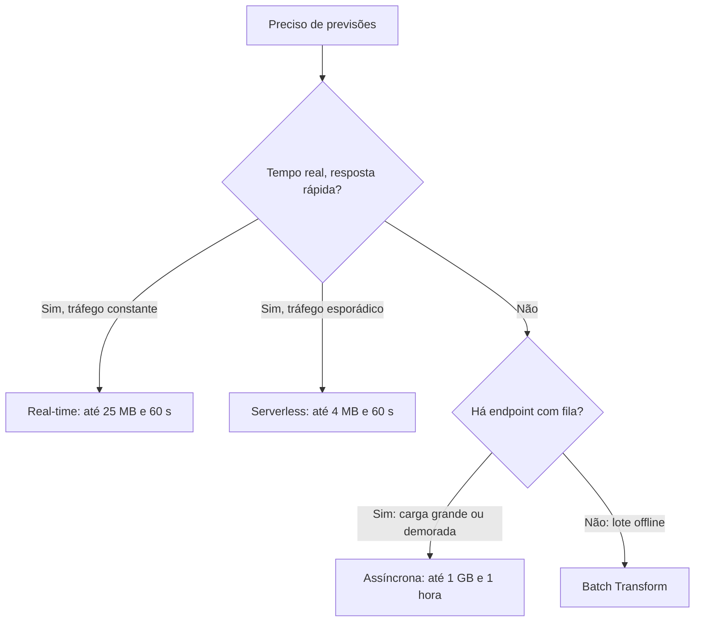

---
aliases:
  - Aula 24.5
modulo: 24
aula: 5
parte: "VII Dados, migração e IA"
dominios:
  - 2
  - 3
lida: false
tags:
  - aula
  - saa-c03
  - modulo-24
---

# Aula 24.5: SageMaker AI e o modelo próprio

[[24 - Servicos de IA Gerenciados|Voltar ao módulo]]

> [!question] Pergunta que esta aula responde
> Quando nenhuma API pronta resolve o problema, o que o [[SageMaker AI]] oferece para treinar e implantar um modelo próprio, quais são as quatro opções de inferência (tempo real, [[Serverless|serverless]], assíncrona, [[Processamento em Lote|lote]]) e como escolher entre elas pelo tamanho da carga, pelo tempo de processamento e pelo padrão de tráfego?

## O problema: o caso que nenhuma API cobre

As aulas 24.2 a 24.4 mostraram serviços que resolvem tarefas **comuns** (texto, fala, imagem, documento). Mas há problemas que são só seus: prever quais clientes vão cancelar a assinatura a partir de dezenas de colunas de uso, estimar a demanda de uma peça com base no seu histórico, detectar fraude com os padrões do seu negócio, treinar um modelo de linguagem com seus documentos internos. Não existe "API de churn da AWS": os dados e o alvo são seus.

Para isso você precisa **construir** o modelo, e construir um modelo é um ciclo com etapas: preparar os dados, **treinar** (ajustar os parâmetros do modelo aos dados, em instâncias com muito poder de cálculo), **avaliar** (medir o erro em dados que o modelo não viu), **implantar** e **monitorar** (a qualidade cai quando os dados do mundo mudam). Cada etapa tem infraestrutura própria: notebooks, clusters de treino, repositório de artefatos, endpoints. O **[[SageMaker AI|Amazon SageMaker AI]]** é o serviço gerenciado que reúne essas etapas. A documentação o descreve como um serviço de machine learning totalmente gerenciado em que cientistas de dados e desenvolvedores podem "construir, treinar e implantar modelos de ML em um ambiente hospedado pronto para produção" (verificado em novembro de 2026).

> [!info] Ligando os pontos
> Na [[24.01 - Por Que Servicos de IA Prontos e Como Escolher pelo Verbo|aula 24.1]] o [[SageMaker AI]] era o degrau 3: o de maior controle e maior overhead. Isso não o torna "melhor": o requisito de prova "menor [[Overhead Operacional|overhead operacional]]" quase nunca aponta para ele. Ele é a resposta quando o enunciado fala em modelo próprio, algoritmo próprio, dados próprios de treino ou hospedagem de modelo com controle.

## Nome e família: SageMaker, SageMaker AI e Bedrock

Os nomes mudaram, e questões antigas de simulado usam o velho. Pela documentação (verificado em novembro de 2026):

- Em **3 de dezembro de 2024**, o **[[SageMaker AI|Amazon SageMaker]]** foi renomeado para **Amazon SageMaker AI**. O nome mudou, **não** as funcionalidades. Os [[Namespaces e Cgroups|namespaces]] antigos continuam (`sagemaker` na CLI, políticas `AmazonSageMaker...`, endpoints, recursos `AWS::SageMaker::...` no [[CloudFormation]]).
- **Na prova**, "[[SageMaker AI|SageMaker]]" e "SageMaker AI" significam o mesmo serviço de ML (o exam guide usa "SageMaker AI"); a plataforma unificada nova, descrita a seguir, não é cobrada.
- No mesmo dia surgiu a nova geração do **[[SageMaker AI|Amazon SageMaker]]**, uma plataforma unificada de dados, análise e IA, que reúne o SageMaker AI (construir, treinar e implantar modelos de ML e de fundação), o Lakehouse (acesso unificado a data lakes no [[S3]], ao [[Redshift]] e outras fontes), governança de dados e IA, análise SQL, processamento de dados (Athena, [[EMR]], Glue), o Unified Studio e o **Amazon Bedrock** (construir aplicações de IA generativa).

> [!warning] Bedrock e outros fora da lista oficial
> O exam guide da SAA-C03 (versão 1.1, de 29 de outubro de 2026) lista, em Machine Learning, só [[Comprehend]], Lex, Polly, [[Rekognition]], [[SageMaker AI]], [[Textract]], [[Transcribe]] e Translate. **Amazon Bedrock** (modelos de fundação por API, para IA generativa) **não consta** na lista, que é descrita como "não exaustiva". Trate-o como contexto: em uma frase, o Bedrock dá acesso por API a modelos de fundação sem você hospedar o modelo; o SageMaker AI é para quando você mesmo treina, ajusta e hospeda. Serviços como Personalize, [[Kendra]] e Comprehend Medical também não estão na lista de escopo do exam guide (Personalize está na lista de **fora do escopo**). Questões podem mencioná-los como [[Distrator|distratores]].

## O que o SageMaker AI oferece

A documentação organiza em ambientes e recursos. Os que valem para a prova, todos citados nela (verificado em novembro de 2026):

| Recurso | O que faz | Quando aparece |
|---|---|---|
| **[[SageMaker AI\|SageMaker]] Studio** | Ambiente web (IDEs, JupyterLab, Code Editor) para o fluxo de ML | Equipe de dados desenvolvendo |
| **[[SageMaker AI\|SageMaker]] Canvas** | Serviço de [[AutoML]] **sem código**: pessoas sem programação constroem modelos e fazem previsões | Analista de negócio quer prever sem programar |
| **[[SageMaker AI\|SageMaker]] Autopilot** | Usuários sem conhecimento de ML constroem modelos de **classificação e regressão** rapidamente | [[AutoML]] a partir de dados tabulares |
| **JumpStart** | Modelos de fundação públicos e proprietários pré-treinados, implantáveis em um endpoint | Começar de um modelo existente em vez do zero |
| **Batch Transform** | Pré-processa datasets e roda inferência **sem endpoint persistente** | Processamento offline em massa |
| **[[A2I\|Amazon Augmented AI]] (A2I)** | Cria os fluxos de **revisão humana** de predições de ML | Baixa confiança passa por pessoas |
| **HyperPod** | Ambiente sempre ligado, em clusters resilientes, para treinar modelos muito grandes (LLMs, difusão) | Pré-treino de modelos enormes |
| **Training plans** | [[Capacity Reservation\|Reserva de capacidade]] de GPUs para treino em prazos definidos | Previsibilidade de custo e de capacidade |
| **Pipelines** (com etapa [[AutoML]]) | Orquestra o fluxo de ML em etapas repetíveis | Automatizar o ciclo de ML |
| **[[Ground Truth]]** | Cria conjuntos de treino rotulados usando pessoas (workers) junto com ML | "Rotular dados" para treinar |
| **[[Model Monitor]]** | Monitora modelos em produção (endpoints) para detectar **deriva de dados** (data drift) e queda de qualidade | "Detectar degradação do modelo" |
| **[[Feature Store]]** | Repositório central de **features** e metadados, com loja online (baixa [[Latencia\|latência]]) e offline (treino e [[Processamento em Lote\|lote]]) | Reusar features entre times |
| **[[Model Registry]]** | [[Versionamento]] de modelos, rastreio de artefatos e linhagem, fluxo de aprovação e implantação entre contas | Governança e promoção de modelos |
| **[[Clarify]]** | Detecta possível viés e ajuda a explicar as previsões de um modelo | "Viés" e "explicabilidade" |

> [!warning] Status de disponibilidade (verificado em novembro de 2026)
> A AWS marcou o **[[Clarify]]** e o **[[Model Monitor]]** como **não abertos a novos clientes** (clientes existentes continuam usando normalmente), e indica soluções de monitoramento de código aberto com [[CloudWatch]] e [[Amazon Quick|QuickSight]] como substitutos. Em prova, os dois ainda aparecem como a resposta de "viés e explicabilidade" e de "deriva do modelo". Fontes: [Clarify availability change](https://docs.aws.amazon.com/sagemaker/latest/dg/clarify-availability-change.html) e [Model Monitor availability change](https://docs.aws.amazon.com/sagemaker/latest/dg/model-monitor-availability-change.html). As descrições da tabela vêm de [SageMaker AI Features](https://docs.aws.amazon.com/sagemaker/latest/dg/whatis-features.html).

> [!example] Do analista ao cientista de dados
> A equipe comercial de uma rede de academias tem uma planilha com 40 colunas por aluno e quer saber quem vai cancelar. Sem programadores de ML, usa o **Canvas** (interface visual, sem código) ou o **Autopilot** ([[AutoML]] de classificação) para treinar e comparar modelos. Um ano depois, a equipe de dados quer uma arquitetura própria, com um algoritmo específico e um [[Container|container]] customizado: usa o **Studio** e jobs de treino do [[SageMaker AI]]. Mesmo serviço, três níveis de controle.

## Inferência: as quatro opções

O treino é **episódico** (roda de tempos em tempos); a **inferência** (usar o modelo treinado para gerar previsões) é o que está em produção e o que pesa na arquitetura e na conta. A documentação lista quatro opções (verificado em novembro de 2026):

| Opção | Ideal para | Carga e tempo suportados | Custo |
|---|---|---|---|
| **Real-time inference** | Baixa [[Latencia\|latência]] ou alta [[Throughput\|vazão]], tráfego sustentado | Até **25 MB** de carga; **60 s** (respostas normais) e **8 min** ([[Streaming de Dados\|streaming]]) | Endpoint persistente em instâncias à sua escolha: você paga as instâncias ligadas |
| **[[Serverless]] Inference** | Tráfego **intermitente ou imprevisível** | Até **4 MB**; até **60 s** | Sem gerenciar instâncias nem políticas de escala; paga o que usa, **sem pagar ociosidade** |
| **Asynchronous Inference** | Cargas **grandes** e processamento **longo**, com fila de requisições | Até **1 GB**; até **1 hora**; pode **escalar a zero** sem requisições | Paga quando há processamento |
| **Batch Transform** | Processamento offline de grandes volumes, sem endpoint | Datasets de **GBs**; processamento de **dias** | Os recursos sobem para o job e são desligados ao fim |

Raciocine pelo **padrão de tráfego**, que é o mesmo raciocínio de capacidade do [[12 - Balanceamento de Carga e Auto Scaling|Módulo 12]] e de custo do Módulo 25: um endpoint em tempo real é como uma [[EC2|instância EC2]] ligada 24 horas, e só compensa com tráfego contínuo; o [[Serverless|serverless]] é o equivalente ao [[Lambda]] para modelos; a assíncrona é o equivalente a uma fila na frente de um worker; o batch é o job noturno.

> [!example] Escolhendo entre as quatro
> (1) Um site de varejo recomenda produtos a cada clique, 24 horas por dia, com respostas de poucos milissegundos e cargas de poucos KB: **tempo real**. (2) Um app interno de triagem usa o modelo algumas vezes por hora, sem hora marcada, com 2 MB por chamada: **[[Serverless|serverless]]**, para não pagar instância ociosa. (3) Um serviço processa vídeos de 600 MB que levam 30 minutos cada e precisa de fila e de zero custo quando não há pedido: **assíncrona**. (4) A análise mensal gera previsões para 5 TB de histórico, em um arquivo, sem endpoint: **Batch Transform**.

## Segurança e operação em uma página

O [[SageMaker AI]] também é um serviço regional. Os dados de treino e os artefatos do modelo ficam no [[S3]] (criptografia com [[KMS]]), a execução usa uma **role** com [[Menor Privilegio]], e os endpoints e jobs podem ficar na sua [[VPC]] ([[06 - VPC a Fundo|Módulo 6]]). A API do SageMaker AI e o Runtime (invocação do endpoint) têm **[[Interface Endpoint|interface endpoint]] ([[PrivateLink]])**, então uma aplicação em [[Sub-rede Privada|sub-rede privada]] invoca o modelo sem passar pela internet pública (fonte: [Connect to SageMaker AI through a VPC interface endpoint](https://docs.aws.amazon.com/sagemaker/latest/dg/interface-vpc-endpoint.html)). Para resiliência de um endpoint em tempo real, a documentação de boas práticas manda implantar **mais de uma instância**, que o serviço distribui por mais de uma [[Zona de Disponibilidade]] (a configuração de VPC precisa de pelo menos duas [[Sub-rede|sub-redes]] em AZs diferentes), e escalar por métricas do [[CloudWatch]]. É o desenho do [[20 - Alta Disponibilidade e Recuperacao de Desastres|Módulo 20]] aplicado ao modelo (fonte: [Best practices for deploying models](https://docs.aws.amazon.com/sagemaker/latest/dg/deployment-best-practices.html); verificado em novembro de 2026).

## Como isso cai na prova

Cobre as perguntas de "quando escolher cada serviço" do Domínio 3 (**Task 3.2** e **3.3**, escolha de computação e de tecnologia pelo padrão de carga) e de serviço de propósito específico (**Task 2.2**). O [[SageMaker AI]] está na lista in-scope de Machine Learning.

**Palavras-chave em inglês e o que apontam:**

- "build, train, and deploy a custom ML model", "own algorithm", "own training data": [[SageMaker AI]].
- "no coding", "business analyst builds ML models": [[SageMaker AI|SageMaker]] Canvas; "[[AutoML]] for tabular data": Autopilot.
- "pre-trained foundation model, deploy to an endpoint": JumpStart.
- "intermittent or unpredictable traffic", "do not pay for idle": [[Serverless]] Inference.
- "large payload", "long processing time", "queue requests", "scale to zero": Asynchronous Inference.
- "offline", "entire dataset", "no persistent endpoint": Batch Transform.
- "low [[Latencia|latency]], sustained traffic": Real-time inference.
- "human review of low-confidence predictions": [[A2I|Amazon Augmented AI]].
- "label training data with human workers": [[Ground Truth]]; "detect data drift / model quality degradation in production": [[Model Monitor]]; "detect bias, explain predictions": [[Clarify]]; "share and reuse features": [[Feature Store]]; "version and approve models": [[Model Registry]].

**Pegadinhas clássicas:**

- Escolher [[SageMaker AI]] para uma tarefa que um serviço pronto já faz ([[OCR]], sentimento, transcrição).
- Usar tempo real para tráfego esporádico, pagando instância ociosa.
- Esquecer o limite de carga: 4 MB no [[Serverless|serverless]], 25 MB em tempo real, 1 GB na assíncrona.
- Confundir assíncrona (endpoint com fila) com Batch Transform (job sem endpoint).
- Achar que o Bedrock é a resposta de "treinar modelo próprio" (ele serve modelos de fundação por API) ou que ele está na lista de escopo.

| Requisito no enunciado | Resposta provável | Por quê |
|---|---|---|
| Prever cancelamentos com colunas próprias da empresa | [[SageMaker AI]] | Nenhuma API pronta cobre o problema |
| Analista de negócio, sem programar, constrói previsões | [[SageMaker AI\|SageMaker]] Canvas | [[AutoML]] sem código |
| Tráfego raro e imprevisível, carga de 2 MB, sem pagar ociosidade | [[Serverless]] Inference | Paga só pelo uso, até 4 MB |
| Cargas de 600 MB que levam 30 minutos e fila de pedidos | Asynchronous Inference | Até 1 GB, 1 hora, escala a zero |
| Previsões para 5 TB de histórico, sem endpoint | Batch Transform | Offline, sem endpoint persistente |
| Baixa [[Latencia\|latência]] constante, 5 MB por chamada | Real-time inference | Até 25 MB; [[Serverless\|serverless]] não comporta |
| Revisão humana para predições de baixa confiança | [[A2I\|Amazon Augmented AI]] (A2I) | Fluxos de revisão humana |

## Resumo

> [!abstract] A aula em uma frase
> O [[SageMaker AI]] é a plataforma para modelo próprio (treinar, ajustar, implantar e monitorar), com Canvas e Autopilot para [[AutoML]] e quatro modos de inferência escolhidos pelo tráfego, pelo tamanho da carga e pelo tempo de processamento.

**A lógica, em 5 passos**

1. Problema que só você tem (dados e alvo próprios) pede um modelo próprio, e isso exige treino, avaliação, implantação e monitoramento.
2. O [[SageMaker AI]] reúne esse ciclo; Canvas e Autopilot tiram o código, JumpStart parte de um modelo pronto, HyperPod treina modelos enormes.
3. A inferência é a parte em produção: escolha o modo pelo padrão de tráfego.
4. Tempo real para tráfego sustentado e baixa [[Latencia|latência]]; [[Serverless|serverless]] para tráfego intermitente; assíncrona para carga grande, demorada e com fila; Batch Transform para [[Processamento em Lote|lote]] offline sem endpoint.
5. Antes de tudo, confirme que não existe serviço pronto: o menor overhead quase sempre vence.

**Números para lembrar** (verificado em novembro de 2026)

| O quê | Valor | Por que importa |
|---|---|---|
| Real-time inference | 25 MB; 60 s (8 min em [[Streaming de Dados\|streaming]]) | Teto da chamada em tempo real |
| [[Serverless]] Inference | 4 MB; 60 s | Carga maior sai do serverless |
| Asynchronous Inference | 1 GB; 1 hora; escala a zero | Cargas grandes e demoradas |
| Batch Transform | GBs; dias | Lote offline |
| Renomeação | [[SageMaker AI\|SageMaker]] para SageMaker AI em 3 de dezembro de 2024 | Questões antigas usam o nome velho |

**Tabela-síntese**

| Pergunta | Opção |
|---|---|
| Tráfego sustentado, baixa [[Latencia\|latência]] | Real-time |
| Tráfego esporádico, sem ociosidade | [[Serverless]] |
| Carga grande e demorada, com fila | Assíncrona |
| Lote offline, sem endpoint | Batch Transform |

**Na prática, isso significa**

- "Menor overhead" com tarefa comum nunca é [[SageMaker AI]].
- Modelo próprio, algoritmo próprio e hospedagem com controle são [[SageMaker AI]].
- Carga e tempo decidem entre [[Serverless|serverless]], tempo real e assíncrona.
- Bedrock é contexto, não escopo: uma frase basta.

> [!tip] Liga com
> Vem do [[24.04 - Visao e Documentos com Rekognition e Textract|aula 24.4]] (serviços prontos de visão) e do [[22 - Dados Analytics e Ingestao|Módulo 22]] (dados em [[S3]] que alimentam o treino). Segue para [[24.06 - Padroes de Arquitetura e Escolha pelo Verbo|a aula 24.6]], que junta tudo em padrões.

## Erros comuns

- **"[[SageMaker AI]] e SageMaker são serviços diferentes."** O SageMaker AI é o SageMaker renomeado em 3 de dezembro de 2024; a plataforma unificada nova leva o nome Amazon SageMaker.
- **"Preciso do [[SageMaker AI]] para qualquer coisa de IA."** Para tarefas comuns, serviços prontos têm menos overhead.
- **"O endpoint [[Serverless|serverless]] aceita qualquer tamanho."** Até 4 MB e 60 segundos; acima disso, assíncrona ou tempo real.
- **"A inferência assíncrona e o Batch Transform são a mesma coisa."** A primeira tem endpoint com fila e escala a zero; o segundo é um job sem endpoint.
- **"O Bedrock treina meu modelo próprio."** Ele dá acesso a modelos de fundação por API; e não consta na lista de escopo da prova.

## Pratique

**1.** Uma rede de academias tem uma planilha com 40 colunas por aluno. A equipe comercial, sem programadores, quer treinar um modelo que preveja cancelamentos usando uma interface visual. O que usar?

- [ ] a) SageMaker Canvas, AutoML sem código, com interface visual
- [ ] b) Comprehend Custom Classification, com a planilha como entrada de texto
- [ ] c) Rekognition Custom Labels, com cada linha da planilha convertida em imagem
- [ ] d) Um bot do Lex, com um slot para cada coluna da planilha

**2.** Um app interno de triagem usa um modelo de ML algumas vezes por hora, em horários imprevisíveis, com cargas de 2 MB e respostas em menos de 60 segundos. A empresa não quer pagar por instâncias ociosas. Qual opção de inferência usar?

- [ ] a) Real-time inference com uma instância grande ligada 24 horas por dia
- [ ] b) Batch Transform executado a cada hora com todos os dados acumulados
- [ ] c) Serverless Inference no SageMaker AI, pagando só pelo que for usado
- [ ] d) Uma instância EC2 própria com o modelo e um Auto Scaling group

**3.** Uma empresa precisa gerar previsões para 5 TB de dados históricos uma vez por mês, gravando o resultado em arquivos, sem manter nenhum endpoint ligado. O que usar?

- [ ] a) Real-time inference, enviando os 5 TB em requisições de 25 MB
- [ ] b) Serverless Inference, enviando os arquivos em requisições de 4 MB
- [ ] c) Asynchronous Inference, mantendo o endpoint ligado entre as execuções
- [ ] d) SageMaker Batch Transform, lendo e gravando dados direto no S3

**4.** Um serviço de análise processa vídeos de 600 MB cuja inferência leva 30 minutos cada. As requisições chegam em rajadas e devem ficar em fila, e não deve haver custo de instâncias quando não houver pedidos. Qual opção atende?

- [ ] a) Real-time inference, com instâncias ligadas o tempo todo
- [ ] b) Asynchronous Inference, escalando a zero sem pedidos
- [ ] c) Serverless Inference, aceitando as cargas de 600 MB
- [ ] d) Batch Transform, executado a cada nova requisição

**5.** Um site precisa de previsões em milissegundos, 24 horas por dia, com tráfego constante e cargas de até 5 MB. Qual opção de inferência atende?

- [ ] a) Serverless Inference, que aceita cargas de até 5 MB
- [ ] b) Batch Transform, executado a cada requisição do site
- [ ] c) Real-time inference com instâncias dimensionadas para a carga
- [ ] d) Asynchronous Inference, com a resposta lida depois pelo front-end

**6.** Uma equipe propõe treinar um modelo de [[OCR]] no [[SageMaker AI]] para extrair texto de 50 mil PDFs escaneados. Qual é a melhor recomendação de arquitetura?

- [ ] a) Usar o Textract, uma API pronta que extrai texto, formulários e tabelas
- [ ] b) Treinar o modelo no SageMaker AI, para ter mais controle sobre a precisão
- [ ] c) Usar o Rekognition Custom Labels, treinado com os PDFs
- [ ] d) Criar um classificador personalizado do Comprehend com os PDFs

**7.** Uma empresa usa um modelo de ML que, em predições de baixa confiança, deve enviar o caso a revisores humanos antes de decidir. Qual serviço fornece os fluxos de revisão humana?

- [ ] a) O Lex, que pergunta ao cliente se a predição está correta
- [ ] b) O Step Functions, que roda a predição de novo até a confiança subir
- [ ] c) O Comprehend, que recalcula a confiança com o texto da predição
- [ ] d) O Amazon Augmented AI (A2I), para revisão humana de predições

**8.** Uma empresa quer partir de um modelo de fundação pré-treinado disponível publicamente e implantá-lo em um endpoint gerenciado por ela, controlando a infraestrutura. O que usar?

- [ ] a) O Amazon Bedrock, que expõe modelos de fundação por API, sem endpoint próprio
- [ ] b) O SageMaker JumpStart, que implanta modelos pré-treinados em endpoints
- [ ] c) O SageMaker Autopilot, que treina modelos de classificação em dados tabulares
- [ ] d) O Comprehend Custom Classification, que hospeda o modelo pré-treinado escolhido

**9.** (Escolha DUAS.) Quais são motivos válidos para escolher o [[SageMaker AI]] em vez de um serviço de IA pronto?

- [ ] a) A empresa quer ler formulários escaneados, e o SageMaker AI entrega mais precisão que o Textract por padrão
- [ ] b) A empresa quer o menor overhead operacional para analisar sentimento de textos
- [ ] c) O problema (por exemplo, previsão sobre dados tabulares próprios) não é coberto por nenhuma API pronta
- [ ] d) A empresa precisa usar o próprio algoritmo e controlar o treino e a hospedagem do modelo
- [ ] e) A empresa quer transcrever ligações, e o SageMaker AI cobra menos por minuto de áudio que o Transcribe

**10.** (Escolha DUAS.) Quais afirmações sobre as opções de inferência do [[SageMaker AI]] estão corretas?

- [ ] a) A Serverless Inference suporta cargas de até 25 MB
- [ ] b) O Batch Transform não exige um endpoint persistente e suporta datasets de GBs
- [ ] c) A Asynchronous Inference exige uma instância mínima ligada o tempo todo
- [ ] d) A Real-time inference é a escolha para tráfego raro, porque não gera custo ocioso
- [ ] e) A Real-time inference suporta cargas de até 25 MB e 60 segundos em respostas normais

**11.** Uma empresa de logística precisa treinar um modelo que classifique fotos de avarias em cargas, mas tem 200 mil fotos sem rótulo e nenhuma equipe interna para rotular. Qual recurso do [[SageMaker AI]] ajuda a criar o conjunto de treino rotulado com pessoas e ML?
 
- [ ] a) SageMaker Ground Truth, que usa workers e ML para criar conjuntos rotulados
- [ ] b) SageMaker Feature Store, que armazena os rótulos criados pelos workers
- [ ] c) SageMaker Model Registry, que versiona as fotos e aprova os rótulos
- [ ] d) SageMaker Batch Transform, que rotula as fotos usando o próprio modelo em treino

**12.** Um modelo de previsão está em produção em um endpoint. Meses depois, os dados de entrada reais mudam e a qualidade das previsões cai sem que ninguém perceba. Qual recurso monitora o modelo em produção para detectar essa deriva?
 
- [ ] a) SageMaker Model Monitor, que detecta deriva de dados e de qualidade em endpoints
- [ ] b) SageMaker Autopilot, que retreina sozinho o modelo quando a qualidade cai
- [ ] c) SageMaker JumpStart, que troca o modelo por outro pré-treinado mais recente
- [ ] d) SageMaker Pipelines, que mede a deriva a cada etapa do fluxo de treino

> [!success]- Gabarito
> **1. a)** o Canvas é [[AutoML]] sem código para dados tabulares; b) o [[Comprehend]] Custom classifica texto, não dados de colunas; c) o [[Rekognition Custom Labels|Custom Labels]] é para imagens; d) o Lex é para conversas.
> **2. c)** a [[Serverless]] Inference atende tráfego intermitente, até 4 MB e 60 s, sem pagar ociosidade; a) o endpoint ligado 24 horas paga ociosidade; b) o [[Processamento em Lote|lote]] horário não atende chamadas imprevisíveis; d) uma instância própria com [[Auto Scaling Group|Auto Scaling]] traz mais overhead e custo.
> **3. d)** o Batch Transform processa grandes volumes offline sem endpoint persistente; a) enviar 5 TB em requisições é impraticável e exige endpoint; b) o limite de 4 MB torna a ideia inviável; c) manter o endpoint ligado contraria o requisito.
> **4. b)** a assíncrona aceita até 1 GB e 1 hora, enfileira requisições e escala a zero; a) o tempo real aceita 25 MB e custa ligado; c) o [[Serverless|serverless]] aceita 4 MB; d) o Batch Transform é um job sem endpoint e não fila requisições.
> **5. c)** o tempo real atende baixa [[Latencia|latência]] com tráfego sustentado e aceita 25 MB; a) o [[Serverless|serverless]] aceita apenas 4 MB; b) o [[Processamento em Lote|lote]] não responde em milissegundos; d) a assíncrona não é de baixa latência.
> **6. a)** o [[Textract]] é a API pronta para extrair texto, formulários e tabelas; b) treinar um [[OCR]] próprio é overhead desnecessário; c) o [[Rekognition Custom Labels|Custom Labels]] é para imagens, não para ler PDFs; d) o [[Comprehend]] classifica texto.
> **7. d)** o [[A2I]] cria os fluxos de revisão humana de predições de ML; a) o Lex conduz diálogos e não gerencia revisão; b) o [[Step Functions]] orquestra, mas repetir a predição não é revisão humana; c) o [[Comprehend]] não recalcula a confiança de outro modelo.
> **8. b)** o JumpStart implanta modelos de fundação pré-treinados em endpoints do [[SageMaker AI]]; a) o Bedrock serve modelos por API sem você controlar o endpoint e está fora da lista de escopo; c) o Autopilot treina modelos tabulares do zero, não implanta um modelo de fundação existente; d) o [[Comprehend]] Custom treina classificadores de texto, não hospeda modelos de fundação.
> **9. c) e d)** um problema sem API pronta e a necessidade de algoritmo e hospedagem próprios justificam o [[SageMaker AI]]; a) o [[Textract]] já lê formulários sem exigir ML e o SageMaker AI não traz precisão superior por padrão; b) sentimento de texto é [[Comprehend]], com menos overhead; e) a transcrição é do [[Transcribe]], e o SageMaker AI não é mais barato nem mais simples para isso.
> **10. b) e e)** o Batch Transform é sem endpoint e suporta GBs, e o tempo real aceita 25 MB e 60 s; a) o [[Serverless|serverless]] aceita 4 MB, não 25 MB; c) a assíncrona pode escalar a zero; d) o tempo real mantém instâncias e paga ociosidade.
> **11. a)** o [[Ground Truth]] cria conjuntos de treino rotulados com workers e ML; b) o [[Feature Store]] guarda features, não rotula dados; c) o [[Model Registry]] versiona e aprova modelos, não fotos ou rótulos; d) o Batch Transform roda inferência em [[Processamento em Lote|lote]], não cria rótulos para o próprio treino.
> **12. a)** o [[Model Monitor]] acompanha dados e qualidade de modelos em endpoints (recurso hoje fechado a novos clientes, mas ainda a resposta de prova); b) o Autopilot treina modelos, não monitora produção; c) o JumpStart parte de modelos pré-treinados, não detecta deriva; d) o Pipelines orquestra etapas, não mede a deriva em produção.

## Para aprofundar

- [ ] [Inference options in Amazon SageMaker AI](https://docs.aws.amazon.com/sagemaker/latest/dg/deploy-model-options.html) (documentação do [[SageMaker AI]]): as quatro opções com limites de carga e de tempo.
- [ ] [What is Amazon SageMaker AI?](https://docs.aws.amazon.com/sagemaker/latest/dg/whatis.html) (documentação do [[SageMaker AI]]): a renomeação e a plataforma unificada.
- [ ] [Amazon SageMaker AI Features](https://docs.aws.amazon.com/sagemaker/latest/dg/whatis-features.html) (documentação do [[SageMaker AI]]): Canvas, Autopilot, [[A2I]], Batch Transform e demais recursos.

Próxima aula: [[24.06 - Padroes de Arquitetura e Escolha pelo Verbo|Aula 24.6: Padrões de arquitetura e a escolha pelo verbo]].
