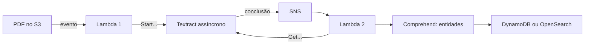

---
aliases:
  - Aula 24.6
modulo: 24
aula: 6
parte: "VII Dados, migração e IA"
dominios:
  - 2
  - 3
  - 4
lida: false
tags:
  - aula
  - saa-c03
  - modulo-24
---

# Aula 24.6: Padrões de arquitetura e a escolha pelo verbo

[[24 - Servicos de IA Gerenciados|Voltar ao módulo]]

> [!question] Pergunta que esta aula responde
> Como combinar os serviços de IA com [[S3]], Lambda, [[SNS]], [[SQS]] e [[Step Functions]] em arquiteturas reais (documentos, contact center, moderação, conteúdo multilíngue, modelo próprio), como torná-las resilientes, seguras e baratas, e como o verbo do enunciado elimina as alternativas erradas?

## O problema: o serviço de IA nunca está sozinho

Nas aulas 24.2 a 24.5 cada serviço foi estudado isoladamente. Em produção, ele é **um estágio** de um fluxo maior: algo coloca o dado no [[S3]], algo chama a IA, algo avisa a conclusão, algo guarda o resultado. A prova cobra esse encadeamento, quase sempre sob um [[Qualificador|qualificador]] de arquitetura: "[[Serverless|serverless]]", "menor overhead", "[[Alta Disponibilidade|alta disponibilidade]]", "mais econômico". Por isso esta aula junta o que você já sabe dos módulos de integração ([[15 - Desacoplamento Filas Eventos e Workflows|Módulo 15]]), [[16 - Serverless Lambda e API Gateway|Lambda]] e [[11 - Amazon S3 a Fundo|S3]] com os serviços de IA.

Todo padrão abaixo é uma variação de um esqueleto único: **entrada em [[S3]], gatilho, chamada de IA (assíncrona se for grande), aviso de conclusão, pós-processamento, saída**. Reconhecer o esqueleto é metade da resposta.

## Padrão 1: documentos, do S3 ao dado estruturado

**Cenário:** um escritório recebe contratos em PDF e precisa de um índice pesquisável com as entidades (partes, datas, valores), com o menor overhead.

1. O upload no [[S3]] gera uma **notificação de evento** ([[11 - Amazon S3 a Fundo|Módulo 11]]) que aciona a primeira função [[Lambda]].
2. A função chama `StartDocumentTextDetection` (ou `StartDocumentAnalysis` para formulários e tabelas) no [[Textract]], informando o tópico [[SNS]] de conclusão. Um PDF longo não cabe em uma chamada síncrona de 1 página, e uma [[Lambda|função Lambda]] não deve ficar esperando (aula 24.1).
3. Quando o job termina, o [[SNS]] aciona a segunda função (diretamente ou passando por uma fila [[SQS]]).
4. Ela chama `GetDocumentTextDetection`, envia o texto ao [[Comprehend]] (entidades, frases-chave, classificação) e grava o resultado no [[DynamoDB]] ou no [[OpenSearch Service]] para busca.
5. Se a confiança for baixa, o item vai para revisão humana ([[A2I|Augmented AI]], da [[24.05 - SageMaker AI e Modelo Proprio|aula 24.5]]).

Se o fluxo tiver mais etapas, condições ou espera de aprovação humana, o [[Step Functions]] coordena as etapas ([[Orquestracao|orquestração]], do Módulo 15) em vez de funções encadeadas por eventos.

> [!example] Mesmo desenho, outro domínio
> Troque contratos por notas fiscais: o estágio de IA passa a ser o `AnalyzeExpense` do [[Textract]] e o pós-processamento grava fornecedor, data e total em uma tabela. Troque por currículos: o [[Comprehend]] extrai habilidades e empresas. O esqueleto não muda.

## Padrão 2: contact center

**Cenário:** uma central quer (a) um bot que resolva pedidos simples por voz e (b) analisar todas as gravações para achar chamadas problemáticas, com [[PII|dados pessoais]] protegidos.

> [!info] Nome atual do Connect
> A documentação atual chama o produto de **[[Amazon Connect|Amazon Connect Customer]]** (antes, Amazon Connect; verificado em novembro de 2026, fonte: [What is Connect Customer?](https://docs.aws.amazon.com/connect/latest/adminguide/what-is-amazon-connect.html)). Questões antigas e este curso usam "Amazon Connect".

- **Atendimento ao vivo:** o cliente liga para o [[Amazon Connect]], que conecta o fluxo a um bot do [[Lex]] (intents e slots); uma função [[Lambda]] valida e cumpre o pedido; se o bot não resolve, transfere para um atendente (aula 24.3).
- **Análise pós-chamada:** gravações no [[S3]] passam pelo **[[Call Analytics|Transcribe Call Analytics]]**, que devolve transcrito com canais separados, sentimento por locutor, categorias, interrupções, resumo e **redação de [[PII]]** do texto e do áudio. A saída em JSON no S3 é consultada no [[Athena]] e exibida no [[Amazon Quick]].
- **Segurança:** o áudio original fica em um [[Bucket|bucket]] restrito com [[KMS]]; o time de analytics lê só o bucket com o conteúdo redigido ([[Menor Privilegio]], com [[Bucket Policy|bucket policies]] do [[04 - IAM Identidade e Acesso|Módulo 4]]).

- **Se a central já roda no [[Amazon Connect]]:** a análise de conversas nativa do Connect é o **[[Contact Lens]]** (sentimento, interrupções, categorias, dentro do próprio Connect). Para gravações soltas no [[S3]] ou de uma central fora do Connect, é o [[Call Analytics|Transcribe Call Analytics]].

A prova adora esta combinação porque dois serviços "de áudio" parecem intercambiáveis: o **Lex** é para a conversa em curso, o **[[Transcribe]]** para a gravação. E a segunda pegadinha é **[[Call Analytics|Transcribe Call Analytics]] contra [[Contact Lens]]**: o enunciado que já usa Connect e quer analisar as conversas dentro dele pede Contact Lens.

## Padrão 3: moderação de conteúdo enviado por usuários

**Cenário:** uma plataforma recebe fotos e vídeos e precisa impedir conteúdo impróprio antes de publicar.

- **Fotos:** a função chama `DetectModerationLabels` do [[Rekognition]] de forma síncrona. Itens acima de um limite de confiança vão para um [[Bucket|bucket]] de **quarentena**.
- **Vídeos:** `StartContentModeration`, aviso por [[SNS]] e `GetContentModeration` (assíncrono).
- **Casos limítrofes:** revisão humana antes de liberar ou bloquear. Só o que passa é copiado para o [[Bucket|bucket]] público, entregue por [[CloudFront]].
- **Texto dos comentários:** o [[Comprehend]] pode detectar sentimento e [[PII]], mas a moderação de **imagem** é do [[Rekognition]]; não confunda.

## Padrão 4: conteúdo multilíngue e acessível

**Cenário:** um portal em português quer oferecer cada matéria em áudio em inglês e legendas em vídeos.

- **Texto para áudio traduzido:** [[Translate]] (pt para en) e depois [[Polly]] sintetizam o áudio; o MP3 vai para o [[S3]] e é servido pelo [[CloudFront]]. Como o Polly permite guardar e reproduzir o áudio sem custo adicional de síntese, gera-se **uma vez por matéria** (aula 24.3).
- **Vídeo com legendas:** [[Transcribe]] transcreve a fala (batch) e já gera arquivos de legenda (WebVTT ou SubRip), o Translate traduz o texto e o resultado vira legenda no outro idioma.
- **Controle de marca:** [[Custom Terminology|custom terminology]] no Translate para nomes de produtos.

## Padrão 5: modelo próprio atrás de uma API

**Cenário:** prever a demanda semanal de peças com o histórico da empresa, exposto em uma API interna com tráfego esporádico.

Os dados históricos ficam no [[S3]]; o treino roda no [[SageMaker AI]] ([[AutoML]] pelo Autopilot ou treino próprio); o modelo é implantado com **[[Serverless]] Inference** (tráfego esporádico, carga pequena); uma [[Lambda|função Lambda]] atrás do [[API Gateway]] recebe as chamadas e invoca o endpoint. Se a carga virar contínua, migra-se para tempo real; se for mensal, vira Batch Transform (aula 24.5).

## Resiliência, segurança e custo do pipeline

**Resiliência** (Task 2.2). Os serviços de IA são regionais e têm quotas; o resto vem do [[20 - Alta Disponibilidade e Recuperacao de Desastres|Módulo 20]]:

- **Fila na frente** do consumo para absorver picos e controlar a concorrência: milhares de PDFs de uma vez não devem virar milhares de chamadas simultâneas ao [[Textract]]. A documentação do Textract confirma que as quotas padrão **podem ser aumentadas** pelo [[Service Quotas]] e que o tamanho de arquivo e idiomas **não** podem (verificado em novembro de 2026).
- **Retentativa com [[Backoff Exponencial|backoff exponencial]] e [[Jitter|jitter]]** nas chamadas, e uma [[Dead-Letter Queue]] para o que falha de vez.
- **Idempotência:** [[SNS]] e [[SQS]] padrão entregam **pelo menos uma vez**, então a mesma notificação pode chegar duas vezes. Antes de chamar o [[Textract]] (que cobra por página), registre o ID do documento em uma tabela com **escrita condicional** (só grava se o item ainda não existir): a segunda tentativa vê o registro e não repete a chamada ([[Idempotencia]]).
- **Resiliência entre [[Regiao AWS|Regiões]]:** não existe replicação automática dos serviços; você replica o [[S3]] e a arquitetura ao redor (a exceção documentada é a Multi-Region Replication do [[Lex|Lex V2]]).

**Segurança** (Task 1.2 e 1.3, links para o [[08 - Criptografia e Protecao de Dados|Módulo 8]]):

- Role de cada função com somente as ações necessárias (`textract:StartDocumentTextDetection`, `comprehend:DetectEntities` etc.).
- [[Interface Endpoint]] ([[PrivateLink]]) para as funções em [[Sub-rede Privada]]: [[Comprehend]], [[Textract]], Translate, [[Transcribe]] (inclusive Medical), [[Rekognition]], Polly, [[Lex|Lex V2]] e [[SageMaker AI]] oferecem interface endpoint (verificado em novembro de 2026, [[24.01 - Por Que Servicos de IA Prontos e Como Escolher pelo Verbo|aula 24.1]]).
- [[Criptografia em Repouso]] dos buckets com [[KMS]], e `OutputConfig` do [[Textract]] para guardar a saída em um [[Bucket|bucket]] seu.
- Redação de [[PII]] ([[Comprehend]] em inglês e espanhol; [[Transcribe]] e [[Call Analytics]] para áudio) e a política de opt-out de serviços de IA do [[Organizations]] quando o conteúdo não pode ser usado para melhoria.

**Custo** (Domínio 4, aprofundado no [[25 - Otimizacao de Custos|Módulo 25]]):

- Todos cobram por uso (caractere, segundo, imagem, página, requisição), e não por servidor: o custo acompanha a demanda, o que é ideal para carga intermitente.
- **[[Cache]]** do áudio do Polly e **[[Processamento em Lote|lote]]** em vez de tempo real quando não há urgência.
- **Pare** o modelo do [[Rekognition Custom Labels]] quando ocioso; **escolha** o modo de inferência do [[SageMaker AI]] pelo padrão de tráfego ([[Serverless|serverless]] ou assíncrona para cargas intermitentes).
- [[Lifecycle Policy|Ciclo de vida do S3]] para entradas e saídas antigas ([[11 - Amazon S3 a Fundo|Módulo 11]]).

## A escolha pelo verbo: o mapa final

O raciocínio de eliminação da prova, em ordem:

1. **Existe serviço pronto para o verbo?** Se sim, é ele (menor overhead).
2. **O rótulo ou o termo é só seu?** Camada 2: [[Comprehend]] Custom, [[Rekognition Custom Labels|Custom Labels]], [[Custom Vocabulary|custom vocabulary]], [[Custom Terminology|custom terminology]], Custom Queries.
3. **O problema é de dados próprios, sem API?** [[SageMaker AI]].
4. **Qual o tamanho e a urgência?** Síncrono, assíncrono ou [[Streaming de Dados|streaming]].

| Verbo e contexto | Serviço | Atenção |
|---|---|---|
| Ler texto de PDF ou imagem de documento | [[Textract]] | Foto de cena é [[Rekognition]] |
| Formulário, tabela, fatura | [[Textract]] (`AnalyzeDocument`, `AnalyzeExpense`) | Não `DetectDocumentText` |
| Entender sentimento, entidades, tópicos de texto | [[Comprehend]] | [[PII]] só em inglês e espanhol |
| Traduzir | Translate | Termos fixos: [[Custom Terminology\|custom terminology]] |
| Transcrever gravação ou fala ao vivo | [[Transcribe]] | Ligações de atendimento: [[Call Analytics]] |
| Narrar, text to speech | Polly | Texto longo: tarefa assíncrona |
| Conversar, chatbot | Lex | Voz de central: com [[Amazon Connect]] |
| Detectar objetos, rostos, conteúdo impróprio | [[Rekognition]] | Vídeo armazenado é assíncrono |
| Logotipo ou objeto próprio em fotos | [[Rekognition Custom Labels]] | Cobra por hora até ser parado |
| Modelo próprio, dados tabulares, treino e hospedagem | [[SageMaker AI]] | Escolha o modo de inferência |
| Descobrir dados sensíveis em arquivos do [[S3]] | [[Macie]] (Módulo 8) | Não é [[Comprehend]] |
| IA generativa por API | Amazon Bedrock | Fora da lista oficial; só contexto |

### Fora da lista oficial, mas citados como distratores

Estes serviços não estão entre os oito da lista de Machine Learning do exam guide, mas aparecem em alternativas. Você os elimina pelo verbo (verificado em novembro de 2026):

| Serviço | O que faz | Como eliminar |
|---|---|---|
| **[[Kendra]]** | Busca inteligente, em linguagem natural, sobre repositórios de documentos corporativos | O verbo é "buscar" |
| **Personalize** | Recomendações personalizadas (explicitamente fora do escopo no exam guide) | O verbo é "recomendar" |
| **Forecast** | Previsão de séries temporais; **fechado a novos clientes** (a AWS indica o [[SageMaker AI\|SageMaker]] Canvas), fonte: [Forecast availability](https://docs.aws.amazon.com/forecast/latest/dg/aws-forecast-set-up-aws-account.html) | O verbo é "prever série" |
| **Fraud Detector** | Detecção de fraude; **fechado a novos clientes desde 7 de novembro de 2025**, fonte: [Fraud Detector availability change](https://docs.aws.amazon.com/frauddetector/latest/ug/frauddetector-availability-change.html) | O verbo é "detectar fraude" |
| **[[Comprehend]] Medical** e **HealthScribe** | Texto clínico (Comprehend Medical) e documentação de conversa clínica (HealthScribe) | O contexto é saúde, e o enunciado não pede serviço específico de saúde |
| **Bedrock** | IA generativa por API | O verbo é "gerar texto, imagem ou resumo" |

**Regra de eliminação:** se o verbo é **buscar**, **recomendar** ou **prever série**, a resposta não é nenhum dos oito da lista; confira se o enunciado descreve um recurso dos oito antes de ceder a um [[Distrator|distrator]].

## Como isso cai na prova

Cobre a **Task 2.2** (serviços gerenciados e propósito específico, resiliência e quotas), a **Task 2.1** (event-driven e [[Serverless|serverless]]: [[S3]], Lambda, [[SNS]], [[SQS]], [[Step Functions]]) e a **Task 3.5** (pipelines de ingestão e transformação), com viés de custo da **Task 4.2** e **4.3** quando o enunciado pede o mais econômico.

**Palavras-chave em inglês e o que apontam:**

- "[[Serverless|serverless]]", "least [[Overhead Operacional|operational overhead]]", "event-driven": [[S3]] event, Lambda, serviço de IA gerenciado, [[SNS]] ou [[SQS]] para o aviso.
- "extract data from scanned documents and analyze text": [[Textract]] mais [[Comprehend]].
- "analyze customer calls", "sentiment of the customer": [[Transcribe]] ([[Call Analytics]]) com [[Comprehend]] ou os insights prontos.
- "inappropriate content in uploaded images/videos": [[Rekognition]].
- "decouple", "handle spikes", "retry failed": [[SQS|fila SQS]] e [[Dead-Letter Queue|DLQ]] na frente.
- "same document processed twice": [[Idempotencia|idempotência]].
- "call center already uses [[Amazon Connect]], analyze conversations": [[Contact Lens]]; "recordings in [[S3]], not in Connect": [[Call Analytics|Transcribe Call Analytics]].
- "search documents in natural language", "recommendations", "forecast time series", "fraud": [[Kendra]], Personalize, Forecast, Fraud Detector ([[Distrator|distratores]] fora da lista).
- "private connectivity to the service without internet": [[Interface Endpoint|interface endpoint]].

**Pegadinhas clássicas:**

- Escolher [[EC2]] com software de [[OCR]] ou um [[Inference Endpoint|endpoint do SageMaker]] 24 horas por dia em um cenário "menor overhead".
- Fazer a Lambda esperar o fim de um job longo em vez de usar [[SNS]], [[Step Functions]] ou fila.
- Ignorar a [[Idempotencia|idempotência]] e pagar duas vezes pela mesma página.
- Propor [[Multi-AZ]] para um serviço de IA (eles já são regionais e gerenciados; entre [[Regiao AWS|Regiões]] o desenho é seu).
- Usar o [[Comprehend]] onde o requisito é analisar áudio ou imagem sem etapa anterior.

| Requisito no enunciado | Resposta provável | Por quê |
|---|---|---|
| PDFs no [[S3]] viram texto e entidades, [[Serverless\|serverless]] | S3 event, Lambda, [[Textract]] assíncrono, [[SNS]], Lambda, [[Comprehend]] | Padrão de documentos |
| Analisar sentimento e categorias de gravações de atendimento | [[Call Analytics\|Transcribe Call Analytics]] | Insights prontos |
| Bot de voz que agenda e transfere ao atendente | Lex mais Lambda no [[Amazon Connect]] | Intents, slots e fulfillment |
| Bloquear fotos e vídeos impróprios antes de publicar | [[Rekognition]] com quarentena e revisão | Moderação pronta |
| Artigo em áudio em outro idioma | Translate mais Polly, áudio guardado no [[S3]] e [[CloudFront]] | Sintetiza uma vez |
| Picos de milhares de PDFs com limite de chamadas | [[SQS]] entre o [[S3]] e a Lambda, backoff, [[Dead-Letter Queue\|DLQ]], aumento de quota | Suaviza o pico e protege a quota |
| Duas notificações do mesmo documento cobram duas vezes | Processamento [[Idempotencia\|idempotente]] | Entrega pelo menos uma vez |

## Resumo

> [!abstract] A aula em uma frase
> Todo pipeline de IA na AWS é [[S3]], gatilho, chamada de IA (assíncrona se for grande), aviso por [[SNS]] ou [[SQS]] e pós-processamento, protegido por fila, backoff, [[Dead-Letter Queue|DLQ]] e [[Idempotencia|idempotência]], e o verbo do enunciado escolhe o serviço.

**A lógica, em 5 passos**

1. Reconheça o esqueleto: entrada no [[S3]], gatilho, IA, aviso de conclusão, saída.
2. Escolha o serviço pelo verbo (serviço pronto primeiro, personalizado se o rótulo é seu, [[SageMaker AI]] se o problema é só seu).
3. Escolha o modo pelo tamanho e pela urgência (síncrono, assíncrono, [[Streaming de Dados|streaming]]).
4. Proteja contra picos e falhas: fila, retentativa com backoff, [[Dead-Letter Queue|DLQ]], [[Idempotencia|idempotência]], quota ampliada.
5. Proteja e economize: role mínima, endpoint de interface, [[KMS]], redação de [[PII]], cache, [[Processamento em Lote|lote]] e modelos parados quando ociosos.

**Números para lembrar** (verificado em novembro de 2026)

| O quê | Valor | Por que importa |
|---|---|---|
| [[Textract]] síncrono | 1 página e 10 MB | Define o modo do pipeline |
| [[Textract]] assíncrono | 500 MB e 3.000 páginas por PDF ou TIFF | Teto por documento |
| Resultado assíncrono do [[Textract]] | 7 dias no [[Bucket\|bucket]] do serviço | Guarde com OutputConfig |
| Polly síncrono | 3.000 caracteres cobrados | Texto longo vai assíncrono |
| [[Comprehend]] assíncrono | Até 10 jobs ativos por operação | Planeje a concorrência |

**Tabela-síntese**

| Padrão | Serviços de IA | [[Orquestracao\|Orquestração]] |
|---|---|---|
| Documentos | [[Textract]] e [[Comprehend]] | [[S3]] event, Lambda, [[SNS]] |
| Contact center | Lex e [[Transcribe]] | [[Amazon Connect]], [[S3]], Athena |
| Moderação | [[Rekognition]] | Lambda, [[SNS]], quarentena |
| Multilíngue | Translate, Polly, [[Transcribe]] | Lambda, [[S3]], [[CloudFront]] |
| Modelo próprio | [[SageMaker AI]] | [[API Gateway]], Lambda |

**Na prática, isso significa**

- "[[Serverless]] e menor overhead" pede [[S3]] event, Lambda e serviços de IA gerenciados.
- Fila, [[Dead-Letter Queue|DLQ]], backoff e [[Idempotencia|idempotência]] são a resposta de resiliência para pipelines com IA.
- Rede privada e dados sensíveis pedem [[Interface Endpoint|interface endpoint]], [[KMS]] e redação de [[PII]].
- Se o enunciado descreve exatamente um recurso pronto ([[Call Analytics]], Queries, [[Custom Terminology|custom terminology]]), é ele.

> [!tip] Liga com
> Fecha o módulo juntando [[24.01 - Por Que Servicos de IA Prontos e Como Escolher pelo Verbo|aula 24.1]] a [[24.05 - SageMaker AI e Modelo Proprio|24.5]]. Segue para o [[25 - Otimizacao de Custos|Módulo 25]], que revisita o custo de tudo o que você aprendeu.

## Erros comuns

- **"Uma Lambda pode esperar o job de IA terminar."** Jobs longos pedem aviso por [[SNS]], fila ou [[Step Functions]]; a função não deve ficar bloqueada.
- **"[[SNS]] e [[SQS]] entregam exatamente uma vez."** O padrão é pelo menos uma vez; projete o [[Idempotencia|consumidor idempotente]].
- **"Se estourar a quota, troco de serviço."** Quotas padrão podem ser aumentadas; antes, suavize o pico com fila e backoff.
- **"Os serviços de IA replicam entre [[Regiao AWS|Regiões]]."** São regionais; a replicação do restante é desenho seu.
- **"O Lex analisa as gravações de ligações."** O Lex conduz conversas; gravações são do [[Transcribe]].
- **"Para uma API de previsão própria, o endpoint em tempo real é sempre a escolha."** Com tráfego esporádico, [[Serverless|serverless]] ou assíncrona custam menos.

## Pratique

**1.** Um escritório recebe contratos em PDF no [[S3]] e precisa extrair o texto, identificar as entidades (partes, datas, valores) e gravar um índice pesquisável, com o MENOR [[Overhead Operacional|overhead operacional]]. Qual arquitetura atende?

- [ ] a) Uma instância EC2 com software de OCR de código aberto e uma biblioteca de NLP, lendo o S3 em lote
- [ ] b) O Rekognition detectando o texto dos PDFs e o Translate extraindo as entidades
- [ ] c) Evento do S3 aciona o Lambda, Textract assíncrono avisa por SNS, outra Lambda chama o Comprehend e grava no banco
- [ ] d) Um endpoint em tempo real do SageMaker AI com modelos próprios de OCR e de entidades, ligado 24 horas por dia, atrás de um balanceador

**2.** Uma central de atendimento tem gravações de ligações no [[S3]] e quer saber o sentimento de cada locutor, categorizar as chamadas e proteger [[PII|dados pessoais]], usando serviços gerenciados. O que usar?

- [ ] a) O Transcribe Call Analytics pós-chamada, com saída no S3 e Athena
- [ ] b) Um bot do Lex que escuta as gravações e classifica as chamadas por intent
- [ ] c) O Polly, que lê as gravações e gera um relatório em texto por ligação
- [ ] d) O Rekognition, que detecta o sentimento nas vozes dos arquivos

**3.** Uma plataforma recebe fotos e vídeos de usuários e precisa impedir a publicação de conteúdo impróprio, com revisão humana dos casos duvidosos. Vídeos podem ter horas. Qual desenho atende?

- [ ] a) Todo o conteúdo é publicado imediatamente e removido depois, quando usuários o denunciarem
- [ ] b) O Comprehend analisando o nome e os metadados dos arquivos antes da publicação, sem olhar o conteúdo
- [ ] c) O Textract lendo os quadros de cada vídeo para detectar texto proibido nas imagens
- [ ] d) Moderação síncrona das fotos, StartContentModeration com SNS para vídeos e quarentena até aprovar

**4.** Um portal em português quer oferecer o áudio de cada matéria em inglês, com o menor custo e esforço. Qual solução usar?

- [ ] a) O Transcribe seguido do Lex, que lê a matéria em inglês
- [ ] b) Translate (pt para en) e Polly, com o MP3 no S3 e entregue pelo CloudFront
- [ ] c) O Comprehend traduzindo o texto e o Textract gerando o áudio
- [ ] d) Um endpoint do SageMaker AI com um modelo de tradução e outro de voz, treinados do zero

**5.** Uma [[Lambda|função Lambda]] iniciou um job assíncrono do [[Textract]] sobre um PDF de 800 páginas. Como a arquitetura deve ser avisada da conclusão sem manter nenhuma função esperando?

- [ ] a) Chamando GetDocumentTextDetection a cada segundo dentro da mesma função
- [ ] b) Informar um tópico SNS de conclusão, que aciona outra função ou uma fila
- [ ] c) Criando um alarme do CloudWatch que dispara quando o PDF termina de ser lido
- [ ] d) Mantendo a função em execução até o job terminar, com o timeout no máximo

**6.** Em um pico, milhares de PDFs chegam ao [[S3]] de uma vez e as chamadas ao [[Textract]] passam a ser limitadas por [[Throttling|throttling]]. Qual é a solução mais adequada?

- [ ] a) Aumentar a memória das funções Lambda para que processem mais rápido
- [ ] b) Trocar o Textract pelo Rekognition, que não tem limites de chamadas
- [ ] c) Uma fila SQS entre o S3 e o Lambda, com backoff, DLQ e aumento de quota
- [ ] d) Habilitar Multi-AZ no Textract para dobrar a capacidade de processamento

**7.** Por causa da entrega pelo menos uma vez do [[SQS]] padrão, a mesma mensagem foi processada duas vezes e o [[Textract]] cobrou duas vezes pelo mesmo documento. Qual correção resolve?

- [ ] a) Tornar o processamento idempotente, com ID do documento e escrita condicional
- [ ] b) Reduzir o visibility timeout da fila para zero segundo, reenviando mais rápido
- [ ] c) Remover a DLQ da fila para que mensagens repetidas desapareçam sozinhas
- [ ] d) Habilitar Multi-AZ no bucket do S3 que guarda os documentos

**8.** Uma plataforma de e-learning tem vídeos gravados em português e precisa de legendas em inglês para eles, além de narração em português para os textos das lições. Quais serviços atendem, com o MENOR esforço, nessa ordem (legendas, depois narração)?

- [ ] a) Transcribe e Translate para as legendas, Polly para a narração
- [ ] b) Transcribe e Translate para as legendas, Lex para a narração
- [ ] c) Rekognition e Translate para as legendas, Polly para a narração
- [ ] d) Comprehend e Translate para as legendas, Transcribe para a narração

**9.** Ligações em inglês contêm números de cartão. O time de analytics deve ver apenas o texto sem [[PII|dados pessoais]], e o áudio original deve ficar restrito. Qual desenho atende?

- [ ] a) O Comprehend DetectPiiEntities aplicado ao áudio, gravando o resultado no mesmo bucket das gravações originais
- [ ] b) O Macie nos arquivos de áudio, com o time de analytics lendo o bucket original sem restrição
- [ ] c) Call Analytics com redação de PII e dois buckets: redigido para analytics, original restrito com KMS
- [ ] d) Um bot do Lex que pergunta ao cliente se pode guardar o número do cartão e registra a resposta

**10.** Uma empresa quer prever a demanda semanal de peças com o histórico próprio e expor a previsão em uma API interna chamada poucas vezes por hora, com o menor custo. Qual arquitetura atende?

- [ ] a) O Comprehend Custom com o histórico convertido em texto, atrás de um API Gateway
- [ ] b) SageMaker AI para treinar e Serverless Inference para hospedar, com Lambda e API Gateway
- [ ] c) O Rekognition Custom Labels com gráficos de demanda como imagens, mantido sempre iniciado
- [ ] d) O Textract Queries sobre planilhas em PDF, com a pergunta "Qual a demanda?"

**11.** (Escolha DUAS.) Quais práticas tornam mais resiliente um pipeline que processa documentos com o [[Textract]] e o Lambda?

- [ ] a) Fila SQS com DLQ e retentativa com backoff entre o S3 e a função que chama o Textract
- [ ] b) Usar sempre a chamada síncrona, para evitar filas e avisos
- [ ] c) Processar cada documento de forma idempotente, por ID, antes de chamar o serviço
- [ ] d) Fazer a função Lambda chamar o Textract em um laço com espera até o job terminar
- [ ] e) Reduzir o timeout da função Lambda para que as falhas apareçam mais rápido

**12.** (Escolha DUAS.) Quais afirmações sobre a integração dos serviços de IA com a rede e o modo de chamada estão corretas?

- [ ] a) O interface endpoint do Textract só funciona se a função estiver em uma sub-rede pública
- [ ] b) Um gateway endpoint permite acesso privado ao Comprehend a partir de uma VPC
- [ ] c) O Textract assíncrono devolve o resultado completo na resposta da operação Start
- [ ] d) Um interface endpoint (PrivateLink) permite chamar o Comprehend sem enviar tráfego pela internet
- [ ] e) A operação Start devolve um identificador de job, e a operação Get lê o resultado depois

> [!success]- Gabarito
> **1. c)** é o padrão [[Serverless|serverless]] de documentos ([[S3]], Lambda, [[Textract]] assíncrono, [[SNS]], [[Comprehend]], banco), com serviços gerenciados e sem servidores; a) [[EC2]] com [[OCR]] próprio traz máximo de overhead; b) o [[Rekognition]] não é para documentos e o Translate não extrai entidades; d) um endpoint próprio ligado o dia todo é caro e desnecessário.
> **2. a)** o [[Call Analytics]] entrega sentimento por locutor, categorias e redação, e a saída no [[S3]] é consultada no Athena; b) o Lex conduz conversas e não analisa gravações; c) o Polly gera fala; d) o [[Rekognition]] analisa imagem e vídeo, não sentimento de voz.
> **3. d)** fotos pedem moderação síncrona, vídeos longos o modo assíncrono com [[SNS]], e a quarentena segura o conteúdo até a aprovação; a) publicar primeiro expõe o conteúdo impróprio; b) o nome do arquivo não revela o conteúdo; c) o [[Textract]] lê texto de documentos e não detecta conteúdo visual impróprio.
> **4. b)** Translate e Polly entregam o áudio traduzido, e guardar o MP3 evita sintetizar a cada acesso; a) o [[Transcribe]] converte fala em texto e o Lex não lê matérias; c) o [[Comprehend]] não traduz e o [[Textract]] não gera áudio; d) treinar modelos do zero é overhead desnecessário.
> **5. b)** o tópico [[SNS]] de conclusão avisa sem polling e aciona a próxima função ou uma fila; a) o polling por segundo desperdiça execuções e custo; c) o [[CloudWatch]] não monitora o fim de um job do [[Textract]] dessa forma; d) deixar a função esperando é o antipadrão que o desenho assíncrono evita.
> **6. c)** a fila controla a concorrência, o backoff trata o [[Throttling|throttling]], a [[Dead-Letter Queue|DLQ]] guarda falhas e a quota padrão pode ser ampliada; a) mais memória não reduz o número de chamadas ao serviço; b) o [[Rekognition]] não lê documentos; d) o [[Textract]] já é gerenciado e regional, e [[Multi-AZ]] não é um recurso configurável dele.
> **7. a)** a escrita condicional por ID garante que a segunda entrega não repita a chamada paga; b) [[Timeout|timeout]] zero aumenta as reentregas; c) a [[Dead-Letter Queue|DLQ]] não causa nem impede a duplicidade; d) a replicação do [[Bucket|bucket]] não afeta a entrega duplicada de mensagens.
> **8. a)** o [[Transcribe]] converte a fala em texto e gera as legendas, o Translate as leva para o inglês, e o Polly narra os textos (texto para fala); b) o Lex conduz conversas e não narra textos; c) o [[Rekognition]] analisa imagem e vídeo, mas não transcreve a fala; d) o [[Comprehend]] analisa texto e o Transcribe converte fala em texto, o inverso da narração.
> **9. c)** a redação do [[Call Analytics]] cobre texto e áudio, e a separação por buckets com [[KMS]] e policy restringe o original; a) o [[Comprehend]] processa texto, não áudio; b) o [[Macie]] descobre dados sensíveis e não os remove, e o time continuaria vendo o original; d) perguntar ao cliente não protege os dados.
> **10. b)** o [[SageMaker AI]] treina com o histórico próprio e a [[Serverless]] Inference atende tráfego raro sem custo ocioso; a) o [[Comprehend]] Custom classifica texto; c) o [[Rekognition Custom Labels|Custom Labels]] é para imagens e cobra por hora ligado; d) o [[Textract]] não prevê demanda.
> **11. a) e c)** fila com [[Dead-Letter Queue|DLQ]] e backoff e [[Idempotencia|idempotência]] aumentam a resiliência; b) o síncrono não suporta documentos grandes; d) o laço com espera mantém a função bloqueada, paga tempo ocioso e quebra no [[Timeout|timeout]], em vez de usar aviso por [[SNS]], fila ou [[Step Functions]] com Retry e Catch; e) um timeout menor só derruba mais execuções, sem tratar [[Throttling|throttling]] nem duplicidade.
> **12. d) e e)** o [[Interface Endpoint|interface endpoint]] mantém o tráfego na rede da Amazon e o Start devolve o JobId para o Get; a) o interface endpoint é justamente o que permite a [[Sub-rede Privada|sub-rede privada]] sem internet; b) o [[Gateway Endpoint|gateway endpoint]] só existe para [[S3]] e [[DynamoDB]]; c) o Start não devolve o resultado.

## Para aprofundar

- [ ] [Calling Amazon Textract Core asynchronous operations](https://docs.aws.amazon.com/textract/latest/dg/api-async.html) (documentação do [[Textract]]): o fluxo Start, [[SNS]], Get e o armazenamento de 7 dias.
- [ ] [Post-call analytics](https://docs.aws.amazon.com/transcribe/latest/dg/call-analytics-batch.html) (documentação do [[Transcribe]]): os insights prontos para contact center.
- [ ] [Amazon Comprehend and interface VPC endpoints (AWS PrivateLink)](https://docs.aws.amazon.com/comprehend/latest/dg/vpc-interface-endpoints.html) (documentação do [[Comprehend]]): acesso privado sem sair da rede da Amazon.
- [ ] [AWS Certified Solutions Architect - Associate exam guide](https://docs.aws.amazon.com/aws-certification/latest/solutions-architect-associate-03/solutions-architect-associate-03.html) (AWS Certification): lista oficial de serviços in-scope e out-of-scope.

Próximo módulo: [[25 - Otimizacao de Custos|Módulo 25: Otimização de Custos]].
