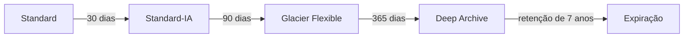

---
aliases:
  - Aula 25.7
modulo: 25
aula: 7
parte: "VIII Custo, projeto e prova"
dominios:
  - 4
lida: false
tags:
  - aula
  - saa-c03
  - modulo-25
---

# Aula 25.7: S3, classes de armazenamento, ciclo de vida e custo de objetos

[[25 - Otimizacao de Custos|Voltar ao módulo]]

> [!question] Pergunta que esta aula responde
> Por que guardar o mesmo dado em [[S3]] pode custar de 1x a 20x mais conforme a classe, o que cada classe cobra "por trás" do preço baixo, e como o ciclo de vida move o dado para a classe certa sem ninguém precisar lembrar?

## O problema: o armazenamento só cresce, e quase tudo esfria

Dados são escritos uma vez, lidos muito no começo e quase nunca depois. Logs de ontem são consultados, os de três anos atrás só existem por exigência legal. Guardar tudo na classe de uso frequente é pagar o preço de "acesso imediato e barato de ler" por dados que ninguém lê. O [[S3]] resolve isso oferecendo **classes de armazenamento** com preços de armazenar cada vez menores em troca de **regras cada vez mais duras** para ler, apagar cedo ou usar objetos pequenos. A lição da aula é entender o que cada classe cobra além do GB-mês, porque é aí que a prova pega.

Os valores de preço abaixo são **ilustrativos** (ordem de grandeza na Região us-east-1, sujeitos a mudança), para você sentir a proporção; confira a página oficial de preços do [[S3]] antes de qualquer decisão real.

## As classes de armazenamento

| Classe | Para que dado | GB-mês (ilustrativo) | Recuperação | Duração mínima | Observação |
|---|---|---|---|---|---|
| **[[S3]] Standard** | Acesso frequente | cerca de US$ 0,023 | Imediata, sem taxa | Nenhuma | Padrão; 3 [[Zona de Disponibilidade\|AZs]] |
| **[[S3 Intelligent-Tiering]]** | Padrão de acesso desconhecido ou mutável | camadas automáticas | Imediata nas camadas frequentes | Nenhuma | Taxa de monitoramento por objeto |
| **[[S3 Standard-IA]]** | Acesso raro, mas rápido quando precisa | cerca de US$ 0,0125 | Imediata, **com taxa por GB recuperado** | **30 dias** | Cobra no mínimo **128 KB** por objeto; 3 [[Zona de Disponibilidade\|AZs]] |
| **[[S3]] One Zone-IA** | Raro, recriável, dado secundário | cerca de 20% menos que o [[S3 Standard-IA\|Standard-IA]] | Imediata, com taxa | **30 dias** | **Uma só [[Zona de Disponibilidade\|AZ]]**; perde-se se a AZ for perdida |
| **Glacier Instant Retrieval** | Arquivo com acesso raro e leitura em milissegundos | cerca de US$ 0,004 | Imediata, taxa maior | **90 dias** | Para dados lidos uma vez por trimestre; cobra no mínimo **128 KB** por objeto; mais barato por GB que o One Zone-IA, mas com recuperação mais cara e 90 dias mínimos |
| **Glacier Flexible Retrieval** | Arquivo com tolerância de minutos a horas | cerca de US$ 0,0036 | Expressa (1 a 5 min), padrão (3 a 5 h), em massa (5 a 12 h) | **90 dias** | Exige restaurar antes de ler; soma **40 KB** de metadados por objeto |
| **[[S3 Glacier Deep Archive\|Glacier Deep Archive]]** | Retenção longa, quase nunca lido | cerca de US$ 0,001 | Padrão (até 12 h), em massa (até 48 h) | **180 dias** | O mais barato; dados com retenção de anos; soma **40 KB** de metadados por objeto |
| **[[S3 Express One Zone]]** | [[Latencia\|Latência]] de milissegundos de um dígito, alto I/O | mais caro que o Standard | Imediata | Nenhuma | Uma [[Zona de Disponibilidade\|AZ]], [[Directory Bucket\|bucket de diretório]]; para desempenho, não para economia |

([[Latencia|Latências]] e tempos verificados na documentação em novembro de 2026; preços ilustrativos.)

Quatro regras que a prova explora:

1. **Duração mínima**: se você apagar ou mover um objeto antes do mínimo, é cobrado o período restante como se tivesse ficado. Guardar 10 dias em [[S3 Standard-IA|Standard-IA]] custa o mesmo que 30.
2. **Tamanho mínimo cobrado (128 KB)** no [[S3 Standard-IA|Standard-IA]] e no One Zone-IA: um objeto de 10 KB é cobrado como 128 KB. Milhões de objetos pequenos nessas classes **custam mais**, não menos.
3. **Taxa de recuperação**: nas classes IA e de arquivo, ler custa por GB. Colocar um dado lido todo dia no [[S3 Standard-IA|Standard-IA]] **aumenta** a conta.
4. **Sobrecarga por objeto nas classes de arquivo**: no Glacier Flexible Retrieval e no [[S3 Glacier Deep Archive|Deep Archive]], cada objeto arquivado ganha **40 KB** de metadados: **8 KB cobrados a taxa do Standard** (nome e metadados para listagem em tempo real) e **32 KB cobrados a taxa do Glacier** (índice para restaurar). Arquivar milhões de objetos pequenos sai caro; o certo é **agregar** em objetos maiores antes de arquivar. O Glacier Instant Retrieval, por sua vez, cobra no mínimo 128 KB por objeto (verificado em novembro de 2026).

> [!example] A conta da classe errada
> 100 TB de dados, lidos por inteiro uma vez por mês, com valores ilustrativos de US$ 0,023 (Standard), US$ 0,0125 ([[S3 Standard-IA|Standard-IA]]) e cerca de US$ 0,01 por GB recuperado. Standard: 100.000 GB x 0,023 = **US$ 2.300** por mês, sem taxa de leitura. Standard-IA: 100.000 GB x 0,0125 = US$ 1.250 de armazenamento, mais 100.000 GB x 0,01 = US$ 1.000 de recuperação, total **cerca de US$ 2.250**: praticamente empate, e **pior** se a leitura passar de uma vez por mês. A classe só compensa quando o acesso é **raro de verdade**. Quando o padrão é desconhecido, a resposta é a próxima seção.

## S3 Intelligent-Tiering: quando você não sabe o padrão

O [[S3 Intelligent-Tiering]] move cada objeto **automaticamente** entre camadas conforme o padrão de acesso, **sem taxa de recuperação** e sem você escrever regra:

- **Frequent Access**: onde o objeto entra.
- **Infrequent Access**: depois de **30 dias** sem acesso.
- **Archive Instant Access**: depois de **90 dias** sem acesso.
- Camadas **opcionais** de arquivo assíncrono (**Archive Access** e **[[S3 Glacier Deep Archive|Deep Archive]] Access**), que você ativa e que exigem restauração antes da leitura.
- Quando o objeto é lido de novo, volta para a camada frequente.

O custo extra é uma **taxa mensal de monitoramento e automação por objeto**. Pontos para a prova:

- Objetos **menores que 128 KB** **não** são monitorados nem movem de camada; ficam na camada de acesso frequente (sem a taxa de monitoramento).
- Não há taxa de recuperação nem duração mínima cobrada para a movimentação entre camadas.
- É a resposta quando o enunciado diz "padrão de acesso **desconhecido**, **imprevisível** ou **mutável**" e quer "o menor custo sem [[Overhead Operacional|esforço operacional]]".
- Para um padrão **conhecido e estável** (por exemplo, nada é lido depois de 30 dias), uma **[[Lifecycle Policy|regra de ciclo de vida]]** é mais barata, porque não paga a taxa de monitoramento.

## Regras de ciclo de vida

Uma [[Lifecycle Policy|regra de ciclo de vida]] aplica ações em objetos de um [[Bucket|bucket]] (filtrados por prefixo, tag ou tamanho) conforme a idade:

- **Transição**: mover para outra classe depois de N dias.
- **Expiração**: apagar o objeto depois de N dias.
- **Versões não correntes**: transicionar ou expirar versões antigas em um [[Bucket|bucket]] com [[Versionamento|versionamento]].
- **Remover marcadores de exclusão expirados** e **abortar uploads multipart incompletos** depois de N dias.

```json
{
  "Rules": [{
    "ID": "logs-esfriam",
    "Status": "Enabled",
    "Filter": { "Prefix": "logs/" },
    "Transitions": [
      { "Days": 30,  "StorageClass": "STANDARD_IA" },
      { "Days": 90,  "StorageClass": "GLACIER" },
      { "Days": 365, "StorageClass": "DEEP_ARCHIVE" }
    ],
    "Expiration": { "Days": 2555 },
    "AbortIncompleteMultipartUpload": { "DaysAfterInitiation": 7 }
  }]
}
```

Regras de transição que decidem questões:

- A transição segue uma **ordem de "cascata"**: de uma classe mais "quente" para uma mais "fria", nunca o contrário (voltar exige copiar o objeto).
- A transição do Standard para [[S3 Standard-IA|Standard-IA]] com poucos dias (por exemplo, 10) **é aceita pelo [[S3]]**: o campo `Days` aceita 0 ou qualquer inteiro positivo. O que acontece é que o objeto **paga os 30 dias mínimos** do Standard-IA, e uma transição seguinte (por exemplo, IA para Glacier) só faz sentido depois da duração mínima da classe de origem.
- Cada transição é uma **requisição cobrada por objeto**. Para milhões de objetos pequenos, o custo de transição pode superar a economia.
- Desde **setembro de 2024**, por padrão, objetos menores que **128 KB não transicionam para nenhuma classe**, justamente para evitar esse prejuízo. Para permitir, use um filtro de tamanho (`ObjectSizeLessThan` ou `ObjectSizeGreaterThan`) na regra.

> [!note] Bancos de questões antigos
> Simulados antigos citam que o Standard exige "30 dias antes de ir para IA". A documentação atual de ciclo de vida (verificado em novembro de 2026) não lista essa restrição. Se aparecer na prova como pegadinha, o raciocínio seguro é a **duração mínima cobrada** de 30 dias, que continua valendo.
- Para objetos com **expiração** e [[Versionamento|versionamento]], é preciso tratar as versões não correntes e os marcadores de exclusão, senão eles continuam sendo cobrados.

**Uploads multipart incompletos**: partes enviadas e nunca finalizadas ficam invisíveis na listagem normal, mas **são cobradas**. Uma regra para abortar multipart incompleto depois de 7 dias é uma das otimizações de custo mais baratas do [[S3]].



## Outras alavancas de custo no S3

- **[[Storage Class Analysis|S3 Storage Class Analysis]]**: observa o padrão de acesso de um [[Bucket|bucket]] e sugere quando mover do Standard para o [[S3 Standard-IA|Standard-IA]] (precisa de dias de observação, em geral 30 ou mais).
- **[[S3 Storage Lens]]**: painel de métricas de uso e atividade de toda a organização, que aponta buckets com versões não correntes demais, multipart incompletos e outras fontes de desperdício.
- **[[Requester Pays]]**: o **solicitante** paga o custo de requisição e transferência em vez do dono do [[Bucket|bucket]]. Serve para compartilhar grandes datasets públicos sem arcar com o tráfego. O solicitante precisa estar autenticado (não funciona com acesso anônimo).
- **Requisições**: PUT, COPY, POST e LIST são cobrados por mil, e mais caros que GET. **Agrupar muitos arquivos pequenos em arquivos maiores** (por exemplo, um por hora) reduz o número de requisições e evita o prejuízo de objetos pequenos.
- **Transferência**: dados que **entram** no [[S3]] são gratuitos; dados que **saem** para a internet são cobrados (os primeiros 100 GB por mês de saída agregada são gratuitos); o tráfego do S3 para o **[[CloudFront]]** e para o **[[EC2]] na mesma Região** não é cobrado como saída. Detalhes na aula [[25.10 - Rede e Transferencia de Dados|25.10]].
- **Replicação**: a [[Replicacao do S3|replicação entre Regiões]] cobra armazenamento extra no destino e a transferência entre [[Regiao AWS|Regiões]]. Só replique o que o requisito justifica.
- **[[Versionamento]]**: protege contra exclusão acidental, mas cada versão é cobrada. Combine com uma regra para expirar versões não correntes.

> [!info] Ligando os pontos
> [[Versionamento]], replicação e [[Object Lock]] estão no [[11 - Amazon S3 a Fundo|Módulo 11]]; a escolha de arquivo para backup e DR no [[20 - Alta Disponibilidade e Recuperacao de Desastres|Módulo 20]]. Aqui o critério é o custo: classe pelo padrão de acesso, ciclo de vida pela idade, limpeza do que é invisível.

## Como isso cai na prova

As Tasks 4.1 (armazenamento de custo otimizado) trazem muitas questões de [[S3]]. A tática: ler o **padrão de acesso**, a **tolerância a [[Latencia|latência]]**, a **[[Durabilidade|durabilidade]] exigida** e a **retenção**.

**Palavras-chave:**

- "access pattern unknown", "unpredictable", "changing" aponta para [[S3 Intelligent-Tiering|Intelligent-Tiering]].
- "infrequent access, millisecond retrieval" aponta para [[S3 Standard-IA|Standard-IA]] (ou Glacier Instant Retrieval se for trimestral).
- "can be re-created", "secondary copy", "lowest cost IA" aponta para One Zone-IA.
- "archive, retrieval in minutes to hours" aponta para Glacier Flexible Retrieval.
- "long-term retention, lowest cost, rarely accessed, hours acceptable" aponta para [[S3 Glacier Deep Archive|Glacier Deep Archive]].
- "automatically move after N days" aponta para [[Lifecycle Policy|regra de ciclo de vida]].
- "incomplete multipart uploads" aponta para regra para abortar.
- "[[Requester Pays|requester pays]] for the [[Data Transfer|data transfer]]" aponta para Requester Pays.

**Pegadinhas:**

- [[S3 Standard-IA|Standard-IA]] com objetos de 10 KB sai **mais caro**, pois cobra 128 KB por objeto.
- Mover antes da duração mínima não evita a cobrança do restante.
- Glacier Flexible e [[S3 Glacier Deep Archive|Deep Archive]] somam 40 KB de metadados por objeto (8 KB a taxa Standard e 32 KB a taxa Glacier): milhões de objetos pequenos arquivados saem caros; agregue antes.
- Glacier Instant Retrieval é mais barato por GB que o One Zone-IA, mas cobra recuperação maior e 90 dias mínimos; o critério é a frequência de leitura.
- [[S3 Intelligent-Tiering|Intelligent-Tiering]] não cobra recuperação, mas cobra monitoramento por objeto, e ignora objetos menores que 128 KB.
- One Zone-IA perde o dado se a [[Zona de Disponibilidade|AZ]] falhar; não é para a única cópia.
- Glacier exige restauração (exceto Instant Retrieval).
- Voltar para uma classe mais quente não é uma transição de ciclo de vida: exige copiar.

| Requisito no enunciado | Resposta provável | Por quê |
|---|---|---|
| Padrão de acesso imprevisível, menor custo sem operação | [[S3 Intelligent-Tiering\|Intelligent-Tiering]] | Move sozinho, sem taxa de recuperação |
| Logs lidos 30 dias e depois só retidos por 7 anos | Ciclo de vida: IA em 30 dias, Glacier ou [[S3 Glacier Deep Archive\|Deep Archive]] depois | Padrão conhecido |
| Backup secundário recriável, acesso raro | One Zone-IA | Mais barato que IA [[Multi-AZ\|multi-AZ]] |
| Recuperação em milissegundos de arquivo trimestral | Glacier Instant Retrieval | Arquivo com leitura imediata |
| Retenção de anos, 12 horas aceitáveis | [[S3 Glacier Deep Archive\|Deep Archive]] | O mais barato |
| Reduzir custo de uploads multipart abandonados | Regra de abortar multipart incompleto | Partes invisíveis são cobradas |

*Cobre a Task 4.1 (armazenamento de custo otimizado).*

## Resumo

> [!abstract] A aula em uma frase
> Classe de armazenamento é uma troca entre preço de guardar e regras para ler, apagar cedo e tamanho de objeto; o ciclo de vida automatiza a descida, e o [[S3 Intelligent-Tiering|Intelligent-Tiering]] cobre o padrão desconhecido.

**A lógica, em 4 passos**

1. Descubra o padrão de acesso ([[Storage Class Analysis]], [[S3 Storage Lens|Storage Lens]]).
2. Padrão desconhecido: [[S3 Intelligent-Tiering|Intelligent-Tiering]]. Padrão conhecido: ciclo de vida.
3. Respeite as durações mínimas, o tamanho mínimo e a taxa de recuperação.
4. Limpe o invisível: multipart incompleto, versões não correntes, objetos expirados.

**Números e fatos para lembrar**

| O quê | Valor | Por que importa |
|---|---|---|
| Duração mínima | 30 dias (IA e One Zone-IA), 90 (Glacier IR e Flexible), 180 ([[S3 Glacier Deep Archive\|Deep Archive]]) | Mover cedo não evita a cobrança |
| Tamanho mínimo cobrado | 128 KB no [[S3 Standard-IA\|Standard-IA]], One Zone-IA e Glacier Instant | Objetos pequenos custam mais |
| Sobrecarga por objeto | 40 KB no Glacier Flexible e [[S3 Glacier Deep Archive\|Deep Archive]] (8 KB Standard + 32 KB Glacier) | Agregar antes de arquivar |
| [[S3 Intelligent-Tiering\|Intelligent-Tiering]] | 30 dias para IA, 90 para Archive Instant | Sem taxa de recuperação |
| Transição padrão | Objetos menores que 128 KB não transicionam (desde set/2024) | Use filtro de tamanho para permitir |
| Recuperação Glacier Flexible | 1 a 5 min (expressa), 3 a 5 h (padrão), 5 a 12 h (massa) | Exige restauração |

**Tabela-síntese**

| Classe | Quando |
|---|---|
| Standard | Leitura frequente |
| [[S3 Intelligent-Tiering\|Intelligent-Tiering]] | Padrão desconhecido |
| [[S3 Standard-IA\|Standard-IA]] | Raro, rápido, [[Multi-AZ\|multi-AZ]] |
| One Zone-IA | Raro, recriável |
| Glacier Instant | Trimestral, em milissegundos |
| Glacier Flexible | Arquivo, minutos a horas |
| [[S3 Glacier Deep Archive\|Deep Archive]] | Retenção longa, o mais barato |

**Na hora H**

- "Desconhecido ou mutável": [[S3 Intelligent-Tiering|Intelligent-Tiering]].
- "Só retido por exigência legal": [[S3 Glacier Deep Archive|Deep Archive]].
- "Milhões de arquivos pequenos": agrupar, não usar IA nem arquivar um a um (40 KB de sobrecarga por objeto).

> [!tip] Liga com
> Vem de [[25.06 - Computacao Rightsizing Graviton e Servicos Gerenciados|25.6]]; segue para [[25.08 - Armazenamento em Bloco Arquivos e Backup Custo|25.8]], sobre [[EBS]], [[EFS]], [[FSx]] e backups.

## Erros comuns

- Colocar dados lidos diariamente em [[S3 Standard-IA|Standard-IA]] (taxa de recuperação).
- Mover milhões de objetos pequenos para IA (128 KB mínimo e custo de transição).
- Esquecer partes de multipart incompleto e versões antigas.
- Achar que Glacier Flexible entrega em milissegundos (só Instant Retrieval).
- Usar One Zone-IA para a única cópia de um dado importante.

## Pratique

**1.** Uma empresa guarda logs que são consultados com frequência nos primeiros 30 dias e quase nunca depois, mas precisam ser retidos por 7 anos por exigência legal; recuperar em até 12 horas é aceitável. Qual configuração tem o menor custo?

- [ ] a) Gravar os logs direto no S3 Standard-IA na criação e mantê-los lá pelos 7 anos
- [ ] b) Mover os logs manualmente para o Standard-IA todo mês, com um responsável revisando o bucket periodicamente
- [ ] c) Regra de ciclo de vida: Standard-IA aos 30 dias e Deep Archive depois, com expiração em 7 anos
- [ ] d) Criar um segundo bucket em Standard com replicação entre Regiões para os logs antigos

**2.** Os dados de um [[Bucket|bucket]] são acessados de forma imprevisível: alguns objetos ficam meses sem leitura e depois voltam a ser lidos com frequência. A equipe não quer escrever regras e quer evitar taxas de recuperação. Qual classe escolher?

- [ ] a) S3 Intelligent-Tiering
- [ ] b) S3 Standard-IA, pela taxa de armazenamento menor e a leitura imediata
- [ ] c) S3 Glacier Flexible Retrieval, para a economia máxima em qualquer padrão
- [ ] d) S3 One Zone-IA, para reduzir o custo em todos os objetos do bucket

**3.** Um [[Bucket|bucket]] tem 200 milhões de objetos de 8 KB cada, lidos raramente. Um engenheiro propõe mover todos para o [[S3 Standard-IA|Standard-IA]] para reduzir o custo. Qual é o problema?

- [ ] a) O Standard-IA não aceita objetos menores que 1 MB e a operação falharia
- [ ] b) O Standard-IA perde o dado se uma AZ falhar, o que é inaceitável aqui
- [ ] c) O Standard-IA cobra a recuperação por GB sempre que há qualquer escrita nova no bucket, além do armazenamento
- [ ] d) O Standard-IA cobra no mínimo 128 KB por objeto e a transição cobra requisição por objeto, podendo aumentar o custo

**4.** Uma empresa de auditoria precisa reter registros por 10 anos. Eles serão lidos, no máximo, uma vez, e a equipe tolera até 48 horas para recuperá-los. O objetivo é o menor custo de armazenamento. O que escolher e que condição aceitar?

- [ ] a) Glacier Instant Retrieval, que tem o menor preço de armazenamento entre todas as classes
- [ ] b) Glacier Deep Archive, aceitando os 180 dias mínimos e a restauração antes de ler
- [ ] c) One Zone-IA, que tem o menor custo desde que o dado seja recriável
- [ ] d) Intelligent-Tiering com as camadas de arquivo desativadas, para eliminar a taxa de recuperação

**5.** Uma empresa tem buckets versionados com muitos uploads grandes feitos por aplicações que às vezes são interrompidas. A conta de [[S3]] cresce sem que o volume visível mude. (Escolha DUAS.) Quais ações reduzem o custo sem afetar dados em uso?

- [ ] a) Criar uma regra de ciclo de vida para abortar uploads multipart incompletos após alguns dias
- [ ] b) Replicar os objetos para outra Região em uma classe de custo menor
- [ ] c) Expirar versões não correntes após um prazo definido
- [ ] d) Usar Glacier Flexible Retrieval com recuperação expressa para as leituras diárias
- [ ] e) Desativar o versionamento e apagar todas as versões antigas imediatamente

**6.** Uma empresa move objetos para o [[S3 Standard-IA|Standard-IA]] e os apaga 10 dias depois. A fatura mostra 30 dias de armazenamento IA para cada um. Por quê?

- [ ] a) A taxa de recuperação mínima do Standard-IA é cobrada como se fosse armazenamento de 30 dias, por objeto movido
- [ ] b) A transição para IA reinicia a idade do objeto, que passa a valer 30 dias
- [ ] c) Os objetos apagados ficam 30 dias em uma lixeira do S3 e continuam sendo cobrados
- [ ] d) O Standard-IA tem duração mínima de 30 dias e o período restante é cobrado se o objeto sair antes

**7.** Uma empresa quer compartilhar um grande dataset público de forma que quem baixa os dados pague a transferência e as requisições, e não o dono do [[Bucket|bucket]]. O que configurar?

- [ ] a) Uma regra de ciclo de vida que expira os dados após o download
- [ ] b) Requester Pays no bucket
- [ ] c) S3 Transfer Acceleration no bucket do dono
- [ ] d) Replicação entre Regiões para cada solicitante

**8.** Uma empresa criou uma [[Lifecycle Policy|regra de ciclo de vida]] que move objetos do Standard para o [[S3 Standard-IA|Standard-IA]] aos 10 dias. O [[Bucket|bucket]] tem milhões de objetos de 20 KB e, semanas depois, nenhum foi movido. Qual é a explicação?

- [ ] a) Por padrão, objetos menores que 128 KB não transicionam; falta um filtro de tamanho
- [ ] b) A transição para IA só ocorre depois que o objeto passa pelo Glacier Flexible Retrieval
- [ ] c) Regras de ciclo de vida só funcionam em objetos criados por upload multipart
- [ ] d) O Standard-IA só aceita transição a partir do Intelligent-Tiering

**9.** Uma startup de mídia usa o [[S3 Intelligent-Tiering]] para milhões de objetos. (Escolha DUAS.) Quais fatos estão corretos?

- [ ] a) Cobra uma taxa de recuperação por GB lido nas camadas infrequentes
- [ ] b) Move objetos entre camadas sem taxa de recuperação, cobrando monitoramento por objeto
- [ ] c) Objetos menores que 128 KB não são monitorados e ficam na camada frequente
- [ ] d) Exige que a equipe escreva uma regra de ciclo de vida para cada camada
- [ ] e) Cobra a duração mínima de 30 dias ao mover objetos entre camadas

**10.** Um dado secundário pode ser recriado a partir da fonte e precisa estar disponível em milissegundos. Ele é lido algumas vezes por mês, e a equipe quer o menor custo total. Qual classe escolher?

- [ ] a) Glacier Flexible Retrieval, por ser a mais barata por GB
- [ ] b) S3 Express One Zone, pela latência baixa
- [ ] c) S3 One Zone-IA
- [ ] d) Glacier Instant Retrieval, que armazena mais barato, mas cobra recuperação maior e 90 dias mínimos

**11.** Uma empresa quer arquivar 500 milhões de objetos de 4 KB no [[S3 Glacier Deep Archive|Glacier Deep Archive]] para economizar. Qual é o problema e a melhor ação?

- [ ] a) O Deep Archive não aceita objetos menores que 128 KB, e a transição falharia
- [ ] b) Cada objeto ganha cerca de 40 KB de metadados (8 KB Standard e 32 KB Glacier), então convém agregar
- [ ] c) A restauração padrão cobra o mínimo de 128 KB por objeto, mas o armazenamento não tem sobrecarga
- [ ] d) O Deep Archive replica cada objeto em três Regiões, o que triplica o custo de armazenamento de cada um

> [!success]- Gabarito
> **1. c)** ciclo de vida desce para IA e depois [[S3 Glacier Deep Archive|Deep Archive]] e expira em 7 anos; a) paga o IA por 7 anos, sem a economia do arquivo, b) é manual e propenso a erro, d) duplica o custo.
> **2. a)** o [[S3 Intelligent-Tiering|Intelligent-Tiering]] move sozinho e não cobra recuperação; b) cobra recuperação e é ruim para dados lidos de novo, c) exige restauração, d) assume risco de [[Zona de Disponibilidade|AZ]] única sem necessidade.
> **3. d)** o mínimo de 128 KB e o custo por transição podem aumentar a conta; a) não há esse mínimo de 1 MB, b) é verdade para One Zone-IA, não [[S3 Standard-IA|Standard-IA]], c) a taxa é na leitura, não na escrita.
> **4. b)** o [[S3 Glacier Deep Archive|Deep Archive]] é o mais barato, com 180 dias mínimos e restauração antes de ler (padrão em até 12 h, em massa em até 48 h); a) o Instant Retrieval é mais caro por GB, c) One Zone-IA custa bem mais que o arquivo e arrisca a [[Zona de Disponibilidade|AZ]], d) as camadas de arquivo do [[S3 Intelligent-Tiering|Intelligent-Tiering]] ainda têm taxa de monitoramento e preço maior que o Deep Archive.
> **5. a) e c)** abortar multipart incompleto e expirar versões antigas eliminam desperdício; b) soma armazenamento e transferência entre [[Regiao AWS|Regiões]], d) a recuperação expressa é cara e o Glacier não serve para leitura diária, e) apaga a proteção do [[Versionamento|versionamento]] sem necessidade, pois a expiração por prazo já resolve.
> **6. d)** o mínimo de 30 dias é cobrado integralmente; a) a taxa de recuperação é por GB lido, não vira armazenamento, b) a idade não é reiniciada, c) não existe lixeira cobrada.
> **7. b)** [[Requester Pays]] transfere o custo ao solicitante; a) não faz sentido, c) acelera, não transfere custo, d) multiplica custo.
> **8. a)** desde setembro de 2024 o padrão impede objetos menores que 128 KB de transicionar, e o filtro de tamanho (`ObjectSizeLessThan`) permite; b) não existe essa exigência, c) a regra vale para qualquer objeto, d) o Standard transiciona direto para o IA. Nota: bancos antigos citam "30 dias antes de ir para IA"; a documentação atual não lista essa restrição.
> **9. b) e c)** não há taxa de recuperação e há taxa de monitoramento, com exceção de objetos pequenos; a) não cobra recuperação, d) a movimentação é automática, e) a movimentação entre camadas não tem duração mínima.
> **10. c)** com leitura algumas vezes por mês, a taxa de recuperação menor do One Zone-IA vence; d) é mais barato por GB, mas a recuperação cara e os 90 dias mínimos pesam (venceria se a leitura fosse trimestral), a) exige restauração, b) é para desempenho e custa mais.
> **11. b)** a sobrecarga de 40 KB por objeto supera os 4 KB do dado, então agregar em objetos maiores antes de arquivar é o correto; a) o [[S3 Glacier Deep Archive|Deep Archive]] aceita objetos pequenos (por padrão o ciclo de vida é que não os transiciona), c) o mínimo de 128 KB não é do Deep Archive e há sobrecarga sim, d) a classe não replica em três [[Regiao AWS|Regiões]].

### Laboratório (opcional)

> [!warning] Use uma conta AWS pessoal separada, com AWS Budgets configurado, nunca a conta de produção da empresa. Custo estimado: centavos (bucket vazio ou com poucos arquivos pequenos).

1. Crie um [[Bucket|bucket]] de teste: `aws s3 mb s3://SEU-BUCKET-UNICO`.
2. Salve o JSON de regra da seção "[[Lifecycle Policy|Regras de ciclo de vida]]" em `lifecycle.json` (reduza para uma transição de 30 dias e o aborto de multipart em 7 dias).
3. Aplique: `aws s3api put-bucket-lifecycle-configuration --bucket SEU-BUCKET-UNICO --lifecycle-configuration file://lifecycle.json`.
4. Confira: `aws s3api get-bucket-lifecycle-configuration --bucket SEU-BUCKET-UNICO`.
5. Limpeza: `aws s3 rb s3://SEU-BUCKET-UNICO --force`.

## Para aprofundar

- [ ] [Understanding and managing Amazon S3 storage classes](https://docs.aws.amazon.com/AmazonS3/latest/userguide/storage-class-intro.html) (AWS Documentation): classes, durações mínimas e recuperação.
- [ ] [Managing the lifecycle of objects](https://docs.aws.amazon.com/AmazonS3/latest/userguide/object-lifecycle-mgmt.html) (AWS Documentation): ações, restrições de transição e exemplos.
- [ ] [How S3 Intelligent-Tiering works](https://docs.aws.amazon.com/AmazonS3/latest/userguide/intelligent-tiering-overview.html) (AWS Documentation): camadas, monitoramento e objetos pequenos.

Próxima aula: [[25.08 - Armazenamento em Bloco Arquivos e Backup Custo|Aula 25.8: EBS, EFS, FSx e backups]].
